# Comprehensive Elixent Architectural Execution Plan

| Standard Field              | Approved Value                                                                                                                                                                                                                                                                                                                                                                                                                                                                                                                                                                                                                                                                                       |
| :-------------------------- | :--------------------------------------------------------------------------------------------------------------------------------------------------------------------------------------------------------------------------------------------------------------------------------------------------------------------------------------------------------------------------------------------------------------------------------------------------------------------------------------------------------------------------------------------------------------------------------------------------------------------------------------------------------------------------------------------------- |
| **Document ID**             | `ELIXENT-EXEC-PLAN-v3.3`                                                                                                                                                                                                                                                                                                                                                                                                                                                                                                                                                                                                                                                                             |
| **Classification**          | `ACTIVE TRACKED EXECUTION PLAN` (per `docs/DOCUMENTATION_GUIDELINES.md` §2 & §3)                                                                                                                                                                                                                                                                                                                                                                                                                                                                                                                                                                                                                     |
| **Version & Status**        | `v3.3 — Approved for Atomic Execution in 12 Phases (12 Commit-Sized SRP Phases + Sub-Agent Waves)`                                                                                                                                                                                                                                                                                                                                                                                                                                                                                                                                                                                                   |
| **Baseline Repository**     | `LUGX v1.46.3` (`1,077 Unit/Contract Tests` + `117 Live Integration Tests` — with full commitment to `Zero Regression Tolerance`)                                                                                                                                                                                                                                                                                                                                                                                                                                                                                                                                                                    |
| **SSOT Architecture Suite** | • [01_architecture_vision_and_adrs](../architecture/01_architecture_vision_and_adrs.md) (`ELIXENT-ARCH-01 v3.1`)<br>• [02_agent_orchestration_and_decision_engine](../architecture/02_agent_orchestration_and_decision_engine.md) (`ELIXENT-ARCH-02 v3.1`)<br>• [03_workspace_ast_editor_and_vault_integration](../architecture/03_workspace_ast_editor_and_vault_integration.md) (`ELIXENT-ARCH-03 v3.2`)<br>• [04_credit_metering_and_settlement_architecture](../architecture/04_credit_metering_and_settlement_architecture.md) (`ELIXENT-ARCH-04 v3.0`)<br>• [05_data_contracts_and_lugx_migration_plan](../architecture/05_data_contracts_and_lugx_migration_plan.md) (`ELIXENT-ARCH-05 v3.2`) |

## 1. Executive Purpose & Execution Protocol

This document represents the **Authoritative Execution Blueprint** for transforming the **`LUGX v1.46.3`** platform from a Markdown text editor powered by five short, linear, word-metered AI operations (`correct`, `improve`, `summarize`, `translate`, `toPrompt`) into the **`Elixent Agentic Architecture & Documentation Engine`**.

To enable rigorous inspection, an independent atomic save (`Atomic Git Commit`), and full verification after every phase without accumulating massive, hard-to-trace changesets, this plan is designed according to **five governing execution invariants** derived from the methodology of `docs/Plans/COMPREHENSIVE_TECHNICAL_REMEDIATION_PLAN.md`:

1. **Atomic Decomposition into 12 Isolated Single-Responsibility Phases (`12 Commit-Sized SRP Phases`):**
   - Instead of bundling multiple subsystems into monolithic phases, the architectural transformation is decomposed into **12 sequential, strictly scoped phases (`Phase 1` $\rightarrow$ `Phase 12`)**.
   - Each phase carries only a single architectural responsibility (`Single Responsibility Principle`) with a controlled number of files that can be easily inspected via `git diff`, tested, and committed in an independent `Git Commit` before advancing to the next phase.
2. **Strict Cumulative State Progression Rule:**
   - Every phase $N$ ($N > 1$) assumes that all modifications, tables, dependencies, and remediations scheduled in phases $1 \dots (N-1)$ **have already been completed, committed, and established as the current repository baseline (`Baseline State of Phase N`)**.
   - **Prohibition of Describing Initial State in Later Phases:** No advanced phase describes files or tables deleted or modified in an earlier phase as if they still existed in their legacy `LUGX v1.46.3` state.
3. **Intra-Phase Sub-Agent Execution Topology:**
   - Each of the 12 phases is decomposed into **Execution Waves** comprising **2 to 3 independent Sub-Agent Tasks**.
   - The topology of each task is explicitly specified: either **`[PARALLEL]`** (executing in full concurrency with other tasks in the same wave) or **`[SEQUENTIAL — Depends on Task X.Y]`** (waiting for a prior task in the same phase to complete and building upon its outputs).
4. **Zero File-Write Contention:**
   - No two sub-agent tasks running in parallel (`[PARALLEL]`) within the same wave are ever permitted to modify the same source file; every target file in a parallel wave is exclusively owned by a single sub-agent.
5. **Zero Broken Intermediate Commits:**
   - When the `usage` and `ai_reservations` tables are dropped in `Phase 2`, all callers across production code and test suites are updated in that same phase via a clean compatibility bridge reading from `users.creditBalanceMicro`, ensuring `npx tsc --noEmit`, `npm run build`, and repository test suites remain $100\%$ green at the closure of every single phase from Phase 1 through Phase 12 without exception.

## 2. Master 12-Phase & Sub-Agent DAG

The following diagram illustrates the sequence of the 12 phases across four major architectural tracks (`Tracks 1–4`), the distribution of parallel and sequential sub-agent tasks, and the `Commit Gates` for each phase:

```mermaid
flowchart TB
    classDef parallelTask fill:#e3fafc,stroke:#0c8599,stroke-width:1.5px,color:#0b7285
    classDef seqTask fill:#f3f0ff,stroke:#5f3dc4,stroke-width:1.5px,color:#5f3dc4
    classDef gateNode fill:#d3f9d8,stroke:#2b8a3e,stroke-width:2px,color:#1b4332

    subgraph TRACK_1 ["Track 1: Core Hardening & DB Foundation"]
        direction TB
        subgraph P1 ["Phase 1: Crypto, Files & Sync Hardening and Dead Code Pruning"]
            T1A["1.A [PARALLEL]: Harden AAD in webauthn-prf & remove dead buildFileAAD"]:::parallelTask
            T1B["1.B [PARALLEL]: Fix parentFolderId in use-sync & prune conflict-resolver"]:::parallelTask
            T1C["1.C [PARALLEL]: Fix restoreFile & import-file ETag & wire authRateLimiter"]:::parallelTask
            G1(["Commit Gate 1"]):::gateNode
            T1A & T1B & T1C --> G1
        end

        subgraph P2 ["Phase 2: Install Dependencies, Export getPgPool() & Migration 0013"]
            T2A["2.A [PARALLEL]: Install NPM packages & export getPgPool() from transactional.ts"]:::parallelTask
            T2B["2.B [PARALLEL]: New Drizzle schemas & drop usage and ai-reservations"]:::parallelTask
            T2C["2.C [SEQUENTIAL: 2.A, 2.B]: Author Migration 0013 (incl. PostgresSaver tables)"]:::seqTask
            T2D["2.D [SEQUENTIAL: 2.C]: Update callers, test-db & transitional compatibility bridge"]:::seqTask
            G2(["Commit Gate 2"]):::gateNode
            T2A & T2B --> T2C --> T2D --> G2
        end
        G1 --> P2
    end

    subgraph TRACK_2 ["Track 2: Financial Metering, Stream Governor & Billing"]
        direction TB
        subgraph P3 ["Phase 3: Lean Model Registry, Derivation Math & Redis Lua Scripts"]
            T3A["3.A [PARALLEL]: Transform models.config.json into Lean Model Registry"]:::parallelTask
            T3B["3.B [PARALLEL]: Build constants.ts, derivation.ts & tokenizer.ts"]:::parallelTask
            T3C["3.C [PARALLEL]: Build the 3 atomic Lua scripts in lua-scripts.ts"]:::parallelTask
            G3(["Commit Gate 3"]):::gateNode
            T3A & T3B & T3C --> G3
        end

        subgraph P4 ["Phase 4: Flush-First Cold Start, Settlement, StreamGovernor & Stripe/Cron"]
            T4A["4.A [PARALLEL]: Build cold-start.ts, upgrade ai-settlement-service.ts & node-gate.ts"]:::parallelTask
            T4B["4.B [PARALLEL]: Build real-time stream-governor.ts (500ms Hold & Abort)"]:::parallelTask
            T4C["4.C [PARALLEL | Depends: 4.A]: Update Stripe tiers, dual-write & remove duplicate routes"]:::seqTask
            T4D["4.D [PARALLEL | Depends: 4.A]: Upgrade Cron job for draining (>30s) & MTR-01..06 tests"]:::seqTask
            G4(["Commit Gate 4 (MTR-01..06)"]):::gateNode
            T4A --> T4C & T4D
            T4B & T4C & T4D --> G4
        end
        G2 --> P3
        G3 --> P4
    end

    subgraph TRACK_3 ["Track 3: AST Inspection, Zero-Knowledge Vault & Decision Core"]
        direction TB
        subgraph P5 ["Phase 5: Fence-Aware Heading Slicer, Section Diff3 & Hybrid BM25"]
            T5A["5.A [PARALLEL]: Build fence-aware heading slicer heading-slicer.ts"]:::parallelTask
            T5B["5.B [PARALLEL]: Build hybrid lexical search engine lexical-bm25.ts"]:::parallelTask
            T5C["5.C [SEQUENTIAL: 5.A]: Add diff3MergeSection(live, base, proposed) in diff3.ts"]:::seqTask
            G5(["Commit Gate 5"]):::gateNode
            T5A --> T5C
            T5B & T5C --> G5
        end

        subgraph P6 ["Phase 6: Zero-Knowledge Vault Isolation & Cloud Workspace Provider"]
            T6A["6.A [PARALLEL]: Build EphemeralVaultMemoryMap (vault_ref:// + Buffer.fill(0))"]:::parallelTask
            T6B["6.B [PARALLEL]: Build EncryptedCheckpointSerializer (AES-256-GCM)"]:::parallelTask
            T6C["6.C [SEQUENTIAL: 6.A, 6.B]: Build IWorkspaceProvider & CloudPostgresWorkspaceProvider"]:::seqTask
            G6(["Commit Gate 6"]):::gateNode
            T6A & T6B --> T6C --> G6
        end

        subgraph P7 ["Phase 7: Predefined Concept Tags, /v1/decisions Client, Conformal APS & AI SDK v6"]
            T7A["7.A [PARALLEL]: Comprehensive PREDEFINED_CONCEPT_TAGS dictionary & Zod contracts"]:::parallelTask
            T7B["7.B [PARALLEL]: Build POST /v1/decisions client, Conformal APS classifier & calibration"]:::parallelTask
            T7C["7.C [PARALLEL]: Upgrade client.ts to Vercel AI SDK v7 & support GEMINI_API_KEY"]:::parallelTask
            G7(["Commit Gate 7"]):::gateNode
            T7A & T7B & T7C --> G7
        end

        subgraph P8 ["Phase 8: Justification-Driven ATMS DAG"]
            T8A["8.A [PARALLEL]: Build ATMS structures & project_decision_ledger sync in dag.ts"]:::parallelTask
            T8B["8.B [PARALLEL]: Build deterministic local candidate retriever candidate-retriever.ts"]:::parallelTask
            T8C["8.C [SEQUENTIAL: 8.A, 8.B]: Build relational linker, resolveATMSCascadeBFS & invalidation.ts"]:::seqTask
            G8(["Commit Gate 8"]):::gateNode
            T8A & T8B --> T8C --> G8
        end
        G4 --> P5
        G5 --> P6
        G6 --> P7
        G7 --> P8
    end

    subgraph TRACK_4 ["Track 4: LangGraph Assembly, Editor Upgrade, Agent UI & Final Purge"]
        direction TB
        subgraph P9 ["Phase 9: AgentGraphState Channels, 7-Stage Nodes & StateGraph Assembly"]
            T9A["9.A [PARALLEL]: Build AgentGraphState channels & Pure Reducers"]:::parallelTask
            T9B["9.B [PARALLEL | Depends: 9.A]: Build Stage 1, 2 & 3 nodes (Orchestrator, Search, Assumptions, Jev)"]:::seqTask
            T9C["9.C [PARALLEL | Depends: 9.A]: Build Stage 4..7 nodes (Classifier, Ledger, Pure Interrupt, Writer)"]:::seqTask
            T9D["9.D [SEQUENTIAL: 9.B, 9.C]: Assemble StateGraph in graph.ts with PostgresSaver(getPgPool())"]:::seqTask
            G9(["Commit Gate 9"]):::gateNode
            T9A --> T9B & T9C --> T9D --> G9
        end

        subgraph P10 ["Phase 10: Upgrade CM6 Editor to Multi-Hunk Ghost & /api/agent/stream Route"]
            T10A["10.A [PARALLEL]: Upgrade streaming-ghost.ts & editor-adapter.ts for GhostHunk[] & mapPos"]:::parallelTask
            T10B["10.B [PARALLEL]: Build /api/agent/stream/route.ts (maxDuration=300 + StreamGovernor + after())"]:::parallelTask
            G10(["Commit Gate 10"]):::gateNode
            T10A & T10B --> G10
        end

        subgraph P11 ["Phase 11: Agent Chat Panel, HITL Cards & Incremental Editor Sync"]
            T11A["11.A [PARALLEL]: Build chat-panel.tsx, hitl-question-card.tsx & update ai-toolbar.tsx"]:::parallelTask
            T11B["11.B [PARALLEL]: Update balance pages (dashboard, account, editor page) to read credits"]:::parallelTask
            T11C["11.C [PARALLEL]: Upgrade use-ai-stream.ts & use-editor-orchestrator.ts for incremental sync"]:::parallelTask
            G11(["Commit Gate 11"]):::gateNode
            T11A & T11B & T11C --> G11
        end

        subgraph P12 ["Phase 12: Final Legacy 5-Op Purge, Test Migration & Documentation Sync"]
            T12A["12.A [PARALLEL]: Final deletion of legacy 5-operation files & client.ts cleanup"]:::parallelTask
            T12B["12.B [SEQUENTIAL: 12.A]: Migrate integration tests, sync living architecture docs & link check"]:::seqTask
            G12(["Final Project Closure Gate 12"]):::gateNode
            T12A --> T12B --> G12
        end
        G8 --> P9
        G9 --> P10
        G10 --> P11
        G11 --> P12
    end
```

## 3. 12-Phase Commit Register

| Phase          | Single Responsibility Scope                                                                                                                                                                                                            |     Sub-Agent Tasks     | Target Git Commit                                                                                                                             |
| :------------- | :------------------------------------------------------------------------------------------------------------------------------------------------------------------------------------------------------------------------------------- | :---------------------: | :-------------------------------------------------------------------------------------------------------------------------------------------- |
| **`Phase 1`**  | Harden encryption (`AAD`), fix sync, folder restoration, and encrypted import, wire `authRateLimiter`, and prune dead code in `conflict-resolver.ts`.                                                                                  |    $3$ (`Wave 1.1`)     | `fix(core): harden webauthn AAD, folder restore, encrypted import ETag, sync root move, and auth rate limit`<br>_(Status: CLOSED / EXECUTED)_ |
| **`Phase 2`**  | Install NPM packages, export `getPgPool()`, create new Drizzle schemas and migration `0013` (dropping `usage` and `ai_reservations`), and update callers to prevent build breakage.                                                    |  $4$ (`Waves 2.1–2.3`)  | `feat(db): add credit & decision ledgers, PostgresSaver DDL, export getPgPool, and drop legacy usage tables`<br>_(Status: CLOSED / EXECUTED)_ |
| **`Phase 3`**  | Transform `models.config.json` into a lean dynamic model registry, build derivation constants/formulas and pessimistic tokenizer (`js-tiktoken`), and author the three atomic Lua scripts.                                             |  $3$ (`Waves 3.1–3.2`)  | `feat(metering): implement lean model registry, micro-credit derivation math, tokenizer, and atomic Redis Lua scripts`<br>_(Status: CLOSED / EXECUTED)_ |
| **`Phase 4`**  | Build `Flush-First Cold Start`, PostgreSQL settlement service, `withMeteredNodeGate` wrapper, `StreamGovernor`, and upgrade Stripe tiers and Cron job.                                                                                 |  $4$ (`Waves 4.1–4.2`)  | `feat(metering): add Flush-First cold start, StreamGovernor, node gate, Stripe dual-write, and dirty wallet cron`                             |
| **`Phase 5`**  | Build the `Fence-Aware Heading Slicer`, `diff3MergeSection` function with exact parameter ordering, and hybrid `BM25 + AST` lexical search engine.                                                                                     |  $3$ (`Waves 5.1–5.2`)  | `feat(ast): implement fence-aware heading slicer, section-scoped Diff3 merge, and hybrid BM25 lexical search`                                 |
| **`Phase 6`**  | Build the zero-knowledge `EphemeralVaultMemoryMap` (`vault_ref://` pointers), `EncryptedCheckpointSerializer`, and `CloudPostgresWorkspaceProvider`.                                                                                   |  $3$ (`Waves 6.1–6.2`)  | `feat(workspace): implement ephemeral vault memory map, encrypted checkpoint serializer, and cloud workspace provider`                        |
| **`Phase 7`**  | Comprehensive definition of `PREDEFINED_CONCEPT_TAGS` and `Zod` contracts, unified `/v1/decisions` client, `Conformal APS` classifier, and `Vercel AI SDK v7` gateway.                                                                 |  $3$ (`Waves 7.1–7.2`)  | `feat(jev): define predefined concept tags taxonomy, unified /v1/decisions client, Conformal APS, and AI SDK v6 bridge`                       |
| **`Phase 8`**  | Build the `Justification-Driven ATMS DAG`, deterministic local candidate retriever, relational linker, and `resolveATMSCascadeBFS` algorithm.                                                                                          |  $3$ (`Waves 8.1–8.2`)  | `feat(atms): implement justification-driven ATMS DAG, deterministic candidate retriever, and cascade BFS`                                     |
| **`Phase 9`**  | Build `AgentGraphState` channels and pure reducers, implement the 7-stage nodes (including `atms_relational_linker_node` and `pure_interrupt_node`), and compile `StateGraph`.                                                         |  $4$ (`Waves 9.1–9.3`)  | `feat(agent): implement pure state reducers, 14 stage nodes, and compiled LangGraph StateGraph with PostgresSaver`                            |
| **`Phase 10`** | Upgrade CodeMirror 6 editor to `Multi-Hunk Ghost` (`GhostHunk[]` + `mapPos`) and build the unified agent stream route `/api/agent/stream` (`maxDuration = 300` + `after()`).                                                           |    $2$ (`Wave 10.1`)    | `feat(stream-editor): upgrade CM6 to multi-hunk ghost overlay and add /api/agent/stream SSE route`                                            |
| **`Phase 11`** | Build the agent chat panel and `HITL` cards, update toolbar and credit balance views, and wire `use-ai-stream` and `use-editor-orchestrator` to debounced incremental sync via `useEditorAutosave`.                                    | $3$ (`Waves 11.1–11.2`) | `feat(ui): add agent chat panel, HITL form cards, credit balance views, and debounced hunk sync orchestration`                                |
| **`Phase 12`** | Final deletion of legacy 5-operation files (`prompts.ts`, `ai-ops.ts`, `ai-commit.ts`, `pending-operation-store.ts`, `quota-settlement-reducer.ts`, `preview-buffer.ts`, `api/ai/stream`), test migration, `METRICS.json`, & doc sync. | $2$ (`Waves 12.1–12.2`) | `chore(cleanup): purge legacy 5-operation AI modules, migrate integration test suites, and sync living docs`                                  |

## 4. Detailed 12-Phase Specifications

### [Phase 1: Core Cryptographic, Sync & Server Actions Hardening] — ✅ CLOSED / EXECUTED

> **Phase Identifier:** `Phase 1 — Core Cryptographic, Sync & Server Actions Hardening`  
> **Status:** `CLOSED / EXECUTED` (Commit Gate 1 Satisfied & Verified)  
> **Single Responsibility Principle (`SRP`):** Close the seven vulnerabilities discovered in the current `LUGX v1.46.3` core and prune dead functions in encryption and conflict resolution without touching database schemas or installing new packages, ensuring the first commit is a clean, completely isolated core hardening baseline.  
> **Closure Record:** [`docs/records/closures/elixent-execution/phase-01-core-hardening.md`](../records/closures/elixent-execution/phase-01-core-hardening.md)  
> **Pre-Phase 1 Baseline State:** Raw `LUGX v1.46.3` repository as currently checked out on the main branch.

#### Phase 1 Sub-Agent Topology

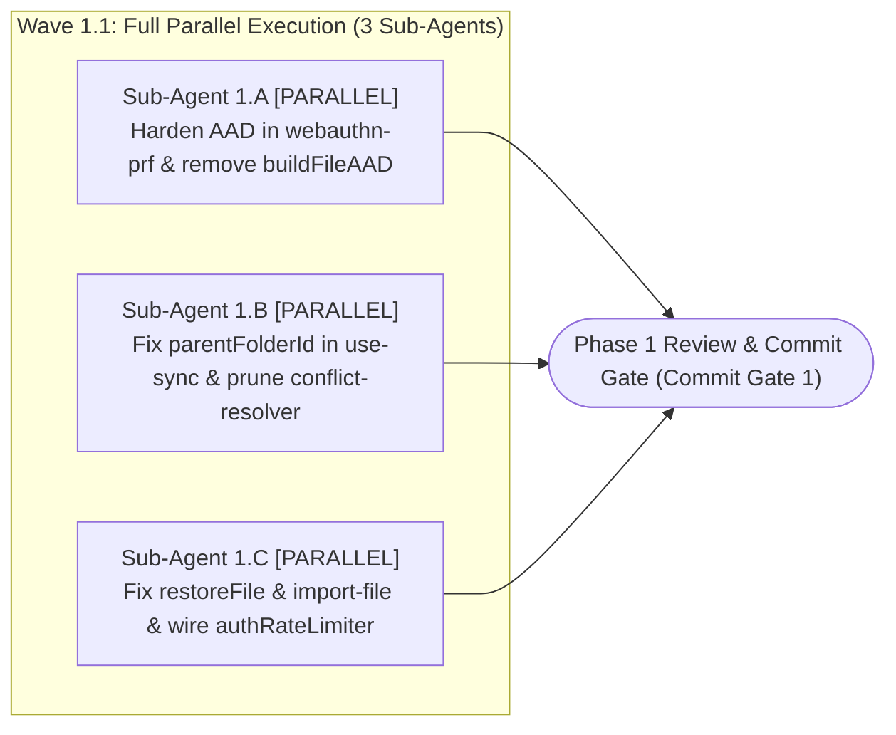

#### Detailed Sub-Agent Tasks in Phase 1

##### 1. Task `Sub-Agent 1.A`: Harden `AAD` Context in `webauthn-prf.ts` and Remove Dead `buildFileAAD`

- **Execution Mode & Dependencies:** `[PARALLEL — Wave 1.1]`.
- **Exclusively Targeted Files:**
  - `src/lib/sync/webauthn-prf.ts` (modify)
  - `src/hooks/use-editor-orchestrator.ts` (modify: remove dead function only)
  - `src/hooks/use-editor-conflict.ts` (modify: remove dead function only)
- **Exact Line-Level Implementation Actions:**
  1. **Unify Additional Authenticated Data (`AAD`) context in `src/lib/sync/webauthn-prf.ts` (inside `createWebAuthnPrfEnvelope` at line `275` and inside `unwrapMasterKeyWithWebAuthnPrf` at line `363`):**
     - Import `AAD` from `@/lib/crypto/aad` (where `AAD.deviceWrap(userId, epoch)` returns the canonical string `lugx:v1:device:${cleanId}:${safeEpoch}`).
     - In the wrapping function `createWebAuthnPrfEnvelope` (line `275`), replace the ad-hoc string `` `trusted_device:${userId}:${deviceTrustEpoch}` `` by passing `AAD.deviceWrap(userId, deviceTrustEpoch)` as the fourth argument (`aad: string`) to `cryptoWorkerBridge.wrapKeyRaw`.
     - In the unwrapping function `unwrapMasterKeyWithWebAuthnPrf` (line `363`), apply the exact `String AAD Dual-Try` pattern matching `unwrapMasterKeyWithPin` in `src/lib/sync/encryption.ts:308-316` (since `cryptoWorkerBridge.unwrapKeyRaw` accepts its fourth argument strictly as `string`, not `Uint8Array`):
       ```typescript
       const epoch = envelope.deviceTrustEpoch || 1;
       const canonicalAad = AAD.deviceWrap(userId, epoch);
       const legacyAad = `trusted_device:${userId}:${epoch}`;
       try {
         return await cryptoWorkerBridge.unwrapKeyRaw(
           kek,
           envelope.encryptedMasterKey,
           iv,
           canonicalAad,
         );
       } catch {
         return await cryptoWorkerBridge.unwrapKeyRaw(
           kek,
           envelope.encryptedMasterKey,
           iv,
           legacyAad,
         );
       }
       ```
  2. **Remove dead `buildFileAAD` function:**
     - Delete the uninvoked local function definition `function buildFileAAD(userId: string, fileId: string)` from `src/hooks/use-editor-orchestrator.ts` (around line `130`) and from `src/hooks/use-editor-conflict.ts` (around line `200`).

##### 2. Task `Sub-Agent 1.B`: Fix Root-Folder File Move in `use-sync.ts` and Prune Dead Methods in `conflict-resolver.ts`

- **Execution Mode & Dependencies:** `[PARALLEL — Wave 1.1]` (executes in full concurrency with `1.A` and `1.C`).
- **Exclusively Targeted Files:**
  - `src/hooks/use-sync.ts` (modify)
  - `src/lib/sync/conflict-resolver.ts` (modify)
- **Exact Line-Level Implementation Actions:**
  1. **Fix persisting file moves to the root folder (`null`) in `src/hooks/use-sync.ts`:**
     - At lines `321` and `339` inside `src/hooks/use-sync.ts`, replace the buggy fallback expression:
       `parentFolderId: file.parentFolderId || existingFile?.parentFolderId || null`
       with the explicit null-preserving expression:
       `parentFolderId: file.parentFolderId !== undefined ? file.parentFolderId : (existingFile?.parentFolderId ?? null)`.
  2. **Prune dead private methods in `src/lib/sync/conflict-resolver.ts`:**
     - Delete lines `481–646` containing the three unreferenced private methods (`private diff2Way`, `private diff3Merge`, `private extractSliceForRange`).
     - **Strict Preservation Constraint:** Leave `computeLCS` (lines `401–479`), `areArraysEqual` (lines `651–657`), and `computeWordSpans` (line `662`) completely untouched because the visual diff renderer `computeVisualDiff` depends on them directly.

##### 3. Task `Sub-Agent 1.C`: Fix Folder Tree Restoration (`restoreFile`), Encrypted Import ETag (`import-file`), and Wire `authRateLimiter`

- **Execution Mode & Dependencies:** `[PARALLEL — Wave 1.1]` (executes in full concurrency with `1.A` and `1.B`).
- **Exclusively Targeted Files:**
  - `src/server/actions/folders.ts` (modify)
  - `src/server/actions/files.ts` (modify)
  - `src/server/actions/import-file.ts` (modify)
  - `src/server/actions/auth-actions.ts` (modify: wire `authRateLimiter`)
- **Exact Line-Level Implementation Actions:**
  1. **Fix recursive restoration of soft-deleted folders (`restoreFile`) in `src/server/actions/folders.ts` and `src/server/actions/files.ts`:**
     - In `src/server/actions/folders.ts` (lines `12–40`), update the signature of `getDescendantIds` to:
       `export async function getDescendantIds(folderId: string, userId: string, includeDeleted: boolean = false): Promise<string[]>`
       and update the internal query filter so that `isNull(schema.files.deletedAt)` is applied only when `includeDeleted === false`.
     - In `src/server/actions/files.ts` inside `restoreFile` (around line `653`), update the call `getDescendantIds(fileId, user.id)` to `getDescendantIds(fileId, user.id, true)`.
  2. **Unify `ETag` computation for imported encrypted files in `src/server/actions/import-file.ts`:**
     - At lines `174–178` inside `src/server/actions/import-file.ts`, replace the call `generateETagSync({ id: newFileId, content: finalContent, updatedAt: now })` by passing `isEncrypted` and the `envelope` object constructed from `finalMetadata` and `finalContent`, matching `src/server/actions/files.ts:341-355`:
       ```typescript
       const etag = generateETagSync({
         id: newFileId,
         content: finalContent,
         updatedAt: now,
         isEncrypted,
         envelope:
           isEncrypted && finalMetadata
             ? {
                 version: 1,
                 algorithm: "AES-GCM-256",
                 keyId: finalMetadata.keyId ?? "master-v1",
                 salt: finalMetadata.salt ?? "",
                 iv: finalMetadata.iv,
                 kdfIterations: finalMetadata.kdfIterations ?? 600000,
                 ciphertext: finalContent,
               }
             : undefined,
       });
       ```
  3. **Wire the authentication rate limiter (`authRateLimiter`) in `src/server/actions/auth-actions.ts`:**
     - Import `authRateLimiter` (defined in `src/lib/rate-limit.ts:208` with `RATE_LIMITS.AUTH` settings) and invoke it at the entry of both active authentication server actions in the file (`signInWithGoogle` at line `15` and `syncUserToDatabase` at line `66`) using the client/user identifier, returning a controlled error response when the limit is exceeded.

#### Phase 1 Commit Gate — ✅ SATISFIED / CLOSED

- Review `git diff` to verify that changes are strictly confined to the nine files specified above.
- Execute the following mandatory verification commands (where crypto, `AAD`, and `WebAuthn PRF` tests reside in `src/test/vault` and auth tests reside in `src/test/auth`) and confirm $100\%$ pass rate before running `git commit`:
  ```bash
  npx tsc --noEmit
  npx vitest run src/test/sync src/test/vault src/test/server src/test/auth
  ```
- **Gate Verdict:** `CLOSED / EXECUTED` — 52 test suites (739 tests) passing 100%, TypeScript check clean (0 errors), `Commit Gate 1` fully satisfied.

### [Phase 2: NPM Dependencies, `getPgPool()` Export & Non-Breaking Database Schema Migration (`0013`)]

> **Phase Identifier:** `Phase 2 — NPM Dependencies, Pool Export & Non-Breaking Database Schema Migration`  
> **Status:** `CLOSED / EXECUTED` ✅ ([Closure Dossier](../records/closures/elixent-execution/phase-02-dependencies-pool-and-schema-migration.md))  
> **Gate Verdict:** `CLOSED / EXECUTED` — 90 unit suites (1081 tests), 21 live suites (118 tests) passing 100%, ESLint clean (0 errors, 0 warnings), TypeScript check clean (0 errors), Commit Gate 2 fully satisfied.  
> **Single Responsibility Principle (`SRP`):** Install the new orchestration and AI packages, retain the `activePool` reference and export `getPgPool()` from `transactional.ts`, create the new Drizzle schemas (`users.creditBalanceMicro`, `creditLedgerTransactions`, `projectDecisionLedger`) and migration `0013_migrate_to_credit_ledger.sql` (including `PostgresSaver` tables and dropping `usage` and `ai_reservations`), and update callers and test utilities in the same step to prevent any build breakage.  
> **Post-Phase 1 Baseline State:** All seven core fixes from `Phase 1` are applied and committed, while database schemas remain at migration `0012`.

#### Phase 2 Sub-Agent Topology

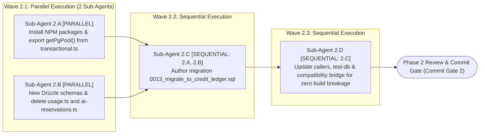

#### Detailed Sub-Agent Tasks in Phase 2

##### 1. Task `Sub-Agent 2.A`: Install New Dependencies and Export Hardened `getPgPool()` from `transactional.ts`

- **Execution Mode & Dependencies:** `[PARALLEL — Wave 2.1]`.
- **Exclusively Targeted Files:**
  - `package.json` & `package-lock.json` (modify)
  - `src/server/db/transactional.ts` (modify)
- **Exact Implementation Actions:**
  1. **Install approved packages in `package.json`:**
     - `@langchain/langgraph` (`^1.5.0`), `@langchain/core` (`^1.2.0`), `@langchain/langgraph-checkpoint-postgres` (`^1.1.0`), `ai` (`^7.0.0`), `@ai-sdk/google` (`^4.0.0`), `@ai-sdk/openai` (`^4.0.0`), and `js-tiktoken` (`^1.0.21`).
     - Add the two canonical documentation scripts under `scripts` in `package.json`: `"docs:sync": "node scripts/sync-doc-metrics.mjs --update-docs"` and `"docs:check": "node scripts/sync-doc-metrics.mjs --check"`.
     - **Strict Constraint (`ADR-001`):** Strictly prohibit installing the monolithic `langchain` package or `@langchain/community`.
  2. **Retain `activePool` reference and export `getPgPool()` in `src/server/db/transactional.ts` (lines `7–52`):**
     - Store the instantiated pool object (`new NeonPool(...)` or `new NodePgPool(...)`) in a module-scoped variable `let activePool: NeonPool | NodePgPool | null = null;` inside `createTransactionalDb`, and export `export function getPgPool(): NeonPool | NodePgPool` so that it **calls `getTxDb()` first** to guarantee lazy initialization and dynamic re-initialization whenever `DATABASE_URL` changes across test suites:
       ```typescript
       export function getPgPool(): NeonPool | NodePgPool {
         getTxDb(); // Ensures activePool is initialized and matches current DATABASE_URL
         if (!activePool) {
           throw new Error("PostgreSQL connection pool failed to initialize");
         }
         return activePool;
       }
       ```

##### 2. Task `Sub-Agent 2.B`: Build New Drizzle Schemas (Including `langgraph-checkpoints.ts`) and Drop `usage` and `ai-reservations` Schemas

- **Execution Mode & Dependencies:** `[PARALLEL — Wave 2.1]` (executes in parallel with `2.A`).
- **Exclusively Targeted Files:**
  - `src/server/db/schema/users.ts` (modify)
  - `src/server/db/schema/credit-ledger.ts` (new)
  - `src/server/db/schema/project-decision-ledger.ts` (new)
  - `src/server/db/schema/langgraph-checkpoints.ts` (new — mandatory for compatibility with `drizzle-kit push --force` in `CI Stage 3`)
  - `src/server/db/schema/usage.ts` (delete)
  - `src/server/db/schema/ai-reservations.ts` (delete)
  - `src/server/db/schema/index.ts` (modify)
- **Exact Implementation Actions:**
  1. **In `src/server/db/schema/users.ts`:** Add column `creditBalanceMicro: bigint("credit_balance_micro", { mode: "bigint" }).notNull().default(sql\`0\`)`and check constraint`check("users_credit_balance_non_negative", sql\`${table.creditBalanceMicro} >= 0\`)`while preserving primary key`id: uuid("id").primaryKey()`.
  2. **Create `src/server/db/schema/credit-ledger.ts`:** Define `executionModeEnum`, `ledgerSettlementStatusEnum`, and the `creditLedgerTransactions` table with primary key `operationId: text("operation_id").primaryKey()` and foreign key `userId: uuid("user_id").notNull().references(() => users.id, { onDelete: "cascade" })` per `ELIXENT-ARCH-05` §1.2.
  3. **Create `src/server/db/schema/project-decision-ledger.ts`:** Define `EvaluatedAlternativeRecord` and the `projectDecisionLedger` table with composite primary key `primaryKey({ columns: [table.projectId, table.decisionId] })` including `userId` (`uuid`), `questionPrompt`, `conceptTags`, `selectedOptionKey`, `selectionRationale`, `runnerUpOptionKey`, `evaluatedAlternatives`, `status`, `impactTier`, `isLoadBearing`, `dependsOn`, `dependedBy`, and `affectedSections` per `ELIXENT-ARCH-05` §1.3.
  4. **Create `src/server/db/schema/langgraph-checkpoints.ts` (per `ELIXENT-ARCH-05` §1.5):** Define the four `PostgresSaver` tables (`checkpointMigrations`, `checkpoints`, `checkpointBlobs`, `checkpointWrites` using `customType` for `bytea` columns) and export them from `src/server/db/schema/index.ts`, because the CI pipeline (`.github/workflows/ci.yml` line `142`) executes `npx drizzle-kit push --config drizzle.config.test.ts --force` after running SQL migrations; without these tables in the Drizzle schema, `drizzle-kit push --force` would automatically drop them.
  5. **Delete `usage.ts` and `ai-reservations.ts` and update `src/server/db/schema/index.ts`:** Remove exports of the two deleted tables and export `./credit-ledger`, `./project-decision-ledger`, and `./langgraph-checkpoints`.

##### 3. Task `Sub-Agent 2.C`: Author Migration `0013_migrate_to_credit_ledger.sql` and Update `scripts/verify-migrations.mjs`

- **Execution Mode & Dependencies:** `[SEQUENTIAL — Wave 2.2 | Depends on: Sub-Agent 2.A, Sub-Agent 2.B]`.
- **Exclusively Targeted Files:**
  - `src/server/db/migrations/0013_migrate_to_credit_ledger.sql` (new)
  - `scripts/verify-migrations.mjs` (update)
- **Exact Implementation Actions:**
  1. Create migration file `src/server/db/migrations/0013_migrate_to_credit_ledger.sql` with the complete SQL DDL below (as `verify-migrations.mjs` and `src/test/db.setup.ts` apply all `.sql` files in `src/server/db/migrations/` in alphabetical order):

     ```sql
     -- Migration: 0013_migrate_to_credit_ledger.sql
     -- 1. Add credit_balance_micro to users with non-negative check constraint & initialize by tier
     ALTER TABLE "users"
       ADD COLUMN IF NOT EXISTS "credit_balance_micro" BIGINT NOT NULL DEFAULT 0;

     UPDATE "users"
     SET "credit_balance_micro" = CASE
       WHEN "tier" = 'ultra' THEN 3500000000
       WHEN "tier" = 'pro' THEN 1000000000
       ELSE 50000000
     END
     WHERE "credit_balance_micro" = 0;

     DO $$ BEGIN
       ALTER TABLE "users"
         ADD CONSTRAINT "users_credit_balance_non_negative" CHECK ("credit_balance_micro" >= 0);
     EXCEPTION
       WHEN duplicate_object THEN NULL;
     END $$;

     -- 2. Create Enums for Credit Ledger
     DO $$ BEGIN
       CREATE TYPE "public"."ai_execution_mode" AS ENUM (
         'SINGLE_PASS_DECISION',
         'DISCRETE_THINKING',
         'STREAMING_GENERATIVE',
         'CREDIT_TOPUP'
       );
     EXCEPTION
       WHEN duplicate_object THEN NULL;
     END $$;

     DO $$ BEGIN
       CREATE TYPE "public"."ledger_settlement_status" AS ENUM (
         'SETTLED',
         'ABORTED',
         'TOPUP_APPLIED'
       );
     EXCEPTION
       WHEN duplicate_object THEN NULL;
     END $$;

     -- 3. Create credit_ledger_transactions table & indexes
     CREATE TABLE IF NOT EXISTS "credit_ledger_transactions" (
       "operation_id" TEXT PRIMARY KEY NOT NULL,
       "user_id" UUID NOT NULL REFERENCES "public"."users"("id") ON DELETE CASCADE,
       "thread_id" TEXT,
       "node_name" TEXT,
       "model_id" TEXT NOT NULL,
       "execution_mode" "public"."ai_execution_mode" NOT NULL,
       "input_tokens" INTEGER NOT NULL DEFAULT 0,
       "cached_input_tokens" INTEGER NOT NULL DEFAULT 0,
       "output_tokens" INTEGER NOT NULL DEFAULT 0,
       "reasoning_tokens" INTEGER NOT NULL DEFAULT 0,
       "delta_micro" BIGINT NOT NULL,
       "status" "public"."ledger_settlement_status" NOT NULL,
       "created_at" TIMESTAMP NOT NULL DEFAULT now()
     );

     CREATE INDEX IF NOT EXISTS "idx_credit_ledger_user_created"
       ON "credit_ledger_transactions" ("user_id", "created_at");
     CREATE INDEX IF NOT EXISTS "idx_credit_ledger_thread"
       ON "credit_ledger_transactions" ("thread_id");

     -- 4. Create project_decision_ledger table & index
     CREATE TABLE IF NOT EXISTS "project_decision_ledger" (
       "project_id" TEXT NOT NULL,
       "decision_id" TEXT NOT NULL,
       "user_id" UUID NOT NULL REFERENCES "public"."users"("id") ON DELETE CASCADE,
       "topic_slug" TEXT NOT NULL,
       "question_prompt" TEXT NOT NULL,
       "concept_tags" JSONB NOT NULL DEFAULT '[]'::jsonb,
       "selected_option_key" TEXT NOT NULL,
       "selection_rationale" TEXT NOT NULL,
       "runner_up_option_key" TEXT,
       "evaluated_alternatives" JSONB NOT NULL DEFAULT '[]'::jsonb,
       "status" TEXT NOT NULL,
       "impact_tier" TEXT NOT NULL,
       "is_load_bearing" BOOLEAN NOT NULL DEFAULT false,
       "depends_on" JSONB NOT NULL DEFAULT '[]'::jsonb,
       "depended_by" JSONB NOT NULL DEFAULT '[]'::jsonb,
       "affected_sections" JSONB NOT NULL DEFAULT '[]'::jsonb,
       "updated_at" TIMESTAMP NOT NULL DEFAULT now(),
       CONSTRAINT "project_decision_ledger_project_id_decision_id_pk"
         PRIMARY KEY ("project_id", "decision_id")
     );

     CREATE INDEX IF NOT EXISTS "idx_project_decision_user_project"
       ON "project_decision_ledger" ("user_id", "project_id");

     -- 5. Create LangGraph PostgresSaver checkpoint tables
     CREATE TABLE IF NOT EXISTS "checkpoint_migrations" (
       "v" INTEGER PRIMARY KEY NOT NULL
     );

     CREATE TABLE IF NOT EXISTS "checkpoints" (
       "thread_id" TEXT NOT NULL,
       "checkpoint_ns" TEXT NOT NULL DEFAULT '',
       "checkpoint_id" TEXT NOT NULL,
       "parent_checkpoint_id" TEXT,
       "type" TEXT,
       "checkpoint" JSONB NOT NULL,
       "metadata" JSONB NOT NULL DEFAULT '{}'::jsonb,
       CONSTRAINT "checkpoints_pkey"
         PRIMARY KEY ("thread_id", "checkpoint_ns", "checkpoint_id")
     );

     CREATE TABLE IF NOT EXISTS "checkpoint_blobs" (
       "thread_id" TEXT NOT NULL,
       "checkpoint_ns" TEXT NOT NULL DEFAULT '',
       "channel" TEXT NOT NULL,
       "version" TEXT NOT NULL,
       "type" TEXT NOT NULL,
       "blob" BYTEA,
       CONSTRAINT "checkpoint_blobs_pkey"
         PRIMARY KEY ("thread_id", "checkpoint_ns", "channel", "version")
     );

     CREATE TABLE IF NOT EXISTS "checkpoint_writes" (
       "thread_id" TEXT NOT NULL,
       "checkpoint_ns" TEXT NOT NULL DEFAULT '',
       "checkpoint_id" TEXT NOT NULL,
       "task_id" TEXT NOT NULL,
       "idx" INTEGER NOT NULL,
       "channel" TEXT NOT NULL,
       "type" TEXT,
       "blob" BYTEA NOT NULL,
       CONSTRAINT "checkpoint_writes_pkey"
         PRIMARY KEY ("thread_id", "checkpoint_ns", "checkpoint_id", "task_id", "idx")
     );

     -- 6. Drop obsolete legacy quota tables
     DROP TABLE IF EXISTS "ai_reservations" CASCADE;
     DROP TABLE IF EXISTS "usage" CASCADE;
     ```

  2. **Update the migration verification script `scripts/verify-migrations.mjs` (lines `148–208`):**
     - Replace `"usage"` and `"ai_reservations"` in the `requiredTables` array with `"credit_ledger_transactions"`, `"project_decision_ledger"`, and the `PostgresSaver` tables (`"checkpoints"`, `"checkpoint_blobs"`, `"checkpoint_writes"`, `"checkpoint_migrations"`).
     - Replace the indexes of the two dropped tables (`idx_ai_reservations_*` and `idx_usage_user_date_unique`) in the `requiredIndexes` array with the indexes of the new tables (`idx_credit_ledger_user_created`, `idx_credit_ledger_thread`, `idx_project_decision_user_project`).
     - Replace the column check for `ai_reservations.request_hash` (lines `200–207`) with a column check verifying `users.credit_balance_micro` to ensure CI Stages 3 and 4 succeed in `.github/workflows/ci.yml`.

##### 4. Task `Sub-Agent 2.D`: Update All Callers, Test Utilities (`src/test/**` & `e2e/**`), and Transitional Compatibility Bridge

- **Execution Mode & Dependencies:** `[SEQUENTIAL — Wave 2.3 | Depends on: Sub-Agent 2.C]`.
- **Exclusively Targeted Files:**
  - `src/server/actions/auth-actions.ts` (remove `schema.usage` insert at line `97` and initialize `creditBalanceMicro: 50_000_000n` for the starter tier)
  - `src/app/api/test/e2e-auth/route.ts` (remove `schema.usage` insert at line `86`)
  - `src/test/test-db.ts` (update table truncation/cleanup at line `107`)
  - `e2e/fixtures/test-db.ts` (remove `schema.usage` and `schema.aiReservations` at lines `50, 64, 65, 100–114`)
  - `src/server/services/ai-settlement-service.ts` & `src/server/actions/ai-ops.ts` & `src/server/actions/ai-commit.ts` (transitional adaptation compatible with the new schema)
  - Update all references to `schema.usage` and `schema.aiReservations` across test files included in `tsconfig.json` (`src/test/auth/auth-signout.test.ts:56`, `src/test/server/cross-user-ownership.test.ts`, `src/test/server/schema-atomic-transactions.live.test.ts`, `src/test/vault/vault-sync.live.test.ts`, `src/test/vault/vault-sync-ai-gate.test.ts`, `src/test/vault/vault-cross-module.integration.test.ts`, `src/test/infrastructure/multi-system-lifecycle.live.test.ts`, `src/test/infrastructure/cron-expire-reservations.live.test.ts`, `src/test/ai/{ai-atomic-commit.integration,ai-authoritative-stream-settlement,ai-gatekeeper,ai-ops.integrity,ai-ops.refund,ai-preview-decision.live,ai-quota-idempotency.live,ai-server-atomic-commit,ai-stream-fileid-governance,ai-stream-replay-prevention}.test.ts`, and `e2e/specs/{06-ai-streaming-commit,07-ai-abort-reject,08-ai-failure-refund}.spec.ts`).
- **Exact Implementation Actions:**
  1. Remove `db.insert(schema.usage)` from `auth-actions.ts:97-102`, `e2e-auth/route.ts:86-93`, and `e2e/fixtures/test-db.ts:50-55`, and update `src/test/test-db.ts:107-109`, `e2e/fixtures/test-db.ts:64-65,100-114`, and `src/test/auth/auth-signout.test.ts:56` to clean and query `creditLedgerTransactions`, `projectDecisionLedger`, `checkpointWrites`, `checkpointBlobs`, and `checkpoints` instead of the two dropped tables.
  2. Transition `ai-settlement-service.ts`, `ai-ops.ts`, and `ai-commit.ts` to read and write against `users.creditBalanceMicro` and `creditLedgerTransactions` instead of the dropped tables while preserving their exported function signatures, and update schema references in `src/test/**` and `e2e/specs/06..08` to point to `creditLedgerTransactions` and `users.creditBalanceMicro`, ensuring `npx tsc --noEmit` (which type-checks the entire `src/` and `e2e/` trees per `tsconfig.json`) passes with zero errors from Phase 2 onward.

#### Phase 2 Commit Gate — ✅ SATISFIED / CLOSED

- Execute the following mandatory verification commands and confirm $100\%$ pass rate before running `git commit`:
  ```bash
  ! grep -rn "schema\.usage\|schema\.aiReservations" src/ e2e/
  node scripts/verify-migrations.mjs
  npx drizzle-kit push --config drizzle.config.test.ts --force
  npx tsc --noEmit
  npx vitest run src/test/auth
  ```
- **Gate Verdict:** CLOSED / EXECUTED — 90 unit suites (1081 tests), 21 live suites (118 tests) passing 100%, ESLint clean (0 errors, 0 warnings), TypeScript check clean (0 errors), Commit Gate 2 fully satisfied.
- **Closure Report Dossier:** [`docs/records/closures/elixent-execution/phase-02-dependencies-pool-and-schema-migration.md`](../records/closures/elixent-execution/phase-02-dependencies-pool-and-schema-migration.md)

### [Phase 3: Lean Dynamic Model Registry, Micro-Credit Derivation Math & Atomic `Redis Lua` Scripts] — ✅ CLOSED / EXECUTED

> **Phase Identifier:** `Phase 3 — Lean Model Registry, Micro-Credit Derivation Math & Atomic Redis Lua Scripts`  
> **Status:** `CLOSED / EXECUTED` ✅ ([Closure Dossier](../records/closures/elixent-execution/phase-03-lean-model-registry-derivation-and-lua.md))  
> **Gate Verdict:** `CLOSED / EXECUTED` — TypeScript clean (0 errors), 46/46 unit tests passing (100%), MTR-01 through MTR-04 verified, Commit Gate 3 fully satisfied.  
> **Single Responsibility Principle (`SRP`):** Transform `models.config.json` into a lean dynamic model registry, build the pure mathematical and tokenization modules (`constants.ts`, `derivation.ts`, `tokenizer.ts`) and the three atomic Upstash Redis Lua scripts (`lua-scripts.ts`), and unit-test them in isolation from streaming services and PostgreSQL.  
> **Closure Record:** [`docs/records/closures/elixent-execution/phase-03-lean-model-registry-derivation-and-lua.md`](../records/closures/elixent-execution/phase-03-lean-model-registry-derivation-and-lua.md)  
> **Post-Phase 2 Baseline State:** Packages (`js-tiktoken`, `@langchain/langgraph`, `ai`) are installed, and `credit_ledger_transactions` and `users.credit_balance_micro` schemas are active in the database.

#### Phase 3 Sub-Agent Topology

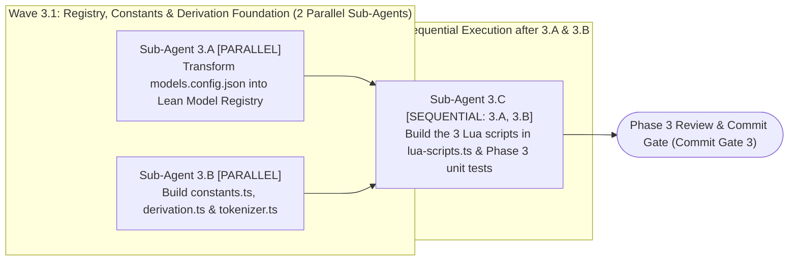

#### Detailed Sub-Agent Tasks in Phase 3

##### 1. Task `Sub-Agent 3.A`: Transform `src/config/models.config.json` into the `Lean Dynamic Model Registry`

- **Execution Mode & Dependencies:** `[PARALLEL — Wave 3.1]`.
- **Exclusively Targeted Files:**
  - `src/config/models.config.json` (modify)
- **Exact Implementation Actions:**
  1. Structure `src/config/models.config.json` to index models under the `models` key by `modelId` (`openai/gpt-6-luna-decisions`, `microsoft/decision-1`, `typesafe/jev-1.13`, `fastino/glide`, `google/gemini-4-argon`, `google/gemini-3.8-flash`, `google/gemini-3.1-pro`) with the canonical fields specified in `ELIXENT-ARCH-04` §2.3:
     - `executionMode` (`SINGLE_PASS_DECISION | DISCRETE_THINKING | STREAMING_GENERATIVE`), `V` (`tokensPerSecond`), `creditsPer1kInput`, `creditsPer1kCacheRead`, `creditsPer1kOutput` (`0` for single-pass decision models), and `calibrationPriors` (`{ qHatCore05: 0.22, qHatPeriph20: 0.42 }` for decision models and `null` for generative models), while preserving temporary backward-compatibility keys for `src/lib/ai/client.ts` until its upgrade in Phase 7.

##### 2. Task `Sub-Agent 3.B`: Build Metering Constants, Automated Derivation Formulas, and Pessimistic Tokenizer (`js-tiktoken`)

- **Execution Mode & Dependencies:** `[PARALLEL — Wave 3.1]` (executes in parallel with `3.A`).
- **Exclusively Targeted Files:**
  - `src/lib/metering/constants.ts` (new)
  - `src/lib/metering/derivation.ts` (new)
  - `src/lib/metering/tokenizer.ts` (new)
- **Exact Implementation Actions:**
  1. **In `src/lib/metering/constants.ts`:** Define and export `MICRO_PER_CREDIT = 1_000_000n`, `T_RUNWAY_SECONDS = 3`, `T_CHUNK_SECONDS = 10`, `L_MIN_TOKENS = 500`, `B_DISCRETE_DEFAULT_TOKENS = 1500`, `PESSIMISTIC_TOKEN_MARGIN = 1.15`, `LOCAL_HOLD_TIMEOUT_MS = 500`, `LEASE_TTL_SECONDS = 120`, `WALLET_TTL_SECONDS = 86400`, `STEP_DONE_TTL_SECONDS = 3600`, `DIRTY_SETTLEMENT_GRACE_MS = 30_000`, and canonical Redis key builder functions (`REDIS_KEYS`).
  2. **In `src/lib/metering/derivation.ts`:** Implement `tokensToMicroCredits` ($\lceil \text{Tokens} \times \text{CreditsPer1k} \times 1,000 \rceil$) and derivation functions for all three execution modes (`SINGLE_PASS_DECISION` where $L_{\text{allocated}} = 0, \text{Trigger} = 0$ without division by zero; `DISCRETE_THINKING`; and `STREAMING_GENERATIVE` applying the **`Zero-Dust Drain`** rule when $0 < \text{UserAvailableTokensCapacity} < L_{\min}$).
  3. **In `src/lib/metering/tokenizer.ts`:** Implement `estimatePessimisticInputTokens(text: string): number` using `js-tiktoken` multiplied by the $+15\%$ pessimistic safety margin.

##### 3. Task `Sub-Agent 3.C`: Build the Three Atomic `Upstash Redis Lua` Scripts and Phase 3 Unit Tests

- **Execution Mode & Dependencies:** `[SEQUENTIAL — Wave 3.2 | Depends on: Sub-Agent 3.A, Sub-Agent 3.B]`.
- **Exclusively Targeted Files:**
  - `src/lib/metering/lua-scripts.ts` (new)
  - `src/test/metering/derivation-and-lua.unit.test.ts` (new)
- **Exact Implementation Actions:**
  1. Author and export the Lua script strings and typed wrapper functions for the three atomic Lua scripts per the exact contract in `ELIXENT-ARCH-05` §2.1:
     - **`reserve_or_extend.lua` (`executeReserveOrExtend`):** Check `lugx:step_done:${stepKey}` for idempotency, verify existence of `lugx:wallet:${userId}` (returning `COLD_START_REQUIRED` if absent), compute atomic reservation (including `Zero-Dust Drain`), and refresh `lugx:lease:${operationId}` with `EXPIRE 120`.
     - **`settle_operation.lua` (`executeSettleOperation`):** Compute $\text{Refund} = \max(0, \text{Reserved} - \text{Actual})$ and credit it back to `lugx:wallet:${userId}` with `EXPIRE 86400`, delete `lugx:lease:${operationId}`, record the settlement entry stamped with `created_at_ms` into `lugx:pending_settlements:${userId}` via `HSET`, add `userId` to `lugx:dirty_wallets`, and stamp `lugx:step_done:${stepKey}`.
     - **`stripe_dual_write.lua` (`executeStripeDualWrite`):** Execute `INCRBY` on `lugx:wallet:${userId}` strictly when `EXISTS == 1`.
  2. Enforce **`Fail-Closed`** policy: throw `MeteringServiceUnavailableError` (`status: 503`) immediately if Upstash Redis is unreachable.
  3. Create `src/test/metering/derivation-and-lua.unit.test.ts` testing the derivation math (`MTR-01`, `MTR-04`) and the three Lua scripts (`MTR-02`, `MTR-03`).

#### Phase 3 Commit Gate — ✅ SATISFIED / CLOSED

- Execute the following mandatory verification commands and confirm $100\%$ pass rate before running `git commit`:
  ```bash
  npx tsc --noEmit
  npx vitest run src/test/metering/derivation-and-lua.unit.test.ts src/test/ai/ai-client.test.ts
  ```
- **Gate Verdict:** `CLOSED / EXECUTED` — TypeScript clean (0 errors), 46/46 unit tests passing (100%), MTR-01 through MTR-04 verified, Commit Gate 3 fully satisfied.
- **Closure Report Dossier:** [`docs/records/closures/elixent-execution/phase-03-lean-model-registry-derivation-and-lua.md`](../records/closures/elixent-execution/phase-03-lean-model-registry-derivation-and-lua.md)

### [Phase 4: `Flush-First` Cold Start Protocol, Settlement Service, `StreamGovernor` & Stripe/Cron Adaptation]

> **Phase Identifier:** `Phase 4 — Flush-First Cold Start, Settlement Service, StreamGovernor & Billing/Cron Adaptation`  
> **Single Responsibility Principle (`SRP`):** Complete the financial governance subsystem by building the `Flush-First Cold Start` protocol, the PostgreSQL draining service (`ai-settlement-service.ts`), the pre-node metering wrapper (`withMeteredNodeGate`), the real-time stream governor (`StreamGovernor`), and updating Stripe subscription tiers and the periodic Cron job.  
> **Post-Phase 3 Baseline State:** The `credit_ledger_transactions` table and `users.credit_balance_micro` column exist in the repository (from Phase 2), alongside the lean model registry, derivation formulas, and the three Lua scripts (from Phase 3).

#### Phase 4 Sub-Agent Topology

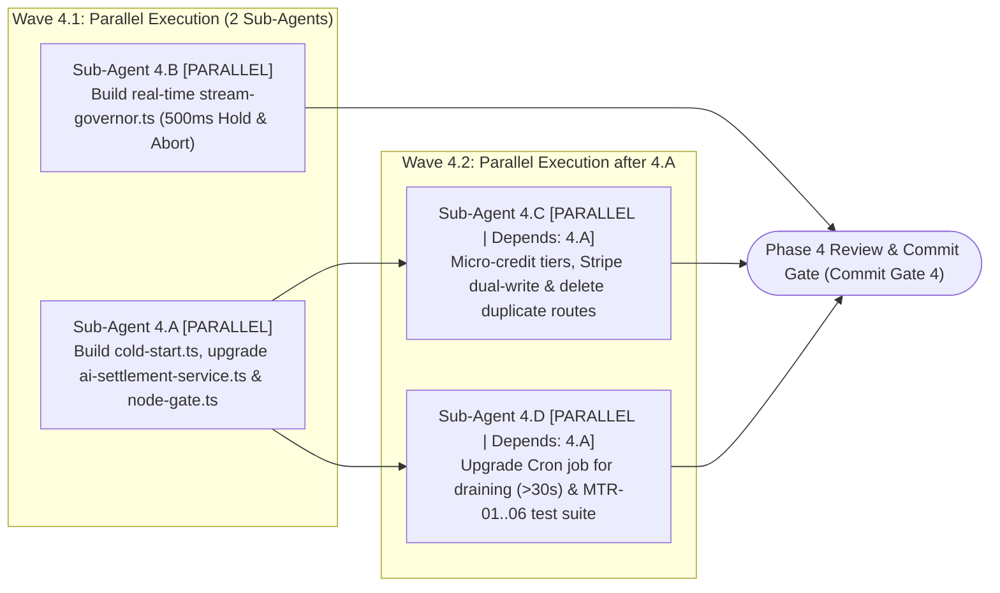

#### Detailed Sub-Agent Tasks in Phase 4

##### 1. Task `Sub-Agent 4.A`: `Flush-First Cold Start` Protocol, PostgreSQL Settlement Service, and `withMeteredNodeGate` Wrapper

- **Execution Mode & Dependencies:** `[PARALLEL — Wave 4.1]`.
- **Exclusively Targeted Files:**
  - `src/lib/metering/cold-start.ts` (new)
  - `src/server/services/ai-settlement-service.ts` (comprehensive upgrade)
  - `src/lib/metering/node-gate.ts` (new)
- **Exact Implementation Actions:**
  1. **In `src/lib/metering/cold-start.ts` (`ensureWalletLoadedFlushFirst`):** When `lugx:wallet:${userId}` is absent, inspect `HLEN lugx:pending_settlements:${userId}`; if pending records exist, invoke `flushPendingSettlementsToPostgres(userId)` to drain them into PostgreSQL first and delete them via `HDEL`, then read the updated `users.creditBalanceMicro` from PostgreSQL and populate Redis via `SETNX lugx:wallet:${userId}` with `EXPIRE 86400`.
  2. **In `src/server/services/ai-settlement-service.ts`:** Implement `flushPendingSettlementsToPostgres(userId, options?: { onlyOlderThanMs?: number })` using `INSERT INTO credit_ledger_transactions ... ON CONFLICT (operation_id) DO NOTHING RETURNING *`, updating `users.creditBalanceMicro` strictly by the net sum of newly inserted rows, and expose `getUserCreditBalance(userId)`.
  3. **In `src/lib/metering/node-gate.ts` (`withMeteredNodeGate`):** Compute `StepKey = SHA256(threadId + ":" + checkpointId + ":" + nodeName + ":" + stepAttempt)`, check `lugx:step_done:${StepKey}` to prevent double billing upon `LangGraph` resumption, and route the state to `pure_interrupt_node` with code `INSUFFICIENT_CREDITS` when balance is insufficient.

##### 2. Task `Sub-Agent 4.B`: Build Real-Time `StreamGovernor` and Local Hold Gate (`500ms Hold & Abort`)

- **Execution Mode & Dependencies:** `[PARALLEL — Wave 4.1]` (executes in parallel with `4.A`).
- **Exclusively Targeted Files:**
  - `src/lib/metering/stream-governor.ts` (new)
- **Exact Implementation Actions:**
  1. Build the `StreamGovernor` class in `src/lib/metering/stream-governor.ts`:
     - Monitors streaming tokens and triggers a non-blocking extension request (`Async Lua Extension`) upon reaching the runway threshold ($\text{Remaining} \le V \times 3\text{s}$).
     - If the current slice is $100\%$ exhausted before the extension response arrives, pauses chunk forwarding to the client for at most **`500ms`**; if the timeout expires or the extension is rejected, immediately invokes `abortController.abort()` and settles the operation via `executeSettleOperation` at the last financially covered token.

##### 3. Task `Sub-Agent 4.C`: Update Subscription Tiers, Stripe Dual-Write Protocol, and Remove Duplicate Webhook Routes

- **Execution Mode & Dependencies:** `[PARALLEL — Wave 4.2 | Depends on: Sub-Agent 4.A]`.
- **Exclusively Targeted Files:**
  - `src/config/tiers.config.ts` (modify)
  - `src/server/actions/subscription-actions.ts` (modify)
  - `src/server/services/billing-service.ts` (modify)
  - `src/app/api/stripe/webhook/route.ts` (modify)
  - `src/app/api/billing/webhook/route.ts` (delete)
  - `src/app/api/webhooks/stripe/route.ts` (delete)
- **Exact Implementation Actions:**
  1. **In `src/config/tiers.config.ts`:** Add per-tier micro-credit allocation fields to the `TierLimits` interface (`creditAllocationMicro: bigint` and `creditsDisplay: number`; e.g., `free: 50_000_000n` i.e. `50` credits, `pro: 1_000_000_000n` i.e. `1,000` credits, and `ultra: 3_500_000_000n` i.e. `3,500` credits) while **temporarily retaining** the legacy fields (`correctImproveTranslate`, `summarize`, `toPrompt`, `isToPromptEnabled`) inside `TierLimits` until Phase 12 so that compilation of `src/app/account/page.tsx` and `src/server/actions/ai-ops.ts` remains unbroken across Phases `4..11`.
  2. **In `src/server/actions/subscription-actions.ts`, `src/server/services/billing-service.ts`, and `src/app/api/stripe/webhook/route.ts`:** Implement the `Stripe Webhook Dual-Write` protocol upon subscription activation or renewal events (`checkout.session.completed`, `invoice.paid`, and tier upgrades in `customer.subscription.updated`):
     - **Step 1 (PostgreSQL inside an atomic transaction):** Insert a top-up record into `schema.creditLedgerTransactions` (`operationId: \`stripe*topup*${eventId}\``, `executionMode: "CREDIT_TOPUP"`, `status: "TOPUP_APPLIED"`, `deltaMicro: allocationMicro`) via `ON CONFLICT (operation_id) DO NOTHING RETURNING \*`; if the row is newly inserted, increment `users.creditBalanceMicro`by`allocationMicro`.
     - **Step 2 (Upstash Redis after PostgreSQL transaction commit):** Call `await executeStripeDualWrite(userId, allocationMicro)` to atomically increment `lugx:wallet:${userId}` if it is currently live in memory (`EXISTS == 1`).
  3. **Delete duplicate routes:** Permanently delete `src/app/api/billing/webhook/route.ts` and `src/app/api/webhooks/stripe/route.ts`, consolidating all Stripe webhook handling into `src/app/api/stripe/webhook/route.ts`.

##### 4. Task `Sub-Agent 4.D`: Upgrade Periodic Cron Job and Acceptance Test Suite `MTR-01..06`

- **Execution Mode & Dependencies:** `[PARALLEL — Wave 4.2 | Depends on: Sub-Agent 4.A]` (executes in parallel with `4.C`).
- **Exclusively Targeted Files:**
  - `src/app/api/cron/expire-reservations/route.ts` (modify)
  - `src/test/metering/credit-metering-suite.test.ts` (new)
  - `src/test/infrastructure/cron-expire-reservations.test.ts` & `src/test/infrastructure/cron-expire-reservations.live.test.ts` (update)
- **Exact Implementation Actions:**
  1. Upgrade `src/app/api/cron/expire-reservations/route.ts` to execute a `Batch-Draining Loop` inspecting `lugx:dirty_wallets` and invoking `flushPendingSettlementsToPostgres(userId, { onlyOlderThanMs: 30_000 })` to drain only records whose `created_at_ms` is older than $30,000\text{ ms}$.
  2. Author and run the six acceptance tests (`MTR-01` through `MTR-06`) and update the Cron test suites.

#### Phase 4 Commit Gate

- Execute the following mandatory verification commands and confirm $100\%$ pass rate across `MTR-01` through `MTR-06`, Cron, and Stripe tests before running `git commit`:
  ```bash
  npx tsc --noEmit
  npx vitest run src/test/metering/credit-metering-suite.test.ts src/test/infrastructure/cron-expire-reservations.test.ts src/test/api/stripe-webhook.test.ts
  ```

### [Phase 5: Fence-Aware AST Heading Slicer, Section-Scoped Diff3 & Hybrid `BM25` Search Engine]

> **Phase Identifier:** `Phase 5 — Fence-Aware AST Heading Slicer, Section-Scoped Diff3 & Hybrid BM25 Search Engine`  
> **Single Responsibility Principle (`SRP`):** Build the pure structural text parsing, lexical search, and section-scoped 3-way merge engines (`heading-slicer.ts`, `diff3MergeSection`, `lexical-bm25.ts`) and verify them in isolation from the database and vault.  
> **Post-Phase 4 Baseline State:** Phases 1–4 are completed and committed (core hardened, new database tables active, and the `src/lib/metering/*` metering and settlement subsystem fully operational).

#### Phase 5 Sub-Agent Topology

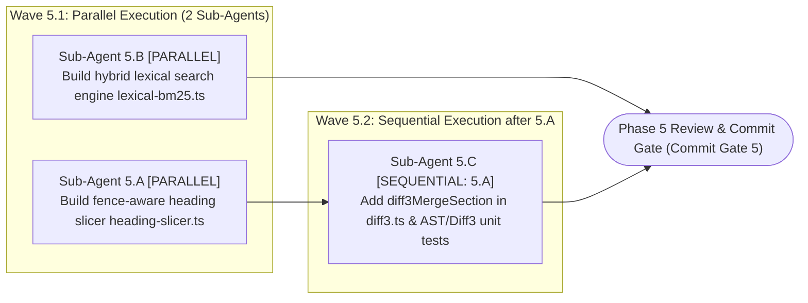

#### Detailed Sub-Agent Tasks in Phase 5

##### 1. Task `Sub-Agent 5.A`: Build Fence-Aware Heading Slicer (`src/core/ast/heading-slicer.ts`)

- **Execution Mode & Dependencies:** `[PARALLEL — Wave 5.1]`.
- **Exclusively Targeted Files:**
  - `src/core/ast/heading-slicer.ts` (new)
- **Exact Implementation Actions:**
  1. Build `parseMarkdownHeadingTree(content: string): HeadingNode[]` and `extractSectionBySlug(content: string, headingSlug: string)` per `ELIXENT-ARCH-03` §2.1:
     - Track fenced code block state (` ``` ` or `~~~`) and `YAML Frontmatter`, ignoring any line starting with `#` inside enclosed code blocks (`inCodeFence === true`).
     - Compute the span of each section $H_k$ (at level $L \in [1, 6]$) up to the line immediately preceding the next heading with level $L_{\text{next}} \le L$, generating the ancestor heading path (`breadcrumb`) and `contentHash` digest.

##### 2. Task `Sub-Agent 5.B`: Build Path-Coupled Hybrid Lexical Search Engine (`src/core/workspace/lexical-bm25.ts`)

- **Execution Mode & Dependencies:** `[PARALLEL — Wave 5.1]` (executes in parallel with `5.A`).
- **Exclusively Targeted Files:**
  - `src/core/workspace/lexical-bm25.ts` (new)
- **Exact Implementation Actions:**
  1. Build the `BM25` search engine ($k_1 = 1.5, b = 0.75$) with Arabic and Latin text normalization and `Exact / Regex Token Boost`, returning matching paragraphs and tables annotated with `headingSlug`, `headingBreadcrumb`, and `lineRange`.

##### 3. Task `Sub-Agent 5.C`: Add `diff3MergeSection` to `src/lib/sync/diff3.ts` and Author Slicing/Merge Unit Tests

- **Execution Mode & Dependencies:** `[SEQUENTIAL — Wave 5.2 | Depends on: Sub-Agent 5.A]`.
- **Exclusively Targeted Files:**
  - `src/lib/sync/diff3.ts` (modify by adding `diff3MergeSection` without altering `diff3MergeText`)
  - `src/test/workspace/ast-slicer-and-diff3.test.ts` (new)
- **Exact Implementation Actions:**
  1. Add the exported function `diff3MergeSection` in `src/lib/sync/diff3.ts` so that it extracts the live section via `extractSectionBySlug`, invokes `diff3MergeText` at line `463` **with the exact parameter order `(localContent, baseContent, remoteContent)` where the middle argument represents the common ancestor (`o`)**:
     `diff3MergeText(liveSectionContent, baseSectionContent, agentProposedSectionContent)`
     and validates the merged output via `validateMarkdownSyntaxIntegrity` from `src/lib/sync/syntax-validator.ts`.
  2. Author unit tests in `src/test/workspace/ast-slicer-and-diff3.test.ts` verifying that the slicer is never fooled by `# comment` lines inside code blocks and verifying accurate line-level 3-way section merging.

#### Phase 5 Commit Gate

- Run `npx vitest run src/test/workspace/ast-slicer-and-diff3.test.ts` and `npx tsc --noEmit` and confirm $100\%$ pass rate before running `git commit`.

### [Phase 6: Zero-Knowledge Vault Boundary (`EphemeralVaultMemoryMap`), Encrypted Checkpoints & `CloudPostgresWorkspaceProvider`]

> **Phase Identifier:** `Phase 6 — Zero-Knowledge Vault Boundary, Encrypted Checkpoints & Cloud Workspace Provider`  
> **Single Responsibility Principle (`SRP`):** Build the zero-knowledge vault isolation layer (`EphemeralVaultMemoryMap`, `vault_ref://` pointers, and `Buffer.fill(0)` zeroing), the encrypted checkpoint serializer (`EncryptedCheckpointSerializer`), and the unified `IWorkspaceProvider` implementation (`CloudPostgresWorkspaceProvider`).  
> **Post-Phase 5 Baseline State:** Heading slicer `heading-slicer.ts`, `diff3MergeSection`, and `lexical-bm25.ts` are ready and tested from Phase 5.

#### Phase 6 Sub-Agent Topology

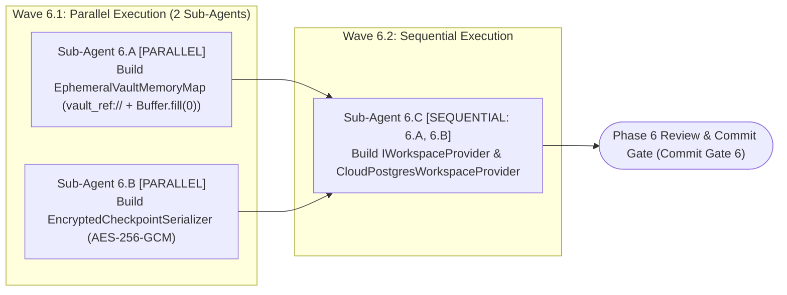

#### Detailed Sub-Agent Tasks in Phase 6

##### 1. Task `Sub-Agent 6.A`: Build Ephemeral Vault Memory Map (`src/lib/vault/ephemeral-memory-map.ts`)

- **Execution Mode & Dependencies:** `[PARALLEL — Wave 6.1]`.
- **Exclusively Targeted Files:**
  - `src/lib/vault/ephemeral-memory-map.ts` (new)
- **Exact Implementation Actions:**
  1. Use `AsyncLocalStorage` to isolate `EphemeralVaultMemoryMap` (`Map<string, Uint8Array>`) within the scope of a single HTTP request (`runWithEphemeralVaultScope`).
  2. Implement `storeEphemeralVaultSection(fileId, headingSlug, plaintext)` returning the opaque pointer `vault_ref://${fileId}#${headingSlug}`, `resolveVaultRefJustInTime(text)` to dereference pointers strictly at prompt construction or 3-way merge time without mutating `AgentGraphState`, and `zeroOutEphemeralVaultMemory()` to execute `buffer.fill(0)` across all stored buffers inside a `finally` block.

##### 2. Task `Sub-Agent 6.B`: Build Encrypted Checkpoint Serializer (`src/core/agent/checkpoint-serializer.ts`)

- **Execution Mode & Dependencies:** `[PARALLEL — Wave 6.1]` (executes in parallel with `6.A`).
- **Exclusively Targeted Files:**
  - `src/core/agent/checkpoint-serializer.ts` (new)
- **Exact Implementation Actions:**
  1. Build `EncryptedCheckpointSerializer` to encrypt `PostgresSaver` payloads with `AES-256-GCM` using an `HKDF`-derived server key, guarded by an assertion preventing serialization of any raw vault plaintext outside `vault_ref://` pointers.

##### 3. Task `Sub-Agent 6.C`: Build `IWorkspaceProvider` Contract and `CloudPostgresWorkspaceProvider` Implementation

- **Execution Mode & Dependencies:** `[SEQUENTIAL — Wave 6.2 | Depends on: Sub-Agent 6.A, Sub-Agent 6.B]`.
- **Exclusively Targeted Files:**
  - `src/core/workspace/provider.ts` (new)
  - `src/core/workspace/cloud-provider.ts` (new)
  - `src/test/workspace/cloud-provider-and-vault.test.ts` (new)
- **Exact Implementation Actions:**
  1. Define the `IWorkspaceProvider` contract and `AgentStreamRequestPayload` (including `ephemeralVaultPayloads` and `liveDocumentSnapshots`) in `src/core/workspace/provider.ts`.
  2. Implement `CloudPostgresWorkspaceProvider` in `src/core/workspace/cloud-provider.ts` (using `heading-slicer.ts`, `lexical-bm25.ts`, and `diff3MergeSection` from Phase 5 and `EphemeralVaultMemoryMap` from `6.A`), enforcing strict file ownership verification in `schema.files` and checking `schema.userVaultProfiles.allowAIOnEncryptedFiles` (throwing `403 VAULT_AI_ACCESS_DENIED` when disabled).

#### Phase 6 Commit Gate

- Run `npx vitest run src/test/workspace/cloud-provider-and-vault.test.ts` to verify rejection of encrypted files when `allowAIOnEncryptedFiles` is disabled, emission of `vault_ref://` pointers when enabled, and memory zeroing via `Buffer.fill(0)` before running `git commit`.

### [Phase 7: Comprehensive `PREDEFINED_CONCEPT_TAGS` Taxonomy, Unified `/v1/decisions` Client, `Conformal APS` Classifier & `AI SDK v6` Bridge]

> **Phase Identifier:** `Phase 7 — Comprehensive Concept Taxonomy, Unified Decisions Client, Conformal APS Classifier & AI SDK v6 Bridge`  
> **Single Responsibility Principle (`SRP`):** Complete the dedicated phase for comprehensively defining the hardcoded architectural concept tags (`PREDEFINED_CONCEPT_TAGS`) and structured `Zod` contracts, building the unified decisions client (`POST /v1/decisions`) and Adaptive Prediction Sets (`Conformal APS Classifier`), and upgrading the generative model client to run on `Vercel AI SDK v7`.  
> **Post-Phase 6 Baseline State:** Phases 1–6 are completed and committed (including `models.config.json` with `calibrationPriors` from Phase 3, and the workspace and vault boundary from Phase 6).

#### Phase 7 Sub-Agent Topology

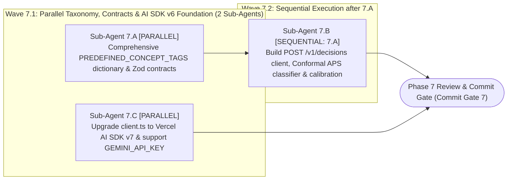

#### Detailed Sub-Agent Tasks in Phase 7

##### 1. Task `Sub-Agent 7.A`: Comprehensive Definition of Hardcoded Concept Tags (`PREDEFINED_CONCEPT_TAGS`) and `Zod` Contracts

- **Execution Mode & Dependencies:** `[PARALLEL — Wave 7.1]`.
- **Exclusively Targeted Files:**
  - `src/core/agent/taxonomy/predefined-tags.ts` (new)
  - `src/core/agent/schemas/decision-schemas.ts` (new)
- **Exact Implementation Actions:**
  1. **In `src/core/agent/taxonomy/predefined-tags.ts` (per `ELIXENT-ARCH-02` §3 & §4.1):**
     - Define the comprehensive architectural concept taxonomy (`PREDEFINED_CONCEPT_TAGS`) as a hardcoded constant tuple (`as const`) covering all engineering and documentation domains (orchestration core & agent state, data schemas & migrations, billing, metering & settlement, encryption, zero-knowledge vault & authentication, synchronization, 3-way merge & version conflicts, structural AST inspection & search, UI & editor components, performance, reliability & Cron, and governance & documentation policies).
     - **Strict Architectural Invariant:** The LLM is strictly prohibited from inventing free-text tags at runtime; it must exclusively select tags imported from `PREDEFINED_CONCEPT_TAGS` enforced via `z.enum(PREDEFINED_CONCEPT_TAGS)`.
  2. **In `src/core/agent/schemas/decision-schemas.ts`:**
     - Build `ConceptTagEnum = z.enum(PREDEFINED_CONCEPT_TAGS)`, `CanonicalOptionSchema` (`optionKey`, `neutralSummary`, `rationaleAndPremises`), `DecisionEvaluationItemSchema` (`options` constrained to $3\text{–}4$ alternatives, `conceptTags` constrained by `ConceptTagEnum`), `CanonicalDecisionBatchSchema`, and schemas for assumption extraction, search synthesis, and human-in-the-loop clarification (`ClarificationResponseSchema`).

##### 2. Task `Sub-Agent 7.B`: Build Unified Decisions Client (`POST /v1/decisions`) and Adaptive Prediction Sets (`Conformal APS`) Classifier

- **Execution Mode & Dependencies:** `[SEQUENTIAL — Wave 7.2 | Depends on: Sub-Agent 7.A]` (depends on the `Zod` schemas and `PREDEFINED_CONCEPT_TAGS` dictionary from `7.A`).
- **Exclusively Targeted Files:**
  - `src/lib/jev/client.ts` (new)
  - `src/lib/jev/calibration-store.ts` (new)
  - `src/lib/jev/conformal-classifier.ts` (new)
  - `src/test/jev/conformal-classifier.test.ts` (new)
- **Exact Implementation Actions:**
  1. **In `src/lib/jev/client.ts`:** Build the `POST /v1/decisions` client to evaluate the four orthogonal dimensions in parallel (`evidence_grounding`, `coupling_level`, `rollback_cost`, `selected_option` including `"insufficient_evidence"`), implement the `Two-Tier Decision Cascade` (Tier 1 fast `Jev 1.13 / MS-Decision-1` $\rightarrow$ Tier 2 thinking escalation `Fastino GLiDE` for ambiguous core architectural decisions), and support batched relational link evaluation (`evaluateRelationalLinksBatch`).
  2. **In `src/lib/jev/calibration-store.ts` and `src/lib/jev/conformal-classifier.ts`:** Implement the prior calibration store and sliding window ($N = 200$), and implement the 5-step deterministic mathematical algorithm (`classifyDecisionConformalAPS` with zero LLM involvement) to compute `ImpactIndex`, normalize option probabilities after isolating $p_{\text{abstain}}$, compute dominance margin $m(x) = \tilde{p}_{(1)} - \tilde{p}_{(2)}$, construct prediction set $\mathcal{C}_\alpha(x)$, and classify into `APPROVED_DIRECT`, `APPROVED_CONSERVATIVE` (persisting `selectionRationale`, `evaluatedAlternatives`, and `runnerUpOptionKey`), or `UNRESOLVED`.

##### 3. Task `Sub-Agent 7.C`: Upgrade Generative Model Gateway to `Vercel AI SDK v7` and Support `GEMINI_API_KEY`

- **Execution Mode & Dependencies:** `[PARALLEL — Wave 7.1]` (executes in parallel with `7.A`).
- **Exclusively Targeted Files:**
  - `src/lib/ai/key-rotation.ts` (modify)
  - `src/lib/ai/client.ts` (modify)
- **Exact Implementation Actions:**
  1. In `src/lib/ai/key-rotation.ts`, add fallback support for reading `process.env.GEMINI_API_KEY` when numbered keys `GEMINI_KEY_1..20` are not configured, while preserving full Redis key rotation and circuit-breaker logic.
  2. In `src/lib/ai/client.ts`, build the `Vercel AI SDK v7` gateway functions (`executeStructuredGeneration` via `generateObject`, `executeToolAgentGeneration` via `generateText`, and `executeStreamingGeneration` via `streamText`) wired to key rotation, while temporarily keeping the legacy streaming function until `api/ai/stream` is deleted in Phase 12.

#### Phase 7 Commit Gate

- Run `npx vitest run src/test/jev/conformal-classifier.test.ts` to verify rejection of any tag outside `PREDEFINED_CONCEPT_TAGS` and mathematical accuracy of `Conformal APS`, and confirm `npx tsc --noEmit` passes before running `git commit`.

### [Phase 8: Justification-Driven `ATMS DAG`, Deterministic Candidate Retriever & Relational Linker]

> **Phase Identifier:** `Phase 8 — Justification-Driven ATMS DAG, Candidate Retriever & Contagious Cascade BFS`  
> **Single Responsibility Principle (`SRP`):** Build the causal truth maintenance subsystem (`src/core/agent/atms/*`) including `ATMSDecisionNode` structures and their synchronization with `project_decision_ledger`, the deterministic local candidate retriever (`retrieveCandidatePriorDecisions`), the relational linker, and the upward/downward contagious cascade BFS algorithm (`resolveATMSCascadeBFS`).  
> **Post-Phase 7 Baseline State:** The `project_decision_ledger` table is active (from Phase 2), the `BM25` engine is ready (from Phase 5), and `PREDEFINED_CONCEPT_TAGS` and the `/v1/decisions` client (`evaluateRelationalLinksBatch`) are ready (from Phase 7).

#### Phase 8 Sub-Agent Topology

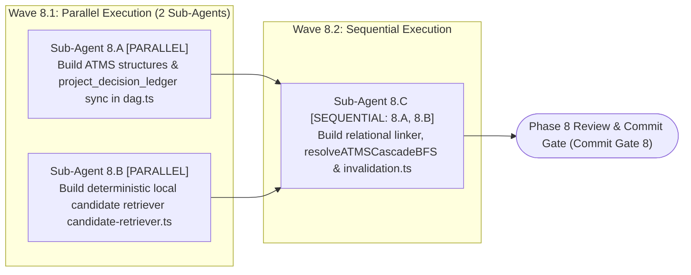

#### Detailed Sub-Agent Tasks in Phase 8

##### 1. Task `Sub-Agent 8.A`: Build `ATMS` DAG Structures and `project_decision_ledger` Synchronization (`src/core/agent/atms/dag.ts`)

- **Execution Mode & Dependencies:** `[PARALLEL — Wave 8.1]`.
- **Exclusively Targeted Files:**
  - `src/core/agent/atms/dag.ts` (new)
- **Exact Implementation Actions:**
  1. Define the `ATMSDecisionNode` interface including justifications (`selectionRationale`), all evaluated alternatives and their contextual rejection reasons (`evaluatedAlternatives`), canonical concept tags (`conceptTags`), and `dependsOn`, `dependedBy`, and `affectedSections` lists.
  2. Build the read and synchronization functions for `schema.projectDecisionLedger`: `loadProjectDecisionLedger(projectId, userId)` and `syncMasterLedgerToProjectStore(projectId, userId, masterLedger)`.

##### 2. Task `Sub-Agent 8.B`: Build Deterministic Local Candidate Retriever (`src/core/agent/atms/candidate-retriever.ts`)

- **Execution Mode & Dependencies:** `[PARALLEL — Wave 8.1]` (executes in parallel with `8.A`).
- **Exclusively Targeted Files:**
  - `src/core/agent/atms/candidate-retriever.ts` (new)
- **Exact Implementation Actions:**
  1. Implement the deterministic function `retrieveCandidatePriorDecisions(assumption, masterLedger, maxCandidates = 8)` per `ELIXENT-ARCH-02` §5.1 by combining three signals:
     - **AST Section Proximity:** Sharing `fileId` and `headingSlug` strictly as a retrieval signal for comparison rather than a mandatory dependency link (allowing multiple independent conservative sub-decisions to coexist under the same heading).
     - **Predefined Concept Tags Intersection:** Overlap of `conceptTags` imported from `PREDEFINED_CONCEPT_TAGS`.
     - **BM25 Lexical Match:** Lexical similarity against `questionPrompt`, `selectionRationale`, and `evaluatedAlternatives`.

##### 3. Task `Sub-Agent 8.C`: Build Relational Linker, `resolveATMSCascadeBFS` Algorithm, and Differential Section Invalidation

- **Execution Mode & Dependencies:** `[SEQUENTIAL — Wave 8.2 | Depends on: Sub-Agent 8.A, Sub-Agent 8.B]`.
- **Exclusively Targeted Files:**
  - `src/core/agent/atms/relational-linker.ts` (new)
  - `src/core/agent/atms/invalidation.ts` (new)
  - `src/test/agent/atms-dag-and-cascade.test.ts` (new)
- **Exact Implementation Actions:**
  1. **In `src/core/agent/atms/relational-linker.ts`:** Invoke `evaluateRelationalLinksBatch` to classify the relation between each new assumption and its retrieved candidate prior decisions into `INDEPENDENT | DEPENDS_ON | REOPENS_OR_OVERRIDES | REFINES`.
  2. **In `src/core/agent/atms/invalidation.ts`:** Implement the deterministic **`resolveATMSCascadeBFS`** function (specified verbatim in `ELIXENT-ARCH-02` §5.2):
     - **Upward Promotion (via `dependsOn`):** Promote any `APPROVED_CONSERVATIVE` decision upon which the new request depends to `CORE_ARCHITECTURAL` (`isLoadBearing: true`), pulling it along with its preserved alternatives (`evaluatedAlternatives`) for re-evaluation.
     - **Downward Cascade (via `dependedBy`):** When a relation is classified as `REOPENS_OR_OVERRIDES`, reopen the target decision with its preserved alternatives and pull all downstream dependent decisions via Breadth-First Search (`BFS` over `dependedBy`) for parallel re-evaluation, computing the differential section invalidation map (`computeMinimalSectionInvalidationMap`).

#### Phase 8 Commit Gate

- Run `npx vitest run src/test/agent/atms-dag-and-cascade.test.ts` to verify independence of sibling sub-decisions under the same heading (`INDEPENDENT`), upward promotion (`DEPENDS_ON`), and parallel downward cascade (`REOPENS_OR_OVERRIDES`) before running `git commit`.

### [Phase 9: `AgentGraphState` Channels, Pure Reducers, 7-Stage Nodes & Compiled `LangGraph` StateGraph]

> **Phase Identifier:** `Phase 9 — AgentGraphState, Pure Reducers, 7-Stage Nodes & Compiled LangGraph StateGraph`  
> **Single Responsibility Principle (`SRP`):** Build the canonical state channels (`state.ts`) and pure reducers (`reducers.ts`), implement the 14 nodes across all 7 stages, and compile the complete state machine in `src/core/agent/graph.ts` backed by `PostgresSaver(getPgPool())`, `EncryptedCheckpointSerializer`, and `withMeteredNodeGate`.  
> **Post-Phase 8 Baseline State:** All underlying agent infrastructure pillars are completed and committed: `getPgPool()` (Phase 2), `withMeteredNodeGate` and `StreamGovernor` (Phase 4), `IWorkspaceProvider`, `EphemeralVaultMemoryMap`, and `EncryptedCheckpointSerializer` (Phase 6), `PREDEFINED_CONCEPT_TAGS`, `/v1/decisions`, `Conformal APS`, and `AI SDK v6` (Phase 7), and `ATMS DAG` and `resolveATMSCascadeBFS` (Phase 8).

#### Phase 9 Sub-Agent Topology

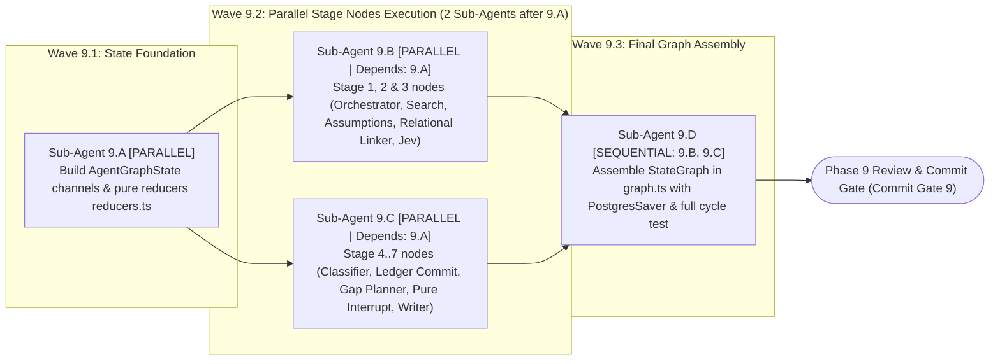

#### Detailed Sub-Agent Tasks in Phase 9

##### 1. Task `Sub-Agent 9.A`: Build `AgentGraphState` Channels and Pure Reducers (`state.ts` & `reducers.ts`)

- **Execution Mode & Dependencies:** `[PARALLEL — Wave 9.1]`.
- **Exclusively Targeted Files:**
  - `src/core/agent/reducers.ts` (new)
  - `src/core/agent/state.ts` (new)
- **Exact Implementation Actions:**
  1. Build side-effect-free pure reducer functions in `src/core/agent/reducers.ts` and define `AgentGraphAnnotation = Annotation.Root({...})` in `src/core/agent/state.ts` using strictly plain JSON-serializable structures (`messages`, `user_request`, `search_report`, `local_inspection_state`, `assumptions`, `master_ledger`, `unresolved_ledger`, `invalidation_map`, `question_queue`, `budget_tracking`, `search_loop_count`) per `ELIXENT-ARCH-02` §2.

##### 2. Task `Sub-Agent 9.B`: Build Stage 1, 2 & 3 Nodes (`Orchestrator`, `Search`, `Assumption & Linker`, `Jev Scorer`)

- **Execution Mode & Dependencies:** `[PARALLEL — Wave 9.2 | Depends on: Sub-Agent 9.A]`.
- **Exclusively Targeted Files:**
  - `src/core/agent/nodes/orchestrator-node.ts` (new)
  - `src/core/agent/nodes/search-nodes.ts` (new)
  - `src/core/agent/nodes/assumption-and-linker-nodes.ts` (new)
  - `src/core/agent/nodes/jev-scoring-nodes.ts` (new)
- **Exact Implementation Actions:**
  1. Wrap model-consuming nodes with `withMeteredNodeGate` and dereference `vault_ref://` pointers strictly at prompt construction time via `resolveVaultRefJustInTime`.
  2. **In `orchestrator-node.ts`:** Export `orchestratorNode(state, config)` to inspect the request and initialize `search_loop_count` and the initial inspection plan.
  3. **In `search-nodes.ts`:** Export the three nodes `searchAgentNode` (bounded by `stopWhen: stepCountIs(6)`), `workspaceToolNode`, and `searchSynthesizerNode`, along with the conditional routing function `toolsCondition(state): "workspace_tool_node" | "search_synthesizer_node"`.
  4. **In `assumption-and-linker-nodes.ts`:** Export the two Stage 2 nodes `assumptionAnalyzerNode` (which imports `PREDEFINED_CONCEPT_TAGS` and invokes `retrieveCandidatePriorDecisions`) and `atmsRelationalLinkerNode` (which calls `/v1/decisions` and executes `resolveATMSCascadeBFS`), along with the conditional routing function `routeAfterAssumptions(state): "jev_structuring_node" | "document_writer_node"`.
  5. **In `jev-scoring-nodes.ts`:** Export the two Stage 3 nodes `jevStructuringNode` (injecting historical `evaluatedAlternatives` and their rationales whenever a prior decision is re-evaluated) and `decisionScorerNode`.

##### 3. Task `Sub-Agent 9.C`: Build Stage 4, 5, 6 & 7 Nodes (`Classifier`, `Ledger Commit`, `Pure Interrupt`, `Document Writer`)

- **Execution Mode & Dependencies:** `[PARALLEL — Wave 9.2 | Depends on: Sub-Agent 9.A]` (executes in parallel with `9.B`).
- **Exclusively Targeted Files:**
  - `src/core/agent/nodes/resolution-and-ledger-nodes.ts` (new)
  - `src/core/agent/nodes/hitl-nodes.ts` (new)
  - `src/core/agent/nodes/document-writer-node.ts` (new)
- **Exact Implementation Actions:**
  1. **In `resolution-and-ledger-nodes.ts`:** Export the two deterministic nodes `confidenceClassifierNode` and `ledgerCommitNode` (pure TypeScript with zero LLM calls, synchronizing committed decisions to `project_decision_ledger` via `syncMasterLedgerToProjectStore`), the `internalGapPlannerNode` node, and the conditional routing function `resolutionGateRouter(state): "document_writer_node" | "internal_gap_planner_node" | "question_organizer_node"`.
  2. **In `hitl-nodes.ts`:** Export `questionOrganizerNode` and the **`pureInterruptNode`** (completely free of any model call or external write before `interrupt(state.question_queue, { responseSchema: ClarificationResponseSchema })`, never swallowing `GraphInterrupt`, and returning `new Command({ update: { question_queue: null, ... }, goto: "assumption_analyzer_node" })` upon resumption).
  3. **In `document-writer-node.ts`:** Export `documentWriterNode`, which merges modifications across sections listed in `state.invalidation_map` via `mergeSectionThreeWay` (`diff3MergeSection`).

##### 4. Task `Sub-Agent 9.D`: Assemble `StateGraph` in `src/core/agent/graph.ts` and Test the State Machine

- **Execution Mode & Dependencies:** `[SEQUENTIAL — Wave 9.3 | Depends on: Sub-Agent 9.B, Sub-Agent 9.C]`.
- **Exclusively Targeted Files:**
  - `src/core/agent/graph.ts` (new)
  - `src/test/agent/langgraph-orchestration.test.ts` (new)
- **Exact Implementation Actions:**
  1. Wire all nodes and conditional edges (`tools_condition`, `route_after_assumptions`, `resolution_gate_router`) inside `src/core/agent/graph.ts`, compiling the graph with `new PostgresSaver(getPgPool(), { serde: new EncryptedCheckpointSerializer() })`.
  2. Author integration tests in `src/test/agent/langgraph-orchestration.test.ts` verifying the 7-stage flow, safe suspension in `pure_interrupt_node`, and resumption via `new Command({ resume })` without re-executing any prior model node.

#### Phase 9 Commit Gate

- Run `npx vitest run src/test/agent/langgraph-orchestration.test.ts` and `npx tsc --noEmit` and confirm $100\%$ pass rate before running `git commit`.

### [Phase 10: `CodeMirror 6` Upgrade to `Multi-Hunk Ghost` & Unified `/api/agent/stream` Route]

> **Phase Identifier:** `Phase 10 — CodeMirror 6 Multi-Hunk Ghost Upgrade & Unified Agent SSE Stream Route`  
> **Single Responsibility Principle (`SRP`):** Upgrade CodeMirror 6 editor extensions to support multi-hunk ghost previews (`MultiHunkGhostState` with coordinate remapping via `tr.changes.mapPos` and per-hunk atomic undo), and build the unified server streaming route `/api/agent/stream/route.ts`.  
> **Post-Phase 9 Baseline State:** The `elixentAgentGraph` in `src/core/agent/graph.ts` is compiled and tested (Phase 9), `StreamGovernor` and `flushPendingSettlementsToPostgres` are ready (Phase 4), and `EphemeralVaultMemoryMap` is ready (Phase 6).

#### Phase 10 Sub-Agent Topology

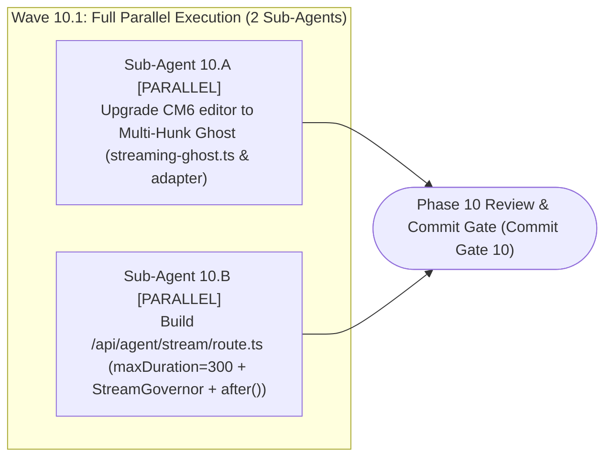

#### Detailed Sub-Agent Tasks in Phase 10

##### 1. Task `Sub-Agent 10.A`: Upgrade `CodeMirror 6` Editor for `Multi-Hunk Ghost` and Granular Atomic Acceptance

- **Execution Mode & Dependencies:** `[PARALLEL — Wave 10.1]`.
- **Exclusively Targeted Files:**
  - `src/components/editor/markdown/streaming-ghost.ts` (comprehensive upgrade)
  - `src/components/editor/markdown/types.ts` (modify)
  - `src/components/editor/markdown/editor-adapter.ts` (modify)
  - `src/components/editor/markdown/markdown-editor.tsx` (modify)
  - `src/test/editor/multi-hunk-ghost.test.ts` (new)
- **Exact Implementation Actions:**
  1. Upgrade `streaming-ghost.ts` from a single range to `MultiHunkGhostState` (`sessionId`, `hunks: GhostHunk[]`) per `ELIXENT-ARCH-03` §4.1–4.2.
  2. Automatically remap coordinates of all remaining hunks inside `StateField.update` via `hunk.from = tr.changes.mapPos(hunk.from, 1)` and `hunk.to = tr.changes.mapPos(hunk.to, -1)`.
  3. Implement `acceptGhostHunk` (annotated with `Transaction.userEvent.of("ai.accept.hunk")` for atomic per-hunk `Ctrl+Z` undo), `rejectGhostHunk`, and `acceptAllGhostHunks` (annotated with a single `Transaction.userEvent.of("ai.accept.all")` transaction), exposing them through `EditorAdapter`.

##### 2. Task `Sub-Agent 10.B`: Build Unified Agent Stream Route `src/app/api/agent/stream/route.ts`

- **Execution Mode & Dependencies:** `[PARALLEL — Wave 10.1]` (executes in parallel with `10.A`).
- **Exclusively Targeted Files:**
  - `src/app/api/agent/stream/route.ts` (new)
  - `src/test/agent/agent-stream-route.test.ts` (new)
- **Exact Implementation Actions:**
  1. Create `src/app/api/agent/stream/route.ts` exporting `export const maxDuration = 300;`.
  2. Authenticate the session via `requireAuthenticatedUser()`, enforce `aiStreamRateLimiter` (`Fail-Closed`), and validate `AgentStreamRequestPayload` (including `ephemeralVaultPayloads`, `liveDocumentSnapshots`, and `resumePayload`).
  3. Execute `elixentAgentGraph` inside `runWithEphemeralVaultScope` with streaming governed by `StreamGovernor`, invoke `zeroOutEphemeralVaultMemory()` (`Buffer.fill(0)`) inside the `finally` block, and schedule background settlement flushing to PostgreSQL via `after(async () => { await flushPendingSettlementsToPostgres(user.id); })`.

#### Phase 10 Commit Gate

- Run `npx vitest run src/test/editor/multi-hunk-ghost.test.ts src/test/agent/agent-stream-route.test.ts` and `npx tsc --noEmit` and confirm $100\%$ pass rate before running `git commit`.

### [Phase 11: Agent Chat Panel, `HITL` Question Cards, Credit Balance Views & Incremental Editor Sync]

> **Phase Identifier:** `Phase 11 — Agent Chat Panel, HITL Form UI, Credit Balance Views & Incremental Hunk Sync Orchestration`  
> **Single Responsibility Principle (`SRP`):** Build the interactive UI components for the architectural agent (`chat-panel.tsx`, `hitl-question-card.tsx`), update the editor toolbar and credit balance display pages (`dashboard`, `account`, `editor page`), and upgrade `use-ai-stream.ts` and `use-editor-orchestrator.ts` to connect to `/api/agent/stream` and perform debounced incremental synchronization via `useEditorAutosave`.  
> **Post-Phase 10 Baseline State:** The `Multi-Hunk Ghost` editor and `/api/agent/stream` route are ready and tested from Phase 10, and `getUserCreditBalance` is ready in `ai-settlement-service.ts` from Phase 4.

#### Phase 11 Sub-Agent Topology

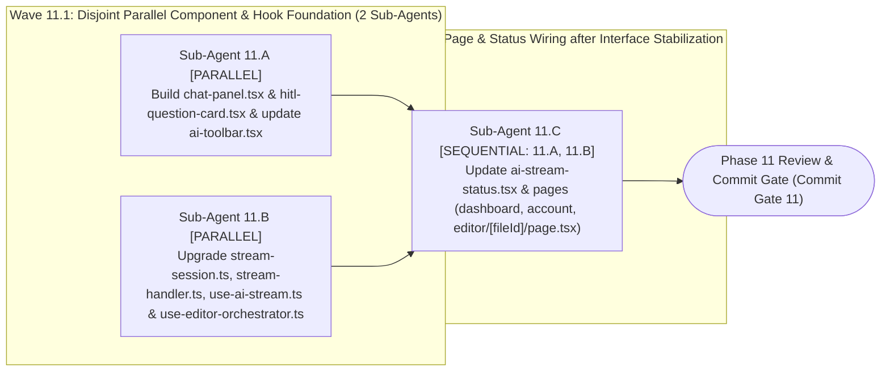

#### Detailed Sub-Agent Tasks in Phase 11

##### 1. Task `Sub-Agent 11.A`: Build Agent Chat Panel, `HITL` Cards, and Update `ai-toolbar.tsx`

- **Execution Mode & Dependencies:** `[PARALLEL — Wave 11.1]`.
- **Exclusively Targeted Files:**
  - `src/components/agent/chat-panel.tsx` (new)
  - `src/components/agent/hitl-question-card.tsx` (new)
  - `src/components/editor/ai-toolbar.tsx` (modify)
- **Exact Implementation Actions:**
  1. Build `src/components/agent/hitl-question-card.tsx` and `src/components/agent/chat-panel.tsx` (`export function AgentChatPanel(...)`) to display 7-stage progress, the architectural decision ledger (`master_ledger`) with each decision's rationale (`selectionRationale`) and evaluated alternatives (`evaluatedAlternatives`), and structured clarification forms governed by `ClarificationResponseSchema`.
  2. Update `src/components/editor/ai-toolbar.tsx` to add agent panel and ghost hunk controls (`onToggleAgentPanel?: () => void`, `isAgentPanelOpen?: boolean`, `activeGhostHunksCount?: number`, `onAcceptAllGhostHunks?: () => void`, `onRejectAllGhostHunks?: () => void`), replacing the legacy 5-operation buttons with the architectural agent panel toggle and multi-hunk action bar (`Accept All / Reject All`).

##### 2. Task `Sub-Agent 11.B`: Upgrade `stream-session.ts`, `stream-handler.ts`, `use-ai-stream.ts`, and `use-editor-orchestrator.ts` for `412`-Free Incremental Sync

- **Execution Mode & Dependencies:** `[PARALLEL — Wave 11.1]` (executes in parallel with `11.A`).
- **Exclusively Targeted Files:**
  - `src/lib/ai/stream-session.ts` (modify: decouple from `./prompts` and support agent session lifecycle states)
  - `src/lib/ai/stream-handler.ts` (modify: consume `/api/agent/stream` events and remove the 5-op `AIOperationType`)
  - `src/hooks/use-ai-stream.ts` (comprehensive upgrade)
  - `src/hooks/use-editor-orchestrator.ts` (upgrade to manage `Multi-Hunk Ghost` and debounced incremental sync)
- **Exact Implementation Actions:**
  1. Upgrade `src/lib/ai/stream-session.ts` to remove the `AIOperation` import from `./prompts` (line `1`) and export `AIStreamStatus` covering agent session states (`'idle' | 'running_graph' | 'awaiting_hitl' | 'streaming_hunks' | 'preview_ready' | 'completed' | 'aborted' | 'failed'`), and upgrade `src/lib/ai/stream-handler.ts` to target `/api/agent/stream` while preserving timeout guards (`FIRST_CHUNK_TIMEOUT_MS` and `MAX_LINE_BUFFER_CHARS`).
  2. In `src/hooks/use-ai-stream.ts`, direct streaming requests to `/api/agent/stream` passing `threadId`, `projectId`, `targetFileIds`, `ephemeralVaultPayloads` (after locally decrypting encrypted files in the browser when the vault is unlocked and `allowAIOnEncryptedFiles` is enabled), `liveDocumentSnapshots`, and `resumePayload`, removing all calls to `commitAIFileOperation`, `pending-operation-store`, and `preview-buffer`.
  3. In `src/hooks/use-editor-orchestrator.ts`, expose agent actions and state (`startAgentSession`, `resumeAgentInterrupt`, `stopAIOperation`, `resetAI`, `acceptGhostHunk`, `rejectGhostHunk`, `acceptAllGhostHunks`, `rejectAllGhostHunks`, `activeGhostHunksCount`, `agentGraphStage`, `activeQuestionQueue`, `masterDecisionLedger`) and wire ghost hunk acceptance to immediate local IndexedDB persistence (`localRevision += 1`) followed by coalesced server sync via `useEditorAutosave` (`Debounce 800ms–1000ms`), preventing concurrent save requests carrying the same `expectedVersion` and eliminating self-inflicted `412 Precondition Failed` errors.

##### 3. Task `Sub-Agent 11.C`: Update `ai-stream-status.tsx` and Dashboard, Account & Editor Pages (`dashboard`, `account`, `editor/[fileId]/page.tsx`)

- **Execution Mode & Dependencies:** `[SEQUENTIAL — Wave 11.2 | Depends on: Sub-Agent 11.A, Sub-Agent 11.B]`.
- **Exclusively Targeted Files:**
  - `src/components/editor/ai-stream-status.tsx` (modify)
  - `src/app/dashboard/page.tsx` (modify)
  - `src/app/account/page.tsx` (modify)
  - `src/app/workspace/editor/[fileId]/page.tsx` (modify)
- **Exact Implementation Actions:**
  1. Update `src/components/editor/ai-stream-status.tsx` to align with the new `AIStreamStatus` states exported from `src/lib/ai/stream-session.ts` (`running_graph`, `awaiting_hitl`, `streaming_hunks`, `preview_ready`, `failed`).
  2. Update `src/app/dashboard/page.tsx` and `src/app/account/page.tsx` to remove `getRemainingQuota()` imports from `ai-ops.ts`, replacing them with calls to `getUserCreditBalance(user.id)` from `src/server/services/ai-settlement-service.ts` and displaying credit allocations from `TIER_LIMITS[tier].creditsDisplay`.
  3. Update `src/app/workspace/editor/[fileId]/page.tsx` to remove `getRemainingQuota` imports and wire `<AIToolbar />`, `<AIStreamStatus />`, and `<AgentChatPanel />` to the updated `useEditorOrchestrator` outputs from `11.B`.

#### Phase 11 Commit Gate

- Verify via `grep` that zero references to `ai-ops.ts`, `ai-commit.ts`, `pending-operation-store.ts`, or `/api/ai/stream` remain in `src/app`, `src/components`, or `src/hooks`.
- Run `npx tsc --noEmit` and `npm run build` and confirm that the full production build succeeds before running `git commit`.

### [Phase 12: Final Purge of Legacy 5-Operation Modules, Test Suite Migration & Living Documentation Sync]

> **Phase Identifier:** `Phase 12 — Final Legacy Purge, Integration Test Suite Migration & Living Documentation Sync`  
> **Single Responsibility Principle (`SRP`):** Permanently delete the legacy 5-operation files that have zero remaining callers after Phase 11, migrate legacy integration tests to verify the new Elixent architecture, and synchronize `docs/foundation/DESIGN_VS_REALITY.md` and monitored documentation metrics.  
> **Post-Phase 11 Baseline State:** All UI components, editor views, and hooks in `src/app`, `src/components`, and `src/hooks` are fully wired to `/api/agent/stream` and `ai-settlement-service.ts`, leaving the legacy 5-operation files completely unreferenced in production code.

#### Phase 12 Sub-Agent Topology

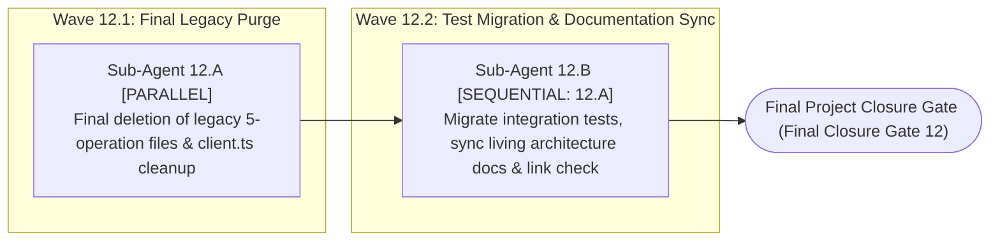

#### Detailed Sub-Agent Tasks in Phase 12

##### 1. Task `Sub-Agent 12.A`: Final Deletion of Legacy 5-Operation Files and Cleanup of `client.ts`, `tiers.config.ts`, `models.config.json`, and `ai-contracts.ts`

- **Execution Mode & Dependencies:** `[PARALLEL — Wave 12.1]`.
- **Exclusively Targeted Files:**
  - `src/lib/ai/prompts.ts` (permanent delete)
  - `src/server/actions/ai-ops.ts` (permanent delete)
  - `src/server/actions/ai-commit.ts` (permanent delete)
  - `src/lib/ai/pending-operation-store.ts` (permanent delete)
  - `src/lib/ai/quota-settlement-reducer.ts` (permanent delete)
  - `src/lib/ai/preview-buffer.ts` (permanent delete)
  - `src/app/api/ai/stream/route.ts` (permanent delete)
  - `src/lib/ai/client.ts` (modify: remove legacy streaming helper and retain only `Vercel AI SDK v7` functions)
  - `src/config/tiers.config.ts` & `src/config/models.config.json` (modify: remove temporary 5-operation compatibility fields now that `ai-ops.ts` is deleted and `account/page.tsx` was updated in Phase 11)
  - `src/types/ai-contracts.ts` (modify: update reservation and settlement contracts to reflect `Micro-Credits` and `/api/agent/stream` payloads)
- **Exact Implementation Actions:**
  1. Permanently delete the seven legacy files (`prompts.ts`, `ai-ops.ts`, `ai-commit.ts`, `pending-operation-store.ts`, `quota-settlement-reducer.ts`, `preview-buffer.ts`, `api/ai/stream/route.ts`) from the codebase.
  2. Clean `src/lib/ai/client.ts`, `src/config/tiers.config.ts`, and `src/config/models.config.json` of any temporary compatibility fields retained for the legacy 5 operations, and update `src/types/ai-contracts.ts` to represent `Micro-Credits` and architectural agent contracts.

##### 2. Task `Sub-Agent 12.B`: Migrate Integration Tests and Synchronize `METRICS.json` and the Eight Monitored Documents (`DESIGN_VS_REALITY.md` & Peers)

- **Execution Mode & Dependencies:** `[SEQUENTIAL — Wave 12.2 | Depends on: Sub-Agent 12.A]`.
- **Exclusively Targeted Files:**
  - `src/test/ai/*` (update and migrate tests that imported `ai-ops`, `ai-commit`, `quota-settlement-reducer`, `preview-buffer`, or `api/ai/stream`)
  - `src/test/contracts/state-machines-contracts.test.ts` & `src/test/types/contracts.test.ts` (update)
  - `src/test/editor/editor-orchestration.integration.test.ts` & `src/test/editor/editor-recovery-reload.test.ts` & `src/test/sync/encrypted-conflict-decryption.integration.test.ts` (update)
  - `src/test/vault/vault-sync-ai-gate.test.ts` & `src/test/vault/vault-cross-module.integration.test.ts` (update)
  - `e2e/specs/{06-ai-streaming-commit,07-ai-abort-reject,08-ai-failure-refund,12-vault-ai-shield}.spec.ts` (update)
  - `vitest.constants.mts` & `docs/METRICS.json` (update and synchronize automatically via `scripts/sync-doc-metrics.mjs`)
  - The eight monitored documentation files listed in `ALL_MONITORED_PATHS` inside `scripts/sync-doc-metrics.mjs`: `README.md`, `docs/README.md`, `docs/TECHNICAL_DEBT_REGISTER.md`, `docs/reference/test-database-isolation.md`, `docs/reference/ci-pipeline.md`, `docs/architecture/sync/editor-sync-orchestration.md`, `docs/architecture/sync/file-ownership-and-versioning.md`, and `docs/foundation/DESIGN_VS_REALITY.md`.
- **Exact Implementation Actions:**
  1. Update test files across `src/test/ai/*`, `src/test/contracts/*`, `src/test/types/*`, `src/test/editor/*`, `src/test/sync/*`, `src/test/vault/*`, and `e2e/specs/*` to bind to `/api/agent/stream`, micro-credit settlement, the `403 VAULT_AI_ACCESS_DENIED` vault gate, and `Multi-Hunk Ghost` incremental synchronization.
  2. Update `LIVE_TEST_FILES` in `vitest.constants.mts`, and update `docs/foundation/DESIGN_VS_REALITY.md` to document the complete architectural transformation from the legacy 5-operation model in `LUGX` to the `Elixent v3.2` architectural agent engine.
  3. Generate the actual JSON report from Vitest and pass it to `scripts/sync-doc-metrics.mjs` to update both `unitSuites` and `unitTests` in `docs/METRICS.json` and across all seven monitored documentation files:
     ```bash
     npx vitest run --reporter=json --outputFile=/tmp/vitest-report.json
     node scripts/sync-doc-metrics.mjs --report=/tmp/vitest-report.json
     ```

#### Phase 12 & Final Milestone Closure Gate

- Execute the comprehensive final verification sequence and confirm $100\%$ pass rate (`0 errors`) before creating the final `git commit`:
  ```bash
  npx tsc --noEmit
  npm run lint
  npm run build
  npx vitest run --reporter=json --outputFile=/tmp/vitest-report.json
  node scripts/sync-doc-metrics.mjs --report=/tmp/vitest-report.json
  node scripts/sync-doc-metrics.mjs --check
  npm run lint:links
  ```

## 5. 12-Phase Cumulative State & Isolation Audit Matrix

The following table proves that all 12 phases adhere strictly to the `Cumulative State Progression` rule and maintain zero file-ownership overlap between parallel sub-agents in every wave:

| Phase          | Input Baseline State                                              | Committed Output State                                                                                                                                                                                                      | Parallel Isolation Check                                                                                                                                                                                                                                                  |
| :------------- | :---------------------------------------------------------------- | :-------------------------------------------------------------------------------------------------------------------------------------------------------------------------------------------------------------------------- | :------------------------------------------------------------------------------------------------------------------------------------------------------------------------------------------------------------------------------------------------------------------------ |
| **`Phase 1`**  | Raw `LUGX v1.46.3` repository.                                    | Hardens the seven vulnerabilities in encryption, files, and sync, and prunes dead code in `conflict-resolver.ts`.                                                                                                           | `1.A` (`webauthn-prf`, `editor hooks`) $\parallel$ `1.B` (`use-sync`, `conflict-resolver`) $\parallel$ `1.C` (`folders`, `files`, `import-file`, `auth-actions`) $\rightarrow$ **Overlap = $0$**.                                                                         |
| **`Phase 2`**  | Committed outputs of `Phase 1`.                                   | Installs NPM packages, exports `getPgPool()`, applies migration `0013` (`credit_ledger_transactions`, `project_decision_ledger`, `PostgresSaver` tables, dropping `usage`/`ai_reservations`), & updates callers/tests.      | `2.A` (`package.json`, `transactional.ts`) $\parallel$ `2.B` (`db/schema/*`), followed sequentially by `2.C` (`migrations/0013`, `verify-migrations.mjs`) then `2.D` (callers & tests) $\rightarrow$ **Overlap = $0$**.                                                   |
| **`Phase 3`**  | Outputs of `Phase 1..2` (new tables and packages ready).          | Lean `models.config.json` registry, micro-credit derivation constants/formulas, `js-tiktoken` tokenizer, and the three atomic Lua scripts + unit tests.                                                                     | Wave `3.1`: `3.A` (`models.config.json`) $\parallel$ `3.B` (`constants`, `derivation`, `tokenizer`), followed in Wave `3.2` by `3.C` (`lua-scripts.ts`, `derivation-and-lua.unit.test.ts`) $\rightarrow$ **Overlap = $0$**.                                               |
| **`Phase 4`**  | Outputs of `Phase 1..3` (Lua scripts & derivation math ready).    | `Flush-First Cold Start`, PostgreSQL settlement service, `withMeteredNodeGate`, `StreamGovernor`, upgraded Stripe & Cron, and passing `MTR-01..06`.                                                                         | Wave `4.1`: `4.A` (`cold-start`, `settlement`, `node-gate`) $\parallel$ `4.B` (`stream-governor`).<br>Wave `4.2`: `4.C` (`stripe/tiers`) $\parallel$ `4.D` (`cron/tests`) $\rightarrow$ **Overlap = $0$**.                                                                |
| **`Phase 5`**  | Outputs of `Phase 1..4` (financial metering subsystem complete).  | Fence-aware heading slicer `heading-slicer.ts`, `diff3MergeSection(live, base, proposed)`, and hybrid lexical search `lexical-bm25.ts`.                                                                                     | `5.A` (`heading-slicer.ts`) $\parallel$ `5.B` (`lexical-bm25.ts`), followed by `5.C` (`diff3.ts`) $\rightarrow$ **Overlap = $0$**.                                                                                                                                        |
| **`Phase 6`**  | Outputs of `Phase 1..5` (AST, BM25 & Diff3 engines ready).        | `EphemeralVaultMemoryMap` (`vault_ref://` + `Buffer.fill(0)`), `EncryptedCheckpointSerializer`, and `CloudPostgresWorkspaceProvider`.                                                                                       | `6.A` (`ephemeral-memory-map.ts`) $\parallel$ `6.B` (`checkpoint-serializer.ts`), followed by `6.C` (`provider.ts`, `cloud-provider.ts`) $\rightarrow$ **Overlap = $0$**.                                                                                                 |
| **`Phase 7`**  | Outputs of `Phase 1..6` (workspace & vault isolation ready).      | Comprehensive `PREDEFINED_CONCEPT_TAGS` dictionary & `Zod` contracts, `/v1/decisions` client & `Conformal APS` classifier, and `client.ts` upgraded to `Vercel AI SDK v7`.                                                  | Wave `7.1`: `7.A` (`taxonomy/schemas`) $\parallel$ `7.C` (`lib/ai/*`), followed in Wave `7.2` by `7.B` (`lib/jev/*`) $\rightarrow$ **Overlap = $0$**.                                                                                                                     |
| **`Phase 8`**  | Outputs of `Phase 1..7` (tags, decisions client & BM25 ready).    | `Justification-Driven ATMS DAG`, deterministic local candidate retriever `retrieveCandidatePriorDecisions`, relational linker, and `resolveATMSCascadeBFS`.                                                                 | `8.A` (`atms/dag.ts`) $\parallel$ `8.B` (`atms/candidate-retriever.ts`), followed by `8.C` (`relational-linker.ts`, `invalidation.ts`) $\rightarrow$ **Overlap = $0$**.                                                                                                   |
| **`Phase 9`**  | Outputs of `Phase 1..8` (all agent infrastructure pillars ready). | `AgentGraphState` channels & pure reducers, 14 nodes across 7 stages, and compiled `StateGraph` in `graph.ts` with `PostgresSaver(getPgPool())`.                                                                            | Wave `9.2`: `9.B` (`orchestrator`, `search`, `assumption`, `jev`) $\parallel$ `9.C` (`resolution`, `hitl`, `writer`), followed by `9.D` (`graph.ts`) $\rightarrow$ **Overlap = $0$**.                                                                                     |
| **`Phase 10`** | Outputs of `Phase 1..9` (`elixentAgentGraph` & governor ready).   | CM6 editor upgraded to `Multi-Hunk Ghost` (`GhostHunk[]` + `mapPos`) and unified `/api/agent/stream/route.ts` route (`maxDuration = 300`).                                                                                  | `10.A` (`components/editor/markdown/*`) $\parallel$ `10.B` (`app/api/agent/stream/route.ts`) $\rightarrow$ **Overlap = $0$**.                                                                                                                                             |
| **`Phase 11`** | Outputs of `Phase 1..10` (`Multi-Hunk` editor & route ready).     | `chat-panel.tsx` & `hitl-question-card.tsx`, updated `ai-toolbar.tsx`, `ai-stream-status.tsx`, and balance pages, and upgraded `stream-session.ts`, `stream-handler.ts`, `use-ai-stream.ts` & `use-editor-orchestrator.ts`. | Wave `11.1`: `11.A` (`components/agent/*`, `ai-toolbar.tsx`) $\parallel$ `11.B` (`hooks/*`, `stream-session.ts`, `stream-handler.ts`), followed in Wave `11.2` by `11.C` (`ai-stream-status.tsx`, `dashboard`, `account`, `editor page`) $\rightarrow$ **Overlap = $0$**. |
| **`Phase 12`** | Outputs of `Phase 1..11` (UI & editor fully wired to new agent).  | Final deletion of legacy 5-operation files, migrated integration test suites, and synchronized `DESIGN_VS_REALITY.md`.                                                                                                      | `12.A` (delete legacy files & clean `client.ts`) followed by `12.B` (migrate tests & sync documentation) $\rightarrow$ **Overlap = $0$**.                                                                                                                                 |
