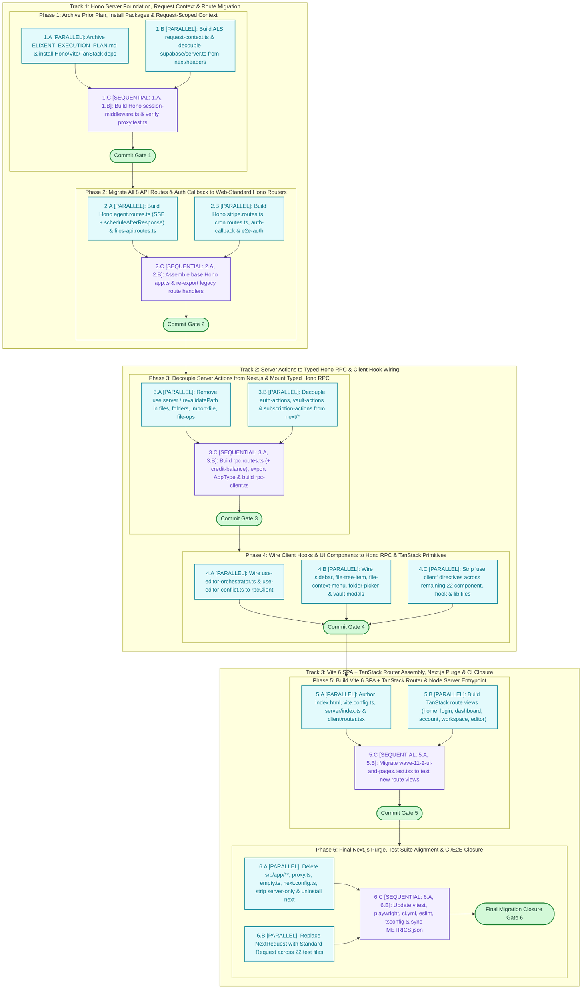
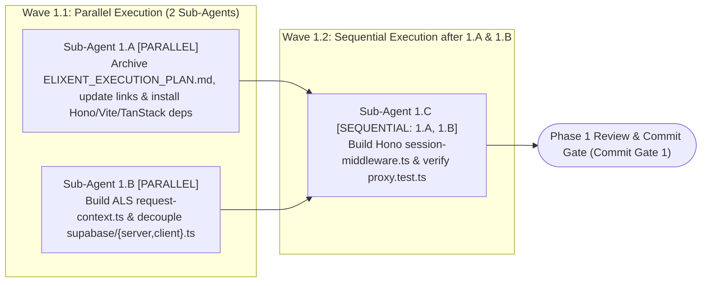
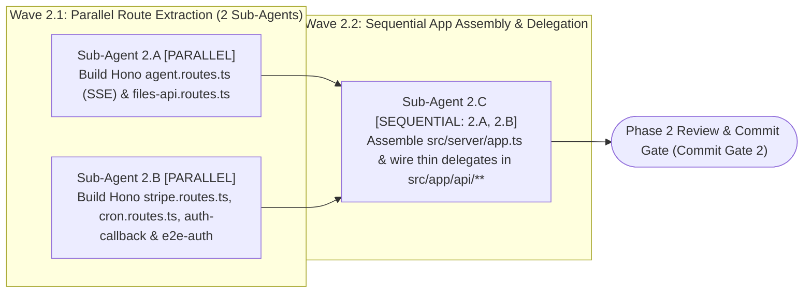
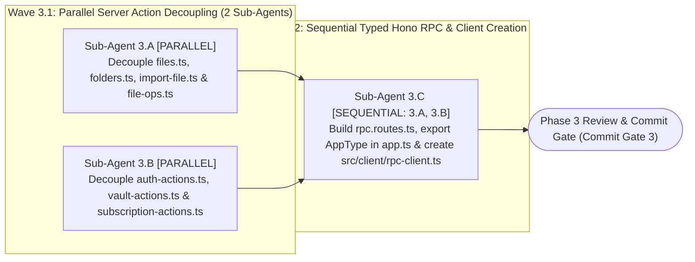
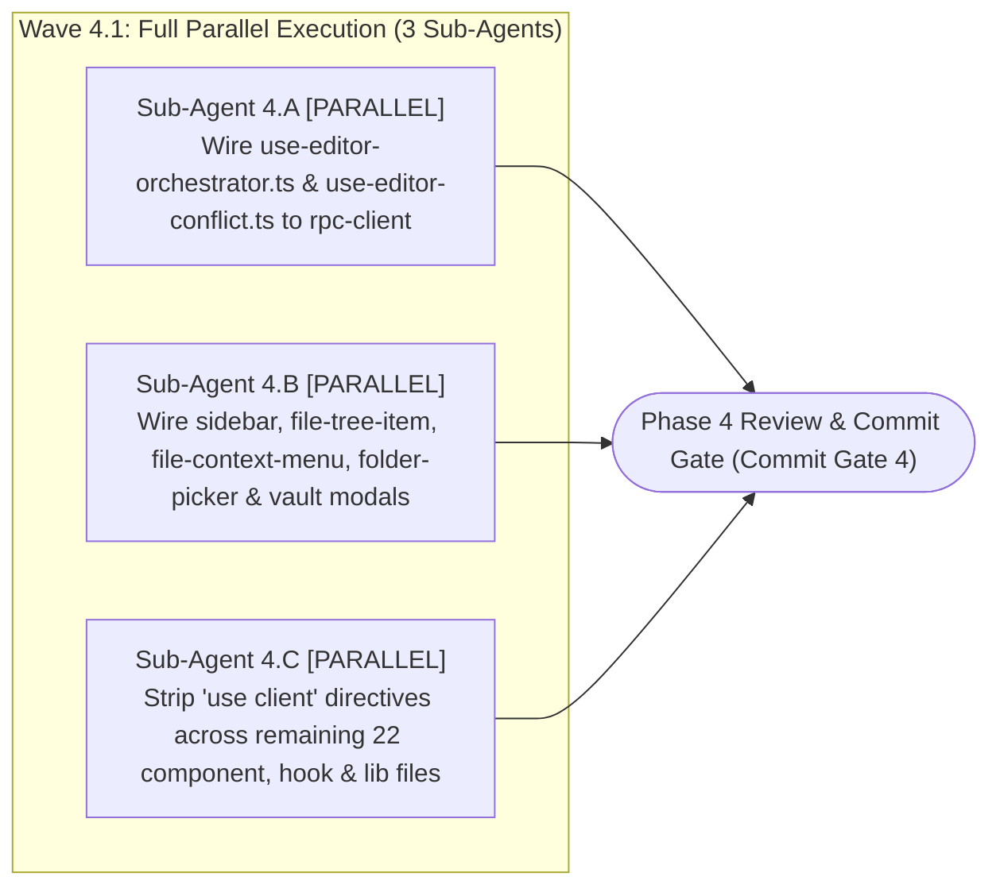
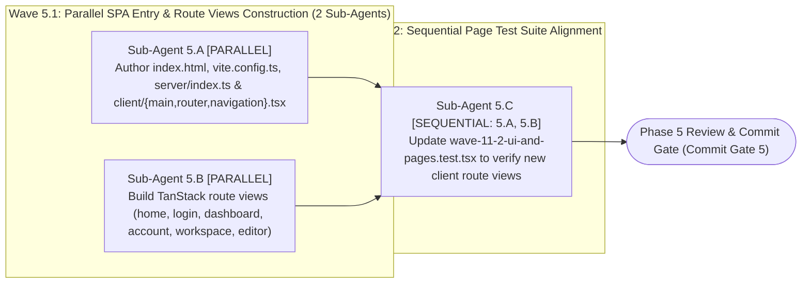
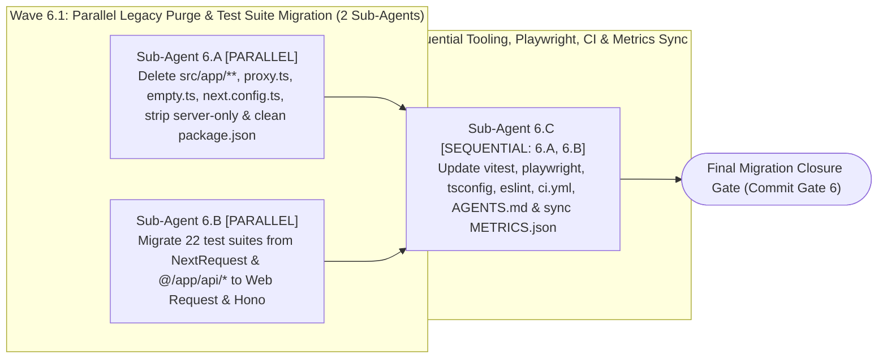

# Comprehensive Elixent Framework Migration Execution Plan

| Standard Field              | Approved Value                                                                                                                                                                                                                                                                                                                                                                                                                                                                                                                                                                                                                                                                                                                                                                                                                                                       |
| :-------------------------- | :------------------------------------------------------------------------------------------------------------------------------------------------------------------------------------------------------------------------------------------------------------------------------------------------------------------------------------------------------------------------------------------------------------------------------------------------------------------------------------------------------------------------------------------------------------------------------------------------------------------------------------------------------------------------------------------------------------------------------------------------------------------------------------------------------------------------------------------------------------------- |
| **Document ID**             | `ELIXENT-FRAMEWORK-MIGRATION-PLAN-v1.1`                                                                                                                                                                                                                                                                                                                                                                                                                                                                                                                                                                                                                                                                                                                                                                                                                              |
| **Classification**          | `ACTIVE TRACKED EXECUTION PLAN` (per `docs/DOCUMENTATION_GUIDELINES.md` §2 & §3)                                                                                                                                                                                                                                                                                                                                                                                                                                                                                                                                                                                                                                                                                                                                                                                     |
| **Version & Status**        | `v1.1 — Approved for Atomic Execution in 6 Phases (6 Commit-Sized SRP Phases + Sub-Agent Waves)`                                                                                                                                                                                                                                                                                                                                                                                                                                                                                                                                                                                                                                                                                                                                                                     |
| **Baseline Repository**     | `Elixent v0.12.0` (`112 Unit/Contract Suites · 1,892 Tests` + `21 Live Suites · 108 Tests` + `14 Playwright E2E Specs · 15 Journeys` — with full commitment to `100% Behavior-Preserving Zero Regression Tolerance`)                                                                                                                                                                                                                                                                                                                                                                                                                                                                                                                                                                                                                                                 |
| **SSOT Architecture Suite** | • [01_architecture_vision_and_adrs](https://www.google.com/search?q=../architecture/01_architecture_vision_and_adrs.md) (`ELIXENT-ARCH-01 v3.1`)<br>• [02_agent_orchestration_and_decision_engine](https://www.google.com/search?q=../architecture/02_agent_orchestration_and_decision_engine.md) (`ELIXENT-ARCH-02 v3.1`)<br>• [03_workspace_ast_editor_and_vault_integration](https://www.google.com/search?q=../architecture/03_workspace_ast_editor_and_vault_integration.md) (`ELIXENT-ARCH-03 v3.2`)<br>• [04_credit_metering_and_settlement_architecture](https://www.google.com/search?q=../architecture/04_credit_metering_and_settlement_architecture.md) (`ELIXENT-ARCH-04 v3.0`)<br>• [05_data_contracts_and_lugx_migration_plan](https://www.google.com/search?q=../architecture/05_data_contracts_and_lugx_migration_plan.md) (`ELIXENT-ARCH-05 v3.2`) |

## 1. Executive Purpose & Execution Protocol

This document represents the **Authoritative Execution Blueprint** for migrating the **`Elixent v0.12.0`** web platform from `Next.js 16 (App Router)` to the unified **`Vite 6 SPA + TanStack Router + Hono RPC`** web architecture while establishing zero-cost transport seams (`Injectable Fetch Transport` in `hc<AppType>` and `IWorkspaceProvider` isolation) for a future, independently planned desktop runtime.

To enable rigorous inspection, an independent atomic save (`Atomic Git Commit`), and full verification after every phase without accumulating massive, hard-to-trace changesets or mixing business-logic changes with framework replacement, this plan is governed by **six strict execution invariants**:

1. **Behavior-Preserving Framework Migration Only (`Zero Logic Mutation`):**
   - This migration strictly replaces the framework transport, routing, and build layers (`Next.js 16 App Router`, `"use server"`, `"use client"`, `next/*`) with **`Vite 6 + TanStack Router + Hono RPC`**.
   - **Prohibition of Bundling Post-Migration Bug Fixes or Feature Changes:** All existing business logic, validation schemas, database queries, state reducers, and status codes in `src/core/**`, `src/lib/**`, `src/server/**`, and `src/components/**` are preserved verbatim (`100% behavioral parity`). Keeping the current `2,015` green tests invariant guarantees that any test failure during migration is immediately and unambiguously isolated to the framework wiring layer.
2. **Web-Only Execution Scope with Zero-Cost Future Desktop Seams:**
   - The active implementation scope of this plan is strictly the **Cloud Web Platform**. No `Electron` packages, desktop processes, or local filesystem providers (`DesktopLocalFsWorkspaceProvider`) are installed or built in this plan.
   - Future desktop readiness is satisfied purely by enforcing standard Web `Request`/`Response` contracts in `Hono` and exposing an injectable `CustomFetchFn` parameter in `createElixentRpcClient(baseUrl, customFetch?)` (`src/client/rpc-client.ts`).
3. **Atomic Decomposition into 6 Isolated Single-Responsibility Phases (`6 Commit-Sized SRP Phases`):**
   - Instead of a monolithic rewrite or overly fragmented micro-steps, the migration is partitioned into **6 sequential, strictly scoped phases (`Phase 1` $\rightarrow$ `Phase 6`)** across three architectural tracks.
   - Each phase carries a single architectural responsibility (`SRP`) that can be completed in a single focused session, inspected via `git diff`, verified via automated gates, and committed in an independent `Git Commit`.
4. **Strict Cumulative State Progression Rule:**
   - Every phase $N$ ($N > 1$) assumes that all modifications, packages, and files scheduled in phases $1 \dots (N-1)$ **have already been completed, committed, and established as the current repository baseline (`Baseline State of Phase N`)**.
   - No advanced phase describes files deleted or transformed in an earlier phase as if they still existed in their legacy `Next.js` state.
5. **Intra-Phase Sub-Agent Execution Topology & Zero File-Write Contention:**
   - Each of the 6 phases is decomposed into **Execution Waves** comprising **2 to 3 Sub-Agent Tasks**, explicitly marked as either **`[PARALLEL]`** or **`[SEQUENTIAL — Depends on Task X.Y]`**.
   - No two sub-agent tasks running in parallel (`[PARALLEL]`) within the same wave are ever permitted to modify the same source file; every target file in a parallel wave is exclusively owned by a single sub-agent.
6. **Zero Broken Intermediate Commits (`Dual-Mode Transition Bridge`):**
   - During Phases `1` through `5`, while `Hono` routes and the `Vite + TanStack Router` client are being constructed alongside existing files, `AsyncLocalStorage` request context bridges in `src/server/context/request-context.ts`, background task scheduling hooks (`scheduleAfterResponse`), and dual-callable wrappers in `src/client/rpc-client.ts` and `src/server/actions/*.ts` ensure that `npx tsc --noEmit` and the entire `1,892` unit test and `108` live integration test baseline remain **$100\%$ green at the closure of every single phase from Phase 1 through Phase 6 without exception**.

## 2. Master 6-Phase & Sub-Agent DAG

The following diagram illustrates the sequence of the 6 phases across three major architectural tracks (`Tracks 1–3`), the distribution of parallel and sequential sub-agent tasks, and the `Commit Gates` for each phase:



## 3. 6-Phase Commit Register

| Phase         | Single Responsibility Scope                                                                                                                                                                                                   |    Sub-Agent Tasks    | Target Git Commit                                                                                                              |
| :------------ | :---------------------------------------------------------------------------------------------------------------------------------------------------------------------------------------------------------------------------- | :-------------------: | :----------------------------------------------------------------------------------------------------------------------------- |
| **`Phase 1`** | Archive completed `ELIXENT_EXECUTION_PLAN.md`, install `Hono` / `Vite 6` / `TanStack Router` packages, build `AsyncLocalStorage` request context (`request-context.ts`), and build Hono `session-middleware.ts`.              | $3$ (`Waves 1.1–1.2`) | `build(deps): archive prior execution plan, install Hono/Vite/TanStack packages, and add ALS request context middleware`       |
| **`Phase 2`** | Migrate all 8 REST/SSE API routes (`/api/agent/stream`, `/api/files/*`, `/api/stripe/*`, `/api/cron/*`, `/api/test/e2e-auth`) and `/auth/callback` into modular Hono routers mounted on `src/server/app.ts`.                  | $3$ (`Waves 2.1–2.2`) | `feat(server): migrate all API route handlers and OAuth callback to web-standard Hono routers`                                 |
| **`Phase 3`** | Decouple all 7 `src/server/actions/*.ts` modules from `"use server"`, `next/cache`, `next/headers`, and `next/navigation`, mount them (plus credit balance) as typed Hono RPC routes (`AppType`), and create `rpc-client.ts`. | $3$ (`Waves 3.1–3.2`) | `feat(rpc): decouple server actions from Next.js runtime, mount typed Hono RPC endpoints, and add injectable hc client`        |
| **`Phase 4`** | Wire client hooks (`use-editor-orchestrator`, `use-editor-conflict`) and UI components (`sidebar`, `file-context-menu`, `vault` modals) to `rpcClient`, replace `next/link`, and remove all `"use client"` directives.        |   $3$ (`Wave 4.1`)    | `refactor(client): wire editor hooks and UI components to Hono RPC client and strip Next.js client directives`                 |
| **`Phase 5`** | Build the `Vite 6 SPA` + `TanStack Router` presentation layer (`index.html`, `vite.config.ts`, `src/client/**`, `src/server/index.ts`), migrate all 5 application pages, and align UI page tests.                             | $3$ (`Waves 5.1–5.2`) | `feat(spa): implement Vite 6 SPA entry, TanStack Router views, and unified Hono Node.js server entrypoint`                     |
| **`Phase 6`** | Permanently delete `src/app/**`, `src/proxy.ts`, `src/server/empty.ts`, and `next.config.ts`, strip `import "server-only"`, uninstall `next`, migrate `NextRequest` in 22 test suites to Web `Request`, and align CI/E2E.     | $3$ (`Waves 6.1–6.2`) | `chore(migration): purge Next.js artifacts, migrate test suites to standard Request, and align Playwright E2E and CI pipeline` |

## 4. Detailed 6-Phase Specifications

### [Phase 1: Archive Prior Plan, Install Target Packages & Build Request-Scoped Session Middleware] — ✅ CLOSED / EXECUTED

> **Phase Identifier:** `Phase 1 — Archive Prior Plan, Install Target Packages & Build Request-Scoped Session Middleware`  
> **Status:** `CLOSED / EXECUTED` (Commit Gate 1 Satisfied & Verified)  
> **Closure Report Dossier:** [`docs/records/closures/framework-migration/phase-01-archive-prior-plan-target-packages-and-session-middleware.md`](../records/closures/framework-migration/phase-01-archive-prior-plan-target-packages-and-session-middleware.md)  
> **Single Responsibility Principle (`SRP`):** Archive the completed `ELIXENT_EXECUTION_PLAN.md` in accordance with `docs/DOCUMENTATION_GUIDELINES.md` §3–§4, install the approved `Hono`, `Vite 6`, and `TanStack Router` dependencies, and decouple `src/lib/supabase/server.ts` from `next/headers` via a deterministic `AsyncLocalStorage` request context (`src/server/context/request-context.ts`) and Hono session middleware (`src/server/middleware/session-middleware.ts`).  
> **Pre-Phase 1 Baseline State:** Raw `Elixent v0.12.0` repository on `Next.js 16.3.8` with `112` unit suites (`1,892` tests), `21` live suites (`108` tests), and `14` E2E specs (`15` journeys) passing $100\%$.

#### Phase 1 Sub-Agent Topology



#### Detailed Sub-Agent Tasks in Phase 1

##### 1. Task `Sub-Agent 1.A`: Archive Completed `ELIXENT_EXECUTION_PLAN.md`, Update All Cross-Document Links, and Install Target Framework Packages

- **Execution Mode & Dependencies:** `[PARALLEL — Wave 1.1]`.
- **Exclusively Targeted Files:**
  - `docs/Plans/ELIXENT_EXECUTION_PLAN.md` (move to `docs/records/plans/elixent-agentic-architecture-execution-plan.md`)
  - `docs/Plans/ELIXENT_FRAMEWORK_MIGRATION_PLAN.md` (place this active execution plan in `docs/Plans/`)
  - `README.md` (modify: lines `168` and `798`)
  - `docs/README.md` (modify: lines `48` and `172`)
  - `docs/records/closures/elixent-execution/phase-10-codemirror-6-multi-hunk-ghost-upgrade-and-unified-agent-sse-stream-route.md` (modify: line `290`)
  - `docs/records/closures/elixent-execution/phase-11-agent-chat-panel-hitl-question-cards-credit-balance-views-and-incremental-editor-sync.md` (modify: line `229`)
  - `docs/records/closures/elixent-execution/phase-12-final-legacy-purge-test-suite-migration-and-living-docs-sync.md` (modify: line `9`)
  - `package.json` & `package-lock.json` (modify)
- **Exact Line-Level Implementation Actions:**
  1. **Archive the completed 12-phase execution plan per `docs/DOCUMENTATION_GUIDELINES.md` §3 & §4:**
     - Append the `— ✅ CLOSED / EXECUTED` suffix to all four remaining phase headings inside `ELIXENT_EXECUTION_PLAN.md` (`Phase 2` on line `306`, `Phase 9` on line `996`, `Phase 10` on line `1075`, and `Phase 11` on line `1127`), and move the file from `docs/Plans/ELIXENT_EXECUTION_PLAN.md` to `docs/records/plans/elixent-agentic-architecture-execution-plan.md`.
     - Inside the moved file `docs/records/plans/elixent-agentic-architecture-execution-plan.md`, update all 21 relative Markdown links to account for the deeper directory level (`docs/records/plans/` instead of `docs/Plans/`): replace `](../architecture/` with `](../../architecture/` (line `9`) and replace `](../records/closures/` with `](../closures/` (lines `188, 309, 552, 557, 560, 624, 629, 632, 713, 718, 721, 781, 786, 789, 846, 851, 854, 928, 933, 935, 994, 1073, 1125, 1196`).
     - Place this active migration plan at `docs/Plans/ELIXENT_FRAMEWORK_MIGRATION_PLAN.md`.
     - Update the Markdown links in `README.md` (lines `168, 798`), `docs/README.md` (lines `48, 172`), and the three closure dossiers (`phase-10` line `290`, `phase-11` line `229`, `phase-12` line `9`: change `../../../Plans/ELIXENT_EXECUTION_PLAN.md` to `../../plans/elixent-agentic-architecture-execution-plan.md`) so `node scripts/check-markdown-links.mjs` passes with zero broken links.
  2. **Install the approved Web-Standard framework packages in `package.json`:**
     - Add to `dependencies`:
       - `"hono": "^4.13.17"`
       - `"@hono/node-server": "^2.1.6"`
       - `"@hono/zod-validator": "^0.9.1"`
       - `"@tanstack/react-router": "^1.170.46"`
     - Add to `devDependencies`:
       - `"vite": "^6.4.5"`
       - `"@vitejs/plugin-react": "^5.2.0"`
       - `"tsx": "^4.23.15"`
     - Retain `"next"` temporarily in `package.json` during Phases `1..5` so existing tests and transitional imports remain unbroken until the final purge in `Phase 6`.

##### 2. Task `Sub-Agent 1.B`: Build `AsyncLocalStorage` Request Context (`request-context.ts`) and Decouple `src/lib/supabase/{server,client}.ts`

- **Execution Mode & Dependencies:** `[PARALLEL — Wave 1.1]` (executes in full concurrency with `1.A`).
- **Exclusively Targeted Files:**
  - `src/server/context/request-context.ts` (new)
  - `src/lib/supabase/server.ts` (modify)
  - `src/lib/supabase/client.ts` (modify)
  - `src/config/features.config.ts` (modify)
- **Exact Line-Level Implementation Actions:**
  1. **Create `src/server/context/request-context.ts`:**
     - Define an `AsyncLocalStorage<ServerRequestContext>` store holding `{ cookies: { getAll(): Array<{ name: string; value: string }>; set(name: string, value: string, options?: Record<string, unknown>): void; delete(name: string): void }; headers: Headers }`.
     - Export `runWithServerRequestContext<T>(ctx: ServerRequestContext, fn: () => Promise<T>): Promise<T>` and `getActiveRequestContext(): ServerRequestContext | null`.
     - Export `resolveCookiesAndHeaders()` which first checks `getActiveRequestContext()`; if `null` (when existing unit or live tests invoke a server function directly without wrapping in Hono middleware), it dynamically falls back to `await import("next/headers")` wrapped in `try/catch` (returning an empty in-memory cookie/header store if unavailable) so all existing unit and live tests that mock `next/headers` continue to pass $100\%$ during Phases `1..5`.
     - Export a deterministic background task scheduler `scheduleAfterResponse(task: () => Promise<void> | void): void` that during Phases `1..5` checks if `next/server` exports `after` and invokes `after(task)` (falling back to `void Promise.resolve().then(task).catch((err) => console.error("[AgentStream] Settlement flush error:", err))`), so existing tests that intercept `after()` via `vi.mock("next/server")` continue to capture background settlement callbacks seamlessly until `Phase 6`.
  2. **Update `src/lib/supabase/server.ts` (lines `1–61`):**
     - Remove the top-level static `import { cookies } from "next/headers"` and replace `const cookieStore = await cookies();` with `const { cookies: cookieStore } = await resolveCookiesAndHeaders();` from `@/server/context/request-context`.
     - Resolve Supabase credentials using `process.env.VITE_SUPABASE_URL || process.env.NEXT_PUBLIC_SUPABASE_URL || "https://placeholder.supabase.co"` and `process.env.VITE_SUPABASE_ANON_KEY || process.env.NEXT_PUBLIC_SUPABASE_ANON_KEY || "placeholder-anon-key"`.
  3. **Update `src/lib/supabase/client.ts` (lines `1–8`) and `src/config/features.config.ts` (line `14`):**
     - Guard `process.env` access with `typeof process !== "undefined"` and check `import.meta.env?.VITE_SUPABASE_*` / `import.meta.env?.NEXT_PUBLIC_*` alongside `process.env.NEXT_PUBLIC_*` / `process.env.VITE_*` so browser bundles and Node test environments resolve identically without throwing `ReferenceError: process is not defined`.

##### 3. Task `Sub-Agent 1.C`: Build Hono Session & Protection Middleware (`session-middleware.ts`)

- **Execution Mode & Dependencies:** `[SEQUENTIAL — Wave 1.2 | Depends on: Sub-Agent 1.A, Sub-Agent 1.B]`.
- **Exclusively Targeted Files:**
  - `src/server/middleware/session-middleware.ts` (new)
- **Exact Line-Level Implementation Actions:**
  1. **Create `src/server/middleware/session-middleware.ts`:**
     - Port the exact logic of `src/proxy.ts` (lines `1–136`) into a standard Hono middleware `sessionMiddleware` and export a standalone Web-standard handler `handleSessionProxy(request: Request): Promise<Response>` along with `export const config = { matcher: ["/((?!_next/static|_next/image|assets/|favicon.ico|.*\\.(?:svg|png|jpg|jpeg|gif|webp|ico|woff|woff2)$).*)"] };`:
       - Parse URL via `const parsedUrl = new URL(request.url)` (never `request.nextUrl`), and parse incoming request cookies from `request.headers.get("cookie")` (with fallback to `(request as { cookies?: { getAll(): Array<{ name: string; value: string }> } }).cookies?.getAll()` if present).
       - Track all cookies mutated during the request (`setAll` / `delete`) in a `Map<string, { name: string; value: string; options?: Record<string, unknown> }>`, serialize them as `Set-Cookie` headers onto the outgoing `Response` (including `307` redirects and `200` pass-through responses), and attach a non-enumerable `cookies: { get(name: string) { ... }, getAll() { ... } }` helper property onto the returned `Response` object so `expect(res.cookies.get("sb-access-token")?.value).toBe("test-token")` in `src/test/auth/proxy.test.ts:191` succeeds identically on standard Web `Response` instances.
       - Bind the request's cookie store and `request.headers` into `runWithServerRequestContext`.
       - Preserve OAuth landing interception (`/?code=...` and `/login?code=...` redirecting `307` to `/auth/callback` while preserving all query parameters and `Set-Cookie` headers).
       - Preserve the **Fast-Path Cookie Gate (`TD-12`)**: bypass `supabase.auth.getUser()` on public non-auth routes and on `/login` when no `sb-*` cookie is present.
       - Preserve the **`AbortSignal.timeout(2500)`** watchdog race around `supabase.auth.getUser()` and the exact warning message `"[Proxy] supabase.auth.getUser error (network/offline):"`.
       - Return `HTTP 401` JSON `{ error: "Unauthorized" }` when unauthenticated requests carry the `next-action` header or target `/api/*` on protected paths, or return a `307` redirect to `/login?redirectTo=...` for protected page navigations (`/workspace`, `/account`, `/dashboard`), and redirect authenticated users visiting `/login` to `/dashboard`.

#### Phase 1 Commit Gate

- Review `git diff` to verify that changes are strictly confined to the files specified above.
- Execute the following mandatory verification commands and confirm $100\%$ pass rate before running `git commit`:
  ```bash
  npx tsc --noEmit
  npx vitest run src/test/auth/proxy.test.ts src/test/auth/auth-signout.test.ts src/test/auth/auth-redirect.test.ts
  node scripts/check-markdown-links.mjs
  ```
- **Gate Verdict:** CLOSED / EXECUTED — TypeScript clean (0 errors), 5 dedicated Phase 1 test suites (100 tests) passing 100%, 117 repository unit suites (1,992 tests) passing 100%, Commit Gate 1 fully satisfied.
- **Closure Report Dossier:** [`docs/records/closures/framework-migration/phase-01-archive-prior-plan-target-packages-and-session-middleware.md`](../records/closures/framework-migration/phase-01-archive-prior-plan-target-packages-and-session-middleware.md)

### [Phase 2: Migrate All 8 API Routes & OAuth Callback to Web-Standard Hono Routers] — ✅ CLOSED / EXECUTED

> **Phase Identifier:** `Phase 2 — Migrate All 8 API Routes & OAuth Callback to Web-Standard Hono Routers`  
> **Status:** `CLOSED / EXECUTED` (Commit Gate 2 Satisfied & Verified)  
> **Closure Report Dossier:** [`docs/records/closures/framework-migration/phase-02-migrate-all-8-api-routes-and-oauth-callback-to-web-standard-hono-routers.md`](../records/closures/framework-migration/phase-02-migrate-all-8-api-routes-and-oauth-callback-to-web-standard-hono-routers.md)  
> **Single Responsibility Principle (`SRP`):** Extract the exact implementation of all 8 REST/SSE API routes (`src/app/api/**`) and `/auth/callback` into modular, Web-standard Hono route modules under `src/server/routes/*.routes.ts`, assemble the central Hono application in `src/server/app.ts`, and re-export thin `GET`/`POST`/`PUT`/`DELETE` wrappers from `src/app/**` delegating to the Hono handlers so all existing route tests stay $100\%$ green.  
> **Post-Phase 1 Baseline State:** `Hono` is installed, `request-context.ts` (including `scheduleAfterResponse`) and `session-middleware.ts` are active, and `src/lib/supabase/server.ts` is decoupled from static `next/headers` imports.

#### Phase 2 Sub-Agent Topology



#### Detailed Sub-Agent Tasks in Phase 2

##### 1. Task `Sub-Agent 2.A`: Build Hono Routers for Agent SSE Stream (`agent.routes.ts`) and File Sync API (`files-api.routes.ts`)

- **Execution Mode & Dependencies:** `[PARALLEL — Wave 2.1]`.
- **Exclusively Targeted Files:**
  - `src/server/routes/agent.routes.ts` (new)
  - `src/server/routes/files-api.routes.ts` (new)
- **Exact Line-Level Implementation Actions:**
  1. **Create `src/server/routes/agent.routes.ts` (migrating `src/app/api/agent/stream/route.ts` lines `1–442`):**
     - Port the exact `POST /api/agent/stream` handler (`export async function handleAgentStreamPost(request: Request): Promise<Response>`) and mount it on a `new Hono()` instance (`agentRoutes`) at `POST /stream`.
     - Export `export const maxDuration = 300;` and `export const dynamic = "force-dynamic";`.
     - Replace `NextResponse` with standard Web `new Response(JSON.stringify(...), { status, headers })`.
     - Replace `after(async () => { ... })` (lines `253–259`) with `scheduleAfterResponse(async () => { try { await flushPendingSettlementsToPostgres(user.id); } catch (settlementErr) { console.error("[AgentStream] Settlement flush error:", settlementErr); } })` from `@/server/context/request-context` so zero imports from `next/server` exist in `agent.routes.ts` while `src/test/agent/agent-stream-route.test.ts` and `src/test/ai/ai-authoritative-stream-settlement.test.ts` pass $100\%$.
  2. **Create `src/server/routes/files-api.routes.ts` (migrating `src/app/api/files/sync/route.ts` lines `1–208` and `src/app/api/files/[id]/route.ts` lines `1–497`):**
     - Port `handleFilesSyncGet(request: Request): Promise<Response>` (`GET /sync`) and `handleFileByIdGet`, `handleFileByIdPut`, `handleFileByIdDelete` (`GET /:id`, `PUT /:id`, `DELETE /:id`) using standard Web `Request` and `Response.json(...)` / `new Response(...)`.
     - In `handleFileByIdGet`, `handleFileByIdPut`, and `handleFileByIdDelete`, accept `(request: Request, context?: { params?: Promise<{ id: string }> | { id: string } })`: resolve `id` from `await context.params` if provided, or extract the final path segment from `new URL(request.url).pathname` if `context` is omitted.
     - In `handleFileByIdDelete` (migrating line `371` of `src/app/api/files/[id]/route.ts`), replace `request.nextUrl.searchParams` with `new URL(request.url).searchParams` so standard Web `Request` instances never throw `TypeError`.
     - Preserve $100\%$ of existing status codes (`200`, `304`, `400`, `401`, `404`, `409`, `412`, `428`, `429`, `500`), RFC 7807 `createProblemDetails` envelopes, `ETag` formatting, and `X-Correlation-ID` headers.

##### 2. Task `Sub-Agent 2.B`: Build Hono Routers for Stripe (`stripe.routes.ts`), Cron (`cron.routes.ts`), OAuth Callback (`auth-callback.routes.ts`), and E2E Auth (`e2e-auth.routes.ts`)

- **Execution Mode & Dependencies:** `[PARALLEL — Wave 2.1]` (executes in full concurrency with `2.A`).
- **Exclusively Targeted Files:**
  - `src/server/routes/stripe.routes.ts` (new)
  - `src/server/routes/cron.routes.ts` (new)
  - `src/server/routes/auth-callback.routes.ts` (new)
  - `src/server/routes/e2e-auth.routes.ts` (new)
- **Exact Line-Level Implementation Actions:**
  1. **Create `src/server/routes/stripe.routes.ts` (migrating `src/app/api/stripe/create-checkout/route.ts` and `src/app/api/stripe/webhook/route.ts`):**
     - In `handleStripeWebhookPost(request: Request)`, read the `stripe-signature` header directly from `request.headers.get("stripe-signature")` (with fallback to `(await resolveCookiesAndHeaders()).headers.get("stripe-signature")` if absent on `request.headers`).
     - Mount `POST /create-checkout` and `POST /webhook` on `stripeRoutes`.
  2. **Create `src/server/routes/cron.routes.ts` (migrating `src/app/api/cron/expire-reservations/route.ts` and `src/app/api/cron/purge-deleted/route.ts`):**
     - Port `handleExpireReservationsCron(request: Request)` and `handlePurgeDeletedCron(request: Request)` supporting both `GET` and `POST` verbs with `timingSafeEqual` `Bearer ${CRON_SECRET}` verification and `acquireCronLock`.
  3. **Create `src/server/routes/auth-callback.routes.ts` (migrating `src/app/auth/callback/route.ts` lines `1–36`):**
     - Port `handleAuthCallbackGet(request: Request)` resolving `trustedOrigin = process.env.VITE_APP_URL || process.env.NEXT_PUBLIC_APP_URL || origin`, returning a `307` redirect `Response` (`new Response(null, { status: 307, headers })`) to `new URL(safeRedirectPath, trustedOrigin).toString()`, and preserving `Set-Cookie` headers from `exchangeCodeForSession`.
  4. **Create `src/server/routes/e2e-auth.routes.ts` (migrating `src/app/api/test/e2e-auth/route.ts` lines `1–193`):**
     - Port `handleE2EAuthPost(request: Request)` and `handleE2EAuthDelete(request: Request)` guarded by `isAllowedEnvironment()`.
     - Parse incoming cookies from `request.headers.get("cookie")`, merge them with cookies set via `setAll`, append `Set-Cookie` headers onto the returned `Response`, and return the exact JSON body `{ ok: true, user: { id, email }, cookies: Array<{ name, value, path }> }` expected by `e2e/fixtures/auth-fixture.ts`.

##### 3. Task `Sub-Agent 2.C`: Assemble `src/server/app.ts` and Wire Thin Delegates in `src/app/**`

- **Execution Mode & Dependencies:** `[SEQUENTIAL — Wave 2.2 | Depends on: Sub-Agent 2.A, Sub-Agent 2.B]`.
- **Exclusively Targeted Files:**
  - `src/server/app.ts` (new)
  - `src/app/api/agent/stream/route.ts` (modify: delegate to `agent.routes.ts`)
  - `src/app/api/files/[id]/route.ts` (modify: delegate to `files-api.routes.ts`)
  - `src/app/api/files/sync/route.ts` (modify: delegate to `files-api.routes.ts`)
  - `src/app/api/stripe/create-checkout/route.ts` (modify: delegate to `stripe.routes.ts`)
  - `src/app/api/stripe/webhook/route.ts` (modify: delegate to `stripe.routes.ts`)
  - `src/app/api/cron/expire-reservations/route.ts` (modify: delegate to `cron.routes.ts`)
  - `src/app/api/cron/purge-deleted/route.ts` (modify: delegate to `cron.routes.ts`)
  - `src/app/api/test/e2e-auth/route.ts` (modify: delegate to `e2e-auth.routes.ts`)
  - `src/app/auth/callback/route.ts` (modify: delegate to `auth-callback.routes.ts`)
- **Exact Line-Level Implementation Actions:**
  1. **Create `src/server/app.ts`:**
     - Instantiate the master `Hono` application, register `sessionMiddleware`, and mount `/api/agent`, `/api/files`, `/api/stripe`, `/api/cron`, `/api/test/e2e-auth`, and `/auth/callback`.
  2. **Replace the body of the 9 route files under `src/app/**`with thin delegates** forwarding incoming`Request`(and`context`for`/api/files/[id]`) directly to the exported handlers in `src/server/routes/\*.routes.ts`. This eliminates duplicate code immediately while keeping all existing test imports (`@/app/api/...`) $100\%$ operational until `Phase 6`.

#### Phase 2 Commit Gate

- Execute the following mandatory verification commands and confirm $100\%$ pass rate before running `git commit`:
  ```bash
  npx tsc --noEmit
  npx vitest run src/test/agent/agent-stream-route.test.ts src/test/ai/ai-authoritative-stream-settlement.test.ts src/test/api/stripe-webhook.test.ts src/test/infrastructure/cron-expire-reservations.test.ts src/test/infrastructure/cron-overlap.test.ts src/test/auth/auth-redirect.test.ts
  ```
- **Gate Verdict:** CLOSED / EXECUTED — TypeScript clean (0 errors), 4 new server router suites (120 tests) passing 100%, 121 repository unit suites (2,112 tests) passing 100%, Commit Gate 2 fully satisfied.
- **Closure Report Dossier:** [`docs/records/closures/framework-migration/phase-02-migrate-all-8-api-routes-and-oauth-callback-to-web-standard-hono-routers.md`](../records/closures/framework-migration/phase-02-migrate-all-8-api-routes-and-oauth-callback-to-web-standard-hono-routers.md)

### [Phase 3: Decouple Server Actions from Next.js Runtime & Mount Typed Hono RPC (`hc<AppType>`)] — ✅ CLOSED / EXECUTED

> **Phase Identifier:** `Phase 3 — Decouple Server Actions from Next.js Runtime & Mount Typed Hono RPC`  
> **Status:** `CLOSED / EXECUTED` (Commit Gate 3 Satisfied & Verified)  
> **Closure Report Dossier:** [`docs/records/closures/framework-migration/phase-03-decouple-server-actions-and-mount-typed-hono-rpc.md`](../records/closures/framework-migration/phase-03-decouple-server-actions-and-mount-typed-hono-rpc.md)  
> **Single Responsibility Principle (`SRP`):** Remove `"use server"`, `revalidatePath`, `next/headers`, and `next/navigation` from all 7 files in `src/server/actions/*.ts`, expose them (alongside user credit balance retrieval) as typed Hono RPC routes in `src/server/routes/rpc.routes.ts` mounted on `src/server/app.ts` (exporting `export type AppType = typeof app`), and build the unified, transport-injectable RPC client in `src/client/rpc-client.ts`.  
> **Post-Phase 2 Baseline State:** All 8 REST/SSE API routes and `/auth/callback` run on `Hono` in `src/server/routes/*` and are mounted on `src/server/app.ts`.

#### Phase 3 Sub-Agent Topology



#### Detailed Sub-Agent Tasks in Phase 3

##### 1. Task `Sub-Agent 3.A`: Decouple File & Folder Operations (`files.ts`, `folders.ts`, `import-file.ts`, `file-ops.ts`) from `"use server"` and `next/cache`

- **Execution Mode & Dependencies:** `[PARALLEL — Wave 3.1]`.
- **Exclusively Targeted Files:**
  - `src/server/actions/files.ts` (modify)
  - `src/server/actions/folders.ts` (modify)
  - `src/server/actions/import-file.ts` (modify)
  - `src/server/actions/file-ops.ts` (modify)
- **Exact Line-Level Implementation Actions:**
  1. **In `src/server/actions/files.ts` (lines `1–986`) and `src/server/actions/folders.ts` (lines `1–236`):**
     - Remove `import { revalidatePath } from "next/cache";` on line `3`. Retain the `"use server";` directive transitionally as a compiler isolation guard for legacy client components until Phase 4 rewires them to `rpc-client`.
     - Remove the 7 calls to `revalidatePath("/workspace")` in `files.ts` (lines `101, 233, 380, 447, 554, 668, 858`) and the 1 call in `folders.ts` (line `192`), as SPA state invalidation is handled client-side without Next.js RSC cache invalidation.
     - Preserve $100\%$ of function signatures, return shapes (`FileOpResult<T>`), database queries, and ownership checks untouched.
  2. **In `src/server/actions/import-file.ts` (lines `1–227`) and `src/server/actions/file-ops.ts` (lines `1–75`):**
     - Retain `"use server";` on line `1` transitionally (to prevent Next.js Webpack from leaking Node.js `pg`/`dns`/`fs` into `sidebar.tsx` before Phase 4 client rewiring) while keeping all exported functions and types identical.

##### 2. Task `Sub-Agent 3.B`: Decouple Auth, Vault & Subscription Actions (`auth-actions.ts`, `vault-actions.ts`, `subscription-actions.ts`) from Next.js Runtime

- **Execution Mode & Dependencies:** `[PARALLEL — Wave 3.1]` (executes in full concurrency with `3.A`).
- **Exclusively Targeted Files:**
  - `src/server/actions/auth-actions.ts` (modify)
  - `src/server/actions/vault-actions.ts` (modify)
  - `src/server/actions/subscription-actions.ts` (modify)
  - `src/test/auth/auth-signout.test.ts` (modify: align with decoupled `signOut`)
  - `src/test/auth/auth-actions-rate-limit.test.ts` (modify: align with decoupled `signInWithGoogle`)
- **Exact Line-Level Implementation Actions:**
  1. **In `src/server/actions/auth-actions.ts` (lines `1–194`):**
     - Retain `"use server";` transitionally, remove `import { revalidatePath } from "next/cache"`, and remove `import { cookies, headers } from "next/headers"`.
     - Use `resolveCookiesAndHeaders()` from `@/server/context/request-context` inside `signInWithGoogle` (to read `x-forwarded-for` / `x-real-ip`) and inside `signOut` (to iterate `getAll()` and `delete` all `sb-*` cookies).
     - Return structured objects `{ success: true as const, redirectUrl: data.url }` from `signInWithGoogle` and `{ success: true as const, redirectUrl: "/" }` from `signOut` when called via RPC, while delegating to `redirect("/")` when invoked via Next.js Server Action `FormData` submission.
     - Update `src/test/auth/auth-signout.test.ts` and `src/test/auth/auth-actions-rate-limit.test.ts` to assert on the returned `{ success: true, redirectUrl }` payload while verifying cookie wiping (`sb-*`) and rate limiting (`signin:${ip}`).
  2. **In `src/server/actions/vault-actions.ts` (lines `1–292`) and `src/server/actions/subscription-actions.ts` (lines `1–350`):**
     - Retain `"use server";` transitionally on `vault-actions.ts` while keeping all exported functions, types, and database logic $100\%$ unchanged.

##### 3. Task `Sub-Agent 3.C`: Build Chained Hono RPC Router (`rpc.routes.ts`), Export `AppType`, and Build Injectable `rpc-client.ts`

- **Execution Mode & Dependencies:** `[SEQUENTIAL — Wave 3.2 | Depends on: Sub-Agent 3.A, Sub-Agent 3.B]`.
- **Exclusively Targeted Files:**
  - `src/server/routes/rpc.routes.ts` (new)
  - `src/server/app.ts` (modify: mount `/api/rpc` and export `AppType`)
  - `src/client/rpc-client.ts` (new)
- **Exact Line-Level Implementation Actions:**
  1. **Create `src/server/routes/rpc.routes.ts`:**
     - Using chained Hono method syntax (`new Hono().post(...).get(...)`) and `@hono/zod-validator` (`zValidator('json', ...)`), mount all operations from `file-ops.ts`, `import-file.ts` (accepting up to `10MB` JSON payload via `bodyLimit({ maxSize: 10 * 1024 * 1024 })`), `vault-actions.ts`, `auth-actions.ts`, and user credit balance retrieval (`getUserCreditBalance` from `@/server/services/ai-settlement-service`) under `/api/rpc`:
       - `/files/create`, `/files/update-content`, `/files/toggle-encryption`, `/files/rename`, `/files/delete`, `/files/restore`, `/files/copy`, `/files/move`, `/files/import`, `/files/get`, `/files/list`, `/files/list-root`, `/files/list-deleted`, `/files/children`
       - `/vault/profile`, `/vault/create`, `/vault/update-password`, `/files/encryption`, `/vault/update-recovery`, `/vault/revoke-devices`, `/vault/update-ai-setting`
       - `/auth/sign-in-google`, `/auth/sign-out` (ensuring `Set-Cookie` deletion headers with `Max-Age=0; Path=/` for all `sb-*` cookies are emitted on the HTTP response), `/auth/sync-user`, `/auth/profile`, `/auth/update-profile`
       - `/billing/credit-balance` (`GET` endpoint resolving the authenticated user via `getUser()` and returning `{ success: true, balanceMicro: (await getUserCreditBalance(user.id)).toString() }` so client views never import `@/server/services/ai-settlement-service`)
  2. **Mount `rpcRoutes` in `src/server/app.ts` and export `export type AppType = typeof app;`.**
  3. **Create `src/client/rpc-client.ts`:**
     - Build `createElixentRpcClient(baseUrl = "", customFetch?: typeof fetch)` using `hc<AppType>(baseUrl, { fetch: customFetch ?? globalThis.fetch })`.
     - Export drop-in async wrapper functions matching the exact parameter and return signatures of the original `src/server/actions/*` functions (`getFile`, `getUserFiles`, `getRootFiles`, `getDeletedFiles`, `createFile`, `updateFileContent`, `toggleFileEncryption`, `renameFile`, `deleteFile`, `restoreFile`, `copyFile`, `moveFile`, `importFile`, `getUserVaultProfile`, `createUserVaultProfile`, `updateVaultPassword`, `updateVaultRecoveryEnvelope`, `revokeAllTrustedDevices`, `updateVaultAISetting`, `signInWithGoogle`, `signOut`, `syncUserToDatabase`, `getUserProfile`, `updateUserProfile`, plus `getCreditBalance(): Promise<bigint>`).
     - **Deterministic Test-Environment Bridge:** When running inside a Vitest unit/integration test environment (`typeof process !== "undefined" && Boolean(process.env.VITEST)`) where no custom fetch transport has been injected, delegate the wrapper functions to the corresponding functions in `@/server/actions/*` (and `@/server/services/ai-settlement-service` for `getCreditBalance`) so existing hermetic unit and integration tests that do not spin up an HTTP server continue to execute with $100\%$ fidelity, while browser runtimes and Playwright E2E execute over `hc<AppType>` HTTP RPC.

#### Phase 3 Commit Gate

- Execute the following mandatory verification commands and confirm $100\%$ pass rate before running `git commit`:
  ```bash
  npx tsc --noEmit
  npx vitest run src/test/server src/test/vault src/test/auth src/test/client
  ```
- **Gate Verdict:** CLOSED / EXECUTED — TypeScript clean (0 errors), 4 new server and client RPC suites (126 tests) passing 100%, 33 targeted commit gate suites (748 tests) passing 100%, 125 repository unit suites (2,239 tests) passing 100%, Commit Gate 3 fully satisfied.
- **Closure Report Dossier:** [`docs/records/closures/framework-migration/phase-03-decouple-server-actions-and-mount-typed-hono-rpc.md`](../records/closures/framework-migration/phase-03-decouple-server-actions-and-mount-typed-hono-rpc.md)

### [Phase 4: Wire Client Hooks & UI Components to Hono RPC Client & Strip Next.js Directives]

> **Phase Identifier:** `Phase 4 — Wire Client Hooks & UI Components to Hono RPC Client & Strip Next.js Directives`  
> **Status:** `CLOSED / VERIFIED`  
> **Single Responsibility Principle (`SRP`):** Switch all client-side hooks (`src/hooks/*`) and UI components (`src/components/*`) from importing `@/server/actions/*` to importing the typed Hono RPC client (`@/client/rpc-client`), replace `next/link` in `sidebar.tsx` and `file-tree-item.tsx` with a router-compatible `AppLink` component, and strip all `"use client"` directives across `src/components/**`, `src/hooks/**`, and `src/lib/ai/stream-handler.ts`.  
> **Post-Phase 3 Baseline State:** `src/server/routes/rpc.routes.ts` and `src/client/rpc-client.ts` are active and typed via `hc<AppType>`, while `src/server/actions/*` remain available for server-side and unit-test imports.

#### Phase 4 Sub-Agent Topology



#### Detailed Sub-Agent Tasks in Phase 4

##### 1. Task `Sub-Agent 4.A`: Wire `use-editor-orchestrator.ts` and `use-editor-conflict.ts` to `rpc-client.ts`

- **Execution Mode & Dependencies:** `[PARALLEL — Wave 4.1]`.
- **Exclusively Targeted Files:**
  - `src/hooks/use-editor-orchestrator.ts` (modify)
  - `src/hooks/use-editor-conflict.ts` (modify)
  - `src/test/editor/editor-orchestration.integration.test.ts` (modify)
  - `src/test/editor/use-editor-conflict.test.ts` (modify)
  - `src/test/sync/encrypted-conflict-decryption.integration.test.ts` (modify)
- **Exact Line-Level Implementation Actions:**
  1. **In `src/hooks/use-editor-orchestrator.ts` (lines `1, 21–22`) and `src/hooks/use-editor-conflict.ts` (lines `1, 23`):**
     - Remove `"use client";`.
     - Replace `import { ... } from "@/server/actions/file-ops"` and `import { getUserVaultProfile } from "@/server/actions/vault-actions"` with imports from `@/client/rpc-client`.
  2. **In `src/test/editor/editor-orchestration.integration.test.ts`, `src/test/editor/use-editor-conflict.test.ts`, and `src/test/sync/encrypted-conflict-decryption.integration.test.ts`:**
     - Alongside the `rpc-client.ts` Vitest bridge from `Sub-Agent 3.C`, register `vi.mock("@/client/rpc-client", ...)` forwarding to the mocked `@/server/actions/file-ops` and `@/server/actions/vault-actions` spies so all mock assertions (`expect(fileOps.updateFileContent).toHaveBeenCalled...`) pass with zero ambiguity.

##### 2. Task `Sub-Agent 4.B`: Wire File Tree, Sidebar, and Vault Modals to `rpc-client.ts` and Replace `next/link`

- **Execution Mode & Dependencies:** `[PARALLEL — Wave 4.1]` (executes in full concurrency with `4.A` and `4.C`).
- **Exclusively Targeted Files:**
  - `src/components/ui/app-link.tsx` (new)
  - `src/components/layout/sidebar.tsx` (modify)
  - `src/components/files/file-tree-item.tsx` (modify)
  - `src/components/files/file-context-menu.tsx` (modify)
  - `src/components/files/folder-picker-modal.tsx` (modify)
  - `src/components/vault/create-vault-modal.tsx` (modify)
  - `src/components/vault/trust-device-modal.tsx` (modify)
  - `src/components/vault/vault-security-card.tsx` (modify)
  - `src/components/vault/vault-unlock-modal.tsx` (modify)
- **Exact Line-Level Implementation Actions:**
  1. **Create `src/components/ui/app-link.tsx`:**
     - Export a lightweight `AppLink` component accepting standard `<a href={...}>` props that uses SPA history navigation (`window.history.pushState` + `PopStateEvent`) when clicked inside an active SPA router context and renders a standard `<a href={href}>` element for full accessibility and Playwright/Testing-Library compatibility (`locator('a[href="/account"]')`).
  2. Remove `"use client";` from all 8 existing files listed above.
  3. Replace `import { ... } from "@/server/actions/file-ops"`, `@/server/actions/import-file`, and `@/server/actions/vault-actions` with `@/client/rpc-client`.
  4. In `src/components/layout/sidebar.tsx` (line `20`) and `src/components/files/file-tree-item.tsx` (line `4`), replace `import Link from "next/link"` with `import { AppLink as Link } from "@/components/ui/app-link"` so zero `next/*` imports remain anywhere in `src/components/**`.

##### 3. Task `Sub-Agent 4.C`: Strip `"use client"` Directives Across All Remaining 22 Component, Hook, and Library Files

- **Execution Mode & Dependencies:** `[PARALLEL — Wave 4.1]` (executes in full concurrency with `4.A` and `4.B`).
- **Exclusively Targeted Files (22 Files):**
  - `src/components/agent/chat-panel.tsx`
  - `src/components/agent/hitl-question-card.tsx`
  - `src/components/editor/ai-stream-status.tsx`
  - `src/components/editor/ai-toolbar.tsx`
  - `src/components/editor/direction-menu.tsx`
  - `src/components/editor/export-button.tsx`
  - `src/components/editor/markdown/markdown-editor.tsx`
  - `src/components/editor/search-replace.tsx`
  - `src/components/export/export-warning-modal.tsx`
  - `src/components/layout/ocr-settings-card.tsx`
  - `src/components/layout/pdf-corrupted-font-dialog.tsx`
  - `src/components/layout/pdf-import-mode-dialog.tsx`
  - `src/components/subscription/upgrade-button.tsx`
  - `src/components/sync/conflict-dialog.tsx`
  - `src/components/sync/sync-indicator.tsx`
  - `src/components/ui/button.tsx`
  - `src/components/ui/card.tsx`
  - `src/components/ui/input.tsx`
  - `src/components/vault/recovery-phrase-modal.tsx`
  - `src/hooks/use-ai-stream.ts`
  - `src/hooks/use-sync.ts`
  - `src/lib/ai/stream-handler.ts`
- **Exact Line-Level Implementation Actions:**
  1. Remove the `"use client";` / `'use client';` directive from the top of all 22 files listed above without altering a single line of component, hook, or library logic.
  2. **Strip Transitional `"use server";` Directives across Decoupled Actions:**
     Now that Tasks 4.A and 4.B have completely rewired all client components (`sidebar.tsx`, `file-context-menu.tsx`, `folder-picker-modal.tsx`, `vault` modals) and client hooks (`use-editor-orchestrator.ts`, `use-editor-conflict.ts`) to import from `@/client/rpc-client` instead of `@/server/actions/*`, zero client code imports directly from the server action files. Consequently, remove the temporary transitional `"use server";` directives from the 6 server action files (`src/server/actions/files.ts`, `src/server/actions/folders.ts`, `src/server/actions/import-file.ts`, `src/server/actions/file-ops.ts`, `src/server/actions/vault-actions.ts`, and `src/server/actions/auth-actions.ts`) without any risk of Webpack bundling `pg`/`dns`/`fs` into the browser bundle.

#### Phase 4 Commit Gate

- Verify via `grep -rn "next/" src/components/ src/hooks/ src/lib/` that **zero** imports from `next/*` remain in `src/components/**` or `src/hooks/**`.
- Execute the following mandatory verification commands and confirm $100\%$ pass rate before running `git commit`:
  ```bash
  npx tsc --noEmit
  npx vitest run src/test/editor src/test/files src/test/layout src/test/export src/test/sync src/test/agent/wave-11-1-ui-and-sync.test.tsx
  ```
- **Gate Verdict:** CLOSED / EXECUTED — TypeScript clean (0 errors), 5 new UI/RPC test suites (65 tests) passing 100%, 130 repository unit suites (2,304 tests) passing 100%, Commit Gate 4 fully satisfied.
- **Closure Report Dossier:** [`docs/records/closures/framework-migration/phase-04-wire-client-hooks-and-ui-to-hono-rpc-and-strip-directives.md`](../records/closures/framework-migration/phase-04-wire-client-hooks-and-ui-to-hono-rpc-and-strip-directives.md)

### [Phase 5: Build `Vite 6 SPA` + `TanStack Router` Presentation Layer & Unified Hono Server Entrypoint] — ✅ CLOSED / EXECUTED

> **Phase Identifier:** `Phase 5 — Build Vite 6 SPA + TanStack Router Presentation Layer & Unified Hono Server Entrypoint`  
> **Status:** `CLOSED / EXECUTED (Commit Gate 5 Satisfied & Verified)`  
> **Closure Report Dossier:** [`docs/records/closures/framework-migration/phase-05-vite-spa-tanstack-router-and-unified-hono-server.md`](../records/closures/framework-migration/phase-05-vite-spa-tanstack-router-and-unified-hono-server.md)  
> **Single Responsibility Principle (`SRP`):** Construct the root `index.html`, `vite.config.ts`, the Node.js Hono server entrypoint (`src/server/index.ts`), the `TanStack Router` tree (`src/client/router.tsx` & `src/client/main.tsx`), and migrate all 5 application views (`home`, `login`, `dashboard`, `account`, `workspace`, and `workspace/editor/$fileId`) into `src/client/routes/**` while updating `wave-11-2-ui-and-pages.test.tsx`.  
> **Post-Phase 4 Baseline State:** All server routes (`src/server/routes/*`), RPC endpoints (`src/client/rpc-client.ts`), hooks (`src/hooks/*`), and UI components (`src/components/*`) are completely free of `next/*` dependencies.

#### Phase 5 Sub-Agent Topology



#### Detailed Sub-Agent Tasks in Phase 5

##### 1. Task `Sub-Agent 5.A`: Author `index.html`, `vite.config.ts`, `src/server/index.ts`, and `src/client/{main,router,navigation}.tsx`

- **Execution Mode & Dependencies:** `[PARALLEL — Wave 5.1]`.
- **Exclusively Targeted Files:**
  - `index.html` (new)
  - `vite.config.ts` (new)
  - `src/server/index.ts` (new)
  - `src/client/navigation.ts` (new)
  - `src/client/main.tsx` (new)
  - `src/client/router.tsx` (new)
- **Exact Line-Level Implementation Actions:**
  1. **Create `index.html` at the repository root:**
     - Set `<html lang="en" class="dark" data-scroll-behavior="smooth">`, include `<title>LUGX - AI-Powered Text Editing Platform</title>`, link `/lugx-icon.svg`, include Google Fonts links for `Geist`, `Geist Mono`, and `IBM Plex Sans Arabic` (setting `--font-geist-sans`, `--font-geist-mono`, `--font-ibm-plex-arabic`), and mount `<div id="root"></div>` with `<script type="module" src="/src/client/main.tsx"></script>`.
  2. **Create `vite.config.ts`:**
     - Configure `@vitejs/plugin-react`, path alias `'@': path.resolve(import.meta.dirname, './src')`, `envPrefix: ['VITE_', 'NEXT_PUBLIC_']`, and build output `dist/client`.
     - Add an explicit `define` block mapping `process.env.NEXT_PUBLIC_SUPABASE_URL`, `process.env.NEXT_PUBLIC_SUPABASE_ANON_KEY`, `process.env.NEXT_PUBLIC_APP_URL`, `process.env.NEXT_PUBLIC_STRIPE_PUBLISHABLE_KEY`, and `process.env.NEXT_PUBLIC_AI_STREAMING_ENABLED` to their stringified values so browser bundles never throw `ReferenceError: process is not defined`.
     - Configure a Vite `configureServer` middleware plugin (`elixent-hono-dev-server`) that:
       - Converts Node `IncomingMessage` / `ServerResponse` into a standard Web `Request` and pipes the Web `Response` (including `Set-Cookie` headers and streaming `ReadableStream` bodies for SSE) back to `ServerResponse`.
       - Routes all `/api/*` and `/auth/callback` requests directly to `app.fetch(webRequest)` from `src/server/app.ts`.
       - Routes HTML page navigation requests (`req.method === "GET"` on `/`, `/login`, `/dashboard`, `/account`, `/workspace`, and `/workspace/editor/*`) through `handleSessionProxy(webRequest)` first: if `handleSessionProxy` returns a `307` redirect or `401` status, write that response immediately to `res`; otherwise, pass `next()` so Vite serves `index.html` with `Set-Cookie` headers preserved.
  3. **Create `src/server/index.ts`:**
     - Standalone production server entrypoint using `@hono/node-server` (`serve({ fetch: app.fetch, port: Number(process.env.PORT || 3000) })`) serving static assets from `dist/client` and `public/` and falling back to `dist/client/index.html` after passing through `sessionMiddleware`.
  4. **Create `src/client/navigation.ts`, `src/client/router.tsx`, and `src/client/main.tsx`:**
     - In `src/client/navigation.ts`, export router hook adapters `useAppParams(): { fileId?: string }`, `useAppNavigate(): (path: string) => void`, and `navigateTo(path: string): void` that read from `TanStack Router` or `window.location` and can be cleanly mocked in unit tests.
     - In `src/client/router.tsx` and `src/client/main.tsx`, define the `TanStack Router` route tree connecting `/`, `/login`, `/dashboard`, `/account`, `/workspace`, and `/workspace/editor/$fileId`.

##### 2. Task `Sub-Agent 5.B`: Migrate All 5 Application Pages & Workspace Layout into `src/client/routes/**`

- **Execution Mode & Dependencies:** `[PARALLEL — Wave 5.1]` (executes in full concurrency with `5.A`).
- **Exclusively Targeted Files:**
  - `src/client/styles/globals.css` (copy from `src/app/globals.css`)
  - `src/client/routes/home-page.tsx` (new — migrated from `src/app/page.tsx`)
  - `src/client/routes/login-page.tsx` (new — migrated from `src/app/login/page.tsx`)
  - `src/client/routes/dashboard-page.tsx` (new — migrated from `src/app/dashboard/page.tsx`)
  - `src/client/routes/account-page.tsx` (new — migrated from `src/app/account/page.tsx`)
  - `src/client/routes/workspace-layout.tsx` (new — migrated from `src/app/workspace/layout.tsx`)
  - `src/client/routes/workspace-page.tsx` (new — migrated from `src/app/workspace/page.tsx`)
  - `src/client/routes/editor-page.tsx` (new — migrated from `src/app/workspace/editor/[fileId]/page.tsx`)
- **Exact Line-Level Implementation Actions:**
  1. **Zero Server-Only Imports in `src/client/routes/**`:\*\*
     - None of the files in `src/client/routes/**` may import `@/server/services/ai-settlement-service` or `next/*`. Replace `import Image from "next/image"` with standard `` and `import Link from "next/link"` with `import { AppLink as Link } from "@/components/ui/app-link"`.
     - Replace `getUserCreditBalance` imports in `dashboard-page.tsx` and `account-page.tsx` with `getCreditBalance` from `@/client/rpc-client`, and replace `@/server/actions/*` imports with `@/client/rpc-client`.
  2. **Preserve Both SPA Client Rendering and Async Server/Unit-Test Invocation (`Dual-Mode View Contract`):**
     - In `dashboard-page.tsx` and `account-page.tsx`, export the async data-resolving component function (`export default async function DashboardPage(...)` / `export default async function AccountPage()`) that calls `getUser()`, `getUserProfile()`, and `getCreditBalance()` (calling `navigateTo("/login")` if unauthenticated) AND export a synchronous React wrapper component (`DashboardRouteView` / `AccountRouteView`) used by `src/client/router.tsx` that resolves the async function inside `useEffect` / `useState` on mount.
     - In `dashboard-page.tsx` and `account-page.tsx` sign-out forms, support both `onSubmit` (calling `await signOut()`, `await createClient().auth.signOut()`, and `window.location.assign("/")` in the browser so Playwright E2E `01-auth-session.spec.ts` navigates cleanly to `"/"` and clears session cookies) and `action={signOut}`.
  3. **In `login-page.tsx`, `workspace-layout.tsx`, and `workspace-page.tsx`:**
     - Provide both the async data loader and the synchronous `RouteView` wrapper for `TanStack Router`, handling Google Sign-In (`signInWithGoogle`) and New Document creation (`createFile("Untitled Document", null, false)` followed by `navigateTo(\`/workspace/editor/\${result.data.id}\`)`) without `"use server"` directives.
  4. **In `editor-page.tsx`:**
     - Replace `useParams()` and `useRouter()` from `next/navigation` with `useAppParams()` and `useAppNavigate()` from `@/client/navigation` while preserving $100\%$ of the existing `EditorPage` DOM structure, keyboard shortcuts, and hydration states.

##### 3. Task `Sub-Agent 5.C`: Update `src/test/agent/wave-11-2-ui-and-pages.test.tsx` to Target `src/client/routes/**`

- **Execution Mode & Dependencies:** `[SEQUENTIAL — Wave 5.2 | Depends on: Sub-Agent 5.A, Sub-Agent 5.B]`.
- **Exclusively Targeted Files:**
  - `src/test/agent/wave-11-2-ui-and-pages.test.tsx` (modify)
- **Exact Line-Level Implementation Actions:**
  1. Update imports in `src/test/agent/wave-11-2-ui-and-pages.test.tsx` (lines `299–301`) from `@/app/dashboard/page`, `@/app/account/page`, and `@/app/workspace/editor/[fileId]/page` to `@/client/routes/dashboard-page`, `@/client/routes/account-page`, and `@/client/routes/editor-page`.
  2. Replace `vi.mock("next/navigation")`, `vi.mock("next/image")`, and `vi.mock("next/link")` (lines `45–64`) with `vi.mock("@/client/navigation", () => ({ useAppParams: () => ({ fileId: mockFileIdParam }), useAppNavigate: () => mockPush, navigateTo: (path: string) => mockRedirect(path) }))` and mock `@/client/rpc-client` to delegate `getUserProfile`, `signOut`, and `getCreditBalance` to `mockGetUserProfile`, `mockSignOut`, and `mockGetUserCreditBalance` so all 31 unit tests in `wave-11-2-ui-and-pages.test.tsx` pass $100\%$.

#### Phase 5 Commit Gate

- Execute the following mandatory verification commands and confirm $100\%$ pass rate before running `git commit`:
  ```bash
  npx tsc --noEmit
  npx vitest run src/test/agent/wave-11-2-ui-and-pages.test.tsx src/test/agent/wave-11-1-ui-and-sync.test.tsx
  ```
- **Gate Verdict:** CLOSED / EXECUTED — TypeScript clean (0 errors), 4 new SPA/Router test suites (47 tests) passing 100%, 134 repository unit suites (2,351 tests) passing 100%, Commit Gate 5 fully satisfied.
- **Closure Report Dossier:** [`docs/records/closures/framework-migration/phase-05-vite-spa-tanstack-router-and-unified-hono-server.md`](../records/closures/framework-migration/phase-05-vite-spa-tanstack-router-and-unified-hono-server.md)

### [Phase 6: Final Next.js Purge, Test Suite Alignment to Standard `Request` & Full CI/E2E Closure]

> **Phase Identifier:** `Phase 6 — Final Next.js Purge, Test Suite Alignment to Standard Request & Full CI/E2E Closure`  
> **Status:** `PLANNED (Next Active Phase)`  
> **Single Responsibility Principle (`SRP`):** Permanently delete `src/app/**`, `src/proxy.ts`, `src/server/empty.ts`, and `next.config.ts`; remove `import "server-only"` from `ai-settlement-service.ts` and `billing-service.ts`; uninstall `next` and `eslint-config-next`; update the 22 test files that imported `NextRequest` or `src/app/api/**` to use standard Web `Request` and `src/server/routes/**`; remove the `'server-only'` alias from `vitest*.config.mts`; and align `playwright.config.ts`, `tsconfig.json`, `eslint.config.mjs`, `.github/workflows/ci.yml`, `AGENTS.md`, and `docs/METRICS.json`.  
> **Post-Phase 5 Baseline State:** All routes (`src/server/routes/**`), RPC endpoints (`src/client/rpc-client.ts`), and SPA views (`src/client/routes/**`) are complete and verified under `Vite 6 + TanStack Router + Hono`.

#### Phase 6 Sub-Agent Topology



#### Detailed Sub-Agent Tasks in Phase 6

##### 1. Task `Sub-Agent 6.A`: Permanently Delete `src/app/**`, `src/proxy.ts`, `src/server/empty.ts`, `next.config.ts`, Strip `import "server-only"`, and Uninstall `next`

- **Execution Mode & Dependencies:** `[PARALLEL — Wave 6.1]`.
- **Exclusively Targeted Files:**
  - `src/app/**` (permanently delete entire directory: all 19 files)
  - `src/proxy.ts` (permanently delete)
  - `src/server/empty.ts` (permanently delete)
  - `next.config.ts` (permanently delete)
  - `src/server/services/ai-settlement-service.ts` (modify: line `1`)
  - `src/server/services/billing-service.ts` (modify: line `1`)
  - `src/server/context/request-context.ts` (modify: remove dynamic `import("next/headers")` and `import("next/server")` fallbacks)
  - `package.json` & `package-lock.json` (modify)
- **Exact Line-Level Implementation Actions:**
  1. Permanently delete `src/app/**`, `src/proxy.ts`, `src/server/empty.ts`, and `next.config.ts`.
  2. Remove `import "server-only";` from line `1` of `src/server/services/ai-settlement-service.ts` and line `1` of `src/server/services/billing-service.ts` (since `server-only` is a Next.js RSC marker package not installed in `node_modules`).
  3. In `src/server/context/request-context.ts`, remove the transitional `import("next/headers")` and `import("next/server")` dynamic fallbacks, keeping the pure `AsyncLocalStorage` context and a registerable test callback listener `onScheduleAfterResponse(listener)` in `scheduleAfterResponse(task)`.
  4. In `package.json`:
     - Remove `"next"` from `dependencies` and remove `"eslint-config-next"` from `devDependencies` (adding `"@eslint/js": "^9.39.5"` and `"typescript-eslint": "^8.72.1"` to `devDependencies`).
     - Update scripts in `package.json`:
       - `"dev": "vite --port 3000"`
       - `"build": "vite build"`
       - `"start": "npx tsx src/server/index.ts"`

##### 2. Task `Sub-Agent 6.B`: Migrate the 22 Test Suites from `NextRequest` and `@/app/api/**` to Web `Request` and `@/server/routes/**`

- **Execution Mode & Dependencies:** `[PARALLEL — Wave 6.1]` (executes in full concurrency with `6.A`).
- **Exclusively Targeted Files (22 Test Files):**
  - `src/test/agent/agent-stream-route.test.ts`
  - `src/test/ai/ai-authoritative-stream-settlement.test.ts`
  - `src/test/ai/ai-client-authority-revocation.test.ts`
  - `src/test/ai/ai-stream-fileid-governance.test.ts`
  - `src/test/ai/ai-stream-replay-prevention.test.ts`
  - `src/test/api/api-files-putguard.live.test.ts`
  - `src/test/api/stripe-webhook.live.test.ts`
  - `src/test/api/stripe-webhook.test.ts`
  - `src/test/auth/auth-actions-rate-limit.test.ts`
  - `src/test/auth/auth-redirect.test.ts`
  - `src/test/auth/auth-signout.test.ts`
  - `src/test/auth/proxy.test.ts`
  - `src/test/infrastructure/cron-expire-reservations.live.test.ts`
  - `src/test/infrastructure/cron-expire-reservations.test.ts`
  - `src/test/infrastructure/cron-overlap.test.ts`
  - `src/test/infrastructure/multi-system-lifecycle.live.test.ts`
  - `src/test/infrastructure/redis-live-integration.test.ts`
  - `src/test/server/cross-user-ownership.test.ts`
  - `src/test/server/phase-08-ownership-and-cycles.test.ts`
  - `src/test/vault/file-ops-vault.unit.test.ts`
  - `src/test/vault/vault-cross-module.integration.test.ts`
  - `src/test/vault/vault-sync-ai-gate.test.ts`
- **Exact Line-Level Implementation Actions:**
  1. Replace `import { NextRequest } from "next/server"` and `new NextRequest(...)` with standard global Web `new Request(...)`.
  2. Remove all `vi.mock("next/server")`, `vi.mock("next/headers")`, `vi.mock("next/cache")`, and `vi.mock("next/navigation")` blocks:
     - In `src/test/agent/agent-stream-route.test.ts`, `src/test/ai/ai-authoritative-stream-settlement.test.ts`, `src/test/ai/ai-stream-fileid-governance.test.ts`, and `src/test/ai/ai-stream-replay-prevention.test.ts`, intercept `scheduleAfterResponse` from `@/server/context/request-context` instead of `after` from `next/server`.
     - In `src/test/auth/auth-signout.test.ts` and `src/test/auth/auth-actions-rate-limit.test.ts`, provide the mocked cookies/headers via `runWithServerRequestContext` or `vi.mock("@/server/context/request-context")` instead of `vi.mock("next/headers")`.
     - In `src/test/ai/ai-client-authority-revocation.test.ts` (line `66`), update the boundary check on `ai-settlement-service.ts` to verify that `src/client/rpc-client.ts` does not export `reserveAIQuota`, `commitAIReservation`, or `flushPendingSettlementsToPostgres`, and verify that `src/app/api/ai/stream/route.ts` remains absent.
  3. Update route handler imports from `@/app/api/.../route` and `@/proxy` to `@/server/routes/...` and `@/server/middleware/session-middleware`.

##### 3. Task `Sub-Agent 6.C`: Align `vitest*.config.mts`, `playwright.config.ts`, `tsconfig.json`, `eslint.config.mjs`, `.github/workflows/ci.yml`, `AGENTS.md`, and Synchronize `METRICS.json`

- **Execution Mode & Dependencies:** `[SEQUENTIAL — Wave 6.2 | Depends on: Sub-Agent 6.A, Sub-Agent 6.B]`.
- **Exclusively Targeted Files:**
  - `vitest.config.mts` & `vitest.live.config.mts` (modify: remove `'server-only'` alias)
  - `playwright.config.ts` (modify: replace `npx next dev --port 3001` with `npx vite --port 3001`)
  - `tsconfig.json` (modify: remove `next` plugin and `.next/types/**/*.ts` includes)
  - `eslint.config.mjs` (modify: use flat `@eslint/js` + `typescript-eslint` config instead of `eslint-config-next`)
  - `.github/workflows/ci.yml` (modify: update Stage 5 cache path from `.next/cache` to `node_modules/.vite` and `dist/`)
  - `AGENTS.md` (modify: replace legacy `nextjs-agent-rules` block with `Vite 6 + TanStack Router + Hono RPC` architectural rules)
  - `docs/METRICS.json` & the 7 monitored documentation files via `scripts/sync-doc-metrics.mjs`
- **Exact Line-Level Implementation Actions:**
  1. Remove `'server-only': path.resolve(import.meta.dirname, './src/server/empty.ts')` from `vitest.config.mts` (line `41`) and `vitest.live.config.mts` (line `30`).
  2. In `playwright.config.ts` (line `68`), update `webServer.command` from `` `npx next dev --port ${PORT}` `` to `` `npx vite --port ${PORT}` ``.
  3. In `tsconfig.json`, remove `"plugins": [{ "name": "next" }]` and remove `"next-env.d.ts"` and `".next/**"` from `"include"`.
  4. In `eslint.config.mjs`, configure flat ESLint rules with `@eslint/js` and `typescript-eslint` preserving `@typescript-eslint/no-explicit-any` and `@typescript-eslint/no-unused-vars` rules and ignoring `dist/**` instead of `.next/**`.
  5. Run the full verification and metrics synchronization pipeline.

#### Phase 6 & Final Migration Closure Gate

- Confirm via `grep -rn "from ['\"]next" src/ e2e/` that **zero** references to `next` exist anywhere in the codebase.
- Execute the comprehensive final verification sequence and confirm $100\%$ pass rate (`0 errors`, `0 warnings`) before creating the final `git commit`:
  ```bash
  npx tsc --noEmit
  npm run lint
  npm run build
  node scripts/ci-audit.mjs
  npx vitest run --reporter=json --outputFile=/tmp/vitest-report.json
  node scripts/sync-doc-metrics.mjs --report=/tmp/vitest-report.json
  node scripts/sync-doc-metrics.mjs --check
  npm run lint:links
  ```

## 5. 6-Phase Cumulative State & Isolation Audit Matrix

The following table proves that all 6 phases adhere strictly to the `Cumulative State Progression` rule and maintain zero file-ownership overlap between parallel sub-agents in every wave:

| Phase         | Input Baseline State                                                 | Committed Output State                                                                                                                                       | Parallel Isolation Check                                                                                                                                                                                                                                                                     |
| :------------ | :------------------------------------------------------------------- | :----------------------------------------------------------------------------------------------------------------------------------------------------------- | :------------------------------------------------------------------------------------------------------------------------------------------------------------------------------------------------------------------------------------------------------------------------------------------- |
| **`Phase 1`** | Raw `Elixent v0.12.0` repository on `Next.js 16.3.8`.                | Prior plan archived to `docs/records/plans/`, `Hono` / `Vite 6` / `TanStack Router` installed, `request-context.ts` & `session-middleware.ts` active.        | Wave `1.1`: `1.A` (`docs/*`, `README.md`, `package.json`) $\parallel$ `1.B` (`request-context.ts`, `supabase/*`, `features.config.ts`), followed sequentially in Wave `1.2` by `1.C` (`session-middleware.ts`) $\rightarrow$ **Overlap = $0$**.                                              |
| **`Phase 2`** | Outputs of `Phase 1` (`Hono` & `request-context.ts` ready).          | All 8 REST/SSE API routes and `/auth/callback` migrated to `src/server/routes/*.routes.ts`, mounted on `src/server/app.ts`, and delegated from `src/app/`.   | Wave `2.1`: `2.A` (`agent.routes.ts`, `files-api.routes.ts`) $\parallel$ `2.B` (`stripe`, `cron`, `auth-callback`, `e2e-auth`), followed sequentially in Wave `2.2` by `2.C` (`app.ts`, `src/app/api/**`) $\rightarrow$ **Overlap = $0$**.                                                   |
| **`Phase 3`** | Outputs of `Phase 1..2` (`src/server/app.ts` & REST routes ready).   | All 7 `src/server/actions/*.ts` modules decoupled from `next/*`, mounted on `/api/rpc` (`AppType`), and wrapped in injectable `src/client/rpc-client.ts`.    | Wave `3.1`: `3.A` (`files`, `folders`, `import-file`, `file-ops`) $\parallel$ `3.B` (`auth-actions`, `vault-actions`, `subscription-actions`, `auth tests`), followed in Wave `3.2` by `3.C` (`rpc.routes`, `rpc-client`) $\rightarrow$ **Overlap = $0$**.                                   |
| **`Phase 4`** | Outputs of `Phase 1..3` (`rpc-client.ts` & decoupled actions ready). | All hooks (`src/hooks/*`) and UI components (`src/components/*`) wired to `rpc-client.ts`, `next/link` replaced, and all `"use client"` directives stripped. | Wave `4.1`: `4.A` (`use-editor-orchestrator`, `use-editor-conflict`, `3 editor/sync tests`) $\parallel$ `4.B` (`app-link.tsx`, `8 file/sidebar/vault components`) $\parallel$ `4.C` (`22 remaining UI/hook/lib files`) $\rightarrow$ **Overlap = $0$**.                                      |
| **`Phase 5`** | Outputs of `Phase 1..4` (all components & hooks free of `next/*`).   | `index.html`, `vite.config.ts`, `src/server/index.ts`, `src/client/router.tsx`, and all 5 page views in `src/client/routes/**` built and tested.             | Wave `5.1`: `5.A` (`index.html`, `vite.config.ts`, `server/index.ts`, `client/{main,router,navigation}.tsx`) $\parallel$ `5.B` (`src/client/routes/*`, `globals.css`), followed in Wave `5.2` by `5.C` (`wave-11-2 test`) $\rightarrow$ **Overlap = $0$**.                                   |
| **`Phase 6`** | Outputs of `Phase 1..5` (full `Vite + TanStack + Hono` app ready).   | `src/app/**`, `src/proxy.ts`, `src/server/empty.ts`, `next.config.ts`, `server-only`, and `next` permanently removed; 22 test files & CI/Playwright aligned. | Wave `6.1`: `6.A` (delete `src/app/**`, `proxy.ts`, `empty.ts`, `next.config.ts`, strip `server-only`, update `package.json`) $\parallel$ `6.B` (`22 test files`), followed in Wave `6.2` by `6.C` (`vitest`, `playwright`, `tsconfig`, `eslint`, `ci.yml`) $\rightarrow$ **Overlap = $0$**. |
