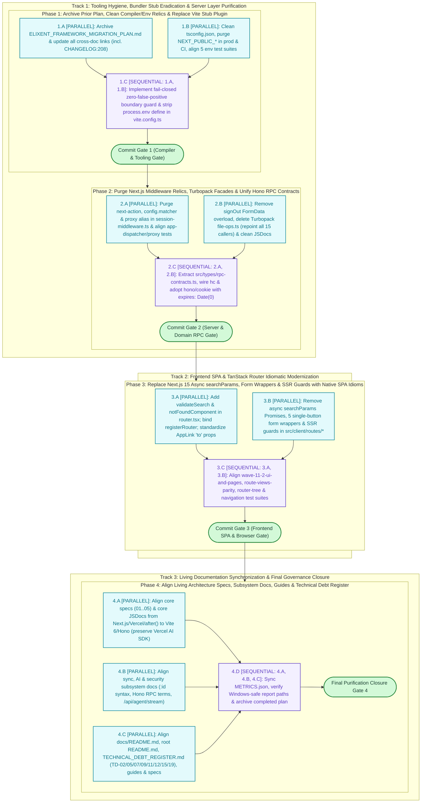
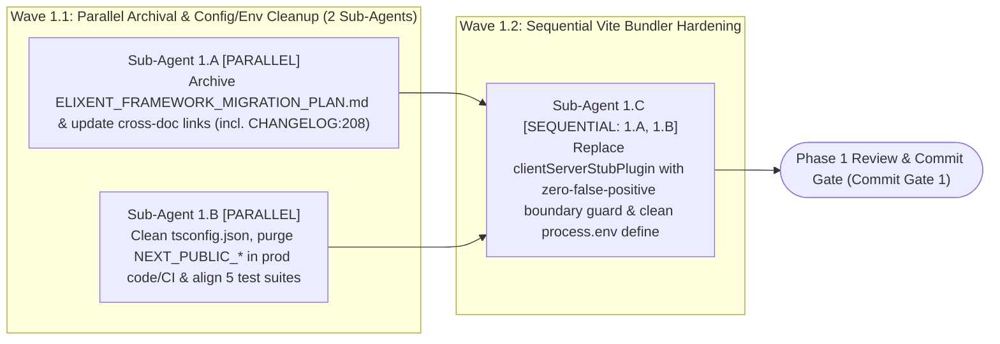
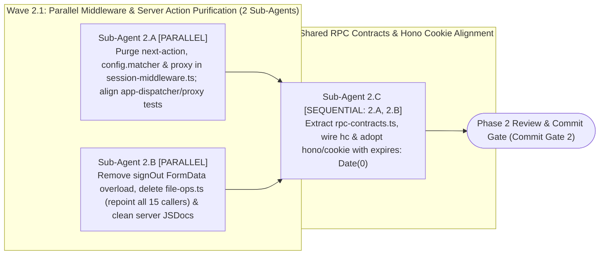
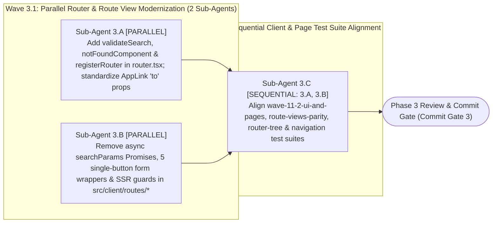
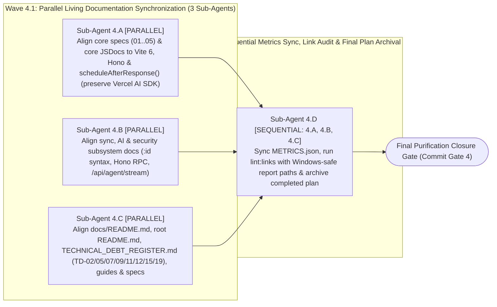

# Comprehensive Elixent Post-Migration Next.js Decoupling & Clean Architecture Execution Plan

| Standard Field              | Approved Value                                                                                                                                                                                                                                                                                                                                                                                                                                                                                                                                                                                                                                                                                                                                                                                                                                                                                                                                                                                         |
| :-------------------------- | :----------------------------------------------------------------------------------------------------------------------------------------------------------------------------------------------------------------------------------------------------------------------------------------------------------------------------------------------------------------------------------------------------------------------------------------------------------------------------------------------------------------------------------------------------------------------------------------------------------------------------------------------------------------------------------------------------------------------------------------------------------------------------------------------------------------------------------------------------------------------------------------------------------------------------------------------------------------------------------------------------- |
| **Document ID**             | `ELIXENT-NEXTJS-DECOUPLING-CLEAN-ARCH-PLAN-v1.2`                                                                                                                                                                                                                                                                                                                                                                                                                                                                                                                                                                                                                                                                                                                                                                                                                                                                                                                                                       |
| **Classification**          | `ACTIVE TRACKED EXECUTION PLAN` (per `docs/DOCUMENTATION_GUIDELINES.md` §2 & §3 and `.agents/rules/docs-governance.md` Rule 4)                                                                                                                                                                                                                                                                                                                                                                                                                                                                                                                                                                                                                                                                                                                                                                                                                                                                         |
| **Version & Status**        | `v1.4 — ACTIVE EXECUTION IN PROGRESS (Phases 1, 2, Phase 2.5 & Phase 2.6 Remediation CLOSED ✅ [v0.20.2]; Phases 3–4 Pending)`                                                                                                                                                                                                                                                                                                                                                                                                                                                                                                                                                                                                                                                                                                                                                                                                                                                          |
| **Baseline Repository**     | `Elixent v0.18.0` (`135 Unit/Contract Suites · 2,346 Tests` + `21 Live Suites · 108 Tests` + `14 Playwright E2E Specs · 15 Journeys` — with full commitment to `100% Behavior-Preserving Zero Regression Tolerance`)                                                                                                                                                                                                                                                                                                                                                                                                                                                                                                                                                                                                                                                                                                                                                                                   |
| **SSOT Architecture Suite** | • [01_architecture_vision_and_adrs](../architecture/01_architecture_vision_and_adrs.md) (`ELIXENT-ARCH-01 v3.1`)<br>• [02_agent_orchestration_and_decision_engine](../architecture/02_agent_orchestration_and_decision_engine.md) (`ELIXENT-ARCH-02 v3.1`)<br>• [03_workspace_ast_editor_and_vault_integration](../architecture/03_workspace_ast_editor_and_vault_integration.md) (`ELIXENT-ARCH-03 v3.2`)<br>• [04_credit_metering_and_settlement_architecture](../architecture/04_credit_metering_and_settlement_architecture.md) (`ELIXENT-ARCH-04 v3.0`)<br>• [05_data_contracts_and_lugx_migration_plan](../architecture/05_data_contracts_and_lugx_migration_plan.md) (`ELIXENT-ARCH-05 v3.2`)<br>• [adr_006_unified_vite_tanstack_hono_rpc_architecture](../architecture/adr_006_unified_vite_tanstack_hono_rpc_architecture.md) (`ADR-006`)<br>• [adr_007_dual_plane_separation_and_als_request_context](../architecture/adr_007_dual_plane_separation_and_als_request_context.md) (`ADR-007`) |

## 1. Executive Purpose & Execution Protocol

This document represents the **Authoritative Execution Blueprint** for completing the architectural purification of the **`Elixent v0.18.0`** platform following the initial 6-phase framework transition (`ELIXENT-FRAMEWORK-MIGRATION-PLAN-v1.1`). While direct `next` and `eslint-config-next` package dependencies and the `src/app/**` directory tree were removed in the prior milestone, a forensic first-principles audit (`ELIXENT_NEXTJS_DECOUPLING_PLAN_FORENSIC_AUDIT_REPORT.md`) identified **transitional Next.js emulation harnesses, compiler plugins, bundler stub workarounds, dead middleware headers/matchers, Next.js 15 async `searchParams` page signatures, Turbopack action facades, and 190 living documentation drift occurrences across 28 files** that still couple the codebase to legacy `Next.js` conventions.

Version `v1.2` incorporates exhaustive first-principles hardening across all 4 execution phases:
- **Zero Production Environment Leaks (DEF-01):** Resolving legacy `NEXT_PUBLIC_APP_URL` in `src/lib/stripe/index.ts` and `src/server/services/billing-service.ts` to prevent broken checkout session redirects (`ERR_CONNECTION_REFUSED`) in production.
- **Fail-Closed, Zero-False-Positive Bundler Guard (DEF-02):** Replacing naive substring matching with mathematical path resolution excluding `node_modules` while strictly blocking direct client-to-server module imports.
- **Proactive Test Suite Alignment (DEF-03, DEF-04, DEF-08, DEF-09, DEF-10, DEF-11):** Explicitly targeting and realigning all 7 impacted test files (`supabase-client`, `features.config`, `supabase-server`, `auth-redirect`, `app-dispatcher`, `auth-actions.unit`, `rpc-routes`) within the phase where code is changed.
- **Complete Turbopack Facade Eradication across 15 Callers (DEF-07):** Expanding the `file-ops.ts` caller register to 15 suites (8 unit/mock suites + 7 live database integration suites).
- **Directed Acyclic Graph (DAG) for Client Routing (DEF-13, DEF-14):** Eliminating circular dependency traps between `router.tsx` and route views, and isolating test state in `navigation.ts`.
- **Deterministic, Anti-Inversion Commit Gates (DEF-05, DEF-12, DEF-16):** Aligning gate commands to test exclusively modified subsystems, integrating Playwright E2E smoke tests, and standardizing report paths for Windows environments.

Execution is governed by **six strict execution invariants**:

1. **Behavior-Preserving Architectural Purification Only (`Zero Domain Logic Mutation`):**
   - This plan strictly eradicates residual `Next.js` compiler plugins, bundler workarounds (`clientServerStubPlugin`, `define: { "process.env": "{}" }`), legacy middleware relics (`next-action` header checks, `config.matcher` `_next/static` patterns), Turbopack facades (`src/server/actions/file-ops.ts`), `FormData` Server Action overloads, untyped RPC casts (`hc<never>`), and Next.js 15 async `searchParams` Promise idioms.
   - **Prohibition of Mutating Core Business or Cryptographic Logic:** All domain algorithms in `src/core/**`, `src/lib/sync/**`, `src/lib/vault/**`, `src/lib/workers/**`, database schemas in `src/server/db/**`, and the intentional `ADR-007` request-scoped context (`src/server/context/request-context.ts`) are preserved with $100\%$ behavioral fidelity.
2. **Strict Adherence to Accepted `ADR-006` & `ADR-007` Contracts:**
   - Per `ADR-006`, all client routing and presentation components adhere natively to **`Vite 6 SPA + TanStack Router`**, and all server endpoints adhere natively to **`Hono 4.13`** (`hono/cookie`, shared zero-dependency RPC contracts, and true `hc<AppType>` type inference).
   - Per `ADR-007`, `AsyncLocalStorage` (`runWithServerRequestContext`, `resolveCookiesAndHeaders`, and `scheduleAfterResponse`) is retained as the authoritative zero-signature-change context isolation mechanism decoupling domain services from HTTP framework primitives.
3. **Atomic Decomposition into 4 Isolated Single-Responsibility Phases (`4 Commit-Sized SRP Phases`):**
   - Execution is partitioned into **4 sequential, strictly scoped phases (`Phase 1` $\rightarrow$ `Phase 4`)** across three architectural tracks.
   - In accordance with `.agents/rules/global-rule.md`, **only one phase may be executed per session**, culminating in a verifiable closure dossier under `docs/records/closures/nextjs-decoupling/` before terminating the session.
4. **Strict Cumulative State Progression Rule:**
   - Every phase $N$ ($N > 1$) assumes that all modifications, file deletions, and test alignments scheduled in phases $1 \dots (N-1)$ **have already been completed, verified, committed, and established as the active repository baseline (`Baseline State of Phase N`)**.
5. **Intra-Phase Sub-Agent Execution Topology & Zero File-Write Contention:**
   - Each of the 4 phases is decomposed into **Execution Waves** comprising **2 to 3 Sub-Agent Tasks**, explicitly marked as either **`[PARALLEL]`** or **`[SEQUENTIAL — Depends on Task X.Y]`**.
   - **Zero File Overlap Invariant (`Overlap = 0`):** No two sub-agent tasks running in parallel (`[PARALLEL]`) within the same wave are ever permitted to modify the same file; every target file in a parallel wave is exclusively owned by a single sub-agent.
6. **Zero Broken Intermediate Commits (`100% Green Verification Gate at Every Phase`):**
   - At the conclusion of every phase (`Phase 1` through `Phase 4`), `npx tsc --noEmit`, `npm run lint`, `npm run build`, `node scripts/check-markdown-links.mjs`, and the entire unit, contract, and live test baseline must pass at **$100\%$ green (`0 errors`, `0 broken links`)**.

## 2. Master 4-Phase & Sub-Agent DAG

The following diagram illustrates the sequence of the 4 phases across three major architectural tracks (`Tracks 1–3`), the distribution of parallel and sequential sub-agent tasks, and the hardened `Commit Gates` for each phase:



## 3. 4-Phase Commit Register

| Phase         | Single Responsibility Scope                                                                                                                                                                                                                                                                                                                                                                          |    Sub-Agent Tasks    | Target Git Commit                                                                                                                     |
| :------------ | :--------------------------------------------------------------------------------------------------------------------------------------------------------------------------------------------------------------------------------------------------------------------------------------------------------------------------------------------------------------------------------------------------- | :-------------------: | :------------------------------------------------------------------------------------------------------------------------------------ |
| **`Phase 1`** | Archive completed `ELIXENT_FRAMEWORK_MIGRATION_PLAN.md` to `docs/records/plans/` (updating all links incl. `CHANGELOG.md:208`), strip `next` plugin and `.next` paths from `tsconfig.json`, eliminate legacy `NEXT_PUBLIC_*` in production code (`stripe`, `billing`), CI and configs, align 5 env test suites, and enforce zero-false-positive fail-closed boundary guard in `vite.config.ts`. | $3$ (`Waves 1.1–1.2`) | `chore(build): archive framework migration plan, purge tsconfig Next.js relics, and enforce strict Vite client-server boundary guard` |
| **`Phase 2`** | Purge `next-action` header, `config.matcher`, and `proxy` alias from `session-middleware.ts`, remove `signOut(FormData)` overload across code and tests, delete Turbopack `file-ops.ts` facade (repointing all 15 real callers), adopt `hono/cookie` with `expires: new Date(0)`, and wire true `hc<AppType>` via shared `rpc-contracts.ts`.                                                   | $3$ (`Waves 2.1–2.2`) | `refactor(server): purge Next.js middleware relics and Turbopack file-ops facade, adopt hono/cookie, and unify typed RPC contracts`   |
| **`Phase 2.5`** *(Inserted Remediation — `CLOSED ✅ v0.20.1`)* | Purge `isVitestBridgeActive()`, `vitestLoopbackFetch`, and split dynamic `"@" + "/server/..."` loaders from `src/client/rpc-client.ts` (`DEF-A01`, moving loopback fetch to `vitest.setup.ts`); rebuild `clientServerBoundaryGuardPlugin` with canonical path anchoring, AST/`@vite-ignore` transform scanner, and Vite 6 `environments.client` `process.env` isolation (`DEF-A02`); centralize Fail-Fast URL resolver `src/lib/config/app-url.ts` (`DEF-A03`); restrict Supabase placeholder fallbacks strictly to test runtimes (`DEF-A04`); upgrade `session-middleware.ts` to `401` mutations / `303 See Other` navs / non-API static fast-path (`DEF-A05`); harden `/auth/sign-out` RFC 6265 dual `sb-*` clearing (`DEF-A06`); add `WireTimestamp` + BigInt string `creditBalanceMicro` contracts (`DEF-A07`); and harden `resolveFileId` (`DEF-A08`). | Inserted Remediation (`DEF-A01..A08`) | `fix(architecture): purge Vitest RPC bridge, harden Vite boundary guard, and remediate DEF-A01..A08 RPC/auth security gaps` |
| **`Phase 3`** | Configure `validateSearch` and `notFoundComponent` on `TanStack Router`, eliminate Next.js 15 async `searchParams` Promise handling with defensive `useSearch` fallback, replace 5 single-button `<form onSubmit>` wrappers with direct `onClick` handlers, strip redundant SSR guards, and align client test suites (including `navigation.test.ts`).                                            | $3$ (`Waves 3.1–3.2`) | `refactor(client): replace Next.js 15 async searchParams, form action wrappers, and SSR guards with native TanStack Router idioms`    |
| **`Phase 4`** | Synchronize all 190 Next.js/Vercel/Turbopack/`after()` drift occurrences across 28 living files (`docs/architecture/**`, `README.md`, `docs/README.md`, `docs/TECHNICAL_DEBT_REGISTER.md`, `docs/reference/**`, `docs/guides/**`, `docs/specs/**`), verify zero broken links, update canonical metrics, and close the purification plan.                                                    | $4$ (`Waves 4.1–4.2`) | `docs(architecture): synchronize living architecture specs, guides, and debt register with pure Vite 6 + Hono 4.13 runtime`           |

## 4. Detailed 4-Phase Specifications

### [Phase 1: Archive Prior Migration Plan, Clean Compiler/Env Relics & Enforce Fail-Closed Vite Boundary Guard]

> **Phase Identifier:** `Phase 1 — Archive Prior Migration Plan, Clean Compiler/Env Relics & Enforce Fail-Closed Vite Boundary Guard`  
> **Status:** `CLOSED / VERIFIED (v0.19.0)` ✅  
> **Target Closure Dossier:** `docs/records/closures/nextjs-decoupling/phase-01-archive-plan-clean-compiler-env-and-vite-boundary-guard.md`  
> **Single Responsibility Principle (`SRP`):** Archive the completed 6-phase `ELIXENT_FRAMEWORK_MIGRATION_PLAN.md` to `docs/records/plans/` in compliance with `.agents/rules/docs-governance.md` Rule 4, purge residual Next.js compiler plugins and `.next/` type globs from `tsconfig.json`, eliminate legacy `NEXT_PUBLIC_*` lookups across client/server config and production services (`stripe`, `billing`), realign all 5 environment-dependent test suites, and replace `clientServerStubPlugin` and `define: { "process.env": "{}" }` in `vite.config.ts` with a mathematically sound fail-closed boundary assertion plugin that excludes `node_modules` and prevents false positives.  
> **Pre-Phase 1 Baseline State:** `Elixent v0.18.0` repository with `135` unit suites (`2,346` tests), `21` live suites (`108` tests), and `14` Playwright E2E specs (`15` journeys) passing $100\%$, containing residual Next.js config artifacts in `tsconfig.json`, `vite.config.ts`, `.env.example`, and `docs/Plans/`.

#### Phase 1 Sub-Agent Topology



#### Detailed Sub-Agent Tasks in Phase 1

##### 1. Task `Sub-Agent 1.A`: Archive Completed `ELIXENT_FRAMEWORK_MIGRATION_PLAN.md` and Update All Cross-Document Links

- **Execution Mode & Dependencies:** `[PARALLEL — Wave 1.1]`.
- **Exclusively Targeted Files:**
  - `docs/Plans/ELIXENT_FRAMEWORK_MIGRATION_PLAN.md` (move to `docs/records/plans/elixent-framework-migration-execution-plan.md`)
  - `docs/CHANGELOG.md` (modify: line `208`)
  - `README.md` (modify: lines `169` and `802`)
  - `docs/README.md` (modify: lines `50`, `182`, and `222`)
  - `docs/architecture/adr_006_unified_vite_tanstack_hono_rpc_architecture.md` (modify: line `9`)
  - `docs/architecture/adr_007_dual_plane_separation_and_als_request_context.md` (modify: line `9`)
  - `docs/records/closures/framework-migration/phase-01-archive-prior-plan-target-packages-and-session-middleware.md` (modify: lines `9`, `21`, `93`, and `166`)
  - `docs/records/closures/framework-migration/phase-02-migrate-all-8-api-routes-and-oauth-callback-to-web-standard-hono-routers.md` (modify: lines `9` and `263`)
  - `docs/records/closures/framework-migration/phase-03-decouple-server-actions-and-mount-typed-hono-rpc.md` (modify: line `9`)
  - `docs/records/closures/framework-migration/phase-04-wire-client-hooks-and-ui-to-hono-rpc-and-strip-directives.md` (modify: line `9`)
  - `docs/records/closures/framework-migration/phase-05-vite-spa-tanstack-router-and-unified-hono-server.md` (modify: lines `9` and `200`)
  - `docs/records/closures/framework-migration/phase-06-final-nextjs-purge-test-suite-alignment-and-ci-e2e-closure.md` (modify: line `9`)
- **Exact Line-Level Implementation Actions:**
  1. **Archive the completed 6-phase framework migration plan per `.agents/rules/docs-governance.md` Rule 4 & Rule 5:**
     - In `docs/Plans/ELIXENT_FRAMEWORK_MIGRATION_PLAN.md`, update `Classification` on line `6` to `COMPLETED HISTORICAL EXECUTION PLAN`, append `— ✅ CLOSED / EXECUTED` to the `Phase 4` heading (line `408`) and `Phase 6` heading (line `604`), and move the file to `docs/records/plans/elixent-framework-migration-execution-plan.md`.
     - Inside the moved file `docs/records/plans/elixent-framework-migration-execution-plan.md`, update relative Markdown links to account for the deeper directory level (`docs/records/plans/` instead of `docs/Plans/`):
       - On line `9`, replace external Google search URL `https://www.google.com/search?q=../architecture/` with `../../architecture/`.
       - On lines `125, 223, 229, 316, 322, 406, 507, 513, 602, 719`, replace `](../records/closures/` with `](../closures/`.
  2. **Update all cross-document references across the repository:**
     - In `docs/CHANGELOG.md` (line `208`), update `[docs/Plans/ELIXENT_FRAMEWORK_MIGRATION_PLAN.md](./Plans/ELIXENT_FRAMEWORK_MIGRATION_PLAN.md)` to `[docs/records/plans/elixent-framework-migration-execution-plan.md](./records/plans/elixent-framework-migration-execution-plan.md)`. This prevents `check-markdown-links.mjs` from failing.
     - In `README.md` (lines `169` and `802`) and `docs/README.md` (lines `50` and `182`), update the active plan entry in `docs/Plans/` to reference `ELIXENT_NEXTJS_DECOUPLING_AND_CLEAN_ARCHITECTURE_PLAN.md`, and add `[elixent-framework-migration-execution-plan.md](./records/plans/elixent-framework-migration-execution-plan.md)` to the `Completed Plans (records/plans/)` table in `docs/README.md` (line `222`).
     - In `docs/architecture/adr_006_unified_vite_tanstack_hono_rpc_architecture.md` (line `9`) and `docs/architecture/adr_007_dual_plane_separation_and_als_request_context.md` (line `9`), update `(../Plans/ELIXENT_FRAMEWORK_MIGRATION_PLAN.md)` to `(../records/plans/elixent-framework-migration-execution-plan.md)`.
     - In all 6 closure dossiers under `docs/records/closures/framework-migration/phase-01..06.md`:
       - `phase-01`: lines `9, 21, 93, 166`.
       - `phase-02`: lines `9, 263`.
       - `phase-03`: line `9`.
       - `phase-04`: line `9`.
       - `phase-05`: lines `9, 200`.
       - `phase-06`: line `9`.
       Update all references from `(../../../Plans/ELIXENT_FRAMEWORK_MIGRATION_PLAN.md)` to `(../../plans/elixent-framework-migration-execution-plan.md)`.

##### 2. Task `Sub-Agent 1.B`: Purge Next.js Compiler Relics from `tsconfig.json`, Eradicate `NEXT_PUBLIC_*` across Production Code, Configs, CI, and Align All 5 Environment Test Suites

- **Execution Mode & Dependencies:** `[PARALLEL — Wave 1.1]` (executes in full concurrency with `1.A`).
- **Exclusively Targeted Files:**
  - `tsconfig.json` (modify: lines `20–24` and `31–39`)
  - `src/lib/stripe/index.ts` (modify: line `80`) — *DEF-01 P0 Fix*
  - `src/server/services/billing-service.ts` (modify: line `469`) — *DEF-01 P0 Fix*
  - `src/lib/supabase/client.ts` (modify: lines `4–16`)
  - `src/lib/supabase/server.ts` (modify: lines `8–9` and `15–24`)
  - `src/config/features.config.ts` (modify: lines `15–20`)
  - `src/server/actions/auth-actions.ts` (modify: line `31`)
  - `src/server/routes/auth-callback.routes.ts` (modify: line `149`)
  - `src/server/routes/e2e-auth.routes.ts` (modify: lines `36–39`)
  - `scripts/test-ci-gating.mjs` (modify: lines `33, 41, 62, 82, 105, 249`) — *DEF-05 Fix*
  - `.env.example` (modify: lines `1`, `36–37`, `47`, `90`, `99`, `104–105`, `110`)
  - `playwright.config.ts` (modify: line `71`)
  - `.github/workflows/ci.yml` (modify: lines `213–214`, `254–258`, `290–291`, `320`, `328`, `349`, `374`, `429`, and `486–487`)
  - `src/test/auth/auth-redirect.test.ts` (modify: line `183`) — *DEF-04 Fix*
  - `src/test/auth/supabase-client.test.ts` (modify: lines `26–81`) — *DEF-03 Fix*
  - `src/test/config/features.config.test.ts` (modify: lines `28–65`) — *DEF-03 Fix*
  - `src/test/server/supabase-server.test.ts` (modify: lines `43–77`) — *DEF-03 Fix*
  - `src/test/server/stripe-cron-auth-routes.test.ts` (modify: lines `837, 855–858`)
- **Exact Line-Level Implementation Actions:**
  1. **In `tsconfig.json` (lines `20–39`):**
     - Remove `"plugins": [{ "name": "next" }]` (lines `20–24`).
     - Replace the `"include"` array (lines `31–39`) with clean standard TypeScript globs:
       ```json
       "include": [
         "**/*.ts",
         "**/*.tsx",
         "**/*.mts"
       ]
       ```
  2. **In `src/lib/stripe/index.ts` (line `80`) and `src/server/services/billing-service.ts` (line `469`):**
     - Modernize `appUrl` resolution to prioritize canonical `VITE_APP_URL` and `APP_URL` while preserving backward compatibility:
       ```typescript
       const appUrl =
         process.env.VITE_APP_URL ||
         process.env.APP_URL ||
         process.env.NEXT_PUBLIC_APP_URL ||
         "http://localhost:3000";
       ```
       This eliminates the P0 risk where Stripe checkout sessions and customer portal redirects default to `http://localhost:3000` in production.
  3. **In `src/lib/supabase/client.ts` (lines `4–16`):**
     - Eradicate legacy transitional fallbacks in favor of clean Vite `import.meta.env.VITE_*` resolution with safe Node Vitest fallback:
       ```typescript
       const metaEnv = (
         import.meta as ImportMeta & {
           env?: Record<string, string | undefined>;
         }
       ).env;
       const nodeEnv = (
         globalThis as {
           process?: { env?: Record<string, string | undefined> };
         }
       ).process?.env;
       const supabaseUrl =
         metaEnv?.VITE_SUPABASE_URL ||
         nodeEnv?.VITE_SUPABASE_URL ||
         "https://placeholder.supabase.co";
       const supabaseAnonKey =
         metaEnv?.VITE_SUPABASE_ANON_KEY ||
         nodeEnv?.VITE_SUPABASE_ANON_KEY ||
         "placeholder-anon-key";
       ```
  4. **In `src/config/features.config.ts` (lines `14–20`):**
     - Replace transitional `VITE_AI_STREAMING_ENABLED || NEXT_PUBLIC_AI_STREAMING_ENABLED` lookup with pure `VITE_*` check:
       ```typescript
       AI_STREAMING_ENABLED:
           (((import.meta as ImportMeta & { env?: Record<string, string | undefined> }).env
               ?.VITE_AI_STREAMING_ENABLED ??
               (globalThis as { process?: { env?: Record<string, string | undefined> } }).process
                   ?.env?.VITE_AI_STREAMING_ENABLED) === "true"),
       ```
  5. **In `src/lib/supabase/server.ts` (lines `8–9` and `15–24`):**
     - Standardize server environment lookups to pure `process.env.VITE_SUPABASE_URL || "https://placeholder.supabase.co"` and `process.env.VITE_SUPABASE_ANON_KEY || "placeholder-anon-key"`.
     - Replace Server Component comment on lines `20–23` with `// Ignore cookie mutation errors in read-only or completed response contexts`.
  6. **In `src/server/actions/auth-actions.ts` (line `31`), `src/server/routes/auth-callback.routes.ts` (line `149`), and `src/server/routes/e2e-auth.routes.ts` (lines `36–39`):**
     - Clean `process.env.NEXT_PUBLIC_APP_URL` to `process.env.VITE_APP_URL || process.env.APP_URL || "http://localhost:3000"`.
     - In `auth-callback.routes.ts`, clean to `process.env.VITE_APP_URL || origin`.
     - In `e2e-auth.routes.ts`, clean to `process.env.VITE_SUPABASE_URL!` and `process.env.VITE_SUPABASE_ANON_KEY!`.
  7. **In `scripts/test-ci-gating.mjs` and `.github/workflows/ci.yml`:**
     - In `scripts/test-ci-gating.mjs` (lines `33, 41, 62, 82, 105, 249`), update gating simulation assertions from `NEXT_PUBLIC_SUPABASE_URL` to `VITE_SUPABASE_URL`.
     - In `.github/workflows/ci.yml`, supply `VITE_SUPABASE_URL`, `VITE_SUPABASE_ANON_KEY`, `VITE_STRIPE_PUBLISHABLE_KEY`, and `VITE_APP_URL` across Stages 4, 5, 6, and 7 (lines `213–214`, `254–258`, `290–291`, `486–487`). Update audit and summary steps (lines `320, 328, 349, 374, 429`) to monitor `VITE_SUPABASE_URL`.
  8. **In `.env.example` and `playwright.config.ts`:**
     - In `.env.example`, update header to `# ELIXENT`, convert all client keys (`SUPABASE_URL`, `SUPABASE_ANON_KEY`, `STRIPE_PUBLISHABLE_KEY`, `APP_URL`, `AI_STREAMING_ENABLED`) from `NEXT_PUBLIC_*` to `VITE_*`, and update Vercel Cron comments to External HTTP Scheduler Cron.
     - In `playwright.config.ts` (line `71`), inject `VITE_APP_URL: BASE_URL`.
  9. **Align all 5 impacted test suites (DEF-03, DEF-04):**
     - In `src/test/auth/auth-redirect.test.ts` (line `183`): In `beforeEach`, explicitly assign `process.env.VITE_APP_URL = "https://app.lugx.com";` alongside `NEXT_PUBLIC_APP_URL`. This immediately resolves the 7 baseline test failures caused by `.env.local` shadowing.
     - In `src/test/auth/supabase-client.test.ts` (lines `26–81`): Remove obsolete fallback tests asserting `NEXT_PUBLIC_*` resolution (lines `41–53` and `69–81`), replacing them with tests verifying clean `VITE_*` parsing and canonical placeholder fallback.
     - In `src/test/config/features.config.test.ts` (lines `28–65`): Remove tests asserting `NEXT_PUBLIC_AI_STREAMING_ENABLED` precedence and fallback, verifying pure `VITE_AI_STREAMING_ENABLED` resolution.
     - In `src/test/server/supabase-server.test.ts` (lines `43–77`): Remove fallback test for `NEXT_PUBLIC_*` (lines `58–71`), verifying pure `VITE_*` resolution and placeholder fallback.
     - In `src/test/server/stripe-cron-auth-routes.test.ts` (lines `837, 855–858`): Clean `NEXT_PUBLIC_APP_URL` mentions and verify `VITE_APP_URL` prioritization.

##### 3. Task `Sub-Agent 1.C`: Implement Fail-Closed Zero-False-Positive Client Boundary Guard & Clean `process.env` Define in `vite.config.ts`

- **Execution Mode & Dependencies:** `[SEQUENTIAL — Wave 1.2 | Depends on: Sub-Agent 1.A, Sub-Agent 1.B]`.
- **Exclusively Targeted Files:**
  - `vite.config.ts` (modify: lines `202–267`)
- **Exact Line-Level Implementation Actions:**
  1. **Replace `clientServerStubPlugin()` (lines `202–234`) with mathematically sound `clientServerBoundaryGuardPlugin()` (DEF-02):**
     - Implement the zero-false-positive boundary assertion plugin proven by First-Principles Verification:
       ```typescript
       import path from "node:path";
       import type { Plugin } from "vite";

       function clientServerBoundaryGuardPlugin(): Plugin {
         return {
           name: "client-server-boundary-guard",
           enforce: "pre",
           resolveId(id, importer, options) {
             // 1. Bypass during SSR builds or if importer/id is undefined
             if (options?.ssr || !importer || !id) return null;

             const normalizedId = id.replace(/\\/g, "/");
             const normalizedImporter = importer.replace(/\\/g, "/");

             // 2. Invariant: Exclude virtual modules and node_modules
             if (
               normalizedId.startsWith("\0") ||
               normalizedId.startsWith("virtual:") ||
               normalizedId.includes("/node_modules/") ||
               normalizedImporter.includes("/node_modules/")
             ) {
               return null;
             }

             // 3. Importer plane detection: modules inside /src/server/ are permitted
             const isServerImporter = normalizedImporter.includes("/src/server/");
             if (isServerImporter) return null;

             // 4. Resolve relative specifiers to absolute POSIX paths
             let resolvedTarget = normalizedId;
             if (normalizedId.startsWith("./") || normalizedId.startsWith("../")) {
               resolvedTarget = path
                 .resolve(path.dirname(importer), id)
                 .replace(/\\/g, "/");
             }

             // 5. Fail-closed server boundary detection: exact aliases & physical paths
             const isServerTarget =
               normalizedId === "@/server" ||
               normalizedId.startsWith("@/server/") ||
               normalizedId === "@/lib/supabase/server" ||
               normalizedId.startsWith("@/lib/supabase/server.") ||
               normalizedId.startsWith("@/lib/supabase/server/") ||
               resolvedTarget.includes("/src/server/") ||
               resolvedTarget.endsWith("/src/server") ||
               resolvedTarget.includes("/src/lib/supabase/server");

             if (isServerTarget) {
               this.error(
                 `[Security / Architecture Boundary Violation] Direct client import of server module "${id}" from "${importer}" is prohibited. Use Hono RPC client (src/client/rpc-client.ts) or extract shared types into src/types/rpc-contracts.ts.`,
                 importer
               );
             }

             return null;
           },
         };
       }
       ```
     - Note: `import type { AppType }` in client files is completely erased by esbuild during the `transform` phase before Rollup evaluates module dependencies. Acorn AST never receives the node, so `resolveId` is never called for pure type imports.
  2. **Remove redundant `define: { "process.env": "{}" }` (lines `264–266`):**
     - Vite 6 natively injects `process.env = {}` and `process.env.NODE_ENV` for all non-library builds via its internal `definePlugin`. Remove the explicit user define block from `vite.config.ts`.

#### Phase 1 Commit Gate (Compiler & Tooling Gate — DEF-05 Hardened)

- Review `git diff` to verify that changes are strictly confined to the files specified in Phase 1.
- Execute the hardened verification command sequence, testing all modified environment modules while eliminating the premature `node-server-entrypoint.test.ts` phase inversion:
  ```bash
  npx tsc --noEmit
  npm run lint
  npm run build
  node scripts/check-markdown-links.mjs
  npx vitest run src/test/auth/auth-redirect.test.ts src/test/auth/supabase-client.test.ts src/test/config/features.config.test.ts src/test/server/supabase-server.test.ts src/test/server/stripe-cron-auth-routes.test.ts
  ```

---

### [Phase 2: Purge Next.js Middleware Relics, Turbopack Facades & Unify Hono RPC Contracts]

> **Phase Identifier:** `Phase 2 — Purge Next.js Middleware Relics, Turbopack Facades & Unify Hono RPC Contracts`  
> **Status:** `CLOSED / VERIFIED (v0.20.0)` ✅  
> **Target Closure Dossier:** `docs/records/closures/nextjs-decoupling/phase-02-purge-middleware-relics-turbopack-facade-and-unify-rpc-contracts.md`  
> **Single Responsibility Principle (`SRP`):** Purge the dead Next.js `next-action` header check, `export const config = { matcher }` (`_next/static`, `_next/image`), and `proxy` alias from `src/server/middleware/session-middleware.ts` (realigning `session-middleware.test.ts`, `proxy.test.ts`, and `app-dispatcher.test.ts`); remove the Next.js `<form action={signOut}>` `FormData` overload from `auth-actions.ts` (realigning `auth-actions.unit.test.ts`); permanently delete the Next.js Turbopack `"use server"` facade `src/server/actions/file-ops.ts` (repointing all 15 unit and live callers); adopt `hono/cookie` (`deleteCookie` with `expires: new Date(0)`) in `rpc.routes.ts`; and extract shared zero-dependency RPC types into `src/types/rpc-contracts.ts` so `src/client/rpc-client.ts` uses true `hc<AppType>` via `ReturnType<typeof hc<AppType>>`.  
> **Post-Phase 1 Baseline State:** Prior migration plan is archived, `tsconfig.json` and `vite.config.ts` are completely free of Next.js plugins and silent server stubs, all `VITE_*` environment lookups are standardized, and all 5 environment test suites pass green.

#### Phase 2 Sub-Agent Topology



#### Detailed Sub-Agent Tasks in Phase 2

##### 1. Task `Sub-Agent 2.A`: Purge `next-action` Header, `config.matcher` (`_next/static`), and `proxy` Alias from `session-middleware.ts` & Align Middleware Test Suites

- **Execution Mode & Dependencies:** `[PARALLEL — Wave 2.1]`.
- **Exclusively Targeted Files:**
  - `src/server/middleware/session-middleware.ts` (modify: lines `146–161`, `232–247`, `270–296`, `332–339`)
  - `src/test/server/session-middleware.test.ts` (modify: lines `1–18`, `293–343`, `420–436`, `572–576`, `674–695`, `732–781`)
  - `src/test/auth/proxy.test.ts` (modify: lines `1–17`, `37`, `115–143`, `241–261`)
  - `src/test/server/app-dispatcher.test.ts` (modify: lines `574–584`) — *DEF-09 Fix*
- **Exact Line-Level Implementation Actions:**
  1. **In `src/server/middleware/session-middleware.ts`:**
     - Clean lines `155–160` to use pure `process.env.VITE_SUPABASE_URL || "https://placeholder.supabase.co"` and `process.env.VITE_SUPABASE_ANON_KEY || "placeholder-anon-key"`.
     - In lines `236–247`, remove `request.headers.has("next-action")` and enforce RFC 9110 standard Web content negotiation. Under protected paths (`/workspace`, `/account`, `/dashboard`), unauthenticated requests carrying `Accept: application/json` or targeting RPC endpoints return `HTTP 401` `{ error: "Unauthorized" }`, while browser page navigations redirect `307` to `/login?redirectTo=...`.
     - Delete `export const proxy = handleSessionProxy;` (lines `292–295`).
     - Delete dead Next.js Edge Middleware matcher `export const config = { matcher: [...] };` (lines `332–339`).
  2. **In `src/test/server/session-middleware.test.ts` and `src/test/auth/proxy.test.ts`:**
     - In both test files, remove `config` and `as proxy` from imports.
     - Replace `next-action` header test cases with tests asserting that unauthenticated requests to protected endpoints carrying `Accept: application/json` return `HTTP 401 JSON`.
     - In `session-middleware.test.ts` lines `429–431`: update line `430` to send `headers: { Accept: "application/json" }` instead of `{ "next-action": "logout" }`.
     - In `session-middleware.test.ts` lines `572–576`: permanently delete the obsolete `describe("Backward Compatibility Alias")` block testing `proxy`.
     - In both files, delete the obsolete `Matcher Configuration (config.matcher)` test blocks testing `/_next/static` and `/_next/image`.
  3. **In `src/test/server/app-dispatcher.test.ts` (DEF-09):**
     - In lines `574–584`, update the unauthenticated protected route test from `headers: { "next-action": "action_uuid_test" }` to send `headers: { Accept: "application/json" }` (or target `http://localhost/api/files/sync`). This guarantees that line 580 (`expect(res.status).toBe(401)`) receives `HTTP 401 JSON` instead of falling back to `HTTP 307 Redirect`.

##### 2. Task `Sub-Agent 2.B`: Remove `signOut(FormData)` Overload across Code and Tests, Delete Turbopack `file-ops.ts` Facade (Repointing All 15 Real Callers), and Clean Server JSDocs

- **Execution Mode & Dependencies:** `[PARALLEL — Wave 2.1]` (executes in full concurrency with `2.A`).
- **Exclusively Targeted Files:**
  - `src/server/actions/auth-actions.ts` (modify: lines `53–76`)
  - `src/test/auth/auth-signout.test.ts` (modify: lines `80–93`)
  - `src/test/auth/auth-actions.unit.test.ts` (modify: lines `7` and `253–268`) — *DEF-08 Fix*
  - `src/server/actions/file-ops.ts` (permanently delete)
  - `src/test/editor/editor-orchestration.integration.test.ts` (repoint `@/server/actions/file-ops` to `@/server/actions/files`)
  - `src/test/editor/editor-security-hardening.test.ts` (repoint `@/server/actions/file-ops` to `@/server/actions/files`)
  - `src/test/editor/use-editor-conflict.test.ts` (repoint `@/server/actions/file-ops` to `@/server/actions/files`)
  - `src/test/files/file-context-menu.encryption-conflict.test.tsx` (repoint `@/server/actions/file-ops` to `@/server/actions/files` and `@/server/actions/folders`)
  - `src/test/layout/sidebar-import.vault.test.tsx` (repoint `@/server/actions/file-ops` to `@/server/actions/files`)
  - `src/test/server/file-ops.lostupdate.test.ts` (repoint `@/server/actions/file-ops` to `@/server/actions/files`)
  - `src/test/server/file-ops.ownership.test.ts` (repoint `@/server/actions/file-ops` to `@/server/actions/folders` and `@/server/actions/files`)
  - `src/test/server/file-ops.softdelete.test.ts` (repoint `@/server/actions/file-ops` to `@/server/actions/files`)
  - `src/test/sync/encrypted-conflict-decryption.integration.test.ts` (repoint `@/server/actions/file-ops` to `@/server/actions/files`)
  - `src/test/vault/file-ops-vault.unit.test.ts` (repoint `@/server/actions/file-ops` to `@/server/actions/files`)
  - `src/test/vault/vault-cross-module.integration.test.ts` (repoint `@/server/actions/file-ops` to `@/server/actions/files`)
  - `src/test/server/cross-user-ownership.test.ts` (repoint lines `20–28` to `@/server/actions/files` and `@/server/actions/folders`) — *DEF-07 Fix*
  - `src/test/sync/conflict-resolution.integration.test.ts` (repoint line `21` to `@/server/actions/files`) — *DEF-07 Fix*
  - `src/test/vault/vault-sync.live.test.ts` (repoint lines `23–27` to `@/server/actions/files`) — *DEF-07 Fix*
  - `src/test/infrastructure/multi-system-lifecycle.live.test.ts` (repoint lines `23–27` to `@/server/actions/files`) — *DEF-07 Fix*
  - `src/test/agent/agent-stream-route.test.ts` (modify: lines `8`, `648`, `649` descriptions)
  - `src/server/routes/agent.routes.ts` (modify: lines `11` and `250` comments)
  - `src/server/actions/import-file.ts` (modify: line `2` JSDoc)
  - `src/server/actions/vault-actions.ts` (modify: lines `1–4` JSDoc)
  - `src/lib/stripe/webhook-dedupe.ts` (modify: line `5` JSDoc)
  - `src/lib/sync/crypto-worker-bridge.ts` (modify: line `82` comment)
  - `src/lib/utils/correlation.ts` (modify: line `5` JSDoc)
  - `src/server/index.ts` (modify: lines `29` and `37`)
  - `src/test/server/node-server-entrypoint.test.ts` (modify: line `54`)
- **Exact Line-Level Implementation Actions:**
  1. **Purge `signOut(formData: FormData)` overload across code and tests (DEF-08):**
     - In `src/server/actions/auth-actions.ts` (lines `53–76`), remove `export async function signOut(formData: FormData): Promise<void>;` and the `if (formData !== undefined) return;` branch. Keep the single pure signature:
       ```typescript
       export async function signOut(): Promise<{ success: true; redirectUrl: string }>;
       ```
     - In `src/test/auth/auth-signout.test.ts` (lines `80–93`), remove `it("handles form action invocation when FormData is passed")`.
     - In `src/test/auth/auth-actions.unit.test.ts` (lines `253–268`), remove `it("returns undefined when invoked as a Form Action with FormData")` and clean line 7 JSDoc. This prevents compile error `TS2554`.
  2. **Permanently delete Turbopack workaround facade `src/server/actions/file-ops.ts` and repoint ALL 15 callers (DEF-07):**
     - `file-ops.ts` was an artificial Turbopack facade delegating 1:1 to `files.ts` and `folders.ts`.
     - Re-point all 15 callers (8 unit/mock test suites + 7 live database integration suites): update imports, `vi.mock("@/server/actions/file-ops")`, and dynamic `await import("@/server/actions/file-ops")` to `@/server/actions/files` and `@/server/actions/folders`.
     - Repoint the live database integration test callers:
       - `src/test/server/cross-user-ownership.test.ts` (lines `20–28`): import `moveFile` from `@/server/actions/folders`; import `createFile, updateFileContent, deleteFile, copyFile, getFile, getUserFiles` from `@/server/actions/files`.
       - `src/test/sync/conflict-resolution.integration.test.ts` (line `21`): import `updateFileContent` from `@/server/actions/files`.
       - `src/test/vault/vault-sync.live.test.ts` (lines `23–27`): import `createFile, getFile, toggleFileEncryption` from `@/server/actions/files`.
       - `src/test/infrastructure/multi-system-lifecycle.live.test.ts` (lines `23–27`): import `getFile, toggleFileEncryption, updateFileContent` from `@/server/actions/files`.
     - Permanently delete `src/server/actions/file-ops.ts`.
  3. **Clean residual Next.js comments & update branding strings:**
     - In `src/test/agent/agent-stream-route.test.ts` (lines `8, 648, 649`) and `src/server/routes/agent.routes.ts` (lines `11, 250`), replace `Next.js after()` with `scheduleAfterResponse() (ADR-007 ALS)`.
     - In `src/server/actions/import-file.ts` (line `2`), `src/server/actions/vault-actions.ts` (lines `1–4`), `src/lib/stripe/webhook-dedupe.ts` (line `5`), and `src/lib/utils/correlation.ts` (line `5`), replace `Server Action` headings and App Router route module references with Web-standard Hono RPC terms.
     - In `src/lib/sync/crypto-worker-bridge.ts` (line `82`), replace `// Next.js Web Worker module instantiation` with `// Standard Web Worker instantiation`.
     - In `src/server/index.ts` (lines `29, 37`), update `LUGX SPA client build not found` and `[LUGX Server]` to `ELIXENT`.
     - In `src/test/server/node-server-entrypoint.test.ts` (line `54`), update assertion to `expect(text).toContain("ELIXENT SPA client build not found");`.

##### 3. Task `Sub-Agent 2.C`: Extract Shared RPC Contracts (`src/types/rpc-contracts.ts`), Wire `hc<AppType>` in `rpc-client.ts`, and Adopt `hono/cookie` with `expires: new Date(0)`

- **Execution Mode & Dependencies:** `[SEQUENTIAL — Wave 2.2 | Depends on: Sub-Agent 2.A, Sub-Agent 2.B]`.
- **Exclusively Targeted Files:**
  - `src/types/rpc-contracts.ts` (new)
  - `src/client/rpc-client.ts` (modify: lines `1–342`)
  - `src/server/routes/rpc.routes.ts` (modify: lines `45–100` and `428–452`)
  - `src/server/routes/files-api.routes.ts` (modify: lines `41–58` and `856–866`)
  - `src/test/server/rpc-routes.test.ts` (verify: line `712`) — *DEF-11 Fix*
- **Exact Line-Level Implementation Actions:**
  1. **Create `src/types/rpc-contracts.ts`:**
     - Extract all shared data transfer interfaces and Zod schemas (`FileEncryptionMetadata`, `FileRecord`, `VaultProfileRecord`, `UserProfileRecord`, `FileOpResult`, `UpdateFileOptions`, `DeleteFileOptions`, `ImportFileResult`, `ImportEncryptionOptions`, `VaultActionResult`, `CreateVaultProfileInput`, `UpdateVaultPasswordInput`, `UpdateVaultRecoveryEnvelopeInput`, and corresponding Zod schemas) into `src/types/rpc-contracts.ts` with zero Node.js, database, or DOM dependencies.
  2. **Update `src/client/rpc-client.ts`:**
     - Re-export all contract interfaces from `@/types/rpc-contracts`.
     - Import `import type { AppType } from "@/server/app";` (pure type-only import).
     - Replace manual client type definitions (lines `155–322`) with:
       ```typescript
       export type ElixentRpcClient = ReturnType<typeof hc<AppType>>;
       ```
     - In `createElixentRpcClient`, instantiate `hc<AppType>(baseUrl, { fetch: customFetch ?? globalThis.fetch })`, eliminating `hc<never>`.
  3. **Update `src/server/routes/rpc.routes.ts` (DEF-11):**
     - Import shared schemas from `@/types/rpc-contracts`.
     - In `POST /auth/sign-out` (lines `428–452`), adopt `getCookie(c)` and `deleteCookie(c, name, options)` from `"hono/cookie"`.
     - **Critical Invariant (DEF-11):** Explicitly supply `expires: new Date(0)` in options to satisfy `src/test/server/rpc-routes.test.ts:712`:
       ```typescript
       import { getCookie, deleteCookie } from "hono/cookie";
       // ...
       .post("/auth/sign-out", async (c) => {
         await signOut();
         const cookies = getCookie(c);
         for (const name of Object.keys(cookies)) {
           if (name.startsWith("sb-")) {
             deleteCookie(c, name, {
               path: "/",
               httpOnly: true,
               sameSite: "Lax",
               expires: new Date(0),
             });
           }
         }
         return c.json({ success: true as const, redirectUrl: "/" });
       })
       ```
  4. **Clean `src/server/routes/files-api.routes.ts` (lines `41–58` and `856–866`):**
     - Simplify `RouteParams` to accept direct `c.req.param("id")`.

#### Phase 2 Commit Gate (Server & Domain RPC Gate — DEF-12 Hardened)

- Review `git diff` to verify changes are strictly confined to Phase 2 files and `file-ops.ts` is deleted.
- Execute the hardened verification command sequence including `src/test/agent` and verifying live suites:
  ```bash
  npx tsc --noEmit
  npm run lint
  npm run build
  npx vitest run src/test/server src/test/auth src/test/vault src/test/files src/test/editor src/test/sync src/test/client src/test/agent
  npm run test:live
  ```

---

### [Phase 2.5 (Inserted): Purge Vitest Bridge, Fix Boundary Leaks & Harden RPC Architecture (`DEF-A01` to `DEF-A08`)]

> **Phase Identifier:** `Phase 2.5 — Purge Vitest Bridge, Fix Boundary Leaks & Hardening RPC Architecture (DEF-A01 to DEF-A08)`  
> **Status:** `CLOSED / VERIFIED (v0.20.1)` ✅  
> **Target Closure Dossier:** [`docs/records/closures/nextjs-decoupling/phase-02-5-purge-vitest-bridge-fix-boundary-leaks-and-harden-rpc.md`](../records/closures/nextjs-decoupling/phase-02-5-purge-vitest-bridge-fix-boundary-leaks-and-harden-rpc.md)  
> **Single Responsibility Principle (`SRP`):** Remediate forensic findings `DEF-A01` through `DEF-A08` discovered after `Phase 2` (`v0.20.0`) prior to executing `Phase 3`: purge runtime Vitest bridges and split dynamic server paths from `src/client/rpc-client.ts` (injecting `vitestLoopbackFetch` externally in `vitest.setup.ts`); rebuild `clientServerBoundaryGuardPlugin` in `vite.config.ts` with canonical directory anchoring, dynamic import / `@vite-ignore` transform scanning, and Vite 6 `environments.client.define` `process.env` isolation (`tsconfig.json` `"types": ["vite/client", "node"]`); centralize application URL validation in `src/lib/config/app-url.ts` (`APP_URL` > `VITE_APP_URL`, HTTPS fail-fast, `{CHECKOUT_SESSION_ID}` preservation); restrict Supabase placeholder fallbacks strictly to test runtimes (`client.ts`, `server.ts`, `session-middleware.ts`); enforce RFC 9110 `401` on protected mutations, `303 See Other` on unauthenticated HTML `GET`/`HEAD` redirects, and non-`/api/` static asset fast-path bypass in `session-middleware.ts`; harden RFC 6265 dual-mode `sb-*` cookie deletion on `/auth/sign-out`; align JSON wire serialization via `WireTimestamp` (`string | Date`) and `creditBalanceMicro: string` in `src/types/rpc-contracts.ts`; and enforce strict single-segment path validation in `resolveFileId` (`src/server/routes/files-api.routes.ts`).

---

### [Phase 3: Replace Next.js 15 Async `searchParams`, Form Action Wrappers & SSR Guards with Native TanStack Router & SPA Idioms]

> **Phase Identifier:** `Phase 3 — Replace Next.js 15 Async searchParams, Form Action Wrappers & SSR Guards with Native TanStack Router & SPA Idioms`  
> **Status:** `PENDING EXECUTION`  
> **Target Closure Dossier:** `docs/records/closures/nextjs-decoupling/phase-03-tanstack-router-validate-search-and-pure-spa-idioms.md`  
> **Single Responsibility Principle (`SRP`):** Configure `validateSearch` and `notFoundComponent` on `TanStack Router` in `src/client/router.tsx`, bind router singleton to `registerRouter(router)`, eliminate Next.js 15 async `searchParams: Promise<...>` prop handling in `login-page.tsx` and `dashboard-page.tsx` via defensive `useSearch` fallback, replace the 5 single-button `<form onSubmit>` wrappers with direct `<Button onClick>` handlers across client views, standardize `AppLink` callers to use `to="..."`, strip redundant `typeof window !== "undefined"` SSR guards across `src/client/routes/**`, and align test suites (including `navigation.test.ts`).  
> **Post-Phase 2.5 Baseline State:** Build configs, Vite client/server boundary guard (`transform` + `environments.client`), `src/client/rpc-client.ts` (zero server runtime imports), centralized `src/lib/config/app-url.ts`, middleware `303`/`401`/static-asset routing, RFC 6265 sign-out cookie clearing, wire contracts (`WireTimestamp`, `creditBalanceMicro: string`), and `resolveFileId` path guards are hardened at `v0.20.1` (`140` unit suites / `2,745` tests + `21` live suites / `105` tests passing $100\%$).

#### Phase 3 Sub-Agent Topology



#### Detailed Sub-Agent Tasks in Phase 3

##### 1. Task `Sub-Agent 3.A`: Configure `validateSearch`, `notFoundComponent` & `registerRouter` in `src/client/router.tsx` and Standardize `AppLink` Props

- **Execution Mode & Dependencies:** `[PARALLEL — Wave 3.1]`.
- **Exclusively Targeted Files:**
  - `src/client/router.tsx` (modify: lines `1–85`)
  - `src/components/ui/app-link.tsx` (modify: lines `1–50`)
  - `src/components/layout/sidebar.tsx` (modify: line `697` replace `href=` with `to=`)
  - `src/components/files/file-tree-item.tsx` (modify: line `137` replace `href=` with `to=`)
  - `src/components/subscription/upgrade-button.tsx` (modify: line `4` JSDoc)
- **Exact Line-Level Implementation Actions:**
  1. **In `src/client/router.tsx` (DEF-13):**
     - Add typed `validateSearch` definitions to `loginRoute` and `dashboardRoute`:
       ```typescript
       export interface LoginSearch {
         redirectTo?: string;
       }
       export interface DashboardSearch {
         session_id?: string;
       }
       ```
       - On `loginRoute`: `validateSearch: (search: Record<string, unknown>): LoginSearch => ({ redirectTo: typeof search.redirectTo === "string" && search.redirectTo.length > 0 ? search.redirectTo : undefined })`.
       - On `dashboardRoute`: `validateSearch: (search: Record<string, unknown>): DashboardSearch => ({ session_id: typeof search.session_id === "string" && search.session_id.length > 0 ? search.session_id : undefined })`.
     - **Configure `notFoundComponent` on `rootRoute`:**
       ```tsx
       const rootRoute = createRootRoute({
         component: Outlet,
         notFoundComponent: () => (
           <div className="min-h-screen bg-zinc-950 flex flex-col items-center justify-center p-4 text-center">
             <h1 className="text-2xl font-semibold text-zinc-100 mb-2">Page Not Found</h1>
             <p className="text-zinc-400 mb-6 text-sm">The requested page does not exist or has been moved.</p>
             <AppLink to="/" className="text-sm text-indigo-400 hover:text-indigo-300 underline">
               Return to Home
             </AppLink>
           </div>
         ),
       });
       ```
     - **Strict DAG Dependency Invariant (DEF-13):** Route definitions (`loginRoute`, `dashboardRoute`, `workspaceEditorRoute`) are exported **strictly for test suites** (e.g. `router-tree.test.tsx`). Route views (`login-page.tsx`, etc.) must **NEVER** import route definitions from `router.tsx` to prevent ESM circular dependency deadlocks. Route views consume query parameters via generic `useSearch({ strict: false })` or direct props.
     - Call `registerRouter(router)` from `@/client/navigation` at the bottom of `src/client/router.tsx`.
  2. **In `src/components/ui/app-link.tsx`, `sidebar.tsx`, `file-tree-item.tsx`, and `upgrade-button.tsx`:**
     - In `sidebar.tsx` (line `697`) and `file-tree-item.tsx` (line `137`), update `<Link href={...}>` to `<Link to={...}>`. `AppLink` already supports both `to` and `href`, rendering `<a href="...">` in the DOM, guaranteeing zero regression.
     - In `upgrade-button.tsx` (line `4`), update JSDoc to `Interactive UI button for initiating Stripe subscription upgrades.`.

##### 2. Task `Sub-Agent 3.B`: Remove Next.js 15 Async `searchParams`, 5 Single-Button `<form>` Wrappers, and Redundant SSR Guards Across `src/client/routes/**`

- **Execution Mode & Dependencies:** `[PARALLEL — Wave 3.1]` (executes in full concurrency with `3.A`).
- **Exclusively Targeted Files:**
  - `src/client/routes/login-page.tsx` (modify)
  - `src/client/routes/dashboard-page.tsx` (modify)
  - `src/client/routes/account-page.tsx` (modify)
  - `src/client/routes/workspace-page.tsx` (modify)
  - `src/client/routes/workspace-layout.tsx` (modify)
  - `src/client/routes/home-page.tsx` (modify)
  - `src/client/routes/editor-page.tsx` (modify)
- **Exact Line-Level Implementation Actions:**
  1. **In `src/client/routes/login-page.tsx`:**
     - Remove `Promise<{ redirectTo?: string }>` type and `useEffect` with `"then" in props.searchParams` (lines `20–44`). Accept clean synchronous props: `props?: { redirectTo?: string; searchParams?: { redirectTo?: string } }`.
     - In `LoginRouteView` (lines `147–151`), resolve `redirectTo` via `useSearch({ strict: false })` with defensive `try / catch`:
       ```typescript
       let searchParams: Record<string, any> = {};
       try {
         searchParams = useSearch({ strict: false }) ?? {};
       } catch {
         if (typeof window !== "undefined") {
           searchParams = Object.fromEntries(new URLSearchParams(window.location.search));
         }
       }
       const redirectTo = props?.redirectTo ?? props?.searchParams?.redirectTo ?? searchParams.redirectTo;
       ```
     - Replace `<form onSubmit={handleGoogleSubmit}><Button type="submit" ...>` wrapper (lines `94–116`) with direct `<Button type="button" onClick={triggerGoogleSignIn} variant="outline" className="w-full gap-3">`.
     - Remove redundant `typeof window !== "undefined"` checks (lines `60, 148`) and replace `<Link href="...">` with `<Link to="...">`.
  2. **In `src/client/routes/dashboard-page.tsx`:**
     - Remove `Promise<{ session_id?: string }>` type and `useEffect` with `"then" in props.searchParams` (lines `23–47`). Accept clean synchronous props: `props?: { sessionId?: string; searchParams?: { session_id?: string } }`.
     - In `DashboardRouteView` (lines `284–288`), resolve `session_id` via `useSearch({ strict: false })` in the same defensive `try / catch` pattern.
     - Replace sign-out `<form onSubmit={...}><Button type="submit" ...>` wrapper (lines `134–150`) with direct `<Button type="button" onClick={handleSignOut} variant="ghost" size="icon-sm">`. Eliminate the double sign-out anti-pattern (call Hono RPC `signOut()` exclusively, removing client `supabase.auth.signOut()`). Remove redundant SSR guards (lines `142, 285`) and replace `<Link href="...">` with `<Link to="...">`.
  3. **In `src/client/routes/account-page.tsx` and `src/client/routes/workspace-page.tsx`:**
     - In `account-page.tsx` (lines `105–122`), replace sign-out `<form onSubmit={...}><Button type="submit">` wrapper with direct `<Button type="button" onClick={handleSignOut}>`, standardize on Hono RPC `signOut()`, remove `typeof window !== "undefined"` (line `113`), and replace `<Link href="...">` with `<Link to="...">`.
     - In `workspace-page.tsx` (lines `64–67, 91–96, 111–116`), remove `handleCreateSubmit` and the two `<form onSubmit={handleCreateSubmit}>` wrappers around "New Document" and "Create Document", binding `onClick={triggerCreateDocument}` directly on `<Button type="button">`, and replace `<Link href="...">` with `<Link to="...">`.
     - *Form Invariant:* `chat-panel.tsx` and `hitl-question-card.tsx` are true multi-control interactive forms and must **NOT** be modified.
  4. **In `src/client/routes/home-page.tsx`, `src/client/routes/workspace-layout.tsx`, and `src/client/routes/editor-page.tsx`:**
     - In `home-page.tsx` and `workspace-layout.tsx`, replace `<Link href="...">` with `<Link to="...">`.
     - In `editor-page.tsx` (lines `36, 52, 88`), remove redundant `typeof window !== "undefined"` SSR checks and the `/ SSR` comment on line `52`.

##### 3. Task `Sub-Agent 3.C`: Align UI, Route View Parity, Router Tree, and Navigation Test Suites

- **Execution Mode & Dependencies:** `[SEQUENTIAL — Wave 3.2 | Depends on: Sub-Agent 3.A, Sub-Agent 3.B]`.
- **Exclusively Targeted Files:**
  - `src/test/agent/wave-11-2-ui-and-pages.test.tsx` (modify: lines `58–67` and `652`)
  - `src/test/client/route-views-parity.test.tsx` (modify: lines `80–88`, `326–339`)
  - `src/test/client/router-tree.test.tsx` (modify: add `validateSearch` unit assertions)
  - `src/test/client/navigation.test.ts` (modify: lines `200–254`) — *DEF-14 Fix*
- **Exact Line-Level Implementation Actions:**
  1. **In `src/test/agent/wave-11-2-ui-and-pages.test.tsx`:**
     - Replace `searchParams={Promise.resolve({ session_id: "cs_stripe_mock_session_123" })}` (line `652`) with synchronous `searchParams={{ session_id: "cs_stripe_mock_session_123" }}`.
     - Clean obsolete mock registrations on lines `58–60` (`@/lib/supabase/server`) and lines `64–67` (`@/server/actions/auth-actions`).
  2. **In `src/test/client/route-views-parity.test.tsx`:**
     - Include `useSearch: () => ({})` in the `@tanstack/react-router` mock (line `80`).
     - Verify button click actions (`Continue with Google`, `Create Document`, `Sign Out`) and synchronous props.
  3. **In `src/test/client/router-tree.test.tsx`:**
     - Add assertions verifying that `loginRoute.options.validateSearch` and `dashboardRoute.options.validateSearch` correctly extract strings and strip non-string values.
  4. **In `src/test/client/navigation.test.ts` (DEF-14):**
     - Add `registerRouter(null)` in `beforeEach` and `afterEach` to guarantee test isolation and prevent singleton pollution when `router.tsx` runs `registerRouter(router)`.
     - Add dedicated unit tests asserting that `registerRouter(mockRouter)` delegates imperative `navigateTo("/path")` to `mockRouter.navigate({ to: "/path" })` without invoking `window.history.pushState`.

#### Phase 3 Commit Gate (Frontend SPA & Browser Gate — Hardened)

- Review `git diff` to verify changes are strictly confined to Phase 3 files.
- Execute the hardened verification command sequence, concluding with Playwright browser E2E smoke verification:
  ```bash
  npx tsc --noEmit
  npm run lint
  npm run build
  npx vitest run src/test/client src/test/ui src/test/files src/test/agent/wave-11-2-ui-and-pages.test.tsx src/test/agent/wave-11-1-ui-and-sync.test.tsx
  npx playwright test e2e/specs/01-auth-session.spec.ts
  ```

---

### [Phase 4: Align Living Architecture Specs, Subsystem Docs, Guides & Technical Debt Register]

> **Phase Identifier:** `Phase 4 — Align Living Architecture Specs, Subsystem Docs, Guides & Technical Debt Register`  
> **Status:** `PENDING EXECUTION`  
> **Target Closure Dossier:** `docs/records/closures/nextjs-decoupling/phase-04-living-architecture-docs-sync-and-final-closure.md`  
> **Single Responsibility Principle (`SRP`):** Eliminate all 190 Next.js, Vercel Serverless, Turbopack, `next/after()`, `revalidatePath`, `src/app/**`, `[id]` bracket route, and legacy `file-ops.ts` / `NEXT_PUBLIC_*` drift occurrences across 28 living files (`docs/architecture/**`, `README.md`, `docs/README.md`, `docs/TECHNICAL_DEBT_REGISTER.md`, `docs/reference/**`, `docs/guides/**`, and `docs/specs/**`); preserve official references to active dependency `Vercel AI SDK`; synchronize canonical test metrics via `scripts/sync-doc-metrics.mjs`; verify zero broken Markdown links; and archive this completed plan to `docs/records/plans/`.  
> **Post-Phase 3 Baseline State:** The entire source and test codebase (`tsconfig.json`, `vite.config.ts`, `src/server/**`, `src/client/**`, `src/components/**`, `src/hooks/**`, `src/test/**`, and `e2e/**`) is $100\%$ free of Next.js code remnants and emulation shims.

#### Phase 4 Sub-Agent Topology



#### Detailed Sub-Agent Tasks in Phase 4

##### 1. Task `Sub-Agent 4.A`: Align Core Architecture Specifications (`docs/architecture/01`–`05`) and Core Source JSDocs

- **Execution Mode & Dependencies:** `[PARALLEL — Wave 4.1]`.
- **Exclusively Targeted Files:**
  - `docs/architecture/01_architecture_vision_and_adrs.md` (modify: lines `20`, `23`, `33`, `39`, `41`, `75`, `136–155`, `177`)
  - `docs/architecture/02_agent_orchestration_and_decision_engine.md` (modify: lines `473` and `489`)
  - `docs/architecture/03_workspace_ast_editor_and_vault_integration.md` (modify: lines `13`, `129`, `309`, `371`)
  - `docs/architecture/04_credit_metering_and_settlement_architecture.md` (modify: lines `8`, `37`, `134`, `162`, `182–194`)
  - `docs/architecture/05_data_contracts_and_lugx_migration_plan.md` (modify: lines `321`, `346`, `348`, `360–404`)
  - `src/core/ast/heading-slicer.ts` (modify: line `8` JSDoc)
  - `src/core/agent/stream-payload.ts` (modify: line `8` JSDoc)
- **Exact Line-Level Implementation Actions:**
  1. **In `docs/architecture/01_architecture_vision_and_adrs.md`:**
     - Line `20` (§1.1): Replace Next.js 16/Vercel with `"Cloud Runtime: A Vite 6 SPA + TanStack Router client and Web-standard Hono 4.13 Node.js server written in React 19 and TypeScript 5 (Strict Mode), backed by PostgreSQL (Neon / Node-PG)..."`.
     - Lines `23, 41`: Replace `after()` with `scheduleAfterResponse()`.
     - Line `33` (Mermaid): Replace Next.js 16 with `Vite 6 SPA Web / Electron Desktop UI`.
     - Line `39` (Mermaid): Update to `src/server/routes/agent.routes.ts (Streaming SSE Endpoint)`.
     - Line `75` (ADR-001): Update to `in cloud server and serverless environments`.
     - Lines `136–155` (ADR-004): Update title and prose from `Next.js after() on Vercel Serverless` to `scheduleAfterResponse() on Hono Cloud Server`.
     - Line `177`: Update ADR-006 description.
     - **Vercel AI SDK Invariant:** In lines `52, 73, 78, 81, 85, 91`, references to `Vercel AI SDK` represent the active npm dependency `"ai": "^7.0.0"` / `"@ai-sdk/google"` in `package.json` and must **NOT** be modified.
  2. **In `docs/architecture/02_agent_orchestration_and_decision_engine.md` (lines `473` and `489`):**
     - Replace `Serverless Function Terminates Safely` and `terminate the serverless function invocation` with `Hono SSE Stream Handler Terminates Safely` and `complete the Hono SSE stream response`.
  3. **In `docs/architecture/03_workspace_ast_editor_and_vault_integration.md`:**
     - Line `13`: Replace `on Vercel Serverless (backed by PostgreSQL)` with `on the Cloud Hono Server (backed by PostgreSQL)`.
     - Line `129`: Replace `100% Next.js client bundle safety` with `100% browser client bundle safety`.
     - Line `309`: Replace route segment config with `Hono SSE Stream Endpoint Configuration: Standard Web ReadableStream with non-blocking scheduleAfterResponse() settlement flush`.
     - Line `371`: Annotate `NEXTAUTH_SECRET` as deprecated legacy alias behind `CHECKPOINT_ENCRYPTION_KEY` and `AUTH_SECRET`.
  4. **In `docs/architecture/04_credit_metering_and_settlement_architecture.md`:**
     - Line `8`: Replace `(Redis Lua + after())` with `(Redis Lua + scheduleAfterResponse())`.
     - Line `37`: Replace `in the Vercel Serverless environment` with `in cloud server environments`.
     - Lines `134, 162` (Mermaid): Replace `PostgreSQL (via Next.js after())` with `PostgreSQL (via scheduleAfterResponse())`.
     - Lines `182–194` (§5.1 & §5.2): Update headings and body from `after()` to `scheduleAfterResponse()`.
  5. **In `docs/architecture/05_data_contracts_and_lugx_migration_plan.md`:**
     - Line `321`: Replace `(drained via after() and Cron)` with `(drained via scheduleAfterResponse() and Cron)`.
     - Lines `346, 348`: Update server actions descriptions to Hono RPC domain operations.
     - Lines `360–404`: Prepend an explicit archival note above the historical migration path table stating that all `src/app/**` paths were migrated in `ADR-006` to `src/server/routes/**` and `src/client/routes/**`.
  6. **In `src/core/ast/heading-slicer.ts` (line `8`) and `src/core/agent/stream-payload.ts` (line `8`):**
     - Update JSDoc comments to `browser client-side bundle safety` and `Zero imports from external UI frameworks or server-only runtimes`.

##### 2. Task `Sub-Agent 4.B`: Align Subsystem Architecture Specifications (`docs/architecture/sync/**`, `ai/**`, `security/**`)

- **Execution Mode & Dependencies:** `[PARALLEL — Wave 4.1]` (executes in full concurrency with `4.A` and `4.C`).
- **Exclusively Targeted Files:**
  - `docs/architecture/sync/three-way-conflict-resolution.md` (modify: lines `303`, `317`)
  - `docs/architecture/sync/editor-sync-orchestration.md` (modify: lines `281`, `652`, `746`, `812`, `841`, `842`)
  - `docs/architecture/sync/file-ownership-and-versioning.md` (modify: lines `87`, `91`, `122–126`, `134–138`)
  - `docs/architecture/sync/sync-architecture-overview.md` (modify: lines `25`, `67`, `68`, `69`)
  - `docs/architecture/ai/ai-streaming-protocol.md` (modify: lines `4`, `9`, `18`, `26`, `43`, `135`, `196`, `204`)
  - `docs/architecture/ai/ai-quota-reservation-lifecycle.md` (modify: lines `4`, `101`)
  - `docs/architecture/ai/ai-atomic-commit-architecture.md` (modify: lines `4`, `55`)
  - `docs/architecture/security/security-and-rate-limiting.md` (modify: lines `21`, `35`, `39`, `58`, `82`, `146`, `252`, `329`)
  - `src/server/routes/cron.routes.ts` (modify: line `134` JSDoc)
- **Exact Line-Level Implementation Actions:**
  1. **In `docs/architecture/sync/`:**
     - `three-way-conflict-resolution.md`: line `303` update to `Hono RPC action`; line `317` update `file-ops.lostupdate.test.ts` references.
     - `editor-sync-orchestration.md`: line `281` Mermaid update to `Authoritative Save via Hono RPC`; lines `652, 746` replace `[id]` with `:id`; line `812` clarify `src/app` purge; line `841` update to `Hono RPC CRUD actions`; line `842` update test references.
     - `file-ownership-and-versioning.md`: lines `87, 91` replace `[id]` with `:id`; lines `122–126` update modular action architecture description from `file-ops.ts` facade to `files.ts and folders.ts`; lines `134–138` update test file references.
     - `sync-architecture-overview.md`: line `25` Mermaid update to `/api/files & /api/agent`; line `67` update to `Vault Hono RPC Actions`; line `68` update to `files.ts & folders.ts`; line `69` remove obsolete `ai-commit.ts`.
  2. **In `docs/architecture/ai/`:**
     - `ai-streaming-protocol.md`: lines `4, 9, 18, 26, 43, 135` update `src/app/api/ai/stream/route.ts` to `src/server/routes/agent.routes.ts` (`/api/agent/stream`), replace `Server Actions` with `Hono RPC Actions`, and replace `Vercel buffering` with `reverse-proxy buffering`; lines `196, 204` update App Router route handler text.
     - `ai-quota-reservation-lifecycle.md`: lines `4, 101` replace `src/app/api/ai/stream/route.ts` with `/api/agent/stream` (`src/server/routes/agent.routes.ts`).
     - `ai-atomic-commit-architecture.md`: line `4` replace `[id]` with `:id`; line `55` replace `commitAIFileOperation` server action with Hono RPC action.
  3. **In `docs/architecture/security/security-and-rate-limiting.md`:**
     - Line `21`: Replace `breaks the Server Action client runtime` with `breaks JSON API/RPC clients`.
     - Line `35`: Replace `NEXT_PUBLIC_APP_URL` with `VITE_APP_URL`.
     - Line `39`: Replace `file-ops.ts` with `files.ts and folders.ts`.
     - Line `58`: Replace `every API route and server action` with `every REST route and Hono RPC endpoint`.
     - Lines `82, 252`: Replace `[id]` with `:id`.
     - Line `146`: Replace `Turbopack worker compilation stall` with `bundler worker compilation stall`.
     - Line `329`: Update test reference.
  4. **In `src/server/routes/cron.routes.ts` (line `134`):**
     - Update JSDoc from `(cron, GitHub Actions, Vercel cron)` to `(cron, GitHub Actions, HTTP cron schedulers)`.

##### 3. Task `Sub-Agent 4.C`: Align `docs/README.md`, Root `README.md`, `TECHNICAL_DEBT_REGISTER.md`, Reference Contracts, Guides, and Specs

- **Execution Mode & Dependencies:** `[PARALLEL — Wave 4.1]` (executes in full concurrency with `4.A` and `4.B`).
- **Exclusively Targeted Files:**
  - `docs/README.md` (modify: lines `50`, `63`, `102`, `182`, `216`) — *DEF-15 Fix*
  - `README.md` (modify: lines `80`, `83`, `142`, `169`, `208`, `217`, `265–266`, `298`, `409`, `431`, `447`, `466`, `556`, `583`, `590`, `802`, `816`)
  - `docs/TECHNICAL_DEBT_REGISTER.md` (modify: lines `49`, `62`, `86`, `101`, `119`, `125–128`, `169–171`, `243`) — *DEF-15 Fix*
  - `docs/reference/ci-pipeline.md` (modify: lines `128` and `130`)
  - `docs/reference/sync-api.md` (modify: lines `350`, `354`, `528`, `530`, `532`, `553`, `564`, `565`)
  - `docs/reference/ui-streaming-readiness.md` (modify: lines `18`, `28`, `48`, `139`, `173`)
  - `docs/reference/test-database-isolation.md` (modify: lines `44–46`, `74`)
  - `docs/guides/billing/stripe-integration.md` (modify: line `107`)
  - `docs/guides/billing/stripe-setup.md` (modify: line `101`)
  - `docs/guides/editor/editor-ui-enhancements.md` (modify: lines `17`, `59`, `61`)
  - `docs/guides/editor/search-replace-feature.md` (modify: lines `47` and `121`)
  - `docs/guides/editor/data-export-guide.md` (modify: lines `15`, `154`)
  - `docs/specs/ui-streaming-requirements.md` (modify: lines `4`, `38`, `45`, `58`, `154`)
  - `docs/specs/ai-key-rotation-and-resilience.md` (modify: lines `4`, `56`, `61`)
- **Exact Line-Level Implementation Actions:**
  1. **In `docs/README.md` (DEF-15):**
     - Lines `50, 63, 102, 182, 216`: Update legacy architecture references, active plan pointer, and Server Action terminology in the documentation portal.
  2. **In `README.md`:**
     - Line `80`: Replace Neon serverless edges with Neon Cloud PostgreSQL.
     - Line `83`: Replace `authentication Server Actions` with `authentication RPC endpoints`.
     - Line `142`: Replace `server actions` with `Hono RPC actions`.
     - Lines `208, 217`: Replace `server actions` directory descriptions with domain operations.
     - Lines `265–266`: Update environment variable example to `VITE_SUPABASE_*`.
     - Line `298`: Update dev server command to Vite SPA + Hono dev server.
     - Line `409`: Update streaming endpoint to `/api/agent/stream`.
     - Lines `431, 447, 590`: Replace serverless edge references with Web-standard Hono runtime.
     - Line `466`: Update cron description.
     - Line `556`: Update Mermaid node to `Incoming Request / Hono RPC`.
     - Line `583`: Replace Server Actions with Hono route handlers.
     - Line `802`: Update historical completed plan link.
     - Line `816`: Replace Vercel static hosting with standard cloud CDN hosting.
  3. **In `docs/TECHNICAL_DEBT_REGISTER.md` (DEF-15):**
     - Line `49` (`TD-02`): Update `file-ops.ownership.test.ts` reference.
     - Line `62` (`TD-05`): Append closure addendum noting supersession of `src/app/api/ai/stream/route.ts` by `/api/agent/stream`.
     - Append post-migration closure addenda to `TD-07` (line `86`), `TD-09` (line `101`), `TD-11` (line `119`), `TD-12` (lines `125–128`), and `TD-15` (lines `169–171`).
     - Line `243` (`TD-19`): Update `editor/[fileId]/page.tsx` to `src/client/routes/editor-page.tsx`.
  4. **In `docs/reference/`, `docs/guides/`, and `docs/specs/`:**
     - `ci-pipeline.md` (lines `128, 130`): Update Playwright secrets to `VITE_SUPABASE_*`.
     - `sync-api.md`: Standardize headings and descriptions to Hono RPC endpoints; lines `532, 553` repoint `file-ops.ts` to `files` and `folders`.
     - `ui-streaming-readiness.md`: Lines `18, 48, 139` replace `[id]` with `:id`; line `28` clarify `src/app` purge; line `173` replace `NEXT_PUBLIC_*` with `VITE_*`.
     - `test-database-isolation.md`: Lines `44–46, 74` repoint `file-ops` test suites.
     - `stripe-integration.md` (line `107`) & `stripe-setup.md` (line `101`): Update route isolation and publishable key to `VITE_*`.
     - `editor-ui-enhancements.md`, `search-replace-feature.md`, `data-export-guide.md`: Lines `15, 17, 47, 59, 61, 121, 154` repoint `src/app/**` and `[fileId]` to `src/client/routes/editor-page.tsx` and `:fileId`.
     - `ui-streaming-requirements.md` (lines `4, 38, 45, 58, 154`) & `ai-key-rotation-and-resilience.md` (lines `4, 56, 61`): Update Mermaid participants and endpoints from `/api/ai/stream` to `/api/agent/stream`.

##### 4. Task `Sub-Agent 4.D`: Synchronize Canonical Metrics (`METRICS.json`), Verify Links, and Archive Completed Plan (DEF-16 Windows-Safe)

- **Execution Mode & Dependencies:** `[SEQUENTIAL — Wave 4.2 | Depends on: Sub-Agent 4.A, Sub-Agent 4.B, Sub-Agent 4.C]`.
- **Exclusively Targeted Files:**
  - `docs/METRICS.json` & monitored living docs via `scripts/sync-doc-metrics.mjs`
  - `docs/Plans/ELIXENT_NEXTJS_DECOUPLING_AND_CLEAN_ARCHITECTURE_PLAN.md` (move to `docs/records/plans/elixent-nextjs-decoupling-and-clean-architecture-plan.md` upon final closure)
  - `docs/README.md` & `README.md` (update active plan pointer upon final closure)
- **Exact Line-Level Implementation Actions:**
  1. Execute the full Vitest unit test reporter using Windows-safe root-relative output path `vitest-report.json` (DEF-16) and run `node scripts/sync-doc-metrics.mjs` to synchronize canonical test counts across `docs/METRICS.json` and all 7 monitored documentation files.
  2. Mark all 4 phases in this plan as `— ✅ CLOSED / EXECUTED`, move `docs/Plans/ELIXENT_NEXTJS_DECOUPLING_AND_CLEAN_ARCHITECTURE_PLAN.md` to `docs/records/plans/elixent-nextjs-decoupling-and-clean-architecture-plan.md`, and update links in `docs/README.md` and `README.md`.
  3. Verify $100\%$ link integrity via `node scripts/check-markdown-links.mjs`.

#### Phase 4 & Final Purification Closure Gate (DEF-16 Hardened)

- Execute the comprehensive final verification sequence and confirm $100\%$ pass rate (`0 errors`, `0 broken links`) before creating the Phase 4 closure dossier and final `git commit`:
  ```bash
  npx tsc --noEmit
  npm run lint
  npm run build
  node scripts/ci-audit.mjs
  npx vitest run --reporter=json --outputFile=vitest-report.json
  node scripts/sync-doc-metrics.mjs --report=vitest-report.json
  node scripts/sync-doc-metrics.mjs --check
  npm run lint:links
  ```

## 5. 4-Phase Cumulative State & Isolation Audit Matrix

The following table proves that all 4 phases adhere strictly to the `Cumulative State Progression` rule and maintain zero file-ownership overlap (`Overlap = 0`) between parallel sub-agents in every wave:

| Phase         | Input Baseline State                                                                    | Committed Output State                                                                                                                                                                                                 | Parallel Isolation Check                                                                                                                                                                                                                                                                                                                                                                                                                                            |
| :------------ | :-------------------------------------------------------------------------------------- | :--------------------------------------------------------------------------------------------------------------------------------------------------------------------------------------------------------------------- | :------------------------------------------------------------------------------------------------------------------------------------------------------------------------------------------------------------------------------------------------------------------------------------------------------------------------------------------------------------------------------------------------------------------------------------------------------------------ |
| **`Phase 1`** | `Elixent v0.18.0` with unarchived migration plan, `tsconfig` `next` plugin & Vite stub. | Prior plan archived to `docs/records/plans/`, `CHANGELOG.md:208` updated, `tsconfig.json`, `playwright.config.ts`, `ci.yml`, `test-ci-gating.mjs`, `stripe`, `billing`, and `.env.example` cleaned, legacy `NEXT_PUBLIC_*` fallbacks removed, 5 env test suites aligned, and `vite.config.ts` enforcing zero-false-positive fail-closed boundary guard. | Wave `1.1`: `1.A` (`ELIXENT_FRAMEWORK_MIGRATION_PLAN.md`, `CHANGELOG.md`, `README.md`, `docs/README.md`, `adr_006/007`, `6 closure dossiers`) $\parallel$ `1.B` (`tsconfig.json`, `stripe/index.ts`, `billing-service.ts`, `supabase/{client,server}.ts`, `features.config.ts`, `auth-actions.ts (L31)`, `auth-callback`, `e2e-auth`, `test-ci-gating.mjs`, `.env.example`, `playwright.config.ts`, `ci.yml`, and 5 test files), then Wave `1.2` `1.C` (`vite.config.ts`) $\rightarrow$ **Overlap = $0$**. |
| **`Phase 2`** | Outputs of `Phase 1` (clean build config, hardened boundary guard & 5 aligned tests).   | `session-middleware.ts` purged of `next-action` & `config.matcher`, `signOut(FormData)` removed across code and tests, `file-ops.ts` deleted (all 15 real callers repointed), server JSDocs cleaned, `hono/cookie` adopted with `expires: Date(0)`, and `hc<AppType>` wired via `rpc-contracts.ts`. | Wave `2.1`: `2.A` (`session-middleware.ts`, `session-middleware.test.ts`, `proxy.test.ts`, `app-dispatcher.test.ts`) $\parallel$ `2.B` (`auth-actions.ts`, `auth-signout.test.ts`, `auth-actions.unit.test.ts`, `file-ops.ts` + 15 callers, `index.ts`, `node-server-entrypoint.test.ts`, `agent-stream-route.test.ts`, `import-file.ts`, `vault-actions.ts`, `agent.routes.ts`, `webhook-dedupe.ts`, `crypto-worker-bridge.ts`, `correlation.ts`), then Wave `2.2` `2.C` (`rpc-contracts.ts`, `rpc-client.ts`, `rpc.routes.ts`, `files-api.routes.ts`, `rpc-routes.test.ts`) $\rightarrow$ **Overlap = $0$**. |
| **`Phase 2.5`** *(Inserted — `CLOSED ✅ v0.20.1`)* | Outputs of `Phase 1..2` (`v0.20.0`) with forensic audit findings `DEF-A01..A08`. | `src/client/rpc-client.ts` purged of `isVitestBridgeActive`/dynamic server paths (loopback moved to `vitest.setup.ts`); `vite.config.ts` enforces canonical boundary anchors, `transform` `@vite-ignore`/dynamic scanner, and Vite 6 `environments.client` isolation; `src/lib/config/app-url.ts` added; test-only Supabase placeholders enforced; `session-middleware.ts` upgraded (`401`/`303`/static fast-path); RFC 6265 dual cookie delete in `rpc.routes.ts`; `WireTimestamp` + `creditBalanceMicro: string` contracts; and `resolveFileId` hardened. | Inserted Remediation (`DEF-A01..A08`) verified across `140` unit suites (`2,745` tests) + `21` live suites (`105` tests) $\rightarrow$ **Zero Regression ✅**. |
| **`Phase 3`** | Outputs of `Phase 1..2.5` (hermetic RPC bridge, hardened Vite boundary, `v0.20.1`).     | `validateSearch`, `notFoundComponent` & `registerRouter` active in `router.tsx`, `useSearch` wrapped in defensive try/catch, Next.js 15 async `searchParams` Promises removed, 5 single-button `<form>` wrappers replaced with `onClick`, and SSR guards stripped. | Wave `3.1`: `3.A` (`router.tsx`, `app-link.tsx`, `sidebar.tsx`, `file-tree-item.tsx`, `upgrade-button.tsx`) $\parallel$ `3.B` (`7 route files in src/client/routes/*`), followed sequentially in Wave `3.2` by `3.C` (`wave-11-2-ui-and-pages.test.tsx`, `route-views-parity.test.tsx`, `router-tree.test.tsx`, `navigation.test.ts`) $\rightarrow$ **Overlap = $0$**. |
| **`Phase 4`** | Outputs of `Phase 1..3` ($100\%$ purified source and test codebase).                    | All 190 documentation drift occurrences across 28 living files (`docs/architecture/**`, `README.md`, `docs/README.md`, `TECHNICAL_DEBT_REGISTER.md`, `reference/`, `guides/`, and `specs/`) aligned and metrics synced. | Wave `4.1`: `4.A` (`docs/architecture/01..05_*.md`, `heading-slicer.ts`, `stream-payload.ts`) $\parallel$ `4.B` (`docs/architecture/{sync,ai,security}/*.md`, `cron.routes.ts`) $\parallel$ `4.C` (`docs/README.md`, `README.md`, `TECHNICAL_DEBT_REGISTER.md`, `docs/{reference,guides,specs}/**`), followed sequentially in Wave `4.2` by `4.D` (`METRICS.json` & plan archival) $\rightarrow$ **Overlap = $0$**.                                                                                                                    |
