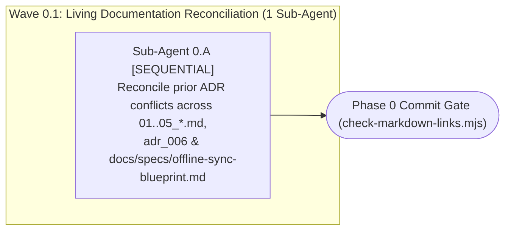
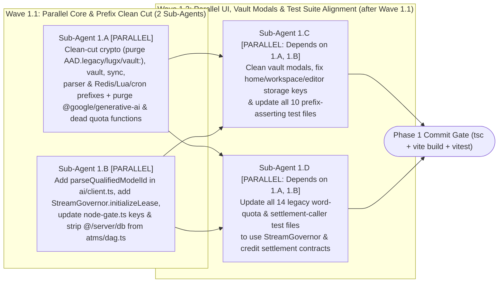
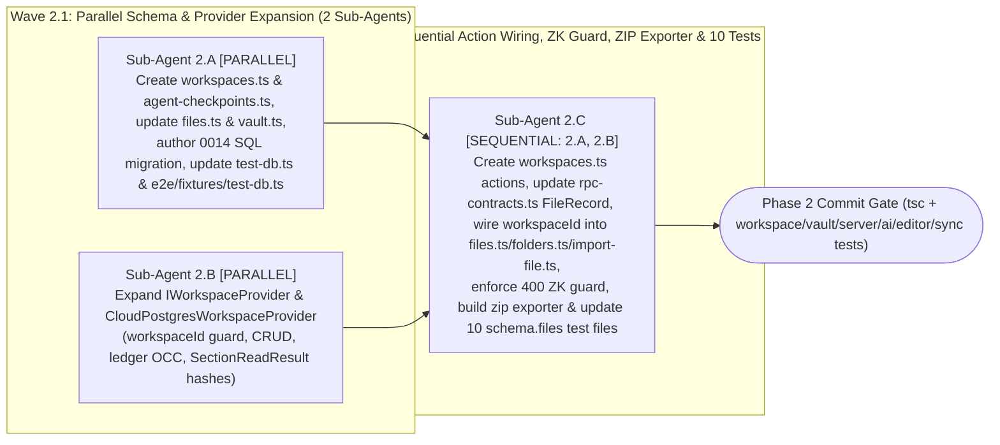
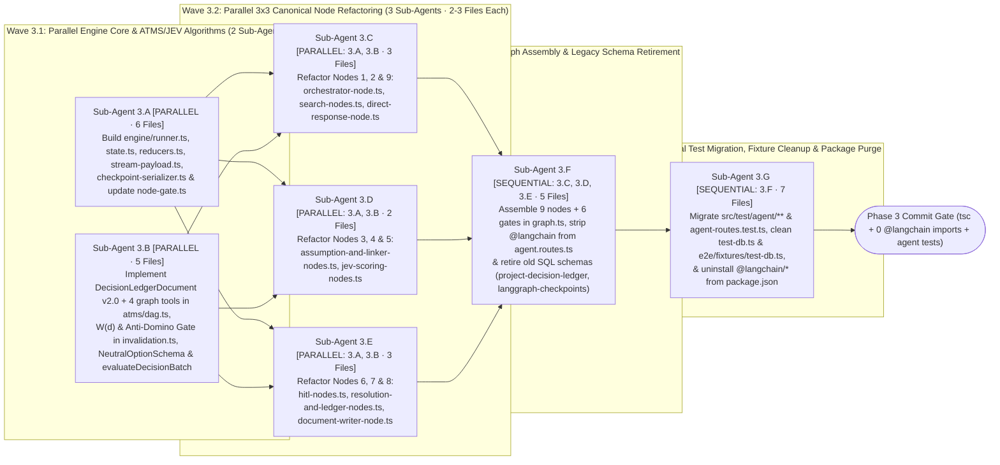
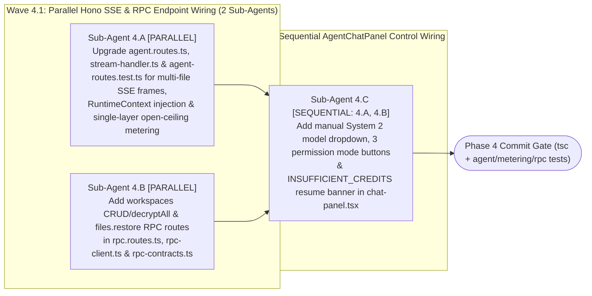
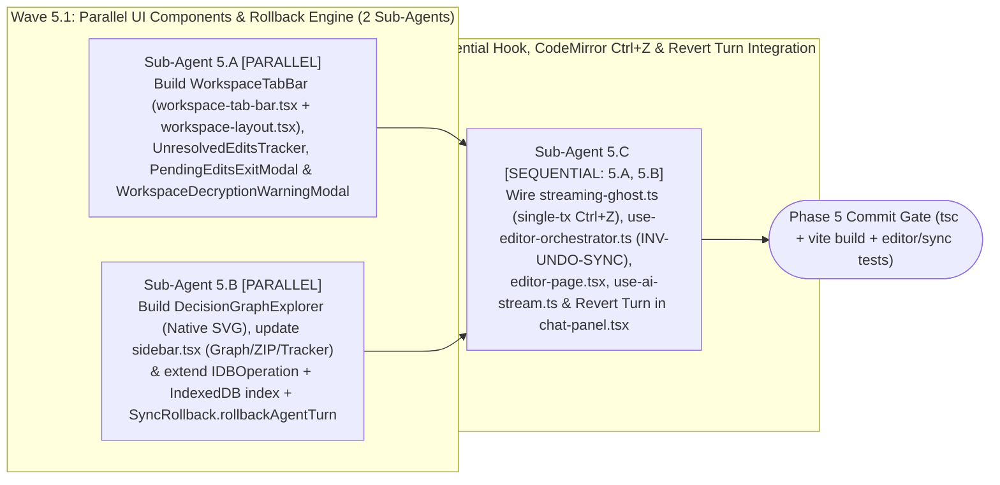
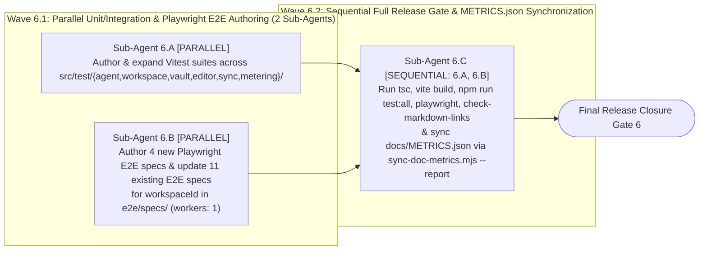

# Comprehensive Elixent Architectural Evolution & Requirements Execution Plan

| Standard Field              | Approved Value                                                                                                                                                                                                                                                                                                                                                                                                                                                                                                                                                                |
| :-------------------------- | :---------------------------------------------------------------------------------------------------------------------------------------------------------------------------------------------------------------------------------------------------------------------------------------------------------------------------------------------------------------------------------------------------------------------------------------------------------------------------------------------------------------------------------------------------------------------------- |
| **Document ID**             | `ELIXENT-EXECUTION-PLAN-v1.1`                                                                                                                                                                                                                                                                                                                                                                                                                                                                                                                                                 |
| **Classification**          | `ACTIVE TECHNICAL EXECUTION PLAN` (per `docs/DOCUMENTATION_GUIDELINES.md` §2 & §3)                                                                                                                                                                                                                                                                                                                                                                                                                                                                                            |
| **Version & Status**        | `v1.1 — AUDITED & AUTHORED FOR EXECUTION (Phase 0 -> Phase 6)`                                                                                                                                                                                                                                                                                                                                                                                                                                                                                                                |
| **Baseline Repository**     | `Elixent v0.22.0` (`146 Unit Suites · 3,007 Unit Tests` + `21 Live Suites · 105 Live Tests` + `14 Playwright E2E Specs · 15 Journeys`)                                                                                                                                                                                                                                                                                                                                                                                                                                        |
| **SSOT Architecture Suite** | • ADRs: [ADR-009](../architecture/adrs/adr_009_native_graph_orchestration_engine.md) through [ADR-016](../architecture/adrs/adr_016_zk_encryption_granularity_and_ephemeral_ai_bridge.md) (`ELIXENT-ADR-009..016 v1.2`)<br>• SRS Suite: [SRS-01](../specs/srs_01_agent_orchestration_decision_graph_and_weight_engine.md), [SRS-02](../specs/srs_02_multi_workspace_isolation_and_zk_vault_governance.md), [SRS-03](../specs/srs_03_editor_tabs_multi_ghost_review_and_two_tier_undo.md), [SRS-04](../specs/srs_04_multi_provider_ai_gateway_and_wallet_metering.md) (`v1.2`) |

---

## 1. Executive Purpose, Scope Boundaries & Hard Execution Invariants

This document is the **Authoritative, Zero-Ambiguity Execution Blueprint** for reconciling prior ADR conflicts (`ADR-001..008`), remediating blocking baseline defects (`BUG-01..BUG-09`), and implementing all requirements specified in **`ADR-009..016`** and **`SRS-01..04`** across the **`Elixent v0.22.0` (`Vite 6 SPA + TanStack Router + Hono RPC`)** repository.

### 1.1. Strict Scope Boundaries (`In-Scope` vs. `Out-of-Scope`)

1. **Strictly In-Scope:**
   - **`Phase 0`:** Reconcile all documented conflicts with prior ADRs (`ADR-001..008`, `01..05_*.md`, `adr_006`, and `offline-sync-blueprint.md`), noting that `ADR-009..016` (`docs/architecture/adrs/`), `SRS-01..04` (`docs/specs/`), this execution plan, and `docs/README.md` are already merged and indexed.
   - **`Phase 1`:** Baseline pre-flight clean-cut cleanup—atomically standardize brand-agnostic prefixes (`zk:v1:*`, `credit:*`, `workspace_sync_*`, `vault_session_v1`, `calibration:window:*`, `editor_direction_pref`), completely purge all legacy `lugx:`/`vault:`/`AAD.legacy` fallback bridges (the application is pre-production with zero encrypted user data), isolate `src/core/agent/atms/dag.ts` from `@/server/db`, add `parseQualifiedModelId` in `src/lib/ai/client.ts`, add `StreamGovernor.initializeLease()`, purge `@google/generative-ai` and dead word-quota reservation functions, and synchronously update all 10 prefix-asserting and 14 legacy-quota / settlement-caller test files (`24` Phase 1 test files total).
   - **`Phases 2–6`:** Deploy the `workspaces` isolation and `agent_checkpoints` schemas (`0014` SQL backfill migration + default-workspace resolution in `src/server/actions/*.ts`, `src/test/test-db.ts`, `e2e/fixtures/test-db.ts`, and the 10 `schema.files` test files), expand `IWorkspaceProvider` & `CloudPostgresWorkspaceProvider` (with optimistic concurrency and `sectionHash` validation), implement `decisions.ledger.json` SSOT & 4 deterministic graph tools, build `Elixent Native Graph Engine` (9 Replay-Safe Nodes & 6 State-Predicate Gates), implement 4-source Change Weight $W(d)$ & Anti-Domino Gate, wire Hono SSE/RPC (`agent.routes.ts` + `stream-handler.ts`) & ephemeral ZK bridge, build multi-tab Ghost Review UI & `DecisionGraphExplorer` & Two-Tier Undo, and close all verification gates (`npm run test:all` + Playwright E2E).
2. **Strictly Out-of-Scope:**
   - **General Codebase Refactoring / Directory Restructuring:** Broad stylistic refactoring, renaming unrelated modules, or reorganizing test folders outside the requirements above are **strictly excluded** from this plan and deferred to a separate future initiative.

### 1.2. Eight Hard Execution Invariants & Boundary Guardrails

1. **Strict Cumulative State Progression Rule (`Phase N Builds on Phase N-1`):**
   - Every Phase $N$ ($N \ge 1$) is authored and executed under the strict assumption that all file creations, schema migrations, function signature updates, and package changes from Phases $0 \dots (N-1)$ **have already been completed, verified, and committed as the active repository baseline**. No phase ever refers to a module transformed in an earlier phase in its obsolete pre-migration form.
2. **Client/Server AST Boundary Guard (`vite.config.ts` `clientServerBoundaryGuardPlugin`):**
   - Browser-reachable modules (`src/client/**`, `src/components/**`, `src/hooks/**`, and shared `src/core/agent/atms/*`) MUST NEVER import `@/server/**`, `node:*`, or `*.server.*`. `src/core/agent/atms/dag.ts` MUST be stripped of `@/server/db` in `Phase 1` before `DecisionGraphExplorer` imports it in `Phase 5`.
3. **Redis Keyspace & Test Suite Atomicity (`Phase 1` Clean Cut):**
   - Legacy `lugx:` metering keys appear in `src/lib/metering/constants.ts`, `src/lib/metering/lua-scripts.ts`, `src/lib/metering/node-gate.ts`, `src/server/routes/cron.routes.ts`, `src/server/services/ai-settlement-service.ts`, and 10 existing test files (`src/test/`). Additionally, 13 test files import deprecated word-quota functions (`reserveAIQuota`, etc.) deleted from `ai-settlement-service.ts` (plus `src/test/vault/vault-sync-ai-gate.test.ts` = 14 files in `Sub-Agent 1.D`). All source modules, Lua scripts, cron jobs, and all 24 affected test files MUST be updated atomically in `Phase 1`—no compatibility shims are retained.
4. **Non-Breaking Default Workspace Resolution for Existing File Callers (`Phase 2`):**
   - Because `src/server/actions/files.ts`, `src/server/actions/import-file.ts`, 10 existing integration/live test files in `src/test/`, and `e2e/fixtures/test-db.ts` insert rows into `schema.files` without passing an explicit `workspaceId`, `Phase 2` MUST introduce `resolveOrEnsureWorkspaceId` / `ensureTestDefaultWorkspace`, update `src/test/test-db.ts` & `e2e/fixtures/test-db.ts`, and update all 10 `schema.files` test files in `Wave 2.2` so all file/folder suites pass $100\%$ at `Commit Gate 2`.
5. **Complete `@langchain/*` Decoupling Prior to Package Removal (`Phase 3`):**
   - `@langchain/langgraph` and `@langchain/core` are imported not only in `src/core/agent/**` and `src/lib/metering/node-gate.ts`, but also in `src/server/routes/agent.routes.ts` (`Command`, `isGraphInterrupt`), `src/test/server/agent-routes.test.ts`, and old schema cleanup in `src/test/test-db.ts` and `e2e/fixtures/test-db.ts`. Therefore, `Wave 3.2` & `Wave 3.3` of `Phase 3` MUST replace those imports and clean up retired schema references at the exact moment `@langchain/*` is uninstalled from `package.json`.
6. **Closed Zod Schema Synchronization (`src/core/agent/stream-payload.ts`):**
   - `AgentStreamRequestPayloadSchema` enforces `.strict()`. Before `Phase 4` or `Phase 5` passes `workspaceId`, `turnId`, `permissionMode`, or `selectedSystem2ModelId` to `POST /api/agent/stream`, `stream-payload.ts` MUST be extended in `Phase 3` (`Wave 3.1`) to validate these fields (while accepting `projectId` as a backward-compatible fallback for `workspaceId`).
7. **Zero-Knowledge Plaintext Isolation & Clean-Cut `'zk:v1'` Prefix Purge:**
   - Because Elixent has not been deployed to production (`Zero Production Encrypted Records`), `src/lib/crypto/aad.ts`, `src/lib/crypto/key-derivation.ts`, `src/lib/vault/recovery.ts`, `src/lib/sync/encryption.ts`, `src/lib/sync/sync-crypto-gateway.ts`, `trust-device-modal.tsx`, and `vault-unlock-modal.tsx` switch exclusively to `'zk:v1'` and purge `AAD.legacy` and all `'lugx:v1:*'` / `'vault:*'` dual-try fallbacks completely. Unwrapped keys never leave the browser Web Worker, and `EncryptedCheckpointSerializer` asserts zero active `getActiveEphemeralVaultPlaintexts()` leaks before writing `agent_checkpoints`.
8. **Zero File-Write Contention in Parallel Sub-Agent Waves:**
   - Within any wave marked `[PARALLEL]`, every modified or created file is owned by **exactly one** sub-agent. Shared integration entrypoints execute exclusively in `[SEQUENTIAL]` waves.

---

## 2. Master 7-Phase & Sub-Agent Execution DAG

```mermaid
flowchart TB
    classDef parallelTask fill:#e3fafc,stroke:#0c8599,stroke-width:1.5px,color:#0b7285
    classDef seqTask fill:#f3f0ff,stroke:#5f3dc4,stroke-width:1.5px,color:#5f3dc4
    classDef gateNode fill:#d3f9d8,stroke:#2b8a3e,stroke-width:2px,color:#1b4332

    subgraph P0 ["Phase 0: Prior-ADR Conflict Resolution & Living Docs Reconciliation"]
        T0A["0.A [SEQUENTIAL]: Reconcile conflicts in 01..05_*.md, adr_006 & offline-sync-blueprint.md"]:::seqTask
        G0(["Commit Gate 0: check-markdown-links.mjs"]):::gateNode
        T0A --> G0
    end

    subgraph P1 ["Phase 1: Baseline Pre-Flight Clean Cut, Prefix Standardization & Seam Fixes"]
        T1A["1.A [PARALLEL]: Standardize prefixes (zk:v1:*, credit:*, workspace_sync_*, vault_session_v1, calibration:window:*), purge AAD.legacy/lugx:*, @google/generative-ai & dead quota functions"]:::parallelTask
        T1B["1.B [PARALLEL]: Add parseQualifiedModelId (ai/client.ts), StreamGovernor.initializeLease(), & decouple atms/dag.ts from @/server/db"]:::parallelTask
        T1C["1.C [PARALLEL after 1.A, 1.B]: Clean vault modals, fix home/workspace/editor keys & align 10 prefix-asserting test files"]:::parallelTask
        T1D["1.D [PARALLEL after 1.A, 1.B]: Align 14 legacy word-quota & settlement-caller test files with StreamGovernor & settlement service"]:::parallelTask
        G1(["Commit Gate 1: tsc + vite build + unit suites"]):::gateNode
        T1A & T1B --> T1C & T1D --> G1
    end

    subgraph P2 ["Phase 2: Multi-Workspace Isolation, decisions.ledger.json Storage & ZK Governance"]
        T2A["2.A [PARALLEL]: Create workspaces.ts & agent-checkpoints.ts; update files.ts & vault.ts; author 0014 SQL migration; update test-db.ts & e2e/fixtures/test-db.ts"]:::parallelTask
        T2B["2.B [PARALLEL]: Expand IWorkspaceProvider & CloudPostgresWorkspaceProvider (workspaceId guard, CRUD, ledger OCC, SectionReadResult hashes)"]:::parallelTask
        T2C["2.C [SEQUENTIAL: 2.A, 2.B]: Wire resolveOrEnsureWorkspaceId in server/actions/*.ts, rpc-contracts.ts, files-api.routes.ts, zip exporter & 10 schema.files tests"]:::seqTask
        G2(["Commit Gate 2: tsc + workspace/vault/server file tests"]):::gateNode
        T2A & T2B --> T2C --> G2
    end

    subgraph P3 ["Phase 3: Elixent Native Graph Engine, 9 Canonical Nodes, W(d) Gate & LangGraph Purge"]
        T3A["3.A [PARALLEL]: Build engine/runner.ts, state.ts, reducers.ts, stream-payload.ts, checkpoint-serializer.ts & node-gate.ts (6 files)"]:::parallelTask
        T3B["3.B [PARALLEL]: Implement DecisionLedgerDocument v2.0 + 4 graph tools (dag.ts), W(d) & Anti-Domino Gate (invalidation.ts), NeutralOptionSchema & evaluateDecisionBatch (5 files)"]:::parallelTask
        T3C["3.C [PARALLEL after 3.A, 3.B]: Refactor Nodes 1, 2 & 9 (orchestrator-node.ts, search-nodes.ts, direct-response-node.ts) (3 files)"]:::parallelTask
        T3D["3.D [PARALLEL after 3.A, 3.B]: Refactor Nodes 3, 4 & 5 (assumption-and-linker-nodes.ts, jev-scoring-nodes.ts) (2 files)"]:::parallelTask
        T3E["3.E [PARALLEL after 3.A, 3.B]: Refactor Nodes 6, 7 & 8 (hitl-nodes.ts, resolution-and-ledger-nodes.ts, document-writer-node.ts) (3 files)"]:::parallelTask
        T3F["3.F [SEQUENTIAL: 3.C, 3.D, 3.E]: Wire 9 Nodes + 6 Gates (G-01..G-06) in graph.ts, strip @langchain from agent.routes.ts & retire old SQL schemas (5 files)"]:::seqTask
        T3G["3.G [SEQUENTIAL: 3.F]: Migrate src/test/agent/**, agent-routes.test.ts, test-db.ts, e2e/fixtures/test-db.ts & uninstall @langchain/* (7 files)"]:::seqTask
        G3(["Commit Gate 3: tsc + 0 @langchain imports + agent tests"]):::gateNode
        T3A & T3B --> T3C & T3D & T3E --> T3F --> T3G --> G3
    end

    subgraph P4 ["Phase 4: Hono SSE/RPC Wiring, Ephemeral ZK Bridge & System 2 Selector"]
        T4A["4.A [PARALLEL]: Upgrade agent.routes.ts, stream-handler.ts & agent-routes.test.ts for multi-file SSE frames & single-layer open-ceiling metering"]:::parallelTask
        T4B["4.B [PARALLEL]: Add workspace CRUD, decryptAll & file restore RPC routes in rpc.routes.ts + rpc-client.ts + rpc-contracts.ts"]:::parallelTask
        T4C["4.C [SEQUENTIAL: 4.A, 4.B]: Add manual System 2 model dropdown, 3 permission modes & credit resume banner in AgentChatPanel"]:::seqTask
        G4(["Commit Gate 4: tsc + agent/metering/rpc tests"]):::gateNode
        T4A & T4B --> T4C --> G4
    end

    subgraph P5 ["Phase 5: Multi-Tab Editor, Persistent Ghost Review, Decision Graph UI & Two-Tier Undo"]
        T5A["5.A [PARALLEL]: Build WorkspaceTabBar (workspace-tab-bar.tsx), UnresolvedEditsTracker, PendingEditsExitModal & WorkspaceDecryptionWarningModal"]:::parallelTask
        T5B["5.B [PARALLEL]: Build DecisionGraphExplorer (Native SVG) + Sidebar Graph/Tracker controls & extend IDBOperation + IndexedDB index + SyncRollback"]:::parallelTask
        T5C["5.C [SEQUENTIAL: 5.A, 5.B]: Wire use-editor-orchestrator.ts (INV-UNDO-SYNC), editor-page.tsx, use-ai-stream.ts, streaming-ghost.ts & Revert Turn UI"]:::seqTask
        G5(["Commit Gate 5: tsc + vite build + editor/sync tests"]):::gateNode
        T5A & T5B --> T5C --> G5
    end

    subgraph P6 ["Phase 6: Comprehensive Verification, Playwright E2E Journeys & Release Closure"]
        T6A["6.A [PARALLEL]: Expand Vitest suites across agent, workspace, vault, editor, sync & metering"]:::parallelTask
        T6B["6.B [PARALLEL]: Author new Playwright E2E specs & update 11 existing E2E specs for workspaceId in e2e/specs/"]:::parallelTask
        T6C["6.C [SEQUENTIAL: 6.A, 6.B]: Full tsc, vite build, npm run test:all, playwright, link check & METRICS.json sync"]:::seqTask
        G6(["Final Release Gate 6"]):::gateNode
        T6A & T6B --> T6C --> G6
    end

    G0 --> P1
    G1 --> P2
    G2 --> P3
    G3 --> P4
    G4 --> P5
    G5 --> P6
```



---

## 3. 7-Phase Commit Register

| Phase         | Single Responsibility Scope (`SRP`)                                                                                                                                                                                                                                              |    Sub-Agent Tasks    | Target Git Commit                                                                          |
| :------------ | :------------------------------------------------------------------------------------------------------------------------------------------------------------------------------------------------------------------------------------------------------------------------------- | :-------------------: | :----------------------------------------------------------------------------------------- |
| **`Phase 0`** | Reconcile prior ADR supersessions and amendments across `01..05_*.md`, `adr_006`, and `offline-sync-blueprint.md` (with `ADR-009..016` and `SRS-01..04` already merged).                                                                                                        |   $1$ (`Wave 0.1`)    | `docs(architecture): reconcile prior ADR supersessions and amendments`                     |
| **`Phase 1`** | Clean-cut standardize brand-agnostic prefixes across crypto/sync/metering/Lua/cron, purge `AAD.legacy`/`lugx:*`/`vault:*` bridges & dead quota functions, isolate `atms/dag.ts` from `@/server/db`, add `parseQualifiedModelId` & `StreamGovernor.initializeLease`, and update all 24 affected test files. | $4$ (`Waves 1.1–1.2`) | `fix(baseline): clean-cut prefix purge, isolate dag.ts, and update affected test suites`   |
| **`Phase 2`** | Deploy `workspaces` and `agent_checkpoints` schemas (`0014` backfill migration), update `test-db.ts` & `e2e/fixtures/test-db.ts`, expand `IWorkspaceProvider` & `CloudPostgresWorkspaceProvider` (OCC + hashes), wire `resolveOrEnsureWorkspaceId` + `FileRecord` + 10 `schema.files` tests, and build `.zip` exporter. | $3$ (`Waves 2.1–2.2`) | `feat(workspace): add multi-workspace isolation, ZK governance, and zip exporter`          |
| **`Phase 3`** | Implement `Elixent Native Graph Engine`, 9 Replay-Safe Nodes (via $3 \times 3$ parallel node waves) & 6 Gates, `decisions.ledger.json` 4 graph tools, $W(d)$ Anti-Domino Gate, neutral `JEV` framing, extend `stream-payload.ts`, migrate `src/test/agent/*`, `agent.routes.ts` & `e2e/fixtures/test-db.ts`, and uninstall `@langchain/*`. | $7$ (`Waves 3.1–3.4` · $\le 6$ files/task) | `feat(agent): replace LangGraph with Elixent Native Graph Engine and 9-node topology`      |
| **`Phase 4`** | Wire `agent.routes.ts`, `stream-handler.ts` & `rpc.routes.ts` for full multi-file SSE frames (`ghost_hunk_proposed`, `file_mutated`, `vault_file_commit_required`), single-layer open-ceiling metering, workspace CRUD/decryptAll/restore RPCs, and `AgentChatPanel` controls. | $3$ (`Waves 4.1–4.2`) | `feat(server): wire Hono SSE/RPC routes, stream handler, ZK bridge, and System 2 selector` |
| **`Phase 5`** | Build `WorkspaceTabBar`, `UnresolvedEditsTracker`, `PendingEditsExitModal` (3 options), `WorkspaceDecryptionWarningModal`, `DecisionGraphExplorer` (Native SVG), single-tx `Ctrl+Z`, and Turn-Linked `IDBOperation` rollback with `INV-UNDO-SYNC`.                             | $3$ (`Waves 5.1–5.2`) | `feat(ui): implement multi-tab ghost review, decision graph explorer, and two-tier undo`   |
| **`Phase 6`** | Complete Vitest (`npm run test:all`) and Playwright E2E (`e2e/specs/` new + 11 updated specs) verification across all `ADR-009..016` and `SRS-01..04` requirements and synchronize `docs/METRICS.json`.                                                                          | $3$ (`Waves 6.1–6.2`) | `test(release): complete ADR-009..016 and SRS-01..04 verification and E2E closure`         |

---

## 4. Detailed Phase-by-Phase Specifications

### [Phase 0: Prior-ADR Conflict Resolution & Living Documentation Reconciliation]

> **Phase Identifier:** `Phase 0 — Prior-ADR Conflict Resolution & Living Documentation Reconciliation`  
> **Single Responsibility Principle (`SRP`):** Reconcile all prior living architecture documents (`01..05_*.md`, `adr_006`, `offline-sync-blueprint.md`) with the already-merged `ADR-009..016` (`docs/architecture/adrs/`) and `SRS-01..04` (`docs/specs/`) baseline.  
> **Pre-Phase 0 Baseline State:** `Elixent v0.22.0` repository (`146` unit suites / `3,007` tests, `21` live suites / `105` tests, `14` E2E specs / `15` tests). `ADR-009..016` (`docs/architecture/adrs/`), `SRS-01..04` (`docs/specs/`), this execution plan (`docs/Plans/`), and `docs/README.md` are already merged and indexed.  
> **Post-Phase 0 Output Contract (Handed Off to Phase 1):** All prior living architecture documents (`01..05_*.md`, `adr_006`, `offline-sync-blueprint.md`) carry explicit supersession and amendment cross-references to `ADR-009..016` and `SRS-01..04`, and `node scripts/check-markdown-links.mjs` passes with `0` broken links.

#### Phase 0 Sub-Agent Topology



#### Detailed Sub-Agent Tasks in Phase 0

##### 1. Task `Sub-Agent 0.A`: Reconcile Supersessions & Amendments Across Existing Living Architecture Documents

- **Execution Mode & Dependencies:** `[SEQUENTIAL — Wave 0.1]`.
- **Exclusively Targeted Files:**
  - `docs/architecture/01_architecture_vision_and_adrs.md` (modify)
  - `docs/architecture/02_agent_orchestration_and_decision_engine.md` (modify)
  - `docs/architecture/03_workspace_ast_editor_and_vault_integration.md` (modify)
  - `docs/architecture/05_data_contracts_and_lugx_migration_plan.md` (modify)
  - `docs/architecture/adrs/adr_006_unified_vite_tanstack_hono_rpc_architecture.md` (modify)
  - `docs/specs/offline-sync-blueprint.md` (modify)
- **Exact Implementation Actions:**
  1. In `docs/architecture/01_architecture_vision_and_adrs.md`:
     - Under `§3.1 ADR-001`: prepend a supersession callout directing readers to [ADR-009](../architecture/adrs/adr_009_native_graph_orchestration_engine.md) (replacing `@langchain/langgraph` with `Elixent Native Graph Engine` and `Vercel AI SDK v7`).
     - Under `§3.2 ADR-002`: add an amendment callout referencing [ADR-013](../architecture/adrs/adr_013_epistemic_framing_decoupling_system2_system1.md) (neutral option enumeration & raw workspace evidence grounding), [ADR-014](../architecture/adrs/adr_014_deterministic_change_weight_and_anti_domino_gate.md) (4-source Change Weight $W(d)$ & Anti-Domino Gate), and [ADR-012](../architecture/adrs/adr_012_json_decision_ledger_and_graph_traversal.md) (`decisions.ledger.json` replacing `project_decision_ledger`).
     - Under `§3.3 ADR-003`: note that Stage 1 discovery (`search_discovery_node` per [ADR-010](../architecture/adrs/adr_010_replay_safe_node_boundary_topology.md)) pairs the 4 AST/BM25 document tools with the 4 `decisions.ledger.json` graph traversal tools (`ADR-012`).
     - Under `§3.5 ADR-005`: prepend an amendment callout referencing [ADR-009](../architecture/adrs/adr_009_native_graph_orchestration_engine.md) (`agent_checkpoints` single-table encrypted store replacing `PostgresSaver`) and [ADR-012](../architecture/adrs/adr_012_json_decision_ledger_and_graph_traversal.md) (`decisions.ledger.json` replacing `project_decision_ledger`).
  2. In `docs/architecture/02_agent_orchestration_and_decision_engine.md`:
     - In `§1` and `§3.1`: add supersession banners pointing to [ADR-009](../architecture/adrs/adr_009_native_graph_orchestration_engine.md), [ADR-010](../architecture/adrs/adr_010_replay_safe_node_boundary_topology.md), and [SRS-01](../specs/srs_01_agent_orchestration_decision_graph_and_weight_engine.md) for the 9 Replay-Safe Canonical Nodes and 6 State-Predicate Gates (`G-01..G-06`).
     - In `§4.1`: note the replacement of pre-scoring `rationaleAndPremises` with `technicalConstraints` and structured `workspaceEvidence` per [ADR-013](../architecture/adrs/adr_013_epistemic_framing_decoupling_system2_system1.md).
     - In `§5` and `§5.2`: note the replacement of `project_decision_ledger` with `decisions.ledger.json` ([ADR-012](../architecture/adrs/adr_012_json_decision_ledger_and_graph_traversal.md)) and insertion of `computeDecisionChangeWeight` + `evaluateAntiDominoGate` ([ADR-014](../architecture/adrs/adr_014_deterministic_change_weight_and_anti_domino_gate.md)).
  3. In `docs/architecture/03_workspace_ast_editor_and_vault_integration.md`:
     - In `§1` & `§2`: add cross-references to [ADR-011](../architecture/adrs/adr_011_multi_workspace_data_isolation_model.md) and [SRS-02](../specs/srs_02_multi_workspace_isolation_and_zk_vault_governance.md) for full `workspaceId` scope (`listWorkspaceTree`, `createWorkspaceFile`, `deleteWorkspaceFile`, open + closed files).
     - In `§4`: add cross-references to [ADR-015](../architecture/adrs/adr_015_two_tier_workspace_undo_and_turn_rollback.md) and [SRS-03](../specs/srs_03_editor_tabs_multi_ghost_review_and_two_tier_undo.md) for `WorkspaceTabBar`, `ghostHunksByFileId`, `PendingEditsExitModal`, and Two-Tier Undo.
     - In `§5`: add cross-references to [ADR-016](../architecture/adrs/adr_016_zk_encryption_granularity_and_ephemeral_ai_bridge.md) for `allow_ai_on_encrypted_files = true` default, mandatory workspace-wide encryption governance, and `vault_file_commit_required`.
  4. In `docs/architecture/05_data_contracts_and_lugx_migration_plan.md`:
     - Mark `§1.3` (`project_decision_ledger`) as superseded by [ADR-012](../architecture/adrs/adr_012_json_decision_ledger_and_graph_traversal.md) and `§1.5` (`langgraph-checkpoints.ts`) as superseded by [ADR-009](../architecture/adrs/adr_009_native_graph_orchestration_engine.md).
  5. In `docs/architecture/adrs/adr_006_unified_vite_tanstack_hono_rpc_architecture.md` (`§1.1` table): update `Agent Brain Execution Host (LangGraph)` to `Agent Brain Execution Host (Elixent Native Graph Engine — ADR-009)`.
  6. In `docs/specs/offline-sync-blueprint.md` (`§1.2`): add a pointer to [ADR-015](../architecture/adrs/adr_015_two_tier_workspace_undo_and_turn_rollback.md) and [SRS-03](./srs_03_editor_tabs_multi_ghost_review_and_two_tier_undo.md) for `(workspaceId, threadId, turnId, postTurnEtag)` extensions on `IDBOperation`.
  7. In `docs/specs/srs_02_multi_workspace_isolation_and_zk_vault_governance.md` (`§5` table & `§6.2`): update the `src/lib/crypto/aad.ts` rule from retaining `AAD.legacy` to the pre-production **Clean-Cut Purge** (`AAD.legacy` removed completely; `zk:v1:*` enforced exclusively), and verify all relative links across `docs/architecture/adrs/adr_009..016_*.md` and `docs/specs/srs_01..04_*.md` resolve cleanly under their subfolder locations (`../../../src/...`, `../01_...`, `../../specs/srs_...`, `../architecture/adrs/adr_...`).

#### Phase 0 Commit Gate

```bash
node scripts/check-markdown-links.mjs
```

---

### [Phase 1: Baseline Pre-Flight Clean Cut, Prefix Standardization & Seam Fixes]

> **Phase Identifier:** `Phase 1 — Baseline Pre-Flight Clean Cut, Prefix Standardization & Seam Fixes`  
> **Single Responsibility Principle (`SRP`):** Atomically perform a clean-cut standardization of all brand-agnostic prefixes (`zk:v1:*`, `credit:*`, `workspace_sync_*`, `vault_session_v1`, `calibration:window:*`, `editor_direction_pref`, `ocr_bilingual_installed`, `pdf_table_extraction_enabled`) while purging all legacy `lugx:`/`vault:`/`AAD.legacy` fallback bridges; isolate `src/core/agent/atms/dag.ts` from `@/server/db`; implement `parseQualifiedModelId` in `src/lib/ai/client.ts`; implement `StreamGovernor.initializeLease()`; purge `@google/generative-ai` and dead word-quota reservation functions; and synchronously update all 10 prefix-asserting and 14 legacy-quota / settlement-caller test files (`24` Phase 1 test files total).  
> **Pre-Phase 1 Baseline State (Inherited from Phase 0):** All 12 `ADR-009..016` and `SRS-01..04` documents are merged, linked, and reconciled with prior docs. Source code (`src/**`) is at the `v0.22.0` baseline with `3,007` unit tests passing.  
> **Post-Phase 1 Output Contract (Handed Off to Phase 2):**
>
> 1. `src/core/agent/atms/dag.ts` has `0` `@/server/db` imports and passes `clientServerBoundaryGuardPlugin`.
> 2. `parseQualifiedModelId` is exported from `src/lib/ai/client.ts` and strips provider prefixes (`google/`) at the SDK call boundary while indexing circuit-breakers and key rotation by full `qualifiedModelId`.
> 3. `StreamGovernor.initializeLease(pessimisticInputTokens)` reserves the initial slice in Redis under `credit:lease:<opId>` prior to streaming.
> 4. All crypto (`zk:v1:*` exclusively, `0` `AAD.legacy`/`lugx:*`/`vault:*` bridges), sync (`workspace_sync_*`, `vault_session_v1`), metering (`credit:*`, `calibration:window:*`), and dead word-quota cleanups are complete and verified across all updated test suites.

#### Phase 1 Sub-Agent Topology



#### Detailed Sub-Agent Tasks in Phase 1

##### 1. Task `Sub-Agent 1.A`: Clean-Cut Standardize Crypto, Sync, Parser & Metering/Lua/Cron Prefixes and Purge Dead Quota Functions

- **Execution Mode & Dependencies:** `[PARALLEL — Wave 1.1]`.
- **Exclusively Targeted Files:**
  - `src/lib/crypto/aad.ts` (modify)
  - `src/lib/crypto/key-derivation.ts` (modify)
  - `src/lib/vault/recovery.ts` (modify)
  - `src/lib/sync/encryption.ts` (modify)
  - `src/lib/sync/sync-crypto-gateway.ts` (modify)
  - `src/lib/sync/session-key-store.ts` (modify)
  - `src/lib/sync/cross-tab-sync.ts` (modify)
  - `src/lib/sync/tab-sync.ts` (modify)
  - `src/lib/sync/webauthn-prf.ts` (modify)
  - `src/lib/parsers/pdf-ocr-engine.ts` (modify)
  - `src/lib/parsers/pdf-settings.ts` (modify)
  - `src/lib/metering/constants.ts` (modify)
  - `src/lib/metering/lua-scripts.ts` (modify)
  - `src/lib/jev/calibration-store.ts` (modify)
  - `src/server/routes/cron.routes.ts` (modify)
  - `src/server/services/ai-settlement-service.ts` (modify)
  - `package.json` & `package-lock.json` (modify)
- **Exact Implementation Actions:**
  1. **Clean-Cut Cryptographic AAD & HKDF Contexts (`SRS-02` §5 — Zero Legacy Bridges):**
     - In `src/lib/crypto/aad.ts`: set `export const AAD_VERSION_V1 = 'zk:v1';`, remove the entire `AAD.legacy` object completely (pre-production clean cut: zero encrypted user records exist), and update `isCanonicalAAD` to enforce `'zk:v1:'`.
     - In `src/lib/crypto/key-derivation.ts`, `src/lib/vault/recovery.ts`, `src/lib/sync/encryption.ts`, `src/lib/sync/sync-crypto-gateway.ts`, and `src/lib/sync/webauthn-prf.ts`: update HKDF info strings exclusively to `zk:v1:doc-key:${fileId}`, `zk:v1:search-key:${userId}`, and `zk:v1:proof-of-possession:${nonce}`, and delete all `AAD.legacy` / `lugx:v1:*` / `vault:*` / `trusted_device:` dual-try fallback blocks (`computeLegacyAad`, adaptive fallback loops in `unwrapMasterKey`, `recoverMasterKeyWithSeed`, `recovery.ts`, and `decryptInbound`).
  2. **Clean-Cut Browser Storage & Cross-Tab Channels (`SRS-02` §5):**
     - In `src/lib/sync/session-key-store.ts`: set `SESSION_STORAGE_VAULT_KEY = 'vault_session_v1'` cleanly without retaining legacy key probes.
     - In `src/lib/sync/cross-tab-sync.ts` and `src/lib/sync/tab-sync.ts`: change `getSyncChannelName` to return `workspace_sync_${uid}`.
     - In `src/lib/parsers/pdf-ocr-engine.ts` and `src/lib/parsers/pdf-settings.ts`: switch storage keys directly to `'ocr_bilingual_installed'` and `'pdf_table_extraction_enabled'` without legacy `'lugx_*'` fallback reads.
  3. **Redis Metering Keyspace & Lua Scripts (`SRS-04` §4):**
     - In `src/lib/metering/constants.ts`: update `REDIS_KEYS` to `credit:wallet:${userId}`, `credit:lease:${operationId}`, `credit:step_done:${stepKey}`, `credit:pending_settlements:${userId}`, and `credit:dirty_wallets`.
     - In `src/lib/metering/lua-scripts.ts`, `src/server/routes/cron.routes.ts`, and `src/server/services/ai-settlement-service.ts`: update all Redis key prefix references and Lua script key builders to use `REDIS_KEYS.*` (`credit:*`).
     - In `src/lib/jev/calibration-store.ts`: update `getRedisKey(modelId)` to return `calibration:window:${modelId}`.
  4. **Purge Dead Legacy Packages & Word-Quota Functions (`SRS-04` §2.2):**
     - Remove `"@google/generative-ai"` from `package.json`.
     - Delete all dead legacy word-quota reservation functions (`reserveAIQuota`, `commitAIReservation`, `refundAIReservation`, `refundUsage`, `expireStaleReservations`, `getAIReservationStatus`, `reserveAndUpdateUsage`) from `src/server/services/ai-settlement-service.ts` immediately (zero production callers exist; affected test suites are synchronously updated in `Sub-Agent 1.D`), retaining `computeRequestHash`, `getUserTier`, `getTodayUsage`, `getUserCreditBalance`, and `flushPendingSettlementsToPostgres`.

##### 2. Task `Sub-Agent 1.B`: Implement `parseQualifiedModelId`, `StreamGovernor.initializeLease`, and Isolate `atms/dag.ts`

- **Execution Mode & Dependencies:** `[PARALLEL — Wave 1.1]` (zero file overlap with `1.A`).
- **Exclusively Targeted Files:**
  - `src/lib/ai/client.ts` (modify)
  - `src/lib/metering/stream-governor.ts` (modify)
  - `src/lib/metering/node-gate.ts` (modify)
  - `src/core/agent/atms/dag.ts` (modify)
- **Exact Implementation Actions:**
  1. In `src/lib/ai/client.ts` (`SRS-04` §2.2):
     - Export `ParsedQualifiedModelId` and `parseQualifiedModelId(qualifiedModelId: string)`.
     - Update `getGoogleModel(modelId, existingKeyInfo?)` to parse `const parsed = parseQualifiedModelId(modelId);`, call `getApiKeyForRequest(parsed.qualifiedModelId)`, and invoke `provider(parsed.providerModelName)` so `"google/gemini-3.8-flash"` passes `"gemini-3.8-flash"` to `@ai-sdk/google`.
  2. In `src/lib/metering/stream-governor.ts` (`SRS-04` §3.2):
     - Add `async initializeLease(pessimisticInputTokens = 0): Promise<{ canAfford: boolean; reservedTokens: number; reservedMicro: bigint }>` which calls `ensureWalletLoadedFlushFirst` and `executeReserveOrExtend` in Redis before any tokens are streamed, updating `this.totalTokensReserved` and `this.coveredTokens` strictly from the Redis Lua response.
  3. In `src/lib/metering/node-gate.ts`: ensure all Redis key lookups use `REDIS_KEYS` from `./constants`.
  4. In `src/core/agent/atms/dag.ts` (`SRS-01` §4.1):
     - Remove `import { and, eq, inArray } from "drizzle-orm";`, `import { db, txDb } from "@/server/db";`, and `import { projectDecisionLedger ... } from "@/server/db/schema/project-decision-ledger";`.
     - Define `EvaluatedAlternativeRecord` directly inside `dag.ts` (or import from `@/core/agent/schemas/decision-schemas`).
     - Convert `loadProjectLedgerState` and `syncMasterLedgerToProjectStore` into pure in-memory adapter stubs preserving their validation guards (`atms-dag-and-cascade.test.ts` compatibility until replaced by `ctx.workspaceProvider.readDecisionLedger()` / `writeDecisionLedger()` in `Phase 3`) so `dag.ts` is $100\%$ client-safe immediately.

##### 3. Task `Sub-Agent 1.C`: Clean Vault Modals, Align UI Route Storage Keys & Update All 10 Prefix-Asserting Test Files

- **Execution Mode & Dependencies:** `[PARALLEL — Wave 1.2 | Depends on: Sub-Agent 1.A, Sub-Agent 1.B]`.
- **Exclusively Targeted Files:**
  - `src/components/vault/trust-device-modal.tsx` (modify)
  - `src/components/vault/vault-unlock-modal.tsx` (modify)
  - `src/client/routes/home-page.tsx` (modify)
  - `src/client/routes/workspace-page.tsx` (modify)
  - `src/client/routes/editor-page.tsx` (modify)
  - `src/test/agent/wave-11-2-ui-and-pages.test.tsx` (modify)
  - `src/test/client/wave-3-1-spa-hardening.test.tsx` (modify)
  - `src/test/types/contracts.test.ts` (modify)
  - `src/test/editor/editor-security-hardening.test.ts` (modify)
  - `src/test/infrastructure/cron-expire-reservations.live.test.ts` (modify)
  - `src/test/infrastructure/cron-expire-reservations.test.ts` (modify)
  - `src/test/metering/derivation-and-lua.unit.test.ts` (modify)
  - `src/test/sync/sync-tab-isolation.test.ts` (modify)
  - `src/test/vault/adaptive-recovery-migration.test.ts` (modify)
  - `src/test/vault/vault-orchestration.test.ts` (modify)
- **Exact Implementation Actions:**
  1. In `src/components/vault/trust-device-modal.tsx` and `src/components/vault/vault-unlock-modal.tsx`: remove `AAD.legacy.passWrap(...)` fallback `catch` branches cleanly so only canonical `AAD.passwordWrap(userId)` (`zk:v1:pass:*`) is executed.
  2. In `src/client/routes/editor-page.tsx`: change `"lugx_editor_direction_pref"` directly to `"editor_direction_pref"` without legacy fallback reads.
  3. In `src/client/routes/home-page.tsx` and `src/client/routes/workspace-page.tsx`: update legacy 5-operation LUGX copy and fix folder `<Link>` navigation inside `/workspace`.
  4. **Update all 10 prefix-asserting test files:** align all expected prefixes across `wave-11-2-ui-and-pages.test.tsx`, `wave-3-1-spa-hardening.test.tsx`, `contracts.test.ts`, `editor-security-hardening.test.ts`, `cron-expire-reservations.live.test.ts`, `cron-expire-reservations.test.ts`, `derivation-and-lua.unit.test.ts`, `sync-tab-isolation.test.ts`, `adaptive-recovery-migration.test.ts`, and `vault-orchestration.test.ts` to assert `zk:v1:*`, `credit:*`, `vault_session_v1`, `workspace_sync_*`, and `editor_direction_pref` exclusively, removing obsolete `AAD.legacy` test cases from `adaptive-recovery-migration.test.ts`.

##### 4. Task `Sub-Agent 1.D`: Synchronously Update All 14 Legacy Word-Quota & Settlement-Caller Test Files (`DEF-01`)

- **Execution Mode & Dependencies:** `[PARALLEL — Wave 1.2 | Depends on: Sub-Agent 1.A, Sub-Agent 1.B]` (zero file overlap with `1.C`).
- **Exclusively Targeted Files:**
  - `src/test/ai/ai-atomic-commit.integration.test.ts` (modify)
  - `src/test/ai/ai-client-authority-revocation.test.ts` (modify)
  - `src/test/ai/ai-ops.integrity.test.ts` (modify)
  - `src/test/ai/ai-ops.refund.test.ts` (modify)
  - `src/test/ai/ai-preview-decision.live.test.ts` (modify)
  - `src/test/ai/ai-quota-idempotency.live.test.ts` (modify)
  - `src/test/ai/ai-quota-idempotency.test.ts` (modify)
  - `src/test/ai/ai-reservation-status.live.test.ts` (modify)
  - `src/test/ai/ai-server-atomic-commit.test.ts` (modify)
  - `src/test/ai/ai-stream-replay-prevention.test.ts` (modify)
  - `src/test/infrastructure/multi-system-lifecycle.live.test.ts` (modify)
  - `src/test/metering/ai-settlement-service.unit.test.ts` (modify)
  - `src/test/server/cross-user-ownership.test.ts` (modify)
  - `src/test/vault/vault-sync-ai-gate.test.ts` (modify)
- **Exact Implementation Actions:**
  1. Refactor `ai-atomic-commit.integration.test.ts`, `ai-client-authority-revocation.test.ts`, `ai-ops.integrity.test.ts`, `ai-ops.refund.test.ts`, `ai-preview-decision.live.test.ts`, `ai-quota-idempotency.live.test.ts`, `ai-quota-idempotency.test.ts`, `ai-reservation-status.live.test.ts`, `ai-server-atomic-commit.test.ts`, `ai-stream-replay-prevention.test.ts`, `multi-system-lifecycle.live.test.ts`, `ai-settlement-service.unit.test.ts`, `cross-user-ownership.test.ts`, and `vault-sync-ai-gate.test.ts` so obsolete calls to deleted word-quota functions (`reserveAIQuota`, `commitAIReservation`, `refundAIReservation`, `refundUsage`, `expireStaleReservations`, `getAIReservationStatus`, `reserveAndUpdateUsage`) are replaced with `StreamGovernor.initializeLease()` / `flushPendingSettlementsToPostgres` / `getUserCreditBalance` or removed where superseded by `SRS-04`.

#### Phase 1 Commit Gate

```bash
npx tsc --noEmit
npm run build
npx vitest run src/test/auth/ src/test/ai/ src/test/metering/ src/test/sync/ src/test/vault/ src/test/types/ src/test/editor/editor-security-hardening.test.ts src/test/infrastructure/cron-expire-reservations.test.ts src/test/agent/wave-11-2-ui-and-pages.test.tsx src/test/client/wave-3-1-spa-hardening.test.tsx src/test/server/cross-user-ownership.test.ts
npx vitest run --config vitest.live.config.mts src/test/ai/ai-preview-decision.live.test.ts src/test/ai/ai-quota-idempotency.live.test.ts src/test/ai/ai-reservation-status.live.test.ts src/test/infrastructure/multi-system-lifecycle.live.test.ts
```

---

### [Phase 2: Multi-Workspace Isolation, `decisions.ledger.json` Storage & ZK Governance]

> **Phase Identifier:** `Phase 2 — Multi-Workspace Isolation, decisions.ledger.json Storage & ZK Governance`  
> **Single Responsibility Principle (`SRP`):** Deploy the `workspaces` and `agent_checkpoints` Drizzle schemas (`0014` SQL migration with default-workspace backfill), wire non-breaking default workspace resolution across `src/server/actions/*.ts`, `src/test/test-db.ts`, `e2e/fixtures/test-db.ts`, and all 10 `schema.files` test files; expand `IWorkspaceProvider` & `CloudPostgresWorkspaceProvider` with optimistic concurrency (`expectedVersion`/`expectedEtag`) and section hashes (`sectionHash`, `fileEtag`, `fileVersion`) for full-workspace open/closed file access and `decisions.ledger.json` persistence; update `FileRecord` in `rpc-contracts.ts`; enforce ZK workspace encryption rules (`400 WORKSPACE_ENCRYPTION_REQUIRED`); and implement `workspace-zip-exporter.ts`.  
> **Pre-Phase 2 Baseline State (Inherited from Phase 1):** Clean-cut domain prefixes (`zk:v1:*`, `credit:*`, `workspace_sync_*`, `vault_session_v1`) are active with zero legacy fallback shims; `parseQualifiedModelId` and `StreamGovernor.initializeLease` are implemented; `atms/dag.ts` is decoupled from `@/server/db`; all 24 Phase 1 test files pass.  
> **Post-Phase 2 Output Contract (Handed Off to Phase 3):**
>
> 1. `workspaces` and `agent_checkpoints` tables exist in `src/server/db/schema/` and migration `0014`; `files` enforces `workspaceId`, `isAiExcluded`, `artifactRole`, and `idx_files_workspace_parent_title_live`.
> 2. `resolveOrEnsureWorkspaceId` in `src/server/actions/workspaces.ts` and `ensureTestDefaultWorkspace` in `src/test/test-db.ts` ensure all existing callers (`createFile`, `importFile`, the 10 integration/live tests, and `e2e/fixtures/test-db.ts`) resolve or create the user's default workspace cleanly.
> 3. `IWorkspaceProvider` and `CloudPostgresWorkspaceProvider` support `listWorkspaceTree()`, `createWorkspaceFile()`, `deleteWorkspaceFile()`, `readDecisionLedger()`, `writeDecisionLedger(doc, options?)` (409 conflict guard), `SectionReadResult` content hashes, closed-file background persistence, and `CrossWorkspaceAccessForbiddenError (403)`.

#### Phase 2 Sub-Agent Topology



#### Detailed Sub-Agent Tasks in Phase 2

##### 1. Task `Sub-Agent 2.A`: Author `workspaces` & `agent_checkpoints` Schemas, Migration `0014`, and Update `test-db.ts` & `e2e/fixtures/test-db.ts`

- **Execution Mode & Dependencies:** `[PARALLEL — Wave 2.1]`.
- **Exclusively Targeted Files:**
  - `src/server/db/schema/workspaces.ts` (new)
  - `src/server/db/schema/agent-checkpoints.ts` (new)
  - `src/server/db/schema/files.ts` (modify)
  - `src/server/db/schema/vault.ts` (modify)
  - `src/server/db/schema/index.ts` (modify)
  - `src/server/db/migrations/0014_multi_workspace_and_native_engine.sql` (new)
  - `src/test/test-db.ts` (modify)
  - `e2e/fixtures/test-db.ts` (modify)
- **Exact Implementation Actions:**
  1. Create `src/server/db/schema/workspaces.ts` (`SRS-02` §2.1) and `src/server/db/schema/agent-checkpoints.ts` (`SRS-01` §2.2).
  2. Update `src/server/db/schema/files.ts` (`SRS-02` §2.2):
     - Add `export function deriveDefaultWorkspaceId(userId: string): string` (deterministic UUIDv5/namespace mapping from `userId` so single-workspace tests and legacy inserts can derive a deterministic default `workspaceId` synchronously when needed).
     - Add `workspaceId: uuid("workspace_id").notNull().references(() => workspaces.id, { onDelete: "cascade" })`, `isAiExcluded: boolean("is_ai_excluded").notNull().default(false)`, and `artifactRole: varchar("artifact_role", { length: 32 }).$type<"document" | "decision_ledger">().notNull().default("document")`.
     - Replace `idx_files_user_parent_title_live` with `idx_files_workspace_parent_title_live` and add `idx_files_workspace_deleted`.
  3. Update `src/server/db/schema/vault.ts`: change `allowAIOnEncryptedFiles` `.default(false)` to `.default(true)`.
  4. Author `src/server/db/migrations/0014_multi_workspace_and_native_engine.sql` with safe backfill (`CREATE TABLE workspaces`, `INSERT INTO workspaces` for every distinct `user_id` in `files`, add & populate `files.workspace_id`, `SET NOT NULL`, swap unique index, `CREATE TABLE agent_checkpoints`, `ALTER TABLE user_vault_profiles ALTER COLUMN allow_ai_on_encrypted_files SET DEFAULT true`).
  5. Export `workspaces` and `agent-checkpoints` from `src/server/db/schema/index.ts` (retaining `project-decision-ledger` and `langgraph-checkpoints` exports until `Phase 3` Wave 3.2).
  6. Update `src/test/test-db.ts`:
     - Export `ensureTestDefaultWorkspace(userId: string, dbClient = testDb): Promise<string>` using `deriveDefaultWorkspaceId(userId)` with `onConflictDoNothing()` so tests inserting directly into `schema.files` can resolve a valid foreign key row deterministically.
     - In `cleanupTestUsers`: add `await testDb.delete(schema.agentCheckpoints).where(inArray(schema.agentCheckpoints.userId, userIds));` before deleting `files`, and add `await testDb.delete(schema.workspaces).where(inArray(schema.workspaces.userId, userIds));` after deleting `files`.
  7. Update `e2e/fixtures/test-db.ts`: update `seedE2EUser` to provision the user's default `workspaces` row (`deriveDefaultWorkspaceId(userId)`), and update `cleanupE2EUser` to delete `schema.agentCheckpoints` before `schema.files` and `schema.workspaces` after `schema.files`.

##### 2. Task `Sub-Agent 2.B`: Expand `IWorkspaceProvider` & `CloudPostgresWorkspaceProvider` (`SRS-02` §3)

- **Execution Mode & Dependencies:** `[PARALLEL — Wave 2.1]`.
- **Exclusively Targeted Files:**
  - `src/core/workspace/provider.ts` (modify)
  - `src/core/workspace/cloud-provider.ts` (modify)
- **Exact Implementation Actions:**
  1. In `src/core/workspace/provider.ts`:
     - Update `SectionReadResult` to include `readonly fileId: string; readonly headingSlug: string; readonly sectionHash: string; readonly fileEtag: string; readonly fileVersion: number;` (preventing stale section merges).
     - Add `WorkspaceTreeEntry` and `CrossWorkspaceAccessForbiddenError` (`status = 403`, `code = "CROSS_WORKSPACE_ACCESS_FORBIDDEN"`).
     - Expand `IWorkspaceProvider` with `listWorkspaceTree()`, optional `fileIds?` on `listHeadingsTree` and `searchLexicalWithASTBreadcrumb`, `createWorkspaceFile`, `deleteWorkspaceFile`, `readDecisionLedger`, and `writeDecisionLedger(doc, options?: { expectedVersion?: number; expectedEtag?: string })`.
  2. In `src/core/workspace/cloud-provider.ts`:
     - Accept `workspaceId?: string` in `CloudPostgresWorkspaceProviderOptions` (defaulting to `deriveDefaultWorkspaceId(options.userId)` if omitted by legacy callers until `Phase 4`).
     - In `loadAndValidateFiles`: if a file exists for `this.userId` but its `r.workspaceId !== this.workspaceId`, throw `new CrossWorkspaceAccessForbiddenError()`. Filter out files where `r.isAiExcluded === true`.
     - Implement `listWorkspaceTree()`, `createWorkspaceFile({ relativePath, initialContent })` (auto-creating missing parent folders sequentially inside `this.workspaceId` and inheriting `isEncrypted: true` if `workspace.isEncrypted === true`), `deleteWorkspaceFile({ fileId })` (throwing `403` if `artifactRole === "decision_ledger"`, otherwise setting `deletedAt = new Date()`), `readDecisionLedger()`, and `writeDecisionLedger(doc, options?)` (enforcing optimistic concurrency `expectedVersion`/`expectedEtag` and throwing `409 Conflict` on mismatch).
     - Update `mergeSectionThreeWay` so that for closed unencrypted files (`!this.liveDocumentSnapshots[fileId] && !file.isEncrypted`), the merged Markdown content is persisted directly to `schema.files` with `version + 1` and new `etag`.

##### 3. Task `Sub-Agent 2.C`: Wire `workspaces.ts`, Update `files.ts`/`folders.ts`/`import-file.ts` & `FileRecord`, Enforce `400` ZK Guard, Build `.zip` Exporter & Update 10 `schema.files` Tests

- **Execution Mode & Dependencies:** `[SEQUENTIAL — Wave 2.2 | Depends on: Sub-Agent 2.A, Sub-Agent 2.B]`.
- **Exclusively Targeted Files:**
  - `src/server/actions/workspaces.ts` (new)
  - `src/server/actions/files.ts` (modify)
  - `src/server/actions/folders.ts` (modify)
  - `src/server/actions/import-file.ts` (modify)
  - `src/server/routes/files-api.routes.ts` (modify)
  - `src/types/rpc-contracts.ts` (modify: update `FileRecord` with `workspaceId`, `isAiExcluded`, `artifactRole`)
  - `src/lib/export/workspace-zip-exporter.ts` (new)
  - `src/test/workspace/multi-workspace-isolation.test.ts` (new)
  - `src/test/ai/ai-atomic-commit.integration.test.ts` (modify)
  - `src/test/ai/ai-preview-decision.live.test.ts` (modify)
  - `src/test/api/api-files-putguard.live.test.ts` (modify)
  - `src/test/editor/editor-orchestration.live.test.ts` (modify)
  - `src/test/server/cross-user-ownership.test.ts` (modify)
  - `src/test/server/file-ops.lostupdate.test.ts` (modify)
  - `src/test/server/file-ops.ownership.test.ts` (modify)
  - `src/test/server/file-ops.softdelete.test.ts` (modify)
  - `src/test/server/phase-08-ownership-and-cycles.test.ts` (modify)
  - `src/test/sync/conflict-resolution.integration.test.ts` (modify)
- **Exact Implementation Actions:**
  1. Create `src/server/actions/workspaces.ts`: export `resolveOrEnsureWorkspaceId(userId: string, workspaceId?: string | null, parentFolderId?: string | null)`, `listUserWorkspaces()`, `createWorkspace()`, `updateWorkspace()`, `deleteWorkspace()`, and `decryptEntireWorkspace(workspaceId, decryptedFilesPayload)`.
  2. Update `src/types/rpc-contracts.ts`: extend `FileRecord` with `workspaceId: string`, `isAiExcluded: boolean`, and `artifactRole: "document" | "decision_ledger"`.
  3. Update `createFile`, `copyFile`, `getUserFiles`, `getRootFiles` in `src/server/actions/files.ts`, `moveFile` in `src/server/actions/folders.ts` (strictly rejecting cross-workspace parent folder moves with `403 CrossWorkspaceAccessForbiddenError`), and `importFile` in `src/server/actions/import-file.ts` to accept an optional `workspaceId?: string`, resolving it via `await resolveOrEnsureWorkspaceId(user.id, workspaceId, parentFolderId)` and enforcing `400 WORKSPACE_ENCRYPTION_REQUIRED` if `workspace.isEncrypted === true` and `isEncrypted !== true`.
  4. Update `src/server/routes/files-api.routes.ts` (`PUT /api/files/:id` and `POST /api/files`): enforce `400 WORKSPACE_ENCRYPTION_REQUIRED` when writing unencrypted content into an encrypted workspace.
  5. Create `src/lib/export/workspace-zip-exporter.ts` (`exportWorkspaceAsZip`) and unit test suite `src/test/workspace/multi-workspace-isolation.test.ts`.
  6. Update all 10 integration/live test files listed above that insert directly into `schema.files` so every insert supplies `workspaceId: await ensureTestDefaultWorkspace(userId)` (or `deriveDefaultWorkspaceId(userId)`).

#### Phase 2 Commit Gate

```bash
npx tsc --noEmit
npx vitest run src/test/workspace/ src/test/vault/ src/test/server/ src/test/ai/ai-atomic-commit.integration.test.ts src/test/sync/conflict-resolution.integration.test.ts
```

---

### [Phase 3: `Elixent Native Graph Engine`, 9 Canonical Nodes, Weight Gate & `@langchain/*` Purge]

> **Phase Identifier:** `Phase 3 — Elixent Native Graph Engine, 9 Canonical Nodes, Weight Gate & LangGraph Purge`  
> **Single Responsibility Principle (`SRP`):** Build the zero-dependency `Elixent Native Graph Engine` (`src/core/agent/engine/runner.ts`), implement `DecisionLedgerDocument v2.0` & 4 graph traversal tools (`atms/dag.ts`), implement 4-source Change Weight $W(d)$ & Anti-Domino Gate (`atms/invalidation.ts`), implement neutral `System 1` framing (`decision-schemas.ts` & `jev/client.ts`), extend `stream-payload.ts`, wire the 9 Replay-Safe Nodes & 6 Gates (`G-01..G-06`), purge `@langchain/*` imports across `src/core/agent/**`, `src/lib/metering/node-gate.ts`, `src/server/routes/agent.routes.ts`, and `src/test/**`, retire `project-decision-ledger.ts` & `langgraph-checkpoints.ts` (including cleaning `test-db.ts` and `e2e/fixtures/test-db.ts`), and uninstall `@langchain/*` from `package.json`.  
> **Pre-Phase 3 Baseline State (Inherited from Phase 2):** `workspaces` and `agent_checkpoints` schemas are live; `IWorkspaceProvider` and `CloudPostgresWorkspaceProvider` expose all 6 document tools and `readDecisionLedger`/`writeDecisionLedger`.  
> **Post-Phase 3 Output Contract (Handed Off to Phase 4):**
>
> 1. Zero `@langchain/*` packages or imports exist anywhere in `package.json` or `src/**`.
> 2. `Elixent Native Graph Engine` executes all 9 Canonical Nodes and 6 State-Predicate Gates (`G-01..G-06`), persisting single-row encrypted checkpoints to `agent_checkpoints`.
> 3. `AgentStreamRequestPayloadSchema` in `src/core/agent/stream-payload.ts` accepts `workspaceId` (with `projectId` alias), `turnId`, `permissionMode`, and `selectedSystem2ModelId`.

#### Phase 3 Sub-Agent Topology



#### Detailed Sub-Agent Tasks in Phase 3

##### 1. Task `Sub-Agent 3.A`: Build `Elixent Native Graph Engine`, `state.ts`, `reducers.ts`, `stream-payload.ts`, `checkpoint-serializer.ts` & `node-gate.ts`

- **Execution Mode & Dependencies:** `[PARALLEL — Wave 3.1]`.
- **Exclusively Targeted Files:**
  - `src/core/agent/engine/runner.ts` (new)
  - `src/core/agent/state.ts` (modify)
  - `src/core/agent/reducers.ts` (modify)
  - `src/core/agent/stream-payload.ts` (modify)
  - `src/core/agent/checkpoint-serializer.ts` (modify)
  - `src/lib/metering/node-gate.ts` (modify)
- **Exact Implementation Actions:**
  1. Create `src/core/agent/engine/runner.ts` (`ADR-009` & `SRS-01` §2.3):
     - Define `AgentRuntimeContext`, `NodeExecutionResult`, `AgentGraphNodeFn`, and `ElixentNativeGraphRunner` with `maxSuperSteps = 25`.
     - Implement `.invoke(initialState, ctx)` and `.stream(initialState, ctx)` executing nodes sequentially through conditional gate functions (`G-01..G-06`), applying pure reducers from `reducers.ts`, and writing 1 encrypted row per completed/interrupted node into `schema.agentCheckpoints`.
  2. Refactor `src/core/agent/state.ts` & `src/core/agent/reducers.ts` (`SRS-01` §2.3):
     - Remove `@langchain/core/messages` and `@langchain/langgraph` (`Annotation.Root`).
     - Define `AgentConversationMessage`, `InputIntentCategory`, `AgentPermissionMode`, `PendingFileLifecycleAction`, and the 18-channel `AgentGraphState` interface + `createInitialAgentGraphState(overrides?)` factory and `applyStateDelta(current, delta)` reducer aggregator (supporting explicit `invalidation_map` clear when `delta.clearInvalidationMap === true`).
  3. Update `src/core/agent/stream-payload.ts`:
     - Extend `AgentStreamRequestPayloadSchema` (`.strict()`) with optional `workspaceId`, `turnId`, `permissionMode: z.enum(["safe", "semi_auto", "full_auto"]).default("safe")`, and `selectedSystem2ModelId: z.string().default("google/gemini-3.8-flash")`, normalizing `workspaceId: data.workspaceId ?? data.projectId`.
  4. Refactor `src/core/agent/checkpoint-serializer.ts`:
     - Remove `@langchain/langgraph-checkpoint` interfaces; export `encryptAgentGraphState(state: AgentGraphState): Buffer` and `decryptAgentGraphState(blob: Buffer): AgentGraphState` using `AES-256-GCM` and asserting zero matches against `getActiveEphemeralVaultPlaintexts()`.
  5. Refactor `src/lib/metering/node-gate.ts`:
     - Remove `import type { RunnableConfig } from "@langchain/core/runnables"`.
     - Update `withMeteredNodeGate` to accept `(state: Readonly<AgentGraphState>, ctx: AgentRuntimeContext)`, use `ctx.selectedSystem2ModelId` when wrapping `System 2` nodes, and return `{ status: "INTERRUPTED", interruptReason: "INSUFFICIENT_CREDITS", stateDelta: {}, interruptPayload: { availableMicro, requiredMicro } }` when `canAfford === false` (`BUG-06` resolved).

##### 2. Task `Sub-Agent 3.B`: Implement `DecisionLedgerDocument v2.0`, 4 Graph Tools, 4-Source $W(d)$ & Anti-Domino Gate, and Neutral `JEV` Framing

- **Execution Mode & Dependencies:** `[PARALLEL — Wave 3.1]`.
- **Exclusively Targeted Files:**
  - `src/core/agent/atms/dag.ts` (modify)
  - `src/core/agent/atms/invalidation.ts` (modify)
  - `src/core/agent/schemas/decision-schemas.ts` (modify)
  - `src/lib/jev/client.ts` (modify)
  - `src/lib/jev/conformal-classifier.ts` (modify)
- **Exact Implementation Actions:**
  1. In `src/core/agent/atms/dag.ts` (`ADR-012` & `SRS-01` §4.1–§4.2):
     - Define `DirectedDecisionEdge`, `DecisionGraphNode`, and `DecisionLedgerDocument` (`schemaVersion: "2.0.0"`).
     - Implement `assertAcyclicDecisionGraph(nodes, edges)` (cycle detection via DFS coloring), `normalizeLedgerGraphIntegrity(doc)` (keeping `edges[]` and node adjacency arrays synchronized), and the 4 pure graph exploration functions + Vercel AI SDK `tool()` wrappers: `searchDecisionLedger`, `getDecisionNodeDetails`, `traverseDecisionDependencies` (`direction: "upstream" | "downstream" | "both"`, `maxDepth: 1 | 2 | "all"`), and `getSectionGoverningDecisions`.
  2. In `src/core/agent/atms/invalidation.ts` (`ADR-014` & `SRS-01` §5):
     - Implement `computeDecisionChangeWeight(node, allNodes): ChangeWeightBreakdown` ($W(d) = \text{clamp}_{[10,100]}(W_{\text{structural}} + W_{\text{provenance}} + W_{\text{topology}} + W_{\text{surface}})$).
     - Implement `evaluateAntiDominoGate(assumption, priorNode, allNodes)` returning `"CONSTRAINED_BY_PRIOR" | "ESCALATE_TO_HITL" | "LOCALIZED_OVERRIDE"`.
  3. In `src/core/agent/schemas/decision-schemas.ts`, `src/lib/jev/client.ts`, and `src/lib/jev/conformal-classifier.ts` (`ADR-013` & `SRS-01` §4.3):
     - Add `NeutralOptionSchema` (`{ optionKey, neutralSummary (max 220), technicalConstraints }`) and `intentType: z.enum(["DIRECT_USER_INSTRUCTION", "INFERRED_COLLATERAL_ASSUMPTION"])` on `AssumptionItemSchema`.
     - Update `evaluateDecisionBatch` in `src/lib/jev/client.ts` to accept `workspaceEvidence` and `governingPriorDecisions` and invoke `synthesizePostAdjudicationRationales` after `classifyDecisionConformalAPS`.

##### 3. Task `Sub-Agent 3.C`: Refactor Nodes 1, 2 & 9 (`orchestrator-node.ts`, `search-nodes.ts`, `direct-response-node.ts` — 3 Files)

- **Execution Mode & Dependencies:** `[PARALLEL — Wave 3.2 | Depends on: Sub-Agent 3.A, Sub-Agent 3.B]`.
- **Exclusively Targeted Files:**
  - `src/core/agent/nodes/orchestrator-node.ts` (modify)
  - `src/core/agent/nodes/search-nodes.ts` (modify)
  - `src/core/agent/nodes/direct-response-node.ts` (new)
- **Exact Implementation Actions:**
  1. **Node 1 (`intent_and_scope_router_node` in `orchestrator-node.ts`):** Load `ctx.workspaceProvider.listWorkspaceTree()` and `ctx.workspaceProvider.readDecisionLedger()`, populate `master_ledger`, `ledger_edges`, and `project_taxonomy`, and classify `classified_intent: InputIntentCategory`.
  2. **Node 2 (`search_discovery_node` in `search-nodes.ts`):** Remove `workspaceToolNode`, `searchSynthesizerNode`, and `@langchain/core/messages`; run `executeToolAgentGeneration` (`ctx.selectedSystem2ModelId`, `maxSteps = 6`) with the 8-tool Dual Toolset (4 workspace doc tools + 4 decision ledger graph tools from `atms/dag.ts`) and synthesize `search_report` deterministically from `result.steps` pairing `toolCallId` with `(args.fileId, args.headingSlug)` (`BUG-07` fixed).
  3. **Node 9 (`direct_response_node` in `direct-response-node.ts`):** Stream direct conversational, search, or decision-graph explanations via `executeStreamingGeneration(ctx.selectedSystem2ModelId)` when no `.md` mutation is needed.

##### 4. Task `Sub-Agent 3.D`: Refactor Nodes 3, 4 & 5 (`assumption-and-linker-nodes.ts`, `jev-scoring-nodes.ts` — 2 Files)

- **Execution Mode & Dependencies:** `[PARALLEL — Wave 3.2 | Depends on: Sub-Agent 3.A, Sub-Agent 3.B]` (zero file overlap with `3.C` and `3.E`).
- **Exclusively Targeted Files:**
  - `src/core/agent/nodes/assumption-and-linker-nodes.ts` (modify)
  - `src/core/agent/nodes/jev-scoring-nodes.ts` (modify)
- **Exact Implementation Actions:**
  1. **Node 3 (`assumption_extractor_node` in `assumption-and-linker-nodes.ts`):** Extract `AssumptionItem[]` with `intentType` (`DIRECT_USER_INSTRUCTION` vs. `INFERRED_COLLATERAL_ASSUMPTION`) and `NeutralOptionSchema[]` via `executeStructuredGeneration(ctx.selectedSystem2ModelId)`, merging tool-discovered decisions with `retrieveCandidatePriorDecisions`.
  2. **Node 4 (`conflict_and_weight_gate_node` in `assumption-and-linker-nodes.ts`):** Run `linkAssumptionsToPriorDecisions`, `evaluateAntiDominoGate` (`CONSTRAINED_BY_PRIOR`, `ESCALATE_TO_HITL`, `LOCALIZED_OVERRIDE`), `resolveATMSCascadeBFS`, and `computeMinimalSectionInvalidationMap`.
  3. **Node 5 (`jev_conformal_scorer_node` in `jev-scoring-nodes.ts`):** Call `evaluateDecisionBatch` with `workspaceEvidence` & `governing_constraints`, run `classifyDecisionConformalAPS` inline, synthesize post-adjudication `selectionRationale` & `evaluatedAlternatives`, and write `scored_decisions` & `unresolved_ledger` (`BUG-01` fixed).

##### 5. Task `Sub-Agent 3.E`: Refactor Nodes 6, 7 & 8 (`hitl-nodes.ts`, `resolution-and-ledger-nodes.ts`, `document-writer-node.ts` — 3 Files)

- **Execution Mode & Dependencies:** `[PARALLEL — Wave 3.2 | Depends on: Sub-Agent 3.A, Sub-Agent 3.B]` (zero file overlap with `3.C` and `3.D`).
- **Exclusively Targeted Files:**
  - `src/core/agent/nodes/hitl-nodes.ts` (modify)
  - `src/core/agent/nodes/resolution-and-ledger-nodes.ts` (modify)
  - `src/core/agent/nodes/document-writer-node.ts` (modify)
- **Exact Implementation Actions:**
  1. **Node 6 (`hitl_clarification_node` in `hitl-nodes.ts`):** Return `status: "INTERRUPTED"` when questions, Anti-Domino confirmations, or file deletion approvals are pending; on resumption, apply `clarification_answers`, stamp `provenance: "USER_EXPLICIT_HITL"`, and call `calibrationStore.recordFeedbackScore` (`BUG-02` fixed).
  2. **Node 7 (`ledger_commit_node` in `resolution-and-ledger-nodes.ts`):** Remove `confidenceClassifierNode`; run `assertAcyclicDecisionGraph` + `normalizeLedgerGraphIntegrity`, recompute $W(d)$, and persist `decisions.ledger.json` via `ctx.workspaceProvider.writeDecisionLedger` (emitting `vault_file_commit_required` for encrypted workspaces).
  3. **Node 8 (`workspace_mutator_node` in `document-writer-node.ts`):** Purge `synthesizeAgentSectionContent` and `<!-- BEGIN:AGENT_DECISION_ALIGNMENT -->` (`BUG-03` fixed); stream full generative edits via `executeStreamingGeneration(ctx.selectedSystem2ModelId)`, execute `createWorkspaceFile` / `deleteWorkspaceFile`, run `mergeSectionThreeWay`, and set `clearInvalidationMap: true`.

##### 6. Task `Sub-Agent 3.F`: Assemble `graph.ts` (`G-01..G-06`), Wire `agent.routes.ts` & Retire Legacy SQL Schemas (5 Files)

- **Execution Mode & Dependencies:** `[SEQUENTIAL — Wave 3.3 | Depends on: Sub-Agent 3.C, Sub-Agent 3.D, Sub-Agent 3.E]`.
- **Exclusively Targeted Files:**
  - `src/core/agent/graph.ts` (modify)
  - `src/server/routes/agent.routes.ts` (modify: strip `@langchain/langgraph` imports)
  - `src/server/db/schema/project-decision-ledger.ts` (delete)
  - `src/server/db/schema/langgraph-checkpoints.ts` (delete)
  - `src/server/db/schema/index.ts` (modify)
- **Exact Implementation Actions:**
  1. Assemble the 9 canonical nodes and 6 routing gates (`G-01..G-06`) in `src/core/agent/graph.ts` using `ElixentNativeGraphRunner`.
  2. Remove `import { Command, isGraphInterrupt } from "@langchain/langgraph"` from `src/server/routes/agent.routes.ts`, wiring it to `elixentAgentGraph.stream(initialState, runtimeContext)`.
  3. Delete `src/server/db/schema/project-decision-ledger.ts` and `src/server/db/schema/langgraph-checkpoints.ts` and remove their exports from `src/server/db/schema/index.ts`.

##### 7. Task `Sub-Agent 3.G`: Migrate Test Suites, Clean Retired Schema Fixtures & Uninstall `@langchain/*`

- **Execution Mode & Dependencies:** `[SEQUENTIAL — Wave 3.4 | Depends on: Sub-Agent 3.F]`.
- **Exclusively Targeted Files:**
  - `src/test/test-db.ts` (modify)
  - `e2e/fixtures/test-db.ts` (modify)
  - `src/test/agent/**` (modify)
  - `src/test/server/agent-routes.test.ts` (modify)
  - `package.json` & `package-lock.json` (modify)
- **Exact Implementation Actions:**
  1. In `src/test/test-db.ts` and `e2e/fixtures/test-db.ts`: remove all `testDb.delete(...)` / `e2eDb.delete(...)` statements referencing the deleted `schema.projectDecisionLedger`, `schema.checkpointWrites`, `schema.checkpointBlobs`, and `schema.checkpoints`.
  2. Update all test files in `src/test/agent/**` (including `atms-dag-and-cascade.test.ts`) and `src/test/server/agent-routes.test.ts` to test `ElixentNativeGraphRunner`, `AgentGraphState`, `AgentRuntimeContext`, `DecisionLedgerDocument v2.0`, and native `status: "INTERRUPTED"` frames without `@langchain/*`.
  3. Uninstall `@langchain/langgraph`, `@langchain/core`, and `@langchain/langgraph-checkpoint-postgres` from `package.json` and `package-lock.json`.

#### Phase 3 Commit Gate

```bash
npx tsc --noEmit
! grep -rn "@langchain" src/ package.json
npx vitest run src/test/agent/ src/test/server/agent-routes.test.ts
```

---

### [Phase 4: Hono SSE/RPC Wiring, Ephemeral ZK Bridge & `AgentChatPanel` Controls]

> **Phase Identifier:** `Phase 4 — Hono SSE/RPC Wiring, Ephemeral ZK Bridge & System 2 Selector`  
> **Single Responsibility Principle (`SRP`):** Upgrade `src/server/routes/agent.routes.ts`, client SSE parser `src/lib/ai/stream-handler.ts`, and `src/test/server/agent-routes.test.ts` to emit and decode full multi-file SSE frames (`ghost_hunk_proposed`, `file_mutated`, `vault_file_commit_required`, `interrupt`) under single-layer open-ceiling wallet metering; expose workspace CRUD, full-workspace decryption, and soft-delete restore (`restoreFile`) on `src/server/routes/rpc.routes.ts` and `src/client/rpc-client.ts`; and add the manual `System 2` model dropdown and 3 permission mode selectors in `AgentChatPanel`.  
> **Pre-Phase 4 Baseline State (Inherited from Phase 3):** `Elixent Native Graph Engine` and all 9 Canonical Nodes are active and tested; `@langchain/*` is completely removed; `stream-payload.ts` validates `workspaceId`, `turnId`, `permissionMode`, and `selectedSystem2ModelId`.  
> **Post-Phase 4 Output Contract (Handed Off to Phase 5):**
>
> 1. `POST /api/agent/stream` emits typed `ghost_hunk_proposed`, `file_mutated`, `vault_file_commit_required`, and `interrupt` SSE frames with zero outer SSE double-metering and zero per-task credit ceiling (`BUG-04` & `BUG-05` resolved), and `src/lib/ai/stream-handler.ts` decodes every new frame cleanly without dropping events.
> 2. `rpcClient` (`src/client/rpc-client.ts`) exposes typed methods for `workspaces.list`, `workspaces.create`, `workspaces.update`, `workspaces.delete`, `workspaces.decryptAll`, and `files.restore`.
> 3. `AgentChatPanel` provides UI controls for manual `System 2` model selection (`models.config.json`) and permission mode switching (`safe`, `semi_auto`, `full_auto`).

#### Phase 4 Sub-Agent Topology



#### Detailed Sub-Agent Tasks in Phase 4

##### 1. Task `Sub-Agent 4.A`: Upgrade `agent.routes.ts`, Client `stream-handler.ts` & `agent-routes.test.ts` for Multi-File SSE Events, `RuntimeContext` Injection & Single-Layer Metering

- **Execution Mode & Dependencies:** `[PARALLEL — Wave 4.1]`.
- **Exclusively Targeted Files:**
  - `src/server/routes/agent.routes.ts` (modify)
  - `src/lib/ai/stream-handler.ts` (modify)
  - `src/test/server/agent-routes.test.ts` (modify)
- **Exact Implementation Actions:**
  1. In `src/server/routes/agent.routes.ts`:
     - Remove the route-level `StreamGovernor` wrapper around `JSON.stringify(chunk)` so SSE state frames are never double-billed (`SRS-04` §3.2 `REQ-METER-02`).
     - Inside `runWithEphemeralVaultScope`, call `loadEphemeralVaultPayloads(payload.ephemeralVaultPayloads)` and instantiate `const workspaceProvider = new CloudPostgresWorkspaceProvider({ userId: user.id, workspaceId, ephemeralVaultPayloads: payload.ephemeralVaultPayloads, liveDocumentSnapshots: payload.liveDocumentSnapshots });` (`BUG-05` resolved).
     - Pass `workspaceProvider`, `selectedSystem2ModelId`, `permissionMode`, `turnId`, and `emitSseEvent` into `AgentRuntimeContext`, streaming `ghost_hunk_proposed`, `file_mutated`, `vault_file_commit_required` (`SRS-02` §4.3), and `interrupt` frames over the Web `ReadableStream`, and scheduling `flushPendingSettlementsToPostgres(user.id)` via `scheduleAfterResponse`.
  2. In `src/lib/ai/stream-handler.ts`:
     - Extend the `AgentStreamEvent` discriminated union and `normalizeParsedFrame` parser to decode `ghost_hunk_proposed`, `file_mutated`, `vault_file_commit_required`, and `interrupt` (`INSUFFICIENT_CREDITS` & `HITL`) frames cleanly so client hooks never drop multi-file or ZK commit events.
  3. In `src/test/server/agent-routes.test.ts`:
     - Update assertions to remove obsolete route-level `MockStreamGovernor` billing expectations and verify emission of `ghost_hunk_proposed`, `file_mutated`, and `vault_file_commit_required` SSE frames.

##### 2. Task `Sub-Agent 4.B`: Mount Workspace CRUD, `decryptAll` & `files.restore` on Hono RPC (`rpc.routes.ts` & `rpc-client.ts`)

- **Execution Mode & Dependencies:** `[PARALLEL — Wave 4.1]`.
- **Exclusively Targeted Files:**
  - `src/types/rpc-contracts.ts` (modify)
  - `src/server/routes/rpc.routes.ts` (modify)
  - `src/client/rpc-client.ts` (modify)
- **Exact Implementation Actions:**
  1. In `src/types/rpc-contracts.ts`: add Zod schemas `createWorkspaceSchema`, `updateWorkspaceSchema`, `decryptWorkspaceAllSchema`, and `restoreWorkspaceFileSchema`.
  2. In `src/server/routes/rpc.routes.ts`: mount `/workspaces/list`, `/workspaces/create`, `/workspaces/update`, `/workspaces/delete`, `/workspaces/decrypt-all` (calling `src/server/actions/workspaces.ts`), and ensure `/files/restore` (calling `restoreFile` from `src/server/actions/files.ts`) clears `deletedAt = null` within the active `workspaceId`.
  3. In `src/client/rpc-client.ts`: export typed client functions `listWorkspacesRpc`, `createWorkspaceRpc`, `updateWorkspaceRpc`, `deleteWorkspaceRpc`, `decryptEntireWorkspaceRpc`, and `restoreWorkspaceFileRpc`.

##### 3. Task `Sub-Agent 4.C`: Add Manual `System 2` Model Selector & Permission Mode Controls in `AgentChatPanel`

- **Execution Mode & Dependencies:** `[SEQUENTIAL — Wave 4.2 | Depends on: Sub-Agent 4.A, Sub-Agent 4.B]`.
- **Exclusively Targeted Files:**
  - `src/components/agent/chat-panel.tsx` (modify)
- **Exact Implementation Actions:**
  1. Import `modelsConfig` from `@/config/models.config.json` and filter entries where `executionMode === "STREAMING_GENERATIVE"` (`"google/gemini-3.8-flash"`, `"google/gemini-3.1-pro"`, `"google/gemini-4-argon"`).
  2. Render the `System 2` model selector dropdown (`selectedSystem2ModelId`, `onSelectSystem2Model`) displaying model name and credit rates (`creditsPer1kInput` / `creditsPer1kOutput`) (`SRS-04` §2.3).
  3. Render the 3-mode permission selector (`safe` | `semi_auto` | `full_auto`) (`SRS-03` §2) and the `INSUFFICIENT_CREDITS` paused state card with a `Resume Task` button.

#### Phase 4 Commit Gate

```bash
npx tsc --noEmit
npx vitest run src/test/agent/ src/test/metering/ src/test/server/agent-routes.test.ts
```

---

### [Phase 5: Multi-Tab Editor, Persistent Ghost Review, Decision Graph UI & Two-Tier Undo]

> **Phase Identifier:** `Phase 5 — Multi-Tab Editor, Persistent Ghost Review, Decision Graph UI & Two-Tier Undo`  
> **Single Responsibility Principle (`SRP`):** Implement the client `WorkspaceTabBar` (`src/components/editor/workspace-tab-bar.tsx`), persistent `ghostHunksByFileId` store across tab closures, `UnresolvedEditsTracker` (both header and sidebar badge), `PendingEditsExitModal` (3 choices: `Save & Leave`, `Discard & Leave`, `Stay`), `WorkspaceDecryptionWarningModal`, `DecisionGraphExplorer` (Native SVG topological layering, launched via the dedicated Files-panel button), single-transaction `CodeMirror` `Ctrl+Z`, and Turn-Linked `IDBOperation` rollback (`Revert Turn / Session`) with `INV-UNDO-SYNC` editor state synchronization.  
> **Pre-Phase 5 Baseline State (Inherited from Phase 4):** `POST /api/agent/stream` emits and `stream-handler.ts` decodes `ghost_hunk_proposed`, `file_mutated`, and `vault_file_commit_required`; `rpcClient` exposes workspace CRUD, `decryptEntireWorkspaceRpc`, and `restoreWorkspaceFileRpc`; `atms/dag.ts` is pure client-safe TypeScript; `AgentChatPanel` exposes model and permission selectors.  
> **Post-Phase 5 Output Contract (Handed Off to Phase 6):** All user-facing and client-side requirements across `ADR-009..016` and `SRS-01..04` are fully wired, interactive, and passing `npx tsc --noEmit` and `npm run build`.

#### Phase 5 Sub-Agent Topology



#### Detailed Sub-Agent Tasks in Phase 5

##### 1. Task `Sub-Agent 5.A`: Build `WorkspaceTabBar`, `UnresolvedEditsTracker`, `PendingEditsExitModal` & `WorkspaceDecryptionWarningModal`

- **Execution Mode & Dependencies:** `[PARALLEL — Wave 5.1]`.
- **Exclusively Targeted Files:**
  - `src/components/editor/workspace-tab-bar.tsx` (new)
  - `src/components/editor/unresolved-edits-tracker.tsx` (new)
  - `src/components/editor/pending-edits-exit-modal.tsx` (new)
  - `src/components/vault/workspace-decryption-warning-modal.tsx` (new)
  - `src/client/routes/workspace-layout.tsx` (modify)
- **Exact Implementation Actions:**
  1. Create `src/components/editor/workspace-tab-bar.tsx` and mount `WorkspaceTabsProvider` + `<WorkspaceTabBar />` directly above `<Outlet />` in `src/client/routes/workspace-layout.tsx` (`SRS-03` §3.1):
     - Display `openTabs: WorkspaceOpenTab[]` with active tab highlighting, dirty dot indicator, `pendingGhostCount` badge, and `(X)` close button.
     - Closing a tab via `(X)` removes the tab from `openTabs` while keeping its pending entries in `ghostHunksByFileId` intact; if the active tab is closed, deterministically activate the adjacent open tab (or navigate to `/workspace` if no tabs remain).
  2. Create `src/components/editor/unresolved-edits-tracker.tsx` (`SRS-03` §3.1 `REQ-TABS-04`):
     - Render a persistent status pill (`"N Unresolved Edits in M Files"`) whenever `totalPendingGhostCount > 0`, opening a popover that lists every file with unresolved `GhostHunk`s (open or closed) and provides `Open & Review`, `Accept All in Workspace`, and `Reject All in Workspace`.
  3. Create `src/components/editor/pending-edits-exit-modal.tsx` (`SRS-03` §3.2 `REQ-EXIT-01..03`):
     - Use TanStack Router's `useBlocker` hook (strictly without importing `src/client/router.tsx` per `DEF-13`) and a `beforeunload` guard whenever `totalPendingGhostCount > 0` or `hasUnsavedDirtyBuffer === true`.
     - Present three explicit buttons: **`Save & Leave`** (accepts & commits all pending hunks and dirty buffers, then proceeds), **`Discard & Leave`** (rejects all pending hunks and discards uncommitted buffer changes, then proceeds), and **`Stay`** (cancels navigation without saving or reverting).
  4. Create `src/components/vault/workspace-decryption-warning-modal.tsx` (`SRS-02` §4.1 `REQ-ZK-02`):
     - Intercept any single-file decrypt attempt when `workspace.isEncrypted === true`, displaying the exact required copy (_"Decrypting any file inside an encrypted workspace requires decrypting the entire workspace and all of its files. Do you want to proceed?"_) and invoking `decryptEntireWorkspaceRpc` only upon confirmation.

##### 2. Task `Sub-Agent 5.B`: Build `DecisionGraphExplorer` (Native SVG), Add Sidebar Graph/ZIP/Tracker Controls & Extend `IDBOperation` / `IndexedDB` / `SyncRollback`

- **Execution Mode & Dependencies:** `[PARALLEL — Wave 5.1]`.
- **Exclusively Targeted Files:**
  - `src/components/agent/decision-graph-explorer.tsx` (new)
  - `src/components/layout/sidebar.tsx` (modify)
  - `src/lib/sync/idb-types.ts` (modify)
  - `src/lib/sync/indexeddb.ts` (modify)
  - `src/lib/sync/rollback.ts` (modify)
- **Exact Implementation Actions:**
  1. Create `src/components/agent/decision-graph-explorer.tsx` (`SRS-03` §4 `REQ-GRAPH-UI-01..04`):
     - Render an interactive directed graph of `DecisionLedgerDocument.nodes` and clickable Bézier `edges` (`DEPENDS_ON`, `REFINES`) using **zero external graph libraries (pure Native SVG + deterministic topological column/layer layout)**.
     - Clicking any node or edge opens the Inspector Drawer displaying linked decisions, `justification`, `changeWeight` breakdown ($W(d) \in [10,100]$), `evaluatedAlternatives`, depth filter (`1 Hop`, `2 Hops`, `Full Chain`), and clickable `affectedSections` (`fileId#headingSlug`) that open the file tab and scroll to the heading.
  2. Update `src/components/layout/sidebar.tsx`:
     - Add a workspace switcher header, the `UnresolvedEditsTracker` badge in the Files section header (`REQ-TABS-04`), a dedicated **`Decision Graph`** button (with active node count badge and `Download JSON` action) in the Files section header, and an **`Export Workspace (.zip)`** action invoking `exportWorkspaceAsZip`. Filter out `artifactRole === "decision_ledger"` from the raw Markdown file tree so `decisions.ledger.json` is never opened as raw editable text.
  3. Update `src/lib/sync/idb-types.ts` and `src/lib/sync/indexeddb.ts` (`SRS-03` §5.2):
     - Preserve all 7 existing concurrency/retry fields on `IDBOperation` (`baseVersion`, `localRevision`, `sentRevision`, `status`, `attempts`, `nextRetryAt`, `lastError`) and add `workspaceId?: string`, `threadId?: string`, `turnId?: string`, and `postTurnEtag?: string`.
     - Add composite index `idx_operations_workspace_turn` on `[workspaceId, turnId]` in IndexedDB store `OPERATIONS` for $O(k)$ turn lookup.
  4. Update `src/lib/sync/rollback.ts` (`SRS-03` §5.2):
     - Implement `async rollbackAgentTurn(workspaceId: string, turnId: string): Promise<{ rolledBackFiles: string[]; restoredFiles: string[]; deletedCreatedFiles: string[] }>` iterating in reverse chronological order over `IDBOperation` entries matching `(workspaceId, turnId)`: calling `this.rollbackOperation(op)` for modified `.md` files and `decisions.ledger.json`, soft-deleting `operationType === "create"` files, and calling `restoreWorkspaceFileRpc(op.fileId)` for `operationType === "delete"` files.

##### 3. Task `Sub-Agent 5.C`: Wire `streaming-ghost.ts` (`Ctrl+Z`), `use-editor-orchestrator.ts` (`INV-UNDO-SYNC`), `editor-page.tsx`, `use-ai-stream.ts` & `Revert Turn` in `AgentChatPanel`

- **Execution Mode & Dependencies:** `[SEQUENTIAL — Wave 5.2 | Depends on: Sub-Agent 5.A, Sub-Agent 5.B]`.
- **Exclusively Targeted Files:**
  - `src/components/editor/markdown/streaming-ghost.ts` (modify)
  - `src/hooks/use-editor-orchestrator.ts` (modify)
  - `src/client/routes/editor-page.tsx` (modify)
  - `src/hooks/use-ai-stream.ts` (modify)
  - `src/components/agent/chat-panel.tsx` (modify)
- **Exact Implementation Actions:**
  1. In `src/components/editor/markdown/streaming-ghost.ts` (`SRS-03` §5.1 `REQ-UNDO-01`):
     - Ensure `acceptGhostHunk`, `acceptAllGhostHunks`, and `replaceRanges` dispatch changes in a single coalesced `CodeMirror` transaction annotated with `Transaction.userEvent.of("agent.mutation")` and `isolateHistory.of("full")` so a single `Ctrl + Z` undoes all turn edits in the active editor buffer.
  2. In `src/hooks/use-editor-orchestrator.ts`, `src/client/routes/editor-page.tsx`, and `src/hooks/use-ai-stream.ts`:
     - Remove legacy client-side `synthesizeAgentSectionContent` (`BUG-03`).
     - Maintain `ghostHunksByFileId: Record<string, GhostHunk[]>` persisted in `IndexedDB` (`pending_ghost_hunks_${workspaceId}`).
     - Enforce `INV-UNDO-SYNC`: immediately after `syncRollback.rollbackAgentTurn` completes, push the restored content into the active `CodeMirror` view, clear `isDirty`, and reset pending auto-save timers so auto-save never overwrites the reverted state.
     - Before calling `POST /api/agent/stream`, decrypt all non-excluded encrypted files in `workspaceId` (open and closed, plus encrypted `decisions.ledger.json`) via `SyncCryptoGateway` into `ephemeralVaultPayloads` (and show the one-time informational notice on first encryption).
     - Handle `vault_file_commit_required` SSE frames by recording the pre-turn `IDBOperation` (`threadId`, `turnId`, `snapshot`), encrypting `mergedPlaintext` via `SyncCryptoGateway`, and pushing the encrypted envelope.
  3. In `src/components/agent/chat-panel.tsx`:
     - Render **`Revert Turn`** on every agent message that mutated workspace files or `decisions.ledger.json`, and **`Revert Session`** in the panel header, invoking `syncRollback.rollbackAgentTurn` (prompting for confirmation if `currentFile.etag !== op.postTurnEtag`).

#### Phase 5 Commit Gate

```bash
npx tsc --noEmit
npm run build
npx vitest run src/test/editor/ src/test/sync/
```

---

### [Phase 6: Comprehensive Verification, Playwright E2E Journeys & Release Gate Closure]

> **Phase Identifier:** `Phase 6 — Comprehensive Verification, Playwright E2E Journeys & Release Gate Closure`  
> **Single Responsibility Principle (`SRP`):** Complete unit, live integration (`npm run test:all`), and Playwright E2E (`./e2e/specs`, updating the 11 existing specs for `workspaceId` + authoring 4 new specs under `workers: 1`) test suites covering every requirement in `ADR-009..016` and `SRS-01..04`, execute the full release verification pipeline, and synchronize `docs/METRICS.json`.  
> **Pre-Phase 6 Baseline State (Inherited from Phase 5):** All backend schemas, `Elixent Native Graph Engine`, 9 Canonical Nodes, `decisions.ledger.json` tools, Change Weight $W(d)$, Hono SSE/RPC routes, multi-tab Ghost Review UI, `DecisionGraphExplorer`, and Two-Tier Undo are implemented and building cleanly.  
> **Post-Phase 6 Output Contract (Final Release State):** $100\%$ green verification across `tsc`, `vite build`, `npm run test:all` (all unit + live `vitest` suites), all `playwright` E2E specs in `e2e/specs/`, `check-markdown-links.mjs`, and `sync-doc-metrics.mjs --check`.

#### Phase 6 Sub-Agent Topology



#### Detailed Sub-Agent Tasks in Phase 6

##### 1. Task `Sub-Agent 6.A`: Complete Unit & Integration Test Coverage (`src/test/**`)

- **Execution Mode & Dependencies:** `[PARALLEL — Wave 6.1]`.
- **Exclusively Targeted Files:**
  - `src/test/agent/native-graph-engine.test.ts` (new)
  - `src/test/agent/decision-ledger-graph-tools.test.ts` (new)
  - `src/test/agent/change-weight-anti-domino.test.ts` (new)
  - `src/test/workspace/workspace-zip-export.test.ts` (new)
  - `src/test/editor/multi-tab-ghost-and-exit-guard.test.tsx` (new)
  - `src/test/sync/turn-linked-rollback.test.ts` (new)
  - `src/test/metering/open-ceiling-single-layer.test.ts` (new)
- **Exact Implementation Actions:**
  1. Verify all 9 `InputIntentCategory` routing paths across Gates `G-01..G-06`, single-table `agent_checkpoints` encryption & zero-leak assertions, and `INSUFFICIENT_CREDITS` pause/resumption.
  2. Verify the 4 `decisions.ledger.json` graph traversal tools (`1`, `2`, `"all"` hops), cycle rejection (`assertAcyclicDecisionGraph`), neutral `System 2` option framing, and post-adjudication rationale synthesis.
  3. Verify the 4-source Change Weight formula $W(d) \in [10, 100]$ (`structural`, `provenance`, `topology`, `surface`) and the Anti-Domino Gate (`CONSTRAINED_BY_PRIOR`, `ESCALATE_TO_HITL`, `LOCALIZED_OVERRIDE`).
  4. Verify multi-tab `ghostHunksByFileId` persistence across tab closures, `PendingEditsExitModal` (`Save & Leave`, `Discard & Leave`, `Stay`), single-transaction `Ctrl + Z`, and `SyncRollback.rollbackAgentTurn` (modified files, created files, soft-deleted file restoration, and `decisions.ledger.json` revert).

##### 2. Task `Sub-Agent 6.B`: Author New & Align Existing Playwright E2E Specs (`e2e/specs/`)

- **Execution Mode & Dependencies:** `[PARALLEL — Wave 6.1]`.
- **Exclusively Targeted Files:**
  - `e2e/specs/multi-workspace-and-zip-export.spec.ts` (new)
  - `e2e/specs/multi-tab-ghost-and-exit-modal.spec.ts` (new)
  - `e2e/specs/decision-graph-and-two-tier-undo.spec.ts` (new)
  - `e2e/specs/workspace-zk-encryption-governance.spec.ts` (new)
  - `e2e/specs/02-file-tree-trash.spec.ts` (modify)
  - `e2e/specs/03-codemirror-bidi.spec.ts` (modify)
  - `e2e/specs/04-offline-sync-conflict.spec.ts` (modify)
  - `e2e/specs/06-ai-streaming-commit.spec.ts` (modify)
  - `e2e/specs/07-ai-abort-reject.spec.ts` (modify)
  - `e2e/specs/08-ai-failure-refund.spec.ts` (modify)
  - `e2e/specs/09-ai-conflict-412.spec.ts` (modify)
  - `e2e/specs/10-vault-lifecycle.spec.ts` (modify)
  - `e2e/specs/11-vault-lock-trust.spec.ts` (modify)
  - `e2e/specs/12-vault-ai-shield.spec.ts` (modify)
  - `e2e/specs/14-tenant-isolation.spec.ts` (modify)
- **Exact Implementation Actions:**
  1. Update the 11 existing E2E specs listed above so direct `e2eDb.insert(schema.files)` seed blocks include the user's `workspaceId` provisioned by `seedE2EUser`.
  2. Author the 4 new Playwright E2E journeys in `./e2e/specs` (`playwright.config.ts` strictly retaining `workers: 1` for Neon test DB safety) testing end-to-end user flows across multi-workspace isolation, `.zip` archive export, `safe`/`semi_auto`/`full_auto` modes, tab switching & closing with unresolved `GhostHunk`s, the 3-choice exit modal, interactive `DecisionGraphExplorer` node/edge inspection, workspace-wide encryption & all-or-nothing decryption confirmation, and `Ctrl + Z` + `Revert Turn`.

##### 3. Task `Sub-Agent 6.C`: Execute Final Release Gate & Synchronize `docs/METRICS.json`

- **Execution Mode & Dependencies:** `[SEQUENTIAL — Wave 6.2 | Depends on: Sub-Agent 6.A, Sub-Agent 6.B]`.
- **Exclusively Targeted Files:**
  - `docs/METRICS.json` (modify)
  - `README.md` & `docs/README.md` (metrics blocks synchronized via `scripts/sync-doc-metrics.mjs --update-docs`)
- **Exact Implementation Actions:**
  1. Execute `npx vitest run --reporter=json --outputFile=vitest-report.json` and `npm run test:all` (to execute both unit and `LIVE_TEST_FILES` suites), followed by `npx playwright test`.
  2. Synchronize test counts cleanly via `node scripts/sync-doc-metrics.mjs --report=vitest-report.json`, update E2E journey counts in `docs/METRICS.json`, and run `node scripts/sync-doc-metrics.mjs --update-docs` followed by `node scripts/sync-doc-metrics.mjs --check`.

#### Final Release Gate 6

```bash
npx tsc --noEmit
npm run build
npm run test:all
npx playwright test
node scripts/check-markdown-links.mjs
node scripts/sync-doc-metrics.mjs --check
```
