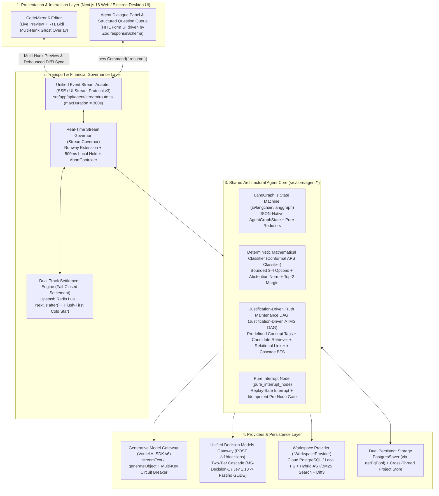

# 01. Architecture Vision & ADR Registry

| Standard Field | Approved Value |
| :--- | :--- |
| **Document ID** | `ELIXENT-ARCH-01` |
| **Classification** | `LIVING SPEC & ADR REGISTRY` (per `docs/DOCUMENTATION_GUIDELINES.md` §5) |
| **Version & Status** | `v3.1 — Accepted` |
| **SSOT Scope** | Defines the transformation vision from `LUGX v1.46.3` to `Elixent`, the overall system container architecture (`C4 Container View`), and the numbered Architectural Decision Record registry (`ADR-001` through `ADR-005`) including trade-offs and future migration triggers (`Migration Triggers`). |
| **Suite Index** | • [02_agent_orchestration_and_decision_engine](./02_agent_orchestration_and_decision_engine.md) • [03_workspace_ast_editor_and_vault_integration](./03_workspace_ast_editor_and_vault_integration.md) • [04_credit_metering_and_settlement_architecture](./04_credit_metering_and_settlement_architecture.md) • [05_data_contracts_and_lugx_migration_plan](./05_data_contracts_and_lugx_migration_plan.md) |

## 1. Overview & Strategic Context

This document establishes the architectural foundation for transforming the **LUGX (`v1.46.3`)** platform from a cloud-based Markdown text editor powered by five short, linear, word-metered AI operations (`correct`, `improve`, `summarize`, `translate`, `toPrompt`) into an intelligent **Elixent Agentic Architecture & Documentation Engine**.

Rather than demolishing the existing repository and rebuilding it from scratch, the **Elixent** architecture capitalizes on the battle-tested engineering assets already present in the `LUGX v1.46.3` core (the advanced `CodeMirror 6` editor, the `Hunt-McIlroy Diff3` three-way merge engine, the `Syntax Validator`, the client-side `Zero-Knowledge Vault`, and distributed rate limiters), while pruning the legacy five-operation pipeline and replacing it with an autonomous cyclic orchestration engine that explores files, analyzes dependencies, mathematically adjudicates architectural decisions, and executes multi-hunk structural edits.

### 1.1. System Constraints & Invariants

1. **Dual-Runtime Single Agent Core (`Dual-Runtime Single Agent Core`):**
   - **Cloud Runtime:** A **Next.js 16 (App Router)**, **React 19**, and **TypeScript 5 (Strict Mode)** application hosted on **Vercel Serverless**, backed by **PostgreSQL (Neon / Node-PG)** via Drizzle ORM (`src/server/db/`) and an **Upstash Redis** in-memory data layer.
   - **Desktop Runtime:** A future **Electron** application operating locally over code repositories and files on the user's machine without uploading them to the cloud, sharing the exact same agent core (`src/core/agent/*`) with the cloud runtime via a unified workspace abstraction interface (`IWorkspaceProvider`).
2. **Financial Immunity & Zero-Overdraft Protection (`Zero-Overdraft & Fail-Closed Metering`):**
   - All model invocations (streaming generative models, closed-schema structured models, and decision models) are metered by actual token consumption and billed in **Micro-Credits (`BigInt`)** within Redis via atomic Lua scripts, with asynchronous flushing to PostgreSQL via `after()` / `waitUntil()` that shields the database connection pool during active streaming.
3. **Zero-Knowledge Vault Boundary (`Zero-Knowledge Vault Boundary`):**
   - End-to-end client-side encryption (`AES-256-GCM` + `PBKDF2 600k` inside a Web Worker under `src/lib/crypto/*` and `src/lib/vault/*`) remains an inviolable boundary. The agent never processes any encrypted file unless the user explicitly enables `allowAIOnEncryptedFiles`, and storing any decrypted plaintext inside persistent `LangGraph` checkpoint tables (`PostgresSaver`) is strictly prohibited.

## 2. System Container Architecture

The following diagram illustrates the four system layers and the data and control flows across both Web and Desktop runtimes:

## 3. Architectural Decision Records: ADR-001 to ADR-005

In compliance with the architectural decision and trade-off documentation rules in `docs/DOCUMENTATION_GUIDELINES.md` (§5), this registry details each core architectural decision in an independent record specifying the context, accepted decision, rejected alternatives, trade-off matrix, and future migration trigger (`Migration Trigger`).

### 3.1. `ADR-001`: Adopting a Hybrid Architecture Combining `@langchain/langgraph` for Cyclic Orchestration and `Vercel AI SDK v6` for Generative Models

- **Context & Problem:** The architectural agent must execute multi-loop autonomous investigation and auditing cycles (local search $\leftarrow$ assumption analysis $\leftarrow$ decision adjudication $\leftarrow$ conditional loopback to search or a Human-in-the-Loop `HITL` pause spanning hours or days $\leftarrow$ exact resumption from the interruption point), while maintaining smooth frontend streaming and avoiding dependency bloat in the Vercel Serverless environment.
- **Accepted Decision:**
  1. Adopt the isolated **`@langchain/langgraph`** package exclusively as a state machine (`StateGraph`) to manage cyclic control flow, conditional edges, persistent checkpoints (`Checkpoints`), and stateless human interrupts (`Stateless Interrupts`).
  2. Adopt **`Vercel AI SDK v6` (`ai`)** as the unified gateway for generative model invocations (`generateObject`, `generateText`, `streamText`) inside graph nodes, wired into the existing multi-key rotation and circuit breaker engine in `src/lib/ai/key-rotation.ts`.
  3. **Strictly prohibit importing the monolithic `langchain` package** or `@langchain/community` to prevent bundle bloat (`Bundle Bloat`).
- **Rejected Alternatives:**
  - _Relying solely on `Vercel AI SDK v6` (`stopWhen: stepCountIs(N)`):_ Excellent for simple single-node tool-calling loops, but lacks an explicit graph state machine capable of branching and looping back across multiple distinct stages, and does not natively support freezing state in the database upon a human interrupt (`interrupt`) and resuming it later in a separate HTTP request.
  - _`Mastra` Framework:_ Primarily designed for linear or directed acyclic workflows (`DAG Workflows`) and enforces its own internal model router that conflicts with our financial stream governance layer (`StreamGovernor`).
- **Trade-off Matrix:**

| Evaluation Criterion | Accepted Solution (`@langchain/langgraph` + `AI SDK v6`) | Alternative 1 (`Vercel AI SDK` Alone) | Alternative 2 (`Mastra` / Full `LangChain`) |
| :--- | :--- | :--- | :--- |
| **Recursive Loop & Deterministic Branching Support** | Excellent (Native via `StateGraph` and `Command`) | Weak (Requires fragile manual `while` loops) | Moderate in `Mastra` / High but heavy in `LangChain` |
| **Stateless Human & Financial Interrupts (`Stateless Interrupt`)** | Native and backed by `Checkpointer` snapshots | Not natively supported across separate HTTP requests | Requires building a custom state persistence layer |
| **Bundle Size & Cold Start Latency (`Cold Start`)** | Lightweight (Installs `@langchain/langgraph` only) | Very lightweight | Heavy (Due to the classic `langchain` dependency tree) |

- **Migration Trigger:** Re-evaluate the `@langchain/langgraph` orchestration layer only if a future release of `Vercel AI SDK` introduces a native graph state machine supporting `Persistent Checkpointers` and `Stateless Resumable Interrupts` with zero external dependencies.

### 3.2. `ADR-002`: Adopting a Unified Decision Model Cascade (`POST /v1/decisions`) and Mathematical Triage via Adaptive Conformal Prediction (`Conformal APS Cascade`)

- **Context & Problem:** While authoring or modifying an architectural document, the agent encounters dozens of design trade-offs and assumptions. Using heavy generative models (`LLMs`) to adjudicate every assumption consumes thousands of tokens and adds seconds of latency. Furthermore, asking a generative model to guess its own "confidence score" or set acceptance thresholds for another model yields statistically uncalibrated decisions, while single-pass classifiers are susceptible to rhetorical phrasing bias across option descriptions.
- **Accepted Decision:**
  1. **Unified Decisions API (`Unified Decisions API`):** Build a standardized decision client (`src/lib/jev/client.ts`) communicating with a unified **`POST /v1/decisions`** contract that supports parallel evaluation across three primitives: `predicate` (binary), `choice` (multi-choice with an explicit `"insufficient_evidence"` abstention option), and `score` (continuous numerical score in $[0, 2]$).
  2. **Two-Tier Decision Cascade (`Two-Tier Decision Cascade`):**
     - **Tier 1 (Low-Cost Fast Triage):** A single forward pass (`Single Forward Pass`, `output_tokens = 0`) via models such as Microsoft-Decision-1, TypeSafe Jev 1.13, or Perplexity Decider v1.1.
     - **Tier 2 (Analytical Escalation for Ambiguous Cases):** Core architectural decisions (`CORE_ARCHITECTURAL`) that remain in the uncertainty zone after Tier 1 are automatically escalated to an adaptive reasoning decision model such as Fastino GLiDE before interrupting the user.
  3. **Deterministic Triage via Adaptive Conformal Prediction (`Conformal Prediction Set & Top-2 Margin`):** Strictly prohibit any LLM from computing acceptance thresholds; instead, enforce a deterministic TypeScript algorithm that bounds alternatives to $3\text{–}4$ mutually exclusive, rhetorically neutral options, normalizes probabilities after isolating the abstention probability $p_{\text{abstain}}$, and adjudicates direct or conservative approval based on the prediction set cardinality $|\mathcal{C}_\alpha(x)|$ and the top-2 dominance margin $m(x) = \tilde{p}_{(1)} - \tilde{p}_{(2)}$ using model-specific `Bootstrap Calibration Priors`.
  4. **Justification-Driven Truth Maintenance DAG & Relational Linker (`Justification-Driven ATMS DAG`):** Record both directly approved and conservatively approved (`APPROVED_CONSERVATIVE`) decisions alongside their selection rationale (`selectionRationale`) and all evaluated alternatives with their contextual exclusion reasons (`evaluatedAlternatives`), tagged using the universal concept taxonomy (`DEFAULT_CONCEPT_TAGS` / `PREDEFINED_CONCEPT_TAGS` alias) combined with a project-scoped dynamic tag registry (`applyProjectTagMutations`, `resolveProjectConceptTags`) and dynamic Zod schema factories (`createConceptTagEnum`), preventing LLM tag hallucination while allowing custom project taxonomy mutations without codebase lock-in; and utilize the local candidate retriever and relational adjudication node (`atms_relational_linker_node`) to distinguish independent sub-decisions under the same heading, re-evaluate conservative decisions with their alternatives whenever the user builds a subsequent request upon them, or reopen foundational decisions and cascade their dependents (`dependedBy`) for parallel update whenever priorities shift and their underlying premises are invalidated.
- **Rejected Alternatives:**
  - _Adjudicating assumptions via generative models (`LLM-as-a-Judge` via `generateObject`):_ $100\text{–}200\times$ more expensive, $10\times$ slower, and lacks calibrated logit probabilities (`Logits Calibration`).
  - _Dynamically guessing confidence thresholds via an LLM:_ Mathematically unsound, as a generative model has no visibility into the empirical logit distribution of the classifier model.
- **Trade-off Matrix:**

| Evaluation Criterion | Accepted Solution (`Two-Tier Conformal Cascade + ATMS`) | Alternative 1 (Generative `LLM-as-a-Judge`) | Alternative 2 (Single Decision Model with Fixed Threshold) |
| :--- | :--- | :--- | :--- |
| **Financial Cost & Latency** | Very low ($0.001\text{–}0.005\$$ per 1M tokens in Tier 1) | Very high (Generates hundreds of tokens per decision) | Very low |
| **Statistical Guarantee & Hallucination Resistance** | Mathematically guaranteed via error budget $\alpha$ and per-model calibration | Uncalibrated (Prone to `Overconfidence` bias) | Degrades when option count varies or reasoning complexity increases |
| **Handling Peripheral Decisions (`PERIPHERAL`)** | Smart provisional approval preserving rationales and alternatives with `ATMS Cascade` re-evaluation | Either excessive user prompting or blind permanent approval | Cannot distinguish between load-bearing and peripheral decisions |

- **Migration Trigger:** Once $\ge 1,000$ resolved architectural decisions accumulate in the `project_decision_ledger` table, replace the `Sliding Window Quantile` calibration model with a lightweight per-category `isotonic / quantile calibrator`.

### 3.3. `ADR-003`: Adopting Hybrid Structural Inspection (`AST Heading Tree + Lexical/BM25 Search`) and Excluding Vector Databases (`Vector RAG`)

- **Context & Problem:** The agent must explore project documents and files to extract evidence and assumptions without reading entire files on every turn and without losing the structural hierarchy of paragraphs or tables.
- **Accepted Decision:**
  1. Permanently exclude vector databases (`Vector Databases / Embeddings RAG`) from the architectural documentation pipeline.
  2. Adopt a **Hybrid Structural Inspection Engine (`Hybrid AST + Lexical/BM25 Search`)** through the `IWorkspaceProvider` interface:
     - Extract the heading hierarchy (`Markdown Heading Tree H1–H6`) with exact line and character offsets via a code-block-aware heading slicer (`Fence-Aware Heading Slicer`).
     - Combine heading tree navigation with lexical/ranked search (`Lexical / BM25 & Regex Search`) across paragraph and table bodies that returns every matching line or paragraph annotated with its full ancestor heading path (`Heading Breadcrumb: H1 > H2 > H3`).
- **Rejected Alternatives:**
  - _Chunk-based Vector RAG (`pgvector` or `Pinecone`):_ Breaks section and table boundaries, requires re-computing embeddings (`Re-embedding`) on every edit made by the user or agent, and suffers from character offset drift (`Offset Drift`) that prevents deterministic `Diff3` merging.
- **Trade-off Matrix:**

| Evaluation Criterion | Accepted Solution (`Hybrid AST + Lexical/BM25`) | Rejected Alternative (`Vector Embeddings RAG`) |
| :--- | :--- | :--- |
| **Index Synchronization with Live Editor Edits** | Instantaneous ($0\text{ ms}$ Stale Index — operates directly on live text) | Delayed and costly (Requires re-chunking and re-indexing on every save) |
| **Merge Target Precision (`Diff3 Section Target`)** | $100\%$ deterministic via `Heading Boundaries` | Fragile (Arbitrary chunking splits tables and fenced code blocks) |
| **Zero-Knowledge Vault Compatibility (`Zero-Knowledge`)** | Operates in ephemeral memory without storing revealing cloud vectors | Violates Zero-Knowledge guarantees (Cloud-stored embeddings leak semantic meaning) |

- **Migration Trigger:** In the `Electron Desktop` runtime, when inspecting massive code repositories exceeding $10,000$ source files, augment the local `IWorkspaceProvider` with a local lexical index built on `SQLite FTS5` + `Tree-sitter AST` on the user's machine with zero cloud vectors.

### 3.4. `ADR-004`: Adopting a Dual-Track Real-Time Billing Engine (`Upstash Redis Lua + Next.js after()`) on Vercel Serverless

- **Context & Problem:** `LUGX v1.46.3` reserved word quotas via direct pessimistic row locking in PostgreSQL (`SELECT ... FOR UPDATE` in `src/server/services/ai-settlement-service.ts`). In a multi-node agent architecture with long-lived streaming responses, opening PostgreSQL transactions during streaming or on every runway slice extension causes connection pool exhaustion (`Connection Pool Exhaustion`) and severe latency spikes, whereas remaining on **Vercel Serverless** requires avoiding persistent background daemons (`Persistent Daemons`).
- **Accepted Decision:**
  1. Convert the accounting unit to **Micro-Credits (`BigInt`)** metered on actual token usage (`Input`, `Cached Input`, `Output + Reasoning`).
  2. Execute pre-authorization reservations, real-time slice extensions (`Runway Extension`), and final settlement atomically within **Upstash Redis** via Lua scripts, enforcing a strict **Fail-Closed** policy whenever Redis is unreachable.
  3. Append settlement ledger records with a `created_at_ms` timestamp into `lugx:pending_settlements:${userId}` in Redis, and flush them asynchronously after stream termination via Next.js 16 **`after()` (`waitUntil`)** into the `credit_ledger_transactions` table in PostgreSQL (`INSERT ... ON CONFLICT (operation_id) DO NOTHING`).
  4. Enforce the **`Flush-First Cold Start`** protocol to prevent any double deduction if a wallet key expires from Redis concurrently with an in-flight `after()` execution.
- **Rejected Alternatives:**
  - _Direct PostgreSQL locks per streaming slice:_ Exhausts Neon/Postgres connections and adds high round-trip latency during token streaming.
  - _Migrating hosting away from Vercel to dedicated container servers solely to run a background flush worker:_ Unjustified operational and engineering overhead given that the `Redis Pending Hash + after() + Cron Sweeper` pattern achieves $100\%$ financial durability on Vercel Serverless.
- **Trade-off Matrix:**

| Evaluation Criterion | Accepted Solution (`Redis Lua + after() + Cron Sweeper`) | Alternative 1 (Direct PostgreSQL Transactions) | Alternative 2 (Dedicated Background Servers Outside Vercel) |
| :--- | :--- | :--- | :--- |
| **PostgreSQL Connection Pressure During Streaming** | Zero ($0$ DB queries during token streaming) | Very high (Risk of connection pool exhaustion) | Zero |
| **Financial Durability (`Financial Durability`)** | $100\%$ (Protected by `pending_settlements` and `ON CONFLICT DO NOTHING`) | $100\%$ | $100\%$ |
| **Vercel Serverless Compatibility & Cost** | Natively compatible at very low cost | Compatible but bottlenecks under concurrency | Requires extra hosting infrastructure and ongoing maintenance |

- **Migration Trigger:** If concurrent settlement throughput exceeds $5,000$ operations per second such that individual `after()` invocations create batch write pressure on PostgreSQL, upgrade the flush mechanism to a scheduled batch consumer running every $5$ seconds via `Upstash QStash / Workflow` while keeping the application hosted on Vercel.

### 3.5. `ADR-005`: Adopting Dual Persistent Storage (`Checkpointer + Project Store`) and Isolating the Zero-Knowledge Vault via `vault_ref://` Pointers

- **Context & Problem:**
  1. `LangGraph Checkpointer` (`PostgresSaver`) snapshots are scoped to a single conversation thread (`thread_id`). If a user starts a new conversation thread within the same project, architectural decisions (`master_ledger`) resolved in prior threads would be lost.
  2. If a user grants the agent permission to read an encrypted vault file (`allowAIOnEncryptedFiles = true`), storing the decrypted plaintext inside `AgentGraphState.search_report` would automatically persist plaintext or near-plaintext data into `PostgresSaver` tables at every super-step transition between nodes, violating the `Zero-Knowledge Vault` invariant.
- **Accepted Decision:**
  1. **Dual Persistence Architecture (`Dual Persistence Architecture`):**
     - **Thread Checkpointer (`Thread Checkpointer`):** Use `PostgresSaver` (connected via the `getPgPool()` singleton exported from `src/server/db/transactional.ts`) to persist step-by-step execution state scoped to `thread_id`.
     - **Cross-Thread Project Store (`Cross-Thread Project Store`):** Create an independent persistent PostgreSQL table `project_decision_ledger` indexed by `project_id` that synchronizes with `master_ledger` (including decision rationales, evaluated alternatives, canonical concept tags, and dependency edges) at the start and end of every agent cycle.
  2. **Vault Plaintext Isolation via Ephemeral References (`Ephemeral Vault References`):**
     - Strictly prohibit placing any decrypted vault file plaintext inside `AgentGraphState` objects.
     - Store decrypted plaintext exclusively inside an out-of-state ephemeral memory map (`EphemeralVaultMemoryMap`) scoped to the single HTTP request lifecycle and zeroed out immediately upon request completion, while writing only an opaque reference pointer into `state.search_report` formatted as **`vault_ref://${fileId}#${headingSlug}`**.
     - As a second line of defense (`Defense-in-Depth`), wrap `PostgresSaver` with an encrypted serializer (`EncryptedCheckpointSerializer`) using a server-side encryption key (`AES-256-GCM`) to encrypt all `JSONB` checkpoint payloads at rest in the database (implemented in Phase 6; see [Phase 6 Closure Dossier](../records/closures/elixent-execution/phase-06-vault-boundary-checkpoints-and-provider.md)).
- **Rejected Alternatives:**
  - _Relying on `PostgresSaver` alone to store project decisions:_ Traps architectural decisions inside a single conversation thread (`thread_id`) and forces the user to re-answer the same clarifying questions in every new session.
  - _Scrubbing state only before graph completion:_ Unsafe because `LangGraph` automatically persists a checkpoint after **every single node (`Super-step`)**, not merely at the end of the graph execution.
- **Migration Trigger:** In the `Electron Desktop` runtime, replace `PostgresSaver` with a local `SqliteSaver` encrypted via `SQLCipher` on the user's machine, while keeping the `AgentGraphState` interface and `project_decision_ledger` contract $100\%$ identical.
