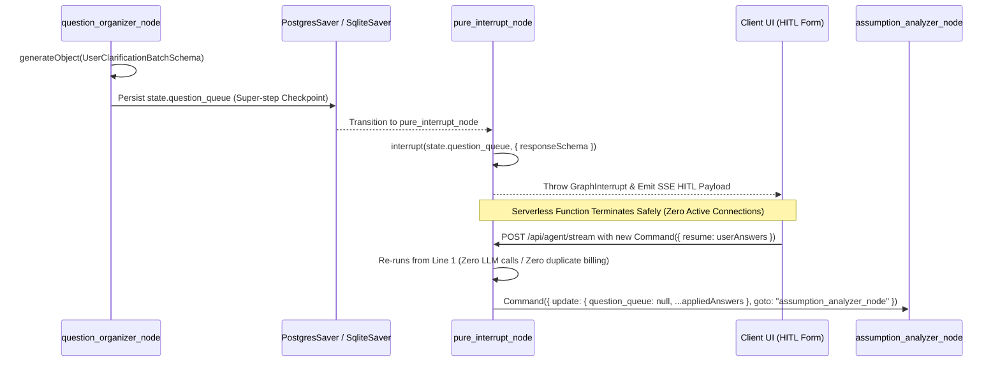

# 02. Agent Orchestration & Decision Engine Architecture

| Standard Field | Approved Value |
| :--- | :--- |
| **Document ID** | `ELIXENT-ARCH-02` |
| **Classification** | `LIVING SUBSYSTEM SPEC` (`src/core/agent/*` & `src/lib/jev/*`) |
| **Version & Status** | `v3.1 — Accepted` |
| **SSOT Scope** | Specification of the `@langchain/langgraph` state machine, canonical state channels (`AgentGraphState`) and `Pure Reducers`, structured `Zod` contracts, the Unified Decisions API protocol (`POST /v1/decisions`), the Adaptive Conformal Prediction algorithm (`Conformal APS & Top-2 Margin`), the Justification-Driven Truth Maintenance DAG (`Justification-Driven ATMS DAG`), and the replay-safe human interrupt protocol (`Replay-Safe HITL`). |
| **Suite Index** | • [01_architecture_vision_and_adrs](./01_architecture_vision_and_adrs.md)<br>• [03_workspace_ast_editor_and_vault_integration](./03_workspace_ast_editor_and_vault_integration.md)<br>• [04_credit_metering_and_settlement_architecture](./04_credit_metering_and_settlement_architecture.md)<br>• [05_data_contracts_and_lugx_migration_plan](./05_data_contracts_and_lugx_migration_plan.md) |

## 1. LangGraph.js StateGraph Architecture

The following diagram illustrates the complete architectural agent lifecycle within `@langchain/langgraph` across seven integrated stages, from receiving the user request to multi-hunk differential streaming:

```mermaid
flowchart TD
    subgraph CLIENT_LAYER ["Client & HITL Protocol Layer"]
        START((__start__))
        USER_REQ["Session Input or Edit Request<br/>(messages, user_request, thread_id, project_id, fileIds)"]
        USER_RESUME["Session Resumption After Interrupt<br/>new Command({ resume: validated_payload })"]
        END((__end__))
    end

    subgraph STATE_STORE ["Central State & Dual Persistence Layer"]
        CHECKPOINTER[("1. Thread Checkpointer (PostgresSaver via getPgPool / SqliteSaver)<br/>Persists session snapshots with Ephemeral Vault Refs & EncryptedCheckpointSerializer<br/>2. Project Decision Store (project_decision_ledger)<br/>Persists decision ledger, rationales, alternatives, and dependency DAG across all project threads")]
        STATE_CHANNELS[("AgentGraphState Channels (JSON-Serializable Pure Reducers):<br/>• search_report: SearchReport (uses vault_ref:// for encrypted files)<br/>• local_inspection_state: string[] (Deduplicated Path & Breadcrumb Set)<br/>• assumptions: AssumptionItem[]<br/>• master_ledger: Record&lt;DecisionId, ATMSDecisionNode&gt;<br/>• unresolved_ledger: UnresolvedDecision[]<br/>• invalidation_map: Record&lt;DecisionId, SectionTarget[]&gt;<br/>• question_queue: ClarifyingQuestionBatch | null<br/>• budget_tracking: { reservedMicro: string; spentMicro: string }<br/>• search_loop_count: number")]
    end

    subgraph LANGGRAPH_CORE ["StateGraph (@langchain/langgraph): Autonomous Decision-Making & Architectural Adjudication"]

        ORCHESTRATOR["Master Orchestrator Node (orchestrator_node)<br/>withMeteredNodeGate + Vercel AI SDK: generateObject<br/>Analyzes user intent, loads project master_ledger, and verifies vault permissions"]

        subgraph STAGE_1 ["Stage 1: Hybrid Structural Inspection & Lexical BM25 Subgraph"]
            SEARCH_AGENT["Local Inspection Agent Node (search_agent_node)<br/>Vercel AI SDK: generateText({ tools: hybridAstSearchTools, stopWhen: stepCountIs(6) })<br/>Directs Markdown AST heading tree navigation and lexical/Regex paragraph search"]
            TOOLS_COND{"Conditional Edge<br/>(tools_condition)<br/>Did agent invoke an inspection tool?"}
            TOOL_NODE["Deterministic Tool Execution Node (workspace_tool_node)<br/>IWorkspaceProvider (Cloud / Local FS)<br/>Inspects headings and paragraphs while returning full ancestor Heading Breadcrumb"]
            SEARCH_SYNTH["Evidence Report Synthesizer Node (search_synthesizer_node)<br/>Vercel AI SDK: generateObject(SearchReportSchema)<br/>Updates state.search_report with text evidence and vault_ref:// pointers"]
        end

        subgraph STAGE_2 ["Stage 2: Assumption Analysis, ATMS Candidate Retrieval & Relational Linker"]
            ASSUMP_NODE["Assumption Analyzer & Tag Classifier Node (assumption_analyzer_node)<br/>1. Vercel AI SDK: generateText + Output.object to extract assumptions and assign bounded tags from Universal Concept Taxonomy & Project Registry<br/>2. Deterministic Local Candidate Retriever: retrieves top-K prior decisions via heading overlap, concept tags, and BM25 over rationales and alternatives"]
            REL_LINKER_NODE["Relational Adjudication & Rationale Audit Node (atms_relational_linker_node)<br/>Unified Decisions API (POST /v1/decisions)<br/>Classifies relation of each new assumption against retrieved candidates (INDEPENDENT | DEPENDS_ON | REOPENS_OR_OVERRIDES | REFINES):<br/>• Pulls depended-upon conservative decisions to re-evaluate their alternatives under new evidence<br/>• Reopens decisions whose priorities shifted or premises failed while cascading dependents via Contagious BFS"]
            ASSUMP_ROUTER{"Conditional Edge: Readiness Gate<br/>(route_after_assumptions)<br/>Are there initial contextual gaps?"}
        end

        subgraph STAGE_3 ["Stage 3: Architectural Auditing & Two-Tier Conformal Decision Cascade"]
            AUDIT_STRUCT_NODE["Option & Rationale Neutralization Node (jev_structuring_node)<br/>Vercel AI SDK: generateObject(CanonicalDecisionBatchSchema)<br/>• Bounds alternatives to 3–4 mutually exclusive options + insufficient_evidence<br/>• Injects historical alternatives and prior exclusion rationales when reopening or promoting a decision for re-evaluation under new evidence<br/>• Strips rhetorical bias from options (Canonical Neutral Specs)"]
            JEV_MODEL_NODE["Parallel Decision Scorer Node (decision_scorer_node)<br/>Unified Decisions API (POST /v1/decisions — Discrete Step Settlement)<br/>Four-dimensional single-pass evaluation (MS-Decision-1 / Jev 1.13) with cascade escalation to Fastino GLiDE:<br/>1. evidence_grounding (predicate) | 2. coupling_level (score)<br/>3. rollback_cost (score) | 4. selected_option (choice + insufficient_evidence)"]
        end

        subgraph STAGE_4_5 ["Stages 4 & 5: Deterministic Mathematical Triage (Conformal APS Margin & ATMS Reduction)"]
            CONF_EVAL_NODE["Deterministic Mathematical Classifier Node (confidence_classifier_node)<br/>[Pure TypeScript Deterministic Node — Zero LLM Involvement]<br/>1. Computes ImpactIndex from (coupling_level, rollback_cost) -> CORE vs PERIPHERAL<br/>2. Normalizes probabilities after isolating p_abstain and computes top-2 margin m = p̃_(1) - p̃_(2)<br/>3. Constructs Conformal Prediction Set |C_alpha| and records selection rationale and alternative exclusion reasons"]

            HIGH_CONF["Direct Full Approval Path (Conformal Singleton)<br/>[|C_alpha_core| == 1 AND m ≥ m_min AND p_abstain < tau]<br/>Decision Status: APPROVED_DIRECT (is_load_bearing: true)"]
            CONS_CONF["Conditional Conservative Approval Path (Provisional Peripheral)<br/>[ImpactIndex == PERIPHERAL AND |C_alpha_periph| ≤ kappa AND p_abstain < tau]<br/>Decision Status: APPROVED_CONSERVATIVE (is_load_bearing: false)"]
            UNRESOLVED_DEC["Unresolved or Internally Ambiguous Path (Ambiguous / Core Uncertain)<br/>[p_abstain ≥ tau OR (ImpactIndex == CORE AND |C_alpha_core| > 1)]<br/>Decision Status: UNRESOLVED"]

            LEDGER_COMMIT_NODE["ATMS DAG Commit & Dependency Invalidation Node (ledger_commit_node)<br/>Updates channels via Pure Reducers and synchronizes Project Store:<br/>• Commits decisions with selectionRationale and evaluatedAlternatives into master_ledger<br/>• When overriding a foundational decision (OVERRIDDEN): pulls all dependent decisions (dependedBy) and computes BFS Invalidation in invalidation_map for parallel update"]

            LOOP_ROUTER{"Conditional Edge: Resolution, Loop & Budget Gate<br/>(resolution_gate_router)<br/>Inspects available credit balance, unresolved_ledger,<br/>and search_loop_count"}

            GAP_PLANNER_NODE["Supplementary Search Planner Node (internal_gap_planner_node)<br/>Vercel AI SDK: generateObject(RefinedSearchQueriesSchema)<br/>Generates queries for unvisited paths outside local_inspection_state and increments search_loop_count += 1"]
        end

        subgraph STAGE_6 ["Stage 6: Replay-Safe Stateless Human or Financial Interrupt"]
            Q_SYNTH_NODE["Diagnostic Question Batch Organizer Node (question_organizer_node)<br/>Vercel AI SDK: generateObject(UserClarificationBatchSchema)<br/>Aggregates unresolved questions (or promoted conservative decisions that could not be confirmed internally) into state.question_queue"]
            HITL_NODE["Pure Interrupt Node (pure_interrupt_node)<br/>[Zero LLM / Zero Side-Effects Before Interrupt]<br/>Invokes interrupt(state.question_queue, { responseSchema: ClarificationResponseSchema })<br/>or interrupt({ code: 'INSUFFICIENT_CREDITS' }) and awaits Command({ resume })"]
        end

        subgraph STAGE_7 ["Stage 7: Final Generation & Multi-Hunk Structural Merge (AST + Diff3 Execution)"]
            DOC_EXEC_NODE["Document Writer & Structural Merge Node (document_writer_node)<br/>Vercel AI SDK: streamText (with Chunked Credit Metering & Backpressure)<br/>1. Slices target sections in invalidation_map via Fence-Aware Heading Slicer<br/>2. Merges edits with live user document via diff3MergeText and validateMarkdownSyntaxIntegrity<br/>3. Streams Multi-Hunk Ghost Decorations to CodeMirror 6 editor"]
        end
    end

    START --> USER_REQ
    USER_REQ -->|"Initializes thread_id and loads project ledger"| ORCHESTRATOR
    ORCHESTRATOR -->|"Dispatches initial inspection queries"| SEARCH_AGENT

    SEARCH_AGENT --> TOOLS_COND
    TOOLS_COND -->|"Pending inspection tool calls"| TOOL_NODE
    TOOL_NODE -->|"Returns AST slices + Breadcrumb and updates inspected paths"| SEARCH_AGENT
    TOOLS_COND -->|"Retrieval complete"| SEARCH_SYNTH
    SEARCH_SYNTH -->|"Updates state.search_report"| ASSUMP_NODE

    ASSUMP_NODE -->|"Passes assumptions with retrieved ledger candidates"| REL_LINKER_NODE
    REL_LINKER_NODE --> ASSUMP_ROUTER
    ASSUMP_ROUTER -.->|"Initial contextual gap (within loop ceiling)"| SEARCH_AGENT
    ASSUMP_ROUTER -->|"Evidence ready for audit or conservative/reopened decisions pulled via ATMS"| AUDIT_STRUCT_NODE

    AUDIT_STRUCT_NODE -->|"Passes 3-4 neutral options + insufficient_evidence"| JEV_MODEL_NODE
    JEV_MODEL_NODE -->|"Passes calibrated probability distributions and impact scores"| CONF_EVAL_NODE

    CONF_EVAL_NODE -->|"|C_alpha_core| == 1 & m ≥ m_min"| HIGH_CONF
    CONF_EVAL_NODE -->|"PERIPHERAL & |C_alpha_periph| ≤ kappa"| CONS_CONF
    CONF_EVAL_NODE -->|"abstain OR (CORE & |C_alpha_core| > 1)"| UNRESOLVED_DEC

    HIGH_CONF --> LEDGER_COMMIT_NODE
    CONS_CONF --> LEDGER_COMMIT_NODE
    UNRESOLVED_DEC --> LEDGER_COMMIT_NODE

    LEDGER_COMMIT_NODE -.->|"Updates state channels and syncs Project Store with rationales and alternatives"| STATE_CHANNELS
    STATE_CHANNELS -.->|"Retrieves candidates via predefined tags, headings, and BM25"| ASSUMP_NODE
    STATE_CHANNELS -.->|"Supplies prior alternatives and rationales during re-evaluation"| AUDIT_STRUCT_NODE

    LEDGER_COMMIT_NODE --> LOOP_ROUTER

    LOOP_ROUTER -->|"1. All critical decisions resolved (unresolved_ledger empty and sufficient credits)"| DOC_EXEC_NODE
    LOOP_ROUTER -->|"2. Unresolved decisions eligible for local search (loop_count < MAX_LOOPS)"| GAP_PLANNER_NODE
    LOOP_ROUTER -->|"3. Internal search exhausted or sovereign user preference required"| Q_SYNTH_NODE
    LOOP_ROUTER -.->|"4. Credit balance exhausted before cycle completion (Financial Pause)"| HITL_NODE

    GAP_PLANNER_NODE -.->|"Targeted queries for unvisited paths"| SEARCH_AGENT

    Q_SYNTH_NODE -->|"Saves question batch in state.question_queue"| HITL_NODE
    HITL_NODE -.->|"Persists encrypted snapshot and suspends execution (interrupt)"| CHECKPOINTER
    HITL_NODE -->|"Renders questions (with response_schema) or top-up prompt"| USER_RESUME
    USER_RESUME -->|"Resumes pure node without re-running any LLM"| HITL_NODE
    HITL_NODE -->|"new Command({ goto: 'assumption_analyzer_node' })"| ASSUMP_NODE

    DOC_EXEC_NODE -->|"Streams Multi-Hunk Ghost patches to CodeMirror 6"| END

    classDef startEndStyle fill:#212529,stroke:#000000,stroke-width:2px,color:#ffffff
    classDef userStyle fill:#d0ebff,stroke:#1971c2,stroke-width:1.5px,color:#1971c2
    classDef stateStoreStyle fill:#f8f9fa,stroke:#495057,stroke-width:1.5px,stroke-dasharray: 5 5,color:#212529
    classDef orchestratorStyle fill:#f3f0ff,stroke:#5f3dc4,stroke-width:2px,color:#5f3dc4
    classDef stage1Style fill:#c5f6fa,stroke:#0c8599,stroke-width:1.5px,color:#0c8599
    classDef stage1SubStyle fill:#e3fafc,stroke:#0c8599,stroke-width:1.5px,color:#0c8599
    classDef stage2Style fill:#dbe4ff,stroke:#3b5bdb,stroke-width:1.5px,color:#3b5bdb
    classDef stage3Style fill:#eebefa,stroke:#7048e8,stroke-width:1.5px,color:#7048e8
    classDef stage3SubStyle fill:#f3f0ff,stroke:#7048e8,stroke-width:1.5px,color:#7048e8
    classDef decisionStyle fill:#fff4e6,stroke:#d9480f,stroke-width:2px,color:#d9480f
    classDef highConfStyle fill:#ebfbee,stroke:#2b8a3e,stroke-width:1.5px,color:#2b8a3e
    classDef consConfStyle fill:#fff9db,stroke:#e67700,stroke-width:1.5px,color:#e67700
    classDef unresConfStyle fill:#ffe3e3,stroke:#c92a2a,stroke-width:1.5px,color:#c92a2a
    classDef ledgerStyle fill:#e3fafc,stroke:#1098ad,stroke-width:1.5px,color:#1098ad
    classDef finalExecStyle fill:#d3f9d8,stroke:#2b8a3e,stroke-width:2px,color:#1b4332

    class START,END startEndStyle
    class USER_REQ,USER_RESUME userStyle
    class CHECKPOINTER,STATE_CHANNELS stateStoreStyle
    class ORCHESTRATOR,Q_SYNTH_NODE orchestratorStyle
    class SEARCH_AGENT,GAP_PLANNER_NODE stage1Style
    class TOOL_NODE,SEARCH_SYNTH stage1SubStyle
    class ASSUMP_NODE,REL_LINKER_NODE stage2Style
    class JEV_MODEL_NODE stage3Style
    class AUDIT_STRUCT_NODE stage3SubStyle
    class TOOLS_COND,ASSUMP_ROUTER,CONF_EVAL_NODE,LOOP_ROUTER,HITL_NODE decisionStyle
    class HIGH_CONF highConfStyle
    class CONS_CONF consConfStyle
    class UNRESOLVED_DEC unresConfStyle
    class LEDGER_COMMIT_NODE ledgerStyle
    class DOC_EXEC_NODE finalExecStyle
```



## 2. State Channel Contracts & Pure Reducers (`AgentGraphState & Pure Reducers`)

To prevent serialization failures (`JSON.stringify`) in `PostgresSaver` and `SqliteSaver` when handling native `Map`, `Set`, and `BigInt` instances, all state channels in `src/core/agent/state.ts` are defined strictly using standard JSON-serializable data structures:

| State Channel in `Annotation.Root` | JSON-Serializable Type | `Pure Reducer` & Governing Rules |
| :--- | :--- | :--- |
| **`messages`** | `BaseMessage[]` | `messagesStateReducer`: Merges conversation message history while preserving deterministic message IDs. |
| **`user_request`** | `{ prompt: string; projectId: string; targetFileIds: string[] }` | Last-write replacement (`(prev, next) => next`). |
| **`search_report`** | `SearchReport` | Merges extracted evidence deduplicated by composite key `(fileId, headingSlug)`, using `vault_ref://${fileId}#${headingSlug}` pointers for encrypted vault files. |
| **`local_inspection_state`** | `string[]` | Deduplicated set union: `Array.from(new Set([...prev, ...next]))` to prevent re-inspecting already visited paths during supplementary search loops. |
| **`assumptions`** | `AssumptionItem[]` | Replaces or updates active assumptions in the current cycle keyed by `assumptionId` (including prior decisions pulled for re-evaluation or promotion). |
| **`master_ledger`** | `Record<string, ATMSDecisionNode>` | Deep merge of Justification-Driven Truth Maintenance DAG nodes (`Justification-Driven ATMS DAG`); each node stores the approved option, its `selectionRationale`, underlying `premises`, all `evaluatedAlternatives` with their provisional exclusion reasons, resolved `conceptTags: string[]`, and `dependsOn` / `dependedBy` adjacency lists, updating or evicting any node whose premises shifted or that was promoted for re-evaluation. System-reserved decision sentinels (`isSystemReservedDecisionId`, e.g. `__PROJECT_TAXONOMY__`) are filtered from DAG execution. |
| **`project_taxonomy`** | `ProjectTaxonomyState \| null` | `(prev, next) => next ?? prev`: Scoped project concept taxonomy state containing `projectId`, `addedTags`, `removedTags`, and `updatedAt`. Synchronized to/from `project_decision_ledger` under the reserved sentinel `__PROJECT_TAXONOMY__` (`PROJECT_TAXONOMY_SENTINEL_ID`). |
| **`unresolved_ledger`** | `UnresolvedDecision[]` | Replaces with the remaining list of decisions that failed the conformal prediction criteria in the current cycle and await supplementary search or user escalation. |
| **`invalidation_map`** | `Record<string, SectionTarget[]>` | Aggregates affected section targets (`fileId`, `headingSlug`) produced by breadth-first invalidation or parallel update propagation (`BFS`) across the `ATMS` DAG. |
| **`question_queue`** | `ClarifyingQuestionBatch \| null` | Replaces with the structured question batch ready for presentation in `pure_interrupt_node`, and resets to `null` immediately upon session resumption. |
| **`budget_tracking`** | `{ reservedMicro: string; spentMicro: string }` | Decimal string representation of integer amounts (`Decimal Strings`), converted to `BigInt` inside the reducer for arithmetic addition and serialized back as a string. |
| **`search_loop_count`** | `number` | Monotonic counter (`(prev, delta) => prev + delta`) bounded by the upper ceiling `MAX_SEARCH_LOOPS = 3`. |

## 3. Node & Conditional Edge Contracts

All graph nodes that invoke external models are wrapped by the pre-execution financial gate **`withMeteredNodeGate`** (detailed in [04_credit_metering_and_settlement_architecture.md](./04_credit_metering_and_settlement_architecture.md) §3.5):

1. **`orchestrator_node`:**
   - Performs server-side verification of file ownership across `targetFileIds` and validates `allowAIOnEncryptedFiles` authorization for encrypted vault files.
   - Loads persistent project decision ledger records and the system-reserved project taxonomy sentinel (`__PROJECT_TAXONOMY__`) from `project_decision_ledger`. Reconstitutes `state.project_taxonomy` via `fromTaxonomyLedgerPayload(projectId, row)` and injects active decisions (filtering out `isSystemReservedDecisionId` rows) into `state.master_ledger`.
   - Emits the initial query plan to transition into `search_agent_node`.
2. **`search_agent_node` $\leftrightarrow$ `workspace_tool_node` $\rightarrow$ `search_synthesizer_node`:**
   - A local exploration loop bounded by `stopWhen: stepCountIs(6)` utilizing the hybrid inspection tools (`listHeadingsTree`, `readSectionByHeading`, `searchLexicalWithASTBreadcrumb`) defined in [03_workspace_ast_editor_and_vault_integration.md](./03_workspace_ast_editor_and_vault_integration.md).
   - `search_synthesizer_node` synthesizes extracted evidence into `state.search_report` and appends inspected paths to `local_inspection_state`.
3. **`assumption_analyzer_node` $\rightarrow$ `atms_relational_linker_node` and `route_after_assumptions` edge:**
   - `assumption_analyzer_node` extracts architectural assumptions and decision points from the user's request, identifies target document sections (`affectedSections`), and assigns conceptual tags (`conceptTags`) strictly validated against the dynamic schema factory `createAssumptionExtractionBatchSchema(resolveProjectConceptTags(state.project_taxonomy))` (or `createConceptTagEnum`), preventing arbitrary LLM tag hallucination while empowering projects to register domain-specific tags via `applyProjectTagMutations`.
   - Executes the deterministic function **`retrieveCandidatePriorDecisions`** to gather the most relevant prior candidate decisions from `state.master_ledger` (via heading intersection, `conceptTags` `string[]` intersection, and `BM25` lexical matching across decision prompts, rationales, and evaluated alternatives).
   - **`atms_relational_linker_node`** receives the new assumptions alongside their retrieved candidate prior decisions, invokes the `POST /v1/decisions` API (`evaluateRelationalLinksBatch`) to classify the logical relationship (`INDEPENDENT`, `DEPENDS_ON`, `REOPENS_OR_OVERRIDES`, `REFINES`), and executes the **Contagious Load-Bearing Promotion & Override Cascade BFS** algorithm (§5).
4. **`jev_structuring_node` $\rightarrow$ `decision_scorer_node`:**
   - `jev_structuring_node` transforms each new assumption or pulled/reopened prior decision into a rhetorically neutral canonical adjudication item bounded by `createCanonicalDecisionBatchSchema(resolveProjectConceptTags(state.project_taxonomy))`. When re-evaluating a prior decision (whether promoted from `APPROVED_CONSERVATIVE` or reopened due to changed premises), its previously evaluated alternatives (`evaluatedAlternatives`) and rationales are re-injected into the candidate option set so they can be re-weighed under the new evidence without permanent prior lock-in.
   - `decision_scorer_node` dispatches the batch in parallel to `POST /v1/decisions` (Tier 1 fast pass, followed by automatic Tier 2 escalation for ambiguous core architectural items).
5. **`confidence_classifier_node` $\rightarrow$ `ledger_commit_node`:**
   - Two purely deterministic TypeScript nodes (zero LLM calls) that execute the adaptive conformal prediction equations (§4), update the `ATMS` DAG (including rationales, alternatives, and the parallel `invalidation_map` for dependent decisions in `dependedBy`) (§5), and synchronize the resulting ledger with `project_decision_ledger`.
6. **Four-Way Resolution Gate (`resolution_gate_router`):**
   - **Path 1 (`DOC_EXEC_NODE`):** If `unresolved_ledger.length === 0` and the credit balance is sufficient $\leftarrow$ transition to `document_writer_node`.
   - **Path 2 (`GAP_PLANNER_NODE`):** If unresolved decisions remain that can be resolved via local workspace inspection and `search_loop_count < MAX_SEARCH_LOOPS` $\leftarrow$ transition to `internal_gap_planner_node`.
   - **Path 3 (`Q_SYNTH_NODE`):** If internal search loops are exhausted (`search_loop_count >= MAX_SEARCH_LOOPS`) or the unresolved item is a sovereign architectural choice (or a promoted conservative decision that could not be confirmed internally) requiring user preference $\leftarrow$ transition to `question_organizer_node`.
   - **Path 4 (`HITL_NODE` directly):** If the financial gate indicates credit exhaustion prior to the next step $\leftarrow$ transition directly to `pure_interrupt_node` with code `INSUFFICIENT_CREDITS`.

## 4. Unified Decisions API & Adaptive Conformal Prediction Cascade (`Unified Decisions API & Conformal APS Cascade`)

### 4.1. Programmatic Contract for `POST /v1/decisions`, Universal Concept Taxonomy & Dynamic Schema Factories

To prevent the language model from drifting into arbitrary tag hallucination while avoiding rigid host-project coupling, the taxonomy is structured in two decoupled tiers:

1. **Universal, Paradigm-Agnostic Concept Taxonomy (`DEFAULT_CONCEPT_TAGS` / `PREDEFINED_CONCEPT_TAGS`):**
   - Defined in `src/core/agent/taxonomy/predefined-tags.ts` as an immutable baseline across **9 engineering domains** (System Architecture & Design; Libraries, SDKs & Public Contracts; Deep Learning, ML & Scientific Computing; Data Modeling, Storage & Persistence; Networking, Protocols & Distributed Sync; Security, Cryptography & Privacy; Performance, Runtime & Systems; Frontend, UI/UX & Client Interaction; Quality, Testing, CI/CD & Governance).
   - **Zero Host Coupling:** Contains no internal LUGX or Elixent subsystem tokens.
   - **Format Validation:** All tags strictly adhere to `CONCEPT_TAG_FORMAT_REGEX = /^[a-z][a-z0-9_]{1,63}$/` with automatic whitespace/dash normalization via `normalizeConceptTag`.

2. **Project-Scoped Mutable Registry & Dynamic Schema Factories (`src/core/agent/schemas/decision-schemas.ts`):**
   - Projects can customize their active taxonomy via `applyProjectTagMutations(current, mutation, baseTags)` adhering to deterministic set algebra: `(baseTags \ removedTags) ∪ addedTags`. At least one tag must remain active, otherwise throwing `EmptyProjectTaxonomyError`.
   - Dynamic schema factories (`createConceptTagEnum`, `createDecisionEvaluationItemSchema`, `createCanonicalDecisionBatchSchema`, `createAssumptionExtractionBatchSchema`) bound LLM generation strictly to the project's active tags at runtime.
   - Project taxonomy customizations are persisted in `project_decision_ledger` under the reserved sentinel `decisionId = "__PROJECT_TAXONOMY__"` (`PROJECT_TAXONOMY_SENTINEL_ID`), converted via `toTaxonomyLedgerPayload(state)` and reconstituted via `fromTaxonomyLedgerPayload(projectId, row)`.

```typescript
import { z } from "zod";
import {
  DEFAULT_CONCEPT_TAGS,
  resolveProjectConceptTags,
  type ProjectTaxonomyState,
} from "../taxonomy/predefined-tags";

// Dynamic enum factory enforcing closed-world active tags for the specific project
export function createConceptTagEnum(activeTags?: readonly string[]) {
  const tags = activeTags ?? resolveProjectConceptTags();
  return z.enum(tags as [string, ...string[]]);
}

export const CanonicalOptionSchema = z.object({
  optionKey: z.string().regex(/^[a-z0-9_]+$/).describe("Canonical semantic key for the proposed alternative"),
  neutralSummary: z.string().max(220).describe("Objective technical description stripped of marketing or preferential adjectives"),
  rationaleAndPremises: z.string().max(400).describe("Engineering justifications and contextual constraints that make this alternative suitable or unsuitable in the current context"),
});

// Dynamic factory for DecisionEvaluationItem bounded to project taxonomy
export function createDecisionEvaluationItemSchema(activeTags?: readonly string[]) {
  const TagEnum = createConceptTagEnum(activeTags);
  return z.object({
    decisionId: z.string(),
    topicSlug: z.string().regex(/^[a-z0-9_]+$/),
    questionPrompt: z.string(),
    conceptTags: z.array(TagEnum).min(1).max(6),
    options: z.array(CanonicalOptionSchema).min(3).max(4),
    priorDecisionContext: z.object({
      reopenedFromDecisionId: z.string().optional(),
      previousSelectedOptionKey: z.string().optional(),
      previousSelectionRationale: z.string().optional(),
      triggerForReevaluation: z.string().optional(),
    }).optional(),
    dependsOnDecisionIds: z.array(z.string()).default([]),
    affectedSections: z.array(
      z.object({
        fileId: z.string(),
        headingSlug: z.string(),
      })
    ).default([]),
  });
}

// Dynamic factory for canonical batch evaluation
export function createCanonicalDecisionBatchSchema(activeTags?: readonly string[]) {
  return z.object({
    items: z.array(createDecisionEvaluationItemSchema(activeTags)).min(1).max(12),
  });
}
```

When invoking `POST /v1/decisions` via `src/lib/jev/client.ts`, the canonical abstention option `"insufficient_evidence"` is automatically appended to the option array for every question, and the decision model evaluates four orthogonal dimensions in parallel within a single forward pass:
1. **`evidence_grounding` (`predicate`):** Probability that the evidence extracted in `search_report` is sufficient to adjudicate the question ($p \in [0, 1]$).
2. **`coupling_level` (`score`):** Degree of architectural coupling with other system modules ($C \in [0, 2]$).
3. **`rollback_cost` (`score`):** Future cost of reversing the decision once implemented ($R \in [0, 2]$).
4. **`selected_option` (`choice`):** Calibrated probability distribution across the $3\text{–}4$ architectural options plus `"insufficient_evidence"`.

### 4.2. Complete Mathematical Formulation of `confidence_classifier_node`

Grounded in Conformal Cascade research (arXiv:2607.25018v1) and UCCI (arXiv:2605.18796v1), `confidence_classifier_node` executes the following five deterministic mathematical steps for each decision item $x$:

#### Step 1: Abstention Gate & Probability Normalization (`Abstention Gate & Probability Normalization`)
Let $\mathcal{A}_{\text{valid}} = \{a_1, \dots, a_M\}$ where $M \in \{3, 4\}$ denote the set of valid architectural options, and let $p_{\text{abstain}}(x) = p(\text{"insufficient\_evidence"} \mid x)$.
- If $p_{\text{abstain}}(x) \ge \tau_{\text{abstain}}$ (where $\tau_{\text{abstain}} = 0.25$) or the `evidence_grounding` score is less than $0.50$, the decision is immediately classified as **`UNRESOLVED`** (due to insufficient contextual evidence).
- If it passes the abstention gate ($p_{\text{abstain}}(x) < 0.25$), the probabilities of the valid options are normalized so that their sum equals $1$:
  $$\tilde{p}(a_k \mid x) = \frac{p(a_k \mid x)}{1 - p_{\text{abstain}}(x)}, \quad \forall a_k \in \mathcal{A}_{\text{valid}}$$

#### Step 2: Structural Impact Index Computation (`ImpactIndex`)
From the coupling score $C \in [0, 2]$ and rollback cost score $R \in [0, 2]$:
$$\text{ImpactIndex}(x) = \begin{cases} \text{CORE\_ARCHITECTURAL} & \text{if } C \ge 1.5 \lor R \ge 1.5 \\ \text{PERIPHERAL} & \text{otherwise} \end{cases}$$

#### Step 3: Top-2 Probability Dominance Margin (`Top-2 Probability Margin`)
Sorting the normalized probabilities in descending order $\tilde{p}_{(1)}(x) \ge \tilde{p}_{(2)}(x) \ge \dots \ge \tilde{p}_{(M)}(x)$:
$$m(x) = \tilde{p}_{(1)}(x) - \tilde{p}_{(2)}(x)$$

#### Step 4: Conformal Prediction Set Construction & Bootstrap Calibration Protocol (`Conformal Prediction Set & Bootstrap Calibration Priors`)
The `Nonconformity Score` for each valid option $a_k \in \mathcal{A}_{\text{valid}}$ is defined as:
$$s(x, a_k) = 1 - \tilde{p}(a_k \mid x)$$
The conformal prediction set at miscoverage level $\alpha$ is constructed as:
$$\mathcal{C}_\alpha(x) = \left\{ a_k \in \mathcal{A}_{\text{valid}} : s(x, a_k) \le \hat{q}_{1-\alpha}^{\text{(model)}} \right\}$$

- **Bootstrap Calibration & Model Switching Protocol (`Bootstrap Calibration & Model Switching`):**
  Because logit probability distributions vary across decision models, each model entry inside `model_registry` carries dedicated `calibrationPriors` derived from an offline reference calibration dataset ($N_0 = 200$ labeled architectural decisions):
  - $\hat{q}_{1-\alpha_{\text{core}}}^{\text{(model)}}$ for the strict core error budget $\alpha_{\text{core}} = 0.05$ (standard bootstrap prior: $\hat{q}_{0.95} = 0.22$, requiring $\tilde{p}(a_k \mid x) \ge 0.78$).
  - $\hat{q}_{1-\alpha_{\text{periph}}}^{\text{(model)}}$ for the relaxed peripheral error budget $\alpha_{\text{periph}} = 0.20$ (standard bootstrap prior: $\hat{q}_{0.80} = 0.42$, requiring $\tilde{p}(a_k \mid x) \ge 0.58$).
  - **Adaptive Sliding Window Quantile Update (`Sliding Window Quantile Update`):** Whenever a decision is resolved by the user via `HITL`, the realized nonconformity score of the user-selected option is recorded within the active model's sliding window ($N = 200$), updating that specific model's empirical quantile at rank $\lceil (N+1)(1-\alpha) \rceil / N$ without cross-contaminating calibration data across different models.

#### Step 5: Three Deterministic Triage Rules & Rationale/Alternative Recording
1. **Direct Full Approval (`APPROVED_DIRECT`):**
   $$\left| \mathcal{C}_{\alpha_{\text{core}}}(x) \right| = 1 \;\land\; m(x) \ge m_{\min} \quad (m_{\min} = 0.25)$$
   The decision is recorded in `master_ledger` with status `APPROVED_DIRECT` and `isLoadBearing: true`, preserving its `selectionRationale` alongside all other proposed alternatives in `evaluatedAlternatives` paired with their contextual non-preference rationales and normalized probabilities $\tilde{p}(a_k \mid x)$.
2. **Conditional Conservative Approval (`APPROVED_CONSERVATIVE`):**
   $$\text{ImpactIndex}(x) = \text{PERIPHERAL} \;\land\; 1 \le \left| \mathcal{C}_{\alpha_{\text{periph}}}(x) \right| \le \kappa \;\land\; m(x) \ge 0.15 \quad (\kappa = 2)$$
   This path is strictly prohibited whenever $\text{ImpactIndex}(x) = \text{CORE\_ARCHITECTURAL}$. The peripheral decision is recorded in `master_ledger` with status `APPROVED_CONSERVATIVE`, preserving its provisional rationale, all `evaluatedAlternatives`, and the `runnerUpOptionKey`; if the user subsequently submits a request that builds upon this peripheral point, the conservative decision is automatically pulled to re-evaluate its alternatives under the new evidence rather than enforcing it rigidly.
3. **Escalation to Internal Search or User Clarification (`UNRESOLVED`):**
   - If a decision is `CORE_ARCHITECTURAL` (or a prior conservative decision promoted to `CORE_ARCHITECTURAL` because the current user request depends on it) and yields $|\mathcal{C}_{\alpha_{\text{core}}}(x)| > 1$ under the Tier 1 model (`Jev 1.13` / `MS-Decision-1`), it is escalated within the same node to the Tier 2 analytical decision model (`Fastino GLiDE`). If $|\mathcal{C}_{\alpha_{\text{core}}}(x)| \neq 1$ persists after Tier 2, it is routed to `unresolved_ledger` to conduct supplementary local workspace search for resolving evidence; if internal evidence remains insufficient after exhausting search loops, it is escalated to the user via `question_organizer_node`.

## 5. Justification-Driven Truth Maintenance DAG & Relational Linker (`Justification-Driven ATMS DAG & Relational Linker`)

Decisions recorded in `state.master_ledger` are managed as a live **Justification-Driven Assumption-based Truth Maintenance System (`Justification-Driven ATMS DAG`)**. Rather than treating the ledger as an immutable blocklist or permanent lock-in, it operates as a causal dependency graph linking every decision to its `selectionRationale`, its `evaluatedAlternatives`, and the downstream decisions that depend on it (`dependedBy`), implemented deterministically in `src/core/agent/atms/` (`dag.ts`, `candidate-retriever.ts`, `relational-linker.ts`, `invalidation.ts`).

### 5.1. Two-Stage Candidate Retrieval & Relational Classification (`Two-Stage Candidate Retrieval & Relational Classification`)
To ensure logical dependencies between decisions are never missed when the language model varies its phrasing, and to allow multiple independent provisional sub-decisions to coexist under the same section heading without false forced linking, Stage 2 of the state graph operates in two complementary steps:

1. **Step 1 — Deterministic Local Candidate Retriever (`Deterministic Candidate Retriever` inside `assumption_analyzer_node`):**
   - Prior to relational adjudication, a deterministic TypeScript function (`retrieveCandidatePriorDecisions`) executes a fast local search over `state.master_ledger` to retrieve the top-$K$ candidate prior decisions ($K \le 8$) for each new assumption or modification, combining three retrieval signals:
     1. **Structural Proximity in the Heading Tree (`AST Section Proximity`):** Prior decisions sharing the same `fileId` and `headingSlug` (or immediate parent/child headings). *Strict Architectural Invariant:* Sharing a section heading is strictly a **candidate retrieval signal for comparison**, never an automatic dependency link, thereby allowing any number of independent conservative sub-decisions to coexist under the same heading.
     2. **Concept Tags Intersection (`Concept Tags Intersection`):** Overlap across active `conceptTags: string[]` resolved from the project-scoped taxonomy (`resolveProjectConceptTags`) regardless of file or heading location.
     3. **Lexical Similarity Across Rationales and Alternatives (`BM25 Lexical Match`):** Keyword overlap between the new request and the `questionPrompt`, `selectionRationale`, and `evaluatedAlternatives` texts of recorded decisions.
2. **Step 2 — Relational Classification via Decision Model (`Relational Classification` inside `atms_relational_linker_node`):**
   - Each new assumption is paired with its $K$ retrieved candidate prior decisions (including their prior rationales and evaluated alternatives) in a single batched request to `POST /v1/decisions` to classify the logical relationship against each candidate $D_i$ into one of four canonical relations:
     - **`INDEPENDENT` (Completely Independent):** The new point addresses a separate concern that neither logically depends on $D_i$ nor contradicts it (even if both reside under the same section heading). No dependency edge is created between them.
     - **`DEPENDS_ON` (Logical Dependency):** The new point builds directly upon the outcome adopted in $D_i$. `D_i.decisionId` is added to `dependsOn`; if $D_i$ is currently an unconfirmed provisional decision (`APPROVED_CONSERVATIVE`), $D_i$ is immediately pulled for re-evaluation and confirmation.
     - **`REOPENS_OR_OVERRIDES` (Priority Shift or Premise Invalidation):** New user inputs or newly discovered workspace evidence shift priorities or invalidate the underlying `selectionRationale` upon which $D_i$ was previously decided (or favor an option previously set aside in `D_i.evaluatedAlternatives`). $D_i$ is reopened alongside all of its historical alternatives for fresh evaluation, and all downstream decisions depending on it (`D_i.dependedBy`) are pulled for parallel update.
     - **`REFINES` (Compatible Sub-Specification):** The new point elaborates a sub-detail within the framework of confirmed decision $D_i$ without altering its foundation, linking to it as a dependent child (`dependsOn: [D_i.decisionId]`).

### 5.2. Contagious Promotion & Override Cascade BFS (`Contagious Promotion & Override Cascade BFS`)
Based on the relational classification outputs in `atms_relational_linker_node`, the following deterministic function executes two directional cascades across the `ATMS` DAG:
1. **Upward Dependency Promotion (via `dependsOn`):** If a new request depends on a prior decision whose status is `APPROVED_CONSERVATIVE`, that conservative decision (along with any conservative ancestors it depends on) is pulled, promoted to `CORE_ARCHITECTURAL` (`isLoadBearing: true`), and pushed with its preserved `evaluatedAlternatives` into the evaluation pipeline (`jev_structuring_node` $\rightarrow$ `decision_scorer_node`) to select the optimal alternative given current evidence—or escalated to the user if internally unresolvable.
2. **Downward Dependent Cascade on Foundational Override (via `dependedBy`):** If the relation against a prior decision $D_i$ is classified as `REOPENS_OR_OVERRIDES`, $D_i$ is pulled for re-evaluation while a breadth-first search (`BFS`) traverses all downstream dependents in `dependedBy` to queue them for parallel re-evaluation and synchronized section updates, preventing architectural drift across document sections:

```typescript
export function resolveATMSCascadeBFS(
  linkedAssumptions: Array<{
    assumption: AssumptionItem;
    relations: Array<{
      targetDecisionId: string;
      relationType: "INDEPENDENT" | "DEPENDS_ON" | "REOPENS_OR_OVERRIDES" | "REFINES";
    }>;
  }>,
  masterLedger: Record<string, ATMSDecisionNode>
): {
  reopenedOrPromotedNodes: ATMSDecisionNode[];
  cascadedDependentNodes: ATMSDecisionNode[];
  updatedLedger: Record<string, ATMSDecisionNode>;
} {
  const updatedLedger = { ...masterLedger };
  const reopenedOrPromotedNodes: ATMSDecisionNode[] = [];
  const cascadedDependentNodes: ATMSDecisionNode[] = [];

  const upwardQueue: string[] = [];
  const upwardVisited = new Set<string>();
  const downwardQueue: string[] = [];
  const downwardVisited = new Set<string>();

  for (const { assumption, relations } of linkedAssumptions) {
    for (const rel of relations) {
      if (rel.relationType === "INDEPENDENT") continue;

      if (rel.relationType === "DEPENDS_ON" || rel.relationType === "REFINES") {
        if (!assumption.dependsOn.includes(rel.targetDecisionId)) {
          assumption.dependsOn.push(rel.targetDecisionId);
        }
        if (!upwardVisited.has(rel.targetDecisionId)) {
          upwardVisited.add(rel.targetDecisionId);
          upwardQueue.push(rel.targetDecisionId);
        }
      }

      if (rel.relationType === "REOPENS_OR_OVERRIDES") {
        const targetNode = updatedLedger[rel.targetDecisionId];
        if (targetNode) {
          reopenedOrPromotedNodes.push({
            ...targetNode,
            impactTier: "CORE_ARCHITECTURAL",
            isLoadBearing: true,
          });
          delete updatedLedger[rel.targetDecisionId];

          for (const childId of targetNode.dependedBy) {
            if (!downwardVisited.has(childId)) {
              downwardVisited.add(childId);
              downwardQueue.push(childId);
            }
          }
        }
      }
    }
  }

  // 1. Upward Path: Promote provisional decisions (APPROVED_CONSERVATIVE) upon which a new request depends
  while (upwardQueue.length > 0) {
    const currentId = upwardQueue.shift()!;
    const node = updatedLedger[currentId];
    if (!node) continue;

    if (node.status === "APPROVED_CONSERVATIVE") {
      reopenedOrPromotedNodes.push({
        ...node,
        impactTier: "CORE_ARCHITECTURAL",
        isLoadBearing: true,
      });
      delete updatedLedger[currentId];
    }

    for (const ancestorId of node.dependsOn) {
      if (!upwardVisited.has(ancestorId)) {
        upwardVisited.add(ancestorId);
        upwardQueue.push(ancestorId);
      }
    }
  }

  // 2. Downward Path: Pull dependent decisions (dependedBy) when a foundational decision is modified or overridden for parallel update
  while (downwardQueue.length > 0) {
    const depId = downwardQueue.shift()!;
    const depNode = updatedLedger[depId];
    if (!depNode) continue;

    cascadedDependentNodes.push(depNode);
    delete updatedLedger[depId];

    for (const grandChildId of depNode.dependedBy) {
      if (!downwardVisited.has(grandChildId)) {
        downwardVisited.add(grandChildId);
        downwardQueue.push(grandChildId);
      }
    }
  }

  return { reopenedOrPromotedNodes, cascadedDependentNodes, updatedLedger };
}
```

### 5.3. Minimal Section Invalidation BFS (`Minimal Section Invalidation BFS`)
Whenever a user modifies a prior decision or a decision is replaced following re-evaluation, `ledger_commit_node` executes a downward breadth-first search (`BFS`) across `dependedBy` edges to identify all impacted downstream decisions, aggregating the `affectedSections` of both the modified root decision and its transitive dependents exclusively into `state.invalidation_map`. Consequently, `document_writer_node` rewrites and merges all causally connected sections together within the same turn without touching unrelated document sections.

## 6. Replay-Safe Stateless HITL Protocol (`Replay-Safe Stateless HITL Protocol`)



According to the execution semantics of LangGraph.js Interrupts, invoking `new Command({ resume })` re-executes the interrupted node function **from its very first line**. To guarantee that no language model call or credit deduction is ever duplicated upon resumption:

1. **Strict Separation Between Question Generation and Interrupt Execution:**
   - **`question_organizer_node`** formulates the diagnostic clarifying questions via `generateObject`, stores them in `state.question_queue`, and terminates normally (causing `PostgresSaver` to commit the super-step checkpoint).
   - The state machine then transitions to **`pure_interrupt_node`**, which **contains zero model calls and zero external write side-effects prior to `interrupt()`**.
2. **Contractual Validation of User Answers via `responseSchema`:**
   - `pure_interrupt_node` invokes:
     `const userAnswers = interrupt(state.question_queue, { responseSchema: ClarificationResponseSchema });`
   - Upon receiving the schema-validated user answers on resume, the node returns an explicit routing command:
     `return new Command({ update: { question_queue: null, ...appliedAnswers }, goto: "assumption_analyzer_node" });`
3. **Prohibition of Swallowing Interrupt Exceptions:** Wrapping the `interrupt()` call inside `pure_interrupt_node` with a generic `try / catch` block is strictly prohibited, because `LangGraph` relies on throwing an internal `GraphInterrupt` control exception to freeze execution state and cleanly terminate the serverless function invocation.
