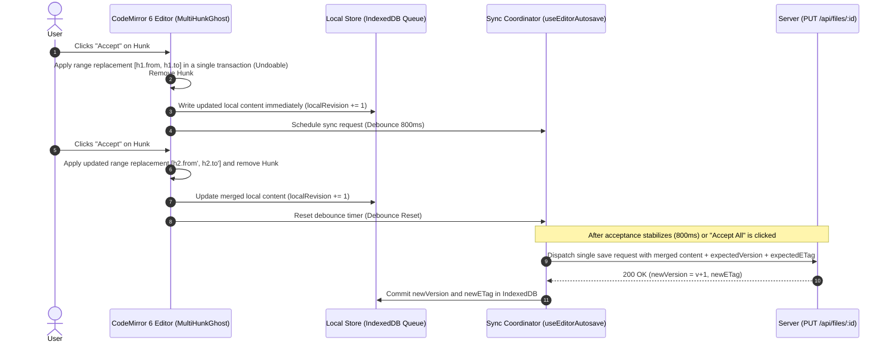

# 03. Workspace, AST, Editor & Zero-Knowledge Vault Integration Architecture

| Standard Field | Approved Value |
| :--- | :--- |
| **Document ID** | `ELIXENT-ARCH-03` |
| **Classification** | `LIVING SUBSYSTEM SPEC` (`src/core/workspace/*`, `src/core/ast/*`, `src/components/editor/markdown/*`, `src/lib/vault/*`) |
| **Version & Status** | `v3.2 — Accepted for Implementation (Accepted)` |
| **SSOT Scope** | Unified Workspace Provider contract (`IWorkspaceProvider`), Hybrid AST and Lexical Search Engine (`Hybrid AST + Lexical/BM25 Search`), Fence-Aware Heading Slicer (`Fence-Aware Slicer`), Multi-Hunk Ghost Preview protocol (`Multi-Hunk Ghost`) and Incremental Sync with `Diff3` and `ETag`, and Zero-Knowledge Vault boundaries (`vault_ref://` and `EphemeralVaultMemoryMap`). |
| **Suite Index** | • [01_architecture_vision_and_adrs](./01_architecture_vision_and_adrs.md)<br>• [02_agent_orchestration_and_decision_engine](./02_agent_orchestration_and_decision_engine.md)<br>• [04_credit_metering_and_settlement_architecture](./04_credit_metering_and_settlement_architecture.md)<br>• [05_data_contracts_and_lugx_migration_plan](./05_data_contracts_and_lugx_migration_plan.md) |

## 1. Unified Workspace Provider Contract (`IWorkspaceProvider Contract`)

To decouple the architectural agent core (`src/core/agent/*`) from underlying storage medium details and enable executing the exact same state graph on **Vercel Serverless** (backed by PostgreSQL) and on **Electron Desktop** (backed by the local filesystem), agent nodes communicate exclusively through the standardized `IWorkspaceProvider` interface (`src/core/workspace/provider.ts`):

```typescript
export interface HeadingNode {
  headingSlug: string;
  title: string;
  level: 1 | 2 | 3 | 4 | 5 | 6;
  breadcrumb: string; // Example: "1. General Architecture > 1.2. Data Layer"
  startLine: number;
  endLine: number;
  startOffset: number;
  endOffset: number;
  contentHash: string;
}

export interface LexicalMatchResult {
  fileId: string;
  fileName: string;
  headingSlug: string;
  headingBreadcrumb: string;
  matchedExcerpt: string; // Paragraph text, table content, or vault_ref:// pointer for encrypted files
  lineRange: [number, number];
  bm25Score: number;
}

export interface SectionMergeOutcome {
  status: "clean" | "conflict_quarantined" | "syntax_invalid";
  mergedDocumentContent: string;
  hunkRange: { from: number; to: number; replacementText: string };
  diagnostics?: string[];
}

export interface SectionReadResult {
  breadcrumb: string;
  contentOrVaultRef: string;
  isVaultRef: boolean;
}

export interface AgentStreamRequestPayload {
  threadId: string;
  projectId: string;
  prompt?: string;
  targetFileIds: string[];
  resumePayload?: unknown;
  ephemeralVaultPayloads?: Record<string, string>;
  liveDocumentSnapshots?: Record<string, string>;
}

export interface IWorkspaceProvider {
  /** Return the complete heading tree for target files without loading full document bodies */
  listHeadingsTree(fileIds: string[]): Promise<Record<string, HeadingNode[]>>;

  /** Read the body of a specific section via file ID and heading slug (respecting vault isolation and recording the base ancestor snapshot for 3-way merge) */
  readSectionByHeading(
    fileId: string,
    headingSlug: string,
  ): Promise<SectionReadResult>;

  /** Hybrid search (lexical BM25 / Regex) within paragraphs and tables with parent heading breadcrumb attached */
  searchLexicalWithASTBreadcrumb(params: {
    fileIds: string[];
    query: string;
    maxResults?: number;
  }): Promise<LexicalMatchResult[]>;

  /** 3-way merge (Diff3) of a specific section modification with structural syntax integrity validation */
  mergeSectionThreeWay(params: {
    fileId: string;
    headingSlug: string;
    baseSectionContent: string;
    agentProposedSectionContent: string;
    liveDocumentContent: string;
  }): Promise<SectionMergeOutcome>;
}

// Custom Workspace Domain Errors
export class VaultAIAccessDeniedError extends Error {
  readonly status = 403;
  readonly code = "VAULT_AI_ACCESS_DENIED";
}

export class WorkspaceFileAccessDeniedError extends Error {
  readonly status = 404;
  readonly code = "WORKSPACE_FILE_ACCESS_DENIED";
}

export class WorkspaceSectionNotFoundError extends Error {
  readonly status = 404;
  readonly code = "WORKSPACE_SECTION_NOT_FOUND";
}

export class EncryptedPayloadMissingError extends Error {
  readonly status = 400;
  readonly code = "ENCRYPTED_PAYLOAD_MISSING";
}
```

### 1.1. Interface Implementations (`Cloud vs. Desktop Implementations`)

| Operational Dimension | Cloud Implementation (`CloudPostgresWorkspaceProvider`) | Desktop Implementation (`DesktopLocalFsWorkspaceProvider`) |
| :--- | :--- | :--- |
| **File Source** | PostgreSQL `files` table (`src/server/db/schema/files.ts`) for standard plaintext files + transient memory map (`EphemeralVaultMemoryMap`) passed in the request for encrypted files and live editor snapshots (`liveDocumentSnapshots`). | Local filesystem (`node:fs/promises`) + local `SQLite` index in Electron. |
| **Permission Verification** | Verification of `files.userId === session.userId` and verification of `userVaultProfiles.allowAIOnEncryptedFiles`. | Local OS permissions for the open workspace directory. |
| **Lexical Search Engine** | Fast in-memory `BM25 / Regex` scanner over the targeted files (`targetFileIds`). | `SQLite FTS5` index + `Tree-sitter` AST for large code repositories. |

## 2. Hybrid AST and Lexical Search Engine (`Hybrid AST + Lexical/BM25 Engine`)

### 2.1. Fence-Aware Heading Slicer (`Fence-Aware Heading Slicer`)

Naive Regex slicing (`/^#{1,6}\s+/m`) suffers from a critical vulnerability: it captures `# comment` lines inside code blocks (` ```python ` or ` ```bash `) as section headings, corrupting section boundaries during merge operations.
Therefore, `src/core/ast/heading-slicer.ts` implements a CommonMark §4.2 and §4.5 compliant ATX heading and code fence tracking state machine:

1. **Ignoring Lines Inside Closed Fences:** While scanning document lines, the slicer tracks the opening and closing state of code fences (```` ``` ```` or `~~~`) and `YAML Frontmatter` at the beginning of the file, registering a line starting with `#` as a heading only when the code fence state is closed (`inCodeFence === false`).
2. **Section Span Calculation (`Section Span Calculation`):** The span of each heading $H_k$ (at level $L \in [1, 6]$) extends from its starting line up to the line immediately preceding the next heading with a level **less than or equal to $L$** ($L_{\text{next}} \le L$), guaranteeing that the section encapsulates all of its paragraphs and sub-headings (`Sub-headings`) as a cohesive structural unit.
3. **Parent Heading Breadcrumb Generation (`Heading Breadcrumb`):** The slicer maintains a hierarchical stack (`Heading Stack`) during scanning to generate the full structural path for every section and sub-heading (e.g., `"3. Economic Model > 3.4. Derivation Equations"`).
4. **Unicode Heading Slug Generation (`generateHeadingSlug`):** Produces URL-friendly slugs preserving Arabic, Latin, and numeric characters while resolving duplicate collisions within the document via numeric suffixing (`base-1`, `base-2`).
5. **Pure TypeScript FIPS 180-4 SHA-256 Hashing (`computeSectionHash`):** Computes a deterministic 64-character lowercase hex SHA-256 digest of normalized section content (`\0` removed, CRLF/CR to LF, Unicode NFC). Uses a pure bitwise implementation with zero `node:crypto` imports, guaranteeing 100% Next.js client bundle safety.
6. **Section Extraction (`extractSectionBySlug`):** Extracts targeted section metadata, full `sectionContent`, and subordinate `sectionBody` excluding the heading line.

### 2.2. Hybrid Search Coupled with Structural Breadcrumb (`Lexical BM25 + AST Breadcrumb`)

When the agent searches for a technical term, variable name, or value inside a table via `searchLexicalWithASTBreadcrumb` (`src/core/workspace/lexical-bm25.ts`):

1. **Semantic Chunk Partitioning (`partitionDocumentIntoChunks`):** The engine partitions each target document into atomic chunks (GFM tables, fenced code blocks, and contiguous paragraphs/lists) categorized under their nearest enclosing parent heading node (`Nearest Enclosing HeadingNode`), decorated with `headingSlug`, `headingBreadcrumb`, and 1-based `lineRange`.
2. **Multilingual Normalization (`normalizeLexicalText`):**
   - Strips BiDi control characters (`\u200E\u200F\u202A-\u202E\u2066-\u2069`), Tashkeel diacritics, and Tatweel/Kashida (`\u0640`).
   - Unifies Arabic character variants: Alef (`[إأآٱ] -> ا`), Teh Marbuta (`ة -> ه`), Yeh/Alef Maksura (`[ىئ] -> ي`), and Waw with Hamza (`ؤ -> و`).
   - Maps Persian and Arabic-Indic digits (`[٠-٩۰-۹]`) to ASCII `0-9`.
   - Normalizes punctuation and applies Latin case-folding.
3. **Compound Identifier Subword Tokenization (`tokenizeLexicalText`):** Decomposes compound code identifiers (`camelCase`, `snake_case`, `kebab-case`) into both the unified token and individual subwords, enabling discovery of identifiers in technical prose.
4. **Okapi BM25 Scoring (`LexicalBM25SearchEngine`):**
   - Standard parameters: $k_1 = 1.5, b = 0.75$.
   - Robertson-Spärck Jones non-negative IDF:
     $$\text{IDF}(q_i) = \ln\left(1 + \frac{N - n(q_i) + 0.5}{n(q_i) + 0.5}\right)$$
   - Guarded against division by zero on empty indices or documents.
5. **ReDoS-Protected Exact / Regex Token Boosting:**
   - Applies an exact match boost (default $2.0\times$) when queries match content or heading breadcrumbs.
   - Protected against catastrophic backtracking via a 100-character length cap, static analysis rejection of dangerous nested quantifiers, and execution inside try/catch with literal substring fallback.
6. **Deterministic Tie-Breaking:** Results are ordered by `bm25Score` descending, with secondary tie-breakers on `fileId` ascending and `lineRange[0]` ascending.

## 3. Section-Scoped 3-Way Merge and Syntax Integrity Validation (`Section-Scoped Diff3 & Syntax Validation`)

The `document_writer_node` relies on `src/lib/sync/diff3.ts` and `src/lib/sync/syntax-validator.ts` to update sections listed in `state.invalidation_map`:

1. **Identifying Base Ancestor Reference (`baseSectionContent`) and Live Version (`liveSectionContent`):**
   - When any section is read via `readSectionByHeading` during the exploration phase, the original section text at read time is recorded as the base ancestor reference (`Base Snapshot`) — either in a contextual map for standard files or retrieved from `EphemeralVaultMemoryMap` for encrypted files — while `liveSectionContent` is extracted from the latest live editor snapshot (`liveDocumentSnapshots[fileId]`) via `extractSectionBySlug` to determine its exact coordinates `(startOffset, endOffset)`.
2. **Section-Level and Sub-Line 3-Way Merge (`diff3MergeSection`):**
   - The exported function `diff3MergeSection` in `src/lib/sync/diff3.ts` is invoked with the exact parameter order `(liveDocumentContent, baseSectionContent, agentProposedSectionContent, headingSlug, options)` or via options object `Diff3MergeSectionParams`.
   - The middle argument (`baseSectionContent`) represents the common ancestor (`o`):
     `diff3MergeText(liveSection.sectionContent, baseSectionContent, agentProposedSectionContent, options)`
     (which applies the `Hunt-McIlroy LCS` algorithm and intra-line partial merge `trySubLineMerge` to resolve adjacent edits without false-positive conflicts).
3. **Conflict Containment & Quarantine:**
   - If conflicts occur, `diff3MergeSection` halts without corrupting the document, returning `status: "conflict_quarantined"` with the replacement text containing conflict markers bounded to `hunkRange`.
4. **Algebraic Replacement Invariant:**
   - Guarantees that applying the replacement text to the live document preserves structural integrity:
     $$\text{liveDocumentContent.slice}(0, \text{hunkRange.from}) + \text{hunkRange.replacementText} + \text{liveDocumentContent.slice}(\text{hunkRange.to}) \equiv \text{mergedDocumentContent}$$
5. **Pre-Stream Syntax Integrity Gate (`validateMarkdownSyntaxIntegrity`):**
   - The merged text is passed through `validateMarkdownSyntaxIntegrity` in `src/lib/sync/syntax-validator.ts` to verify that there are no unclosed code fences, broken Markdown tables, or truncated math delimiters. If validation fails, `diff3MergeSection` returns `status: "syntax_invalid"` with diagnostics.

## 4. Multi-Hunk Ghost Preview Architecture and Incremental Sync Contract (`Multi-Hunk Ghost & Incremental Sync Contract`)

### 4.1. Upgrading `streaming-ghost.ts` from Single Hunk to Hunk Array (`Multi-Hunk Ghost Decorations`)

The current file `src/components/editor/markdown/streaming-ghost.ts` (lines 20–31) in `LUGX v1.46.3` supports only a single preview hunk (`from: number`, `to: number`, `text: string`). To enable the agent to modify multiple non-contiguous sections across a document in a single cycle, the state is upgraded to the following structure:

```typescript
export interface GhostHunk {
  hunkId: string;
  decisionIds: string[]; // Architectural decisions that produced this modification
  headingSlug: string;
  from: number;
  to: number;
  originalSlice: string;
  replacementText: string;
  status: "streaming" | "preview_ready";
}

export interface MultiHunkGhostState {
  sessionId: string | null;
  hunks: GhostHunk[];
}
```

- **Automatic Coordinate Mapping via `tr.changes.mapPos`:** Whenever the user types elsewhere in the document or accepts one of the ghost hunks, `StateField.update` in CodeMirror 6 maps the coordinates of all remaining hunks through:
  ```typescript
  hunk.from = tr.changes.mapPos(hunk.from, 1);
  hunk.to = tr.changes.mapPos(hunk.to, -1);
  ```
  preserving the exact positioning of all remaining ghost hunks without any offset drift.

### 4.2. Incremental Hunk Sync Contract for Partial Acceptance and `412` Conflict Prevention (`Incremental Hunk Sync Contract`)

In the legacy architecture (`src/server/actions/ai-commit.ts`), accepting an AI result triggered an immediate, direct server save request. If that pattern were applied literally with `Multi-Hunk Ghost` and a user clicked "Accept" on three consecutive hunks within one second, 3 concurrent save requests carrying the same stale `expectedVersion` would be dispatched in parallel, triggering self-inflicted `412 Precondition Failed` errors.

Therefore, the system adopts the **Immediate Local Transaction + Debounced Sequential Server Sync (`Immediate Local Transaction + Debounced Sequential Server Sync`)** contract:



1. **Independence of Financial Settlement from Editor Acceptance:** As established in `Phase 11` of `LUGX v1.46.3`, token costs are settled server-side upon generation; consequently, user acceptance or rejection of a ghost hunk is a **pure file editing and synchronization operation** that never re-invokes the billing engine.
2. **Per-Hunk Atomic Undo (`Per-Hunk Atomic Undo`):** Accepting each `GhostHunk` is recorded as an independent CodeMirror transaction tagged with `Transaction.userEvent.of("ai.accept.hunk")`, so pressing `Ctrl+Z` cleanly reverts the last accepted hunk, whereas clicking **"Accept All Hunks (`Accept All Hunks`)"** applies all hunks in a single atomic CodeMirror transaction (`changes: hunks.map(...)`) that can be reverted all at once with a single `Ctrl+Z`.

## 5. Zero-Knowledge Vault Boundary and Isolated Ephemeral References (`Zero-Knowledge Vault Boundary & Ephemeral References`)

To preserve the end-to-end encryption (`Zero-Knowledge`) guarantees implemented in `src/lib/crypto/*`, `src/lib/vault/*`, and `src/server/db/schema/vault.ts`:

### 5.1. Server-Side Vault Consent Gate and Transient Transport Contract (`Server-Side Vault Consent Gate & Transient Transport Contract`)

1. Every request to `/api/agent/stream` (whether initiating a session or resuming via `Command({ resume })`) adheres to the following programmatic contract separating persistent state data from transient in-memory payloads:
   ```typescript
   export interface AgentStreamRequestPayload {
     threadId: string;
     projectId: string;
     prompt?: string;
     targetFileIds: string[];
     resumePayload?: unknown; // Validated user responses when resuming after interrupt()
     /**
      * Plaintext of encrypted files decrypted locally in the browser (when the vault is unlocked and allowAIOnEncryptedFiles === true).
      * Used exclusively to populate EphemeralVaultMemoryMap within the scope of the current HTTP request and never enters AgentGraphState.
      */
     ephemeralVaultPayloads?: Record<string, string>;
     /**
      * Latest live snapshots of open editor documents to ensure accurate computation of baseSectionContent and liveDocumentContent in Diff3.
      */
     liveDocumentSnapshots?: Record<string, string>;
   }
   ```
2. Prior to starting or resuming `LangGraph`, the security guard layer and `orchestrator_node` query the target file attributes in the `files` table and the user's vault settings in the `user_vault_profiles` table (`schema.userVaultProfiles` in `src/server/db/schema/vault.ts`):
   - If any file in `targetFileIds` (or in `ephemeralVaultPayloads`) has `isEncrypted === true` while the user's setting in `user_vault_profiles` is `allowAIOnEncryptedFiles === false`, the request is immediately rejected with status `403 VAULT_AI_ACCESS_DENIED` without processing or consuming any credits.

### 5.2. Ephemeral Memory Map and `vault_ref://` Pointers (`EphemeralVaultMemoryMap`)

Because the `files.content` column in PostgreSQL stores `AES-256-GCM` ciphertext for which the server holds no decryption key, processing encrypted files (when `allowAIOnEncryptedFiles === true`) follows this strict protocol implemented in `src/lib/vault/ephemeral-memory-map.ts`:

1. **Transient Per-Request Hydration via `AsyncLocalStorage` (`runWithEphemeralVaultScope`):**
   - The client browser decrypts target files locally via `SyncCryptoGateway` and passes their plaintext in the transient `ephemeralVaultPayloads` field within the `POST /api/agent/stream` request (both on the initial request and on any resume request following an `interrupt`, because the initial request's memory is completely wiped upon suspension).
   - Upon receiving the request on the server, `CloudPostgresWorkspaceProvider` slices the texts in `ephemeralVaultPayloads` in memory via the `Fence-Aware Heading Slicer` and stores each section as a `Uint8Array` inside the `EphemeralVaultMemoryMap` (`Map<string, Uint8Array>`) scoped strictly to the active request context using Node.js `AsyncLocalStorage`:
     ```typescript
     export async function runWithEphemeralVaultScope<T>(
       callback: () => Promise<T> | T
     ): Promise<T>;
     ```
2. **Prohibition of Storage in `AgentGraphState` & Canonical Pointer Format:**
   - Inserting decrypted plaintext into `state.search_report` or any other channel in `AgentGraphState` is strictly prohibited, because `PostgresSaver` automatically persists a checkpoint snapshot after every node (`Super-step`).
   - Sliced sections are stored transiently via `storeEphemeralVaultSection(fileId, headingSlug, plaintext)`, which returns an opaque pointer formatted as:
     $$\text{vault\_ref://}\{fileId\}\#\{headingSlug\}$$
   - Pointer formatting and inspection are validated by `formatVaultRef(fileId, headingSlug)` and `isVaultRef(value)`.
3. **Just-In-Time Prompt Resolution (`resolveVaultRefJustInTime`):**
   - When `assumption_analyzer_node` or `document_writer_node` needs to pass evidence to the LLM or retrieve `baseSectionContent` for 3-way merge, the prompt builder (`Prompt Resolver`) dereferences the `vault_ref://` pointer from `EphemeralVaultMemoryMap` in transient memory at the exact moment of dispatch without mutating the `state` object:
     ```typescript
     export function resolveVaultRefJustInTime(text: string): string;
     ```
   - Invariant 1 (Fast-Path): If `text` contains no `vault_ref://` prefix, returns immediately without allocating maps.
   - Invariant 2 (Scope Check): If text contains pointers but executes outside an active scope, throws `EphemeralVaultResolutionError`.
   - Invariant 3 (Zeroed Memory Rejection): Throws `EphemeralVaultResolutionError` if the target buffer has been wiped.
4. **Deterministic Buffer Zeroization (`zeroOutEphemeralVaultMemory`):**
   - In the `finally` block of `runWithEphemeralVaultScope` (whether completing normally, pausing at an `interrupt`, or throwing an unhandled exception), deterministic zeroization (`buffer.fill(0)`) is executed across all `Uint8Array` buffers in memory and the map is cleared:
     ```typescript
     export function zeroOutEphemeralVaultMemory(): void;
     ```
5. **Leak Assertions & Scope Introspection:**
   - Exposes `getActiveEphemeralVaultPlaintexts(): string[]` and `hasActiveVaultPlaintextInMemory(): boolean` to allow downstream serializers to inspect and guarantee zero-knowledge boundaries.

### 5.3. Authenticated Checkpoint Encryption & Zero-Knowledge Leak Assertion (`EncryptedCheckpointSerializer`)

To prevent state persistence from storing unencrypted scratchpad data or leaked plaintexts in PostgreSQL, `src/core/agent/checkpoint-serializer.ts` implements `SerializerProtocol` from `@langchain/langgraph-checkpoint`:

```mermaid
flowchart LR
    State["LangGraph Checkpoint State"] --> Inner["JsonPlusSerializer<br/>Preserve Date, Map, Set, DeltaSnapshot"]
    Inner --> LeakAssert{"assertNoVaultPlaintextLeak()<br/>Inspect for active plaintexts >= 4 chars"}
    LeakAssert -->|Leak Detected| LeakErr["throw CheckpointVaultLeakError<br/>(VAULT_PLAINTEXT_LEAK_DETECTED)"]
    LeakAssert -->|Clean (pointers only)| HKDF["HKDF-SHA-256 Key Derivation<br/>256-bit Key from secretKey + salt + info"]
    HKDF --> AES["AES-256-GCM Cipher<br/>12-byte IV · 16-byte Tag · AAD: innerType"]
    AES --> Envelope["EncryptedCheckpointEnvelope<br/>Emits valid UTF-8 JSON bytes for JSONB"]
    Envelope --> Postgres["PostgresSaver Checkpoint Table"]
```

1. **Authenticated AES-256-GCM Encryption with HKDF Key Derivation:**
   - Derives a 32-byte (256-bit) encryption key using `crypto.hkdfSync("sha256", keyMaterial, salt, info, 32)` from `CHECKPOINT_ENCRYPTION_KEY`, `AUTH_SECRET`, or `NEXTAUTH_SECRET`.
   - Encrypts serialized checkpoint payloads with `AES-256-GCM` using a 12-byte CSPRNG IV and a 16-byte authentication tag.
   - Binds Additional Authenticated Data (AAD) to the inner serialization type: `elixent:v1:checkpoint:${innerType}`.
2. **PostgresSaver JSONB Column Compatibility (`EncryptedCheckpointEnvelope`):**
   - Serialized envelopes conform to the typed contract:
     ```typescript
     export interface EncryptedCheckpointEnvelope {
       __elixentEncrypted: true;
       v: 1;
       alg: "AES-256-GCM";
       innerType: string;
       iv: string;  // Base64 12-byte IV
       tag: string; // Base64 16-byte Tag
       ct: string;  // Base64 Ciphertext
     }
     ```
   - Emits valid UTF-8 JSON strings (`["encrypted_json", Buffer.from(JSON.stringify(envelope))]`), enabling seamless storage and querying within PostgreSQL `JSONB` checkpoint tables.
3. **Idempotent Pass-Through Protection:**
   - During `PostgresSaver._loadMetadata`, LangGraph re-serializes previously read checkpoint envelopes. `EncryptedCheckpointSerializer.dumpsTyped` inspects candidates using `isEncryptedCheckpointEnvelope` and passes them through directly, preventing catastrophic double-encryption.
4. **Active Plaintext Leak Assertion (`assertNoVaultPlaintextLeak`):**
   - Prior to encryption in `dumpsTyped`, the serializer queries `getActiveEphemeralVaultPlaintexts()`.
   - If any active vault plaintext ($\ge 4$ characters, non-pointer) is detected anywhere within the serialized state string (either verbatim or JSON-escaped), the serializer halts execution and throws `CheckpointVaultLeakError` with code `VAULT_PLAINTEXT_LEAK_DETECTED`.
5. **Complex Type Preservation & Legacy Fallback:**
   - Wraps LangGraph's internal `JsonPlusSerializer` to preserve complex state objects (`Date`, `Map`, `Set`, `RegExp`, `DeltaSnapshot`, and custom LangChain classes).
   - In `loadsTyped`, supports unencrypted fallback for legacy or development checkpoints.
