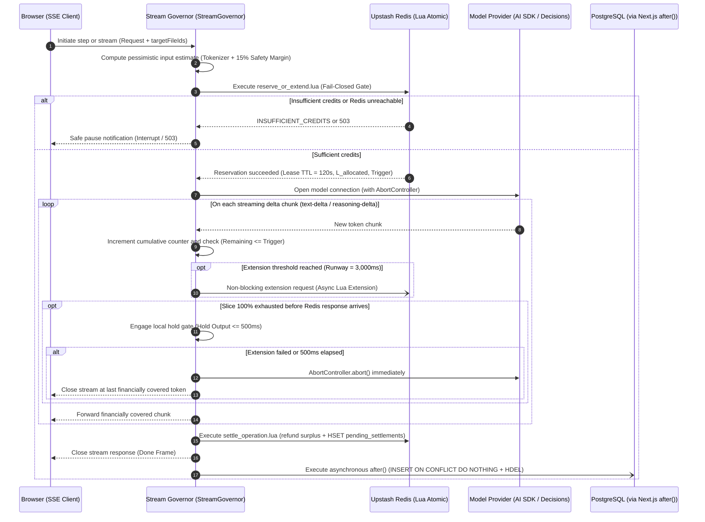

# 04. Credit-Based Metering, Stream Governor & Financial Settlement Architecture

| Standard Field | Approved Value |
| :--- | :--- |
| **Document ID** | `ELIXENT-ARCH-04` |
| **Classification** | `LIVING SUBSYSTEM SPEC` (`src/lib/metering/*`, `src/server/services/ai-settlement-service.ts`, `src/server/services/billing-service.ts`) |
| **Version & Status** | `v3.1 — Fully Implemented & Verified in Phase 4 (Accepted & Implemented)` |
| **SSOT Scope** | Economic model specification (`Micro-Credits` / `BigInt`), Lean Dynamic Model Registry (`Lean Model Registry`), automatic derivation equations for the three execution modes, idempotent pre-node gate wrapper (`withMeteredNodeGate`), stream governor and backpressure valve (`StreamGovernor`), bifurcated settlement engine (`Redis Lua + after()`), and cold-start protocol (`Flush-First Cold Start`). |
| **Suite Index** | • [01_architecture_vision_and_adrs](./01_architecture_vision_and_adrs.md)<br>• [02_agent_orchestration_and_decision_engine](./02_agent_orchestration_and_decision_engine.md)<br>• [03_workspace_ast_editor_and_vault_integration](./03_workspace_ast_editor_and_vault_integration.md)<br>• [05_data_contracts_and_lugx_migration_plan](./05_data_contracts_and_lugx_migration_plan.md) |

## 1. Context of Transitioning from Word Counting to Actual Token and Credit Metering

In its legacy model, the **LUGX (`v1.46.3`)** platform relied on counting words in AI-generated outputs (`countWords` in `src/lib/utils.ts`) and persisting them in the `usage` and `ai_reservations` tables via direct pessimistic database locking (`SELECT ... FOR UPDATE` inside `src/server/services/ai-settlement-service.ts`). With the transition to the **Elixent** architectural agent, that legacy model became obsolete for three fundamental reasons:

1. **High Asymmetry Between Input Volume and Output Volume:** The agent inspects dozens of architectural sections and passes them as inputs (`input_tokens` and `cached_input_tokens`) to ultimately produce a concise structured decision or a targeted section edit, making billing based on "output words" a guaranteed financial loss.
2. **Multi-Modal Execution Paradigms Within a Single Cycle (`Multi-Modal Execution Paradigms`):**
   - **Single-Pass Decision Models (`SINGLE_PASS_DECISION`):** Such as TypeSafe Jev 1.13, Microsoft-Decision-1, and GPT-6 Luna Decisions, which generate zero text tokens (`output_tokens = 0`) and are billed exclusively on input tokens.
   - **Closed Structured Steps and Adaptive Thinking Decision Models (`DISCRETE_THINKING`):** Such as assumption extraction and option structuring nodes via `generateObject`, and adaptive thinking decision models such as Fastino GLiDE.
   - **Extended Generative Streaming Flows (`STREAMING_GENERATIVE`):** Such as the document writing and modification node (`document_writer_node`) via `streamText`.
3. **Internal Reasoning and Thinking Tokens (`Reasoning / Thinking Tokens`):** Reasoning models consume internal thinking tokens that the platform is billed for in full without appearing as final words in the user's document.

## 2. Economic Model and Lean Dynamic Model Registry (Economic Model & Lean Registry)

### 2.1. Credit Unit and Precision-Lossless Mathematical Representation (`Micro-Credits & BigInt`)

- **Standard Credit Valuation:** One credit unit ($1 \text{ Credit}$) is defined as a fixed, system-wide standard monetary unit.
- **Fraction-Free Integer Representation:** All balances and arithmetic computations inside Redis and PostgreSQL are stored as exact integers denominated in **Micro-Credits (`Micro-Credits`)**, where:
  $$1 \text{ Credit} = 1,000,000 \text{ Micro-Credits}$$
  The `BigInt` primitive is used at runtime in TypeScript, `BIGINT` in PostgreSQL, and base-10 string representation (`Decimal String`) inside `LangGraph` state to guarantee lossless serialization in `JSONB`.
- **Fundamental Token-to-Micro-Credit Conversion Formula:**
  $$\text{Cost}_{\text{micro}} = \left\lceil \frac{\text{Tokens} \times \text{CreditsPer1k} \times 1,000,000}{1,000} \right\rceil = \left\lceil \text{Tokens} \times \text{CreditsPer1k} \times 1,000 \right\rceil$$

### 2.2. System-Level Infrastructure Constants (System-Level Constants)

These constants are centrally defined in `src/lib/metering/constants.ts`:

- **Safety Runway Window ($T_{\text{runway}} = 3\text{s} = 3,000\text{ ms}$):** A fixed temporal window to absorb network round-trip latency to Upstash Redis over HTTP in the Vercel Serverless environment and complete the next chunk extension reservation before the active slice is exhausted.
- **Chunk Stability Duration ($T_{\text{chunk}} = 10\text{s}$):** The target operational lifetime of a reservation slice to avoid saturating Redis with overly frequent extension requests.
- **Standard Minimum Chunk Floor ($L_{\min} = 500\text{ tokens}$):** An algebraic token floor preventing tiny reservation slices for lower-velocity models under normal operating conditions.
- **Pessimistic Thinking Ceiling for Discrete Steps ($B_{\text{discrete}} = 1,500\text{ tokens}$):** The pessimistic output/thinking token cap reserved up front for non-streaming steps (`generateObject` or `Fastino GLiDE`), tunable per node schema.

### 2.3. Lean Dynamic Model Registry (`Lean Dynamic Model Registry`)

The model registry in `src/config/models.config.json` is indexed by unique model identifier (`modelId`) rather than the legacy five-operation taxonomy, containing the following fields:

| Registry Field | Type | Description and Computational Role |
| :--- | :--- | :--- |
| **`modelId`** | `string` | Unique operational identifier of the model (e.g., `openai/gpt-6-luna-decisions`, `typesafe/jev-1.13`, `fastino/glide`, `google/gemini-3.1-pro`). |
| **`executionMode`** | `enum` | Execution and metering paradigm:<br>1. `SINGLE_PASS_DECISION`: Single forward pass with zero text output (`output_tokens = 0`).<br>2. `DISCRETE_THINKING`: Non-streaming closed step consuming input tokens + bounded thinking/output tokens.<br>3. `STREAMING_GENERATIVE`: Extended generative stream governed by dynamic chunk equations. |
| **`V` (`tokensPerSecond`)** | `number` | Reference generation velocity in tokens per second (used exclusively in `STREAMING_GENERATIVE` mode; set to `0` in `SINGLE_PASS_DECISION`). |
| **`creditsPer1kInput`** | `number` | Pricing rate per $1,000$ uncached base input tokens. |
| **`creditsPer1kCacheRead`** | `number` | Pricing rate per $1,000$ cached input tokens read from prompt cache (`0` if the provider waives cache reads). |
| **`creditsPer1kOutput`** | `number` | Pricing rate per $1,000$ output tokens including visible text and reasoning tokens (**`0`** for pure decision models such as `Jev 1.13` and `Microsoft-Decision-1`). |
| **`calibrationPriors`** | `object \| null` | Baseline calibration parameters (`{ qHatCore05: number, qHatPeriph20: number }`) specific to decision models for Conformal Adaptive Prediction Sets (`Conformal APS`). |

```json
{
  "models": {
    "typesafe/jev-1.13": {
      "modelId": "typesafe/jev-1.13",
      "executionMode": "SINGLE_PASS_DECISION",
      "V": 0,
      "creditsPer1kInput": 0.15,
      "creditsPer1kCacheRead": 0.03,
      "creditsPer1kOutput": 0,
      "calibrationPriors": { "qHatCore05": 0.08, "qHatPeriph20": 0.22 }
    },
    "fastino/glide": {
      "modelId": "fastino/glide",
      "executionMode": "DISCRETE_THINKING",
      "V": 85,
      "creditsPer1kInput": 0.25,
      "creditsPer1kCacheRead": 0.05,
      "creditsPer1kOutput": 0.80,
      "calibrationPriors": { "qHatCore05": 0.09, "qHatPeriph20": 0.24 }
    },
    "google/gemini-3.1-pro": {
      "modelId": "google/gemini-3.1-pro",
      "executionMode": "STREAMING_GENERATIVE",
      "V": 95,
      "creditsPer1kInput": 1.25,
      "creditsPer1kCacheRead": 0.3125,
      "creditsPer1kOutput": 5.00,
      "calibrationPriors": null
    }
  }
}
```

## 3. Automatic Parameter Derivation Equations and Full Balance Drain Policy (Runtime Derivation & Zero-Dust Drain)

### 3.1. Execution-Mode Automatic Derivation (`Execution-Mode Derivation`)

1. **For Single-Pass Decision Mode (`SINGLE_PASS_DECISION` where `creditsPer1kOutput == 0`):**
   - $L_{\text{allocated}} = 0$ and $\text{Trigger} = 0$.
   - Atomic pre-flight reservation is strictly limited to the **pessimistic input cost only ($\text{Cost}_{\text{input\_pessimistic}}$)**, eliminating any division by zero.
2. **For Closed Discrete Steps and Thinking Decision Models (`DISCRETE_THINKING`):**
   - Exempt from the streaming extension loop; pre-flight reservation is computed as:
     $$\text{Reserved}_{\text{micro}} = \text{Cost}_{\text{input\_pessimistic}} + \left\lceil B_{\text{discrete}} \times \text{creditsPer1kOutput} \times 1,000 \right\rceil$$
   - Immediately upon receiving the structured object from the model, **Immediate Atomic Step Settlement (`Discrete Step Settlement`)** is executed in Redis before `LangGraph` transitions to the next node.
3. **For Extended Generative Streaming Mode (`STREAMING_GENERATIVE` where `creditsPer1kOutput > 0`):**
   - **Computed Operational Chunk Size ($L_{\text{calc}}$):**
     $$L_{\text{calc}} = \max(L_{\min}, V \times T_{\text{chunk}})$$
   - **User Available Output Token Capacity After Covering Inputs ($\text{UserAvailableTokensCapacity}$):**
     $$\text{UserAvailableTokensCapacity} = \left\lfloor \frac{\text{AvailableMicroCredits} - \text{Cost}_{\text{input\_pessimistic}}}{\text{creditsPer1kOutput} \times 1,000} \right\rfloor$$
   - **Actual Allocated Chunk Size After Financial Clamping ($L_{\text{allocated}}$):**
     $$L_{\text{allocated}} = \min(L_{\text{calc}}, \text{UserAvailableTokensCapacity})$$
   - **Extension Trigger Threshold in Remaining Tokens ($\text{Trigger}$):**
     $$\text{Trigger} = V \times T_{\text{runway}}$$

### 3.2. Full Account Zero-Dust Drain Policy (`Zero-Dust Drain Policy`)

1. **Exception to the Minimum Chunk Floor ($L_{\min}$) at Stream Initialization:** If the remaining balance after reserving input costs in `STREAMING_GENERATIVE` mode covers a number of output tokens strictly greater than zero and less than $L_{\min}$ ($0 < \text{UserAvailableTokensCapacity} < L_{\min}$), the $L_{\min}$ constraint is waived as an exception: the entire remaining balance is reserved to generate exactly $\text{UserAvailableTokensCapacity}$ tokens, after which the stream closes cleanly with a balance of **exactly zero**.
2. **Mid-Stream Terminal Micro-Extension Slice (`Mid-Stream Terminal Drain`):** If an active stream reaches the extension threshold ($\text{Trigger}$) and the remaining account balance in Redis is less than the cost of a full $L_{\text{calc}}$ slice but strictly greater than zero, the entire remaining balance is reserved as a terminal micro-extension slice until the last financially covered token is consumed.

### 3.3. Idempotent Pre-Node Wrapper Preventing Double Billing in `LangGraph` (`Idempotent Pre-Node Wrapper`)

Because resuming a node after `interrupt()` in `@langchain/langgraph` re-executes the node function from its first line, every model-consuming node is wrapped with **`withMeteredNodeGate`** (`src/lib/metering/node-gate.ts`):

1. **Deterministic Step Idempotency Key (`Deterministic StepKey`):**
   $$\text{StepKey} = \text{SHA256}(\text{thread\_id} + \text{checkpoint\_id} + \text{node\_name} + \text{step\_attempt})$$
2. **Pre-Execution Idempotency Check:** Prior to invoking the model, the wrapper checks Redis to determine whether `StepKey` has already been settled within the current checkpoint; if present, the cached node output is returned immediately without deducting any additional micro-credits.
3. **Replay-Safe Financial Pause (`Replay-Safe Financial Pause`):** If the available balance is insufficient to cover the minimum requirement of the step, the wrapper does not throw an unhandled exception that would corrupt the run; instead, it routes the state machine via a conditional edge to `pure_interrupt_node` to invoke `interrupt({ code: "INSUFFICIENT_CREDITS", requiredMicroCredits })`, allowing the user to seamlessly resume execution from the exact same node once their balance is topped up.

## 4. Atomic Pre-Flight Reservation and In-Flight Stream Governance (`Pre-Flight Reservation & In-Flight StreamGovernor`)



### 4.1. Server-Side Pessimistic Pre-Estimation (`Server-Side Pessimistic Estimation`)

- **Lightweight Text Tokenizer:** Input token counts are computed server-side using a lightweight TypeScript tokenizer (`js-tiktoken` without heavy WASM binaries) with a **fixed algebraic safety margin ($+15\%$)** added to cover multilingual and code tokenization variances across providers.
- **Pessimistic Input Pricing:** Input tokens are reserved up front at the full base input rate (`creditsPer1kInput`); when actual `usageMetadata` arrives from the provider (whether in the initial frame for Anthropic or the final frame for Gemini/OpenAI), the actual cache read rate (`creditsPer1kCacheRead`) is applied and the surplus is refunded immediately to the user's Redis wallet.
- **Fail-Closed Credit Gate (`Fail-Closed Credit Gate`):** If Upstash Redis is unreachable, the request is rejected immediately with `503 Service Unavailable`; fail-open execution (`Fail-Open`) is strictly prohibited.

### 4.2. Local Hold Gate and Hard Abort Timeout (`500ms Local Hold & Hard Abort`)

If the reserved token slice is $100\%$ consumed during streaming before the Redis extension confirmation returns:

1. `StreamGovernor` temporarily holds incoming delta chunks in server memory without forwarding them to the client browser.
2. It waits up to a maximum of **$500$ milliseconds** for the Redis extension response to arrive.
3. If the $500\text{ ms}$ timeout elapses or the extension is rejected due to credit exhaustion, the server immediately fires **`AbortController.abort()`** to sever the network connection with the external provider and halt GPU billing, then settles the operation at the exact last financially covered token.

## 5. Bifurcated Settlement Engine and Race-Free Cold Start Protocol (Bifurcated Settlement & Cold Start)

### 5.1. Atomic Settlement and Asynchronous Draining via `after()` (`Serverless-Native Durability`)

1. **In Redis (`settle_operation.lua`):** Upon completion of a step or stream (or upon `Abort`, incorporating a minor `Ghost Abort Margin` to cover network teardown latency), a Lua script atomically computes the actual cost, refunds the unused surplus to `lugx:wallet:${userId}`, refreshes the wallet expiration (`EXPIRE 86400`), writes the settlement payload stamped with **`created_at_ms`** into `lugx:pending_settlements:${userId}`, and adds the user to `lugx:dirty_wallets`.
2. **In Next.js `after()` (`waitUntil`):** Immediately after closing the stream response to the user, the `after()` callback pulls pending records from `lugx:pending_settlements:${userId}` and commits them to PostgreSQL in a single idempotent transaction:
   `INSERT INTO credit_ledger_transactions ... ON CONFLICT (operation_id) DO NOTHING`
   deducting the net newly inserted amounts from `users.credit_balance_micro`, and then removes the committed keys from Redis via `HDEL`.
3. **The $30$-Second Grace Guard in the Cron Job (`/api/cron/expire-reservations`):** The periodic Cron job cleans up expired orphan reservations (`TTL = 120s`) and drains pending records in `lugx:pending_settlements:${userId}` whose `created_at_ms` timestamp is **older than $30,000\text{ ms}$** only, preventing any race condition with an active `after()` callback.

### 5.2. Race-Free Flush-First Cold Start Protocol (`Flush-First Cold Start Protocol`)

When a request arrives for a user whose wallet key `lugx:wallet:${userId}` is absent from Redis (due to `TTL` expiration or a cold start):

- **It is strictly prohibited** to read the balance from PostgreSQL and manually subtract `lugx:pending_settlements` in memory (because a concurrent `after()` callback may have just deducted the amount from PostgreSQL without having executed `HDEL` yet, which would cause a double deduction).
- **Mandatory Rule (`Flush-First`):** The cold-start routine first checks `HLEN lugx:pending_settlements:${userId}`; if pending records exist, **it flushes them to PostgreSQL first (`INSERT ... ON CONFLICT DO NOTHING` + `HDEL`)**, and only then reads the updated, authoritative `users.credit_balance_micro` from PostgreSQL and populates Redis via `SETNX lugx:wallet:${userId}`.

### 5.3. Webhook Dual-Write Protocol for Stripe Top-Up Events (`Webhook Dual-Write Protocol`)

When a payment or subscription renewal event is received in `src/app/api/stripe/webhook/route.ts`:

1. `users.credit_balance_micro` is updated and the event is recorded in `subscription_events` and `credit_ledger_transactions` inside a PostgreSQL transaction first.
2. A Redis Lua script (`stripe_dual_write.lua`) is invoked to increment `lugx:wallet:${userId}` by the top-up amount via `INCRBY` **only if the key currently exists in memory (`EXISTS == 1`)**; otherwise, it is left to be hydrated via the `Flush-First Cold Start` protocol on the next user request.

## 6. Standard Verification and Acceptance Criteria (Verification & Acceptance Criteria)

| Criterion ID | Verification Test Scenario | Expected Deterministic Passing Behavior |
| :--- | :--- | :--- |
| **`MTR-01`** | Invoke a single-pass decision model (`Jev 1.13` / `MS-Decision-1` where `creditsPer1kOutput = 0`). | Reserves input cost only ($L_{\text{allocated}} = 0, \text{Trigger} = 0$) with zero division-by-zero errors and settles the step atomically. |
| **`MTR-02`** | Dispatch $10$ concurrent requests for an account holding enough balance for only $3$ requests. | Accepts exactly $3$ requests and rejects the remaining $7$ immediately while maintaining Redis and PostgreSQL balances $\ge 0$ at all times. |
| **`MTR-03`** | Disable Upstash Redis connectivity while sending a request to `/api/agent/stream`. | Enforces `Fail-Closed` policy and returns `503 Service Unavailable` immediately without invoking any external model. |
| **`MTR-04`** | Account holds balance covering inputs plus $80$ output tokens only ($< L_{\min}$). | Opens the stream under the exception policy (`Zero-Dust Drain`), generates exactly $80$ tokens, and closes cleanly with $0$ micro-credits remaining. |
| **`MTR-05`** | Balance runs out after `search_synthesizer_node` and before `decision_scorer_node`, followed by balance top-up and `Command({ resume })`. | Agent pauses via `interrupt('INSUFFICIENT_CREDITS')` before invoking the decision model; upon resume, the node executes and is billed exactly once (`StepKey`). |
| **`MTR-06`** | Key `lugx:wallet:${userId}` expires from Redis while an unsettled record exists in `lugx:pending_settlements:${userId}`. | `Flush-First Cold Start` flushes the pending record to PostgreSQL first with `ON CONFLICT DO NOTHING` and then reads the net balance without double deduction. |

---

## 7. Implementation Artifacts & Phase Closure References

- **Implementation Modules:**
  - `src/lib/metering/cold-start.ts` — `ensureWalletLoadedFlushFirst`
  - `src/lib/metering/stream-governor.ts` — `StreamGovernor` (500ms Local Hold & Abort)
  - `src/lib/metering/node-gate.ts` — `withMeteredNodeGate` (Higher-Order Metered Node Gate)
  - `src/server/services/ai-settlement-service.ts` — `flushPendingSettlementsToPostgres`, `getUserCreditBalance`
  - `src/config/tiers.config.ts` — `creditAllocationMicro` and `creditsDisplay` per tier
  - `src/server/services/billing-service.ts` — `recordCreditTopup`, `executeRedisDualWrite`
  - `src/app/api/stripe/webhook/route.ts` — Authoritative Stripe webhook handler with dual-write protocol
  - `src/app/api/cron/expire-reservations/route.ts` — Batch-draining cron job with 30s grace window
- **Acceptance & Verification Suites:**
  - `src/test/metering/derivation-and-lua.unit.test.ts` — Token derivation and Redis Lua script unit tests (18 tests)
  - `src/test/metering/cold-start.unit.test.ts` — Flush-First cold start unit tests (13 tests)
  - `src/test/metering/stream-governor.unit.test.ts` — Real-time stream governor unit tests (17 tests)
  - `src/test/metering/node-gate.unit.test.ts` — Metered node gate unit tests (11 tests)
  - `src/test/metering/ai-settlement-service.unit.test.ts` — AI settlement service unit tests (21 tests)
  - `src/test/infrastructure/cron-expire-reservations.test.ts` — Cron batch draining tests (10 tests)
  - `src/test/server/billing-service.test.ts` — Billing service and top-up unit tests (23 tests)
  - `src/test/api/stripe-webhook.test.ts` — Stripe webhook and dual-write tests (26 tests)
- **Phase Closure Dossier:** [`docs/records/closures/elixent-execution/phase-04-flush-first-cold-start-and-settlement.md`](../records/closures/elixent-execution/phase-04-flush-first-cold-start-and-settlement.md)

