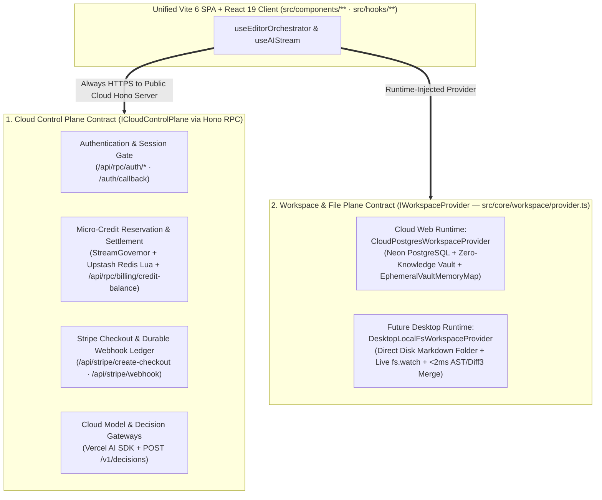

# ADR-007: Enforcing Dual-Plane Contract Separation (ICloudControlPlane vs. IWorkspaceProvider) and Request-Scoped AsyncLocalStorage Context Isolation

| Standard Field | Approved Value |
| :--- | :--- |
| **ADR Identifier** | `ADR-007` (`ELIXENT-ADR-007`) |
| **Classification** | `STANDALONE ARCHITECTURAL DECISION RECORD (ADR)` |
| **Version & Status** | `v1.0 — Accepted` |
| **Supersedes / Amends** | Extends [03_workspace_ast_editor_and_vault_integration.md](./03_workspace_ast_editor_and_vault_integration.md) and [04_credit_metering_and_settlement_architecture.md](./04_credit_metering_and_settlement_architecture.md) |
| **Governing Execution Plan** | [elixent-framework-migration-execution-plan.md](../records/plans/elixent-framework-migration-execution-plan.md) (`ELIXENT-FRAMEWORK-MIGRATION-PLAN-v1.1`) |
| **Affected Repository Scope** | `src/server/context/request-context.ts`, `src/server/middleware/session-middleware.ts`, `src/lib/supabase/server.ts`, `src/server/routes/rpc.routes.ts`, `src/core/workspace/provider.ts` |

## 1. Context & Problem Statement

Following the adoption of **`Vite 6 SPA + TanStack Router + Hono RPC`** in [ADR-006](./adr_006_unified_vite_tanstack_hono_rpc_architecture.md), two architectural boundary problems must be resolved simultaneously:

1. **Decoupling Request Context from `next/headers` Without Breaking Call-Site Signatures:**
   - In the legacy `Next.js` baseline, `src/lib/supabase/server.ts` and `src/server/actions/auth-actions.ts` relied on `cookies()` and `headers()` from `next/headers` to read/write session cookies (`sb-*`) and client IP headers (`x-forwarded-for`, `x-real-ip`), while `src/app/api/agent/stream/route.ts` relied on `after()` from `next/server` to schedule post-response credit settlement flushes.
   - Threading Hono's `Context (c)` object explicitly as a new function parameter across `createClient()`, `getUser()`, and all 7 modules in `src/server/actions/*.ts` would mutate dozens of function signatures, violate the `Zero Logic Mutation` migration invariant, and break `112` unit test suites.
2. **Establishing Clean Control-Plane vs. Workspace-Plane Boundaries for Future Live Agent Interoperability:**
   - In the future Desktop runtime (`Electron + Node.js Utility Process`), external coding agents (`Claude Code`, `Cursor`, CLI automation scripts) modify `.md` documentation files directly on the user's local disk while `Elixent` reacts in `< 2ms` via `Fence-Aware Heading Slicer` (`src/core/ast/heading-slicer.ts`) and `diff3MergeSection` (`src/lib/sync/diff3.ts`).
   - To support this dual-runtime model without duplicating business logic or compromising financial security, the codebase must enforce an explicit boundary between **Cloud Control Plane operations** (which must always execute on the authoritative cloud server) and **Workspace & File Plane operations** (which adapt to the storage medium via `IWorkspaceProvider`).

## 2. Accepted Decision & Architectural Contract

### 2.1. Request-Scoped Context Isolation via `AsyncLocalStorage` (`src/server/context/request-context.ts`)

1. **Deterministic `ServerRequestContext` Store:**
   - Implement an `AsyncLocalStorage<ServerRequestContext>` singleton in `src/server/context/request-context.ts` holding the active request's mutable cookie store (`getAll()`, `set()`, `delete()`) and `Headers` instance.
   - Populate the store automatically inside Hono's `sessionMiddleware` (`src/server/middleware/session-middleware.ts`) via `runWithServerRequestContext(ctx, () => next())`.
2. **Zero-Signature-Change Resolution (`resolveCookiesAndHeaders` & `scheduleAfterResponse`):**
   - `src/lib/supabase/server.ts` and `src/server/actions/auth-actions.ts` call `resolveCookiesAndHeaders()` to access the request's cookies and headers without taking a framework context parameter.
   - `src/server/routes/agent.routes.ts` calls `scheduleAfterResponse(task)` from `src/server/context/request-context.ts` to execute `flushPendingSettlementsToPostgres(user.id)` non-blockingly after the SSE stream closes, exposing a registerable test listener (`onScheduleAfterResponse`) for deterministic unit test verification.
3. **Preservation of Edge Proxy Security Invariants in `sessionMiddleware`:**
   - Preserve OAuth landing code interception (`/?code=...` and `/login?code=...` forwarding `307` to `/auth/callback` with `Set-Cookie` propagation).
   - Preserve the **Fast-Path Cookie Gate (`TD-12`)**: bypass `supabase.auth.getUser()` on public non-auth routes and on `/login` when no `sb-*` cookie is present.
   - Preserve the **`AbortSignal.timeout(2500)`** watchdog race around `supabase.auth.getUser()`.

### 2.2. Strict Dual-Plane Contract Separation (`ICloudControlPlane` vs. `IWorkspaceProvider`)

1. **Cloud Control Plane Contract (`ICloudControlPlane` over Hono RPC):**
   - Encompasses all operations that require an active internet connection and execute **exclusively on the authoritative public cloud Hono server** in both the Cloud Web runtime and the future Desktop runtime:
     - User authentication and OAuth session exchange (`/api/rpc/auth/*`, `/auth/callback`).
     - Pre-authorization credit leases, real-time `StreamGovernor` runway extensions, `Redis Lua` settlement, and credit balance queries (`/api/rpc/billing/credit-balance`).
     - `Stripe` subscription checkout and HMAC-verified webhook processing (`/api/stripe/*`).
     - Upstream generative LLM calls and `POST /v1/decisions` cascade invocations.
2. **Workspace & File Plane Contract (`IWorkspaceProvider` in `src/core/workspace/provider.ts`):**
   - Governs structural document inspection (`listHeadingsTree`, `readSectionByHeading`, `searchLexicalWithASTBreadcrumb`) and surgical three-way merging (`mergeSectionThreeWay`).
   - Dynamically injected per runtime:
     - **Cloud Web Runtime:** Injects `CloudPostgresWorkspaceProvider` (`src/core/workspace/cloud-provider.ts`) operating over `Neon PostgreSQL` and the request-scoped `EphemeralVaultMemoryMap` (`vault_ref://` pointers).
     - **Future Desktop Runtime:** Injects `DesktopLocalFsWorkspaceProvider` operating directly over local `.md` files on disk with native `fs.watch` event emission, allowing live edits from external coding agents (`Claude Code`, `Cursor`) to merge cleanly into the user's live editor buffer in `< 2ms` without framework route-cache interference.

## 3. Evaluated Alternatives & Rejection Rationales

- **Alternative 1: Explicitly Threading Hono's `Context (c)` Through All Domain and Service Functions:**
  - *Rejection Rationale:* Requires changing the function signatures of `createClient()`, `getUser()`, and every exported function in `src/server/actions/*.ts`, breaking direct invocation in `112` unit test suites and coupling core domain logic to Hono's HTTP context interface.
- **Alternative 2: Executing Model Invocations or Credit Metering Locally Inside the Future Desktop Runtime:**
  - *Rejection Rationale:* Violates the `Zero-Overdraft Protection` invariant by exposing upstream LLM API keys and quota state to client-side tampering. Keeping `ICloudControlPlane` strictly cloud-authoritative guarantees financial immunity across both runtimes.

## 4. Trade-off Matrix

| Evaluation Criterion | Accepted Solution (`ALS Request Context + Dual-Plane Split`) | Alternative 1 (Explicit `Hono Context` Parameter Threading) | Alternative 2 (Local Desktop Execution of Control Plane) |
| :--- | :--- | :--- | :--- |
| **Function Signature Parity & Test Preservation** | $100\%$ preserved (`0` domain signature changes) | Low (Requires rewriting signatures across all services & tests) | N/A |
| **Protection of AI Keys & Financial Ledger** | $100\%$ server-authoritative (`Fail-Closed` on cloud) | $100\%$ server-authoritative | Compromised (Exposes keys and quota state on client) |
| **Live External Agent Interop (`Claude Code` / `Cursor`)** | Sub-$2\text{ ms}$ local `fs.watch` + `Diff3` merge without framework cache friction | Same, but with high refactoring churn | Same, but financially insecure |

## 5. Consequences, Invariants & Future Migration Trigger

1. **Zero Server-Only Imports in Client Route Views:** By exposing `/api/rpc/billing/credit-balance` on the Hono RPC control plane (`src/server/routes/rpc.routes.ts`) and `getCreditBalance()` in `src/client/rpc-client.ts`, client views (`dashboard-page.tsx`, `account-page.tsx`) never import `@/server/services/ai-settlement-service` or `@/lib/supabase/server`.
2. **Migration Trigger (When to Activate the Desktop Workspace Provider):** When the `Electron Desktop` milestone is initiated after completing the 6-phase web framework migration, implement `DesktopLocalFsWorkspaceProvider` and pass a routing `CustomFetchFn` into `createElixentRpcClient(baseUrl, customFetch)` that dispatches workspace operations over `Electron IPC / MessagePort` while forwarding all `ICloudControlPlane` endpoints over `HTTPS` to the cloud `Hono` server.
