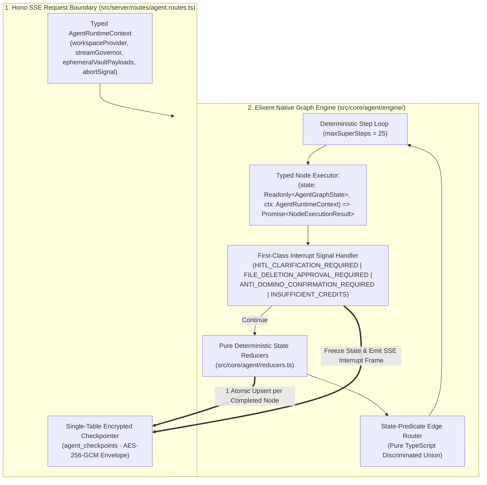

# ADR-009: Replacing `@langchain/langgraph` with a Zero-Dependency Native Graph Orchestration Engine (`Elixent Native Graph Engine`)

| Standard Field | Approved Value |
| :--- | :--- |
| **ADR Identifier** | `ADR-009` (`ELIXENT-ADR-009`) |
| **Classification** | `STANDALONE ARCHITECTURAL DECISION RECORD (ADR)` |
| **Version & Status** | `v1.1 — Accepted (Audited & Schema-Normalized)` |
| **Supersedes / Amends** | Supersedes the `@langchain/langgraph` runtime and `PostgresSaver` 3-table checkpointer mandate in [`ADR-001`](../01_architecture_vision_and_adrs.md) (§3.1) and [`ADR-005`](../01_architecture_vision_and_adrs.md) (§3.5); amends [`02_agent_orchestration_and_decision_engine.md`](../02_agent_orchestration_and_decision_engine.md) (§2 & §3.1) |
| **Governing Execution Plan** | [`ELIXENT-EXECUTION-PLAN-v1.1`](../../Plans/elixent-architectural-evolution-execution-plan.md) |
| **Companion SRS** | [`SRS-01: Agent Orchestration Engine, Canonical Decision Graph & Weight Gate`](../../specs/srs_01_agent_orchestration_decision_graph_and_weight_engine.md) |
| **Affected Repository Scope** | `../../src/core/agent/state.ts`, `../../src/core/agent/graph.ts`, `../../src/core/agent/checkpoint-serializer.ts`, `../../src/server/routes/agent.routes.ts`, `../../src/server/db/schema/langgraph-checkpoints.ts` (retired), `../../src/server/db/schema/agent-checkpoints.ts` (Planned / New), `../../package.json` |

## 1. Context & Problem Diagnosis

In [`ADR-001`](../01_architecture_vision_and_adrs.md) (§3.1), `@langchain/langgraph` was adopted as the cyclic state machine runtime while `Vercel AI SDK` handled model invocations. Following the Web-standard migration to **`Vite 6 SPA + TanStack Router + Hono RPC`** under [`ADR-006`](./adr_006_unified_vite_tanstack_hono_rpc_architecture.md) and [`ADR-007`](./adr_007_dual_plane_separation_and_als_request_context.md), an architectural evaluation of the agent orchestration layer (`../../src/core/agent/**` and `../../src/server/routes/agent.routes.ts`) identified four structural mismatches caused specifically by the `@langchain/langgraph` runtime engine:

1. **Conflation of Serializable State Deltas with Request-Scoped Runtime Context:**
   - `@langchain/langgraph` forces every node function to conform to `(state: AgentGraphState, config?: RunnableConfig) => Promise<Partial<AgentGraphState>>` (`../../src/core/agent/state.ts`).
   - Because `RunnableConfig.configurable` is an untyped `Record<string, unknown>` dictionary inspected by `PostgresSaver` metadata serializers, passing live request-scoped dependency instances—such as `IWorkspaceProvider` (`../../src/core/workspace/provider.ts`), `StreamGovernor` (`../../src/lib/metering/stream-governor.ts`), `AbortSignal`, and client-decrypted `ephemeralVaultPayloads`—requires untyped casts and risks leaking non-serializable references into checkpoint metadata.
2. **Three-Table Binary Checkpoint Fragmentation (`checkpoints`, `checkpoint_blobs`, `checkpoint_writes`):**
   - `PostgresSaver` (`@langchain/langgraph-checkpoint-postgres`) splits every super-step state snapshot across three PostgreSQL tables defined in `../../src/server/db/schema/langgraph-checkpoints.ts` (`checkpoints`, `checkpoint_blobs`, `checkpoint_writes`), serializing each state channel into an individual `bytea` row wrapped by `EncryptedCheckpointSerializer` (`../../src/core/agent/checkpoint-serializer.ts`).
   - A single multi-node turn executes dozens of multi-row binary `INSERT`/`UPSERT` statements, whereas the entire `AgentGraphState` is already a pure JSON-serializable object that can be persisted atomically as a single `AES-256-GCM` encrypted envelope per `(thread_id, step_index)`.
3. **Dual Message Type Hierarchy (`@langchain/core/messages` vs. `Vercel AI SDK CoreMessage`):**
   - Retaining `@langchain/langgraph` requires importing `BaseMessage`, `HumanMessage`, `AIMessage`, and `ToolMessage` from `@langchain/core/messages` (`../../src/core/agent/state.ts`, `../../src/core/agent/nodes/search-nodes.ts`) while all model invocations execute through `Vercel AI SDK v7` (`../../src/lib/ai/client.ts`), forcing continuous message translation between the two SDKs.
4. **Silent Channel Dropping in `Annotation.Root`:**
   - `LangGraph`'s runtime channel registry (`Annotation.Root` in `../../src/core/agent/state.ts`) silently strips any property returned by a node if its key is not explicitly registered in `AgentGraphAnnotation`, bypassing TypeScript compile-time completeness checks whenever partial state shapes evolve.

## 2. Accepted Decision & Architectural Contract

We supersede [`ADR-001`](../01_architecture_vision_and_adrs.md) (§3.1) by removing `@langchain/langgraph`, `@langchain/core`, and `@langchain/langgraph-checkpoint-postgres` from the codebase and replacing them with the **`Elixent Native Graph Engine`** (`../../src/core/agent/engine/` — Planned / New), a deterministic, zero-dependency TypeScript state-machine runtime built directly on top of `Vercel AI SDK v7` and `Hono RPC`.

1. **Strict Separation of `AgentGraphState` and `AgentRuntimeContext`:**
   - Every graph node receives `(state: Readonly<AgentGraphState>, ctx: AgentRuntimeContext)` and returns a discriminated `NodeExecutionResult` (`"COMPLETED"` with `stateDelta`, or `"INTERRUPTED"` with `interruptReason`, `stateDelta`, and `interruptPayload`).
   - Persistent serializable graph state never mixes with live request dependencies (`workspaceProvider`, `streamGovernor`, `ephemeralVaultPayloads`, `abortSignal`).
   - Exact TypeScript interfaces and state channel contracts are specified in [`SRS-01`](../../specs/srs_01_agent_orchestration_decision_graph_and_weight_engine.md) (§2.3).
2. **Single-Table Encrypted Checkpoint Persistence (`agent_checkpoints`):**
   - Retire the three `PostgresSaver` tables (`checkpoints`, `checkpoint_blobs`, `checkpoint_writes` in `../../src/server/db/schema/langgraph-checkpoints.ts`) in favor of a single `agent_checkpoints` table keyed by `(thread_id, step_index)` storing one `AES-256-GCM` encrypted state blob per completed node via `EncryptedCheckpointSerializer`.
   - Exact Drizzle schema and zero-knowledge leak assertions are specified in [`SRS-01`](../../specs/srs_01_agent_orchestration_decision_graph_and_weight_engine.md) (§2.2).

## 3. Evaluated Alternatives & Single-Variable Rejection Rationales

To isolate the orchestration runtime variable (`Ceteris Paribus`), all alternatives are evaluated while holding the graph node topology (`ADR-010`), `Vercel AI SDK v7` model gateway (`../../src/lib/ai/client.ts`), `POST /v1/decisions` conformal cascade (`../../src/lib/jev/client.ts`), and pure reducers (`../../src/core/agent/reducers.ts`) strictly constant:

1. **Alternative 1: Retaining `@langchain/langgraph` (`StateGraph` + `PostgresSaver`)**
   - *Rejection Rationale:* Imposes a 3-table binary checkpoint schema (`checkpoint_blobs` per channel), requires dual message representations (`@langchain/core/messages` alongside `Vercel AI SDK`), silently drops undeclared state keys at runtime, and forces request-scoped objects through untyped `RunnableConfig.configurable` maps. Across `src/core/agent/` (`5,961` lines) and `@langchain/*`-importing files (`9,289` lines including tests), only the graph assembly, state annotation, checkpoint serializer, HITL nodes, and `src/lib/metering/node-gate.ts` (`import type { RunnableConfig }`) depend on LangChain primitives, whereas core domain modules (`atms/*`, `ast/*`, `workspace/*`, `jev/*`, `reducers.ts`, `schemas/*`, `taxonomy/*`) have zero LangGraph coupling.
2. **Alternative 2: Adopting an External Workflow Framework (`Mastra` or `LlamaIndex Workflows`)**
   - *Rejection Rationale:* Introduces a new external framework dependency tree whose internal model-routing and telemetry abstractions duplicate and conflict with our Redis-backed multi-key rotation (`../../src/lib/ai/key-rotation.ts`) and `StreamGovernor` credit pre-authorization pipeline (`../../src/lib/metering/stream-governor.ts`).
3. **Alternative 3 (Accepted): Custom TypeScript `Elixent Native Graph Engine`**
   - *Selection Rationale:* Provides compile-time exhaustive checking over `AgentGraphState` and node transitions in pure TypeScript, unifies all messages on native JSON structures compatible with `Vercel AI SDK v7`, separates `AgentRuntimeContext` from `AgentGraphState` by construction, and reduces checkpoint persistence to a single atomic `UPSERT` per node.

## 4. Controlled Trade-off Matrix

| Evaluation Criterion (Isolated to Runtime Engine) | Accepted Solution (`Elixent Native Graph Engine`) | Alternative 1 (`@langchain/langgraph` + `PostgresSaver`) | Alternative 2 (External Workflow Framework) |
| :--- | :--- | :--- | :--- |
| **Type Safety of State Deltas & Routing** | $100\%$ compile-time checked (`Partial<AgentGraphState>` with explicit discriminated unions) | Partial (Untyped `configurable` + silent runtime stripping of unregistered keys) | Moderate (Framework-specific generic wrappers) |
| **Checkpoint Database Write Amplification** | $1$ atomic row write per completed node (`agent_checkpoints`) | $3$ tables $\times$ $N$ channels per super-step (`checkpoints`, `checkpoint_blobs`, `checkpoint_writes`) | Varies; requires custom storage adapter |
| **Separation of `RuntimeContext` vs. `State`** | Enforced by function signature `(state, ctx)` | Conflated inside `RunnableConfig.configurable` | Conflated inside step context objects |
| **External Orchestration Dependencies** | $0$ external packages (Pure TypeScript over `Vercel AI SDK v7`) | `@langchain/langgraph`, `@langchain/core`, `@langchain/langgraph-checkpoint-postgres` | Heavy external framework dependency tree |

## 5. Consequences, Conflict Reconciliation & Migration Trigger

### 5.1. Architectural Consequences
- **Positive:** Eliminates `@langchain/*` dependency bloat, stops silent runtime key stripping, reduces database checkpoint I/O to 1 atomic row per node, and enforces strict compile-time typing across `AgentRuntimeContext` and `AgentGraphState`.
- **Negative / Operational Trade-off:** Internalizes loop-guard (`maxSuperSteps`) and checkpoint resumption tests within `src/core/agent/engine/` rather than relying on an upstream library's test suite.

### 5.2. Prior-ADR Conflict Reconciliation (Deferred to Execution Plan Phase 0)
- **[`ADR-001`](../01_architecture_vision_and_adrs.md) (§3.1):** Directly superseded. The Migration Trigger in `ADR-001` is formally activated and satisfied by `Elixent Native Graph Engine`.
- **[`ADR-005`](../01_architecture_vision_and_adrs.md) (§3.5):** Amended to replace `PostgresSaver` (`checkpoints`, `checkpoint_blobs`, `checkpoint_writes`) with the single-table `agent_checkpoints` store while preserving `EncryptedCheckpointSerializer` (`AES-256-GCM`).
- **[`ADR-006`](./adr_006_unified_vite_tanstack_hono_rpc_architecture.md) (§1.1):** Update the `Agent Brain Execution Host` label from `LangGraph` to `Elixent Native Graph Engine`.

### 5.3. Migration Trigger (When to Revisit)
Revisit the custom `Elixent Native Graph Engine` only if future multi-agent distributed orchestration requires cross-machine workflow sharding across independent worker clusters with durable external message-queue brokers (e.g., `Temporal.io` or `Upstash Workflow`).
