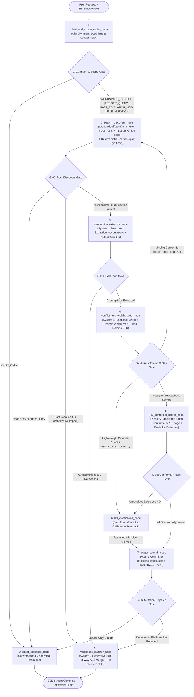

# ADR-010: Adopting a 9-Node Replay-Safe Graph Boundary Topology and Dual-Toolset Discovery Consolidation

| Standard Field | Approved Value |
| :--- | :--- |
| **ADR Identifier** | `ADR-010` (`ELIXENT-ADR-010`) |
| **Classification** | `STANDALONE ARCHITECTURAL DECISION RECORD (ADR)` |
| **Version & Status** | `v1.1 — Accepted (Audited & Schema-Normalized)` |
| **Supersedes / Amends** | Supersedes the 14-node stage topology and `workspace_tool_node` / `confidence_classifier_node` separation in [`02_agent_orchestration_and_decision_engine.md`](../02_agent_orchestration_and_decision_engine.md) (§1 & §3) and `../../src/core/agent/graph.ts` |
| **Governing Execution Plan** | [`ELIXENT-EXECUTION-PLAN-v1.1`](../../records/plans/elixent-architectural-evolution-execution-plan.md) |
| **Companion SRS** | [`SRS-01: Agent Orchestration Engine, Canonical Decision Graph & Weight Gate`](../../specs/srs_01_agent_orchestration_decision_graph_and_weight_engine.md) |
| **Affected Repository Scope** | `../../src/core/agent/graph.ts`, `../../src/core/agent/nodes/orchestrator-node.ts`, `../../src/core/agent/nodes/search-nodes.ts`, `../../src/core/agent/nodes/assumption-and-linker-nodes.ts`, `../../src/core/agent/nodes/jev-scoring-nodes.ts`, `../../src/core/agent/nodes/resolution-and-ledger-nodes.ts`, `../../src/core/agent/nodes/hitl-nodes.ts`, `../../src/core/agent/nodes/document-writer-node.ts` |

## 1. Context & Problem Diagnosis

In [`02_agent_orchestration_and_decision_engine.md`](../02_agent_orchestration_and_decision_engine.md) (§1 & §3) and `../../src/core/agent/graph.ts` (lines `136–149`), the agent workflow is partitioned into **14 graph nodes** (`ORCHESTRATOR_NODE` through `DOCUMENT_WRITER_NODE`) across 7 linear stages. Evaluating these node boundaries against the unified `Vercel AI SDK v7` gateway (`../../src/lib/ai/client.ts`) and the full spectrum of user request patterns reveals two opposite structural hazards in node granularity design:

1. **Over-Fragmentation Hazard (`14` Fine-Grained Nodes in Current Baseline):**
   - **Externalized Tool Loop (`search_agent_node` $\leftrightarrow$ `workspace_tool_node` $\rightarrow$ `search_synthesizer_node` in `../../src/core/agent/nodes/search-nodes.ts`):** `executeToolAgentGeneration` (`../../src/lib/ai/client.ts`) already executes bounded multi-step tool calls (`stopWhen: stepCountIs(6)`) with integrated key rotation and circuit-breaking, returning the complete array of `steps`, `toolCalls`, and `toolResults` in a single invocation. Maintaining a separate graph-level `workspace_tool_node` and `search_synthesizer_node` introduces redundant checkpoint writes on every tool call without adding fault isolation.
   - **Artificial Separation of Pure Math from API Scoring (`decision_scorer_node` $\rightarrow$ `confidence_classifier_node` in `../../src/core/agent/nodes/jev-scoring-nodes.ts` and `../../src/core/agent/nodes/resolution-and-ledger-nodes.ts`):** `classifyDecisionConformalAPS` (`../../src/lib/jev/conformal-classifier.ts`) is a pure, deterministic `< 1ms` mathematical function with zero I/O that is already invoked inside `evaluateDecisionBatch` (`../../src/lib/jev/client.ts`). Isolating it as a standalone graph node adds an unnecessary state transition boundary.
   - **Rigid Single-Track Routing:** Requests that require only conversational answers, workspace search, or localized formatting edits are forced through assumption extraction and `System 1` scoring nodes.
2. **Under-Fragmentation Hazard (`6–7` Coarse Nodes Mixing Distinct Cost or Side-Effect Phases):**
   - Merging `assumption_extractor_node` (which invokes a metered `System 2` generative LLM) with `conflict_and_weight_gate_node` (which invokes `System 1` relational linking and enforces the `Anti-Domino Gate`) violates **Replay-Safety**: if the graph pauses at the `Anti-Domino Gate` or retries a transient `System 1` network error, the user would be billed twice for re-running `System 2` assumption extraction.
   - Similarly, merging `ledger_commit_node` (which atomically updates `decisions.ledger.json`) with `workspace_mutator_node` (which streams multi-file `System 2` Markdown edits and `Diff3` merges) violates **Side-Effect Isolation**:
     1. In `Safe Mode` (`ADR-015`), architectural decisions approved by the user must be committed to `decisions.ledger.json`, whereas document text edits must remain uncommitted as pending `GhostHunks`.
     2. In `Ledger-Only` or architectural Q&A turns, decisions are recorded in `decisions.ledger.json` without mutating any `.md` document.
     3. If a `System 2` streaming call fails on the third file of a five-file mutation, keeping `ledger_commit_node` as a preceding checkpoint boundary ensures the resolved decisions in `decisions.ledger.json` are already durably saved and are never recomputed upon retry.

## 2. Accepted Decision & Architectural Contract

We establish the **Replay-Safe Boundary Principle**: *A graph node boundary is placed if and only if a stage transitions across (a) an independent metered model tier (`System 2` vs. `System 1`), (b) a human/financial interrupt boundary (`HITL`), or (c) an irreversible storage mutation boundary (`decisions.ledger.json` commit vs. multi-file `.md` mutation).*

Applying this principle yields **9 Replay-Safe Canonical Nodes** governed by **6 Deterministic State-Predicate Routing Gates (`G-01` .. `G-06`)**:

| Node ID | Metered Model / Engine Tier | Core Architectural Responsibility & Boundary Justification |
| :--- | :--- | :--- |
| **`1. intent_and_scope_router_node`** | Fast Router (`0 LLM` heuristic + lightweight classification) | Loads workspace file-tree metadata and `decisions.ledger.json` summary index into `RuntimeContext`, classifying the request across the 9 canonical input patterns. |
| **`2. search_discovery_node`** | `System 2` Tool Loop (`executeToolAgentGeneration`, `maxSteps = 6`) | Executes autonomous exploration using a **Dual Toolset** (4 document inspection tools + 4 decision graph tools per [`ADR-012`](./adr_012_json_decision_ledger_and_graph_traversal.md)) and synthesizes `search_report` deterministically (`0` extra LLM calls) by pairing `toolCallId` entries in `result.steps`. |
| **`3. assumption_extractor_node`** | `System 2` Structured (`executeStructuredGeneration`) | Extracts architectural assumptions, classifies intent origin, enumerates 3–4 rhetorically neutral options, and attaches candidate prior decisions. Isolated from Node 4 so `System 2` generation is checkpointed before `System 1` network calls. |
| **`4. conflict_and_weight_gate_node`** | `System 1` Relational API + Pure `ATMS` Math | Adjudicates logical relationships, enforces the `Anti-Domino Gate` ([`ADR-014`](./adr_014_deterministic_change_weight_and_anti_domino_gate.md)), and runs `resolveATMSCascadeBFS` and `computeMinimalSectionInvalidationMap`. |
| **`5. jev_conformal_scorer_node`** | `System 1` Cascade (`POST /v1/decisions`) + Pure `Conformal APS` | Evaluates all open decisions via `evaluateDecisionBatch` grounded in `search_report.evidenceItems`, executes `classifyDecisionConformalAPS` inline in `< 1ms`, and constructs post-adjudication rationales ([`ADR-013`](./adr_013_epistemic_framing_decoupling_system2_system1.md)). |
| **`6. hitl_clarification_node`** | Stateless Interrupt Boundary (`0 LLM`) | Freezes execution on `unresolved_ledger`, `ESCALATE_TO_HITL` conflicts, or file deletion approvals; records `calibrationStore.recordFeedbackScore` upon resumption. |
| **`7. ledger_commit_node`** | Atomic Ledger Persistence (`0 LLM`) | Validates DAG acyclicity, recomputes Change Weights $W(d)$, and atomically writes `decisions.ledger.json`. Isolated from Node 8 so approved decisions persist even if multi-file `.md` streaming fails or is staged as `GhostHunks`. |
| **`8. workspace_mutator_node`** | `System 2` Streaming (`executeStreamingGeneration`) + `Diff3` AST Merge | Executes full generative Markdown authoring, section rewriting, or file creation/deletion across open and closed workspace files according to `permissionMode`. |
| **`9. direct_response_node`** | `System 2` Streaming (`executeStreamingGeneration`) | Streams direct analytical answers, workspace search summaries, or decision graph explanations when no `.md` mutation is required. |

Detailed state-predicate routing conditions (`G-01` .. `G-06`) and node input/output schemas are specified in [`SRS-01`](../../specs/srs_01_agent_orchestration_decision_graph_and_weight_engine.md) (§3).

## 3. Evaluated Alternatives & Single-Variable Rejection Rationales

To isolate the node granularity variable (`Ceteris Paribus`), all alternatives are evaluated while holding the orchestration runtime engine (`ADR-009`), workspace inspection and ledger tools (`ADR-011`, `ADR-012`), and mathematical scoring/weight algorithms (`ADR-013`, `ADR-014`) strictly constant:

1. **Alternative 1: Retaining the 14-Node Fine-Grained Topology (`workspace_tool_node` + `search_synthesizer_node` + `confidence_classifier_node` as Separate Graph Nodes)**
   - *Rejection Rationale:* Creates redundant checkpoint writes on every tool hop and synchronous math step. Because `executeToolAgentGeneration` (`../../src/lib/ai/client.ts`) natively encapsulates the tool loop and `classifyDecisionConformalAPS` (`../../src/lib/jev/conformal-classifier.ts`) is a synchronous in-memory classifier already invoked inside `evaluateDecisionBatch`, separating them into standalone graph nodes adds serialization latency without providing replay-safety benefits.
2. **Alternative 2: Over-Consolidated 6-to-7 Node Topology (Merging `assumption_extractor_node` with `conflict_and_weight_gate_node`, or Merging `ledger_commit_node` with `workspace_mutator_node`)**
   - *Rejection Rationale:* Directly violates **Replay-Safety** and **Side-Effect Isolation**. Merging `ledger_commit_node` with `workspace_mutator_node` means a streaming failure during multi-file `.md` generation loses or re-runs `decisions.ledger.json` commits, and conflates committed decision state with uncommitted `Safe Mode` document `GhostHunks`.
3. **Alternative 3 (Accepted): 9 Replay-Safe Canonical Nodes with 6 State-Predicate Gates**
   - *Selection Rationale:* Eliminates every zero-value intermediate node while preserving strict checkpoint boundaries between `System 2` extraction (Node 3), `System 1` conflict gating (Node 4), `System 1` batch conformal scoring (Node 5), human interrupts (Node 6), atomic `decisions.ledger.json` persistence (Node 7), and multi-file generative document mutation (Node 8).

## 4. Controlled Trade-off Matrix

| Evaluation Criterion (Isolated to Node Granularity) | Accepted Solution (`9 Replay-Safe Nodes`) | Alternative 1 (`14 Fine-Grained Nodes`) | Alternative 2 (`6–7 Coarse Phase-Mixing Nodes`) |
| :--- | :--- | :--- | :--- |
| **Replay-Safety on Partial Failure / Interrupt** | $100\%$ (Every LLM/API tier and storage side-effect has an isolated checkpoint boundary) | $100\%$ | Compromised (Streaming failure in doc writer loses or re-runs ledger commit / `System 2` extraction) |
| **Checkpoint Writes per Full Architectural Turn** | $5\text{–}7$ checkpoints (1 per distinct phase) | $14\text{–}20$ checkpoints (Includes per-tool-step and zero-cost math hops) | $4\text{–}6$ checkpoints |
| **Tool Call Attribution Fidelity (`fileId#headingSlug`)** | $100\%$ deterministic (Paired directly via `result.steps` inside `search_discovery_node`) | Fragile (Requires reconstructing tool args across separate node messages) | $100\%$ deterministic |
| **Fast-Path Latency for Non-Architectural Prompts** | $2$ nodes (`Node 1 -> Node 9` or `Node 1 -> Node 2 -> Node 8`) | Forced through linear stages | $2\text{–}3$ nodes |

## 5. Consequences, Conflict Reconciliation & Migration Trigger

### 5.1. Architectural Consequences
- **Positive:** Cuts per-turn checkpoint overhead by eliminating redundant tool-hop and pure-math nodes, enables $2$-node fast paths for conversational and search queries, and guarantees exact tool-call attribution inside `search_discovery_node`.
- **Negative / Operational Trade-off:** Places responsibility for bounded multi-step tool loops (`maxSteps = 6`) inside `executeToolAgentGeneration` rather than graph-level edges, requiring `search_discovery_node` to synthesize `search_report` directly from `result.steps`.

### 5.2. Prior-ADR Conflict Reconciliation (Deferred to Execution Plan Phase 0)
- **[`02_agent_orchestration_and_decision_engine.md`](../02_agent_orchestration_and_decision_engine.md) (§1 & §3):** Update in **Phase 0** to replace the 14-node diagram and stage definitions with the 9 Replay-Safe Canonical Nodes and 6 State-Predicate Gates (`G-01..G-06`).
- **[`ADR-003`](../01_architecture_vision_and_adrs.md) (§3.3):** Extended in **Phase 0** so the `search_discovery_node` inspection contract includes both the 4 `IWorkspaceProvider` document tools and the 4 `decisions.ledger.json` graph traversal tools defined in [`ADR-012`](./adr_012_json_decision_ledger_and_graph_traversal.md).

### 5.3. Migration Trigger (When to Revisit)
Split `workspace_mutator_node` (Node 8) into a coordinator node and parallel per-file worker sub-nodes if and only if average single-turn architectural mutations routinely exceed $10$ distinct `.md` files in a single turn, warranting parallel per-file checkpointing.
