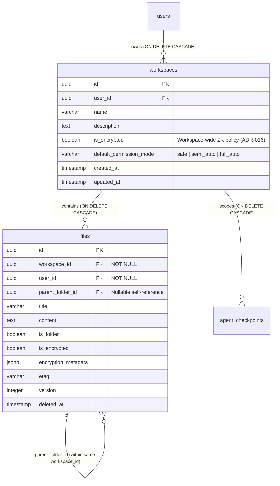

# ADR-011: Multi-Workspace Data Isolation Model and Full-Workspace Agent Execution Scope

| Standard Field | Approved Value |
| :--- | :--- |
| **ADR Identifier** | `ADR-011` (`ELIXENT-ADR-011`) |
| **Classification** | `STANDALONE ARCHITECTURAL DECISION RECORD (ADR)` |
| **Version & Status** | `v1.1 — Accepted (Audited & Schema-Normalized)` |
| **Supersedes / Amends** | Amends the user-scoped `files` schema (`../../src/server/db/schema/files.ts`) and expands the explicit `targetFileIds` scope in [`03_workspace_ast_editor_and_vault_integration.md`](../03_workspace_ast_editor_and_vault_integration.md) (§1) |
| **Governing Execution Plan** | [`ELIXENT-EXECUTION-PLAN-v1.1`](../../records/plans/elixent-architectural-evolution-execution-plan.md) |
| **Companion SRS** | [`SRS-02: Multi-Workspace Isolation, File Lifecycle & Zero-Knowledge Vault Governance`](../../specs/srs_02_multi_workspace_isolation_and_zk_vault_governance.md) |
| **Affected Repository Scope** | `../../src/server/db/schema/workspaces.ts` (Planned / New), `../../src/server/db/schema/files.ts`, `../../src/core/workspace/provider.ts`, `../../src/core/workspace/cloud-provider.ts`, `../../src/server/routes/rpc.routes.ts`, `../../src/lib/sync/idb-types.ts` |

## 1. Context & Problem Diagnosis

In the current database schema (`../../src/server/db/schema/files.ts`), all files and folders belong directly to `user_id` without a parent workspace entity, enforcing uniqueness across `(user_id, COALESCE(parent_folder_id, '00000000-0000-0000-0000-000000000000'::uuid), title)`. This flat user-scoped tenancy model creates three structural limitations:

1. **Inability to Isolate Independent Engineering Projects per User:**
   - A user working on multiple distinct software architectures cannot create two root-level files named `architecture.md` or `README.md` across separate projects without colliding on `idx_files_user_parent_title_live`, nor can each project maintain an isolated `decisions.ledger.json` ([`ADR-012`](./adr_012_json_decision_ledger_and_graph_traversal.md)) or an independent workspace-wide Zero-Knowledge encryption policy ([`ADR-016`](./adr_016_zk_encryption_granularity_and_ephemeral_ai_bridge.md)).
2. **Ambiguous Agent Exploration & Mutation Scope:**
   - When the agent explores documents or resolves cross-file architectural cascades, passing only the currently open editor file (`targetFileIds`) prevents the agent from discovering conflicting sections in closed files belonging to the same project, whereas granting access to all rows matching `user_id` would leak unrelated personal projects into the agent's context window.
3. **Lack of Sovereign Project Lifecycle Operations (Create/Delete/Export):**
   - Without a first-class workspace boundary, neither the agent (`createWorkspaceFile`, `deleteWorkspaceFile`) nor the full-project archive exporter (`.zip` bundle containing the hierarchical `.md` tree and `decisions.ledger.json`) has an authoritative relational boundary defining which files belong to the active project.

## 2. Accepted Decision & Architectural Contract

We adopt a **Dedicated Sovereign `workspaces` Entity with Mandatory `workspace_id` Foreign-Key Scoping** across all file records, agent checkpoints, and `IWorkspaceProvider` instances.

1. **Sovereign `workspaces` Entity & Workspace-Scoped Uniqueness:**
   - Every user owns $1..N$ independent rows in `workspaces` (`../../src/server/db/schema/workspaces.ts` — Planned / New), enforcing live workspace name uniqueness per user.
   - Every row in `files` (`../../src/server/db/schema/files.ts`) carries a non-null `workspace_id` foreign key (`ON DELETE CASCADE`), shifting live filename uniqueness from `(user_id, parent_folder_id, title)` to `(workspace_id, parent_folder_id, title)`.
   - Exact Drizzle definitions and SQL index DDL are specified in [`SRS-02`](../../specs/srs_02_multi_workspace_isolation_and_zk_vault_governance.md) (§2.1–§2.2).
2. **Full-Workspace Agent Scope (`Open + Closed Files`) & Hermetic Cross-Workspace Isolation:**
   - `CloudPostgresWorkspaceProvider` (`../../src/core/workspace/cloud-provider.ts`) is instantiated with an immutable `(userId, workspaceId)` pair, enforcing `workspace_id = :workspaceId` on all reads, searches, mutations, file creations, and soft deletions, and failing closed (`403 CrossWorkspaceAccessForbiddenError`) on any cross-workspace `fileId` access attempt.
   - The agent inspects and modifies all non-excluded files within the active `workspaceId` (both open in editor tabs and closed in background storage). Detailed `IWorkspaceProvider` signatures and `.zip` export contracts are defined in [`SRS-02`](../../specs/srs_02_multi_workspace_isolation_and_zk_vault_governance.md) (§3).

## 3. Evaluated Alternatives & Single-Variable Rejection Rationales

To isolate the workspace tenancy representation (`Ceteris Paribus`), all alternatives are evaluated while holding per-file sync primitives (`etag`, `version`, `deletedAt`, `Diff3`) and AST/BM25 inspection algorithms (`../../src/core/ast/heading-slicer.ts`) constant:

1. **Alternative 1: Retaining the User-Scoped Flat Hierarchy (`files.user_id` Only)**
   - *Rejection Rationale:* Prevents a user from maintaining multiple separate projects with identical filenames (e.g., `SRS.md` or `decisions.ledger.json`), and forces the agent either to restrict its vision to manually passed `targetFileIds` (missing cross-file conflicts in closed project files) or to scan every file in the user's account across unrelated projects.
2. **Alternative 2: Implicit Root-Folder Pseudo-Workspaces (`files.parent_folder_id IS NULL AND is_folder = true`)**
   - *Rejection Rationale:* Overloads the `files` table by conflating a project container with a regular directory. Determining which workspace a deeply nested file (`depth = 5`) belongs to—in order to enforce cross-workspace isolation or check workspace-wide encryption status—requires an expensive `WITH RECURSIVE` SQL query on every read and write operation instead of an $O(1)$ indexed check on `files.workspace_id`.
3. **Alternative 3 (Accepted): Dedicated Sovereign `workspaces` Table with Mandatory `files.workspace_id` Foreign Key**
   - *Selection Rationale:* Guarantees $O(1)$ multi-project tenancy verification, clean cascade deletion, deterministic per-workspace uniqueness, and unambiguous full-workspace agent scope across both open and closed files.

## 4. Controlled Trade-off Matrix

| Evaluation Criterion (Isolated to Workspace Tenancy Model) | Accepted Solution (`Dedicated workspaces Table + workspace_id FK`) | Alternative 1 (`User-Scoped Flat Hierarchy`) | Alternative 2 (`Root-Folder Pseudo-Workspace`) |
| :--- | :--- | :--- | :--- |
| **Query Complexity for Workspace Isolation Check** | $O(1)$ via composite index `(workspace_id, user_id)` | N/A (Cannot isolate multiple projects) | $O(d)$ recursive CTE traversal of `parent_folder_id` |
| **Cross-Project Filename Independence** | $100\%$ (Identical paths allowed in separate workspaces) | $0\%$ at root level (`idx_files_user_parent_title_live` collision) | Supported only under distinct root folders |
| **Workspace-Level Policy Enforcement (Encryption / Permissions)** | Native columns on `workspaces` row | Impossible per project (User-global only) | Requires nullable metadata columns on folder rows |
| **Full-Project `.zip` Export & Agent Scope Boundary** | Single indexed query `WHERE workspace_id = $1` | Requires manual file selection | Requires recursive tree walk |

## 5. Consequences, Conflict Reconciliation & Migration Trigger

### 5.1. Architectural Consequences
- **Positive:** Enables clean multi-project isolation per user, $O(1)$ workspace ownership/encryption enforcement, conflict discovery across closed background files, and self-contained `.zip` project exports.
- **Negative / Operational Trade-off:** Requires a one-time baseline data migration in `Phase 0` assigning existing `files` rows to a default `workspace` record per user.

### 5.2. Prior-ADR Conflict Reconciliation (Deferred to Execution Plan Phase 0)
- **[`03_workspace_ast_editor_and_vault_integration.md`](../03_workspace_ast_editor_and_vault_integration.md) (§1 & §2):** Update in **Phase 0** to expand `IWorkspaceProvider` from explicit `fileIds[]` filtering to full `workspaceId` tree discovery (`listWorkspaceTree`), file lifecycle creation/deletion (`createWorkspaceFile`, `deleteWorkspaceFile`), and background closed-file persistence.
- **`../../src/server/db/schema/files.ts`:** Update in **Phase 0** to introduce `workspace_id` and replace `idx_files_user_parent_title_live` with `idx_files_workspace_parent_title_live`.

### 5.3. Migration Trigger (When to Revisit)
When team or organization collaboration is introduced in a future milestone, replace the single `workspaces.user_id` ownership check with a `workspace_memberships (workspace_id, user_id, role)` join table while keeping `files.workspace_id` and `IWorkspaceProvider` contracts unchanged.
