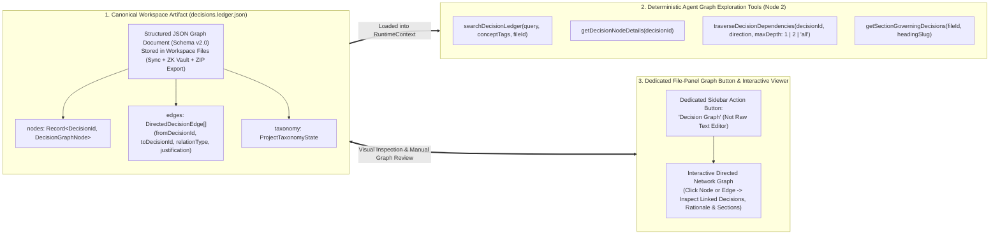

# ADR-012: Adopting `decisions.ledger.json` as the Canonical Single Source of Truth for Architectural Decisions, Deterministic Graph Traversal Tools, and Interactive Network Visualization

| Standard Field | Approved Value |
| :--- | :--- |
| **ADR Identifier** | `ADR-012` (`ELIXENT-ADR-012`) |
| **Classification** | `STANDALONE ARCHITECTURAL DECISION RECORD (ADR)` |
| **Version & Status** | `v1.1 — Accepted (Audited & Schema-Normalized)` |
| **Supersedes / Amends** | Supersedes the `project_decision_ledger` PostgreSQL table mandate in [`ADR-005`](../01_architecture_vision_and_adrs.md) (§3.5), [`02_agent_orchestration_and_decision_engine.md`](../02_agent_orchestration_and_decision_engine.md) (§5), and [`05_data_contracts_and_lugx_migration_plan.md`](../05_data_contracts_and_lugx_migration_plan.md) (§1.3) |
| **Governing Execution Plan** | [`ELIXENT-EXECUTION-PLAN-v1.1`](../../records/plans/elixent-architectural-evolution-execution-plan.md) |
| **Companion SRS** | [`SRS-01`](../../specs/srs_01_agent_orchestration_decision_graph_and_weight_engine.md) (Graph Schema & Agent Tools) · [`SRS-03`](../../specs/srs_03_editor_tabs_multi_ghost_review_and_two_tier_undo.md) (Interactive Graph UI) |
| **Affected Repository Scope** | `../../src/server/db/schema/project-decision-ledger.ts` (retired), `../../src/core/agent/atms/dag.ts`, `../../src/core/agent/nodes/search-nodes.ts`, `../../src/core/agent/nodes/resolution-and-ledger-nodes.ts`, `../../src/core/workspace/provider.ts`, `../../src/components/agent/decision-graph-explorer.tsx` (Planned / New) |

## 1. Context & Problem Diagnosis

Under [`ADR-005`](../01_architecture_vision_and_adrs.md) (§3.5), cross-thread architectural decisions were persisted in a dedicated relational PostgreSQL table `project_decision_ledger` (`../../src/server/db/schema/project-decision-ledger.ts`) synchronized by `syncMasterLedgerToProjectStore` (`../../src/core/agent/atms/dag.ts`), while `documentWriterNode` (`../../src/core/agent/nodes/document-writer-node.ts`) appended `<!-- BEGIN:AGENT_DECISION_ALIGNMENT -->` blocks into Markdown files. A rigorous audit of this storage and discovery model identified four architectural flaws:

1. **Zero-Knowledge Encryption Breach via Plaintext SQL Columns:**
   - Even when a user encrypts their workspace (`isEncrypted = true`), `project_decision_ledger` stores `topic_slug`, `question_prompt`, `selection_rationale`, and `evaluated_alternatives` as unencrypted plaintext columns in PostgreSQL (`../../src/server/db/schema/project-decision-ledger.ts`), leaking the full architectural reasoning of an encrypted project on the database server.
2. **Client/Server Boundary Violation in `src/core/agent/atms/dag.ts`:**
   - Because `dag.ts` imports `db` and `txDb` from `@/server/db` to query `project_decision_ledger`, any client-side UI component attempting to import pure `ATMS` graph utilities from `dag.ts` triggers a hard build failure under `clientServerBoundaryGuardPlugin` (`../../vite.config.ts`).
3. **Fragile Reliance on Markdown Prose or Blind Tag Overlap During Agent Exploration:**
   - During Stage 1 exploration, the agent had no tools to inspect the decision graph directly. Instead, the agent either relied on reading `.md` text (hoping the LLM would faithfully trace implicit decision chains across prose) or relied exclusively on a post-exploration tag-overlap heuristic (`retrieveCandidatePriorDecisions` in `../../src/core/agent/atms/candidate-retriever.ts`) without being able to traverse 1-hop, 2-hop, or full transitive dependency chains (`dependsOn` / `dependedBy`) on demand.
4. **Sentinel Row Pollution & Dual-Storage Sync Drift:**
   - Project taxonomy customizations (`addedTags`, `removedTags`) were stored inside `project_decision_ledger` as a fake sentinel decision row (`__PROJECT_TAXONOMY__` in `../../src/core/agent/atms/dag.ts`), requiring filter guards (`!isSystemReservedDecisionId(id)`) across every graph algorithm, and creating synchronization drift whenever a workspace was exported or restored offline.

## 2. Accepted Decision & Architectural Contract

We retire the `project_decision_ledger` PostgreSQL table completely and establish **`decisions.ledger.json`** as the **Canonical Single Source of Truth (`SSOT`)** for all architectural decisions, explicit relational edges, and project taxonomy state within a workspace.

1. **Canonical Workspace Artifact (`decisions.ledger.json`):**
   - `decisions.ledger.json` is persisted as a system-managed workspace artifact (`artifact_role: "decision_ledger"`, protected against raw text-editor corruption and accidental `deleteWorkspaceFile` deletion) storing `taxonomy`, `nodes`, and `edges` (`DirectedDecisionEdge[]`) in one versioned JSON graph.
   - Because it resides inside the workspace's `files` lifecycle, it automatically participates in `IndexedDB` offline sync, `Zero-Knowledge AES-256-GCM` encryption ([`ADR-016`](./adr_016_zk_encryption_granularity_and_ephemeral_ai_bridge.md)), Turn-Linked rollback ([`ADR-015`](./adr_015_two_tier_workspace_undo_and_turn_rollback.md)), and `.zip` export.
2. **Four Deterministic Agent Graph-Exploration Tools (`search_discovery_node`):**
   - `searchDecisionLedger`, `getDecisionNodeDetails`, `traverseDecisionDependencies` (deterministic BFS supporting `maxDepth: 1 | 2 | "all"` over `dependsOn`/`dependedBy`), and `getSectionGoverningDecisions` allow the agent to inspect decision chains with zero reliance on Markdown prose.
3. **Dedicated Interactive Network Graph UI (`DecisionGraphExplorer` — Planned / New):**
   - Accessed via a dedicated **`Decision Graph`** button in the Workspace Files panel rather than opening raw JSON in the Markdown editor, rendering an interactive directed network where users can click any node or relationship edge to inspect linked decisions, rationales, and jump to affected sections.
   - Exact JSON schemas, BFS tool contracts, and UI specifications are defined in [`SRS-01`](../../specs/srs_01_agent_orchestration_decision_graph_and_weight_engine.md) (§4.1) and [`SRS-03`](../../specs/srs_03_editor_tabs_multi_ghost_review_and_two_tier_undo.md) (§4).

## 3. Evaluated Alternatives & Single-Variable Rejection Rationales

To isolate the decision ledger storage and query medium (`Ceteris Paribus`), all alternatives are evaluated while holding `Justification-Driven ATMS` node semantics, `resolveATMSCascadeBFS` (`../../src/core/agent/atms/invalidation.ts`), and the universal concept taxonomy (`../../src/core/agent/taxonomy/predefined-tags.ts`) constant:

1. **Alternative 1: Dedicated PostgreSQL Table (`project_decision_ledger` in `src/server/db/schema/project-decision-ledger.ts`)**
   - *Rejection Rationale:* Stores decision text outside the `files` sync and Zero-Knowledge encryption pipeline (exposing plaintext rationales in SQL even for encrypted workspaces), couples `src/core/agent/atms/dag.ts` to server database imports (`@/server/db`), and requires dual-storage translation whenever exporting or syncing a workspace offline.
2. **Alternative 2: Representing Decisions Exclusively in Markdown Tables or Hidden HTML Comments (`<!-- BEGIN:AGENT_DECISION_ALIGNMENT -->`)**
   - *Rejection Rationale:* Pollutes the user's authored Markdown documents with synthetic agent metadata, lacks machine-verifiable referential integrity (`edges`), and forces the LLM to parse unstructured prose to guess transitive dependencies.
3. **Alternative 3 (Accepted): Canonical `decisions.ledger.json` Artifact with Deterministic Graph Tools & Interactive Visual Graph Explorer**
   - *Selection Rationale:* Unifies storage, offline `IndexedDB` caching, Zero-Knowledge encryption (`AES-256-GCM`), Turn-Linked rollback, and `.zip` export under a single JSON graph artifact, makes `src/core/agent/atms/dag.ts` $100\%$ isomorphic and client-safe, and enables deterministic $k$-hop dependency traversal by the agent and interactive visual graph inspection by the user.

## 4. Controlled Trade-off Matrix

| Evaluation Criterion (Isolated to Decision Ledger Medium) | Accepted Solution (`decisions.ledger.json` + Graph Tools + Visual Network UI) | Alternative 1 (SQL `project_decision_ledger` Table) | Alternative 2 (Markdown Prose / HTML Comments) |
| :--- | :--- | :--- | :--- |
| **Zero-Knowledge Workspace Encryption Compatibility** | $100\%$ (Encrypted with `AES-256-GCM` identically to workspace files) | $0\%$ (Plaintext SQL columns `topic_slug`, `selection_rationale`) | $100\%$ (Inside `.md` files, but pollutes user prose) |
| **Deterministic $k$-Hop Dependency Traversal for Agent** | $O(V + E)$ exact BFS via `traverseDecisionDependencies` (`maxDepth: 1 \| 2 \| 'all'`) | Requires custom SQL recursive queries; no agent exploration tool | Unreliable (Relies on LLM reading prose faithfully) |
| **Isomorphic Client/Server Safety (`dag.ts`)** | $100\%$ pure TypeScript (`0` `@/server/db` imports) | Violates client boundary (`imports @/server/db`) | Pure text |
| **User Inspection Experience** | Interactive visual network graph (`Nodes + Clickable Edges`) | Hidden database table | Raw text clutter inside `.md` documents |

## 5. Consequences, Conflict Reconciliation & Migration Trigger

### 5.1. Architectural Consequences
- **Positive:** Eliminates SQL plaintext leaks for encrypted workspaces, removes `@/server/db` imports from `src/core/agent/atms/dag.ts`, eliminates the `__PROJECT_TAXONOMY__` sentinel row hack, and gives both the agent and user deterministic graph traversal capabilities.
- **Negative / Operational Trade-off:** Cross-decision queries operate on the parsed JSON graph in memory rather than SQL `WHERE` predicates, requiring the full `decisions.ledger.json` file to be loaded per active workspace turn.

### 5.2. Prior-ADR Conflict Reconciliation (Deferred to Execution Plan Phase 0)
- **[`ADR-005`](../01_architecture_vision_and_adrs.md) (§3.5):** Supersede the `project_decision_ledger` SQL table specification in **Phase 0**, replacing it with `decisions.ledger.json`.
- **[`ADR-002`](../01_architecture_vision_and_adrs.md) (§3.2 Migration Trigger):** Update the reference to `project_decision_ledger` in **Phase 0** to reference `decisions.ledger.json`.
- **[`02_agent_orchestration_and_decision_engine.md`](../02_agent_orchestration_and_decision_engine.md) (§5) & [`05_data_contracts_and_lugx_migration_plan.md`](../05_data_contracts_and_lugx_migration_plan.md) (§1.3):** Retire `src/server/db/schema/project-decision-ledger.ts` and remove `import { db, txDb } from "@/server/db"` from `src/core/agent/atms/dag.ts`.

### 5.3. Migration Trigger (When to Revisit)
If a single workspace's `decisions.ledger.json` grows beyond $5,000$ active decision nodes such that full JSON serialization exceeds $5\text{ MB}$, partition `decisions.ledger.json` into a root graph index (`decisions.index.json` holding `edges`, `taxonomy`, and lightweight node headers) and domain-sharded node files while keeping the 4 agent traversal tool signatures identical.
