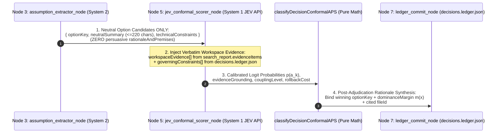

# ADR-013: Epistemic Decoupling of System 2 Option Framing from System 1 Probabilistic Adjudication

| Standard Field | Approved Value |
| :--- | :--- |
| **ADR Identifier** | `ADR-013` (`ELIXENT-ADR-013`) |
| **Classification** | `STANDALONE ARCHITECTURAL DECISION RECORD (ADR)` |
| **Version & Status** | `v1.1 — Accepted (Audited & Schema-Normalized)` |
| **Supersedes / Amends** | Amends `CanonicalOptionSchema` (`rationaleAndPremises` pre-scoring field) and the `POST /v1/decisions` context contract in [`02_agent_orchestration_and_decision_engine.md`](../02_agent_orchestration_and_decision_engine.md) (§3.1 & §4.1), `../../src/core/agent/schemas/decision-schemas.ts`, and `../../src/core/agent/nodes/jev-scoring-nodes.ts` |
| **Governing Execution Plan** | [`ELIXENT-EXECUTION-PLAN-v1.1`](../../records/plans/elixent-architectural-evolution-execution-plan.md) |
| **Companion SRS** | [`SRS-01: Agent Orchestration Engine, Canonical Decision Graph & Weight Gate`](../../specs/srs_01_agent_orchestration_decision_graph_and_weight_engine.md) |
| **Affected Repository Scope** | `../../src/core/agent/schemas/decision-schemas.ts`, `../../src/lib/jev/client.ts`, `../../src/lib/jev/conformal-classifier.ts`, `../../src/core/agent/nodes/jev-scoring-nodes.ts` |

## 1. Context & Problem Diagnosis

In [`ADR-002`](../01_architecture_vision_and_adrs.md) (§3.2), the architecture separated generative authoring (`System 2`) from calibrated probabilistic adjudication (`System 1` via `POST /v1/decisions` and `Conformal APS` in `../../src/lib/jev/conformal-classifier.ts`). However, inspecting `../../src/core/agent/nodes/jev-scoring-nodes.ts` and `../../src/core/agent/schemas/decision-schemas.ts` reveals two epistemic coupling flaws in how options and context are constructed prior to `System 1` scoring:

1. **Pre-Scoring Persuasive Framing Bias (`rationaleAndPremises` Generated by `System 2` Before Scoring):**
   - In `../../src/core/agent/nodes/jev-scoring-nodes.ts`, the generative model (`System 2`) generates `rationaleAndPremises` justifying each candidate option *before* the options are sent to `POST /v1/decisions`.
   - When `System 2` has an uncalibrated prior preference for Option A, it naturally authors a more detailed, persuasive `rationaleAndPremises` string for Option A and a weaker summary for Option B. Passing those asymmetrical persuasive arguments into `POST /v1/decisions` (`../../src/lib/jev/client.ts`) contaminates the `System 1` probability distribution $\tilde{p}(a_k)$ with `System 2`'s rhetorical framing bias, artificially inflating the top-2 dominance margin $m(x) = \tilde{p}_{(1)} - \tilde{p}_{(2)}$.
2. **Absence of Live Workspace Evidence in `POST /v1/decisions` Context:**
   - In `../../src/core/agent/nodes/jev-scoring-nodes.ts` (lines `136–143`), `priorDecisionContext` is populated only when reopening a previously settled decision (`{ reopenedFromDecisionId, previousSelectedOptionKey, previousSelectionRationale, triggerForReevaluation }`) and is `undefined` for all new decisions, while raw `search_report.evidenceItems` excerpts from the workspace are not passed as structured evidence into `POST /v1/decisions`. Without live workspace evidence, `evidenceGrounding` in `POST /v1/decisions` evaluates the internal plausibility of `System 2`'s prose rather than empirical alignment with the user's workspace documents.

## 2. Accepted Decision & Architectural Contract

We enforce **Strict Pre-Adjudication Epistemic Neutrality**: `System 2` is prohibited from generating persuasive rationales (`rationaleAndPremises`) prior to `System 1` scoring. Instead, `System 1` receives rhetorically neutral option descriptors (`neutralSummary` capped at `220` chars + `technicalConstraints`) paired with verbatim workspace evidence from `search_report` and governing parent constraints from `decisions.ledger.json`, and `selectionRationale` is constructed **post-adjudication** from the winning option's empirical metrics and supporting evidence.

1. **Neutral Pre-Scoring Option Contract:**
   - Prior to `POST /v1/decisions`, `assumption_extractor_node` emits only `{ optionKey, neutralSummary (<= 220 chars), technicalConstraints }`, stripping persuasive `rationaleAndPremises`.
2. **Evidence-Grounded `POST /v1/decisions` Payload & Post-Adjudication Rationale Synthesis:**
   - `jev_conformal_scorer_node` injects verbatim `workspaceEvidence` (`{ fileId, headingSlug, excerpt }`) and `governingPriorDecisions` from `decisions.ledger.json`, then deterministically synthesizes `selectionRationale` and `evaluatedAlternatives` after `classifyDecisionConformalAPS` concludes.
   - Exact Zod schemas (`NeutralOptionSchema`) and synthesis logic are specified in [`SRS-01`](../../specs/srs_01_agent_orchestration_decision_graph_and_weight_engine.md) (§4.2).

## 3. Evaluated Alternatives & Single-Variable Rejection Rationales

To isolate the pre-scoring option framing and evidence-grounding contract (`Ceteris Paribus`), all alternatives are evaluated while holding the `Two-Tier Decision Cascade` (`typesafe/jev-1.13` $\rightarrow$ `fastino/glide` in `../../src/lib/jev/client.ts`), `Conformal APS` math (`../../src/lib/jev/conformal-classifier.ts`), and `CalibrationStore` quantiles (`../../src/lib/jev/calibration-store.ts`) constant:

1. **Alternative 1: Pre-Scoring Persuasive Rationale Generation by `System 2` (Current Implementation in `jev-scoring-nodes.ts`)**
   - *Rejection Rationale:* Causes epistemic circularity (`System 2` biases `System 1`), wastes `System 2` output tokens generating persuasive paragraphs for 3–4 options before knowing which option will win, and evaluates synthetic prose rather than actual workspace evidence.
2. **Alternative 2: Bare Option Scoring Without Workspace Evidence Context (`Context-Free Option Scoring`)**
   - *Rejection Rationale:* Removing `rationaleAndPremises` without supplying verbatim `workspaceEvidence` from `search_report` leaves `System 1` with zero project-specific grounding, causing `evidenceGrounding < 0.50` and triggering false-positive abstentions (`p_abstain >= 0.25` $\rightarrow$ `UNRESOLVED`).
3. **Alternative 3 (Accepted): Neutral Option Descriptors + Verbatim Workspace Evidence Grounding + Post-Adjudication Rationale Synthesis**
   - *Selection Rationale:* Eliminates `System 2` rhetorical framing bias, grounds `evidenceGrounding` in real workspace sections (`fileId#headingSlug`) and prior `decisions.ledger.json` constraints, and reduces `System 2` pre-scoring token generation.

## 4. Controlled Trade-off Matrix

| Evaluation Criterion (Isolated to Option & Evidence Framing) | Accepted Solution (`Neutral Options + Raw Workspace Evidence`) | Alternative 1 (`Pre-Scoring System 2 Rationales`) | Alternative 2 (`Bare Options Without Workspace Evidence`) |
| :--- | :--- | :--- | :--- |
| **Immunity to `System 2` Rhetorical Framing Bias** | High (Zero persuasive prose in `System 1` input) | Low (`System 2` prose skews `System 1` logits) | High |
| **Empirical Grounding in User Workspace Files** | $100\%$ (Passes verbatim `search_report.evidenceItems`) | Partial (Passes `priorDecisionContext` only on reopened decisions; omits live `search_report` evidence) | $0\%$ (Causes high false abstention rate) |
| **`System 2` Output Token Consumption Prior to Scoring** | Minimal (`neutralSummary` + `technicalConstraints` only) | High (Full persuasive essay per candidate option) | Minimal |
| **Auditability of Final `selectionRationale`** | Directly cites `(fileId, headingSlug)` and conformal margin $m(x)$ | Unverified generative prose | Lacks contextual citations |

## 5. Consequences, Conflict Reconciliation & Migration Trigger

### 5.1. Architectural Consequences
- **Positive:** Decouples `System 1` probabilistic scoring from `System 2` persuasion, improves empirical `evidenceGrounding` accuracy, and ensures every committed `selectionRationale` traces directly to `(fileId, headingSlug)` evidence and conformal dominance margins.
- **Negative / Operational Trade-off:** Increases input payload size to `POST /v1/decisions` due to embedded `workspaceEvidence` excerpts, requiring concise excerpt truncation in `search_discovery_node`.

### 5.2. Prior-ADR Conflict Reconciliation (Deferred to Execution Plan Phase 0)
- **[`02_agent_orchestration_and_decision_engine.md`](../02_agent_orchestration_and_decision_engine.md) (§3.1 & §4.1):** Update in **Phase 0** to replace pre-scoring `rationaleAndPremises` with `technicalConstraints`, and add structured `workspaceEvidence` and `governingPriorDecisions` to the `POST /v1/decisions` contract.

### 5.3. Migration Trigger (When to Revisit)
If a future version of the upstream `POST /v1/decisions` endpoint introduces native per-option contrastive evidence attribution (returning the exact subset of `workspaceEvidence` indices that maximized $\tilde{p}(a_k)$), bind those returned evidence indices directly into `evaluatedAlternatives` in `jev_conformal_scorer_node`.
