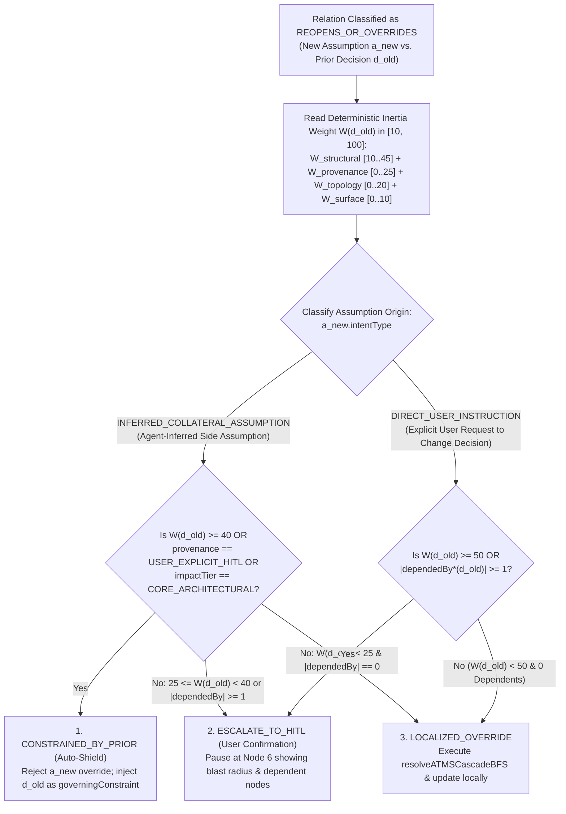

# ADR-014: Deterministic Four-Source Change Weight Formulation ($W(d)$) and the Anti-Domino Override Gate

| Standard Field | Approved Value |
| :--- | :--- |
| **ADR Identifier** | `ADR-014` (`ELIXENT-ADR-014`) |
| **Classification** | `STANDALONE ARCHITECTURAL DECISION RECORD (ADR)` |
| **Version & Status** | `v1.1 — Accepted (Audited & Schema-Normalized)` |
| **Supersedes / Amends** | Amends the unconditional eviction rule on `REOPENS_OR_OVERRIDES` in [`02_agent_orchestration_and_decision_engine.md`](../02_agent_orchestration_and_decision_engine.md) (§5.2) and `../../src/core/agent/atms/invalidation.ts` |
| **Governing Execution Plan** | [`ELIXENT-EXECUTION-PLAN-v1.1`](../../records/plans/elixent-architectural-evolution-execution-plan.md) |
| **Companion SRS** | [`SRS-01: Agent Orchestration Engine, Canonical Decision Graph & Weight Gate`](../../specs/srs_01_agent_orchestration_decision_graph_and_weight_engine.md) |
| **Affected Repository Scope** | `../../src/core/agent/atms/invalidation.ts`, `../../src/core/agent/atms/dag.ts`, `../../src/core/agent/nodes/assumption-and-linker-nodes.ts`, `../../src/core/agent/schemas/decision-schemas.ts` |

## 1. Context & Problem Diagnosis

In `../../src/core/agent/atms/invalidation.ts` (`resolveATMSCascadeBFS`), whenever the relational linker classifies the link between a newly extracted assumption $a_{\text{new}}$ and an existing decision node $d_{\text{old}}$ as `REOPENS_OR_OVERRIDES`, the algorithm unconditionally evicts $d_{\text{old}}$ from `masterLedger` and cascades downward across all `dependedBy` edges to evict every transitively dependent decision. This unweighted eviction policy creates two critical architectural failure modes:

1. **The Collateral Domino Effect (`Peripheral Assumption Overriding Foundational Architecture`):**
   - When a user asks the agent to modify a localized feature or peripheral section, `System 2` often extracts secondary, inferred collateral assumptions (`INFERRED_COLLATERAL_ASSUMPTION`). Under unconditional eviction, if a peripheral collateral assumption conflicts with a core, user-approved architectural decision $d_{\text{old}}$, it silently evicts $d_{\text{old}}$ and invalidates all downstream decisions across the workspace.
2. **The Asymmetry & Cold-Start Problem in Weight Estimation:**
   - Assigning a numerical weight $W(d)$ to decisions requires strictly deterministic provenance for every number:
     - Relying on an LLM to assign a weight (`10..100`) introduces non-determinism and framing bias.
     - Relying purely on graph in-degree (`|dependedBy(d)|`) suffers from **Cold-Start Blindness**: a newly approved core cryptographic or database decision with zero dependents yet (`|dependedBy| = 0`) would receive a near-zero weight and remain vulnerable to immediate overwrite.
     - Comparing a settled decision $d_{\text{old}}$ against a brand-new assumption $a_{\text{new}}$ using the exact same topology formula is structurally asymmetric because $a_{\text{new}}$ is not yet in `decisions.ledger.json` and always has `|dependedBy| = 0`.

## 2. Accepted Decision & Architectural Contract

We adopt a **Deterministic Four-Source Inertia Weight Formula $W(d) \in [10, 100]$** paired with an **Intent-Aware Anti-Domino Gate** executed in `conflict_and_weight_gate_node` ([`ADR-010`](./adr_010_replay_safe_node_boundary_topology.md)).

1. **Deterministic Four-Source Formula for Inertia Weight $W(d) \in [10, 100]$ (`0` LLM Involvement):**
   $$W(d) = \text{clamp}_{[10, 100]}\!\Big(W_{\text{structural}}(d) + W_{\text{provenance}}(d) + W_{\text{topology}}(d) + W_{\text{surface}}(d)\Big)$$
   - **$W_{\text{structural}}(d) \in [10, 45]$:** Derived deterministically from `System 1` `POST /v1/decisions` continuous outputs `couplingLevel` $\in [0, 2]$ and `rollbackCost` $\in [0, 2]$, eliminating Cold-Start Blindness at decision birth.
   - **$W_{\text{provenance}}(d) \in [0, 25]$:** Derived from approval origin (`+25` for `USER_EXPLICIT_HITL`, `10..15` scaled by `dominanceMargin` for `SYSTEM1_DIRECT_APS`, `0` for `SYSTEM1_CONSERVATIVE_APS`).
   - **$W_{\text{topology}}(d) \in [0, 20]$:** Derived via BFS over `decisions.ledger.json` `dependedBy` edges (`+6` per direct dependent, `+3` per indirect dependent).
   - **$W_{\text{surface}}(d) \in [0, 10]$:** Derived from document span across `affectedSections` (unique files and heading sections).
2. **Intent-Aware Anti-Domino Adjudication Matrix:**
   - `assumption_extractor_node` tags each assumption as `DIRECT_USER_INSTRUCTION` or `INFERRED_COLLATERAL_ASSUMPTION`.
   - When `relationType === "REOPENS_OR_OVERRIDES"`, `conflict_and_weight_gate_node` shields high-weight/core decisions against collateral inferences (`CONSTRAINED_BY_PRIOR`), escalates heavy or dependent conflicts with full blast-radius previews (`ESCALATE_TO_HITL`), and permits seamless updates for isolated peripheral nodes (`LOCALIZED_OVERRIDE`).
   - Exact TypeScript implementation and boundary formulas are specified in [`SRS-01`](../../specs/srs_01_agent_orchestration_decision_graph_and_weight_engine.md) (§5).

## 3. Evaluated Alternatives & Single-Variable Rejection Rationales

To isolate the change-weight calculation and override policy (`Ceteris Paribus`), all alternatives are evaluated while holding the 4 relational link classifications (`INDEPENDENT`, `DEPENDS_ON`, `REOPENS_OR_OVERRIDES`, `REFINES` in `../../src/core/agent/schemas/decision-schemas.ts`), `linkAssumptionsToPriorDecisions` (`../../src/core/agent/atms/relational-linker.ts`), and `resolveATMSCascadeBFS` traversal mechanics (`../../src/core/agent/atms/invalidation.ts`) strictly constant:

1. **Alternative 1: Unconditional Cascade Eviction on `REOPENS_OR_OVERRIDES` (Current Implementation in `invalidation.ts`)**
   - *Rejection Rationale:* Treats a $12$-point provisional formatting assumption identically to an $85$-point user-confirmed cryptographic architecture decision, allowing collateral agent inferences to trigger destructive workspace-wide domino invalidations.
2. **Alternative 2: LLM-Assigned Subjective Weight or Pure Topological In-Degree Weight**
   - *Rejection Rationale:* LLM-assigned weights are non-deterministic and vulnerable to prompt framing bias, while pure topological in-degree (`|dependedBy|`) assigns $0$ weight to newly created foundational decisions (`Cold-Start Blindness`).
3. **Alternative 3 (Accepted): Deterministic Four-Source Weight $W(d)$ + Intent-Aware Anti-Domino Matrix**
   - *Selection Rationale:* Derives every single point of $W(d) \in [10, 100]$ deterministically from `System 1` continuous scores, approval provenance, DAG topology, and document span, while distinguishing explicit user directives from collateral agent assumptions.

## 4. Controlled Trade-off Matrix

| Evaluation Criterion (Isolated to Weight & Override Policy) | Accepted Solution (`4-Source Deterministic W(d) + Anti-Domino Matrix`) | Alternative 1 (`Unconditional Cascade Eviction`) | Alternative 2 (`Pure Topological In-Degree Weight`) |
| :--- | :--- | :--- | :--- |
| **Determinism & Reproducibility** | $100\%$ deterministic (`0` LLM involvement in weight math) | $100\%$ deterministic | $100\%$ deterministic |
| **Protection Against Collateral Domino Cascades** | High (`CONSTRAINED_BY_PRIOR` shields core & HITL decisions automatically) | None (Any override link evicts target and all dependents) | Weak on leaf/new decisions |
| **Cold-Start Protection for New Core Decisions** | Immediate ($W_{\text{structural}} \in [36, 45]$ + $W_{\text{provenance}} \in [10, 25]$ at birth) | None | $0$ topological weight until dependents are added |
| **Respect for Explicit User Directives (`DIRECT_USER_INSTRUCTION`)** | Escalates with exact blast-radius preview if heavy/dependent; applies directly if localized | Blindly cascades without warning user of broken dependents | Cannot distinguish user directive from collateral inference |

## 5. Consequences, Conflict Reconciliation & Migration Trigger

### 5.1. Architectural Consequences
- **Positive:** Prevents silent architectural regressions from collateral agent inferences, protects newly minted core decisions from cold-start overwrites, and gives users transparent blast-radius previews before breaking dependent decisions.
- **Negative / Operational Trade-off:** Requires `decisions.ledger.json` to persist `couplingLevel`, `rollbackCost`, `dominanceMargin`, and `provenance` on every node and recompute `W_topology` in `ledger_commit_node` upon edge mutations.

### 5.2. Prior-ADR Conflict Reconciliation (Deferred to Execution Plan Phase 0)
- **[`02_agent_orchestration_and_decision_engine.md`](../02_agent_orchestration_and_decision_engine.md) (§5.2 Contagious Promotion & Override Cascade):** Update in **Phase 0** to insert `computeDecisionChangeWeight` and `evaluateAntiDominoGate` prior to `resolveATMSCascadeBFS` eviction.

### 5.3. Migration Trigger (When to Revisit)
Revisit the linear combination coefficients $(45, 25, 20, 10)$ of $W(d)$ only if empirical telemetry across $\ge 500$ multi-turn workspace sessions indicates that the boundary thresholds ($40$ for collateral shield and $50$ for direct instruction escalation) produce $> 10\%$ unnecessary HITL escalations.
