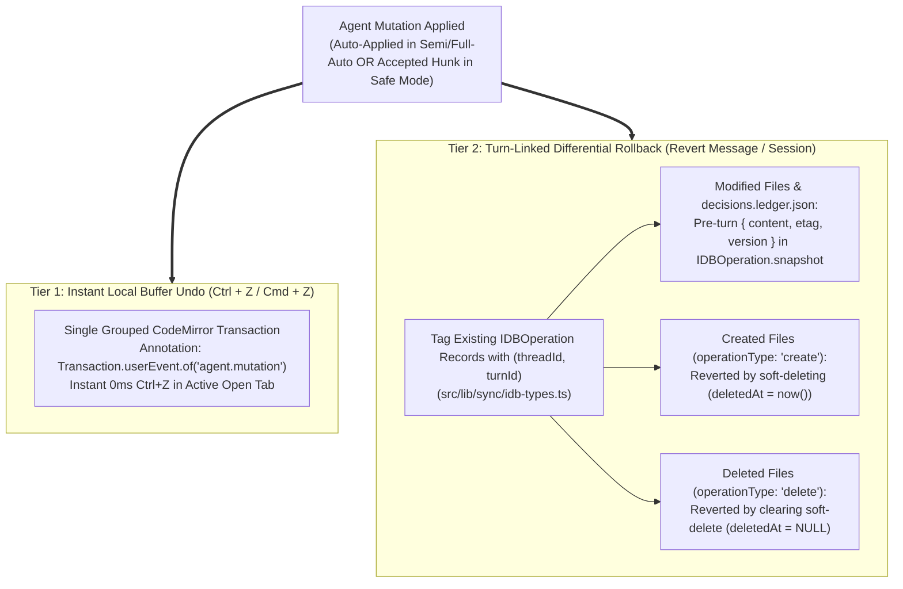

# ADR-015: Two-Tier Native Workspace Undo and Turn-Linked Differential Rollback Architecture

| Standard Field | Approved Value |
| :--- | :--- |
| **ADR Identifier** | `ADR-015` (`ELIXENT-ADR-015`) |
| **Classification** | `STANDALONE ARCHITECTURAL DECISION RECORD (ADR)` |
| **Version & Status** | `v1.1 — Accepted (Audited & Schema-Normalized)` |
| **Supersedes / Amends** | Extends the offline operation log and rollback contracts in [`offline-sync-blueprint.md`](../../specs/offline-sync-blueprint.md), `../../src/lib/sync/idb-types.ts`, and `../../src/lib/sync/rollback.ts` with turn-linked multi-file rollback across open/closed files and `decisions.ledger.json` |
| **Governing Execution Plan** | [`ELIXENT-EXECUTION-PLAN-v1.1`](../../Plans/elixent-architectural-evolution-execution-plan.md) |
| **Companion SRS** | [`SRS-03: Multi-File Editor Tabs, Ghost Review, Decision Graph UI & Two-Tier Undo`](../../specs/srs_03_editor_tabs_multi_ghost_review_and_two_tier_undo.md) |
| **Affected Repository Scope** | `../../src/lib/sync/idb-types.ts`, `../../src/lib/sync/rollback.ts`, `../../src/hooks/use-editor-orchestrator.ts`, `../../src/hooks/use-ai-stream.ts`, `../../src/server/routes/rpc.routes.ts` |

## 1. Context & Problem Diagnosis

When the agent executes document mutations across open and closed workspace files ([`ADR-011`](./adr_011_multi_workspace_data_isolation_model.md)), creates or deletes workspace files, and commits new architectural decisions to `decisions.ledger.json` ([`ADR-012`](./adr_012_json_decision_ledger_and_graph_traversal.md)) under `safe`, `semi_auto`, or `full_auto` permission modes, the user requires a reliable, friction-free mechanism to undo or revert unwanted agent changes. Evaluating candidate rollback architectures reveals major flaws in conventional approaches:

1. **Structural Failure of a Single-Slot Server Base Snapshot (`workspace_base_snapshots`):**
   - Maintaining a single pre-mutation snapshot slot per workspace that is overwritten after each chat message creates an unavoidable dilemma:
     - If the single slot is automatically overwritten when the user sends a follow-up message in the same conversation, the user permanently loses the ability to revert the architectural changes of the preceding message.
     - Conversely, if the system blocks the next message until the user manually approves/clears the previous snapshot, `semi_auto` and `full_auto` modes degrade into forced manual confirmation after every single turn.
   - Furthermore, storing plaintext file snapshots in a server-side SQL table violates Zero-Knowledge encryption for vault files.
2. **Incompleteness of Relying Exclusively on In-Editor `Ctrl + Z` (`CodeMirror 6 History`):**
   - While `Ctrl + Z` (`Cmd + Z`) is ideal for instant undo inside the currently active editor buffer, `CodeMirror` history operates solely on the mounted in-memory `EditorState` of a single open document. It cannot revert simultaneous background mutations applied to closed files, cannot restore a file deleted by `deleteWorkspaceFile`, cannot remove a file created by `createWorkspaceFile`, and cannot roll back the corresponding decision nodes committed to `decisions.ledger.json`.
3. **Untapped Existing Rollback Primitives Already Present in the Codebase:**
   - Inspection of `../../src/lib/sync/idb-types.ts`, `../../src/lib/sync/rollback.ts`, and `../../src/server/db/schema/files.ts` demonstrates that the repository already possesses:
     1. **`IDBOperation` with Pre-Operation Snapshots (`../../src/lib/sync/idb-types.ts`):** Every operation record stored in the client's `IndexedDB` (`OPERATIONS` store, retained for 7 days / up to 1,000 operations per file) already includes `snapshot?: { content: MarkdownSource; etag: string; version: number }` and `previousContent?: MarkdownSource`.
     2. **`SyncRollback.rollbackOperation` (`../../src/lib/sync/rollback.ts`):** A tested rollback manager that restores any `IDBFile` from an `IDBOperation.snapshot` and queues it for sync.
     3. **Soft Deletion on `files` (`deletedAt` in `../../src/server/db/schema/files.ts`):** Deleted files are soft-deleted via `deleted_at` timestamps rather than physically erased, meaning file restoration requires only setting `deleted_at = NULL` without duplicating file payloads in a separate snapshot table.

## 2. Accepted Decision & Architectural Contract

We reject server-side single-slot snapshot tables and adopt a **Two-Tier Native Undo & Turn-Linked Differential Rollback Architecture** that leverages the project's existing `CodeMirror 6`, `IDBOperation`, `SyncRollback`, and `files.deletedAt` infrastructure.

1. **Tier 1 — Coalesced Single-Transaction Editor Undo (`Ctrl + Z`):**
   - All section replacements applied by the agent to an open `CodeMirror 6` editor tab within a turn are dispatched as a single isolated transaction group, enabling instant one-step `Ctrl + Z` undo.
2. **Tier 2 — Turn-Linked Differential `IDBOperation` & Soft-Delete Rollback (`Revert Turn / Session`):**
   - `IDBOperation` (`../../src/lib/sync/idb-types.ts`) is extended with `(threadId, turnId)` correlation fields, capturing pre-turn `snapshot` records **exclusively for the files touched by that turn** (including `decisions.ledger.json`).
   - Every mutating agent message in `AgentChatPanel` exposes a `Revert Turn` control that invokes `SyncRollback.rollbackAgentTurn` to restore modified open/closed files and `decisions.ledger.json`, soft-delete created files (`deletedAt = now()`), and restore deleted files (`deletedAt = NULL`).
   - Exact TypeScript extensions, divergence guards, and `GhostHunk` persistence rules are specified in [`SRS-03`](../../specs/srs_03_editor_tabs_multi_ghost_review_and_two_tier_undo.md) (§5).

## 3. Evaluated Alternatives & Single-Variable Rejection Rationales

To isolate the state-capture and rollback mechanism (`Ceteris Paribus`), all alternatives are evaluated while holding the three permission modes (`safe`, `semi_auto`, `full_auto`), `Diff3` merge logic (`../../src/lib/sync/diff3.ts`), and `IndexedDB` storage engine (`../../src/lib/sync/indexeddb.ts`) strictly constant:

1. **Alternative 1: Single-Slot Server-Side Base Snapshot Table (`workspace_base_snapshots`)**
   - *Rejection Rationale:* A single slot per workspace is either overwritten on the very next chat message (destroying multi-turn undo history) or forces the user to manually approve/acknowledge every turn before sending another message (defeating `semi_auto` and `full_auto` modes). It also duplicates file storage in PostgreSQL and cannot store plaintext snapshots of Zero-Knowledge encrypted files.
2. **Alternative 2: Relying Exclusively on In-Editor `Ctrl + Z` (`CodeMirror History Only`)**
   - *Rejection Rationale:* Cannot undo edits applied to closed background files, cannot restore soft-deleted files, cannot remove newly created files, cannot revert `decisions.ledger.json` graph mutations, and loses history on browser reload.
3. **Alternative 3: Full Server-Side Workspace Clones per Message (`Per-Turn Full DB Clone`)**
   - *Rejection Rationale:* Cloning all untouched files in PostgreSQL on every chat message causes $O(N_{\text{files}} \times N_{\text{turns}})$ storage amplification and remains incompatible with client-side Zero-Knowledge encryption.
4. **Alternative 4 (Accepted): Two-Tier Hybrid Undo (`CodeMirror Ctrl+Z` + Turn-Linked Differential `IDBOperation` & `files.deletedAt` Rollback)**
   - *Selection Rationale:* Reuses the repository's existing `IDBOperation`, `SyncRollback`, and `files.deletedAt` infrastructure, requires zero new PostgreSQL snapshot tables, supports multi-turn message-level rollback without blocking prompts, keeps `decisions.ledger.json` synchronized with document reverts, and works natively with Zero-Knowledge encrypted files because `IDBOperation` lives in the client's local storage pipeline.

## 4. Controlled Trade-off Matrix

| Evaluation Criterion (Isolated to Undo / Rollback Mechanism) | Accepted Solution (`Two-Tier Ctrl+Z + Turn-Linked IDBOperation & Soft-Delete`) | Alternative 1 (`Single-Slot Server Base Snapshot`) | Alternative 2 (`Editor Ctrl+Z Only`) |
| :--- | :--- | :--- | :--- |
| **Multi-Turn Chat History Rollback (`Revert Turn K`)** | Full support across all turns in thread without overwriting prior snapshots | Fails (Overwritten on next message or forces blocking approval modal) | Partial (Active open file only; lost on reload) |
| **Closed Background File & `decisions.ledger.json` Revert** | $100\%$ atomic restoration via `SyncRollback.rollbackOperation` | Supported for 1 turn only | $0\%$ (Cannot revert closed files or ledger) |
| **Deleted File Restoration Cost** | $0$ extra storage bytes (Clears existing `files.deletedAt = NULL`) | Duplicates entire deleted file content in snapshot table | $0\%$ (Cannot restore deleted files) |
| **Zero-Knowledge Vault Compatibility** | $100\%$ native (Local `IDBOperation` + client `SyncCryptoGateway`) | Incompatible without client re-encryption roundtrips | $100\%$ (Open buffer only) |
| **New PostgreSQL Tables Required** | $0$ new tables (Reuses `IDBOperation` + `files.deletedAt`) | Requires new `workspace_base_snapshots` table | $0$ new tables |

## 5. Consequences, Conflict Reconciliation & Migration Trigger

### 5.1. Architectural Consequences
- **Positive:** Delivers instant `Ctrl + Z` inside the editor alongside multi-turn workspace-wide rollback (`Revert Turn`) with zero new PostgreSQL tables and full Zero-Knowledge compliance.
- **Negative / Operational Trade-off:** Tier 2 turn-rollback history is bound to the browser's `IndexedDB` (`7`-day / `1,000`-operation retention window), so cross-device turn revert from a second device is unavailable without server-side diff storage.

### 5.2. Prior-ADR Conflict Reconciliation (Deferred to Execution Plan Phase 0)
- **[`offline-sync-blueprint.md`](../../specs/offline-sync-blueprint.md) & `../../src/lib/sync/idb-types.ts`:** Update in **Phase 0** to document the `(threadId, turnId)` correlation fields on `IDBOperation` and the soft-delete restoration RPC route (`POST /api/rpc/files/restore`).

### 5.3. Migration Trigger (When to Revisit)
If users require cross-device turn-rollback history (starting a chat session on Device A and reverting a specific message's edits from Device B without Device A's local `IndexedDB`), synchronize compressed differential unified-diff patches (encrypted client-side when `isEncrypted = true`) alongside the `agent_checkpoints` record for each `turnId`.
