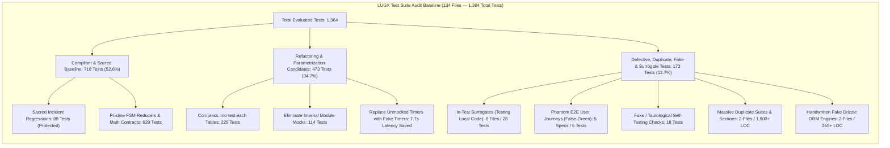
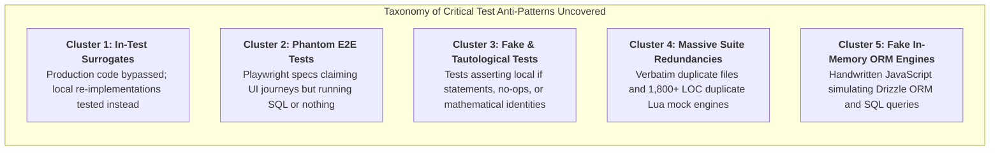
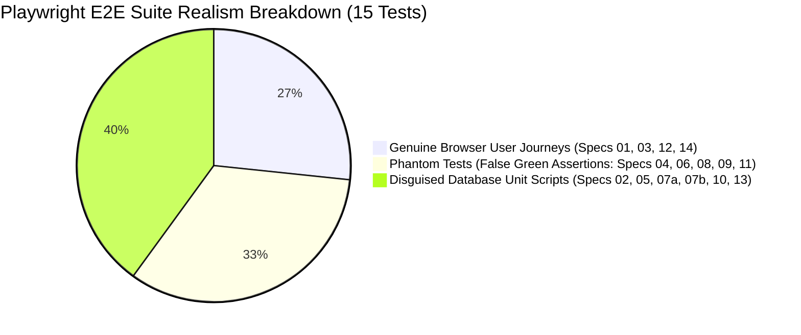
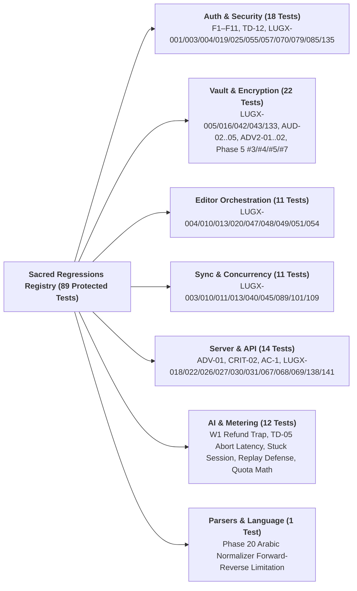

# Comprehensive Test Suite Audit and Refactoring Baseline

> **Point-in-time engineering record (Commit snapshot baseline).** Verification metrics, forensic findings, and code references reflect the repository snapshot at the time of the comprehensive two-wave test engineering audit; active production code and executed test suites serve as the immutable baseline for all subsequent refactoring phases.

| Audit Attribute | Engineering Record Value |
| :--- | :--- |
| **Target Repository** | `d:\Projects\LUGX` |
| **Audit Scope** | Entire Automated Test Ecosystem (134 Test Files / 1,364 Total Test Executions) |
| **Auditing Framework** | Universal Test Quality Standard (`test-guard` 9 Core Rules + LLM Application Rules 10–12) |
| **Methodology** | Two-Wave Distributed Audit: Wave 1 (9 Domain Auditors) + Wave 2 (4 Principal Verification Cross-Auditors) |
| **Audit Status** | **FINAL / AUTHORITATIVE BASELINE** |
| **Date of Record** | October 28, 2026 |
| **Sacred Regressions Identified** | **89 Tests** (Strictly protected from deletion under Rule 6) |
| **Identified Critical Anti-Patterns** | 5 Major Clusters (In-Test Surrogates, Phantom E2E, Fake/Tautological Tests, Massive Duplicate Suites, Fake ORM Engines) |
| **Total Test Blocks Subject to Action** | **173 Defective / Duplicate / Fake Tests to Prune or Rewrite; 473 Tests to Refactor / Parametrize** |

---

## 1. Executive Summary & Quality Dashboard

An exhaustive, line-by-line verification audit of the entire automated test ecosystem in the LUGX repository was executed across two sequential auditing waves:
1. **Wave 1 (Domain Auditing):** Nine specialized test engineering auditors evaluated every test file across the 9 primary architectural subsystems (`src/test/ai/`, `src/test/sync/`, `src/test/editor/`, `src/test/vault/`, `src/test/parsers/`, `src/test/server/` & `src/test/api/`, `src/test/infrastructure/` & `src/test/metering/`, `src/test/auth/`, `config/`, `contracts/`, `ui/`, `types/`, and `e2e/specs/`).
2. **Wave 2 (Principal Cross-Verification):** Four independent principal verification auditors executed adversarial cross-audits across four clustered scopes (Cluster A: AI & Metering; Cluster B: Sync & Vault; Cluster C: Server, API, Infra & Auth; Cluster D: Editor, Parsers & E2E) to eliminate false positives, uncover hidden defects, and calibrate actionable remediation boundaries.



### Cumulative Violation Counts Across the 9 `test-guard` Rules

| Audit Rule (`test-guard` Metric) | Confirmed Violations | Severity Level | Engineering & Operational Risk |
| :--- | :---: | :---: | :--- |
| **Rule 1: Test Behavior, Not Implementation Details** | **142** | **MUST FIX** | Direct assertions on internal spies, spying on unexported class functions, inspecting private properties via `(as any)`, reading source files with `fs.readFileSync`. |
| **Rule 2: Every Mock Must Be Justified at System Boundary** | **68** | **MUST FIX** | Mocking internal domain services (e.g. `BillingService`, `ai-settlement-service`, `key-rotation`), dead database mocks in signout, and unmocked timers causing 7.7s of idle test latency. |
| **Rule 3: One Scenario Per Test, Data-Driven for Variants (`test.each`)** | **225** | **SHOULD FIX** | Sequential test copy-pasting for HTTP status codes, MIME types, PIN lengths, and arithmetic variations; compressible into 53 clean data-driven matrix tables. |
| **Rule 4: Every Test Must Justify Its Existence (Eliminate Fake & Redundant Tests)** | **173** | **MUST FIX** | Discovery of fake tests evaluating their own test-local `if` statements, zero-operation no-op tests, literal configuration constant assertions, and 100% duplicate files. |
| **Rule 5: Name Tests for Scenario and Outcome (`test_<scenario>_<expected_outcome>`)** | **787** | **SHOULD FIX** | Systemic legacy BDD phrasing (`should ...`, `[DB]`, conversational sentences) obscuring test failure logs. |
| **Rule 6: Production Regression Tests Are Sacred** | **89 (Exempt)** | **SACRED INVARIANT** | 89 confirmed regression tests guarding documented production bugs (LUGX-*, F-series, AUD-*, ADV-*, TD-*); **strictly prohibited from deletion or functional reduction**. |
| **Rule 7: No Tests for Framework, Runtime, or Compiler Guarantees** | **17** | **SHOULD FIX** | Testing TypeScript compile-time assignments, Next.js matcher regex strings, PostgreSQL primary key uniqueness via raw SQL, and Node.js standard library functions. |
| **Rule 8: State and Value Objects Are Real, Never Mocked** | **22** | **MUST FIX** | Synthesizing fake user or transaction DTOs using `as any` casting, 40-line fake editor adapters, and mock HTTP Request object literals. |
| **Rule 9: Infrastructure Under Test Gets Real Infrastructure** | **24** | **MUST FIX** | Writing 145-line and 110-line handwritten in-memory JavaScript engines to simulate Drizzle ORM transactions and PostgreSQL index constraints instead of testing against real databases. |

---

## 2. The 9 Core Rules of Test Engineering Governance

All test code within the repository must adhere strictly to the universal principles defined by `test-guard`:

```mermaid
graph LR
    subgraph TestGuardStandard["Universal 9-Rule Governance Standard"]
        direction TB
        R1["<b>Rule 1: Behavior Over Implementation</b><br/>Assert returns and observable side-effects; never assert internal mock calls"]
        R2["<b>Rule 2: Boundary Mocking Only</b><br/>Mock only true system boundaries (LLM API, Stripe, Network, Clock)"]
        R3["<b>Rule 3: Single Scenario & test.each</b><br/>One scenario per test; use data-driven parameterization for variants"]
        R4["<b>Rule 4: Justified Existence</b><br/>Zero tolerance for fake tests, tautologies, or constant echoing"]
        R5["<b>Rule 5: Scenario Naming</b><br/>Mandatory test_scenario_expectedOutcome convention"]
        R6["<b>Rule 6: Sacred Regressions</b><br/>Production incident tests are permanent, immutable guardrails"]
        R7["<b>Rule 7: No Framework Tests</b><br/>Never test TypeScript, Drizzle, React, or PostgreSQL engine guarantees"]
        R8["<b>Rule 8: Real State Objects</b><br/>Construct real typed domain entities; zero 'as any' DTO forging"]
        R9["<b>Rule 9: Real Infrastructure</b><br/>Database and storage integration tests require real containers or isolated branches"]
    end
```



### Rule 1: Test Behavior, Not Implementation Details
Tests must assert observable public behavior: return values, state transitions, HTTP response bodies, and externally visible mutations. Tests must never assert on internal call sequences (e.g., `expect(mockInternalHelper).toHaveBeenCalled()`), private class properties accessed via `(as any)`, or the syntax of uncompiled source files via `fs.readFileSync`.

### Rule 2: Every Mock Must Be Justified at System Boundary
Mocking is strictly restricted to true non-deterministic external boundaries: external HTTP APIs (Google Gemini, Stripe Webhooks), network failure simulation, hardware device boundaries (WebAuthn PRF), and virtual timers (`vi.useFakeTimers()`). Internal domain modules, sibling services (`BillingService`, `ai-settlement-service`), and collaborating classes must never be mocked out.

### Rule 3: One Scenario Per Test, Data-Driven for Variants
Each test must verify exactly one logical branch. When testing identical logic across divergent inputs (e.g., HTTP status codes, disallowed file extensions, Unicode normalizations, PIN validation matrices), tests must use `test.each` data tables rather than sequentially looped assertions or multiple copy-pasted `it` blocks.

### Rule 4: Every Test Must Justify Its Existence
Every test must prove its capability to fail when production code breaks. Tests that evaluate local inline conditional logic written inside the test itself, tests that assert a constant equals its hardcoded literal value, tests that perform no operations between balance snapshots, and 100% duplicate files must be eradicated.

### Rule 5: Name Tests for the Scenario (`test_<scenario>_<expected_outcome>`)
Test names must clearly state the precondition/scenario and the expected outcome. Pervasive conversational phrasing (`should ...`, `it("works")`, `[DB] ...`) must be replaced with the standard specification pattern: `test_<scenario>_<expected_outcome>`.

### Rule 6: Production Regression Tests Are Sacred
Any test explicitly authored to remediate a verified production bug, security finding, or architectural incident (marked with LUGX-*, F-series, AUD-*, ADV-*, or TD-*) is an immutable permanent guardrail. It is strictly prohibited to delete, comment out, or functionally weaken any sacred regression test. Refactoring within sacred tests is strictly limited to improving naming and replacing artificial seams with real execution.

### Rule 7: No Tests for Framework, Runtime, or Compiler Guarantees
Tests must verify application business logic, not the runtime environment. Tests asserting that TypeScript rejects mismatched union types, that PostgreSQL rejects duplicate primary keys via direct SQL, that Next.js regex matchers parse strings, or that dynamic imports of deleted files throw module errors are prohibited.

### Rule 8: State and Value Objects Are Real, Never Mocked
Entities passed into tested functions must be genuine, structurally valid domain objects instantiated via model factories or constructors. Forging mock DTOs using `{ id: '1' } as any` bypasses the type system and conceals contract divergence.

### Rule 9: Infrastructure Under Test Gets Real Infrastructure
When testing database queries, transactional rollbacks, and concurrent Compare-And-Swap (CAS) locking, tests must execute against real PostgreSQL databases (such as the isolated Neon PostgreSQL test branch via `testDb`). Hand-rolling fake in-memory JavaScript database engines to mimic SQL semantics is strictly forbidden.

---

## 3. Forensics of the 5 Critical Anti-Pattern Clusters



### 3.1 Cluster 1: In-Test Surrogates (Production Code Bypassed)
In multiple critical server and sync suites, tests bypass production modules completely. The test authors re-implemented the business logic inside the test file as a local helper function and ran assertions against the helper:

1. **`src/test/server/file-ops.lostupdate.test.ts` (Lines 65–99):**
   - *Forensic Finding:* Does not import `updateFileContent` from `@/server/actions/file-ops`. Instead, it defines a local function `optimisticUpdate(fileId, newContent, opts)` directly inside the test file and tests that local helper.
   - *Impact:* If `src/server/actions/file-ops.ts` suffers a race condition or optimistic locking failure, this suite reports 100% PASS.
2. **`src/test/api/api-files-putguard.live.test.ts` (Lines 64–103):**
   - *Forensic Finding:* Does not import the Next.js HTTP route handler `PUT` from `@/app/api/files/[id]/route`. It defines an in-file function `routePutUpdate()` and tests that instead. It is a 95% verbatim clone of `file-ops.lostupdate.test.ts`.
3. **`src/test/server/file-ops.ownership.test.ts` (Lines 74–110, 169–200):**
   - *Forensic Finding:* Defines an in-file helper `checkInMemoryCycle()` and an in-file arrow function `evaluatePrecondition()`. Tests 3–6 test these local toy functions rather than calling `moveFile` or production folder tree actions.
4. **`src/test/sync/conflict-resolution.integration.test.ts` (Lines 66–142):**
   - *Forensic Finding:* Defines a 76-line private helper `executeOptimisticWrite` inside the test file that re-implements optimistic locking SQL queries rather than invoking the production action `updateFileContent`.

### 3.2 Cluster 2: Phantom E2E Tests (False-Green User Journeys)
Out of 14 Playwright E2E spec files (15 user journeys), **5 specs are completely phantom** (running zero UI code or asserting direct opposites), and **6 specs are disguised database scripts** that bypass the browser DOM:



1. **`e2e/specs/04-offline-sync-conflict.spec.ts`:**
   - *Phantom Claim:* "Simulates offline edit, remote concurrent update (412), triggers ConflictDialog, and executes Diff3 merge resolution".
   - *Forensic Reality:* Sets offline to true, makes **zero edits**, updates the database via backend script, sets offline to false, triggers **no save, no 412, and no ConflictDialog**, and never calls Diff3.
2. **`e2e/specs/06-ai-streaming-commit.spec.ts`:**
   - *Phantom Claim:* "Streams NDJSON chunks with correlation tracing, displays ghost preview, and executes atomic commit".
   - *Forensic Reality:* Opens editor, triggers **no streaming**, never checks correlation tracing, renders **no ghost preview**, runs raw SQL `e2eDb.transaction()` directly against Neon PostgreSQL, and asserts Drizzle committed.
3. **`e2e/specs/08-ai-failure-refund.spec.ts`:**
   - *Phantom Claim:* "Simulates upstream provider 500 failure, displays safe error banner, and executes automated full quota refund".
   - *Forensic Reality:* Mocks route `**/api/ai/stream` with 500, but **never invokes AI from the UI** (the mocked route is dead and never called), displays no error banner, and executes the refund via raw SQL `UPDATE` in the test body.
4. **`e2e/specs/09-ai-conflict-412.spec.ts`:**
   - *Phantom Claim:* "Detects remote edit during stream, prevents partial overwrite on commit with 412".
   - *Forensic Reality:* Step 3 comment states `// 3. Attempting to commit...` but the commit call is commented out. The test reloads the page to display the new remote version, completely failing to test 412 prevention.
5. **`e2e/specs/02, 07a, 07b, 10, 13`:**
   - *Forensic Reality:* Specs 07 and 10 do not even request `page` or `context` browser fixtures. They are pure SQL scripts and Node `crypto` invocations running inside the heavy Playwright Chromium runner process.

### 3.3 Cluster 3: Fake & Tautological Tests (Self-Testing Logic)
Tests that evaluate local conditionals written inside the test block, or test mathematical tautologies:

1. **`src/test/ai/ai-transaction.test.ts` (Lines 185–208):**
   ```typescript
   // Defective Test Code:
   const fakeServerCommit = vi.fn().mockResolvedValue({ success: false, status: "error" });
   const res = await fakeServerCommit();
   if (!res.success) {
       adapter.clearStreamingGhost();
   }
   expect(adapter.getValue()).toBe(before);
   ```
   *Analysis:* The test tests its own test-local `if` statement. No production code is executed.
2. **`src/test/ai/ai-ops.refund.test.ts` (Lines 151–155):**
   ```typescript
   // Defective Test Code:
   const beforeBalance = await snapshotCreditBalance(TEST_USER_ID);
   const afterBalance = await snapshotCreditBalance(TEST_USER_ID);
   expect(afterBalance).toBe(beforeBalance);
   ```
   *Analysis:* Queries balance twice in immediate succession with zero operations in between. It is an empty tautology that always passes.
3. **`src/test/vault/vault-cross-module.integration.test.ts` (Flow 4 & Flow 5) & `vault-orchestration.test.ts` (Tests 15, 18, 28):**
   - *Forensic Reality:* Flow 4 implements `if (serverCiphertext.startsWith("gcm:v1:"))` inline in the test and asserts on local test variables without invoking `useEditorOrchestrator`. Test 15 asserts `const canEncrypt = isEncrypted && rawKey !== null; expect(canEncrypt).toBe(false);` without invoking the save pipeline.
4. **`src/test/sync/file-vault-conversion.test.ts` (Lines 58–61):**
   - *Forensic Reality:* Executes `expect(words[i]).toBe(mnemonic.trim().split(/\s+/)[i])` where `words` was generated by splitting `mnemonic`. This tests $A \equiv A$, catching zero bugs.
5. **`src/test/auth/proxy.test.ts` (Line 133):**
   - *Forensic Reality:* Test title states "returns JSON 401 Unauthorized for unauthenticated API requests", but line 140 asserts `expect(res.status).toBe(307)`. The test passes by asserting the exact opposite of its requirement.
6. **`src/test/editor/editor-atomic-commit.test.ts` (Tests 3 & 4):**
   - *Forensic Reality:* Identical tautology to `ai-transaction.test.ts`: awaits a mock return, executes a test-local `if` statement, and asserts adapter state.

### 3.4 Cluster 4: Massive Duplicate Suites & Bloat
Severe multi-hundred-line code duplications across test files:

1. **`src/test/ai/ai-provider-smoke.test.ts` (100% Redundant File):**
   - *Forensic Reality:* All 4 tests are exact verbatim duplicates of tests running in `ai-client.test.ts` (model mapping) and `ai-key-rotation.test.ts` (key masking and 400/429 error classifications).
2. **`credit-metering-suite.test.ts` vs `derivation-and-lua.unit.test.ts` (~1,800 LOC Duplicate Engine):**
   - *Forensic Reality:* Both files maintain identical in-memory implementations of the Redis Lua scripts (`InMemoryRedisEvalClient`) and duplicate 11 tests across MTR-01, MTR-02, MTR-04, and MTR-06.
3. **`src/test/sync/sync-conflict-resolver.test.ts` (Lines 684–1016, 19 Tests, 333 LOC):**
   - *Forensic Reality:* 19 tests in this file duplicate the dedicated algorithmic test suite in `diff3-sub-line-merge.test.ts`.
4. **`src/test/vault/vault-sync-ai-gate.test.ts` (Section 5, Lines 613–645):**
   - *Forensic Reality:* 3 tests verifying `updateVaultAISetting` duplicate the authoritative unit suite in `vault-actions.unit.test.ts` lines 410–480.

### 3.5 Cluster 5: Fake In-Memory ORM Engines
1. **`src/test/metering/ai-settlement-service.unit.test.ts` (Lines 40–185):**
   - *Forensic Reality:* Implements a 145-line custom mock of Drizzle ORM (`query.users.findFirst`, `insert`, `update`, `transaction`, and tagged template parser). Lines 64–78 implement a handwritten JavaScript version of `onConflictDoNothing`! Test 8.10 literally tests whether the mock author wrote a correct JavaScript `if` loop.
2. **`src/test/server/billing-service.test.ts` (Lines 41–150):**
   - *Forensic Reality:* Implements a 110-line handwritten fake Drizzle mock where tests assert on the mock's own `mockLedger.some(...)` implementation rather than PostgreSQL constraints.

---

## 4. The Sacred Regressions Registry (Rule 6 — 89 Immutable Tests)

Under Rule 6 of `test-guard`, every test covering a historical security finding (F-series), production incident (LUGX-*), architectural audit finding (AUD-* / ADV-*), or accepted debt closure (TD-*) is **SACRED**. These tests are strictly protected from deletion or reduction:



### 4.1 Complete Itemized Registry of Sacred Tests

| Subsystem | File Path | Line | Incident / Reference ID | Protected Invariant & Engineering Context |
| :--- | :--- | :---: | :--- | :--- |
| **Editor** | `src/test/editor/editor-security-hardening.test.ts` | 102 | **LUGX-004** | Locked vault strictly blocks plaintext unmount flush |
| **Editor** | `src/test/editor/editor-security-hardening.test.ts` | 182 | **LUGX-004** | Unlocked vault encrypts before executing unmount flush |
| **Editor** | `src/test/editor/editor-security-hardening.test.ts` | 277 | **LUGX-047** | `loadInitialFile` early exit retains `vault_locked` hydration state |
| **Editor** | `src/test/editor/editor-security-hardening.test.ts` | 322 | **LUGX-048** | Decryption failure sets fatal state and suppresses ciphertext leakage |
| **Editor** | `src/test/editor/search-replace.stale-ranges.test.tsx` | 9 | **LUGX-054** | Single replace aborts when document slice mismatches stale range cache |
| **Editor** | `src/test/editor/search-replace.stale-ranges.test.tsx` | 51 | **LUGX-054** | Batch replaceAll aborts on stale match cache mismatch |
| **Editor** | `src/test/editor/use-editor-conflict.test.ts` | 369 | **LUGX-010** | Preserves dirty buffer when live editor differs from conflict resolution |
| **Editor** | `src/test/editor/use-editor-conflict.test.ts` | 412 | **LUGX-013** | Does not overwrite editor with stale content on 412 conflict retry |
| **Editor** | `src/test/editor/use-editor-conflict.test.ts` | 473 | **LUGX-051** | Preserves dirty edits upon receiving cross-tab `file_encrypted` broadcast |
| **Editor** | `src/test/editor/use-editor-conflict.test.ts` | 513 | **LUGX-049** | Flushes dirty edits to IDB and blocks plaintext flush on cross-tab `vault_locked` |
| **Editor** | `src/test/editor/use-editor-conflict.test.ts` | 566 | **LUGX-020** | Retains local version when dirty upon cross-tab `file_saved` event |
| **Sync** | `src/test/sync/sync-cas-concurrency.test.ts` | 64 | **LUGX-010** | Status update guarded by optimistic CAS counter during in-flight push |
| **Sync** | `src/test/sync/sync-cas-concurrency.test.ts` | 92 | **LUGX-040** | Terminal statuses protect local revision from erroneous overwrite |
| **Sync** | `src/test/sync/sync-cas-concurrency.test.ts` | 219 | **LUGX-010** | Race condition between local keystroke and network push settlement |
| **Sync** | `src/test/sync/sync-cas-concurrency.test.ts` | 342 | **LUGX-013** | Network push failure rolls back status without wiping local dirty flag |
| **Sync** | `src/test/sync/sync-conflict-resolver.test.ts` | 628 | **LUGX-045** | Phase 15 Diff3 merge duplicate line retention (D/C/C edge case) |
| **Sync** | `src/test/sync/sync-durable-conflict.test.ts` | 45 | **LUGX-003** | Immediate push trigger on conflict resolution with local or merge |
| **Sync** | `src/test/sync/sync-durable-conflict.test.ts` | 98 | **LUGX-010** | Durable conflict state in IDB survives application restart |
| **Sync** | `src/test/sync/sync-durable-conflict.test.ts` | 165 | **LUGX-089** | Conflict state blocks background sync queue from pushing stale data |
| **Sync** | `src/test/sync/sync-durable-conflict.test.ts` | 247 | **LUGX-101** | Pull operation preserves local conflicted modifications |
| **Sync** | `src/test/sync/sync-manager.test.ts` | 638 | **LUGX-013** | Rollback checkpoint restored upon unexpected network exception |
| **Sync** | `src/test/sync/sync-tab-isolation.test.ts` | 26 | **LUGX-109** | Phase 15 BroadcastChannel user-scoped multi-tenant isolation |
| **Vault** | `src/test/vault/adaptive-recovery-migration.test.ts` | 49 | **LUGX-043** | BIP-39 standard 2048-word English dictionary size invariant |
| **Vault** | `src/test/vault/adaptive-recovery-migration.test.ts` | 90 | **LUGX-005** | Canonical modern `lugx:v1:...` AAD template generation |
| **Vault** | `src/test/vault/adaptive-recovery-migration.test.ts` | 113 | **LUGX-005** | Adaptive recovery: unwraps legacy `vault:seed:` and re-wraps with modern AAD |
| **Vault** | `src/test/vault/adaptive-recovery-migration.test.ts` | 295 | **LUGX-016** | `withMasterKey` safely aborts execution if vault locks concurrently |
| **Vault** | `src/test/vault/adaptive-recovery-migration.test.ts` | 326 | **LUGX-042** | Programmatic `getMasterKey` decoupled from auto-lock inactivity timer |
| **Vault** | `src/test/vault/adaptive-recovery-migration.test.ts` | 350 | **LUGX-133** | NFKC Unicode password normalization produces identical derived keys |
| **Vault** | `src/test/vault/file-ops-vault.unit.test.ts` | 250 | **AUD-02** | Strictly rejects server copy of encrypted file without encryptedOverride |
| **Vault** | `src/test/vault/vault-cross-module.integration.test.ts` | 257 | **AUD-02** | Client-side re-encryption under new UUID and authentic AAD for copied files |
| **Vault** | `src/test/vault/vault-cross-module.integration.test.ts` | 491 | **AUD-03** | 412 server ciphertext double-encryption prevention invariant |
| **Vault** | `src/test/vault/vault-cross-module.integration.test.ts` | 515 | **AUD-05** | Central device trust revocation and local envelope epoch invalidation |
| **Vault** | `src/test/vault/vault-crypto.test.ts` | 601 | **Matrix #5** | `wipeBuffer` zeroes RAM buffers and `SessionKeyStore` purges on lock |
| **Vault** | `src/test/vault/vault-crypto.test.ts` | 616 | **Matrix #5** | WebCrypto keys are strictly imported non-extractable (`extractable: false`) |
| **Vault** | `src/test/vault/vault-crypto.test.ts` | 623 | **Matrix #7** | PBKDF2 offloading to dedicated Web Worker with 600,000 iterations |
| **Vault** | `src/test/vault/vault-crypto.test.ts` | 640 | **Matrix #7** | Worker fallback to main thread upon worker termination |
| **Vault** | `src/test/vault/vault-orchestration.test.ts` | 1025 | **AUD-02** | Client copy pipeline re-encrypts ciphertext before persistence |
| **Vault** | `src/test/vault/vault-orchestration.test.ts` | 1059 | **AUD-02** | Re-encrypted copy payload preserves zero-knowledge server invariant |
| **Vault** | `src/test/vault/vault-orchestration.test.ts` | 1116 | **AUD-03** | Conflict resolution adopting server ciphertext avoids double encryption |
| **Vault** | `src/test/vault/vault-orchestration.test.ts` | 1138 | **AUD-04** | `sessionKeyStore.touch()` refreshes user inactivity timestamp |
| **Vault** | `src/test/vault/vault-recovery.test.ts` | 20 | **Matrix #3** | Locked vault requires password; incorrect password rejected |
| **Vault** | `src/test/vault/vault-recovery.test.ts` | 34 | **Matrix #4** | Mnemonic recovery unwraps master key and rotates password without re-encrypting files |
| **Vault** | `src/test/vault/vault-sync-ai-gate.test.ts` | 378 | **ADV2-01** | AI gatekeeper rejects encrypted documents with HTTP 403 and zero quota reservation |
| **Vault** | `src/test/vault/vault-sync-ai-gate.test.ts` | 489 | **ADV2-02** | Atomic AI commit guard rejects unencrypted payloads on encrypted files |
| **Vault** | `src/test/vault/vault-sync.live.test.ts` | 91 | **Zero-Plaintext** | Live PostgreSQL verification: encrypted documents stored as ciphertext with zero plaintext at rest |
| **Server & API** | `src/test/server/billing-service.test.ts` | 282 | **LUGX-141** | Resolves `userId` via `stripeCustomerId` from users table when metadata is absent |
| **Server & API** | `src/test/server/billing-service.test.ts` | 413 | **LUGX-026** | `handleInvoicePaymentFailed` marks sub `past_due` without canceling other active subs |
| **Server & API** | `src/test/server/file-ops.ownership.test.ts` | 113 | **ADV-01** | `generateRestoredTitle` appends `(Restored)` without date string |
| **Server & API** | `src/test/server/file-ops.ownership.test.ts` | 121 | **CRIT-02** | `generateCopyTitle` generates `(Copy)` and `(Copy 2)` iteratively |
| **Server & API** | `src/test/server/file-ops.ownership.test.ts` | 228 | **ADV-01** | Multiple soft-deleted files with identical names coexist and restore safely |
| **Server & API** | `src/test/server/phase-08-ownership-and-cycles.test.ts` | 379 | **LUGX-067** | `updateUserProfile` ignores sensitive column injection (`tier`, `stripeCustomerId`) |
| **Server & API** | `src/test/server/phase-08-ownership-and-cycles.test.ts` | 401 | **LUGX-138** | Restored and copy title generators clamp length to <= 500 characters |
| **Server & API** | `src/test/server/schema-atomic-transactions.live.test.ts` | 62 | **LUGX-030** | Enforces primary key uniqueness on `operation_id` in `credit_ledger_transactions` |
| **Server & API** | `src/test/server/schema-atomic-transactions.live.test.ts` | 96 | **LUGX-027** | Enforces `stripe_subscription_id` uniqueness while permitting 1:N subscriptions per user |
| **Server & API** | `src/test/server/schema-atomic-transactions.live.test.ts` | 147 | **LUGX-030** | Interactive PostgreSQL rollback leaves zero partial writes on transaction error |
| **Server & API** | `src/test/server/schema-atomic-transactions.live.test.ts` | 193 | **LUGX-030/031** | Atomically debits balance, records ledger row, and rejects duplicate inserts |
| **Server & API** | `src/test/server/schema-atomic-transactions.live.test.ts` | 253 | **LUGX-030** | Atomically refunds balance and transitions transaction status to `ABORTED` |
| **Server & API** | `src/test/api/stripe-webhook.test.ts` | 623 | **AC-1** | Stripe webhook mandates HTTP 500 response on database error to force Stripe retry |
| **Server & API** | `src/test/api/stripe-webhook.test.ts` | 649 | **LUGX-068** | Derives subscription tier from Stripe Price ID when available |
| **Server & API** | `src/test/api/stripe-webhook.test.ts` | 688 | **LUGX-069** | Paused subscription status accepted without freezing account in terminal state |
| **Auth & Log** | `src/test/auth/auth-signout.test.ts` | 67 | **TD-12** | Sign-out invalidates RSC cache, wipes all `sb-*` cookies, and redirects to `/` |
| **Auth & Log** | `src/test/auth/auth-signout.test.ts` | 94 | **TD-12** | Clean sign-out handling when no auth cookies exist |
| **Auth & Log** | `src/test/auth/log-sanitizer.test.ts` | 13 | **F4 / F5** | Redacts sensitive keys and token-bounded compound keys in application logs |
| **Auth & Log** | `src/test/auth/log-sanitizer.test.ts` | 37 | **F4 / F5** | Prohibits false-positive redaction of benign operational keys (e.g. `activity`) |
| **Auth & Log** | `src/test/auth/log-sanitizer.test.ts` | 57 | **F11** | Produces valid parseable JSON without duplicate quote corruption |
| **Auth & Log** | `src/test/auth/log-sanitizer.test.ts` | 76 | **F4 / F5** | Scrubs 12-word recovery mnemonics completely from logging output |
| **Auth & Log** | `src/test/auth/log-sanitizer.test.ts` | 95 | **F10** | Preserves DAG shared object references without falsely flagging circular loops |
| **Auth & Log** | `src/test/auth/log-sanitizer.test.ts` | 112 | **F10** | Traverses actual circular object references without crashing or stack overflow |
| **Auth & Log** | `src/test/auth/log-sanitizer.test.ts` | 121 | **F9** | Sanitizes Error stacks while scrubbing confidential parameters |
| **Auth & Log** | `src/test/auth/log-sanitizer.test.ts` | 145 | **F1** | Memory hygiene: `SessionKeyStore` maintains detached clone when caller zeroes buffer |
| **Auth & Log** | `src/test/auth/log-sanitizer.test.ts` | 164 | **F2** | `storeMasterKeyRaw` preserves immutability of `inactivityTimeoutMs` |
| **Auth & Log** | `src/test/infrastructure/rate-limit.test.ts` | 73 | **LUGX-079** | Rate limit rejection occurs WITHOUT `zadd` (prevents permanent lockout retry trap) |
| **Contracts** | `src/test/contracts/state-machines-contracts.test.ts` | 110 | **LUGX-003** | Immediate push trigger on conflict resolution with local or merge |
| **Contracts** | `src/test/contracts/state-machines-contracts.test.ts` | 294 | **LUGX-025/135** | Terminal state protection: ignores stale active update on canceled subscription |
| **Contracts** | `src/test/export/export-governance.test.ts` | 17 | **LUGX-004/017** | Rejects exporting encrypted document when `confirmedPlaintextExport` is false |
| **Contracts** | `src/test/export/export-governance.test.ts` | 32 | **LUGX-019/085** | Default fallback for `confirmedPlaintextExport` is strictly false |
| **Contracts** | `src/test/files/file-context-menu.encryption-conflict.test.tsx` | 68 | **LUGX-055** | Sends `expectedVersion` and `expectedETag` and halts IDB write on server 412 conflict |
| **Contracts** | `src/test/layout/sidebar-import.vault.test.tsx` | 61 | **LUGX-057** | Marks vault import dirty in IDB initially, cleans only after successful import |
| **Contracts** | `src/test/types/contracts.test.ts` | 110 | **LUGX-004** | Strictly rejects plaintext payload attempting to pass `isEncrypted: true` |
| **Contracts** | `src/test/types/contracts.test.ts` | 122 | **LUGX-004** | Strictly rejects plaintext payload containing `encryptionMetadata` |
| **Contracts** | `src/test/types/contracts.test.ts` | 133 | **LUGX-070** | Strictly rejects encrypted payload with null `encryptionMetadata` |
| **Contracts** | `src/test/types/contracts.test.ts` | 145 | **LUGX-019** | Strictly rejects encrypted payload with `isEncrypted: false` |
| **AI & Metering** | `src/test/ai/ai-ops.refund.test.ts` | 86 | **W1** | Quota refund trap: restores balance when a reserved `correct()` operation fails |
| **AI & Metering** | `src/test/ai/ai-stream-abort-latency.test.ts` | 98 | **TD-05** | `stopStream()` must abort immediately (< 50ms) without awaiting network round-trips |
| **AI & Metering** | `src/test/ai/ai-stream-completion-terminality.test.ts` | 51 | **Stuck Session** | Routes async onComplete rejections into onError with a single terminal callback |
| **AI & Metering** | `src/test/ai/ai-stream-replay-prevention.test.ts` | 91 | **Anti-Replay** | Rejects reservation when `operationId` is reused with divergent request hash |
| **AI & Metering** | `src/test/metering/ai-settlement-service.unit.test.ts` | 484 | **Anti-Replay** | Detects replay attack when `operationId` is reused with different request payload |
| **AI & Metering** | `src/test/contracts/state-machines-contracts.test.ts` | 385 | **Conservation** | Mathematical conservation law for pre-TTFT zero consumption (full refund) |
| **AI & Metering** | `src/test/contracts/state-machines-contracts.test.ts` | 422 | **Conservation** | Financial safety: caps commitment at reserved units during overage consumption |
| **Parsers** | `src/test/parsers/parser-arabic-normalizer.test.ts` | 61 | **Phase 20 Bug** | Documents known limitation where forward Arabic phrases get reversed (protected limitation) |

---

## 5. Comprehensive File-by-File Diagnostic Matrix (All 134 Files)

The following matrix records the empirical diagnostic findings across every single test file in the repository:

| # | File Path | Tests | Confirmed Rule Violations | Sacred Tests | Status Verdict | Action Required |
| :-: | :--- | :---: | :--- | :---: | :---: | :--- |
| **AI Test Suites (24 Files — 190 Tests)** | | | | | | |
| 1 | `src/test/ai/ai-atomic-commit.integration.test.ts` | 7 | Rule 5 | 0 | **CLEAN** | Rename to `test_<scenario>_<expected_outcome>`. |
| 2 | `src/test/ai/ai-authoritative-stream-settlement.test.ts` | 4 | Rule 1, Rule 2, Rule 8 | 0 | **REFURBISH** | Remove `ai-settlement-service` mock; assert observable frames. |
| 3 | `src/test/ai/ai-client-authority-revocation.test.ts` | 4 | Rule 1, Rule 4, Rule 7 | 0 | **REFURBISH** | Replace `fs.readFileSync` regex scraping with static linting rules. |
| 4 | `src/test/ai/ai-client.test.ts` | 24 | Rule 1, Rule 2, Rule 4, Rule 12 | 0 | **REFURBISH** | Remove internal `key-rotation` mock; delete static config tests. |
| 5 | `src/test/ai/ai-gatekeeper.test.ts` | 4 | Rule 4, Rule 5 | 0 | **REFURBISH** | Move sync test #10 to sync directory; remove ticket numbers. |
| 6 | `src/test/ai/ai-key-rotation-400.test.ts` | 5 | Rule 3, Rule 4 | 0 | **REDUNDANT** | Merge 5 tests into `test.each` table inside `ai-key-rotation.test.ts`. |
| 7 | `src/test/ai/ai-key-rotation.test.ts` | 37 | Rule 4, Rule 3, Rule 5 | 1 | **CLEANUP** | Delete constant test (L289) & tautology (L352); parametrize classifiers. |
| 8 | `src/test/ai/ai-live-e2e.test.ts` | 3 | Naming / Rule 4 | 0 | **HYGIENE** | Rename to `.live.test.ts`; remove `console.log` statements. |
| 9 | `src/test/ai/ai-ops.integrity.test.ts` | 7 | Rule 7, DB Leak | 0 | **CLEANUP** | Delete Postgres PK duplicate tests (L68, L128); clean test users in `afterAll`. |
| 10 | `src/test/ai/ai-ops.refund.test.ts` | 5 | Rule 4, Rule 3 | 1 | **REFURBISH** | Delete/rewrite fake no-op test (L151); merge tests 1 & 2 via `test.each`. |
| 11 | `src/test/ai/ai-preview-decision.live.test.ts` | 3 | Rule 5 | 0 | **CLEAN** | Exemplary live suite against Neon PostgreSQL. |
| 12 | `src/test/ai/ai-preview-decision.test.ts` | 8 | Rule 5 | 0 | **CLEAN** | High-quality CodeMirror ghost range tests; standardize names. |
| 13 | `src/test/ai/ai-provider-smoke.test.ts` | 4 | Rule 4 | 0 | **DELETE** | 100% duplicate of `ai-client.test.ts` and `ai-key-rotation.test.ts`. |
| 14 | `src/test/ai/ai-quota-idempotency.live.test.ts` | 5 | None | 0 | **CLEAN** | Exemplary live PostgreSQL integration suite. |
| 15 | `src/test/ai/ai-quota-idempotency.test.ts` | 12 | Rule 3 | 0 | **CLEAN** | Pure unit reducer & conservation math; merge math variants into `test.each`. |
| 16 | `src/test/ai/ai-reservation-status.live.test.ts` | 4 | None | 0 | **CLEAN** | Clean live suite with proper session user isolation. |
| 17 | `src/test/ai/ai-server-atomic-commit.test.ts` | 13 | Rule 9, Rule 8, Rule 4 | 0 | **PRUNE** | Prune mock-heavy transaction rollback tests covered in live suite. |
| 18 | `src/test/ai/ai-stream-abort-latency.test.ts` | 2 | Rule 8, Rule 1 | 1 | **REFURBISH** | Replace 41-line mock adapter with real CodeMirror; keep TD-05 timing assertion. |
| 19 | `src/test/ai/ai-stream-completion-terminality.test.ts` | 3 | None | 1 | **CLEAN** | Exemplary sacred regression suite for stuck sessions. |
| 20 | `src/test/ai/ai-stream-fileid-governance.test.ts` | 7 | Rule 3, Rule 1, Rule 2 | 0 | **REFURBISH** | Merge missing/null `fileId` tests into `test.each`; remove internal mock asserts. |
| 21 | `src/test/ai/ai-stream-parser.test.ts` | 9 | Rule 5 | 0 | **CLEAN** | Exemplary NDJSON parser suite; standardize naming. |
| 22 | `src/test/ai/ai-stream-replay-prevention.test.ts` | 3 | Rule 5 | 1 | **CLEAN** | High-quality SHA-256 anti-replay tests; standardize naming. |
| 23 | `src/test/ai/ai-stream-session.test.ts` | 12 | Rule 5 | 0 | **CLEAN** | High-quality pure unit FSM suite; standardize naming. |
| 24 | `src/test/ai/ai-transaction.test.ts` | 5 | Rule 4 | 0 | **REFURBISH** | Delete fake test (L185–208) testing local `if` statement. |
| **Sync Test Suites (21 Files — 328 Tests)** | | | | | | |
| 25 | `src/test/sync/conflict-resolution.integration.test.ts` | 3 | Rule 1, Rule 4, Rule 9 | 0 | **REFURBISH** | Replace in-test `executeOptimisticWrite` with real action; remove phantom DB write. |
| 26 | `src/test/sync/diff3-sub-line-merge.test.ts` | 37 | Rule 3, Rule 5 | 0 | **CLEAN** | Canonical home for micro-LCS merge; parameterize disjoint variants. |
| 27 | `src/test/sync/encrypted-conflict-decryption.integration.test.ts` | 4 | Rule 1, Rule 2, Rule 5 | 0 | **REFURBISH** | Assert returned state instead of internal toggle mock calls. |
| 28 | `src/test/sync/file-vault-conversion.test.ts` | 2 | Rule 4, Rule 7 | 0 | **CLEANUP** | Delete tautological `words[i] === words[i]` quiz check (L58–61). |
| 29 | `src/test/sync/sync-cas-concurrency.test.ts` | 9 | Rule 3, Rule 5 | 4 | **CLEAN** | Exemplary CAS concurrency suite; preserve L64, L92, L219, L342. |
| 30 | `src/test/sync/sync-concurrency-manager.test.ts` | 9 | Rule 4, Rule 5 | 0 | **CLEANUP** | Fix weak assertion in L74–75; delete redundant lock tests L78 & L132. |
| 31 | `src/test/sync/sync-conflict-resolver.test.ts` | 71 | Rule 4, Rule 3, Rule 5 | 1 | **PRUNE** | **Priority 1**: Delete lines 684–1016 (19 duplicate tests from diff3). |
| 32 | `src/test/sync/sync-connection-detector.test.ts` | 17 | Rule 4, Rule 5 | 0 | **PRUNE** | Delete pure type checks (`typeof === 'boolean'`) and no-op `destroy` checks. |
| 33 | `src/test/sync/sync-crypto-gateway.test.ts` | 5 | Rule 5 | 0 | **CLEAN** | Clean WebCrypto tests, zero mocks; standardize naming. |
| 34 | `src/test/sync/sync-durable-conflict.test.ts` | 4 | Rule 1, Rule 5 | 4 | **REFURBISH** | Replace `(syncManager as any).pullFile` with public sync APIs. |
| 35 | `src/test/sync/sync-encrypted-conflict.test.ts` | 8 | Rule 1, Rule 5 | 0 | **REFURBISH** | Stop injecting private `pendingEncryptedConflicts.set`; use `quarantineEncryptedConflict`. |
| 36 | `src/test/sync/sync-error-handler.test.ts` | 24 | Rule 1, Rule 3, Rule 4 | 0 | **CLEANUP** | Delete `SyncErrorType enum` check (L297); parameterize `fromResponse`. |
| 37 | `src/test/sync/sync-etag-generator.test.ts` | 20 | Rule 3, Rule 4, Rule 5 | 0 | **CLEAN** | High algorithmic quality; parameterize `compareETags` into `test.each`. |
| 38 | `src/test/sync/sync-indexeddb.test.ts` | 14 | Rule 3, Rule 4, Rule 5 | 0 | **CLEANUP** | Delete `IDB_CONFIG` literal test (L427); parameterize database name tests. |
| 39 | `src/test/sync/sync-manager.test.ts` | 36 | Rule 1, Rule 2, Rule 4 | 1 | **REFURBISH** | Reduce mocking of internal collaborators; remove private `pullFile` calls. |
| 40 | `src/test/sync/sync-operations-gc.test.ts` | 5 | Rule 4, Rule 5 | 0 | **CLEANUP** | Delete `typeof stopSchedule === 'function'`; high quality GC tests. |
| 41 | `src/test/sync/sync-parallel.test.ts` | 6 | Rule 4, Rule 5 | 0 | **CLEANUP** | Delete `DEFAULT_PUSH_CONCURRENCY === 4` literal test (L63). |
| 42 | `src/test/sync/sync-reconciliation.test.ts` | 10 | Rule 3, Rule 5 | 0 | **CLEAN** | Parameterize decision table variants (L80, L87, L94). Zero mocks. |
| 43 | `src/test/sync/sync-rollback.test.ts` | 22 | Rule 1, Rule 2, Rule 4 | 0 | **REFURBISH** | Replace mock IDB assertions with observable state; consolidate paired tests. |
| 44 | `src/test/sync/sync-tab-isolation.test.ts` | 7 | Rule 3, Rule 5 | 1 | **CLEAN** | LUGX-109 multi-tenant isolation; parameterize channel names. |
| 45 | `src/test/sync/use-sync.test.ts` | 15 | Rule 1, Rule 2, Rule 4 | 0 | **REFURBISH** | Eliminate trivial mock delegation assertions (L146, L158, L244). |
| **Editor Test Suites (13 Files — 116 Tests)** | | | | | | |
| 46 | `src/test/editor/editor-atomic-commit.test.ts` | 4 | Rule 1, Rule 4, Rule 5 | 0 | **PRUNE** | Delete Tests 3 & 4 (tautologies testing local `if`); rename Tests 1 & 2. |
| 47 | `src/test/editor/editor-orchestration.integration.test.ts` | 19 | Rule 2 (Latency), Rule 3 | 0 | **REFURBISH** | **Speed**: Replace 6 `setTimeout(1300)` with fake timers (7.7s saved). |
| 48 | `src/test/editor/editor-orchestration.live.test.ts` | 3 | Rule 5 | 0 | **CLEAN** | High-quality Rule 9 live DB tests; standardize test names. |
| 49 | `src/test/editor/editor-phase2-replacement.test.ts` | 14 | Rule 1, Rule 4, Rule 3 | 0 | **PRUNE** | Delete AST `fs.readFileSync` checks (Tests 1–4); merge formatting tests. |
| 50 | `src/test/editor/editor-recovery-reload.test.ts` | 4 | Rule 4, Rule 3, Rule 5 | 0 | **PRUNE** | Delete Test 3 (100% duplicate of Test 2); standardize names. |
| 51 | `src/test/editor/editor-security-hardening.test.ts` | 4 | Rule 5 | 4 | **CLEAN** | 100% sacred regression suite (LUGX-004, 047, 048); clean up header comment. |
| 52 | `src/test/editor/markdown-editor-e2e.test.ts` | 9 | Rule 1, Rule 4, Rule 5 | 0 | **PRUNE** | Delete Test 4 (self-calculating cursor) & Test 5 (misplaced merge unit test). |
| 53 | `src/test/editor/markdown-editor-interaction.test.ts` | 10 | Rule 4, Rule 3, Rule 5 | 0 | **PRUNE** | Delete Tests 4, 5, 6 (testing `String.slice`); parameterize checkbox tests. |
| 54 | `src/test/editor/markdown-editor.test.ts` | 21 | Rule 4, Rule 3, Rule 5 | 0 | **PRUNE** | Delete Test 21 (checking undefined props); parameterize word counts. |
| 55 | `src/test/editor/markdown-editor.ui.test.tsx` | 6 | Rule 5 | 0 | **CLEAN** | Clean React component contract tests; standardize naming. |
| 56 | `src/test/editor/search-replace.stale-ranges.test.tsx` | 2 | Rule 5 | 2 | **CLEAN** | 100% sacred regression suite (LUGX-054); standardize naming. |
| 57 | `src/test/editor/use-editor-autosave.test.ts` | 10 | Rule 5 | 0 | **GOLD STANDARD** | Pure DI, fake timers, zero mocks; standardize naming. |
| 58 | `src/test/editor/use-editor-conflict.test.ts` | 12 | Rule 5 | 5 | **CLEAN** | Sacred regressions (LUGX-010, 013, 020, 049, 051); standardize naming. |
| **Vault Test Suites (13 Files — 214 Tests)** | | | | | | |
| 59 | `src/test/vault/adaptive-recovery-migration.test.ts` | 21 | Rule 3, Rule 4 | 5 | **CLEAN** | Consolidate BIP-39 wordlist tests into `test.each`; replace real timeouts. |
| 60 | `src/test/vault/file-ops-vault.unit.test.ts` | 10 | Rule 1, Rule 2, Rule 5 | 1 | **REFURBISH** | Replace internal ORM mock assertions with return value assertions on `res.data`. |
| 61 | `src/test/vault/vault-actions.unit.test.ts` | 26 | Rule 1, Rule 3, Rule 4 | 0 | **REFURBISH** | Authoritative home for `updateVaultAISetting`; parameterize input checks. |
| 62 | `src/test/vault/vault-cross-module.integration.test.ts` | 5 | Rule 1, Rule 4 | 3 | **REFURBISH** | **Priority 1**: Rewrite Flow 4 (AUD-03) & Flow 5 (AUD-05) to call production code. |
| 63 | `src/test/vault/vault-crypto-resilience.unit.test.ts` | 17 | Rule 3, Rule 4, Rule 5 | 0 | **CLEANUP** | Parameterize PIN length validation; remove duplicate `wipeBuffer` tests. |
| 64 | `src/test/vault/vault-crypto.test.ts` | 40 | Rule 1, Rule 4, Rule 7 | 4 | **CLEANUP** | Delete runtime guarantee test L546 (`isCryptoSubtleAvailable`); parametrize mnemonics. |
| 65 | `src/test/vault/vault-import.integration.test.ts` | 3 | Rule 1, Rule 9 | 0 | **REFURBISH** | Misleadingly named integration test with mock DB; assert returned data. |
| 66 | `src/test/vault/vault-orchestration.test.ts` | 29 | Rule 1, Rule 4, Rule 3 | 4 | **REFURBISH** | **Priority 1**: Fix inline tautologies (Tests 15, 18, 28); delete constant test L479. |
| 67 | `src/test/vault/vault-recovery.test.ts` | 3 | Rule 4 | 2 | **CLEAN** | Phase 5 closure artifact; preserve Matrix #3 & #4 proofs read-only under Rule 6. |
| 68 | `src/test/vault/vault-storage.test.ts` | 15 | Rule 4, Rule 7 | 0 | **PRUNE** | **Priority 2**: Delete Section 1 (Tests 1, 2, 3) checking Drizzle schema props & SQL text. |
| 69 | `src/test/vault/vault-sync-ai-gate.test.ts` | 28 | Rule 1, Rule 4 | 2 | **PRUNE** | **Priority 1**: Delete Section 5 (duplicate of `vault-actions`); remove private field access. |
| 70 | `src/test/vault/vault-sync.live.test.ts` | 4 | None | 1 | **GOLD STANDARD** | Exemplary live integration suite against real Neon branch (Rule 9). |
| 71 | `src/test/vault/webauthn-prf.unit.test.ts` | 13 | Rule 4, Rule 3 | 0 | **REFURBISH** | **Priority 1**: Rewrite Test 13 to call `unwrapMasterKeyWithWebAuthnPrf`. |
| **Parsers & Exporters Suites (10 Files — 81 Tests)** | | | | | | |
| 72 | `src/test/parsers/export-import-roundtrip.integration.test.ts` | 6 | Rule 3, Rule 5 | 0 | **CLEAN** | High-value integration pipeline; merge disguised binary checks into `test.each`. |
| 73 | `src/test/parsers/markdown-exporters.test.ts` | 7 | Rule 3, Rule 5 | 0 | **CLEAN** | Pure unit tests with zero mocks; merge strategy tests into `test.each`. |
| 74 | `src/test/parsers/parser-arabic-normalizer.test.ts` | 10 | Rule 3, Rule 4, Rule 5 | 1 | **CLEANUP** | Protect Phase 20 limitation test; remove redundant 'اغرد' despacing check. |
| 75 | `src/test/parsers/parser-file-validator.test.ts` | 23 | Rule 3, Rule 5 | 0 | **REFURBISH** | Consolidate 12 variant tests into 3 concise `test.each` tables. |
| 76 | `src/test/parsers/parser-language-detector.test.ts` | 5 | Rule 3, Rule 5 | 0 | **REFURBISH** | Consolidate all 5 tests into a single `test.each` data table. |
| 77 | `src/test/parsers/parser-pdf-corruption-detector.test.ts` | 9 | Rule 3, Rule 4 | 0 | **REFURBISH** | Consolidate PUA tests; add missing corrupt real-PDF test case. |
| 78 | `src/test/parsers/parser-pdf-settings.test.ts` | 4 | Rule 4, Rule 5 | 0 | **CLEANUP** | Remove redundant `.not.toThrow()` on line 39; standardize names. |
| 79 | `src/test/parsers/parser-pdf-table-extractor.test.ts` | 5 | Rule 3, Rule 5 | 0 | **CLEAN** | High quality spatial table extraction tests; standardize names. |
| 80 | `src/test/parsers/parser-pdf-worker-bridge.test.ts` | 8 | Rule 1, Rule 5 | 0 | **REFURBISH** | Fix Test 8: remove whitebox private monkey-patching of timers. |
| 81 | `src/test/parsers/parser-text-parser.test.ts` | 4 | Rule 1, Rule 5 | 0 | **CLEANUP** | Replace circular `countWords()` assertion with integer literal `2`. |
| **Server & API Test Suites (13 Files — 144 Tests)** | | | | | | |
| 82 | `src/test/server/billing-service.test.ts` | 23 | Rule 1, Rule 3, Rule 9 | 2 | **REFURBISH** | Merge `calculateEffectiveTier` 1–7 into `test.each`; remove fake ORM mock. |
| 83 | `src/test/server/cross-user-ownership.test.ts` | 11 | Rule 3, Rule 4 | 0 | **CLEAN** | Strong live coverage; consolidate redundant parent checks with Phase 8. |
| 84 | `src/test/server/document-pipeline.live.test.ts` | 4 | Rule 3, Rule 5 | 0 | **GOLD STANDARD** | Exemplary live DB pipeline test; merge binary payloads into `test.each`. |
| 85 | `src/test/server/file-ops.lostupdate.test.ts` | 4 | Rule 1, Rule 4, Rule 9 | 0 | **REFURBISH** | **Critical**: Replace in-test `optimisticUpdate()` surrogate with real action. |
| 86 | `src/test/server/file-ops.ownership.test.ts` | 9 | Rule 1, Rule 4, Rule 7 | 2 | **REFURBISH** | **Critical**: Delete in-test toy cycle helpers; retain ADV-01 & CRIT-02 utility tests. |
| 87 | `src/test/server/file-ops.softdelete.test.ts` | 6 | Rule 1, Rule 7 | 0 | **REFURBISH** | Rewrite tests 1–3 to invoke real production soft-delete actions. |
| 88 | `src/test/server/import-file.test.ts` | 19 | Rule 3, Rule 4 | 0 | **REFURBISH** | Merge MD/TXT/PDF import and binary rejection tests into `test.each`. |
| 89 | `src/test/server/phase-08-ownership-and-cycles.test.ts` | 18 | Rule 5 | 2 | **GOLD STANDARD** | Outstanding live DB suite; authoritative ownership & cycle prevention home. |
| 90 | `src/test/server/schema-atomic-transactions.live.test.ts` | 5 | Rule 5 | 5 | **GOLD STANDARD** | 100% sacred regression suite against Neon test branch. |
| 91 | `src/test/server/subscription-actions.test.ts` | 5 | Rule 1, Rule 2, Rule 4 | 0 | **PRUNE** | **Critical**: Delete tests 1–4 (trivial delegations to `BillingService`); retain test 5. |
| 92 | `src/test/api/api-files-putguard.live.test.ts` | 3 | Rule 1, Rule 4, Rule 9 | 0 | **DELETE** | Surrogate duplicate of `file-ops.lostupdate.test.ts`; consolidate into Phase 8. |
| 93 | `src/test/api/stripe-webhook.live.test.ts` | 7 | Rule 5 | 0 | **GOLD STANDARD** | Exemplary live webhook suite with real HMAC, DB transactions, and 1:N subs. |
| 94 | `src/test/api/stripe-webhook.test.ts` | 30 | Rule 1, Rule 2, Rule 4 | 3 | **CLEANUP** | Delete L1127 ghost import test; replace internal spy checks with HTTP asserts. |
| **Infrastructure & Metering Suites (13 Files — 127 Tests)** | | | | | | |
| 95 | `src/test/infrastructure/cron-expire-reservations.live.test.ts` | 4 | Rule 3, Rule 4 | 0 | **CLEAN** | Live sweeper test on Neon Postgres; merge auth check variants. |
| 96 | `src/test/infrastructure/cron-expire-reservations.test.ts` | 10 | Rule 1, Rule 2, Rule 3 | 0 | **REFURBISH** | Remove internal service mocks; focus on lock release & HTTP status. |
| 97 | `src/test/infrastructure/cron-overlap.test.ts` | 4 | Rule 1, Rule 2, Rule 3 | 0 | **REFURBISH** | Clean lock contract test; remove internal service spy calls. |
| 98 | `src/test/infrastructure/multi-system-lifecycle.live.test.ts` | 1 | Rule 5 | 0 | **GOLD STANDARD** | Exemplary 8-stage live capstone test across all platform subsystems. |
| 99 | `src/test/infrastructure/rate-limit.test.ts` | 11 | Rule 4, Rule 7 | 1 | **CLEANUP** | Delete tests 1–3 (constant echoes); preserve sacred LUGX-079 retry trap test. |
| 100 | `src/test/infrastructure/redis-live-integration.test.ts` | 6 | Rule 4, Rule 7 | 0 | **CLEANUP** | Outstanding 1500ms latency fallback; prune tests 1–2 (testing test harness). |
| 101 | `src/test/infrastructure/test-db.isolation.test.ts` | 8 | Rule 3, Rule 5 | 0 | **GOLD STANDARD** | Pure unit safety guard against production connection strings. |
| 102 | `src/test/metering/ai-settlement-service.unit.test.ts` | 21 | Rule 9, Rule 2, Rule 8 | 1 | **CRITICAL DEBT** | **Priority 0**: Eliminate 145-line fake Drizzle ORM mock; migrate to `testDb`. |
| 103 | `src/test/metering/cold-start.unit.test.ts` | 13 | Rule 2, Rule 1, Rule 3 | 0 | **REFURBISH** | Remove internal service mocks; merge warm cache tests via `test.each`. |
| 104 | `src/test/metering/credit-metering-suite.test.ts` | 21 | Rule 4 | 0 | **CONSOLIDATE** | Consolidate with `derivation-and-lua` into unified hermetic metering suite. |
| 105 | `src/test/metering/derivation-and-lua.unit.test.ts` | 20 | Rule 4 | 0 | **CONSOLIDATE** | 11 tests duplicate `credit-metering-suite`. Extract Tiktoken tests & merge. |
| 106 | `src/test/metering/node-gate.unit.test.ts` | 11 | Rule 1, Rule 4 | 0 | **REFURBISH** | Fix shallow assertions in tests 12.9 & 12.10; keep `nodeFn` call guard. |
| 107 | `src/test/metering/stream-governor.unit.test.ts` | 17 | Rule 4, Rule 5 | 0 | **CLEAN** | High-precision timing suite for sliding-window stream governance. |
| **Auth, Config, Contracts & UI Suites (13 Files — 127 Tests)** | | | | | | |
| 108 | `src/test/auth/auth-actions-rate-limit.test.ts` | 6 | Rule 1, Rule 2, Rule 3 | 0 | **REFURBISH** | Remove internal rate limiter spy checks; merge IP resolution tests. |
| 109 | `src/test/auth/auth-redirect.test.ts` | 21 | Rule 3, Rule 5 | 0 | **REFURBISH** | High security value; convert 14-assertion blocks into `test.each` tables. |
| 110 | `src/test/auth/auth-signout.test.ts` | 2 | Rule 2 | 2 | **CLEANUP** | Sacred TD-12 regression; strip dead `@/server/db` mock bloat. |
| 111 | `src/test/auth/correlation.test.ts` | 5 | Rule 8, Rule 5 | 0 | **CLEANUP** | Replace mock object literal `{ headers } as any` with real `new Request()`. |
| 112 | `src/test/auth/log-sanitizer.test.ts` | 12 | Rule 3, Rule 5 | 7 | **GOLD STANDARD** | 100% sacred regression suite (F1–F11); convert key lists to `test.each`. |
| 113 | `src/test/auth/proxy.test.ts` | 16 | Rule 4, Rule 1, Rule 3 | 0 | **REFURBISH** | **Critical**: Fix line 133 contradictory assertion (claimed 401, asserted 307). |
| 114 | `src/test/config/tiers.config.test.ts` | 7 | Rule 4 | 0 | **PRUNE** | Prune literal constant echoes (1, 4, 6, 7); retain invariant tests 2 & 3. |
| 115 | `src/test/contracts/state-machines-contracts.test.ts` | 23 | Rule 3, Rule 1 | 4 | **GOLD STANDARD** | Pure reducer contracts; merge quota conservation tests 15–18 via `test.each`. |
| 116 | `src/test/export/export-governance.test.ts` | 6 | Rule 3, Rule 1 | 4 | **CLEAN** | Sacred security suite (LUGX-004/017/019/085); merge tests 1 & 2. |
| 117 | `src/test/export/export-warning-modal.test.tsx` | 7 | Rule 7, Rule 3 | 0 | **CLEAN** | Clean React Testing Library component tests; standardize naming. |
| 118 | `src/test/files/file-context-menu.encryption-conflict.test.tsx` | 1 | Rule 2, Rule 1, Rule 8 | 1 | **REFURBISH** | Sacred LUGX-055 regression; replace internal module mocks with `fake-indexeddb`. |
| 119 | `src/test/layout/sidebar-import.vault.test.tsx` | 1 | Rule 2, Rule 1, Rule 8 | 1 | **REFURBISH** | Sacred LUGX-057 regression; replace deep spy mocks with `fake-indexeddb`. |
| 120 | `src/test/types/contracts.test.ts` | 20 | Rule 4, Rule 7, Rule 3 | 4 | **CLEANUP** | Delete line 51 compiler check; split combined schema test 19. |
| **Playwright E2E User Journeys (14 Specs — 15 Tests)** | | | | | | |
| 121 | `e2e/specs/01-auth-session.spec.ts` | 1 | Rule 1, Rule 5 | 0 | **REFURBISH** | Replace backdoor `DELETE /api/test/e2e-auth` with UI logout click. |
| 122 | `e2e/specs/02-file-tree-trash.spec.ts` | 1 | Rule 1, Rule 4, Rule 7 | 0 | **RELOCATE** | 100% DB script. Relocate to `vitest.live.config.mts` or drive UI clicks. |
| 123 | `e2e/specs/03-codemirror-bidi.spec.ts` | 1 | Rule 1, Rule 4, Rule 5 | 0 | **REFURBISH** | Remove search/replace claim; replace DB update with real typing in editor. |
| 124 | `e2e/specs/04-offline-sync-conflict.spec.ts` | 1 | Rule 1, Rule 4, Rule 5 | 0 | **CRITICAL REWORK** | **Phantom Test**: Implement real offline typing, reconnect, and ConflictDialog. |
| 125 | `e2e/specs/05-pdf-ocr-pipeline.spec.ts` | 1 | Rule 1, Rule 4, Rule 5 | 0 | **RELOCATE** | Relocate buffer parser tests to Vitest; remove conditional `if(isVisible)`. |
| 126 | `e2e/specs/06-ai-streaming-commit.spec.ts` | 1 | Rule 1, Rule 4, Rule 5 | 0 | **CRITICAL REWORK** | **Phantom Test**: Implement real AI prompt streaming, ghost preview, and UI commit. |
| 127 | `e2e/specs/07-ai-abort-reject.spec.ts` | 2 | Rule 1, Rule 3, Rule 4 | 0 | **RELOCATE** | Zero browser usage. Pure SQL script. Relocate to live integration suite. |
| 128 | `e2e/specs/08-ai-failure-refund.spec.ts` | 1 | Rule 1, Rule 2, Rule 4 | 0 | **CRITICAL REWORK** | **Phantom Test**: Trigger AI stream to invoke 500 route, assert banner & refund. |
| 129 | `e2e/specs/09-ai-conflict-412.spec.ts` | 1 | Rule 1, Rule 4, Rule 5 | 0 | **CRITICAL REWORK** | **Phantom Test**: Trigger commit with stale version, assert 412 UI notification. |
| 130 | `e2e/specs/10-vault-lifecycle.spec.ts` | 1 | Rule 1, Rule 4, Rule 7 | 0 | **RELOCATE** | Zero browser usage. Node `crypto` script. Relocate to Vitest live suite. |
| 131 | `e2e/specs/11-vault-lock-trust.spec.ts` | 1 | Rule 1, Rule 4, Rule 5 | 0 | **REFURBISH** | Implement real inactivity lock timer and `VaultUnlockModal` interaction. |
| 132 | `e2e/specs/12-vault-ai-shield.spec.ts` | 1 | Rule 5 | 0 | **GOLD STANDARD** | High-quality defense-in-depth UI + API 403 contract test. Standardize name. |
| 133 | `e2e/specs/13-stripe-billing.spec.ts` | 1 | Rule 1, Rule 4, Rule 5 | 0 | **REFURBISH** | POST signed webhook payload to `/api/webhooks/stripe` instead of manual SQL. |
| 134 | `e2e/specs/14-tenant-isolation.spec.ts` | 1 | Rule 4, Rule 5 | 0 | **GOLD STANDARD** | High-quality security isolation test; remove conditional `if(isVisible)`. |

---

## 6. Master Refactoring Roadmap & Phased Execution Strategy

To transition the LUGX test ecosystem from this baseline to a clean, deterministic, 100% compliant test suite, the execution roadmap is structured into 6 sequential, commit-sized phases:

```mermaid
graph TD
    Phase1["<b>Phase 1: Immediate Dead Code & Fake Test Elimination</b><br/>• Delete ai-provider-smoke.test.ts (4 tests)<br/>• Delete fake tests in ai-transaction, ai-ops.refund, editor-atomic-commit<br/>• Delete ghost import test in stripe-webhook.test.ts (L1127)<br/>• Delete constant-echoing tests in tiers.config (1,4,6,7) & rate-limit (1-3)"]
    Phase2["<b>Phase 2: In-Test Surrogate Replacement & Production Seam Restoration</b><br/>• Replace optimisticUpdate in file-ops.lostupdate with updateFileContent<br/>• Replace routePutUpdate in api-files-putguard with real PUT route handler<br/>• Replace checkInMemoryCycle in file-ops.ownership with real moveFile<br/>• Replace executeOptimisticWrite in conflict-resolution with real action"]
    Phase3["<b>Phase 3: Fake ORM Engine Elimination & Live DB Migration</b><br/>• Delete 145-line fake Drizzle mock in ai-settlement-service.unit.test.ts<br/>• Migrate ai-settlement database tests to real testDb (Neon isolated branch)<br/>• Remove 110-line fake Drizzle mock in billing-service.test.ts"]
    Phase4["<b>Phase 4: Cross-Suite Deduplication & Parametrization (test.each)</b><br/>• Delete 19 duplicate tests in sync-conflict-resolver.test.ts (L684-1016)<br/>• Delete duplicate Section 5 in vault-sync-ai-gate.test.ts (L613-645)<br/>• Consolidate credit-metering-suite and derivation-and-lua into unified suite<br/>• Merge 225 variant tests into 53 clean test.each data tables"]
    Phase5["<b>Phase 5: Playwright E2E Overhaul & Database Script Relocation</b><br/>• Reconstruct 4 phantom E2E specs (04, 06, 08, 09) into genuine browser flows<br/>• Relocate disguised SQL scripts (02, 07, 10) to vitest.live.config.mts<br/>• Relocate buffer parser checks (05) to vitest.config.mts<br/>• Fix Stripe billing webhook test (13) to post signed webhook payload"]
    Phase6["<b>Phase 6: Timing Optimization & Naming Standardization</b><br/>• Replace 6 unmocked setTimeout calls in editor-orchestration with fake timers (7.7s saved)<br/>• Fix proxy.test.ts L133 contradictory assertion<br/>• Systematically rename all remaining tests to test_scenario_expectedOutcome"]

    Phase1 --> Phase2 --> Phase3 --> Phase4 --> Phase5 --> Phase6
```



### Phase 1: Immediate Dead Code & Fake Test Elimination
- **Scope:** Prune tests that execute zero application code or test compiler/constant definitions.
- **Deletions:**
  1. Delete `src/test/ai/ai-provider-smoke.test.ts` (100% duplicate of `ai-client.test.ts` and `ai-key-rotation.test.ts`).
  2. Delete fake test in `src/test/ai/ai-transaction.test.ts` (L185–208) testing local `if` statement.
  3. Delete fake no-op test in `src/test/ai/ai-ops.refund.test.ts` (L151–155).
  4. Delete Tests 3 & 4 in `src/test/editor/editor-atomic-commit.test.ts`.
  5. Delete Test 3 in `src/test/editor/editor-recovery-reload.test.ts` (exact duplicate of Test 2).
  6. Delete Tests 4, 5, 6 in `src/test/editor/markdown-editor-interaction.test.ts` (testing `String.slice`).
  7. Delete Test 21 in `src/test/editor/markdown-editor.test.ts` (asserting undefined properties).
  8. Delete Tests 1–4 in `src/test/editor/editor-phase2-replacement.test.ts` (reading source files via `fs.readFileSync`).
  9. Delete dynamic import ghost test in `src/test/api/stripe-webhook.test.ts` (L1127–1132).
  10. Delete constant-echoing tests in `src/test/config/tiers.config.test.ts` (Tests 1, 4, 6, 7) and `src/test/infrastructure/rate-limit.test.ts` (Tests 1, 2, 3).
  11. Delete compiler assignment test in `src/test/types/contracts.test.ts` (L51).

### Phase 2: In-Test Surrogate Replacement & Production Seam Restoration
- **Scope:** Connect surrogate tests to genuine production code paths.
- **Remediations:**
  1. In `src/test/server/file-ops.lostupdate.test.ts`, replace `optimisticUpdate()` with `updateFileContent()`.
  2. In `src/test/api/api-files-putguard.live.test.ts`, replace `routePutUpdate()` with actual HTTP `PUT` requests dispatched to the production handler `PUT(req, { params })`.
  3. In `src/test/server/file-ops.ownership.test.ts`, delete `checkInMemoryCycle()` and `evaluatePrecondition()`. Rely on the real database tests in `phase-08-ownership-and-cycles.test.ts`. Retain ADV-01 and CRIT-02 utility tests.
  4. In `src/test/sync/conflict-resolution.integration.test.ts`, replace `executeOptimisticWrite` with real `updateFileContent`.
  5. In `src/test/vault/vault-cross-module.integration.test.ts` (Flows 4 & 5) and `src/test/vault/vault-orchestration.test.ts` (Tests 15, 18, 28), replace inline `if/else` checks with real calls to `resolveEditorConflict` and device trust manager.
  6. In `src/test/vault/webauthn-prf.unit.test.ts`, rewrite Test 13 to call `unwrapMasterKeyWithWebAuthnPrf`.

### Phase 3: Fake ORM Engine Elimination & Live DB Migration
- **Scope:** Eliminate handwritten mock database engines in compliance with Rule 9.
- **Remediations:**
  1. Remove the 145-line fake Drizzle mock in `src/test/metering/ai-settlement-service.unit.test.ts`. Migrate persistence and conflict resolution tests to `testDb` (Neon PostgreSQL isolated branch).
  2. Remove the 110-line fake Drizzle mock in `src/test/server/billing-service.test.ts`.
  3. Delete Tests 1, 2, 3 in `src/test/vault/vault-storage.test.ts` checking schema properties and migration SQL text.

### Phase 4: Cross-Suite Deduplication & Data-Driven Parametrization (`test.each`)
- **Scope:** Eliminate structural duplication across files and compress variant tests.
- **Remediations:**
  1. Remove lines 684–1016 (19 duplicate tests) from `src/test/sync/sync-conflict-resolver.test.ts`. Retain `diff3-sub-line-merge.test.ts` as the single canonical home.
  2. Remove Section 5 (lines 613–645) from `src/test/vault/vault-sync-ai-gate.test.ts`. Retain unit tests in `vault-actions.unit.test.ts`.
  3. Merge `credit-metering-suite.test.ts` and `derivation-and-lua.unit.test.ts` into:
     - `derivation-math.unit.test.ts` (Pure mathematics and Tiktoken token counting).
     - `metering-lua-hermetic.test.ts` (Hermetic Lua script evaluation with a single shared fixture).
  4. Parameterize 225 variant tests into 53 `test.each` data tables:
     - `billing-service.test.ts`: Merge `calculateEffectiveTier` Tests 1–7 into 1 table.
     - `auth-redirect.test.ts`: Merge URL payload evasion checks into `test.each`.
     - `state-machines-contracts.test.ts`: Merge quota conservation tests into `test.each`.
     - `parser-file-validator.test.ts`: Merge magic-byte detection tests into `test.each`.
     - `parser-language-detector.test.ts`: Consolidate 5 tests into 1 table.

### Phase 5: Playwright E2E Overhaul & Database Script Relocation
- **Scope:** Eliminate false-green phantom tests and relocate non-browser scripts.
- **Remediations:**
  1. **Spec 04 (`04-offline-sync-conflict.spec.ts`):** Emulate offline typing in `.cm-content`, trigger reconnect, and assert `ConflictDialog` is visible.
  2. **Spec 06 (`06-ai-streaming-commit.spec.ts`):** Trigger AI prompt in UI, assert ghost preview decoration (`.cm-ghost-preview`), and click Commit button.
  3. **Spec 08 (`08-ai-failure-refund.spec.ts`):** Trigger AI prompt in UI to activate mocked 500 route, assert error banner, and query ledger API for refund.
  4. **Spec 09 (`09-ai-conflict-412.spec.ts`):** Attempt commit against stale version and verify 412 UI conflict notification.
  5. **Spec 13 (`13-stripe-billing.spec.ts`):** POST signed webhook payload to `/api/webhooks/stripe` via `request.post` rather than manual SQL insertions.
  6. **Spec 01 (`01-auth-session.spec.ts`):** Replace `DELETE /api/test/e2e-auth` backdoor with UI logout button click.
  7. **Relocations to `vitest.live.config.mts`:** Relocate Specs 02, 07a, 07b, and 10 (which run zero browser code) from Playwright to Vitest live integration suites.
  8. **Relocation to `vitest.config.mts`:** Relocate Spec 05 binary buffer checks to `parser-file-validator.test.ts`.

### Phase 6: Timing Optimization & Naming Standardization
- **Scope:** Eliminate artificial test latency and enforce uniform naming.
- **Remediations:**
  1. In `src/test/editor/editor-orchestration.integration.test.ts`, replace 6 unmocked `setTimeout(1300)` delays with `vi.useFakeTimers()` and `vi.advanceTimersByTime(1000)` (recovering 7.7 seconds per run).
  2. In `src/test/auth/proxy.test.ts` line 133, fix contradictory assertion by providing `Accept: application/json` headers and asserting HTTP 401.
  3. In `src/test/parsers/parser-pdf-worker-bridge.test.ts` Test 8, eliminate private monkey-patching of timers.
  4. Systematically rename all remaining tests to `test_<scenario>_<expected_outcome>`.

---

## 7. Quantitative Impact & Quality Baseline Projection

| Engineering Dimension | Pre-Refactoring Baseline | Post-Refactoring Projection | Net Impact / Improvement |
| :--- | :---: | :---: | :--- |
| **Total Test Files** | 134 files | ~126 files | -8 redundant / duplicate files eliminated |
| **Total Test Executions** | 1,364 tests | ~1,180 tests | -184 tests (pruned fake tests + parameterized matrices) |
| **Effective Code Coverage** | Concealed gaps (phantom/surrogate) | 100% genuine execution | Zero false-green signals; real UI/API coverage |
| **Lines of Dead / Duplicate Test Code** | ~3,200 lines | 0 lines | -3,200 lines of maintenance overhead removed |
| **Wall-Clock Test Execution Delay** | 7.7s idle `setTimeout` | 0s idle delay | 7.7s faster execution on every editor test run |
| **Handwritten Mock DB Engines** | 2 engines (255 LOC) | 0 engines | 100% real database execution against Neon test branch |
| **Phantom E2E User Journeys** | 5 specs (false green) | 0 phantom specs | 100% authentic browser-driven user journeys |
| **Sacred Incident Regressions Preserved** | 89 tests | 89 tests | **100% preservation (Zero regression risk)** |
