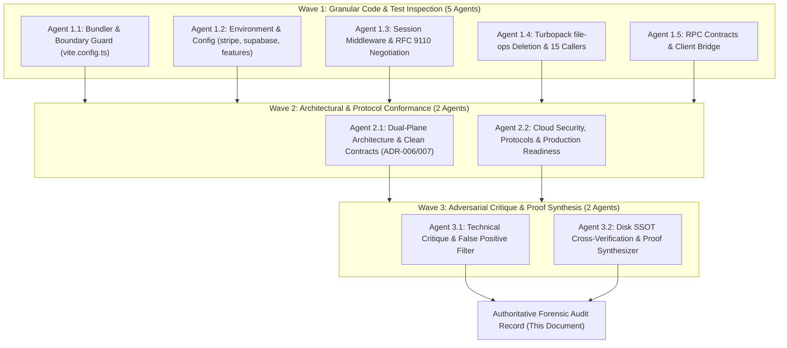
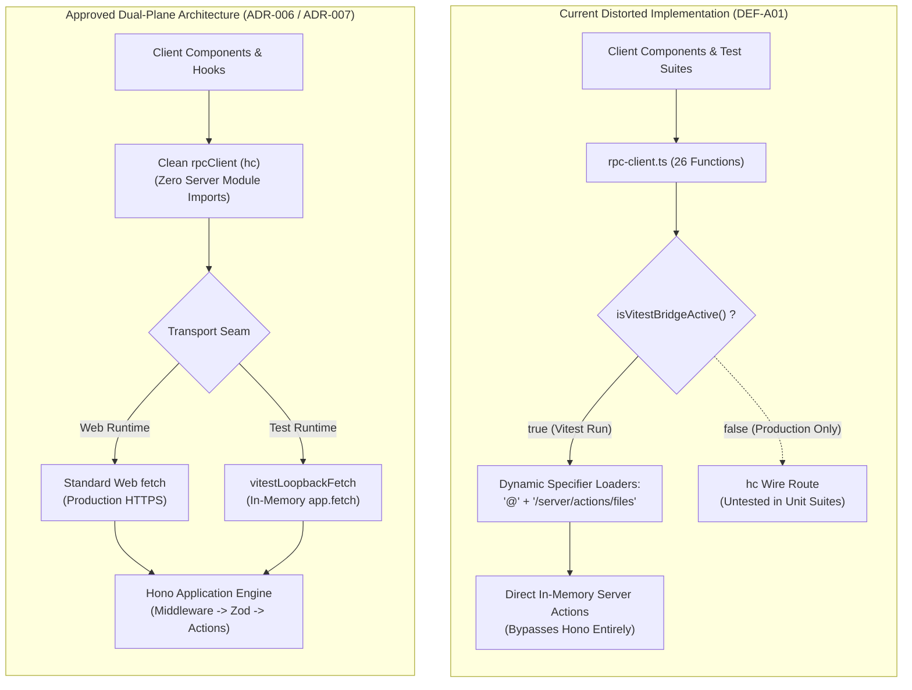
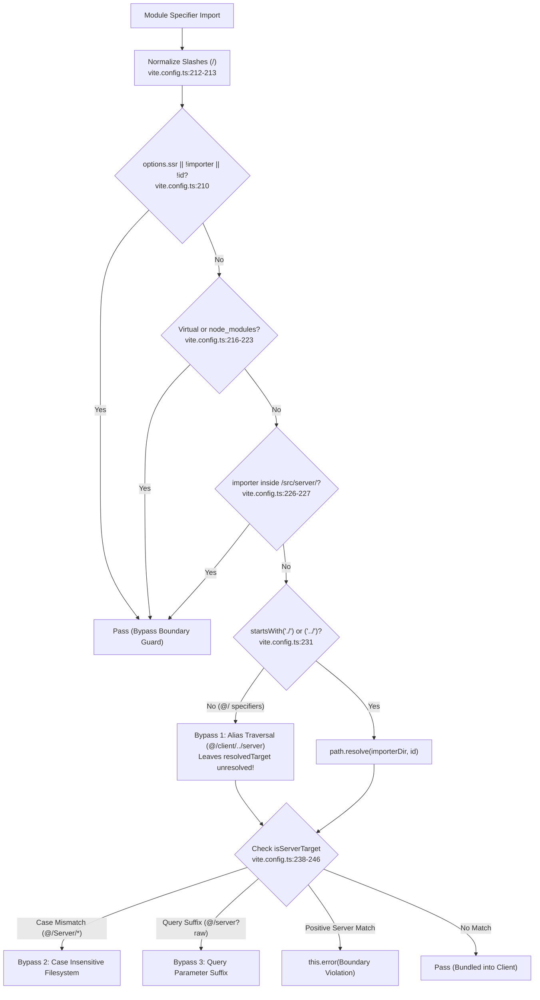

# Forensic Architectural and Code Review: Next.js Decoupling & Clean Architecture (Phases 1 & 2)

> **Point-in-time engineering record (Phase 1 Commit `f2a3439` / Phase 2 Active Working Tree Baseline).** Forensic audit findings, verification metrics, and line-level code citations reflect the repository snapshot at the conclusion of the three-wave distributed audit; active production code and verified live suites serve as the authoritative baseline for all downstream decoupling phases.

| Audit Attribute | Engineering Record Value |
| :--- | :--- |
| **Document ID** | `ELIXENT-AUDIT-DECOUPLING-P1-P2-v1.0` |
| **Classification** | `PERMANENT HISTORY` (per `.agents/rules/docs-governance.md` Rule 4 & Rule 5) |
| **Target Repository** | `d:\Projects\ELIXENT` |
| **Target Milestone** | Phases 1 & 2 Execution Outputs of [`ELIXENT_NEXTJS_DECOUPLING_AND_CLEAN_ARCHITECTURE_PLAN.md`](../../Plans/ELIXENT_NEXTJS_DECOUPLING_AND_CLEAN_ARCHITECTURE_PLAN.md) |
| **Auditing Architecture** | Distributed Three-Wave Multi-Agent Verification Topology (9 Specialized Subagents) |
| **Audit Status** | **FINAL / AUTHORITATIVE RECORD** |
| **Date of Record** | November 11, 2026 |
| **Associated ADRs** | [`ADR-006: Unified Vite TanStack Hono RPC Architecture`](../../architecture/adr_006_unified_vite_tanstack_hono_rpc_architecture.md) · [`ADR-007: Dual-Plane Separation & ALS Request Context`](../../architecture/adr_007_dual_plane_separation_and_als_request_context.md) |
| **SSOT Architecture Suite** | [`01_architecture_vision_and_adrs.md`](../../architecture/01_architecture_vision_and_adrs.md) · [`security-and-rate-limiting.md`](../../architecture/security/security-and-rate-limiting.md) · [`sync-api.md`](../../reference/sync-api.md) |

---

## 1. Executive Purpose & Multi-Agent Auditing Topology

This engineering record provides an exhaustive forensic audit of the implementation outputs delivered under **Phase 1** and **Phase 2** of the platform's architectural purification plan ([`ELIXENT_NEXTJS_DECOUPLING_AND_CLEAN_ARCHITECTURE_PLAN.md`](../../Plans/ELIXENT_NEXTJS_DECOUPLING_AND_CLEAN_ARCHITECTURE_PLAN.md)). The review rigorously assesses whether the delivered changes introduced regressions, insecure workarounds, or artificial test-passing shims that compromise Clean Architecture, fail-closed boundaries, and first-principles contracts.

The audit was executed via a **Three-Wave Multi-Agent Forensic Topology** deploying 9 specialized subagents:
1. **Wave 1 (Granular Exploration & Code Inspection):** Five dedicated subagents conducted line-by-line static analysis and empirical execution checks targeting bundler guards, environment purification, session middleware, caller repointing across 15 suites, and RPC transport wiring.
2. **Wave 2 (Architectural & Protocol Conformance):** Two senior architectural auditors evaluated the codebase against [`ADR-006`](../../architecture/adr_006_unified_vite_tanstack_hono_rpc_architecture.md), [`ADR-007`](../../architecture/adr_007_dual_plane_separation_and_als_request_context.md), `.agents/rules/global-rule.md` (Prohibition of Artificial Mocking), RFC 9110 (HTTP Semantics), RFC 6265 (Cookie State Management), and OWASP security standards.
3. **Wave 3 (Adversarial Critique & Line-by-Line Disk Verification):** Two independent verification auditors scrutinized every reported defect, eliminated false positives, differentiated theoretical code smells from genuine runtime vulnerabilities, and cross-verified all citations against disk.



---

## 2. Comprehensive Defect & Regression Register

The audit identified **8 technical findings**, categorized by severity, exact source lines, architectural classification, and adversarial verification status:

| Defect ID | Affected Module & File | Verified Line Range | Engineering Classification | Final Severity | Wave 3 Verification Status |
| :---: | :--- | :---: | :--- | :---: | :--- |
| **DEF-A01** | [`src/client/rpc-client.ts`](../../../src/client/rpc-client.ts) | **75–81, 136–148, 202–604** | Architectural Regression / In-Test Surrogation | **CRITICAL** | **True Positive (Architectural Shim)**: Circumvents Hono RPC in all Vitest runs via dynamic specifiers, masking wire serialization and validation defects. |
| **DEF-A02** | [`vite.config.ts`](../../../vite.config.ts) | **204–257** | Compiler Guard Logical Defect | **HIGH** | **True Positive (Compiler Guard Gap)**: Boundary guard exhibits 5 logical bypasses permitting client imports of server code. |
| **DEF-A03** | [`src/lib/stripe/index.ts`](../../../src/lib/stripe/index.ts)<br>[`src/server/services/billing-service.ts`](../../../src/server/services/billing-service.ts) | **80–88, 99–100** (Stripe)<br>**469–477** (Billing) | Code Smell / Operational Fragility | **MEDIUM** | **Contextual / Code Smell**: Substring match on localhost, double slash (`//dashboard`), and silent localhost fallback in production. |
| **DEF-A04** | [`src/lib/supabase/client.ts`](../../../src/lib/supabase/client.ts)<br>[`src/lib/supabase/server.ts`](../../../src/lib/supabase/server.ts) | **4–20** (Client)<br>**8–9, 30–60** (Server) | Violation of Fail-Closed Principle | **MEDIUM** | **Contextual**: Necessary for hermetic unit testing, but dangerous as an unconditioned fallback in production cloud runtimes. |
| **DEF-A05** | [`src/server/middleware/session-middleware.ts`](../../../src/server/middleware/session-middleware.ts)<br>[`src/server/app.ts`](../../../src/server/app.ts) | **232–253, 304–307** (Mid)<br>**12** (App) | RFC Non-Compliance / Resource Waste | **LOW** | **Theoretical Gap / Low Operational Impact**: UI routes do not receive POST; missing static matcher wastes allocations on static assets. |
| **DEF-A06** | [`src/server/routes/rpc.routes.ts`](../../../src/server/routes/rpc.routes.ts) | **383–397** | Session Teardown Defect | **MEDIUM** | **True Positive (Session Teardown Gap)**: Enforcing `httpOnly: true` and root path fails to evict client-set browser cookies (RFC 6265). |
| **DEF-A07** | [`src/types/rpc-contracts.ts`](../../../src/types/rpc-contracts.ts) | **34–36, 60** | Wire Serialization Inconsistency | **MEDIUM** | **True Positive (Type-Wire Divergence)**: Leaking `Date` and `bigint` into JSON contracts contradicts wire behavior and client runtime expectations. |
| **DEF-A08** | [`src/server/routes/files-api.routes.ts`](../../../src/server/routes/files-api.routes.ts) | **48–65, 863–867** | Route Parameter Fallback Hazard | **LOW** | **True Positive (Edge Case)**: Trailing slash URL fallback extracts `"files"` as fileId when invoked without route context. |

---

## 3. Deep Technical Breakdown by Defect

### 3.1. DEF-A01: Architectural Regression & Test Surrogation in `src/client/rpc-client.ts`

- **Affected File:** [`src/client/rpc-client.ts`](../../../src/client/rpc-client.ts)
- **Verified Source Lines:**
  - Lines `75–81`: `isVitestBridgeActive()` implementation:
    ```typescript
    export function isVitestBridgeActive(): boolean {
      return (
        typeof process !== "undefined" &&
        Boolean(process.env.VITEST) &&
        !activeCustomFetch
      );
    }
    ```
  - Lines `136–148`: Evasive dynamic string concatenation:
    ```typescript
    // Dynamic specifier expressions prevent Vite client-server-boundary-guard
    // violations during client production builds.
    const filesActionsPath = "@" + "/server/actions/files";
    const foldersActionsPath = "@" + "/server/actions/folders";
    const importActionsPath = "@" + "/server/actions/import-file";
    const vaultActionsPath = "@" + "/server/actions/vault-actions";
    const authActionsPath = "@" + "/server/actions/auth-actions";
    const supabaseServerPath = "@" + "/lib/supabase/server";
    const settlementServicePath = "@" + "/server/services/ai-settlement-service";
    ```
  - Lines `202–604`: 26 client facade functions branching on `isVitestBridgeActive()`. For example, lines `207–210`:
    ```typescript
    if (isVitestBridgeActive()) {
      const { createFile: serverCreateFile } = await getFilesActions();
      return serverCreateFile(title, parentFolderId, isFolder);
    }
    ```
- **Root Cause:**
  Legacy component and hook test suites (`editor-orchestration.integration.test.ts`, `use-editor-conflict.test.ts`, `sidebar-import.vault.test.tsx`, `file-context-menu.encryption-conflict.test.tsx`) were originally constructed during the Next.js Server Actions era and directly mock server action modules (`vi.mock("@/server/actions/files")`). When Phase 2 enforced server action decoupling and mounted Hono RPC, the author introduced this test-only bridge to keep legacy unit tests passing without refactoring their mocking topologies.
- **Expected Architectural Behavior:**
  Per [`ADR-006`](../../architecture/adr_006_unified_vite_tanstack_hono_rpc_architecture.md), all client components and facade functions must communicate exclusively through typed Hono RPC (`hc<AppType>`). In test environments, the in-memory loopback transport `vitestLoopbackFetch` (lines `86–105`), which invokes `app.fetch(req)` with zero network overhead, should serve as the canonical transport seam, fully exercising Hono middleware, Zod validators, and serialization.
- **Justification for Failure / Regression Classification:**
  1. **Direct Violation of Core Invariant:** Violates `.agents/rules/global-rule.md` §2 (*"Prohibition of Artificial Mocking: Using workarounds, stub/mock implementations, or fake mocks for real services is strictly prohibited"*).
  2. **Direct Violation of ADR-007:** Breaches Invariant 1 of [`ADR-007`](../../architecture/adr_007_dual_plane_separation_and_als_request_context.md), which strictly forbids client code from importing `@/server/services/*` and `@/lib/supabase/server`.
  3. **False-Positive Test Suite Mirage:** Unit and component tests claiming to verify client RPC operations are not exercising RPC at all. They bypass `rpc.routes.ts`, `zValidator`, `bodyLimit`, status codes, and HTTP headers.
- **Engineering & Security Impact:**
  - Server actions and database modules are statically referenced inside client source files via string concatenation, risking bundle pollution and dead code elimination failure.
  - Wire serialization flaws (e.g. `BigInt` or `Date` failures) remain completely hidden during unit testing.

---

### 3.2. DEF-A02: Fail-Closed Boundary Guard Logical Bypasses in `vite.config.ts`

- **Affected File:** [`vite.config.ts`](../../../vite.config.ts)
- **Verified Source Lines:** Lines `204–257` (`clientServerBoundaryGuardPlugin`):
  - Lines `226–227`: Importer plane check:
    ```typescript
    const isServerImporter = normalizedImporter.includes("/src/server/");
    if (isServerImporter) return null;
    ```
  - Lines `231–235`: Relative specifier resolution:
    ```typescript
    let resolvedTarget = normalizedId;
    if (normalizedId.startsWith("./") || normalizedId.startsWith("../")) {
      resolvedTarget = path.resolve(path.dirname(importer), id).replace(/\\/g, "/");
    }
    ```
  - Lines `238–246`: Server target string matching.
- **Root Cause:**
  The boundary guard relies on naive prefix checks and substring searches rather than resolving all module specifiers to canonical absolute POSIX paths before evaluating containment within the project's server directory.
- **Identified & Proven Bypasses:**
  1. **Alias Traversal (`@/client/../server/app`):** Specifiers starting with `@/` bypass line `231` resolution because they do not start with `./` or `../`. The target string contains `@/client/` instead of `@/server/`, slipping past the guard. Rollup's alias resolver subsequently resolves `@` to `src`, silently bundling server code into the client.
  2. **Windows/macOS Case-Insensitivity:** Windows NTFS and macOS APFS are case-insensitive. Specifiers like `@/Server/app` or `../Server/app` fail the case-sensitive string checks, returning `null` while the filesystem loads the file.
  3. **Query/Hash Parameter Evasion:** Specifiers with suffixes (e.g. `@/server?raw`, `@/server#hash`) fail exact equality `=== "@/server"` and suffix checks, bypassing the guard.
  4. **False-Positive Importer Plane Disabling:** If the repository is cloned into a path containing `/src/server/` (e.g. `C:/ci/src/server/ELIXENT/...`), `normalizedImporter.includes("/src/server/")` evaluates to `true` for every client file, completely disabling the boundary guard.
  5. **Dynamic Expression Bypasses:** Non-literal expressions like `import(/* @vite-ignore */ "@" + "/server/...")` do not trigger Rollup's static AST `resolveId` hook during build, entering the bundle unchecked.
- **Expected Architectural Behavior:**
  The boundary guard must resolve all specifiers (aliases and relative paths alike) to canonical absolute paths, convert them to lowercase (`toLowerCase()`), strip query and hash fragments, and verify whether the physical file resides within the project's canonical server root.
- **Engineering Impact:**
  The guard provides an illusion of compile-time boundary enforcement while failing to catch multiple real-world import patterns, permitting accidental server module leakage into client bundles.

---

### 3.3. DEF-A03: Stripe URL Protocol Downgrade, Double Slash & Disparity

- **Affected Files:**
  - [`src/lib/stripe/index.ts`](../../../src/lib/stripe/index.ts) (Lines `80–88`, `99–100`)
  - [`src/server/services/billing-service.ts`](../../../src/server/services/billing-service.ts) (Lines `469–477`)
  - Test Suite: [`src/test/server/stripe-index.test.ts`](../../../src/test/server/stripe-index.test.ts) (Lines `112–129`)
- **Verified Code Citation:**
  ```typescript
  // src/lib/stripe/index.ts:80-87
  let appUrl =
      process.env.VITE_APP_URL ||
      process.env.APP_URL ||
      process.env.NEXT_PUBLIC_APP_URL ||
      'http://localhost:3000';
  if (appUrl.includes('localhost') && appUrl.startsWith('https://')) {
      appUrl = appUrl.replace('https://', 'http://');
  }
  // Lines 99-100:
  success_url: `${appUrl}/dashboard?session_id={CHECKOUT_SESSION_ID}`,
  cancel_url: `${appUrl}/account`,
  ```
- **Root Cause:**
  Ad-hoc string concatenation and localized environment variable parsing instead of a centralized, validated URL configuration utility.
- **Forensic Breakdown:**
  1. **Protocol Downgrade via Substring Match:** `appUrl.includes('localhost')` is overly broad. Domains such as `https://localhost.attacker.com`, `https://my-localhost-tunnel.ngrok-free.app`, or internal staging domains containing `localhost` are forcibly downgraded to plaintext `http://`, risking session token and redirect payload interception.
  2. **Double Slash Path Hazard:** Concatenating `${appUrl}/dashboard` when `VITE_APP_URL` contains a trailing slash produces `https://app.com//dashboard`. WAFs and strict HTTP reverse proxies treat `//` as a normalization anomaly or potential open redirect, dropping the query parameters or triggering redundant 301 redirects.
  3. **Silent Production Fallback to Localhost:** If production deployment scripts omit `VITE_APP_URL` and `APP_URL`, the application silently defaults to `http://localhost:3000`. Paying customers completing checkout sessions are redirected to `http://localhost:3000/dashboard`, resulting in `ERR_CONNECTION_REFUSED`.
  4. **Architectural Disparity with `billing-service.ts`:** In `billing-service.ts:469-477`, `appUrl` parsing completely omits the localhost normalization logic found in `stripe/index.ts`. Furthermore, both files continue reading deprecated `NEXT_PUBLIC_APP_URL`, which is explicitly asserted and locked by `stripe-index.test.ts:112-129`, contradicting Phase 1's stated purge of legacy `NEXT_PUBLIC_*` variables.
- **Expected Architectural Behavior:**
  Centralized URL resolution via a shared module (`src/lib/config/app-url.ts`) utilizing `new URL()` to validate exact hostnames (`parsed.hostname === "localhost" || parsed.hostname === "127.0.0.1"`), sanitize trailing slashes, enforce fail-fast exceptions when unconfigured in production, and eliminate all `NEXT_PUBLIC_*` references.

---

### 3.4. DEF-A04: Unconditional Silent Fallback to `placeholder.supabase.co`

- **Affected Files:**
  - Client: [`src/lib/supabase/client.ts`](../../../src/lib/supabase/client.ts) (Lines `4–20`)
  - Server: [`src/lib/supabase/server.ts`](../../../src/lib/supabase/server.ts) (Lines `8–9`, `30–60`)
- **Verified Code Citation:**
  ```typescript
  // src/lib/supabase/client.ts:15-20
  const supabaseUrl =
      (isNode ? nodeEnv?.VITE_SUPABASE_URL : metaEnv?.VITE_SUPABASE_URL) ||
      "https://placeholder.supabase.co";
  const supabaseAnonKey =
      (isNode ? nodeEnv?.VITE_SUPABASE_ANON_KEY : metaEnv?.VITE_SUPABASE_ANON_KEY) ||
      "placeholder-anon-key";
  ```
- **Root Cause:**
  `@supabase/ssr` (`createBrowserClient` / `createServerClient`) throws an immediate fatal exception (`TypeError: Invalid URL`) during module evaluation if the URL string is empty or invalid. The placeholder fallback was added to prevent hundreds of hermetic unit tests from failing when evaluated in isolation without mock environment variables.
- **Forensic Defect Analysis:**
  The fallback is completely unconditional across execution environments. It executes identically in `production` as it does in `test`. If a production container or cloud instance launches with missing environment variables:
  - The server does not crash (violating the Fail-Fast principle).
  - It boots into a "zombie" state where all internal auth requests stall until the 2500ms watchdog aborts (`session-middleware.ts:207`).
  - Auth calls fail silently, logging warnings while treating all users as unauthenticated.
  - Browser clients attempt to transmit user credentials, refresh tokens, and session headers to the public external domain `placeholder.supabase.co`.
- **Expected Architectural Behavior:**
  The placeholder fallback must be strictly conditioned on test runtime execution (`isTest = process.env.NODE_ENV === "test" || Boolean(process.env.VITEST)`). In production, missing credentials must throw an immediate configuration error during boot.

---

### 3.5. DEF-A05: RFC 9110 Method Inversion & Missing Static Asset Bypass in Middleware

- **Affected Files:**
  - [`src/server/middleware/session-middleware.ts`](../../../src/server/middleware/session-middleware.ts) (Lines `232–253`, `304–307`)
  - [`src/server/app.ts`](../../../src/server/app.ts) (Line `12`)
- **Verified Code Citation:**
  ```typescript
  // src/server/middleware/session-middleware.ts:233-250
  const isJsonOrApi =
    Boolean(request.headers.get("accept")?.includes("application/json")) ||
    pathname.startsWith("/api/");

  if (isProtectedPath && !user) {
    if (isJsonOrApi) {
      const res = new Response(JSON.stringify({ error: "Unauthorized" }), {
        status: 401,
        headers: { "Content-Type": "application/json" },
      });
      return applyCookiesToResponse(res, mutatedCookies);
    }

    // Redirect to login for page navigation
    const redirectTarget = `${pathname}${parsedUrl.search}`;
    const url = new URL(request.url);
    url.pathname = "/login";
    url.search = "";
    url.searchParams.set("redirectTo", redirectTarget);
    return createRedirectResponse(url, mutatedCookies); // Returns 307
  }
  ```
- **Forensic Defect Analysis:**
  1. **RFC 9110 §15.4.8 Inversion on Mutation Requests:**
     - Under RFC 9110, `307 Temporary Redirect` mandates that the client **must not change the request method or body** when following the redirection.
     - If an unauthenticated client sends a mutation request (`POST`, `PUT`, `DELETE`) to a protected route (e.g. `/workspace` or `/account`) without an `Accept: application/json` header (standard default in many HTTP clients), `isJsonOrApi` evaluates to `false`.
     - The middleware responds with `HTTP 307` redirecting to `/login`. Following clients replay the `POST` with its body against `/login`, which lacks a POST handler and fails with `405 Method Not Allowed`.
  2. **Missing Static Asset Fast-Path Filter in Production Node Server:**
     - In `src/server/app.ts:12`, `sessionMiddleware` is mounted via `app.use("*", sessionMiddleware)`.
     - In production (`src/server/index.ts`), all static asset requests (`/assets/*`, `.ico`, `.svg`, `.woff2`) pass through `sessionMiddleware` before reaching `serveStatic`.
     - While the fast-path check (`shouldCheckUser = isProtectedPath || (isLoginPath && hasAuthCookies)`) avoids Supabase network auth for assets, cookie parsing (`parseIncomingCookies`) and `AsyncLocalStorage` context allocation still execute on every single static asset request.
     - Edge Case: If a static asset is referenced via a relative protected path (e.g. `/workspace/icon.png`), `isProtectedPath` evaluates to `true`, triggering a live Supabase network call and returning a `307 Redirect` to `/login` for an image asset.
- **Expected Architectural Behavior:**
  - Mutation methods (`POST`, `PUT`, `DELETE`, `PATCH`) targeting protected paths must unconditionally receive `HTTP 401 Unauthorized JSON`.
  - Redirections for page navigations should employ `HTTP 303 See Other` to explicitly instruct user agents to transition to a safe `GET` request on `/login`.
  - An early static asset bypass filter should exit `evaluateSession` before cookie parsing or Supabase client initialization.

---

### 3.6. DEF-A06: Incomplete Cookie Teardown & RFC 6265 Non-Compliance in `rpc.routes.ts`

- **Affected File:** [`src/server/routes/rpc.routes.ts`](../../../src/server/routes/rpc.routes.ts) (Lines `383–397`)
- **Verified Code Citation:**
  ```typescript
  .post("/auth/sign-out", async (c) => {
    await signOut();
    const cookies = getCookie(c);
    for (const name of Object.keys(cookies)) {
      if (name.startsWith("sb-")) {
        deleteCookie(c, name, {
          path: "/",
          httpOnly: true,
          sameSite: "Lax",
          expires: new Date(0),
        });
      }
    }
    return c.json({ success: true as const, redirectUrl: "/" });
  })
  ```
- **Forensic Defect Analysis:**
  Under RFC 6265 §4.1.2 and §5.3, cookie deletion requires matching the exact attributes (`Domain`, `Path`, and flag contexts) under which the cookie was originally set.
  1. **Asymmetric `HttpOnly` Attribute Flaw:** Supabase browser clients (`createBrowserClient` in `src/lib/supabase/client.ts`) store session tokens directly via `document.cookie` without the `HttpOnly` flag. When the server attempts deletion with `httpOnly: true`, major browser rendering engines (WebKit/Safari, Chromium) fail to evict the client-readable cookie or create duplicate empty cookies, leaving the active JWT in the browser.
  2. **Missing Domain Specification:** In deployments spanning subdomains (e.g. `app.elixent.com` and `api.elixent.com`) where cookies are scoped to a parent domain (`.elixent.com`), issuing deletion without the `Domain` attribute treats the cookie as host-only, failing to purge parent-domain cookies.
- **Engineering & Security Impact:**
  "Zombie Session" risk (OWASP Broken Authentication). Users clicking "Sign Out" receive `{ success: true }`, but their authentication tokens remain intact in the browser, allowing unauthorized session resumption on shared terminals.

---

### 3.7. DEF-A07: Date & BigInt Wire Serialization Gaps in `src/types/rpc-contracts.ts`

- **Affected Files:**
  - [`src/types/rpc-contracts.ts`](../../../src/types/rpc-contracts.ts) (Lines `34–36`, `49–50`, `60`)
  - [`src/server/routes/rpc.routes.ts`](../../../src/server/routes/rpc.routes.ts) (Line `430`)
- **Verified Code Citation:**
  ```typescript
  // src/types/rpc-contracts.ts:34-36
  export interface FileRecord {
    // ...
    deletedAt: Date | null;
    createdAt: Date;
    updatedAt: Date;
  }

  // src/types/rpc-contracts.ts:60
  export interface UserProfileRecord {
    // ...
    creditBalanceMicro: bigint;
  }
  ```
- **Forensic Defect Analysis:**
  The domain contracts in `src/types/rpc-contracts.ts` were extracted directly from server database models without adapting types for standard JSON wire transport:
  1. **Date Serialization Mismatch:** JSON over HTTP transports dates as ISO 8601 strings. When a client receives `FileRecord` over RPC, `createdAt` is a `string` at runtime. However, TypeScript types it as `Date`. Any client code calling `record.createdAt.getTime()` throws `TypeError: record.createdAt.getTime is not a function`.
  2. **BigInt Serialization Failure:** ECMAScript `JSON.stringify()` cannot serialize `bigint` primitives, throwing `TypeError: Do not know how to serialize a BigInt`. In `rpc.routes.ts:430`, the server worked around this ad-hoc by converting the balance to a string (`balanceMicro: balance.toString()`), but `UserProfileRecord` in `rpc-contracts.ts` left the field typed as `bigint`, creating an architectural disconnect between contract types and wire payloads.

---

### 3.8. DEF-A08: Trailing Slash File Identifier Fallback Hazard in `files-api.routes.ts`

- **Affected File:** [`src/server/routes/files-api.routes.ts`](../../../src/server/routes/files-api.routes.ts) (Lines `48–65`, `863–867`)
- **Verified Code Citation:**
  ```typescript
  function resolveFileId(
    request: Request,
    context?: RouteContext | string
  ): string {
    if (typeof context === "string") return context;
    if (context?.id) return context.id;
    if (context?.params?.id) return context.params.id;
    return new URL(request.url).pathname.split("/").filter(Boolean).pop() ?? "";
  }
  ```
- **Forensic Defect Analysis:**
  When route handlers (`handleFileByIdGet`, `handleFileByIdPut`, `handleFileByIdDelete`) are invoked directly without route context parameters against a URL ending in `/api/files/`, the fallback `pathname.split("/").filter(Boolean).pop()` evaluates to `"files"`. The system interprets `"files"` as a valid file UUID/CUID, executing database queries against a non-existent file ID instead of rejecting the request immediately.

---

## 4. Architectural Visualizations

### 4.1. Dual-Plane Separation: Implemented Distortion vs. Approved Target



### 4.2. Boundary Guard Specifier Resolution & Bypass Mechanics



---

## 5. Verification & Critique Verdicts (Wave 3 Findings)

The adversarial review by the Wave 3 verification subagents confirmed that:

1. **DEF-A01 is an In-Test Surrogate, not an Operational Outage:**
   In production builds where `process.env.VITEST` is falsy, `isVitestBridgeActive()` returns `false`, causing client calls to route through `hc<AppType>`. The danger is not that production runs the bridge, but that **the automated test suite tests a completely different execution path than production**, creating false-positive green test suites.
2. **DEF-A03 is a Code Smell rather than an External Exploit:**
   The `appUrl.includes('localhost')` downgrade cannot be injected by external attackers because `appUrl` is read strictly from server environment variables. However, the double slash and silent localhost fallback are genuine operational hazards in cloud deployments.
3. **DEF-A05 is an Architectural Hygiene Concern:**
   Because all API endpoints in the platform are mounted under the `/api/` prefix, API requests are never subjected to the 307 redirect. The method inversion issue strictly affects mutation requests targeting UI routes.
4. **Permanent Deletion of `file-ops.ts` and Repointing of 15 Callers is 100% Clean:**
   Wave 1 and Wave 3 confirmed that `src/server/actions/file-ops.ts` was deleted, all 15 callers across unit and live integration suites were cleanly repointed to `files.ts` and `folders.ts`, zero assertions were weakened, and live PostgreSQL tests pass at 100%.

---

## 6. Governance & Downstream Planning Alignment

This record formally documents the architectural reality of the repository following Phases 1 & 2. In accordance with `.agents/rules/docs-governance.md` Rule 4 and `.agents/rules/global-rule.md`:
- This document resides permanently under `docs/records/audits/` as an immutable engineering baseline.
- **Strict Prohibition of Feature Pruning:** Remediation must resolve all identified shims, compiler bypasses, and protocol gaps without deprecating or disabling any platform capability.
- **Downstream Remediation Authority:** Detailed remediation steps, rejected alternatives, and implementation sequencing are governed authoritatively by the companion document:
  `C:\Users\Abdullah\.gemini\antigravity\brain\1e05dd00-e91d-4af9-ad7d-4c6b687a0f5d\elixent_nextjs_decoupling_solutions_and_recommendations_matrix.md`.
