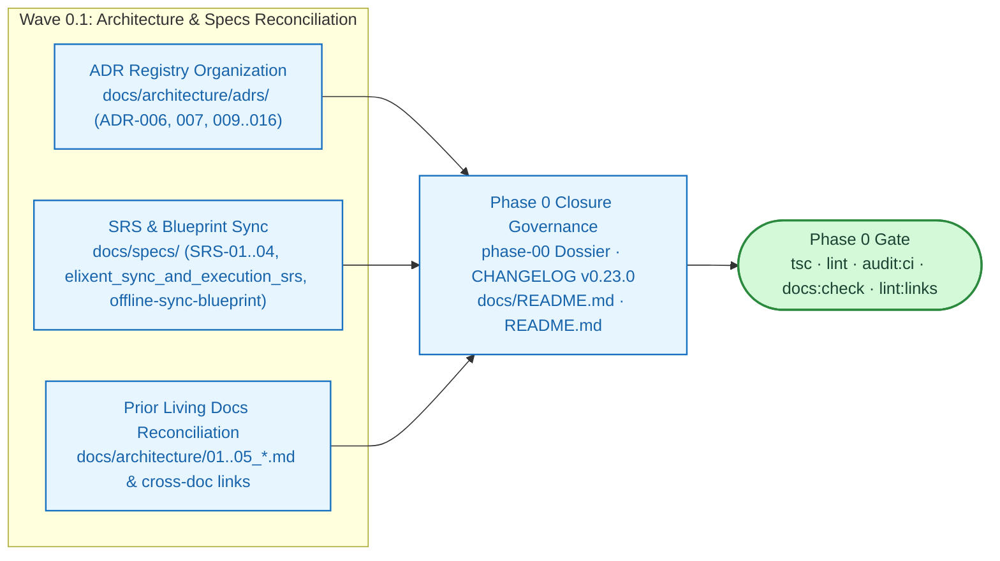

# Phase 0 Closure Dossier: Prior-ADR Conflict Resolution & Living Documentation Reconciliation

| Standard Field | Value |
| :--- | :--- |
| **Phase** | `Phase 0: Prior-ADR Conflict Resolution & Living Documentation Reconciliation` |
| **Milestone / Version** | `v0.23.0` |
| **Status** | `CLOSED / VERIFIED (Docs-Only Phase — Test Suites Skipped per User Authorization)` ✅ |
| **Closure Date** | `2026-11-18` |
| **Governing Plan** | [`elixent-architectural-evolution-execution-plan.md`](../../plans/elixent-architectural-evolution-execution-plan.md) (`ELIXENT-EXECUTION-PLAN-v1.1` — **Active** across Phases 0–6; Phase 0 Closed, Phases 1–6 Active) |
| **Associated ADRs** | [`ADR-006`](../../../architecture/adrs/adr_006_unified_vite_tanstack_hono_rpc_architecture.md) · [`ADR-007`](../../../architecture/adrs/adr_007_dual_plane_separation_and_als_request_context.md) · [`ADR-009`](../../../architecture/adrs/adr_009_native_graph_orchestration_engine.md) · [`ADR-010`](../../../architecture/adrs/adr_010_replay_safe_node_boundary_topology.md) · [`ADR-011`](../../../architecture/adrs/adr_011_multi_workspace_data_isolation_model.md) · [`ADR-012`](../../../architecture/adrs/adr_012_json_decision_ledger_and_graph_traversal.md) · [`ADR-013`](../../../architecture/adrs/adr_013_epistemic_framing_decoupling_system2_system1.md) · [`ADR-014`](../../../architecture/adrs/adr_014_deterministic_change_weight_and_anti_domino_gate.md) · [`ADR-015`](../../../architecture/adrs/adr_015_two_tier_workspace_undo_and_turn_rollback.md) · [`ADR-016`](../../../architecture/adrs/adr_016_zk_encryption_granularity_and_ephemeral_ai_bridge.md) |
| **Companion SRS Suite** | [`SRS-01`](../../../specs/srs_01_agent_orchestration_decision_graph_and_weight_engine.md) · [`SRS-02`](../../../specs/srs_02_multi_workspace_isolation_and_zk_vault_governance.md) · [`SRS-03`](../../../specs/srs_03_editor_tabs_multi_ghost_review_and_two_tier_undo.md) · [`SRS-04`](../../../specs/srs_04_multi_provider_ai_gateway_and_wallet_metering.md) · [`elixent_sync_and_execution_srs.md`](../../../specs/elixent_sync_and_execution_srs.md) |
| **SSOT Architecture Suite** | [`01_architecture_vision_and_adrs.md`](../../../architecture/01_architecture_vision_and_adrs.md) · [`02_agent_orchestration_and_decision_engine.md`](../../../architecture/02_agent_orchestration_and_decision_engine.md) · [`03_workspace_ast_editor_and_vault_integration.md`](../../../architecture/03_workspace_ast_editor_and_vault_integration.md) · [`04_credit_metering_and_settlement_architecture.md`](../../../architecture/04_credit_metering_and_settlement_architecture.md) · [`05_data_contracts_and_lugx_migration_plan.md`](../../../architecture/05_data_contracts_and_lugx_migration_plan.md) · [`offline-sync-blueprint.md`](../../../specs/offline-sync-blueprint.md) |

---

## 1. Executive Summary

Phase 0 establishes the architectural documentation baseline for the **Elixent Architectural Evolution & Requirements Execution Plan (`ELIXENT-EXECUTION-PLAN-v1.1`)** by integrating the `ADR-009`–`ADR-016` registry and `SRS-01`–`SRS-04` specifications into `docs/`, organizing standalone ADRs under `docs/architecture/adrs/` and SRS documents under `docs/specs/`, and reconciling all supersessions and amendments across the prior living architecture suite (`01`–`05`), `ADR-006`, `ADR-007`, and `offline-sync-blueprint.md`.

Because Phase 0 modified documentation artifacts only (`0` changes in `src/**` at closure), the active plan [`elixent-architectural-evolution-execution-plan.md`](../../plans/elixent-architectural-evolution-execution-plan.md) remains in `docs/Plans/` for Phases 1–6 execution, and test suites (`npm run test`, `npm run test:live`, `npm run test:e2e`) were skipped by explicit user authorization while preserving the verified [`METRICS.json`](../../../METRICS.json) baseline.

---

## 2. Phase 0 Reconciliation Scope & Deliverables

### 2.1. Structural Organization & New Specifications
- **Standalone ADR Registry (`docs/architecture/adrs/`):**
  - Relocated [`adr_006_unified_vite_tanstack_hono_rpc_architecture.md`](../../../architecture/adrs/adr_006_unified_vite_tanstack_hono_rpc_architecture.md) and [`adr_007_dual_plane_separation_and_als_request_context.md`](../../../architecture/adrs/adr_007_dual_plane_separation_and_als_request_context.md) from `docs/architecture/` into `docs/architecture/adrs/` and updated cross-document relative links across living docs, audits, completed plans, and historical closure dossiers.
  - Added [`ADR-009`](../../../architecture/adrs/adr_009_native_graph_orchestration_engine.md) through [`ADR-016`](../../../architecture/adrs/adr_016_zk_encryption_granularity_and_ephemeral_ai_bridge.md).
- **Specifications Registry (`docs/specs/`):**
  - Relocated [`elixent_sync_and_execution_srs.md`](../../../specs/elixent_sync_and_execution_srs.md) from `docs/architecture/` to `docs/specs/`.
  - Added [`SRS-01`](../../../specs/srs_01_agent_orchestration_decision_graph_and_weight_engine.md), [`SRS-02`](../../../specs/srs_02_multi_workspace_isolation_and_zk_vault_governance.md), [`SRS-03`](../../../specs/srs_03_editor_tabs_multi_ghost_review_and_two_tier_undo.md), and [`SRS-04`](../../../specs/srs_04_multi_provider_ai_gateway_and_wallet_metering.md).
  - Updated `SRS-02` (`§5` and `§6.2`) to specify the pre-production clean-cut purge of `AAD.legacy` (`lugx:v1:*` fallback removal) in favor of exclusive `zk:v1:*` enforcement.
- **Active Execution Plan (`docs/Plans/`):**
  - Published [`elixent-architectural-evolution-execution-plan.md`](../../plans/elixent-architectural-evolution-execution-plan.md) (`ELIXENT-EXECUTION-PLAN-v1.1`, Phases 0–6) and retained it in `docs/Plans/` while Phases 1–6 remain active.

### 2.2. Living Architecture & Blueprint Reconciliation (`Sub-Agent 0.A`)

| Document | Reconciled Sections | Supersession / Amendment Summary |
| :--- | :--- | :--- |
| [`01_architecture_vision_and_adrs.md`](../../../architecture/01_architecture_vision_and_adrs.md) | `§3.1`, `§3.2`, `§3.3`, `§3.5`, `§3.6` | Marked `ADR-001` superseded by `ADR-009` (`Elixent Native Graph Engine` + `Vercel AI SDK v7`); amended `ADR-002` with `ADR-012`/`013`/`014`; amended `ADR-003` with `ADR-010`/`012`; amended `ADR-005` with `ADR-009` (`agent_checkpoints`) and `ADR-012` (`decisions.ledger.json`); updated `ADR-006`/`ADR-007` relative links to `./adrs/`. |
| [`02_agent_orchestration_and_decision_engine.md`](../../../architecture/02_agent_orchestration_and_decision_engine.md) | `§1`, `§3.1`, `§4.1`, `§5`, `§5.2` | Marked `§1` and `§3.1` LangGraph/`PostgresSaver` specs superseded by `ADR-009`, `ADR-010`, and `SRS-01` (9 replay-safe canonical nodes, 6 state-predicate gates `G-01..G-06`, single-table `agent_checkpoints`); amended `§4.1` for `ADR-013` (`technicalConstraints` & `workspaceEvidence`); amended `§5` & `§5.2` for `decisions.ledger.json` (`ADR-012`) and `computeDecisionChangeWeight` + `evaluateAntiDominoGate` (`ADR-014`). |
| [`03_workspace_ast_editor_and_vault_integration.md`](../../../architecture/03_workspace_ast_editor_and_vault_integration.md) | `§1`, `§2`, `§4`, `§5` | Amended `§1` & `§2` with `ADR-011` and `SRS-02` (`workspaceId` scope, `listWorkspaceTree`, `createWorkspaceFile`, `deleteWorkspaceFile`, open + closed files); amended `§4` with `ADR-015` and `SRS-03` (`WorkspaceTabBar`, `ghostHunksByFileId`, `PendingEditsExitModal`, Two-Tier Undo); amended `§5` with `ADR-016` and `SRS-02` (`allow_ai_on_encrypted_files = true` default, mandatory workspace-wide encryption, `vault_file_commit_required`). |
| [`04_credit_metering_and_settlement_architecture.md`](../../../architecture/04_credit_metering_and_settlement_architecture.md) | `§2.1`, `§3.3`, `§5` | Amended `§2.1` & `§3.3` with `ADR-009` and `SRS-04` (native checkpointer `agent_checkpoints` eliminating node-replay double-billing and single-layer open-ceiling wallet-bounded metering); amended `§5` noting Phase 1 standardization of `lugx:*` Redis keys to `credit:*`. |
| [`05_data_contracts_and_lugx_migration_plan.md`](../../../architecture/05_data_contracts_and_lugx_migration_plan.md) | `§1.3`, `§1.5`, `§3.2` | Marked `§1.3` (`project_decision_ledger`) superseded by `ADR-012` (`decisions.ledger.json`) and `§1.5` (`langgraph-checkpoints.ts`) superseded by `ADR-009` (`agent_checkpoints`); updated `§3.2` `ADR-006` link to `./adrs/`. |
| [`adr_006_unified_vite_tanstack_hono_rpc_architecture.md`](../../../architecture/adrs/adr_006_unified_vite_tanstack_hono_rpc_architecture.md) | Metadata, `§1.1` | Updated `Agent Brain Execution Host` row in `§1.1` from `LangGraph` to `Elixent Native Graph Engine — ADR-009`, and adjusted relative parent links after relocation to `adrs/`. |
| [`offline-sync-blueprint.md`](../../../specs/offline-sync-blueprint.md) | `§1.2` | Added runtime extension notice linking to `ADR-015` and `SRS-03` for `IDBOperation` extensions (`workspaceId`, `threadId`, `turnId`, `postTurnEtag`). |

---

## 3. Verification Gate Evidence

| Check Command | Scope | Result | Notes |
| :--- | :--- | :---: | :--- |
| `npx tsc --noEmit` | Full TypeScript compilation | **PASS (`0` errors)** ✅ | Verified after restoring working tree `src/**` purity (`0` modified source files). |
| `npm run lint` | ESLint 9 flat config | **PASS (`0` errors)** ✅ | Verified clean across repository. |
| `npm run audit:ci` | Production & full tree dependency audit | **PASS (`0` vulnerabilities)** ✅ | Both `--omit=dev` and full tree returned `0` vulnerabilities. |
| `npm run docs:check` | `scripts/sync-doc-metrics.mjs --check` | **PASS (100% synced)** ✅ | Preserves [`METRICS.json`](../../../METRICS.json) baseline (`146` unit / `3,007` tests · `21` live / `105` tests · `14` E2E / `15` tests). |
| `npm run lint:links` | `scripts/check-markdown-links.mjs` | **PASS (`0` broken links)** ✅ | Verified across all Markdown files under `docs/` and root `README.md`. |
| `npm run test`, `npm run test:live`, `npm run test:e2e` | Vitest unit, Neon live DB & Playwright E2E | **SKIPPED (Authorized)** ⏭️ | Explicitly skipped by user authorization because Phase 0 modified documentation files only; baseline metrics in [`METRICS.json`](../../../METRICS.json) remain unchanged from `v0.22.0`. |
