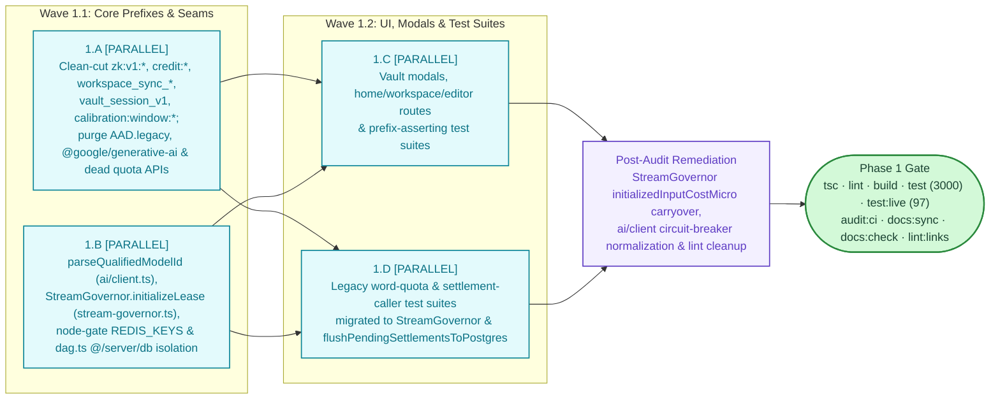

# Phase 1 Closure Dossier: Baseline Pre-Flight Clean Cut, Prefix Standardization & Seam Fixes

| Standard Field | Value |
| :--- | :--- |
| **Phase** | `Phase 1: Baseline Pre-Flight Clean Cut, Prefix Standardization & Seam Fixes` |
| **Milestone / Version** | `v0.24.0` |
| **Status** | `CLOSED / VERIFIED` ✅ |
| **Closure Date** | `2026-11-18` |
| **Governing Plan** | [`elixent-architectural-evolution-execution-plan.md`](../../plans/elixent-architectural-evolution-execution-plan.md) (`ELIXENT-EXECUTION-PLAN-v1.1` — **Active** across Phases 0–6; Phases 0–1 Closed, Phases 2–6 Active) |
| **Associated ADRs** | [`ADR-009`](../../../architecture/adrs/adr_009_native_graph_orchestration_engine.md) · [`ADR-011`](../../../architecture/adrs/adr_011_multi_workspace_data_isolation_model.md) · [`ADR-012`](../../../architecture/adrs/adr_012_json_decision_ledger_and_graph_traversal.md) · [`ADR-016`](../../../architecture/adrs/adr_016_zk_encryption_granularity_and_ephemeral_ai_bridge.md) |
| **Companion SRS Suite** | [`SRS-01`](../../../specs/srs_01_agent_orchestration_decision_graph_and_weight_engine.md) · [`SRS-02`](../../../specs/srs_02_multi_workspace_isolation_and_zk_vault_governance.md) · [`SRS-04`](../../../specs/srs_04_multi_provider_ai_gateway_and_wallet_metering.md) |

---

## 1. Executive Summary

Phase 1 establishes the clean-cut baseline required before multi-workspace schema isolation (`Phase 2`) and the native graph engine (`Phase 3`) are introduced. All cryptographic, browser storage, cross-tab sync, Redis metering, and calibration prefixes were standardized to brand-agnostic identifiers (`zk:v1:*`, `credit:*`, `workspace_sync_*`, `vault_session_v1`, `calibration:window:*`, `editor_direction_pref`, `ocr_bilingual_installed`, `pdf_table_extraction_enabled`), with all pre-production `AAD.legacy`, `lugx:*`, `vault:*`, and `trusted_device:` fallback bridges purged.

In parallel, three foundational architectural seams were completed: `src/core/agent/atms/dag.ts` was isolated from `@/server/db` and `drizzle-orm` to comply with the client/server AST boundary guard, `parseQualifiedModelId` was added in `src/lib/ai/client.ts` (including normalized circuit-breaker keys across structured, tool-agent, and streaming entrypoints), and `StreamGovernor.initializeLease(pessimisticInputTokens)` was implemented in `src/lib/metering/stream-governor.ts` with initialized input token/cost persistence for `settle()`. Unused `@google/generative-ai` and dead word-quota functions in `src/server/services/ai-settlement-service.ts` were removed alongside synchronized updates to all affected unit and live integration test suites.

Because Phases 2–6 of [`elixent-architectural-evolution-execution-plan.md`](../../plans/elixent-architectural-evolution-execution-plan.md) remain open, the multi-phase execution plan stays active in `docs/Plans/`.

---

## 2. Phase 1 Execution Topology & Deliverables

### 2.1. Source & Package Deliverables

| Subsystem / File | Key Changes Verified in Source |
| :--- | :--- |
| `package.json`, `package-lock.json` | Bumped version to `0.24.0` and removed unused `@google/generative-ai` dependency. |
| `src/lib/crypto/aad.ts`, `key-derivation.ts` | Set `AAD_VERSION_V1 = 'zk:v1'`, purged `AAD.legacy`, enforced `'zk:v1:'` in `isCanonicalAAD`, and updated HKDF info strings to `zk:v1:doc-key:${fileId}`, `zk:v1:search-key:${userId}`, and `zk:v1:proof-of-possession:${nonce}`. |
| `src/lib/vault/recovery.ts`, `src/lib/sync/{encryption,sync-crypto-gateway,webauthn-prf}.ts` | Removed all `AAD.legacy`, `computeLegacyAad`, `vault:*`, and `trusted_device:` fallback loops; enforced canonical `zk:v1:*` contexts exclusively. |
| `src/components/vault/{trust-device-modal,vault-unlock-modal}.tsx` | Removed `AAD.legacy.passWrap` fallback branches and updated default WebAuthn placeholder emails from `user@lugx.local` to `user@elixent.local`. |
| `src/lib/sync/{session-key-store,cross-tab-sync,tab-sync}.ts`, `src/lib/parsers/{pdf-ocr-engine,pdf-settings}.ts` | Standardized storage/channel keys to `'vault_session_v1'`, `workspace_sync_${uid}`, `'ocr_bilingual_installed'`, `'ocr-v1'`, and `'pdf_table_extraction_enabled'`. |
| `src/client/routes/{home-page,workspace-page,editor-page}.tsx` | Updated `editor_direction_pref`, aligned `home-page.tsx` brand copy/alt attributes to `Elixent`, and wired `folderId` query synchronization via `useRouter` + `getFolderChildren(folderId)` in `workspace-page.tsx`. |
| `src/lib/metering/{constants,lua-scripts,node-gate}.ts`, `src/lib/jev/calibration-store.ts`, `src/server/routes/cron.routes.ts` | Standardized Redis keys and Lua scripts to `credit:wallet:*`, `credit:lease:*`, `credit:step_done:*`, `credit:pending_settlements:*`, `credit:dirty_wallets`, and `calibration:window:${modelId}`. |
| `src/lib/ai/client.ts` | Exported `ParsedQualifiedModelId` and `parseQualifiedModelId`, updated `getGoogleModel` to use `parsed.qualifiedModelId` for key rotation and `parsed.providerModelName` for `@ai-sdk/google`, and normalized circuit-breaker keys across `executeStructuredGeneration`, `executeToolAgentGeneration`, and `executeStreamingGeneration`. |
| `src/lib/metering/stream-governor.ts` | Implemented `StreamGovernor.initializeLease(pessimisticInputTokens)` with `ensureWalletLoadedFlushFirst` + `executeReserveOrExtend`, persisting `initializedInputTokens` and `initializedInputCostMicro` so `settle()` accurately accounts for initialized input costs when constructor overrides are omitted. |
| `src/core/agent/atms/dag.ts` | Removed `@/server/db`, `drizzle-orm`, and `project-decision-ledger` imports; defined `EvaluatedAlternativeRecord` locally; converted `loadProjectDecisionLedger` and `syncMasterLedgerToProjectStore` into pure in-memory adapter stubs ahead of Phase 3 `IWorkspaceProvider` wiring. |
| `src/server/services/ai-settlement-service.ts` | Permanently deleted `reserveAIQuota`, `commitAIReservation`, `refundAIReservation`, `refundUsage`, `expireStaleReservations`, `getAIReservationStatus`, and `reserveAndUpdateUsage`, retaining `computeRequestHash`, `getUserTier`, `getTodayUsage`, `getUserCreditBalance`, and `flushPendingSettlementsToPostgres`. |

### 2.2. Living Documentation Synchronized

- [`README.md`](../../../../README.md), [`docs/README.md`](../../../README.md), [`docs/METRICS.json`](../../../METRICS.json), [`docs/CHANGELOG.md`](../../../CHANGELOG.md) (`v0.24.0`), and [`docs/TECHNICAL_DEBT_REGISTER.md`](../../../TECHNICAL_DEBT_REGISTER.md).
- Architecture & Subsystem Specs: [`01_architecture_vision_and_adrs.md`](../../../architecture/01_architecture_vision_and_adrs.md), [`04_credit_metering_and_settlement_architecture.md`](../../../architecture/04_credit_metering_and_settlement_architecture.md), [`05_data_contracts_and_lugx_migration_plan.md`](../../../architecture/05_data_contracts_and_lugx_migration_plan.md), [`security-and-rate-limiting.md`](../../../architecture/security/security-and-rate-limiting.md), [`sync-lifecycle-architecture.md`](../../../architecture/sync/sync-lifecycle-architecture.md), [`sync-architecture-overview.md`](../../../architecture/sync/sync-architecture-overview.md), [`three-way-conflict-resolution.md`](../../../architecture/sync/three-way-conflict-resolution.md), [`editor-sync-orchestration.md`](../../../architecture/sync/editor-sync-orchestration.md), [`file-ownership-and-versioning.md`](../../../architecture/sync/file-ownership-and-versioning.md), [`ai-atomic-commit-architecture.md`](../../../architecture/ai/ai-atomic-commit-architecture.md), [`ai-quota-reservation-lifecycle.md`](../../../architecture/ai/ai-quota-reservation-lifecycle.md), and [`ai-streaming-protocol.md`](../../../architecture/ai/ai-streaming-protocol.md).
- Reference, Guides & Specs: [`sync-api.md`](../../../reference/sync-api.md), [`ui-streaming-readiness.md`](../../../reference/ui-streaming-readiness.md), [`stripe-integration.md`](../../../guides/billing/stripe-integration.md), [`editor-ui-enhancements.md`](../../../guides/editor/editor-ui-enhancements.md), [`ai-key-rotation-and-resilience.md`](../../../specs/ai-key-rotation-and-resilience.md), [`ui-streaming-requirements.md`](../../../specs/ui-streaming-requirements.md), and [`srs_02_multi_workspace_isolation_and_zk_vault_governance.md`](../../../specs/srs_02_multi_workspace_isolation_and_zk_vault_governance.md).

---

## 3. Verification Gate Evidence

| Check Command | Scope | Result | Executor / Notes |
| :--- | :--- | :---: | :--- |
| `npx tsc --noEmit` | Full TypeScript compilation | **PASS (`0` errors)** ✅ | Verified post-final-edit in both coordinator and `doc_governor` sessions. |
| `npm run lint` | ESLint 9 flat config | **PASS (`0` errors, `0` warnings)** ✅ | Verified post-final-edit in both coordinator and `doc_governor` sessions. |
| `npm run audit:ci` | Production (`--omit=dev`) & full dependency tree | **PASS (`0` vulnerabilities)** ✅ | Verified post-final-edit in both coordinator and `doc_governor` sessions. |
| `npm run build` | `vite build` + `esbuild` server bundle | **PASS** ✅ | Executed by coordinator post-final-edit: `2,197` Vite modules + `dist/server/index.mjs` (`471.8kb`). |
| `npx vitest run` (`npm run test`) | Full Unit & Contract test suite | **PASS (`146` files, `3,000` tests)** ✅ | Executed by coordinator post-final-edit outside sandbox `.env.local` restriction. |
| `npx vitest run --config vitest.live.config.mts` (`npm run test:live`) | Live integration suites on isolated Neon branch | **PASS (`21` files, `97` tests)** ✅ | Executed by coordinator post-final-edit against isolated Neon branch. |
| `npm run test:e2e` | Playwright browser E2E journeys | **NOT RE-RUN (Retained Baseline)** ⏭️ | Outside Phase 1 Commit Gate scope; [`METRICS.json`](../../../METRICS.json) retains verified `14` E2E specs / `15` journeys baseline. |
| `npm run docs:sync` & `npm run docs:check` | `scripts/sync-doc-metrics.mjs` | **PASS (100% synced)** ✅ | Synchronized living docs and verified `146` unit (`3,000` tests) · `21` live (`97` tests) · `14` E2E (`15` journeys). |
| `npm run lint:links` | `scripts/check-markdown-links.mjs` | **PASS (`0` broken links)** ✅ | Verified across all Markdown files under `docs/` and `README.md`. |
