# Phase 2 Closure Dossier: Multi-Workspace Isolation, `decisions.ledger.json` Storage & ZK Governance

| Standard Field | Value |
| :--- | :--- |
| **Phase** | `Phase 2: Multi-Workspace Isolation, decisions.ledger.json Storage & ZK Governance` |
| **Milestone / Version** | `v0.25.0` |
| **Status** | `CLOSED / VERIFIED` ✅ |
| **Closure Date** | `2026-11-18` |
| **Governing Plan** | [`elixent-architectural-evolution-execution-plan.md`](../../plans/elixent-architectural-evolution-execution-plan.md) (`ELIXENT-EXECUTION-PLAN-v1.1` — **Active** across Phases 0–6; Phases 0–2 Closed, Phases 3–6 Active) |
| **Associated ADRs** | [`ADR-011`](../../../architecture/adrs/adr_011_multi_workspace_data_isolation_model.md) · [`ADR-012`](../../../architecture/adrs/adr_012_json_decision_ledger_and_graph_traversal.md) · [`ADR-016`](../../../architecture/adrs/adr_016_zk_encryption_granularity_and_ephemeral_ai_bridge.md) |
| **Companion SRS Suite** | [`SRS-02`](../../../specs/srs_02_multi_workspace_isolation_and_zk_vault_governance.md) |

---

## 1. Executive Summary

Phase 2 implements PostgreSQL multi-workspace isolation, schema-backed `decisions.ledger.json` storage via `IWorkspaceProvider`, fail-closed Zero-Knowledge workspace encryption governance, and deterministic full-workspace `.zip` export across the data, domain, RPC, REST sync, and client export layers.

All user-owned files now carry a non-null `workspace_id` foreign key referencing `schema.workspaces`, workspace-scoped uniqueness (`idx_files_workspace_parent_title_live`), AI exclusion filtering (`is_ai_excluded`), and artifact role classification (`artifact_role` = `'document' | 'decision_ledger'`), alongside the `agent_checkpoints` table and `user_vault_profiles.allow_ai_on_encrypted_files` defaulting to `true` via migration `0014_multi_workspace_and_native_engine.sql`. `IWorkspaceProvider` and `CloudPostgresWorkspaceProvider` isolate every query and mutation to `(workspaceId, userId)`, reject cross-workspace access with HTTP `403` (`CrossWorkspaceAccessForbiddenError`), provide `listWorkspaceTree`, `createWorkspaceFile`, `deleteWorkspaceFile`, and `readDecisionLedger`/`writeDecisionLedger` (OCC `409`), return section/file hashes in `SectionReadResult`, and persist closed-file unencrypted `mergeSectionThreeWay` edits directly with `version` optimistic concurrency control (`409 FILE_VERSION_CONFLICT`).

Because Phases 3–6 of [`elixent-architectural-evolution-execution-plan.md`](../../plans/elixent-architectural-evolution-execution-plan.md) remain open, the multi-phase execution plan stays active in `docs/Plans/`.

---

## 2. Phase 2 Architecture & Remediation Topology

```mermaid
flowchart LR
    classDef schemaNode fill:#e3fafc,stroke:#0c8599,stroke-width:1.5px,color:#0b7285
    classDef domainNode fill:#fff3bf,stroke:#e67700,stroke-width:1.5px,color:#9c4221
    classDef fixNode fill:#f3f0ff,stroke:#5f3dc4,stroke-width:1.5px,color:#5f3dc4
    classDef gateNode fill:#d3f9d8,stroke:#2b8a3e,stroke-width:2px,color:#1b4332

    MIG["Migration 0014 & Schemas<br/>workspaces, files (+workspace_id, is_ai_excluded, artifact_role),<br/>agent_checkpoints, allow_ai_on_encrypted_files=true"]:::schemaNode

    PROV["IWorkspaceProvider & CloudPostgresWorkspaceProvider<br/>403 CrossWorkspaceAccessForbiddenError, listWorkspaceTree,<br/>create/deleteWorkspaceFile, read/writeDecisionLedger (409),<br/>SectionReadResult hashes & closed-file OCC merge"]:::domainNode

    ACTIONS["Server Actions & Routes<br/>workspaces.ts (resolveOrEnsureWorkspaceId, decryptEntireWorkspace),<br/>files/folders/import/files-api/rpc.routes.ts (400 WORKSPACE_ENCRYPTION_REQUIRED, 403)"]:::domainNode

    ZIP["Full-Workspace ZIP Exporter<br/>exportWorkspaceAsZip, buildZipArchive, computeCrc32,<br/>fail-closed ENCRYPTED_EXPORT_UNCONFIRMED, ledger relativePath"]:::domainNode

    REM["Post-Audit Fixes<br/>e2e-auth default workspace seed · verify-migrations 0014 checks ·<br/>exporter strict confirmedPlaintextExport !== true · deleteWorkspace name guard ·<br/>closed-file merge === undefined + version OCC"]:::fixNode

    GATE(["Phase 2 Gate<br/>tsc · lint · audit:ci · test:ci-gate (30/30) ·<br/>test (147/3027) · test:live (22/101) · test:e2e (14/15) ·<br/>docs:sync · docs:check · lint:links"]):::gateNode

    MIG --> PROV --> ACTIONS --> ZIP --> REM --> GATE
```

### 2.1. Source, Migration & Test Deliverables

| Subsystem / File | Key Changes Verified in Source |
| :--- | :--- |
| `src/server/db/schema/{workspaces,files,agent-checkpoints,vault,index}.ts`, `0014_multi_workspace_and_native_engine.sql` | Added `schema.workspaces` (`idx_workspaces_user_name`, `idx_workspaces_user_updated`), `schema.agentCheckpoints` (`idx_agent_checkpoints_workspace_thread`), `deriveDefaultWorkspaceId(userId)`, `files.workspaceId` (`NOT NULL`), `files.isAiExcluded`, `files.artifactRole`, `idx_files_workspace_parent_title_live`, `idx_files_workspace_deleted`, and `allow_ai_on_encrypted_files DEFAULT true`. |
| `src/core/workspace/{provider,cloud-provider}.ts`, `src/core/agent/nodes/search-nodes.ts` | Extended `IWorkspaceProvider` & `CloudPostgresWorkspaceProvider` with `listWorkspaceTree`, `createWorkspaceFile`, `deleteWorkspaceFile` (blocking deletion of `decisions.ledger.json`), `readDecisionLedger`/`writeDecisionLedger` (`DecisionLedgerConflictError` `409`), `CrossWorkspaceAccessForbiddenError` (`403`), `SectionReadResult` (`fileId`, `headingSlug`, `sectionHash`, `fileEtag`, `fileVersion`), closed-file OCC persistence in `mergeSectionThreeWay` (`409 FILE_VERSION_CONFLICT`), and `FallbackWorkspaceProvider` stub alignment. |
| `src/server/actions/workspaces.ts` | Added `resolveOrEnsureWorkspaceId`, `isWorkspaceEncrypted`, `listUserWorkspaces`, `createWorkspace`, `updateWorkspace`, `deleteWorkspace` (blocking both `deriveDefaultWorkspaceId(user.id)` and `name === "Default Workspace"`), and `decryptEntireWorkspace` (transactional all-or-nothing batch decryption setting `workspace.isEncrypted = false`). |
| `src/server/actions/{files,folders,import-file}.ts` | Threaded `workspaceId` via `resolveOrEnsureWorkspaceId`, enforced cross-workspace `403` (`CROSS_WORKSPACE_ACCESS_FORBIDDEN`) across `createFile`, `copyFile`, `moveFile`, and `importFile`, and enforced `400` (`WORKSPACE_ENCRYPTION_REQUIRED`) inside encrypted workspaces across writes, copies, imports, and `toggleFileEncryption`. |
| `src/server/routes/{files-api.routes,rpc.routes,e2e-auth.routes}.ts`, `src/types/rpc-contracts.ts` | Updated `FileRecord` and REST responses (`GET /api/files/sync`, `GET /api/files/:id`) with `workspaceId`, `isAiExcluded`, `artifactRole`; added `workspaceId` query/body filtering and `400 WORKSPACE_ENCRYPTION_REQUIRED` / `403 CROSS_WORKSPACE_ACCESS_FORBIDDEN` propagation on `/api/files/*` and `/api/rpc/files/*`; updated `upsertE2EUserRecord` in `e2e-auth.routes.ts` to seed `"Default Workspace"`. |
| `src/lib/export/workspace-zip-exporter.ts` | Implemented `exportWorkspaceAsZip`, `buildZipArchive` (STORE method `0`, IEEE 802.3 CRC-32 `computeCrc32`, UTF-8 EFS `0x0800`), fail-closed `ENCRYPTED_EXPORT_UNCONFIRMED` guard (`options.confirmedPlaintextExport !== true`), `VAULT_LOCKED` / `DECRYPTION_FAILED` guards, and root `decisions.ledger.json` `affectedSections[].relativePath` enrichment. |
| `scripts/verify-migrations.mjs`, `src/test/test-db.ts`, `e2e/fixtures/test-db.ts`, `vitest.constants.mts`, `src/test/workspace/*` | Updated migration checks for `workspaces`, `agent_checkpoints`, and `0014` indexes; added `ensureTestDefaultWorkspace` and child cleanup ordering (`agentCheckpoints`, `files`, `workspaces`); added `src/test/workspace/multi-workspace-isolation.test.ts` (unit) and `src/test/workspace/multi-workspace-isolation.live.test.ts` (22nd suite in `LIVE_TEST_FILES`). |

### 2.2. Living Documentation Synchronized

- [`README.md`](../../../../README.md), [`docs/README.md`](../../../README.md), [`docs/METRICS.json`](../../../METRICS.json), [`docs/CHANGELOG.md`](../../../CHANGELOG.md) (`v0.25.0`), and [`docs/TECHNICAL_DEBT_REGISTER.md`](../../../TECHNICAL_DEBT_REGISTER.md).
- Architecture & Subsystem Specs: [`03_workspace_ast_editor_and_vault_integration.md`](../../../architecture/03_workspace_ast_editor_and_vault_integration.md), [`05_data_contracts_and_lugx_migration_plan.md`](../../../architecture/05_data_contracts_and_lugx_migration_plan.md), [`file-ownership-and-versioning.md`](../../../architecture/sync/file-ownership-and-versioning.md), [`ai-streaming-protocol.md`](../../../architecture/ai/ai-streaming-protocol.md), and [`security-and-rate-limiting.md`](../../../architecture/security/security-and-rate-limiting.md).
- Reference, Guides & Specs: [`sync-api.md`](../../../reference/sync-api.md), [`test-database-isolation.md`](../../../reference/test-database-isolation.md), [`ui-streaming-readiness.md`](../../../reference/ui-streaming-readiness.md), [`data-export-guide.md`](../../../guides/editor/data-export-guide.md), and [`srs_02_multi_workspace_isolation_and_zk_vault_governance.md`](../../../specs/srs_02_multi_workspace_isolation_and_zk_vault_governance.md).

---

## 3. Verification Gate Evidence

| Check Command | Scope | Result | Notes |
| :--- | :--- | :---: | :--- |
| `npx tsc --noEmit` | Full TypeScript compilation | **PASS (`0` errors)** ✅ | Verified post-final-code-edit. |
| `npm run lint` | ESLint 9 flat config | **PASS (`0` errors, `0` warnings)** ✅ | Verified post-final-code-edit. |
| `npm run audit:ci` | Production (`--omit=dev`) & full dependency tree | **PASS (`0` vulnerabilities)** ✅ | Prod `--omit=dev`: `0`; full tree: `0` (with [`TD-21`](../../../TECHNICAL_DEBT_REGISTER.md#td-21--latent-upstream-redos-in-dev-toolchain-picomatch--407--accepted-debt-2026-11-18) dev allowlist). |
| `npm run test:ci-gate` | CI governance & boundary checks | **PASS (`30/30` checks)** ✅ | Verified post-final-code-edit. |
| `npm run test` (`vitest.config.mts`) | Full Unit & Contract test suite | **PASS (`147` files, `3,027` tests)** ✅ | Executed outside sandbox `.env.local` restriction; includes `multi-workspace-isolation.test.ts`. |
| `npm run test:live` (`vitest.live.config.mts`) | Live integration suites on isolated Neon branch | **PASS (`22` files, `101` tests)** ✅ | Executed against isolated Neon branch `ep-dark-queen-ahbapy5k-pooler`; includes `multi-workspace-isolation.live.test.ts`. |
| `npm run test:e2e` (`playwright.config.ts`) | Playwright browser E2E user journeys | **PASS (`14` specs, `15` passed)** ✅ | Executed post-`e2e-auth.routes.ts` default workspace fix (`3.0m`). |
| `node scripts/verify-migrations.mjs` | Fresh schema migration & index verification | **PASS** ✅ | Executed by coordinator after `0014` index/table checks update. |
| `npm run docs:sync` & `npm run docs:check` | `scripts/sync-doc-metrics.mjs` | **PASS (100% synced)** ✅ | Synchronized living docs with `147` unit (`3,027` tests) · `22` live (`101` tests) · `14` E2E (`15` journeys). |
| `npm run lint:links` | `scripts/check-markdown-links.mjs` | **PASS (`0` broken links)** ✅ | Verified across all Markdown files under `docs/` and `README.md`. |
