# Phase 3 Closure Dossier — Elixent Native Graph Engine, 9 Canonical Nodes, Weight Gate & `@langchain/*` Purge

| Standard Field | Value |
| :--- | :--- |
| **Phase** | Phase 3 of 7 (`ELIXENT-EXECUTION-PLAN-v1.1`) |
| **Title** | Elixent Native Graph Engine, 9 Canonical Nodes, Weight Gate & `@langchain/*` Purge |
| **Release Version** | `v0.26.0` |
| **Closure Date** | 2026-11-20 |
| **Governing Plan** | [`docs/Plans/elixent-architectural-evolution-execution-plan.md`](../../plans/elixent-architectural-evolution-execution-plan.md) (Active — Phases 4–6 Remaining) |
| **Governing ADRs & SRS** | [`ADR-009`](../../../architecture/adrs/adr_009_native_graph_orchestration_engine.md) · [`ADR-010`](../../../architecture/adrs/adr_010_replay_safe_node_boundary_topology.md) · [`ADR-012`](../../../architecture/adrs/adr_012_json_decision_ledger_and_graph_traversal.md) · [`ADR-013`](../../../architecture/adrs/adr_013_epistemic_framing_decoupling_system2_system1.md) · [`ADR-014`](../../../architecture/adrs/adr_014_deterministic_change_weight_and_anti_domino_gate.md) · [`SRS-01`](../../../specs/srs_01_agent_orchestration_decision_graph_and_weight_engine.md) |
| **Status** | `CLOSED & VERIFIED` |

---

## 1. Executive Summary

Phase 3 replaces the `@langchain/langgraph` runtime, `@langchain/core` message hierarchy, 4-table `PostgresSaver` checkpointer (`langgraph-checkpoints.ts`), and relational `project_decision_ledger` schema (`project-decision-ledger.ts`) with the zero-dependency **`Elixent Native Graph Engine`** (`ElixentNativeGraphRunner`), **18-channel `AgentGraphState`**, **9 Replay-Safe Canonical Nodes** governed by **6 Deterministic State-Predicate Gates (`G-01..G-06`)**, workspace-native **`decisions.ledger.json` (`DecisionLedgerDocument v2.0`)** with **4 deterministic graph-exploration tools**, **4-source Change Weight $W(d) \in [10, 100]$ & Intent-Aware Anti-Domino Override Gate**, and **Epistemically Decoupled Conformal APS scoring** (`NeutralOptionSchema` + post-adjudication rationale synthesis).

All `@langchain/*` packages (`@langchain/langgraph`, `@langchain/core`, `@langchain/langgraph-checkpoint`, `@langchain/langgraph-checkpoint-postgres`) are permanently uninstalled from `package.json`.

```mermaid
flowchart TD
    subgraph RUNTIME ["Wave 3.1: Elixent Native Graph Engine & 18-Channel State"]
        RUNNER["ElixentNativeGraphRunner (src/core/agent/engine/runner.ts)<br/>(state: Readonly&lt;AgentGraphState&gt;, ctx: AgentRuntimeContext) =&gt; Promise&lt;NodeExecutionResult&gt;<br/>maxSuperSteps = 25 · Single-Table agent_checkpoints"]
        SERDE["Native Checkpoint Serializer (src/core/agent/checkpoint-serializer.ts)<br/>encryptAgentGraphState / decryptAgentGraphState · AES-256-GCM + assertNoVaultPlaintextLeak"]
        GATE_WRAP["Native Metered Node Gate (src/lib/metering/node-gate.ts)<br/>withMeteredNodeGate(nodeName, modelId, nodeFn, { isSystem2Node }) · Native INTERRUPTED on INSUFFICIENT_CREDITS"]
    end

    subgraph DAG_EPIST ["Wave 3.2: Decision Graph v2.0, Weight Gate W(d) & Epistemic Decoupling"]
        DAG["Isomorphic Decision Graph (src/core/agent/atms/dag.ts)<br/>DecisionLedgerDocument v2.0 · 0 @/server/db imports · assertAcyclicDecisionGraph"]
        TOOLS["4 Deterministic Graph Tools (src/core/agent/tools/decision-graph-tools.ts)<br/>searchDecisionLedger · getDecisionNodeDetails · traverseDecisionDependencies · getSectionGoverningDecisions"]
        WEIGHT["4-Source Change Weight & Anti-Domino Gate (src/core/agent/atms/invalidation.ts)<br/>computeDecisionChangeWeight W(d) in [10, 100] · evaluateAntiDominoGate"]
        EPIST["Epistemic Decoupling (decision-schemas.ts & src/lib/jev/client.ts)<br/>NeutralOptionSchema (technicalConstraints only) · workspaceEvidence · synthesizePostAdjudicationRationales"]
    end

    subgraph TOPOLOGY ["Waves 3.3 & 3.4: 9 Replay-Safe Canonical Nodes, 6 Gates & @langchain/* Purge"]
        N1_N9["9 Canonical Nodes (src/core/agent/nodes/*)<br/>1. intent_and_scope_router_node · 2. search_discovery_node · 3. assumption_extractor_node<br/>4. conflict_and_weight_gate_node · 5. jev_conformal_scorer_node · 6. hitl_clarification_node<br/>7. ledger_commit_node · 8. workspace_mutator_node · 9. direct_response_node"]
        G1_G6["6 State-Predicate Gates (src/core/agent/graph.ts)<br/>gateG01..gateG06 + gateAfterHitlClarification"]
        SSE["Hono SSE Route (src/server/routes/agent.routes.ts)<br/>elixentAgentGraph.stream(graphInput, runtimeContext) · 0 @langchain/* imports"]
    end

    RUNTIME --> DAG_EPIST --> TOPOLOGY
```

---

## 2. Source & Test Deliverables

| Wave / Sub-Agent | File Path | Action | Verified Engineering Deliverable |
| :--- | :--- | :--- | :--- |
| **Wave 3.1 / 3.A** | [`src/core/agent/engine/runner.ts`](../../../../src/core/agent/engine/runner.ts) | Created | Implements `ElixentNativeGraphRunner`, `AgentRuntimeContext`, `NodeExecutionResult` (`COMPLETED` / `INTERRUPTED`), `AgentGraphNodeFn`, `AgentGraphGateFn`, `PostgresAgentCheckpointStore`, `InMemoryAgentCheckpointStore`, `MaxSuperStepsExceededError` (`maxSuperSteps = 25`), and `GraphExecutionAbortedError`. |
| **Wave 3.1 / 3.A** | [`src/core/agent/checkpoint-serializer.ts`](../../../../src/core/agent/checkpoint-serializer.ts) | Modified | Replaces `@langchain/langgraph-checkpoint` `SerializerProtocol` with native `encryptAgentGraphState` and `decryptAgentGraphState` (`AES-256-GCM`, `HKDF-SHA-256`, `elixent:v1:checkpoint:${innerType}` AAD, and `assertNoVaultPlaintextLeak` throwing `CheckpointVaultLeakError`). |
| **Wave 3.1 / 3.B** | [`src/core/agent/state.ts`](../../../../src/core/agent/state.ts) | Modified | Replaces LangGraph `Annotation.Root` and `@langchain/core/messages` with pure 18-channel `AgentGraphState`, `AgentGraphStateDelta` (`clearInvalidationMap`, `replaceMasterLedger`), `AgentConversationMessage`, `InputIntentCategory` (9 intents), `PendingFileLifecycleAction`, and `createInitialAgentGraphState`. |
| **Wave 3.1 / 3.B** | [`src/core/agent/reducers.ts`](../../../../src/core/agent/reducers.ts) | Modified | Adds `reduceMessages`, `reduceScoredDecisions`, `reduceLedgerEdges`, `reducePendingFileActions`, `reduceInvalidationMapWithOptions`, and `applyStateDelta` over all 18 channels while preserving immutability under `Object.freeze`. |
| **Wave 3.1 / 3.B** | [`src/core/agent/stream-payload.ts`](../../../../src/core/agent/stream-payload.ts) | Modified | Extends strict `AgentStreamRequestPayloadSchema` with `workspaceId` (plus backward-compatible `projectId` alias resolution), `turnId`, `permissionMode`, and `selectedSystem2ModelId`. |
| **Wave 3.1 / 3.C** | [`src/lib/metering/node-gate.ts`](../../../../src/lib/metering/node-gate.ts) | Modified | Migrates `withMeteredNodeGate` to `(state: Readonly<AgentGraphState>, ctx: AgentRuntimeContext) => Promise<NodeExecutionResult>`, routes `isSystem2Node: true` to `ctx.selectedSystem2ModelId`, and returns native `status: "INTERRUPTED"` with `interruptReason: "INSUFFICIENT_CREDITS"` (`BUG-06` resolved). |
| **Wave 3.2 / 3.D** | [`src/core/agent/atms/dag.ts`](../../../../src/core/agent/atms/dag.ts) | Modified | Removes `@/server/db` imports (`100%` isomorphic client/server module), implements `DecisionLedgerDocument` (`schemaVersion: "2.0.0"`), `DecisionGraphNode`, `DirectedDecisionEdge`, `assertAcyclicDecisionGraph`, `normalizeLedgerGraphIntegrity`, `normalizeProviderLedgerToV2`, and `toProviderLedgerDocument`. |
| **Wave 3.2 / 3.D** | [`src/core/agent/tools/decision-graph-tools.ts`](../../../../src/core/agent/tools/decision-graph-tools.ts) | Created | Implements the 4 deterministic decision graph tools (`searchDecisionLedger`, `getDecisionNodeDetails`, `traverseDecisionDependencies` supporting `maxDepth: 1 \| 2 \| "all"`, `getSectionGoverningDecisions`) and AI SDK tool factory `createDecisionGraphTools`. |
| **Wave 3.2 / 3.E** | [`src/core/agent/atms/invalidation.ts`](../../../../src/core/agent/atms/invalidation.ts) | Modified | Implements the 4-source Change Weight formula $W(d) \in [10, 100]$ (`computeDecisionChangeWeight`) and the Intent-Aware Anti-Domino Gate (`evaluateAntiDominoGate` returning `CONSTRAINED_BY_PRIOR`, `ESCALATE_TO_HITL`, or `LOCALIZED_OVERRIDE`). |
| **Wave 3.2 / 3.F** | [`src/core/agent/schemas/decision-schemas.ts`](../../../../src/core/agent/schemas/decision-schemas.ts) | Modified | Introduces `NeutralOptionSchema` (`optionKey`, `neutralSummary` $\le 220$ chars, `technicalConstraints` $1..4$ with zero pre-scoring `rationaleAndPremises`) and `AssumptionIntentTypeEnum` (`DIRECT_USER_INSTRUCTION` vs. `INFERRED_COLLATERAL_ASSUMPTION`). |
| **Wave 3.2 / 3.F** | [`src/lib/jev/client.ts`](../../../../src/lib/jev/client.ts) & [`src/lib/jev/conformal-classifier.ts`](../../../../src/lib/jev/conformal-classifier.ts) | Modified | Extends `evaluateDecisionBatch` with `workspaceEvidence` and `governingPriorDecisions`, and implements `synthesizePostAdjudicationRationales` citing `(fileId, headingSlug)` evidence and dominance margin $m(x)$. |
| **Wave 3.3 / 3.G** | [`src/core/agent/nodes/orchestrator-node.ts`](../../../../src/core/agent/nodes/orchestrator-node.ts) | Modified | Implements Node 1 (`intent_and_scope_router_node` / `intentAndScopeRouterNode`), loading workspace tree and `decisions.ledger.json` v2.0 and classifying prompts into the 9 `InputIntentCategory` patterns. |
| **Wave 3.3 / 3.G** | [`src/core/agent/nodes/search-nodes.ts`](../../../../src/core/agent/nodes/search-nodes.ts) | Modified | Implements Node 2 (`search_discovery_node` / `searchDiscoveryNode`), executing `executeToolAgentGeneration` (`maxSteps = 6`) with the 8-tool Dual Toolset and deterministic `toolCallId` pairing (`BUG-07` resolved). |
| **Wave 3.3 / 3.G** | [`src/core/agent/nodes/direct-response-node.ts`](../../../../src/core/agent/nodes/direct-response-node.ts) | Created | Implements Node 9 (`direct_response_node` / `directResponseNode`), streaming conversational, workspace search, and decision ledger responses via `executeStreamingGeneration`. |
| **Wave 3.3 / 3.H** | [`src/core/agent/nodes/assumption-and-linker-nodes.ts`](../../../../src/core/agent/nodes/assumption-and-linker-nodes.ts) | Modified | Implements Node 3 (`assumption_extractor_node` / `assumptionExtractorNode`) and Node 4 (`conflict_and_weight_gate_node` / `conflictAndWeightGateNode`), enforcing the Anti-Domino Gate before `resolveATMSCascadeBFS`. |
| **Wave 3.3 / 3.H** | [`src/core/agent/nodes/jev-scoring-nodes.ts`](../../../../src/core/agent/nodes/jev-scoring-nodes.ts) | Modified | Implements Node 5 (`jev_conformal_scorer_node` / `jevConformalScorerNode`), resolving `vault_ref://` pointers just-in-time in RAM, running `evaluateDecisionBatch` + `classifyDecisionConformalAPS`, and writing `scored_decisions` (`BUG-01` resolved). |
| **Wave 3.3 / 3.I** | [`src/core/agent/nodes/hitl-nodes.ts`](../../../../src/core/agent/nodes/hitl-nodes.ts) | Modified | Implements Node 6 (`hitl_clarification_node` / `hitlClarificationNode`), returning native `INTERRUPTED` results and recording empirical nonconformity scores via `calibrationStore.recordFeedbackScore` on resume (`BUG-02` resolved). |
| **Wave 3.3 / 3.I** | [`src/core/agent/nodes/resolution-and-ledger-nodes.ts`](../../../../src/core/agent/nodes/resolution-and-ledger-nodes.ts) | Modified | Implements Node 7 (`ledger_commit_node` / `ledgerCommitNode`), verifying DAG acyclicity (`assertAcyclicDecisionGraph`), recomputing $W(d)$, and writing `decisions.ledger.json` via `ctx.workspaceProvider.writeDecisionLedger`. |
| **Wave 3.3 / 3.I** | [`src/core/agent/nodes/document-writer-node.ts`](../../../../src/core/agent/nodes/document-writer-node.ts) | Modified | Implements Node 8 (`workspace_mutator_node` / `workspaceMutatorNode`), purging `synthesizeAgentSectionContent` and `<!-- BEGIN:AGENT_DECISION_ALIGNMENT -->` (`BUG-03` resolved), executing `executeStreamingGeneration` + `mergeSectionThreeWay`, and emitting `ghost_hunk_proposed`, `file_mutated`, or `vault_file_commit_required` SSE frames per `permissionMode`. |
| **Wave 3.4 / 3.J** | [`src/core/agent/graph.ts`](../../../../src/core/agent/graph.ts) | Modified | Wires the 9 canonical nodes and 6 deterministic routing gates (`gateG01..gateG06` + `gateAfterHitlClarification`) on `ElixentNativeGraphRunner` (`createElixentAgentGraph`, `elixentAgentGraph`). |
| **Wave 3.4 / 3.J** | [`src/server/routes/agent.routes.ts`](../../../../src/server/routes/agent.routes.ts) | Modified | Purges `@langchain/langgraph` (`Command`, `isGraphInterrupt`), constructs `AgentRuntimeContext` with `CloudPostgresWorkspaceProvider`, streams `elixentAgentGraph.stream(graphInput, runtimeContext)`, and normalizes native `INTERRUPTED` yields into SSE `interrupt` frames. |
| **Wave 3.4 / 3.J** | [`package.json`](../../../../package.json), [`src/server/db/schema/index.ts`](../../../../src/server/db/schema/index.ts), [`src/test/test-db.ts`](../../../../src/test/test-db.ts), [`e2e/fixtures/test-db.ts`](../../../../e2e/fixtures/test-db.ts) | Modified / Deleted | Bumps version to `0.26.0`, uninstalls `@langchain/core`, `@langchain/langgraph`, `@langchain/langgraph-checkpoint`, and `@langchain/langgraph-checkpoint-postgres`, and physically deletes `src/server/db/schema/langgraph-checkpoints.ts` and `src/server/db/schema/project-decision-ledger.ts`. |
| **Tests (8 New + 7 Updated)** | [`src/test/agent/native-graph-runner.test.ts`](../../../../src/test/agent/native-graph-runner.test.ts), [`src/test/agent/native-state-and-payload.test.ts`](../../../../src/test/agent/native-state-and-payload.test.ts), [`src/test/metering/native-node-gate.test.ts`](../../../../src/test/metering/native-node-gate.test.ts), [`src/test/agent/decision-ledger-v2-and-weight-gate.test.ts`](../../../../src/test/agent/decision-ledger-v2-and-weight-gate.test.ts), [`src/test/jev/epistemic-decoupling.test.ts`](../../../../src/test/jev/epistemic-decoupling.test.ts), [`src/test/agent/canonical-nodes-discovery-and-response.test.ts`](../../../../src/test/agent/canonical-nodes-discovery-and-response.test.ts), [`src/test/agent/canonical-nodes-assumptions-and-scoring.test.ts`](../../../../src/test/agent/canonical-nodes-assumptions-and-scoring.test.ts), [`src/test/agent/canonical-nodes-hitl-ledger-mutator.test.ts`](../../../../src/test/agent/canonical-nodes-hitl-ledger-mutator.test.ts), [`src/test/agent/langgraph-orchestration.test.ts`](../../../../src/test/agent/langgraph-orchestration.test.ts), [`src/test/agent/checkpoint-serializer.test.ts`](../../../../src/test/agent/checkpoint-serializer.test.ts), [`src/test/agent/reducers-and-state.test.ts`](../../../../src/test/agent/reducers-and-state.test.ts), [`src/test/agent/stage-nodes-wave9-2.test.ts`](../../../../src/test/agent/stage-nodes-wave9-2.test.ts), [`src/test/agent/agent-stream-route.test.ts`](../../../../src/test/agent/agent-stream-route.test.ts), [`src/test/server/agent-routes.test.ts`](../../../../src/test/server/agent-routes.test.ts), [`src/test/metering/node-gate.unit.test.ts`](../../../../src/test/metering/node-gate.unit.test.ts) | Created / Modified | Adds 8 new unit test suites (+118 tests) and migrates 7 existing unit suites (-5 net delta) for a net increase of +8 unit suites and +113 unit tests (`155` unit suites / `3,140` unit tests total). |

---

## 3. Living Documentation Synchronized

1. **[`README.md`](../../../../README.md):** Updated Table of Contents (`#16`), Overview capabilities, Architecture & Tech Stack table, Project Structure (`v0.26.0`), and Sections 13–16 (`encryptAgentGraphState` / `decryptAgentGraphState`, `NeutralOptionSchema` + `synthesizePostAdjudicationRationales`, `DecisionLedgerDocument v2.0` + 4 graph tools, 4-source Change Weight $W(d)$ & Anti-Domino Gate, and `ElixentNativeGraphRunner` with 18-channel `AgentGraphState` & 9 Replay-Safe Canonical Nodes).
2. **[`docs/README.md`](../../../README.md):** Updated `CHANGELOG.md` version range (`v0.26.0`) and registered the Phase 3 closure dossier under `records/closures/architectural-evolution/`.
3. **[`docs/TECHNICAL_DEBT_REGISTER.md`](../../../TECHNICAL_DEBT_REGISTER.md):** Updated review timestamp to `2026-11-20 (v0.26.0)` and synchronized test metrics.
4. **[`docs/architecture/02_agent_orchestration_and_decision_engine.md`](../../../architecture/02_agent_orchestration_and_decision_engine.md), [`03_workspace_ast_editor_and_vault_integration.md`](../../../architecture/03_workspace_ast_editor_and_vault_integration.md), [`04_credit_metering_and_settlement_architecture.md`](../../../architecture/04_credit_metering_and_settlement_architecture.md), [`05_data_contracts_and_lugx_migration_plan.md`](../../../architecture/05_data_contracts_and_lugx_migration_plan.md):** Updated active orchestration, `AgentStreamRequestPayload`, `encryptAgentGraphState`/`decryptAgentGraphState`, native `(state, ctx)` `withMeteredNodeGate`, and physical deletion notices for `project-decision-ledger.ts` and `langgraph-checkpoints.ts`.
5. **[`docs/specs/srs_01_agent_orchestration_decision_graph_and_weight_engine.md`](../../../specs/srs_01_agent_orchestration_decision_graph_and_weight_engine.md) & [`docs/architecture/adrs/adr_009_native_graph_orchestration_engine.md`](../../../architecture/adrs/adr_009_native_graph_orchestration_engine.md):** Promoted status to implemented (`v0.26.0`), removed `(Planned / New)` placeholders on `src/core/agent/engine/**`, `src/server/db/schema/agent-checkpoints.ts`, and `src/core/agent/nodes/direct-response-node.ts`, and linked `src/core/agent/tools/decision-graph-tools.ts`.
6. **[`docs/reference/test-database-isolation.md`](../../../reference/test-database-isolation.md) & [`docs/reference/ui-streaming-readiness.md`](../../../reference/ui-streaming-readiness.md):** Updated `cleanupTestUsers` child table list and `/api/agent/stream` payload contract (`workspaceId`, `turnId`, `permissionMode`, `selectedSystem2ModelId`).
7. **[`docs/CHANGELOG.md`](../../../CHANGELOG.md) & [`docs/METRICS.json`](../../../METRICS.json):** Added `[0.26.0] - 2026-11-20` release entry and updated SSOT test metrics (`155` unit suites / `3,140` unit tests, `22` live suites / `101` live tests, `14` E2E specs / `15` E2E journeys).

---

## 4. Verification Gate Evidence

| Gate / Command | Execution Scope | Result |
| :--- | :--- | :--- |
| **`npx tsc --noEmit`** | Strict TypeScript compilation check | **PASS** (Exit 0 — 0 errors) |
| **`npm run lint`** | ESLint 9 static analysis | **PASS** (Exit 0 — 0 errors, 2 non-blocking warnings) |
| **`npm run audit:ci`** | Production & development dependency vulnerability gate (`scripts/ci-audit.mjs`) | **PASS** (Exit 0 — 0 production/full vulnerabilities) |
| **`npm run docs:sync` & `npm run docs:check`** | Documentation test metrics SSOT synchronization (`scripts/sync-doc-metrics.mjs`) | **PASS** (Exit 0 — 155 unit suites / 3,140 tests, 22 live suites / 101 tests, 14 E2E specs / 15 journeys) |
| **`npm run lint:links`** | Repository-wide Markdown internal link integrity (`scripts/check-markdown-links.mjs`) | **PASS** (Exit 0 — 156 Markdown files scanned, 0 broken links) |
