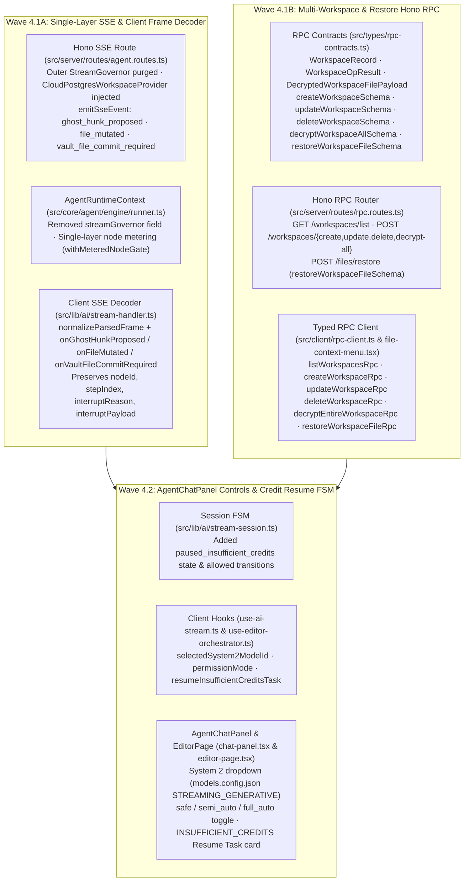

# Phase 4 Closure Dossier — Hono SSE/RPC Wiring, Ephemeral ZK Bridge & `AgentChatPanel` Controls

| Standard Field | Value |
| :--- | :--- |
| **Phase** | Phase 4 of 7 (`ELIXENT-EXECUTION-PLAN-v1.1`) |
| **Title** | Hono SSE/RPC Wiring, Ephemeral ZK Bridge & `AgentChatPanel` Controls |
| **Release Version** | `v0.27.0` |
| **Closure Date** | 2026-11-21 |
| **Governing Plan** | [`docs/Plans/elixent-architectural-evolution-execution-plan.md`](../../plans/elixent-architectural-evolution-execution-plan.md) (Active — Phases 5–6 Remaining) |
| **Governing ADRs & SRS** | [`ADR-006`](../../../architecture/adrs/adr_006_unified_vite_tanstack_hono_rpc_architecture.md) · [`ADR-007`](../../../architecture/adrs/adr_007_dual_plane_separation_and_als_request_context.md) · [`ADR-009`](../../../architecture/adrs/adr_009_native_graph_orchestration_engine.md) · [`ADR-011`](../../../architecture/adrs/adr_011_multi_workspace_data_isolation_model.md) · [`ADR-016`](../../../architecture/adrs/adr_016_zk_encryption_granularity_and_ephemeral_ai_bridge.md) · [`SRS-02`](../../../specs/srs_02_multi_workspace_isolation_and_zk_vault_governance.md) · [`SRS-03`](../../../specs/srs_03_editor_tabs_multi_ghost_review_and_two_tier_undo.md) · [`SRS-04`](../../../specs/srs_04_multi_provider_ai_gateway_and_wallet_metering.md) |
| **Status** | `CLOSED & VERIFIED` |

---

## 1. Executive Summary

Phase 4 completes the Hono SSE/RPC transport wiring, removes outer route-level SSE double-metering (`BUG-04`), extends the client SSE decoder (`src/lib/ai/stream-handler.ts`) for multi-file and Zero-Knowledge commit events, exposes typed multi-workspace CRUD / all-or-nothing decryption / file-restore RPC routes on `rpc.routes.ts` and `rpc-client.ts`, and wires manual `System 2` model selection, 3-mode permission controls (`safe`, `semi_auto`, `full_auto`), and `INSUFFICIENT_CREDITS` checkpoint resumption across `stream-session.ts`, `useAIStream`, `useEditorOrchestrator`, `EditorPage`, and `AgentChatPanel`.

---

## 2. Source & Test Deliverables

| Wave / Sub-Agent | File Path | Action | Verified Engineering Deliverable |
| :--- | :--- | :--- | :--- |
| **Wave 4.1 / 4.A** | [`src/server/routes/agent.routes.ts`](../../../../src/server/routes/agent.routes.ts) | Modified | Purges route-level `StreamGovernor`, `AGENT_STREAM_MODEL_ID`, `INITIAL_RESERVATION_TOKENS`, `governor.onTokenChunk(JSON.stringify(chunk))`, and route-level `governor.settle` calls (`BUG-04` / `SRS-04` §3.2 `REQ-METER-02`); injects `CloudPostgresWorkspaceProvider` (`ephemeralVaultPayloads`, `liveDocumentSnapshots`) inside `runWithEphemeralVaultScope`, forwards `ghost_hunk_proposed`, `file_mutated`, `vault_file_commit_required`, and `direct_response_node` `update` frames via `emitSseEvent`, normalizes native `INTERRUPTED` yields, and schedules `flushPendingSettlementsToPostgres(user.id)` via `scheduleAfterResponse`. |
| **Wave 4.1 / 4.A** | [`src/core/agent/engine/runner.ts`](../../../../src/core/agent/engine/runner.ts) | Modified | Removes unused `StreamGovernor` import and `streamGovernor` property from `AgentRuntimeContext` to enforce single-layer node metering. |
| **Wave 4.1 / 4.A** | [`src/lib/ai/stream-handler.ts`](../../../../src/lib/ai/stream-handler.ts) | Modified | Adds `AgentStreamGhostHunkProposedEvent`, `AgentStreamFileMutatedEvent`, `AgentStreamVaultFileCommitRequiredEvent` (plus `Stream*` aliases), extends `AgentStreamInterruptEvent` with `nodeId`, `stepIndex`, `interruptReason`, and `interruptPayload`, adds `onGhostHunkProposed`, `onFileMutated`, and `onVaultFileCommitRequired` callbacks on `StreamHandlerOptions`, strips synthesized `workspaceId` in `buildRequestPayload` when callers pass only legacy `projectId`, and decodes all new frames in `normalizeParsedFrame` / `consumeAgentStream`. |
| **Wave 4.1 / 4.B** | [`src/types/rpc-contracts.ts`](../../../../src/types/rpc-contracts.ts) | Modified | Exports `WorkspacePermissionMode`, `WorkspaceRecord`, `WorkspaceOpResult`, `CreateWorkspaceInput`, `UpdateWorkspaceInput`, `DecryptedWorkspaceFilePayload`, and Zod schemas `workspacePermissionModeSchema`, `createWorkspaceSchema`, `updateWorkspaceSchema`, `deleteWorkspaceSchema`, `decryptWorkspaceAllSchema`, and `restoreWorkspaceFileSchema`. |
| **Wave 4.1 / 4.B** | [`src/server/routes/rpc.routes.ts`](../../../../src/server/routes/rpc.routes.ts) | Modified | Adds `mapWorkspaceStatusCode`, mounts `GET /api/rpc/workspaces/list` and `POST /api/rpc/workspaces/{create,update,delete,decrypt-all}` backed by `src/server/actions/workspaces.ts`, and binds `POST /api/rpc/files/restore` to `restoreWorkspaceFileSchema`. |
| **Wave 4.1 / 4.B** | [`src/client/rpc-client.ts`](../../../../src/client/rpc-client.ts) & [`src/components/files/file-context-menu.tsx`](../../../../src/components/files/file-context-menu.tsx) | Modified | Exports `listWorkspacesRpc`, `createWorkspaceRpc`, `updateWorkspaceRpc`, `deleteWorkspaceRpc`, `decryptEntireWorkspaceRpc`, renames `restoreFile` to `restoreWorkspaceFileRpc`, and updates `FileContextMenu` (`handleRestore`) to invoke `restoreWorkspaceFileRpc`. |
| **Wave 4.2 / 4.C** | [`src/lib/ai/stream-session.ts`](../../../../src/lib/ai/stream-session.ts) | Modified | Adds `'paused_insufficient_credits'` to `AIStreamStatus` and `ALLOWED_TRANSITIONS` (`paused_insufficient_credits` -> `running_graph` | `aborted` | `failed` | `idle`). |
| **Wave 4.2 / 4.C** | [`src/hooks/use-ai-stream.ts`](../../../../src/hooks/use-ai-stream.ts) | Modified | Adds `selectedSystem2ModelId` (default `'google/gemini-3.8-flash'`), `setSelectedSystem2ModelId`, `permissionMode` (default `'safe'`), `setPermissionMode`, transitions `INSUFFICIENT_CREDITS` interrupts to `'paused_insufficient_credits'`, forwards `selectedSystem2ModelId` and `permissionMode` on start/resume payloads, and exposes `resumeInsufficientCreditsTask()` sending `resumePayload: { resumeReason: 'INSUFFICIENT_CREDITS' }`. |
| **Wave 4.2 / 4.C** | [`src/hooks/use-editor-orchestrator.ts`](../../../../src/hooks/use-editor-orchestrator.ts) & [`src/client/routes/editor-page.tsx`](../../../../src/client/routes/editor-page.tsx) | Modified | Exposes and wires `selectedSystem2ModelId`, `setSelectedSystem2ModelId`, `permissionMode`, `setPermissionMode`, and `resumeInsufficientCreditsTask` from `useAIStream` through `useEditorOrchestrator` into `AgentChatPanel`. |
| **Wave 4.2 / 4.C** | [`src/components/agent/chat-panel.tsx`](../../../../src/components/agent/chat-panel.tsx) | Modified | Imports `modelsConfig` (`src/config/models.config.json`) filtering `executionMode === "STREAMING_GENERATIVE"` (`google/gemini-4-argon`, `google/gemini-3.8-flash`, `google/gemini-3.1-pro`), renders System 2 model dropdown (`agent-system2-model-select`) with per-1K input/output credit rates, renders 3-mode permission selector (`agent-permission-mode-safe`, `semi_auto`, `full_auto`), and renders the `paused_insufficient_credits` recovery card (`agent-insufficient-credits-card`, `agent-resume-task-button`). |
| **Tests (1 New + 25 Updated)** | [`src/test/agent/agent-wave4-controls.cross-contract.test.tsx`](../../../../src/test/agent/agent-wave4-controls.cross-contract.test.tsx) (new) + 25 updated suites across `src/test/{agent,ai,client,contracts,editor,files,layout,metering,server}/` | Created / Modified | Adds real loopback cross-contract test (`AgentChatPanel` -> `useAIStream` -> `consumeAgentStream` -> `agentRoutes`), expands `agent-routes.test.ts`, `ai-stream-parser.test.ts`, `ai-stream-session.test.ts`, `rpc-contracts.test.ts`, `rpc-routes.test.ts`, `rpc-client.test.ts`, `wave-11-1-ui-and-sync.test.tsx`, `wave-11-2-ui-and-pages.test.tsx`, `editor-orchestration.integration.test.ts`, and aligns `AgentRuntimeContext` / `restoreWorkspaceFileRpc` fixtures (+1 unit suite, +99 net unit tests -> `156` unit suites / `3,250` tests). |

---

## 3. Living Documentation Synchronized

1. **[`README.md`](../../../../README.md):** Updated `CHANGELOG.md` version range (`v0.27.0`), updated Section 17 (`Agent Chat Panel`, System 2 model selector, 3 permission modes, `paused_insufficient_credits` recovery card, multi-file SSE frame decoder, and typed `/api/rpc/workspaces/*` + `restoreWorkspaceFileRpc` facades), and synchronized SSOT test metric badges/tables via `npm run docs:sync`.
2. **[`docs/README.md`](../../../README.md):** Updated `CHANGELOG.md` version range (`v0.27.0`), registered this Phase 4 closure dossier under `records/closures/architectural-evolution/`, and synchronized SSOT verification metrics.
3. **[`docs/TECHNICAL_DEBT_REGISTER.md`](../../../TECHNICAL_DEBT_REGISTER.md):** Updated last-reviewed header to `2026-11-21 (v0.27.0)` and synchronized SSOT baseline metrics.
4. **[`docs/architecture/02_agent_orchestration_and_decision_engine.md`](../../../architecture/02_agent_orchestration_and_decision_engine.md), [`03_workspace_ast_editor_and_vault_integration.md`](../../../architecture/03_workspace_ast_editor_and_vault_integration.md), [`04_credit_metering_and_settlement_architecture.md`](../../../architecture/04_credit_metering_and_settlement_architecture.md):** Purged obsolete route-level `StreamGovernor` billing claims (`INITIAL_RESERVATION_TOKENS = 1200`, `GOVERNOR_QUOTA_EXHAUSTED`) from `agent.routes.ts` descriptions, documented single-layer node metering (`withMeteredNodeGate`), added `ghost_hunk_proposed` / `file_mutated` / `vault_file_commit_required` SSE frames, and documented Phase 4 `AgentChatPanel` System 2 model, permission mode, and credit-resume controls.
5. **[`docs/architecture/adrs/adr_006_unified_vite_tanstack_hono_rpc_architecture.md`](../../../architecture/adrs/adr_006_unified_vite_tanstack_hono_rpc_architecture.md):** Updated RPC facade count reference to reflect the expanded `src/client/rpc-client.ts` surface including the 5 workspace RPC facades.
6. **[`docs/reference/ui-streaming-readiness.md`](../../../reference/ui-streaming-readiness.md) & [`docs/reference/sync-api.md`](../../../reference/sync-api.md):** Updated Session FSM to 9 states (`paused_insufficient_credits`), corrected default `selectedSystem2ModelId` (`"google/gemini-3.8-flash"`), updated `/api/agent/stream` SSE event framing table and single-layer metering notes, and added `/api/rpc/workspaces/*` and `restoreWorkspaceFileRpc` contracts to `sync-api.md`.
7. **[`docs/specs/srs_04_multi_provider_ai_gateway_and_wallet_metering.md`](../../../specs/srs_04_multi_provider_ai_gateway_and_wallet_metering.md):** Updated status banner to record Phase 1, 3, and 4 implementation milestones.
8. **[`docs/CHANGELOG.md`](../../../CHANGELOG.md) & [`docs/METRICS.json`](../../../METRICS.json):** Added `[0.27.0] - 2026-11-21` release entry and updated SSOT test metrics (`156` unit suites / `3,250` unit tests, `22` live suites / `101` live tests, `14` E2E specs / `15` E2E journeys).

---

## 4. Verification Gate Evidence

| Gate / Command | Execution Scope | Result |
| :--- | :--- | :--- |
| **`npx tsc --noEmit`** | Strict TypeScript compilation check | **PASS** (Exit 0 — 0 errors) |
| **`npm run test`** | Full Vitest unit & contract test suite (`vitest.config.mts`) | **PASS** (Exit 0 — `156` test files / `3,250` tests passing) |
| **`npm run lint`** | ESLint 9 static analysis | **PASS** (Exit 0 — 0 errors, 1 non-blocking warning: unused `WorkspacePermissionMode` type import at `src/client/rpc-client.ts:18`) |
| **`npm run audit:ci`** | Production & full dependency vulnerability gate (`scripts/ci-audit.mjs`) | **PASS** (Exit 0 — 0 production vulnerabilities, 0 full-tree vulnerabilities) |
| **`npm run docs:sync` & `npm run docs:check`** | Documentation test metrics SSOT synchronization (`scripts/sync-doc-metrics.mjs`) | **PASS** (Exit 0 — `156` unit suites / `3,250` tests, `22` live suites / `101` tests, `14` E2E specs / `15` journeys) |
| **`npm run lint:links`** | Repository-wide Markdown internal link integrity (`scripts/check-markdown-links.mjs`) | **PASS** (Exit 0 — 0 broken links) |

> **Scope Note on Live DB & E2E Suites:** Phase 4 introduced no database schema changes, live test modifications, or Playwright E2E spec changes; `npm run test:live` (`22` suites / `101` tests) and `npm run test:e2e` (`14` specs / `15` journeys) were not re-executed during this closure and retain their last verified baseline in [`docs/METRICS.json`](../../../METRICS.json).
