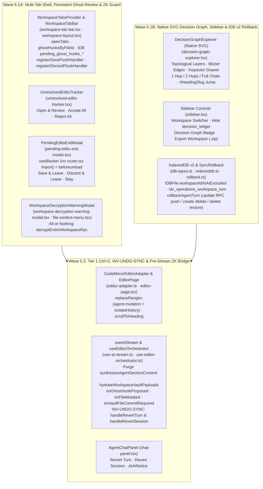

# Phase 5 Closure Dossier — Multi-Tab Editor, Persistent Ghost Review, Decision Graph UI & Two-Tier Undo

| Standard Field | Value |
| :--- | :--- |
| **Phase** | Phase 5 of 7 (`ELIXENT-EXECUTION-PLAN-v1.1`) |
| **Title** | Multi-Tab Editor, Persistent Ghost Review, Decision Graph UI & Two-Tier Undo |
| **Release Version** | `v0.28.0` |
| **Closure Date** | 2026-11-22 |
| **Governing Plan** | [`docs/Plans/elixent-architectural-evolution-execution-plan.md`](../../plans/elixent-architectural-evolution-execution-plan.md) (Active — Phase 6 Remaining) |
| **Governing ADRs & SRS** | [`ADR-011`](../../../architecture/adrs/adr_011_multi_workspace_data_isolation_model.md) · [`ADR-012`](../../../architecture/adrs/adr_012_json_decision_ledger_and_graph_traversal.md) · [`ADR-015`](../../../architecture/adrs/adr_015_two_tier_workspace_undo_and_turn_rollback.md) · [`ADR-016`](../../../architecture/adrs/adr_016_zk_encryption_granularity_and_ephemeral_ai_bridge.md) · [`SRS-02`](../../../specs/srs_02_multi_workspace_isolation_and_zk_vault_governance.md) · [`SRS-03`](../../../specs/srs_03_editor_tabs_multi_ghost_review_and_two_tier_undo.md) |
| **Status** | `CLOSED & VERIFIED` |

---

## 1. Executive Summary

Phase 5 delivers the complete client-side multi-file editing, persistent ghost review, interactive decision graph, workspace Zero-Knowledge decryption guard, and Two-Tier Undo architecture:

- **Wave 5.1 (UI Shell, Decision Graph & IndexedDB v2 Rollback):** Implemented `WorkspaceTabsProvider` & `WorkspaceTabBar`, `UnresolvedEditsTracker`, `PendingEditsExitModal` (3-choice navigation/exit guard via TanStack Router `useBlocker` without importing `router.tsx` per `DEF-13`), `WorkspaceDecryptionWarningModal` wired into `FileContextMenu`, pure Native SVG `DecisionGraphExplorer` (zero external graph libraries), upgraded `Sidebar` (workspace switcher, `decision_ledger` filtering, Decision Graph badge + JSON download, compact `UnresolvedEditsTracker`, and `.zip` workspace export), and upgraded IndexedDB to `DB_VERSION: 2` (`idx_operations_workspace_turn`, encrypted `pending_ghost_hunks_${workspaceId}` CRUD, and `SyncRollback.rollbackAgentTurn`).
- **Wave 5.2 (Two-Tier Undo, `INV-UNDO-SYNC` & Pre-Stream ZK Bridge):** Upgraded `CodeMirrorEditorAdapter` (`replaceRanges` single-transaction `agent.mutation` + `isolateHistory.of("full")` and `scrollToHeading`), wired `#headingSlug` hash navigation in `EditorPage`, purged legacy client-side `synthesizeAgentSectionContent` (`BUG-03`), implemented workspace-scoped pre-stream vault hydration (`hydrateWorkspaceVaultPayloads`), `onFileMutated`, and `onVaultFileCommitRequired` in `useAIStream`, enforced `INV-UNDO-SYNC` (`handleRevertTurn` & `handleRevertSession`) in `useEditorOrchestrator`, and added `Revert Turn` / `Revert Session` / `zkAiNotice` controls in `AgentChatPanel`.
- **Post-Audit Hardening:** Resolved 5 source anomalies identified during Phase 5 closure inspection — preserving raw server offsets on cross-file `ghost_hunk_proposed` frames (`preserveRawOffsets = true`), enforcing workspace/`isAiExcluded` filtering across IndexedDB files in `hydrateWorkspaceVaultPayloads` (`IDBFile.workspaceId` & `IDBFile.isAiExcluded`), wiring `registerDiscardFlushHandler` so `Discard & Leave` cancels autosave before unmount, pushing rolled-back `update` snapshots back to PostgreSQL (`updateFileContent` / `toggleFileEncryption`) with `preTurnSnapshotsRef` fallback for uncached closed files, handling `decrypted.status === "error"` in `DecisionGraphExplorer` and `Sidebar`, and updating header logo `alt="Elixent"` in `WorkspaceLayoutRouteView`.

---

## 2. Source & Test Deliverables

| Wave / Scope | File Path | Action | Verified Engineering Deliverable |
| :--- | :--- | :--- | :--- |
| **Wave 5.1 / 5.A** | [`src/components/editor/workspace-tab-bar.tsx`](../../../../src/components/editor/workspace-tab-bar.tsx) | Created | Implements `WorkspaceTabsProvider`, `WorkspaceTabBar`, `useWorkspaceTabs`, `useOptionalWorkspaceTabs`, `openTabs` management (adjacent tab activation on close while retaining `ghostHunksByFileId`), encrypted IndexedDB hydration/persistence (`pending_ghost_hunks_${workspaceId}`), `acceptAllPendingInFile` / `acceptAllPendingInWorkspace` / `rejectAllPendingInWorkspace` / `discardAllDirtyAndPending`, and `registerSaveFlushHandler` / `registerDiscardFlushHandler`. |
| **Wave 5.1 / 5.A** | [`src/components/editor/unresolved-edits-tracker.tsx`](../../../../src/components/editor/unresolved-edits-tracker.tsx) | Created | Renders persistent `"N Unresolved Edits in M Files"` pill (full in `WorkspaceTabBar`, compact in `Sidebar`) with popover listing open and closed files and actions `Open & Review`, `Accept All in Workspace`, and `Reject All in Workspace`. |
| **Wave 5.1 / 5.A** | [`src/components/editor/pending-edits-exit-modal.tsx`](../../../../src/components/editor/pending-edits-exit-modal.tsx) | Created | Intercepts workspace exit navigation via TanStack Router `useBlocker` (zero `src/client/router.tsx` import per `DEF-13`) and `beforeunload` when `totalPendingGhostCount > 0 || hasUnsavedDirtyBuffer`, exposing `Save & Leave`, `Discard & Leave`, and `Stay`. |
| **Wave 5.1 / 5.A** | [`src/components/vault/workspace-decryption-warning-modal.tsx`](../../../../src/components/vault/workspace-decryption-warning-modal.tsx) & [`src/components/files/file-context-menu.tsx`](../../../../src/components/files/file-context-menu.tsx) | Created / Modified | Intercepts single-file decryption inside encrypted workspaces (`workspace.isEncrypted === true`), presents the mandatory all-or-nothing warning copy (`SRS-02` §4.1 `REQ-ZK-02`), locally decrypts all non-deleted encrypted workspace files via `SyncCryptoGateway`, invokes `decryptEntireWorkspaceRpc`, and updates local IndexedDB records. |
| **Wave 5.1 / 5.A** | [`src/client/routes/workspace-layout.tsx`](../../../../src/client/routes/workspace-layout.tsx) | Modified | Wraps layout in `WorkspaceTabsProvider`, mounts `<WorkspaceTabBar />` directly above `<main><Outlet /></main>`, mounts `<PendingEditsExitModal />`, and updates header logo `alt="Elixent"`. |
| **Wave 5.1 / 5.B** | [`src/components/agent/decision-graph-explorer.tsx`](../../../../src/components/agent/decision-graph-explorer.tsx) | Created | Pure Native SVG interactive decision graph (`computeTopologicalLayers`, `buildBezierEdgePath`, clickable `DEPENDS_ON`/`REFINES`/`OVERRIDES` edges, Inspector Drawer with `selectionRationale`, `changeWeight` breakdown, upstream/downstream links, `evaluatedAlternatives`, `1 Hop`/`2 Hops`/`Full Chain` depth filtering via `traverseDecisionDependencies`, `Download JSON`, clickable `affectedSections` `#headingSlug` jump, and explicit `decrypted.status === "error"` handling). |
| **Wave 5.1 / 5.B** | [`src/components/layout/sidebar.tsx`](../../../../src/components/layout/sidebar.tsx) | Modified | Adds workspace switcher (`Active Workspace` + `Create Workspace`), compact `UnresolvedEditsTracker` in Files header, `Decision Graph` button with active node count badge & `Download JSON`, `Export Workspace (.zip)` via `exportWorkspaceAsZip` (handling `ENCRYPTED_EXPORT_UNCONFIRMED`), filters `artifactRole === "decision_ledger"` from the Markdown tree, and handles `decrypted.status === "error"` during ledger preload. |
| **Wave 5.1 / 5.B** | [`src/lib/sync/idb-types.ts`](../../../../src/lib/sync/idb-types.ts) & [`src/lib/sync/indexeddb.ts`](../../../../src/lib/sync/indexeddb.ts) | Modified | Adds `workspaceId` and `isAiExcluded` to `IDBFile`, adds `workspaceId`, `threadId`, `turnId`, `postTurnEtag`, and `snapshot.encryptionMetadata` to `IDBOperation`, bumps `IDB_CONFIG.DB_VERSION` to `2`, adds composite index `idx_operations_workspace_turn` (`['workspaceId', 'turnId']`) and `getOperationsByWorkspaceTurn`, and adds encrypted `sync_metadata` CRUD (`savePendingGhostHunks`, `loadPendingGhostHunks`, `clearPendingGhostHunks`). |
| **Wave 5.1 / 5.B** | [`src/lib/sync/rollback.ts`](../../../../src/lib/sync/rollback.ts) | Modified | Implements `SyncRollback.rollbackAgentTurn(workspaceId, turnId)` iterating in reverse chronological order: restoring `update` operations in IDB and pushing to server (`toggleFileEncryption` / `updateFileContent`), soft-deleting `create` files (`deleteFile` + IDB delete), and restoring `delete` files (`restoreWorkspaceFileRpc`). |
| **Wave 5.2 / 5.C** | [`src/components/editor/markdown/editor-adapter.ts`](../../../../src/components/editor/markdown/editor-adapter.ts) & [`src/client/routes/editor-page.tsx`](../../../../src/client/routes/editor-page.tsx) | Modified | Annotates `CodeMirrorEditorAdapter.replaceRanges` with `Transaction.userEvent.of("agent.mutation")` and `isolateHistory.of("full")`, adds `scrollToHeading(headingSlug)` via `extractSectionBySlug`, wires `#headingSlug` initial & `hashchange` scrolling in `EditorPage`, and passes rollback/notice props to `AgentChatPanel`. |
| **Wave 5.2 / 5.C** | [`src/hooks/use-ai-stream.ts`](../../../../src/hooks/use-ai-stream.ts) | Modified | Purges legacy `synthesizeAgentSectionContent` (`BUG-03`), adds `ghostHunksByFileId` persistence (`pending_ghost_hunks_${workspaceId}`), preserves raw server offsets on cross-file `ghost_hunk_proposed` (`preserveRawOffsets = true`), adds workspace-scoped `hydrateWorkspaceVaultPayloads` (filtering IDB & remote files by `workspaceId` / `!isAiExcluded` and caching `preTurnSnapshotsRef`), emits one-time `zkAiNotice` (`elixent_zk_ai_notice_shown`), and wires `onFileMutated` and `onVaultFileCommitRequired` (recording turn-linked `IDBOperation` snapshots and re-encrypting via `SyncCryptoGateway.encryptOutbound` + `toggleFileEncryption`). |
| **Wave 5.2 / 5.C** | [`src/hooks/use-editor-orchestrator.ts`](../../../../src/hooks/use-editor-orchestrator.ts) & [`src/components/agent/chat-panel.tsx`](../../../../src/components/agent/chat-panel.tsx) | Modified | Integrates `WorkspaceTabsProvider` (`openTab`, `updateTabState`, `registerSaveFlushHandler`, `registerDiscardFlushHandler`, `hydrateGhostHunksForFile`), implements `INV-UNDO-SYNC` (`handleRevertTurn` and `handleRevertSession` with stale-`postTurnEtag` confirmation, `autosave.cancelAutosave()`, `adapter.setValue(..., "rollback")`, and `markClean()`), and renders `Revert Turn`, `Revert Session`, and `zkAiNotice` in `AgentChatPanel`. |
| **Release & Tests** | [`package.json`](../../../../package.json), 8 new suites + 2 updated suites (`src/test/`) | Created / Modified | Bumps package version to `0.28.0`. Adds 8 Phase 5 unit/cross-contract suites (`decision-graph-and-sidebar.test.tsx`, `wave-5-2-ai-stream-vault-and-mutations.test.tsx`, `wave-5-1-boundaries.test.ts`, `inv-undo-sync-and-revert-ui.test.tsx`, `two-tier-undo-and-heading-scroll.test.ts`, `workspace-tabs-and-exit-guard.test.tsx`, `sync-turn-rollback.test.ts`, `workspace-decryption-warning.test.tsx`) and aligns `wave-11-1-ui-and-sync.test.tsx` and `route-views-parity.test.tsx` (`164` unit suites / `3,331` tests total; +8 suites, +50 net tests vs. `v0.27.0`). |

---

## 3. Living Documentation Synchronized

1. **[`README.md`](../../../../README.md):** Updated `CHANGELOG.md` version range (`v0.28.0`), updated project structure (`components/agent/`, `components/editor/`, `components/vault/`), expanded Section 17 with Phase 5 Multi-Tab Editor, Persistent Ghost Review, `DecisionGraphExplorer`, `WorkspaceDecryptionWarningModal`, and Two-Tier Undo, and synchronized SSOT test metric badges/tables via `npm run docs:sync`.
2. **[`docs/README.md`](../../../README.md):** Updated `CHANGELOG.md` version range (`v0.28.0`), registered this Phase 5 closure dossier under `records/closures/architectural-evolution/`, and synchronized SSOT verification metrics.
3. **[`docs/TECHNICAL_DEBT_REGISTER.md`](../../../TECHNICAL_DEBT_REGISTER.md):** Updated `Last reviewed` header to `2026-11-22 (v0.28.0)` and synchronized SSOT baseline metrics.
4. **[`docs/architecture/03_workspace_ast_editor_and_vault_integration.md`](../../../architecture/03_workspace_ast_editor_and_vault_integration.md):** Updated version to `v3.3`, documented `scrollToHeading` & `replaceRanges` single-transaction annotations, expanded Section 4.3 with `WorkspaceTabsProvider`/`WorkspaceTabBar`, `UnresolvedEditsTracker`, `PendingEditsExitModal`, `DecisionGraphExplorer`, `Sidebar` controls, `WorkspaceDecryptionWarningModal`, and `INV-UNDO-SYNC`, and updated Section 5.2 with `hydrateWorkspaceVaultPayloads`, `onVaultFileCommitRequired`, and `ElixentNativeGraphRunner` checkpointing.
5. **[`docs/architecture/sync/queue-gc-rollback-architecture.md`](../../../architecture/sync/queue-gc-rollback-architecture.md) & [`editor-sync-orchestration.md`](../../../architecture/sync/editor-sync-orchestration.md):** Documented IndexedDB `DB_VERSION: 2`, `IDBFile.workspaceId`/`isAiExcluded`, extended `IDBOperation` fields, `idx_operations_workspace_turn`, encrypted `pending_ghost_hunks_${workspaceId}` CRUD, `SyncRollback.rollbackAgentTurn`, and `useEditorOrchestrator` Phase 5 tab-flush & `INV-UNDO-SYNC` orchestration.
6. **[`docs/reference/ui-streaming-readiness.md`](../../../reference/ui-streaming-readiness.md):** Updated Section 8.2 (`ghost_hunk_proposed`, `file_mutated`, `vault_file_commit_required`) and Section 9 (`AgentChatPanel` rollback & ZK notice controls, purged `synthesizeAgentSectionContent`, multi-tab review, and `DecisionGraphExplorer`).
7. **[`docs/specs/srs_02_multi_workspace_isolation_and_zk_vault_governance.md`](../../../specs/srs_02_multi_workspace_isolation_and_zk_vault_governance.md) & [`srs_03_editor_tabs_multi_ghost_review_and_two_tier_undo.md`](../../../specs/srs_03_editor_tabs_multi_ghost_review_and_two_tier_undo.md):** Updated implementation status banners to reflect Phase 5 (`v0.28.0`) completion and cleared `(Planned / New)` markers on delivered modules.
8. **[`docs/CHANGELOG.md`](../../../CHANGELOG.md) & [`docs/METRICS.json`](../../../METRICS.json):** Added `[0.28.0] - 2026-11-22` release entry and updated SSOT test metrics (`164` unit suites / `3,331` unit tests, `22` live suites / `101` live tests, `14` E2E specs / `15` E2E journeys).

---

## 4. Verification Gate Evidence

| Gate / Command | Execution Scope | Result |
| :--- | :--- | :--- |
| **`npx tsc --noEmit`** | Strict TypeScript compilation check | **PASS** (Exit 0 — 0 errors) |
| **`npm run test`** | Full Vitest unit & contract test suite (`vitest.config.mts`) | **PASS** (Exit 0 — `164` test files / `3,331` tests passing) |
| **`npm run lint`** | ESLint 9 static analysis | **PASS** (Exit 0 — 0 errors, 1 non-blocking warning: unused `WorkspacePermissionMode` type import at `src/client/rpc-client.ts:18`) |
| **`npm run audit:ci`** | Production & full dependency vulnerability gate (`scripts/ci-audit.mjs`) | **PASS** (Exit 0 — 0 production vulnerabilities, 0 full-tree vulnerabilities) |
| **`npm run docs:sync` & `npm run docs:check`** | Documentation test metrics SSOT synchronization (`scripts/sync-doc-metrics.mjs`) | **PASS** (Exit 0 — `164` unit suites / `3,331` tests, `22` live suites / `101` tests, `14` E2E specs / `15` journeys) |
| **`npm run lint:links`** | Repository-wide Markdown internal link integrity (`scripts/check-markdown-links.mjs`) | **PASS** (Exit 0 — 0 broken links) |

> **Scope Note on Live DB & E2E Suites:** Phase 5 introduced no database schema changes, live test modifications, or Playwright E2E spec changes (Playwright E2E expansion and `npm run test:all` full-gate closure are scheduled in Phase 6 of [`elixent-architectural-evolution-execution-plan.md`](../../plans/elixent-architectural-evolution-execution-plan.md)); `npm run test:live` (`22` suites / `101` tests) and `npm run test:e2e` (`14` specs / `15` journeys) retain their last verified baselines in [`docs/METRICS.json`](../../../METRICS.json).
