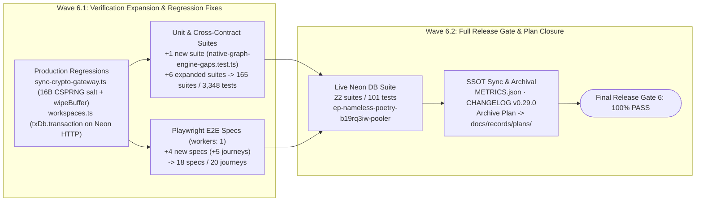

# Phase 6 Closure Dossier — Comprehensive Verification, Playwright E2E Journeys & Release Gate Closure

| Standard Field | Value |
| :--- | :--- |
| **Phase** | Phase 6 of 7 — Final Phase (`ELIXENT-EXECUTION-PLAN-v1.1`) |
| **Title** | Comprehensive Verification, Playwright E2E Journeys & Release Gate Closure |
| **Release Version** | `v0.29.0` |
| **Closure Date** | 2026-11-22 |
| **Governing Plan** | [`elixent-architectural-evolution-execution-plan.md`](../../plans/elixent-architectural-evolution-execution-plan.md) (`ELIXENT-EXECUTION-PLAN-v1.1` — 100% Completed & Archived) |
| **Governing ADRs & SRS** | [`ADR-009`](../../../architecture/adrs/adr_009_native_graph_orchestration_engine.md)–[`ADR-016`](../../../architecture/adrs/adr_016_zk_encryption_granularity_and_ephemeral_ai_bridge.md) · [`SRS-01`](../../../specs/srs_01_agent_orchestration_decision_graph_and_weight_engine.md)–[`SRS-04`](../../../specs/srs_04_multi_provider_ai_gateway_and_wallet_metering.md) |
| **Status** | `CLOSED & VERIFIED` |

---

## 1. Executive Summary

Phase 6 completes the **Elixent Architectural Evolution Execution Plan (`Phases 0–6`)** by closing remaining unit/cross-contract coverage gaps across `ADR-009..016` and `SRS-01..04`, authoring 4 new Playwright browser E2E specifications (`+5` journeys) alongside the 14 existing E2E specs (`18` specs / `20` journeys passing under `workers: 1`), resolving two production runtime regressions discovered during end-to-end verification, and executing the complete release verification pipeline (`tsc`, `lint`, `audit:ci`, `test:ci-gate`, `test`, `test:live`, `test:e2e`, `docs:check`, and `lint:links`):

- **Production Regression Fixes (`src/lib/sync/sync-crypto-gateway.ts`, `src/server/actions/workspaces.ts`):**
  - Updated `SyncCryptoGateway.encryptOutbound` to allocate a fresh 16-byte CSPRNG `saltBytes` (`cryptoWorkerBridge.generateRandomBytes(16)`), serialize `salt: arrayBufferToBase64(saltBytes)` (satisfying strict non-empty `salt` validation in `encryptionMetadataSchema` and `fileEncryptionMetadataSchema`), and wipe both `ivBytes` and `saltBytes` via `wipeBuffer` in `finally`.
  - Updated `decryptEntireWorkspace` to execute atomic workspace decryption transactions via `txDb.transaction` (`@/server/db`, avoiding `No transactions support in neon-http driver` on Neon HTTP runtimes) with a safe fallback to `db.transaction` when partial test mocks omit `txDb`.
- **Unit & Cross-Contract Gap Closure (`Wave 6.1` · `src/test/`):** Added `src/test/agent/native-graph-engine-gaps.test.ts` and expanded 6 existing suites (`agent-stream-route.test.ts`, `canonical-nodes-hitl-ledger-mutator.test.ts`, `decision-ledger-v2-and-weight-gate.test.ts`, `sync-crypto-gateway.test.ts`, `sync-turn-rollback.test.ts`, `multi-workspace-isolation.test.ts`), bringing the unit & contract suite to `165` suites / `3,348` tests (`+1` suite, `+17` tests vs. `v0.28.0`).
- **Playwright E2E Expansion (`Wave 6.1` · `e2e/specs/`):** Added 4 new browser E2E specs (`multi-workspace-and-zip-export.spec.ts`, `multi-tab-ghost-and-exit-modal.spec.ts`, `decision-graph-and-two-tier-undo.spec.ts`, `workspace-zk-encryption-governance.spec.ts`) covering 5 new full-stack user journeys, verified alongside all 14 existing workspace-scoped specs (`18` specs / `20` journeys passing).
- **Release Closure & Plan Archival (`Wave 6.2`):** Synchronized `docs/METRICS.json`, all 7 `sync-doc-metrics.mjs` living documentation targets, `SRS-01..04` statuses, `ADR-009..016` plan links, and archived [`elixent-architectural-evolution-execution-plan.md`](../../plans/elixent-architectural-evolution-execution-plan.md) to `docs/records/plans/`.



---

## 2. Source & Test Deliverables

| Scope | File Path | Action | Verified Engineering Deliverable |
| :--- | :--- | :--- | :--- |
| **ZK Sync Regression Fix** | [`src/lib/sync/sync-crypto-gateway.ts`](../../../../src/lib/sync/sync-crypto-gateway.ts) | Modified | Generates 16-byte CSPRNG `saltBytes` (`cryptoWorkerBridge.generateRandomBytes(16)`), populates `encryptionMetadata.salt` via `arrayBufferToBase64(saltBytes)`, and zeroes both `ivBytes` and `saltBytes` via `wipeBuffer` in `finally`. |
| **Neon HTTP Transaction Fix** | [`src/server/actions/workspaces.ts`](../../../../src/server/actions/workspaces.ts) | Modified | Routes `decryptEntireWorkspace` atomic rollback/commit through `txDb.transaction` (`@/server/db`) to support Neon HTTP runtimes, falling back safely to `db.transaction` when test mocks omit `txDb`. |
| **Unit Gap Closure (New)** | [`src/test/agent/native-graph-engine-gaps.test.ts`](../../../../src/test/agent/native-graph-engine-gaps.test.ts) | Created | Covers the remaining 5 `InputIntentCategory` end-to-end paths (`DECISION_LEDGER_QUERY`, `NEW_DOC_DRAFTING`, `CONFLICTING_OVERRIDE`, `FILE_STRUCTURE_MUTATION`, `COMPOUND_MULTI_INTENT`), Gate `G-03`/`G-04` (`CONSTRAINED_BY_PRIOR`)/`G-06` edge branches, and `INSUFFICIENT_CREDITS` encrypted zero-leak checkpoint pause and full resumption to `END`. |
| **Unit Gap Closure (Expanded)** | [`src/test/agent/agent-stream-route.test.ts`](../../../../src/test/agent/agent-stream-route.test.ts), [`canonical-nodes-hitl-ledger-mutator.test.ts`](../../../../src/test/agent/canonical-nodes-hitl-ledger-mutator.test.ts), [`decision-ledger-v2-and-weight-gate.test.ts`](../../../../src/test/agent/decision-ledger-v2-and-weight-gate.test.ts), [`sync-crypto-gateway.test.ts`](../../../../src/test/sync/sync-crypto-gateway.test.ts), [`sync-turn-rollback.test.ts`](../../../../src/test/sync/sync-turn-rollback.test.ts), [`multi-workspace-isolation.test.ts`](../../../../src/test/workspace/multi-workspace-isolation.test.ts) | Modified | Adds open-ceiling single-layer metering assertions (`BUG-04`), neutral System 2 option framing + 3-branch HITL `selectionRationale` synthesis, non-finite `Infinity`/`-Infinity` & depth-3+ cycle clamping on $W(d)$, 16-byte salt schema compliance + buffer zeroing regressions, encrypted turn rollback via `toggleFileEncryption`, and `txDb.transaction` atomic commit/409 rollback & partial-mock fallback regressions. |
| **Playwright E2E (New)** | [`e2e/specs/multi-workspace-and-zip-export.spec.ts`](../../../../e2e/specs/multi-workspace-and-zip-export.spec.ts) | Created | Verifies multi-workspace file-tree isolation, UI workspace creation (`Create Workspace`), and `.zip` archive download (`workspace-${betaWorkspaceId}.zip`). |
| **Playwright E2E (New)** | [`e2e/specs/multi-tab-ghost-and-exit-modal.spec.ts`](../../../../e2e/specs/multi-tab-ghost-and-exit-modal.spec.ts) | Created | 2 browser journeys verifying permission mode switching (`safe` / `semi_auto` / `full_auto`), unresolved `GhostHunk` persistence across tab close in `UnresolvedEditsTracker`, and `PendingEditsExitModal` (`Stay`, `Discard & Leave`, and `Save & Leave`). |
| **Playwright E2E (New)** | [`e2e/specs/decision-graph-and-two-tier-undo.spec.ts`](../../../../e2e/specs/decision-graph-and-two-tier-undo.spec.ts) | Created | Verifies `DecisionGraphExplorer` native SVG rendering and Inspector Drawer inspection, Tier 1 single-transaction `Control+z` undo, and Tier 2 `file_mutated` -> `Revert Turn` / `Revert Session` controls. |
| **Playwright E2E (New)** | [`e2e/specs/workspace-zk-encryption-governance.spec.ts`](../../../../e2e/specs/workspace-zk-encryption-governance.spec.ts) | Created | Verifies `VaultUnlockModal` decryption on an encrypted workspace, `agent-zk-ai-notice` display, zero `localStorage` master/private key leaks, and `WorkspaceDecryptionWarningModal` all-or-nothing transactional decryption across all encrypted workspace files. |
| **Release Version** | [`package.json`](../../../../package.json) | Modified | Bumps package version from `0.28.0` to `0.29.0`. |

---

## 3. Living Documentation Synchronized & Plan Archival

1. **Execution Plan Archival (`docs/records/plans/`):** Archived the completed plan to [`docs/records/plans/elixent-architectural-evolution-execution-plan.md`](../../plans/elixent-architectural-evolution-execution-plan.md) (`Phases 0–6 CLOSED & VERIFIED [v0.29.0]`), adjusted internal relative links (`../../architecture/`, `../../specs/`), and updated cross-document plan references across [`ADR-009`](../../../architecture/adrs/adr_009_native_graph_orchestration_engine.md)–[`ADR-016`](../../../architecture/adrs/adr_016_zk_encryption_granularity_and_ephemeral_ai_bridge.md), prior closure dossiers (`phase-00`–`phase-05`), [`docs/CHANGELOG.md`](../../../CHANGELOG.md), [`docs/README.md`](../../../README.md), and [`README.md`](../../../../README.md).
2. **Subsystem Architecture Updates:**
   - [`docs/architecture/sync/sync-lifecycle-architecture.md`](../../../architecture/sync/sync-lifecycle-architecture.md): Documented fresh 16-byte CSPRNG `salt` generation alongside the 12-byte IV and in-place `wipeBuffer` zeroing in `SyncCryptoGateway.encryptOutbound`.
   - [`docs/architecture/sync/file-ownership-and-versioning.md`](../../../architecture/sync/file-ownership-and-versioning.md): Documented `txDb.transaction` atomic execution in `decryptEntireWorkspace` for Neon HTTP compatibility and updated `multi-workspace-isolation.test.ts` evidence.
3. **SRS Status Closure (`docs/specs/srs_01..04`):** Updated implementation status headers across [`SRS-01`](../../../specs/srs_01_agent_orchestration_decision_graph_and_weight_engine.md), [`SRS-02`](../../../specs/srs_02_multi_workspace_isolation_and_zk_vault_governance.md), [`SRS-03`](../../../specs/srs_03_editor_tabs_multi_ghost_review_and_two_tier_undo.md), and [`SRS-04`](../../../specs/srs_04_multi_provider_ai_gateway_and_wallet_metering.md) to reflect full Phase 6 (`v0.29.0`) verification closure.
4. **Indices, Technical Debt, Reference & Metrics SSOT:** Updated [`docs/METRICS.json`](../../../METRICS.json) (`165`/`3,348`, `22`/`101`, `18`/`20`), [`docs/CHANGELOG.md`](../../../CHANGELOG.md) (`[0.29.0] - 2026-11-22`), [`docs/README.md`](../../../README.md), [`README.md`](../../../../README.md) (updating Section 11 E2E journeys and removing ad-hoc E2E counts per Rule 7), [`docs/TECHNICAL_DEBT_REGISTER.md`](../../../TECHNICAL_DEBT_REGISTER.md) (`Last reviewed: 2026-11-22 (v0.29.0)`), [`docs/reference/test-database-isolation.md`](../../../reference/test-database-isolation.md), [`docs/reference/ci-pipeline.md`](../../../reference/ci-pipeline.md), and synchronized all 7 monitored living docs via `npm run docs:sync`.

---

## 4. Verification Gate Evidence

| Gate / Command | Execution Scope | Observed Result |
| :--- | :--- | :--- |
| **`npx tsc --noEmit`** | Strict TypeScript compilation check | **PASS** (Exit 0 — `0` errors) |
| **`npm run lint`** | ESLint 9 static analysis | **PASS** (Exit 0 — `0` errors, `1` non-blocking warning: unused `WorkspacePermissionMode` import at `src/client/rpc-client.ts:18`) |
| **`npm run audit:ci`** | Production & full dependency vulnerability gate (`scripts/ci-audit.mjs`) | **PASS** (Exit 0 — `0` production vulnerabilities, `0` full-tree vulnerabilities) |
| **`npm run test:ci-gate`** | Deterministic CI gating matrix (`scripts/test-ci-gating.mjs`) | **PASS** (Exit 0 — `30/30` checks passed) |
| **`npm run test`** | Full Vitest unit & contract test suite (`vitest.config.mts`) | **PASS** (Exit 0 — `165` test files / `3,348` tests passing) |
| **`npm run test:live`** | Live multi-system integration suite (`vitest.live.config.mts`) | **PASS** (Exit 0 — `22` suites / `101` tests passing) |
| **`npm run test:e2e`** | Headless Chromium Playwright E2E suite (`playwright.config.ts`, `workers: 1`) | **PASS** (Exit 0 — `18` spec files / `20` journeys passing in `3.3m`) |
| **`npm run docs:sync` & `npm run docs:check`** | Documentation test metrics SSOT synchronization (`scripts/sync-doc-metrics.mjs`) | **PASS** (Exit 0 — `165`/`3,348`, `22`/`101`, `18`/`20` 100% synced) |
| **`npm run lint:links`** | Repository-wide Markdown internal link integrity (`scripts/check-markdown-links.mjs`) | **PASS** (Exit 0 — `0` broken links) |

**Mandatory Isolated Test Branch Identity (`npm run test:live`):**
```text
[test-db] Isolated test branch identity — endpointId: 'ep-nameless-poetry-b19rq3iw-pooler' host: 'ep-nameless-poetry-b19rq3iw-pooler.c-5.eu-central-1.aws.neon.tech'
```

> **Build Gate Note:** `npm run build` is restricted by the `doc_governor` read-only execution hook and is verified separately by the Coordinator / CI Stage 5 (`build-verification`) prior to release tagging.
