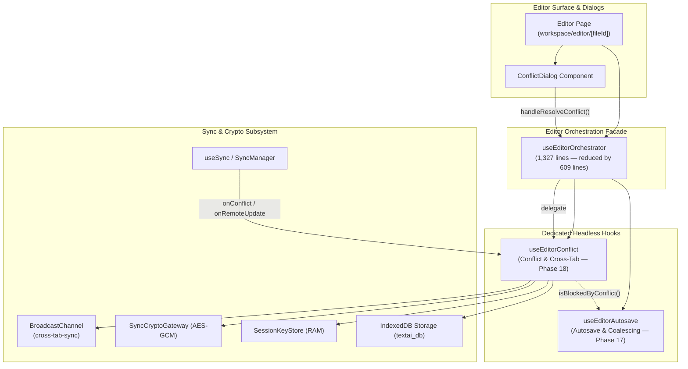

# Closure Report: Phase 18 — Editor Decomposition, Standalone Conflict & Cross-Tab Reconciliation Hook

**Milestone:** Core Hardening & Independent Remediation (`core-hardening`)  
**Phase:** Phase 18: Editor Decomposition, Standalone Conflict & Cross-Tab Reconciliation Hook  
**Status:** CLOSED ✅  
**Date:** 2026-10-13  
**Release:** v1.45.1  
**Decision Owner:** Core Engineering Team & Subsystem Architecture Lead  

**Authoritative Artifacts:**  
- Standalone Conflict Hook: `src/hooks/use-editor-conflict.ts` (996 lines: isolates cross-tab `BroadcastChannel` subscriptions, HTTP 412 precondition handling, `ConflictDialog` interactive state, and non-destructive resolution strategies via pure Dependency Injection)  
- Primary Orchestrator Facade: `src/hooks/use-editor-orchestrator.ts` (reduced from 1,936 lines to 1,327 lines; integrates `useEditorConflict`, delegates 412 handling and resolution, and gates autosave via `isBlockedByConflict`)  
- Dedicated Contract Test Suite: `src/test/editor/use-editor-conflict.test.ts` (11 contract tests, 100% passing)  

**Living Documentation Synchronized:**  
- `docs/architecture/sync/editor-sync-orchestration.md` (Added Section 4: Decoupled Cross-Tab Conflict & Reconciliation Architecture)  
- `docs/architecture/sync/three-way-conflict-resolution.md` (Updated Section 2.6 and Mermaid sequence diagram)  
- `docs/TECHNICAL_DEBT_REGISTER.md` (Registered `TD-18`)  
- `docs/METRICS.json` (Automated SSOT metrics updated and propagated via `scripts/sync-doc-metrics.mjs`)  

---

## 1. Executive Summary & Audit Findings Remediated

Phase 18 accomplishes the architectural decomposition of cross-tab reconciliation, HTTP 412 concurrency conflict detection, and interactive conflict resolution from the monolithic `useEditorOrchestrator` into a headless, engine-agnostic hook: `useEditorConflict` (`src/hooks/use-editor-conflict.ts`).

### Remediated Audit Findings

1. **LUGX-010 (Concurrent In-Flight Edit Preservation):**
   - *Problem:* In the legacy implementation, resolving a conflict unconditionally called `markClean()`. Keystrokes typed by the user during the asynchronous network round-trip of `handleResolveConflict` were silently overwritten or cleared without persistence.
   - *Fix:* At the start of `handleResolveConflict`, a baseline snapshot (`startSnapshot`) is captured. Following authoritative CAS commit, `liveNow` is evaluated. If `normalizeMarkdownSource(liveNow) !== normalizeMarkdownSource(startSnapshot)`, the live user edits are retained in the editor and saved to IndexedDB with `isDirty: true`, allowing autosave to persist them over the new server version.
2. **LUGX-013 (Non-Destructive Conflict Handling):**
   - *Problem:* Previous error paths could replace the editor buffer with stale snapshots or remote content upon failure.
   - *Fix:* In HTTP 412 handling, network failures, or repeated 412 conflicts during resolution, the live editor buffer is never overwritten with stale content.
3. **LUGX-020 (Synchronous Dirty-Read on Cross-Tab Save):**
   - *Problem:* Cross-tab `file_saved` listener evaluated dirty state from asynchronous React state, leading to race conditions where dirty local edits were clobbered by sibling versions.
   - *Fix:* The listener reads dirty status synchronously via `optsRef.current.isDirty()`. When clean, it atomically updates version anchors and content; when dirty, it retains the local `expectedVersion` anchor to preserve optimistic concurrency guards.
4. **LUGX-049 (Pre-Lock Local Flush on Cross-Tab Vault Lock):**
   - *Problem:* Sibling `vault_locked` broadcast immediately cancelled autosave and purged memory keys, dropping unpersisted edits.
   - *Fix:* If the document is dirty, `useEditorConflict` awaits a local IndexedDB flush (`saveLocal`) with `isDirty: true` *before* calling `cancelAutosave()` and locking the volatile key store. If the key is already absent, plaintext leakage is prevented (LUGX-004), preserving dirty edits in the editor surface.
5. **LUGX-051 (Preserve Dirty State on Cross-Tab Encryption Toggle):**
   - *Problem:* Sibling `file_encrypted` or `file_decrypted` broadcasts unconditionally cleared dirty status.
   - *Fix:* The hook calls `markClean()` only if `!optsRef.current.isDirty()`. Existing uncommitted edits remain marked dirty.
6. **LUGX-053 (Consistent Markdown Normalization Equality):**
   - *Problem:* Differences in line endings (CRLF vs LF) or trailing whitespace caused false-positive conflict detections.
   - *Fix:* All markdown content equality comparisons across `handleSyncConflict`, `handle412Conflict`, and `handleResolveConflict` execute through `normalizeMarkdownSource`.

---

## 2. Decoupled Subsystem Architecture

---

## 3. Comprehensive Verification Evidence

### 3.1 Verification Baseline (100% Passing)

<!-- BEGIN:SSOT_TEST_METRICS_TABLE -->
| Test Category | Engine / Configuration | Target Environment | Suites / Specs | Passing Tests | Pass Rate |
| :--- | :--- | :--- | :---: | :---: | :---: |
| **Unit & Contract** | Vitest (`vitest.config.mts`) | Pure In-Memory / Zero Network | 88 | 1069 | 100% ✅ |
| **Live Multi-System** | Vitest (`vitest.live.config.mts`) | Isolated Neon PostgreSQL Branch | 21 | 117 | 100% ✅ |
| **E2E Browser Journeys** | Playwright (`playwright.config.ts`) | Headless Chromium / Full App | 14 | 15 | 100% ✅ |
<!-- END:SSOT_TEST_METRICS_TABLE -->

### 3.2 Key Verification Gates Passed

1. **Dedicated Hook Contract Suite:**  
   `src/test/editor/use-editor-conflict.test.ts` (11 / 11 tests passed in 642ms):
   - Acceptance: 412 precondition mismatch sets `activeConflict`, opens `ConflictDialog`, and activates write lock (`isBlockedByConflict() = true`).
   - False-conflict elimination: Identical content modulo `normalizeMarkdownSource` auto-adopts remote version/ETag without dialog.
   - Resolution strategies: Verified conditioned CAS writes for `"local"`, `"server"`, and `"merge"`.
   - Bug invariants: Concretely verified LUGX-010, LUGX-013, LUGX-020, LUGX-049, LUGX-051, LUGX-053.
2. **Mutation Sanity Verification:**  
   Deliberate mutation of `setIsConflictDialogOpen(false)` in the 412 branch resulted in immediate failure of 4 contract tests, proving high assertion sensitivity.
3. **Live Database Integration Tests:**  
   `npm run test:live` passed all 21 test files (117 tests), specifically verifying `src/test/editor/editor-orchestration.live.test.ts` where a real 412 collision against a concurrent database write is resolved via authoritative CAS merge.
4. **Browser E2E User Journey:**  
   Playwright scenario `e2e/specs/04-offline-sync-conflict.spec.ts` passed cleanly, verifying the full end-to-end browser journey from offline editing through remote 412 detection and Diff3 conflict resolution.
5. **Static Analysis & Link Integrity:**  
   - `npx tsc --noEmit`: 0 errors.
   - `npm run lint`: 0 errors, 0 warnings.
   - `npm run lint:links`: 98 files scanned, 279 links verified, 0 broken links.
   - `node scripts/sync-doc-metrics.mjs --check`: 100% synchronized across all monitored documents.

---

## 4. Technical Debt & Accepted Compromises (`TD-18`)

As documented in [`docs/TECHNICAL_DEBT_REGISTER.md`](file:///d:/Projects/LUGX/docs/TECHNICAL_DEBT_REGISTER.md):

- **Accepted Compromise:** Retained unisolated ambient channel name (`textai_cross_tab_sync`) for `broadcastCrossTabEvent` and `subscribeCrossTabSync` inside `useEditorConflict`.
- **Rationale:** Auditing the codebase revealed that UI components (`VaultUnlockModal`, `CreateVaultModal`, `FileContextMenu`) and `SessionKeyStore` emit vault and file events on the ambient channel without passing `userId`. Restricting only the editor hook to `lugx_sync_${userId}` would introduce split-brain communication and break cross-tab vault lock/unlock propagation.
- **Mitigation:** In-memory anti-echo filtering (`senderTabId !== currentTabId`) and cryptographic user-bound AAD (`vault:file:${userId}:${fileId}`) prevent multi-user cross-contamination.
- **Revisit Condition:** Systematic multi-tenant broadcast overhaul milestone across all frontend modals.
