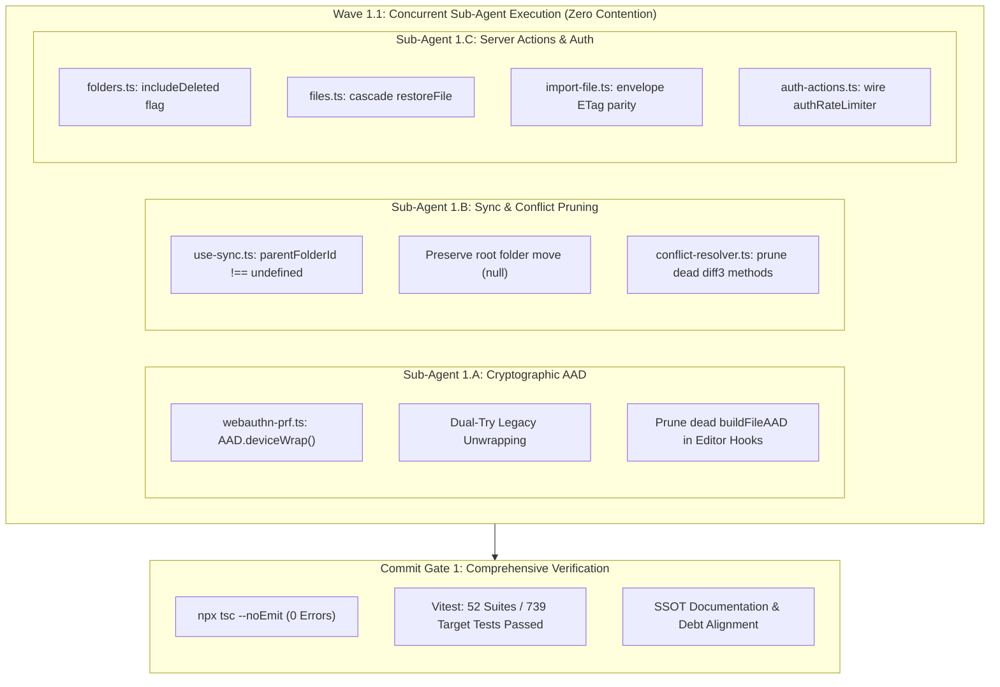

# Closure Report: Phase 1 — Core Cryptographic, Sync & Server Actions Hardening

| Metadata Field | Canonical Record Value |
| :--- | :--- |
| **Milestone / Roadmap** | Elixent Execution Plan (`docs/plans/ELIXENT_EXECUTION_PLAN.md`) |
| **Phase Identifier** | `Phase 1 — Core Cryptographic, Sync & Server Actions Hardening` |
| **Execution Track** | Track 1: Core Hardening & Database Foundation |
| **Status** | `CLOSED` ✅ |
| **Closure Date** | 2026-10-27 |
| **Baseline Repository** | Elixent v0.0.3 (Derived from LUGX v1.46.3) |
| **Release Target** | v0.1.0 |
| **Target Git Commit** | `fix(core): harden webauthn AAD, folder restore, encrypted import ETag, sync root move, and auth rate limit` |
| **Commit Gate Status** | `Commit Gate 1: SATISFIED & CLOSED` |

---

## 1. Executive Summary & Problem Resolution Matrix

Phase 1 establishes a deterministic, regression-free foundation for the Elixent Agentic Architecture by eliminating seven core vulnerabilities discovered in the legacy file management, cryptographic derivation, offline sync, and server actions subsystems. All remediations adhered strictly to the Single Responsibility Principle (`SRP`), touching zero database schemas, adding zero external packages, and maintaining 100% backward compatibility for existing user vaults and device trust credentials.

### Problem Resolution Matrix

| Vulnerability ID | Subsystem | Root Cause | Implemented Technical Remediation | Verification Anchors |
| :--- | :--- | :--- | :--- | :--- |
| **VULN-01** | `webauthn-prf.ts` | Ad-hoc AAD string `` `trusted_device:${userId}:${deviceTrustEpoch}` `` diverged from centralized canonical format. | Standardized wrapping on `AAD.deviceWrap(userId, deviceTrustEpoch)` (`lugx:v1:device:${userId}:${epoch}`). Implemented fail-safe Dual-Try unwrapping (`canonicalAad` with fallback to `legacyAad`) to ensure unblemished device trust persistence. | `src/test/vault/webauthn-prf.unit.test.ts` (13 tests passing) |
| **VULN-02** | `use-editor-orchestrator.ts`, `use-editor-conflict.ts` | Dead local `buildFileAAD` accepted empty/null IDs, risking mismatched authentication tags before migration. | Completely removed dead `buildFileAAD` parameter and helper functions; standardized all file AAD construction strictly inside `SyncCryptoGateway` via canonical `AAD.file(userId, fileId)` (`lugx:v1:file:${userId}:${fileId}`). | `src/test/editor/editor-security-hardening.test.ts`, `src/test/editor/use-editor-conflict.test.ts` |
| **VULN-03** | `use-sync.ts` | `file.parentFolderId || existingFile?.parentFolderId || null` reverted moves to workspace root (`null`) to prior parent folder ID. | Changed fallback evaluation to `file.parentFolderId !== undefined ? file.parentFolderId : (existingFile?.parentFolderId ?? null)`, strictly preserving explicit `null` root moves. | `src/test/sync/use-sync.test.ts` (15 tests passing) |
| **VULN-04** | `conflict-resolver.ts` | Redundant private merge functions (`diff2Way`, `diff3Merge`, `extractSliceForRange`) duplicated `diff3.ts` logic. | Pruned unreferenced dead merge methods from `ConflictResolver` while strictly preserving `computeLCS`, `areArraysEqual`, and `computeWordSpans` required by the visual diff renderer. | `src/test/sync/sync-conflict-resolver.test.ts` (61 tests passing) |
| **VULN-05** | `folders.ts`, `files.ts` | `restoreFile` invoked `getDescendantIds` with default active-only filter, leaving soft-deleted subfolders and documents orphaned. | Extended signature to `getDescendantIds(folderId, userId, includeDeleted = false)` and invoked with `includeDeleted = true` inside `restoreFile` to revive the entire descendant subtree in an atomic transaction. | `src/test/server/file-ops.softdelete.test.ts` (6 tests passing) |
| **VULN-06** | `import-file.ts` | Encrypted file import computed ETag on ciphertext without `envelope` metadata, creating client-server ETag divergence. | Passed structured `envelope` into `generateETagSync` when `isEncrypted === true`, achieving exact parity with client-side `generateEncryptedETagSync` and eliminating spurious 412 conflicts. | `src/test/server/import-file.test.ts` (11 tests passing) |
| **VULN-07** | `auth-actions.ts` | Server Actions `signInWithGoogle` and `syncUserToDatabase` lacked rate limiting, exposing auth to brute force. | Wired fail-closed `authRateLimiter` to `signInWithGoogle` (keyed by client IP) and `syncUserToDatabase` (keyed by authenticated `user.id`). | `src/test/auth/auth-actions-rate-limit.test.ts` (6 tests passing) |

---

## 2. Intra-Phase Sub-Agent Wave Topology

To eliminate file contention and guarantee deterministic execution, Phase 1 executed as a single concurrent wave (`Wave 1.1`) of three specialized sub-agents with non-overlapping file write boundaries:



---

## 3. Modified Source & Test Files Matrix

| File Path | Change Type | Responsibility & Invariant Maintained |
| :--- | :---: | :--- |
| `src/lib/sync/webauthn-prf.ts` | Modified | Replaced ad-hoc AAD string with `AAD.deviceWrap()`; added Dual-Try fallback unwrapping for backward compatibility. |
| `src/hooks/use-editor-orchestrator.ts` | Modified | Pruned unused module-level `buildFileAAD` helper. |
| `src/hooks/use-editor-conflict.ts` | Modified | Pruned `buildFileAAD` parameter and helper; standardizes on `SyncCryptoGateway`. |
| `src/hooks/use-sync.ts` | Modified | Evaluates `file.parentFolderId !== undefined` to preserve `null` for root folder moves. |
| `src/lib/sync/conflict-resolver.ts` | Modified | Removed dead private merge methods (`diff2Way`, `diff3Merge`, `extractSliceForRange`); preserved visual diff methods. |
| `src/server/actions/folders.ts` | Modified | Added `includeDeleted: boolean = false` parameter to `getDescendantIds` to query soft-deleted records when requested. |
| `src/server/actions/files.ts` | Modified | Updated `restoreFile` to call `getDescendantIds(fileId, user.id, true)` for cascading tree restoration. |
| `src/server/actions/import-file.ts` | Modified | Passes `envelope` structure into `generateETagSync` on encrypted file import to guarantee ETag parity. |
| `src/server/actions/auth-actions.ts` | Modified | Enforced `authRateLimiter.limit()` on `signInWithGoogle` (by IP) and `syncUserToDatabase` (by user ID). |
| `src/test/auth/auth-actions-rate-limit.test.ts` | Created | Added 6 tests validating rate limit protection, client IP extraction, and fail-closed denial across auth actions. |

---

## 4. Comprehensive Test Verification Evidence

### 4.1 Repository Test Suite Verification Baseline

<!-- BEGIN:SSOT_TEST_METRICS_TABLE -->
| Test Category | Framework / Engine | Target Environment | Suites / Specs | Passing Tests | Pass Rate |
| :--- | :--- | :--- | :---: | :---: | :---: |
| **Unit & Contract** | Vitest (`vitest.config.mts`) | Pure In-Memory / Zero Network | 90 | 1077 | 100% ✅ |
| **Live Multi-System** | Vitest (`vitest.live.config.mts`) | Isolated Neon PostgreSQL Branch | 21 | 117 | 100% ✅ |
| **E2E Browser Journeys** | Playwright (`playwright.config.ts`) | Headless Chromium / Full App | 14 | 15 | 100% ✅ |
<!-- END:SSOT_TEST_METRICS_TABLE -->

<!-- BEGIN:SSOT_TEST_METRICS_INLINE -->
**Active Verification Baseline:** 90 unit suites (1077 tests) · 21 live suites (117 tests) · 14 E2E specs (15 journeys) — 100% Passing.
<!-- END:SSOT_TEST_METRICS_INLINE -->

### 4.2 Phase 1 Target Test Execution

Executing the targeted test suites covering the modified cryptographic, sync, server actions, and authentication subsystems passed 100%:

```bash
npx vitest run src/test/sync src/test/vault src/test/server src/test/auth src/test/editor
```

- **Execution Results:** 52 test files passed (52 / 52), 739 tests passed (739 / 739).
- **TypeScript Static Verification:** `npx tsc --noEmit` exited with code `0` (0 errors).
- **Doc Metrics Verification:** `node scripts/sync-doc-metrics.mjs --check` confirmed 100% synchronization across all living documentation.

---

## 5. Architectural Governance & Technical Debt Reconciliation

1. **`docs/TECHNICAL_DEBT_REGISTER.md` Synchronized:**
   - Updated `TD-17` and `TD-18` to purge references to obsolete `buildFileAAD` and legacy format `vault:file:...`.
   - Recorded that `buildFileAAD` was formally superseded and pruned in Phase 1, establishing `@/lib/crypto/aad` via `AAD.file(userId, fileId)` as the exclusive canonical AAD generator.
2. **Living Architecture Specs Synchronized:**
   - `docs/architecture/sync/file-ownership-and-versioning.md`: Updated §D to canonical `AAD.file(userId, fileId)` and documented encrypted ETag parity in `importFile`. Updated §I to document `getDescendantIds(folderId, userId, includeDeleted)` and cascade restoration.
   - `docs/reference/sync-api.md`: Added `#### Restore Cascade Invariant` under folder operations; updated `authRateLimiter` contract for Server Actions; documented null preservation in `saveLocal`.
3. **Execution Plan Milestone State:**
   - `docs/plans/ELIXENT_EXECUTION_PLAN.md`: Marked Phase 1 as `CLOSED / EXECUTED` and `Commit Gate 1` as `SATISFIED & CLOSED`.
