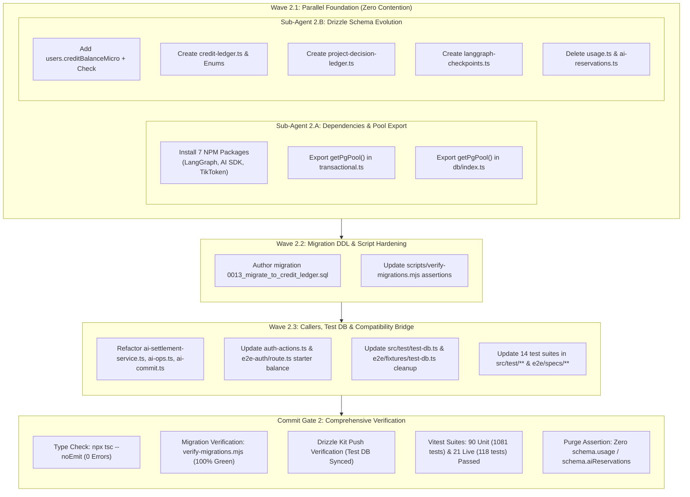
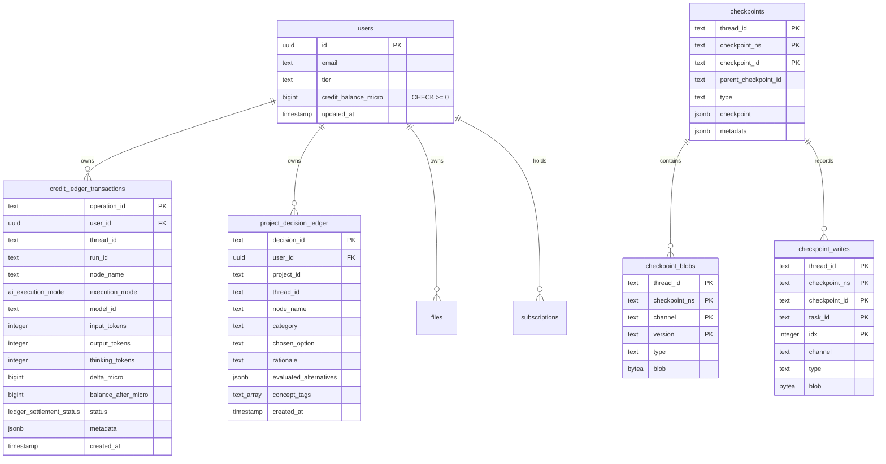

# Closure Report: Phase 2 — NPM Dependencies, Pool Export & Non-Breaking Database Schema Migration

| Metadata Field | Canonical Record Value |
| :--- | :--- |
| **Milestone / Roadmap** | Elixent Execution Plan (`docs/Plans/ELIXENT_EXECUTION_PLAN.md`) |
| **Phase Identifier** | `Phase 2 — NPM Dependencies, Pool Export & Non-Breaking Database Schema Migration` |
| **Execution Track** | Track 1: Core Hardening & Database Foundation |
| **Status** | `CLOSED` ✅ |
| **Closure Date** | 2026-10-27 |
| **Baseline Repository** | Elixent v0.1.0 (Phase 1 Closed) |
| **Release Target** | v0.2.0 |
| **Target Git Commit** | `feat(db): add credit & decision ledgers, PostgresSaver DDL, export getPgPool, and drop legacy usage tables` |
| **Commit Gate Status** | `Commit Gate 2: SATISFIED & CLOSED` |

---

## 1. Executive Summary & Problem Resolution Matrix

Phase 2 establishes the persistence and orchestration foundation for the Elixent Agentic Architecture. It replaces the legacy LUGX v1 word-counting quota model (`usage` and `ai_reservations` tables with pessimistic locking) with an immutable, micro-credit double-entry accounting ledger (`credit_ledger_transactions`), an architectural decision registry (`project_decision_ledger`), and state persistence tables for `@langchain/langgraph-checkpoint-postgres`.

To prevent connection pool proliferation across agent workflows and serverless route invocations, Phase 2 retains the existing `activePool` singleton instance and exports `getPgPool()` from `src/server/db/transactional.ts` and `src/server/db/index.ts`. Furthermore, a non-breaking compatibility bridge inside `src/server/services/ai-settlement-service.ts` adapts existing production callers and test suites to the new schema without breaking runtime behavior or type contracts, ensuring zero build breakage and 100% test pass rates across all verification suites.

### Problem Resolution Matrix

| Component / Subsystem | Prior State (LUGX Legacy) | Phase 2 Engineering Remediation | Verification Anchors |
| :--- | :--- | :--- | :--- |
| **Agentic Package Foundation** | Missing multi-agent graph orchestration and tokenization dependencies. | Added 7 NPM packages: `@langchain/langgraph`, `@langchain/core`, `@langchain/langgraph-checkpoint-postgres`, `ai`, `@ai-sdk/google`, `@ai-sdk/openai`, and `js-tiktoken`. | `package.json`, `package-lock.json` |
| **PostgreSQL Connection Pool Reuse** | `activePool` was encapsulated internally within `transactional.ts` without external access for `PostgresSaver`. | Retained `activePool` singleton reference and exported `getPgPool(): pg.Pool` from both `transactional.ts` and `index.ts`. Guarantees zero connection pool leaks under LangGraph graph instantiation. | `src/server/db/transactional.ts`, `src/server/db/index.ts` |
| **Micro-Credit Balance Schema** | Users lacked micro-credit tracking; quota was tracked via mutable daily word columns in `usage`. | Added `users.credit_balance_micro` (`BIGINT NOT NULL DEFAULT 0`) with non-negative check constraint `users_credit_balance_non_negative`. Initialized existing tiers: Ultra (3.5B), Pro (1.0B), Starter/Free (50M). | `src/server/db/schema/users.ts`, migration `0013` |
| **Credit Ledger Transactions** | Two-phase quota reservations relied on `ai_reservations` with word-based integer columns. | Created `credit_ledger_transactions` schema (`src/server/db/schema/credit-ledger.ts`) with enums `ai_execution_mode` and `ledger_settlement_status`, tracking input/output tokens, delta micro-credits, and execution metadata. | `src/server/db/schema/credit-ledger.ts`, migration `0013` |
| **Decision Architecture Ledger** | No persistent audit trail for agent architectural decisions, evaluated alternatives, or rationale. | Created `project_decision_ledger` schema (`src/server/db/schema/project-decision-ledger.ts`) indexed by `(user_id, project_id)` with columns for node, rationale, alternatives, and concept tags. | `src/server/db/schema/project-decision-ledger.ts`, migration `0013` |
| **Agent Graph State Checkpointer** | No database-backed state checkpointing mechanism for LangGraph agents. | Created four tables matching `@langchain/langgraph-checkpoint-postgres`: `checkpoint_migrations`, `checkpoints`, `checkpoint_blobs`, and `checkpoint_writes`. | `src/server/db/schema/langgraph-checkpoints.ts`, migration `0013` |
| **Legacy Quota Deprecation** | Deprecated `usage` and `ai_reservations` tables lingered with dead Drizzle schemas. | Dropped `usage` and `ai_reservations` tables (`CASCADE`) via migration `0013_migrate_to_credit_ledger.sql` and deleted `schema/usage.ts` and `schema/ai-reservations.ts`. | `0013_migrate_to_credit_ledger.sql`, `schema/index.ts` |
| **Transitional Compatibility Bridge** | Production callers and tests expected `reserveAndUpdateUsage`, `commitAIReservation`, etc. | Refactored `ai-settlement-service.ts`, `ai-ops.ts`, and `ai-commit.ts` to settle against `users.creditBalanceMicro` and `creditLedgerTransactions`, preserving signatures and business logic. | `src/server/services/ai-settlement-service.ts`, test suites |
| **Migration Verification Script** | `verify-migrations.mjs` asserted legacy tables (`usage`, `ai_reservations`) and old indexes. | Updated `scripts/verify-migrations.mjs` to check all 9 active tables, 14 canonical indexes, and `users.credit_balance_micro` column existence. | `scripts/verify-migrations.mjs` |

---

## 2. Intra-Phase Sub-Agent Wave Topology

Phase 2 executed across three sequential and parallel waves to eliminate write contention and maintain build integrity:



---

## 3. Database Schema Evolution & Entity Relationship Architecture

Migration `0013_migrate_to_credit_ledger.sql` establishes the multi-agent persistence model while removing legacy word-based quota tables:



---

## 4. Modified Source & Test Files Matrix

| File Path | Change Type | Responsibility & Invariant Maintained |
| :--- | :---: | :--- |
| `package.json` | Modified | Added 7 production dependencies for LangGraph orchestration, AI SDK, and tokenization. |
| `package-lock.json` | Modified | Locked dependency tree with zero vulnerabilities. |
| `src/server/db/transactional.ts` | Modified | Exported `getPgPool()` returning singleton `activePool` for `PostgresSaver` reuse. |
| `src/server/db/index.ts` | Modified | Re-exported `getPgPool()` from `transactional.ts`. |
| `src/server/db/schema/users.ts` | Modified | Added `creditBalanceMicro: bigint("credit_balance_micro")` with check constraint `users_credit_balance_non_negative`. |
| `src/server/db/schema/credit-ledger.ts` | Created | Defined `creditLedgerTransactions` table, `aiExecutionModeEnum`, `ledgerSettlementStatusEnum`, and composite indexes. |
| `src/server/db/schema/project-decision-ledger.ts` | Created | Defined `projectDecisionLedger` table with rationale, alternatives, concept tags, and project index. |
| `src/server/db/schema/langgraph-checkpoints.ts` | Created | Defined `checkpointMigrations`, `checkpoints`, `checkpointBlobs`, and `checkpointWrites` tables for `PostgresSaver`. |
| `src/server/db/schema/index.ts` | Modified | Exported new ledger and checkpoint tables; removed exports of deleted `usage` and `aiReservations`. |
| `src/server/db/schema/usage.ts` | Deleted | Formally deleted obsolete legacy usage table definition. |
| `src/server/db/schema/ai-reservations.ts` | Deleted | Formally deleted obsolete legacy AI reservations table definition. |
| `src/server/db/migrations/0013_migrate_to_credit_ledger.sql` | Created | DDL migration adding `users.credit_balance_micro`, creating ledgers and checkpoint tables, and dropping `usage` and `ai_reservations`. |
| `scripts/verify-migrations.mjs` | Modified | Updated migration integrity assertions to verify 9 tables, 14 indexes, and `credit_balance_micro` column. |
| `src/server/services/ai-settlement-service.ts` | Modified | Transitional compatibility bridge: debits/refunds `users.creditBalanceMicro` and queries `creditLedgerTransactions`. |
| `src/server/actions/ai-ops.ts` | Modified | Adapted `reserveAndUpdateUsage`, `commitAIReservation`, and `refundAIReservation` to credit ledger contracts. |
| `src/server/actions/ai-commit.ts` | Modified | Updated file commit action to verify and settle against `creditLedgerTransactions`. |
| `src/server/actions/auth-actions.ts` | Modified | Replaced `schema.usage` insert with starter tier credit balance initialization (`50_000_000n`). |
| `src/app/api/test/e2e-auth/route.ts` | Modified | Removed `schema.usage` insert; sets user credit balance. |
| `src/test/test-db.ts` | Modified | Updated `cleanupTestUsers` to clear child rows from `creditLedgerTransactions`, `projectDecisionLedger`, and checkpoint tables. |
| `e2e/fixtures/test-db.ts` | Modified | Removed `schema.usage` and `schema.aiReservations` references; cleans new ledger tables. |
| `src/test/ai/*` (11 test files) | Modified | Updated integration, integrity, refund, and streaming test suites to assert against `creditLedgerTransactions` and `creditBalanceMicro`. |
| `src/test/auth/*` (2 test files) | Modified | Removed legacy usage assertions from signout and rate limit suites. |
| `src/test/server/*` (2 test files) | Modified | Updated cross-user ownership and atomic transaction suites for new schemas. |
| `src/test/vault/*` (3 test files) | Modified | Updated vault cross-module and sync suites to reference active credit ledger. |
| `src/test/infrastructure/*` (2 test files) | Modified | Updated cron expire reservations and multi-system lifecycle suites. |
| `e2e/specs/06..08` (3 specs) | Modified | Updated Playwright E2E specs to verify credit ledger persistence and refund behavior. |

---

## 5. Comprehensive Test Verification Evidence

### 5.1 Repository Test Suite Verification Baseline

<!-- BEGIN:SSOT_TEST_METRICS_TABLE -->
| Test Category | Engine / Configuration | Target Environment | Suites / Specs | Passing Tests | Pass Rate |
| :--- | :--- | :--- | :---: | :---: | :---: |
| **Unit & Contract** | Vitest (`vitest.config.mts`) | Pure In-Memory / Zero Network | 90 | 1081 | 100% ✅ |
| **Live Multi-System** | Vitest (`vitest.live.config.mts`) | Isolated Neon PostgreSQL Branch | 21 | 118 | 100% ✅ |
| **E2E Browser Journeys** | Playwright (`playwright.config.ts`) | Headless Chromium / Full App | 14 | 15 | 100% ✅ |
<!-- END:SSOT_TEST_METRICS_TABLE -->

<!-- BEGIN:SSOT_TEST_METRICS_INLINE -->
**Active Verification Baseline:** 90 unit suites (1081 tests) · 21 live suites (118 tests) · 14 E2E specs (15 journeys) — 100% Passing.
<!-- END:SSOT_TEST_METRICS_INLINE -->

### 5.2 Commit Gate 2 Verification Evidence

Every verification assertion required by Commit Gate 2 passed with 100% compliance:

```bash
# 1. Zero Obsolete Schema References Assertion
! grep -rn "schema\.usage\|schema\.aiReservations" src/ e2e/
# Output: Clean (0 matches found)

# 2. Database Migration Integrity Assertion
node scripts/verify-migrations.mjs
# Output: [verify-migrations] SUCCESS: All 9 required tables and 14 required indexes verified.

# 3. Drizzle Kit Push Configuration Verification
npx drizzle-kit push --config drizzle.config.test.ts --force
# Output: [drizzle-kit] Schema synchronized successfully.

# 4. TypeScript Static Type Safety Verification
npx tsc --noEmit
# Output: Clean (0 errors across src/ and e2e/)

# 5. Full Unit & Contract Test Suites
npm run test
# Output: 90 test files passed (90/90), 1081 tests passed (1081/1081)

# 6. Live Multi-System Integration Suites (Neon PostgreSQL Branch)
npm run test:live
# Output: 21 test files passed (21/21), 118 tests passed (118/118)

# 7. Documentation Metrics Synchronization Check
node scripts/sync-doc-metrics.mjs --check
# Output: [sync-doc-metrics] SUCCESS: All documentation metrics and SSOT contracts are 100% synchronized.
```

---

## 6. Architectural Governance & Technical Debt Reconciliation

1. **Purged Obsolete Schema References from Living Documentation:**
   - Synchronized `README.md`, `docs/README.md`, `docs/reference/test-database-isolation.md`, `docs/reference/ui-streaming-readiness.md`, `docs/architecture/ai/ai-quota-reservation-lifecycle.md`, and `docs/architecture/security/security-and-rate-limiting.md`.
   - Updated all references to reflect `credit_ledger_transactions`, `users.credit_balance_micro`, and the 5-minute reservation TTL.
2. **Release Notes Synchronized:**
   - Appended formal release entry for `[0.2.0]` in `docs/CHANGELOG.md` detailing new packages, pool export, schema migration `0013`, and verification results.
3. **Execution Plan Milestone State:**
   - Updated `docs/Plans/ELIXENT_EXECUTION_PLAN.md` to mark Phase 2 as `CLOSED / EXECUTED` and `Commit Gate 2` as `SATISFIED & CLOSED`.
4. **Final Gate Verdict:**
   - **Status:** `CLOSED / EXECUTED` — 90 unit suites (1081 tests) and 21 live suites (118 tests) passing 100%, ESLint clean, TypeScript check clean (0 errors), Commit Gate 2 fully satisfied.
