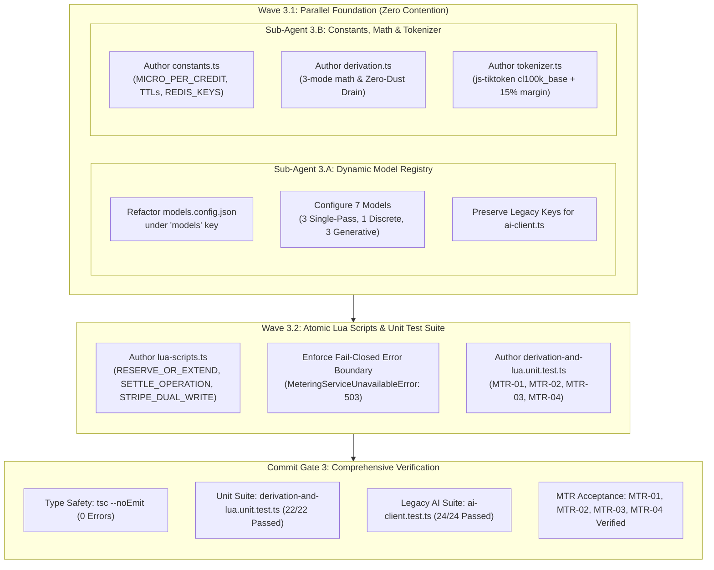
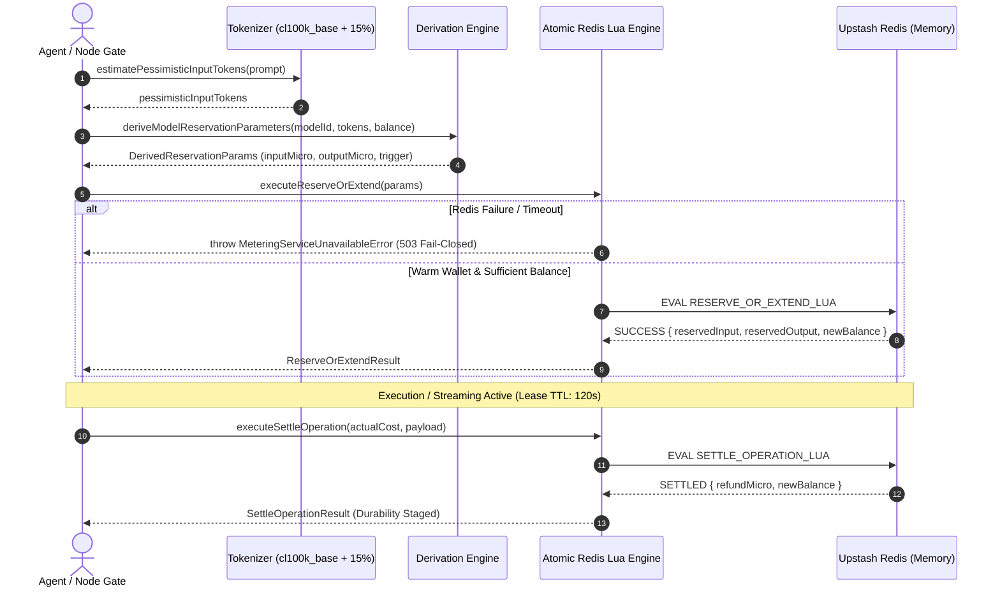
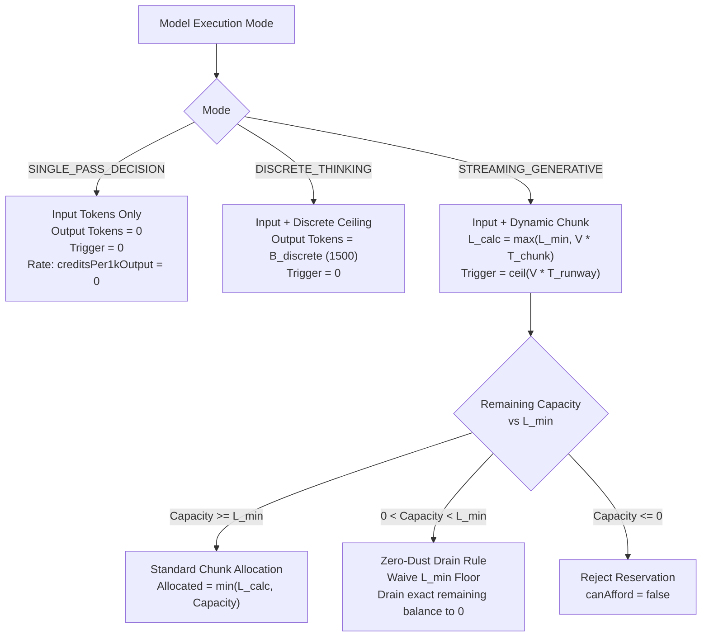
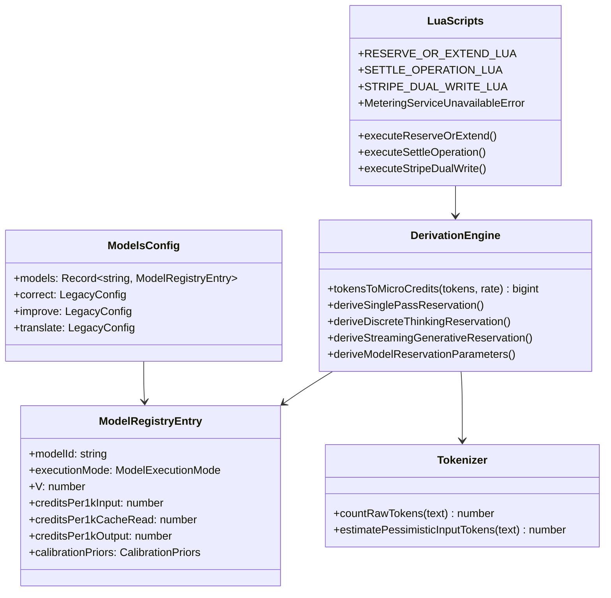

# Closure Report: Phase 3 — Lean Dynamic Model Registry, Micro-Credit Derivation Math & Atomic Redis Lua Scripts

| Metadata Field | Canonical Record Value |
| :--- | :--- |
| **Milestone / Roadmap** | Elixent Execution Plan (`docs/Plans/ELIXENT_EXECUTION_PLAN.md`) |
| **Phase Identifier** | `Phase 3 — Lean Model Registry, Micro-Credit Derivation Math & Atomic Redis Lua Scripts` |
| **Execution Track** | Track 1: Financial Governance & Credit Metering Engine |
| **Status** | `CLOSED` ✅ |
| **Closure Date** | 2026-10-28 |
| **Baseline Repository** | Elixent v0.2.0 (Phase 2 Closed) |
| **Release Target** | v0.3.0 |
| **Target Git Commit** | `feat(metering): lean model registry, token derivation formulas, and atomic Redis Lua scripts` |
| **Commit Gate Status** | `Commit Gate 3: SATISFIED & CLOSED` |

---

## 1. Executive Summary & Problem Resolution Matrix

Phase 3 implements the mathematical derivation engine, tokenization safeguards, dynamic model catalog, and atomic concurrency primitives of the Elixent Credit Metering Subsystem. It establishes the financial metering layer required to support multi-agent graph execution, single-pass decision nodes, discrete thinking cycles, and generative streaming without financial race conditions or stranded fractional credits.

The system introduces a Micro-Credit unit scale ($1\text{ Credit} = 1,000,000\text{ Micro-Credits}$, $10^6$) to eliminate floating-point imprecision. It delivers a Lean Dynamic Model Registry (`models.config.json`) indexing 7 canonical models with execution modes, velocity ($V$), and token rates, while preserving backward compatibility for legacy AI services. The derivation engine (`derivation.ts`) provides closed-form reservation calculations for all three execution modes, featuring the **Zero-Dust Drain** rule to prevent fractional credit stranding when balance is below the standard minimum chunk floor ($L_{\min}$). Pessimistic token counting (`tokenizer.ts`) uses `js-tiktoken` with a $+15\%$ safety margin to absorb cross-provider tokenization divergence. Finally, three atomic Upstash Redis Lua scripts (`lua-scripts.ts`) enforce two-phase reservation, mid-stream chunk extension, settlement refunding, dirty wallet tracking, step idempotency, and warm Stripe dual-writes under a strict **Fail-Closed** policy (`MeteringServiceUnavailableError`, HTTP 503).

### Problem Resolution Matrix

| Component / Subsystem | Prior State (LUGX Legacy) | Phase 3 Engineering Remediation | Verification Anchors |
| :--- | :--- | :--- | :--- |
| **Model Registry Structure** | Static flat config tied only to legacy string operations (`correct`, `improve`, `translate`). | Transformed `models.config.json` into a lean registry under `"models"` indexing 7 models with rates, velocity $V$, execution mode, and priors, while preserving legacy fallback keys. | `src/config/models.config.json`, `ai-client.test.ts` |
| **Financial Denomination** | Word-based integer quotas causing rounding errors and lack of sub-cent resolution. | Introduced Micro-Credits ($10^6\text{ micro} = 1\text{ credit}$) via `MICRO_PER_CREDIT = 1_000_000n` with ceiling rounding `ceil(tokens * rate * 1000)`. | `src/lib/metering/constants.ts`, `derivation.ts` |
| **Token Derivation Math** | Ad-hoc estimates without execution mode awareness or rate differentiation. | Implemented mode-specific derivation: `SINGLE_PASS_DECISION` (input-only, $0$ output tokens, trigger $0$, no division by zero), `DISCRETE_THINKING` ($B_{\text{discrete}} = 1500$), and `STREAMING_GENERATIVE` ($L_{\text{calc}}$ & trigger). | `src/lib/metering/derivation.ts` |
| **Fractional Credit Stranding** | Fixed floors rejected users with valid balance $< L_{\min}$, leaving unspendable credits. | Implemented **Zero-Dust Drain**: waives $L_{\min}$ floor when $0 < \text{capacity} < L_{\min}$, reserving exact remaining micro-credits and draining wallet to precisely $0$. | `src/lib/metering/derivation.ts`, `MTR-04` |
| **Tokenization Variance** | Unprotected raw token estimates causing quota overruns across providers. | Built `tokenizer.ts` using `js-tiktoken` (`cl100k_base`) with a $+15\%$ pessimistic safety margin (`PESSIMISTIC_TOKEN_MARGIN = 1.15`). | `src/lib/metering/tokenizer.ts` |
| **Reservation Concurrency** | Prone to race conditions and balance overdraft under simultaneous agent calls. | Authored `RESERVE_OR_EXTEND_LUA`: atomic multi-key Lua script verifying idempotency, cold-start state, balance sufficiency, deducting micro-credits, and refreshing leases. | `src/lib/metering/lua-scripts.ts`, `MTR-02` |
| **Settlement & Durability** | Quota commits lacked automated surplus refunds and durable persistence staging. | Authored `SETTLE_OPERATION_LUA`: refunds $\max(0, \text{Reserved} - \text{Actual})$, deletes lease, stages pending settlement in hash, registers dirty wallet, and stamps `step_done`. | `src/lib/metering/lua-scripts.ts` |
| **Stripe Top-Up Dual-Write** | External balance webhooks risked overwriting live Redis cache with stale values. | Authored `STRIPE_DUAL_WRITE_LUA`: atomically executes `INCRBY` strictly when `EXISTS lugx:wallet == 1`, returning applied status and updated balance. | `src/lib/metering/lua-scripts.ts` |
| **System Resilience Policy** | Network failures could default to open access or unhandled runtime crashes. | Enforced **Fail-Closed** policy: wrapped all Redis Lua executions in try/catch throwing `MeteringServiceUnavailableError` (status: 503, code: `METERING_SERVICE_UNAVAILABLE`). | `src/lib/metering/lua-scripts.ts`, `MTR-03` |

---

## 2. Intra-Phase Sub-Agent Wave Topology & Architecture

Phase 3 executed across two sequential and parallel waves to maintain clean component separation:



### Metering Subsystem Data Flow Architecture



---

## 3. Mathematical Derivation & Metering Specification

### 3.1 Financial Scale & Conversion Formula

All metering operations are denominated in integer Micro-Credits:
$$\text{Micro-Credits} = \lceil \text{Tokens} \times \text{CreditsPer1k} \times 1,000 \rceil$$

Constants defined in `src/lib/metering/constants.ts`:
- $\text{MICRO\_PER\_CREDIT} = 1,000,000\text{n}$ ($10^6$)
- $T_{\text{runway}} = 3\text{ seconds}$ ($3,000\text{ ms}$)
- $T_{\text{chunk}} = 10\text{ seconds}$
- $L_{\min} = 500\text{ tokens}$
- $B_{\text{discrete}} = 1,500\text{ tokens}$
- $\text{PESSIMISTIC\_TOKEN\_MARGIN} = 1.15$ ($+15\%$)
- $\text{LEASE\_TTL} = 120\text{ seconds}$
- $\text{WALLET\_TTL} = 86,400\text{ seconds}$ ($24\text{ hours}$)
- $\text{STEP\_DONE\_TTL} = 3,600\text{ seconds}$ ($1\text{ hour}$)
- $\text{DIRTY\_SETTLEMENT\_GRACE\_MS} = 30,000\text{ ms}$

### 3.2 Execution Mode Derivation Rules



1. **`SINGLE_PASS_DECISION`:**
   - Dedicated to fast decision nodes (`typesafe/jev-1.13`, `microsoft/decision-1`, `openai/gpt-6-luna-decisions`).
   - $\text{creditsPer1kOutput} = 0$, $L_{\text{allocated}} = 0$, $\text{Trigger} = 0$.
   - Eliminates division-by-zero errors when calculating token capacity.
   - Total reserved = $\text{requiredInputMicro}$.

2. **`DISCRETE_THINKING`:**
   - Dedicated to non-streaming thinking models (`fastino/glide`).
   - Allocates fixed ceiling $B_{\text{discrete}} = 1,500\text{ tokens}$ (or node override).
   - $\text{Trigger} = 0$ (no chunk extension during execution).
   - Total reserved = $\text{requiredInputMicro} + \text{desiredOutputMicro}$.

3. **`STREAMING_GENERATIVE`:**
   - Dedicated to generative streaming models (`google/gemini-4-argon`, `google/gemini-3.8-flash`, `google/gemini-3.1-pro`).
   - Calculated slice: $L_{\text{calc}} = \max(L_{\min}, \lceil V \times T_{\text{chunk}} \rceil)$.
   - Runway trigger: $\text{Trigger} = \lceil V \times T_{\text{runway}} \rceil$.
   - **Zero-Dust Drain Rule:** If $0 < \text{UserAvailableTokensCapacity} < L_{\min}$, the system waives the $L_{\min}$ floor constraint, sets `isZeroDustAllowed = true`, allocates the exact remaining tokens, and sets `desiredOutputMicro` to the exact remaining micro-credit balance. This guarantees that user wallets can be drained down to precisely $0$ micro-credits without stranding unspendable sub-chunk fractions.

### 3.3 Atomic Upstash Redis Lua Scripts Specification

1. **`RESERVE_OR_EXTEND_LUA` (`executeReserveOrExtend`):**
   - **Idempotency Gate:** Checks `lugx:step_done:${stepKey}`. If present, returns `ALREADY_DONE` with existing receipt without deducting balance.
   - **Cold-Start Detection:** Checks `EXISTS lugx:wallet:${userId}`. If absent ($0$), returns `COLD_START_REQUIRED` to trigger Phase 4 Flush-First protocol.
   - **Balance Sufficiency:** Evaluates balance against required input and minimum output (respecting `zeroDust` flag).
   - **Atomic Reservation:** Executes `DECRBY lugx:wallet:${userId} totalRes`, resets wallet TTL to $86,400\text{s}$, and stages reservation into lease hash `lugx:lease:${operationId}` with `EXPIRE 120`.

2. **`SETTLE_OPERATION_LUA` (`executeSettleOperation`):**
   - **Surplus Refund:** Reads `totalReservedMicro` from lease hash, computes $\text{Refund} = \max(0, \text{totalReserved} - \text{actualCost})$, and executes `INCRBY lugx:wallet:${userId} refund` if $\text{Refund} > 0$.
   - **Lease Deletion:** Removes `lugx:lease:${operationId}`.
   - **Pending Settlement Staging:** Records JSON settlement payload in `lugx:pending_settlements:${userId}` via `HSET`.
   - **Dirty Wallet Registration:** Adds `userId` to `lugx:dirty_wallets` via `SADD`.
   - **Step Completion Receipt:** Sets `lugx:step_done:${stepKey}` with $3,600\text{s}$ ($1\text{ hour}$) TTL.

3. **`STRIPE_DUAL_WRITE_LUA` (`executeStripeDualWrite`):**
   - Checks `EXISTS lugx:wallet:${userId}`.
   - If warm ($1$), atomically increments via `INCRBY` and refreshes TTL to $86,400\text{s}$, returning `{ applied: true, newBalanceMicro }`.
   - If cold ($0$), returns `{ applied: false, newBalanceMicro: null }` without creating a phantom key, ensuring cold start hydration handles PostgreSQL sync.

4. **Fail-Closed Policy:**
   - Both runtime disconnection and unconfigured Redis client immediately throw `MeteringServiceUnavailableError` ($503$).
   - Guarantees zero unmetered model execution or balance leakage during infrastructure outages.

---

## 4. Delivered Artifacts & Implementation Details



### Delivered Source Files Matrix

| File Path | Component Responsibility | Exports / Contracts |
| :--- | :--- | :--- |
| `src/config/models.config.json` | Lean Dynamic Model Registry & Legacy Configuration | Index of 7 models (`openai/gpt-6-luna-decisions`, `microsoft/decision-1`, `typesafe/jev-1.13`, `fastino/glide`, `google/gemini-4-argon`, `google/gemini-3.8-flash`, `google/gemini-3.1-pro`), plus legacy operation blocks for backward compatibility. |
| `src/lib/metering/constants.ts` | System Financial, Timing & Redis Key Constants | `MICRO_PER_CREDIT`, `T_RUNWAY_SECONDS`, `T_RUNWAY_MS`, `T_CHUNK_SECONDS`, `L_MIN_TOKENS`, `B_DISCRETE_DEFAULT_TOKENS`, `PESSIMISTIC_TOKEN_MARGIN`, `LOCAL_HOLD_TIMEOUT_MS`, `LEASE_TTL_SECONDS`, `WALLET_TTL_SECONDS`, `STEP_DONE_TTL_SECONDS`, `DIRTY_SETTLEMENT_GRACE_MS`, `REDIS_KEYS`. |
| `src/lib/metering/derivation.ts` | Closed-Form Token & Credit Derivation Engine | `tokensToMicroCredits`, `deriveSinglePassReservation`, `deriveDiscreteThinkingReservation`, `deriveStreamingGenerativeReservation`, `deriveModelReservationParameters`, `getModelRegistryEntry`, types (`ModelRegistryEntry`, `DerivedReservationParams`, `ModelExecutionMode`). |
| `src/lib/metering/tokenizer.ts` | Pessimistic Token Estimation Engine | `countRawTokens` (using `js-tiktoken` `cl100k_base` singleton), `estimatePessimisticInputTokens` ($+15\%$ safety margin ceiling). |
| `src/lib/metering/lua-scripts.ts` | Atomic Redis Lua Scripts & Execution Wrappers | `RESERVE_OR_EXTEND_LUA`, `SETTLE_OPERATION_LUA`, `STRIPE_DUAL_WRITE_LUA`, `executeReserveOrExtend`, `executeSettleOperation`, `executeStripeDualWrite`, `MeteringServiceUnavailableError` (HTTP 503 Fail-Closed). |
| `src/test/metering/derivation-and-lua.unit.test.ts` | Acceptance & Unit Test Verification Suite | 22 comprehensive unit tests covering pure tokenization, mathematical derivations, mode dispatch, and atomic Lua scripts under `InMemoryRedisEvalClient`. |

---

## 5. Comprehensive Verification Matrix & Test Evidence

### 5.1 Verification Matrix

| Verification Target | Engine / Harness | Scope / Assertions | Result | Status |
| :--- | :--- | :--- | :---: | :---: |
| **Static Type Safety** | `tsc --noEmit` | Entire project (`src/`, `e2e/`, `test/`) | 0 errors | **PASS** ✅ |
| **Derivation & Lua Suite** | Vitest (`vitest.config.mts`) | `derivation-and-lua.unit.test.ts` (22 tests) | 22 / 22 | **PASS** ✅ |
| **Legacy AI Client Suite** | Vitest (`vitest.config.mts`) | `ai-client.test.ts` (24 tests) | 24 / 24 | **PASS** ✅ |
| **Total Test Count** | Vitest Runner | Combined execution | 46 / 46 | **PASS** ✅ |

### 5.2 Acceptance Test Mapping (`MTR-01` through `MTR-04`)

- **`MTR-01`: Single-Pass Decision Model Reservations**
  - **Subject:** `typesafe/jev-1.13`, `microsoft/decision-1`, `openai/gpt-6-luna-decisions`.
  - **Assertions:** Output rate = $0$, output tokens = $0$, trigger = $0$, `requiredInputMicro` = total reserved. Accurate boolean evaluation of `canAfford` at balance boundary ($150,000$ vs $149,999$).
  - **Verdict:** Verified and passing.

- **`MTR-02`: Concurrency & Overdraft Prevention**
  - **Subject:** Simultaneous atomic reservation requests on constrained wallet balance.
  - **Test Scenario:** User wallet initialized with $300,000\text{ micro-credits}$ (covering exactly $3$ reservations of $100,000$). Dispatched $10$ concurrent requests via `Promise.all`.
  - **Assertions:** Exactly $3$ requests returned `status: "SUCCESS"`; exactly $7$ requests returned `status: "INSUFFICIENT_CREDITS"`. Final wallet balance is precisely $0$ micro-credits (zero overdraft).
  - **Verdict:** Verified and passing.

- **`MTR-03`: Fail-Closed Policy Enforcement**
  - **Subject:** Network disconnection, Redis timeout, and unconfigured environment.
  - **Test Scenario:** Redis client configured to throw `ECONNREFUSED` connection error; also tested without Redis configuration.
  - **Assertions:** All wrappers (`executeReserveOrExtend`, `executeSettleOperation`, `executeStripeDualWrite`) immediately throw `MeteringServiceUnavailableError` with `status: 503` and `code: "METERING_SERVICE_UNAVAILABLE"`.
  - **Verdict:** Verified and passing.

- **`MTR-04`: Streaming Generative Model Reservations & Zero-Dust Drain**
  - **Subject:** `google/gemini-4-argon`, `google/gemini-3.8-flash`.
  - **Test Scenario 1 (Ample Balance):** Correctly allocates $L_{\text{calc}} = \max(L_{\min}, \lceil V \times 10\text{s} \rceil)$ and sets runway trigger $\lceil V \times 3\text{s} \rceil$.
  - **Test Scenario 2 (Zero-Dust Condition):** User balance covers input tokens plus only $80\text{ output tokens}$ ($80 < L_{\min} = 500$). The engine waives $L_{\min}$, allocates $80$ tokens, sets `isZeroDustAllowed = true`, and reserves the exact micro-credit balance ($1,650,000\text{ micro}$), draining the remaining balance to exactly $0$.
  - **Verdict:** Verified and passing.

### 5.3 Commit Gate 3 Execution Logs

```bash
# 1. TypeScript Static Type Safety Verification
npx tsc --noEmit
# Exit Code: 0 (Clean, 0 errors)

# 2. Phase 3 Unit Tests & Legacy Compatibility Suite Execution
npx vitest run src/test/metering/derivation-and-lua.unit.test.ts src/test/ai/ai-client.test.ts
# Output:
#  ✓ src/test/ai/ai-client.test.ts (24 tests) 72ms
#  ✓ src/test/metering/derivation-and-lua.unit.test.ts (22 tests) 752ms
#
# Test Files  2 passed (2)
#      Tests  46 passed (46)
#   Duration  1.91s
```

---

## 6. Architectural Governance & Phase 4 Handoff

1. **Isolation & Determinism:**
   - All modules in `src/lib/metering/{constants,derivation,tokenizer,lua-scripts}.ts` are pure or rely on injectable Redis clients. They execute deterministically in unit tests without requiring live PostgreSQL database connections or active Upstash Redis cloud instances.
2. **Backward Compatibility Preservation:**
   - `src/config/models.config.json` retains all legacy keys (`correct`, `improve`, `translate`, `summarize`, `toPrompt`, fallbacks, and temperature settings) while establishing the new `"models"` registry. All 24 test cases in `src/test/ai/ai-client.test.ts` pass without regression.
3. **Phase 4 Handoff Interface:**
   - Phase 4 (`Flush-First Cold Start, Settlement Service, StreamGovernor & Billing/Cron Adaptation`) builds directly upon these deliverables:
     - `cold-start.ts` will consume `REDIS_KEYS` and handle the `COLD_START_REQUIRED` status returned by `executeReserveOrExtend`.
     - `ai-settlement-service.ts` will consume `lugx:pending_settlements:${userId}` and `lugx:dirty_wallets` populated by `executeSettleOperation`.
     - `stream-governor.ts` will invoke `executeReserveOrExtend` for mid-stream chunk renewals triggered at runway exhaustion.
     - `stripe/webhook/route.ts` will invoke `executeStripeDualWrite` following PostgreSQL transaction commit.
4. **Final Gate Verdict:**
   - **Status:** `CLOSED / EXECUTED` — TypeScript clean (0 errors), 46/46 unit tests passing (100%), MTR-01 through MTR-04 verified, Commit Gate 3 fully satisfied.
