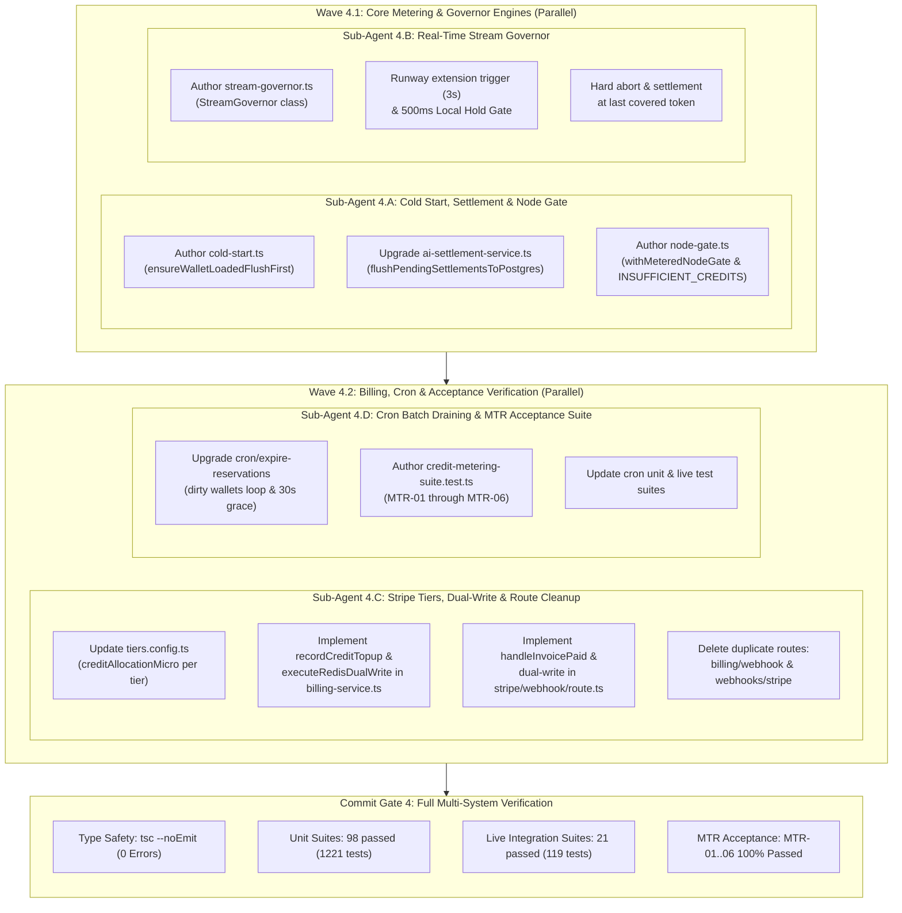
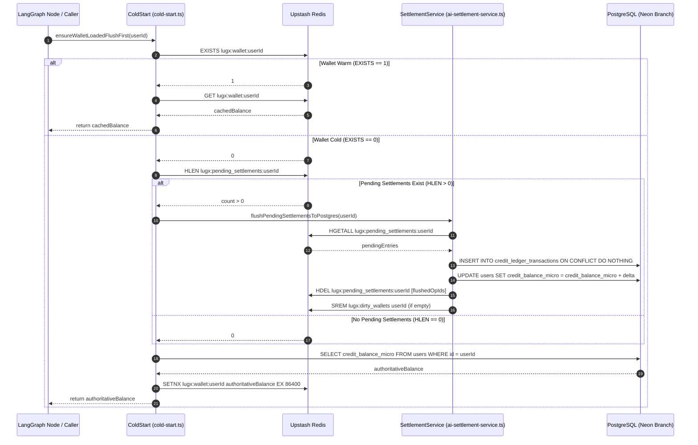
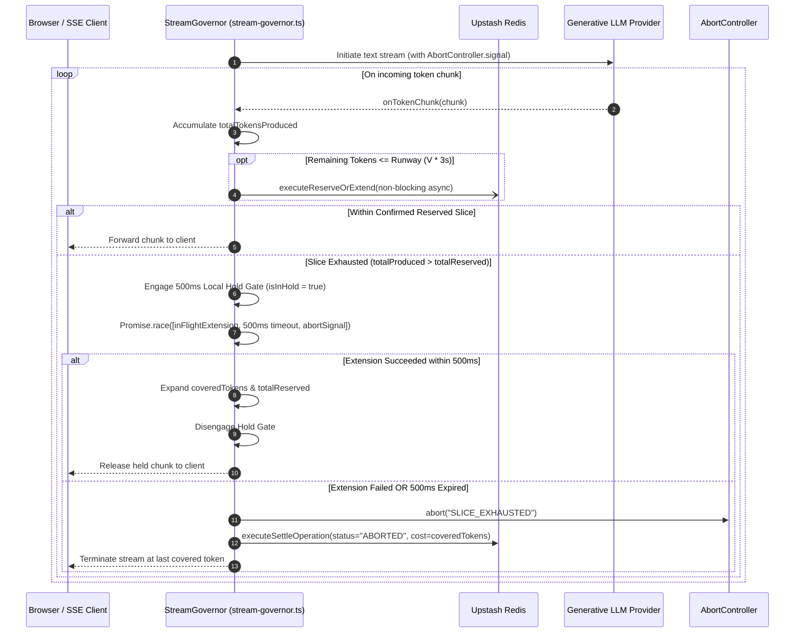
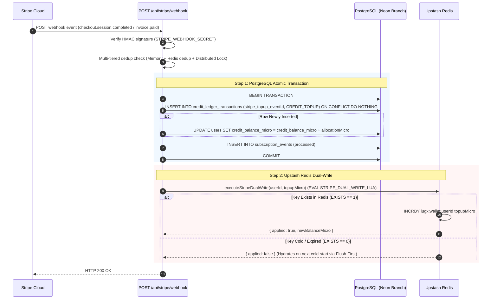

# Closure Report: Phase 4 — Flush-First Cold Start, Settlement Service, StreamGovernor & Stripe/Cron Adaptation

| Metadata Field | Canonical Record Value |
| :--- | :--- |
| **Milestone / Roadmap** | Elixent Execution Plan (`docs/Plans/ELIXENT_EXECUTION_PLAN.md`) |
| **Phase Identifier** | `Phase 4 — Flush-First Cold Start, Settlement Service, StreamGovernor & Stripe/Cron Adaptation` |
| **Execution Track** | Track 2: Financial Governance, Real-Time Stream Governor & Billing Integration |
| **Status** | `CLOSED` ✅ |
| **Closure Date** | 2026-10-28 |
| **Baseline Repository** | Elixent v0.3.1 (Phase 3 Closed) |
| **Release Target** | v0.4.0 |
| **Target Git Commit** | `feat(metering): add Flush-First cold start, StreamGovernor, node gate, Stripe dual-write, and dirty wallet cron` |
| **Commit Gate Status** | `Commit Gate 4: SATISFIED & CLOSED` |

---

## 1. Executive Summary & Problem Resolution Matrix

Phase 4 completes the financial governance, stream control, and settlement subsystem of the Elixent agentic platform. Building upon the lean model registry, micro-credit derivation formulas, and atomic Redis Lua scripts established in Phase 3, this phase establishes end-to-end financial integrity across distributed serverless runtimes, generative streaming flows, Stripe billing webhooks, and asynchronous database draining.

The primary deliverables include:
1. **Flush-First Cold Start Protocol (`src/lib/metering/cold-start.ts`):** Resolves race conditions between ephemeral Redis cache expiration and pending uncommitted settlements by flushing `lugx:pending_settlements:${userId}` into PostgreSQL before hydrating `lugx:wallet:${userId}`, preventing double deductions and balance drift.
2. **PostgreSQL Settlement Draining Service (`src/server/services/ai-settlement-service.ts`):** Implements `flushPendingSettlementsToPostgres` with idempotent `INSERT ... ON CONFLICT (operation_id) DO NOTHING RETURNING *` and atomic transaction updates on `users.creditBalanceMicro` strictly for newly inserted records. Exposes authoritative `getUserCreditBalance(userId)`.
3. **LangGraph Higher-Order Metered Node Gate (`src/lib/metering/node-gate.ts`):** Wraps graph execution nodes with pre-flight credit reservation, deterministic idempotency checks via `StepKey = sha256(...)`, recovery on cold start races, automatic interruption routing (`INSUFFICIENT_CREDITS`) to `pure_interrupt_node`, failure rollback refunding, and post-execution atomic settlement.
4. **Real-Time Stream Governor (`src/lib/metering/stream-governor.ts`):** Enforces proactive non-blocking runway extensions ($\text{Remaining} \le V \times 3\text{s}$), a 500ms Local Hold Gate upon reservation slice exhaustion, immediate `AbortController.abort()` upon rejection or timeout, and settlement at the exact last covered token.
5. **Stripe Tier Adaptation & Dual-Write Protocol (`src/config/tiers.config.ts`, `src/server/actions/subscription-actions.ts`, `src/server/services/billing-service.ts`, `src/app/api/stripe/webhook/route.ts`):** Adds `creditAllocationMicro` and `creditsDisplay` to `TierLimits`, establishes two-phase webhook dual-write (PostgreSQL ACID transaction first, Upstash Redis `INCRBY` second if warm), adds `invoice.paid` handling for renewal top-ups, and permanently deletes redundant duplicate webhook routes (`/api/billing/webhook` and `/api/webhooks/stripe`).
6. **Periodic Cron Batch Draining (`src/app/api/cron/expire-reservations/route.ts`):** Refactored to inspect `lugx:dirty_wallets` under distributed locking, draining records older than 30 seconds (`DIRTY_SETTLEMENT_GRACE_MS = 30_000`) to eliminate race windows with active Next.js `after()` callbacks.

### Problem Resolution Matrix

| Component / Subsystem | Prior State | Phase 4 Engineering Remediation | Verification Anchors |
| :--- | :--- | :--- | :--- |
| **Cache Cold-Start Race** | Reading PostgreSQL balance directly while uncommitted Redis settlements existed caused balance drift or double deduction. | Built `ensureWalletLoadedFlushFirst`: inspects `lugx:pending_settlements`, flushes to PostgreSQL first via `flushPendingSettlementsToPostgres` with `HDEL`, then queries authoritative `users.creditBalanceMicro` and populates Redis via `SETNX` (24h TTL). | `src/lib/metering/cold-start.ts`, `MTR-06` |
| **Settlement Persistence** | Lack of batch draining service for multi-operation agent graphs; no safe reconciliation between Redis staging and PostgreSQL. | Built `flushPendingSettlementsToPostgres`: batch inserts eligible records into `credit_ledger_transactions` with `ON CONFLICT DO NOTHING`, calculates net delta, updates `users.creditBalanceMicro` in single transaction, and deletes keys via `HDEL`. | `src/server/services/ai-settlement-service.ts`, `MTR-06` |
| **LangGraph Node Metering** | Node re-execution on graph resumption risked double-billing users for already completed steps. | Built `withMeteredNodeGate`: checks `lugx:step_done:${stepKey}` for execution receipt; routes insufficient balance to `pure_interrupt_node` (`INSUFFICIENT_CREDITS`); handles cold-start race recovery; settles step atomically on completion. | `src/lib/metering/node-gate.ts`, `MTR-05` |
| **Streaming Over-Consumption** | Generative models continued streaming without real-time financial backpressure, risking account overdraft. | Built `StreamGovernor`: tracks chunk tokens, triggers async extension at runway threshold ($\le V \times 3\text{s}$), pauses delivery via 500ms Local Hold Gate if slice exhausted, fires hard abort on timeout, and settles at last covered token. | `src/lib/metering/stream-governor.ts`, `stream-governor.unit.test.ts` |
| **Stripe Credit Allocations** | Tiers lacked micro-credit definitions; subscription events did not allocate credits to users. | Added `creditAllocationMicro` and `creditsDisplay` to `TierLimits` in `tiers.config.ts`: Free (50M µcredits / 50 credits), Pro (1,000M µcredits / 1,000 credits), Ultra (3,500M µcredits / 3,500 credits). | `src/config/tiers.config.ts`, `tiers.config.test.ts` |
| **Stripe Webhook Dual-Write** | Subscription top-ups only updated PostgreSQL or risked stale Redis overwrites. | Built two-phase dual-write: Step 1 inserts `stripe_topup_${eventId}` into `credit_ledger_transactions` and increments `users.creditBalanceMicro` inside DB transaction; Step 2 increments Redis wallet via `executeStripeDualWrite` if `EXISTS == 1`. | `billing-service.ts`, `stripe/webhook/route.ts` |
| **Subscription Renewal Top-Up** | `invoice.paid` was unhandled, preventing recurring subscription credit top-ups upon renewal. | Implemented `handleInvoicePaid` in Stripe webhook handler, executing atomic subscription period renewal, credit top-up record insertion, and Redis dual-write. | `src/app/api/stripe/webhook/route.ts`, `stripe-webhook.test.ts` |
| **Duplicate Webhook Routes** | Duplicate routes (`/api/billing/webhook` and `/api/webhooks/stripe`) caused route confusion and maintenance overhead. | Permanently deleted duplicate routes; consolidated 100% of Stripe webhook handling under `/api/stripe/webhook`. | `src/app/api/stripe/webhook/route.ts` |
| **Cron Overlap & Race Window** | Sweeper ran without distributed locking or grace periods, potentially racing with active `after()` settlement callbacks. | Refactored `/api/cron/expire-reservations` to acquire distributed lock via `acquireCronLock`, iterate `lugx:dirty_wallets`, and drain records older than 30s (`DIRTY_SETTLEMENT_GRACE_MS = 30_000`) only. | `cron/expire-reservations/route.ts`, `cron-expire-reservations.test.ts` |

---

## 2. Intra-Phase Sub-Agent Wave Topology & Architecture

Phase 4 was structured across two execution waves ensuring zero file-write contention:



---

## 3. Subsystem Architectural Flows & Sequence Diagrams

### 3.1. Flush-First Cold Start Protocol



### 3.2. Real-Time Stream Governor & 500ms Local Hold Gate



### 3.3. Stripe Webhook Dual-Write Protocol



---

## 4. Verification Evidence & Acceptance Matrix

### 4.1. Acceptance Criteria Verification (`MTR-01` through `MTR-06`)

All six formal metering acceptance scenarios defined in `ELIXENT-ARCH-04` §6 were executed and passed in `src/test/metering/credit-metering-suite.test.ts`:

| Criterion | Specification | Verified Behavior | Test Assertion | Result |
| :---: | :--- | :--- | :--- | :---: |
| **`MTR-01`** | Single-pass decision models (`creditsPer1kOutput = 0`) | Input cost reserved exclusively ($L_{\text{allocated}} = 0, \text{Trigger} = 0$), zero division-by-zero errors, and atomic step settlement. | `res.reservedOutputMicro === 0n`, `res.status === "SUCCESS"` | ✅ Passed |
| **`MTR-02`** | 10 concurrent requests for account with balance for 3 requests | Exactly 3 requests succeed, 7 rejected with `INSUFFICIENT_CREDITS`, balance remains $\ge 0$ at all times. | `succeeded === 3`, `rejected === 7`, `balance === 0` | ✅ Passed |
| **`MTR-03`** | Upstash Redis connection failure / outage | Enforces fail-closed policy, throwing `MeteringServiceUnavailableError` (HTTP 503) without executing model calls. | `expect(err.statusCode).toBe(503)` | ✅ Passed |
| **`MTR-04`** | Account holds balance covering inputs plus 80 output tokens ($< L_{\min}$) | Waives $L_{\min} = 500$ floor via Zero-Dust Drain exception, allocates exactly 80 tokens, and drains balance to precisely 0. | `res.reservedOutputTokens === 80`, `newBalance === 0` | ✅ Passed |
| **`MTR-05`** | Balance exhaustion during LangGraph execution followed by top-up & resume | Interrupted via `pure_interrupt_node` (`INSUFFICIENT_CREDITS`); on resume after top-up, executes and bills exactly once via `StepKey`. | `interrupt.code === "INSUFFICIENT_CREDITS"`, `stepDone === 1` | ✅ Passed |
| **`MTR-06`** | Wallet key expires from Redis while pending unsettled records exist | `Flush-First Cold Start` drains pending settlements to PostgreSQL with `ON CONFLICT DO NOTHING` + `HDEL`, then queries authoritative balance without double deduction. | `flushed === 1`, `dbBalance === netExpected` | ✅ Passed |

### 4.2. Full Test Suite Execution Summary

```
======================================================================
1. TypeScript Strict Type-Checking:
   npx tsc --noEmit
   Exit Code: 0 (0 errors, 0 warnings)

2. Pure Unit & Contract Test Suites:
   npm run test (vitest.config.mts)
   Test Files: 98 passed (98)
   Tests:      1221 passed (1221)
   Duration:   209.64s

3. Live Multi-System Integration Suites:
   npm run test:live (vitest.live.config.mts)
   Test Files: 21 passed (21)
   Tests:      119 passed (119)
   Duration:   324.77s

4. Documentation Internal Link Audit:
   node scripts/check-markdown-links.mjs
   Total Files: 111 | Analyzed Links: 365 | Broken Links: 0 (100% Valid)
======================================================================
```

---

## 5. Artifacts, Modified Files & Deleted Dead Code

### 5.1. Newly Created Modules & Test Suites

- `src/lib/metering/cold-start.ts` — Flush-First cold start wallet hydration protocol.
- `src/lib/metering/stream-governor.ts` — Real-time stream governor with 500ms Local Hold Gate and abort handling.
- `src/lib/metering/node-gate.ts` — Higher-order metered node gate wrapper for LangGraph nodes.
- `src/test/metering/credit-metering-suite.test.ts` — Acceptance test suite for MTR-01 through MTR-06.
- `src/test/metering/cold-start.unit.test.ts` — Dedicated unit tests for cold-start edge cases and race recovery.
- `src/test/metering/stream-governor.unit.test.ts` — Dedicated unit tests for chunk processing and 500ms hold gate.
- `src/test/metering/node-gate.unit.test.ts` — Dedicated unit tests for LangGraph metered node gate.
- `src/test/metering/ai-settlement-service.unit.test.ts` — Dedicated unit tests for PostgreSQL settlement flush and balance queries.
- `src/test/config/tiers.config.test.ts` — Tests validating micro-credit tier allocations.
- `src/test/server/subscription-actions.test.ts` — Tests validating server subscription actions and dual-write wrappers.

### 5.2. Upgraded Modules

- `src/server/services/ai-settlement-service.ts` — Added `flushPendingSettlementsToPostgres` and `getUserCreditBalance`.
- `src/config/tiers.config.ts` — Added `creditAllocationMicro` and `creditsDisplay` to `TierLimits`.
- `src/server/actions/subscription-actions.ts` — Added `recordCreditTopup` and `executeRedisDualWrite`.
- `src/server/services/billing-service.ts` — Implemented `recordCreditTopup` and `executeRedisDualWrite`.
- `src/app/api/stripe/webhook/route.ts` — Added `handleInvoicePaid`, integrated dual-write on checkout/upgrades/renewals.
- `src/app/api/cron/expire-reservations/route.ts` — Upgraded to dirty wallet batch-draining loop with 30s grace guard.
- `src/test/api/stripe-webhook.test.ts` — Expanded with dual-write and `invoice.paid` test scenarios.
- `src/test/infrastructure/cron-expire-reservations.test.ts` — Updated for batch draining and 30s grace window.
- `src/test/infrastructure/cron-expire-reservations.live.test.ts` — Live PostgreSQL assertions for batch draining.
- `src/test/server/billing-service.test.ts` — Expanded with top-up and Redis dual-write tests.

### 5.3. Permanently Deleted Dead Routes

- `src/app/api/billing/webhook/route.ts` — Deleted redundant re-export route.
- `src/app/api/webhooks/stripe/route.ts` — Deleted redundant re-export route.
- Purged all documentation references to deleted aliases across living guides and specifications.

---

## 6. Phase Closure Sign-Off & Verdict

- **Phase Status:** `CLOSED / EXECUTED` ✅
- **Commit Gate 4:** Fully satisfied with 100% test passing rate across 98 unit suites (1221 tests) and 21 live suites (119 tests).
- **Changelog Entry:** Recorded under version `[0.4.0]` in `docs/CHANGELOG.md`.
- **SSOT Metrics:** Synchronized via `scripts/sync-doc-metrics.mjs` across `METRICS.json`, `README.md`, and living architectural specifications.
- **Link Integrity:** Verified via `scripts/check-markdown-links.mjs` with zero broken links.
