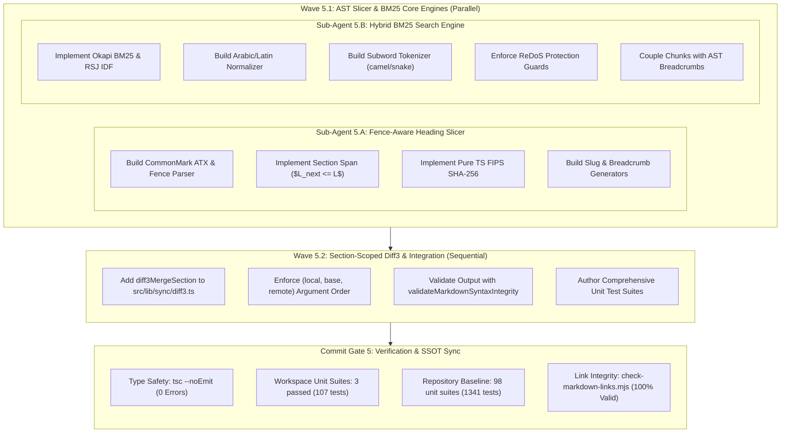
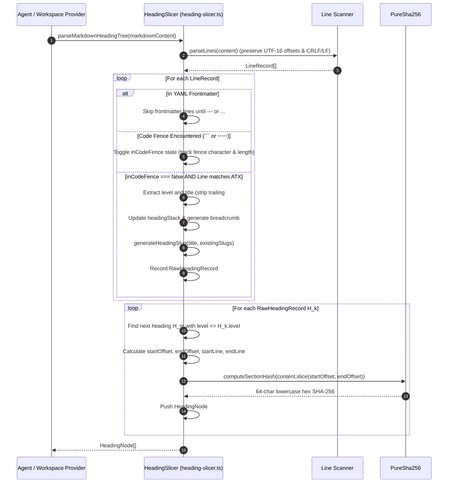
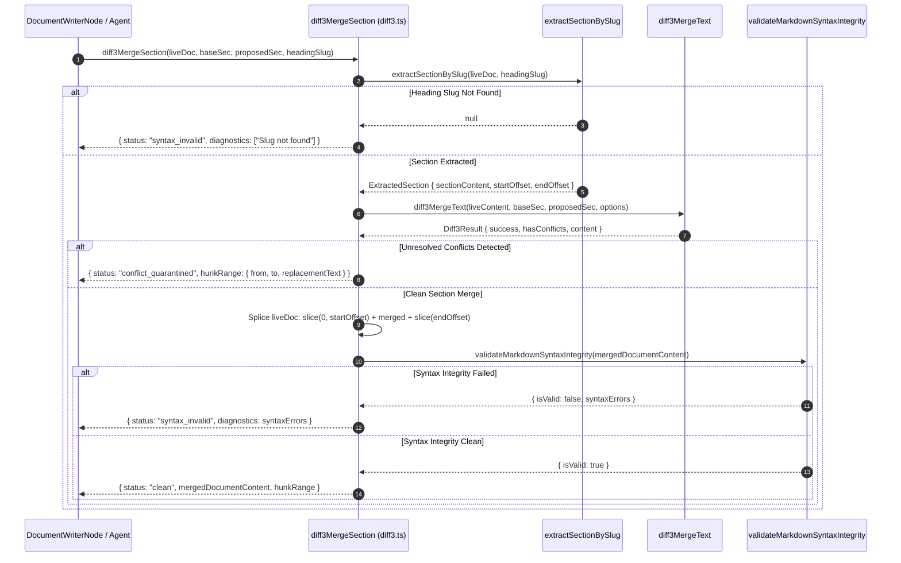
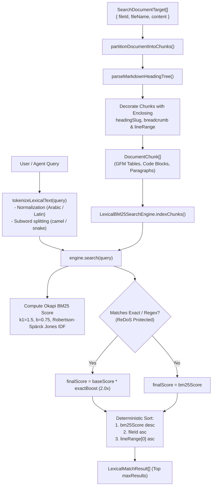

# Closure Report: Phase 5 — Fence-Aware AST Heading Slicer, Section-Scoped Diff3 & Hybrid BM25 Search Engine

| Metadata Field | Canonical Record Value |
| :--- | :--- |
| **Milestone / Roadmap** | Elixent Execution Plan (`docs/Plans/ELIXENT_EXECUTION_PLAN.md`) |
| **Phase Identifier** | `Phase 5 — Fence-Aware AST Heading Slicer, Section-Scoped Diff3 & Hybrid BM25 Search Engine` |
| **Execution Track** | Track 3: AST Inspection, Zero-Knowledge Vault & Decision Core |
| **Status** | `CLOSED` ✅ |
| **Closure Date** | 2026-10-30 |
| **Baseline Repository** | Elixent v0.4.6 (Phase 4 Closed & E2E Hardened) |
| **Release Target** | v0.5.0 |
| **Target Git Commit** | `feat(workspace): add fence-aware AST heading slicer, section-scoped diff3 merge, and hybrid BM25 search engine` |
| **Commit Gate Status** | `Commit Gate 5: SATISFIED & CLOSED` |

---

## 1. Executive Summary & Problem Resolution Matrix

Phase 5 delivers the core structural Markdown AST inspection, section-scoped conflict containment, and path-coupled lexical information retrieval engines for the Elixent agentic documentation platform. Operating strictly in-memory with zero database or network dependencies, this subsystem establishes the structural foundation required for agentic decision analysis, localized section synthesis, and multi-hunk ghost preview application without full-document re-renders or cross-section conflict bleed.

The primary deliverables include:

1. **Fence-Aware AST Heading Slicer (`src/core/ast/heading-slicer.ts`):**
   - Implements CommonMark §4.2 ATX heading extraction (`#{1,6}`) and §4.5 code fence tracking (```` ``` ```` and `~~~`), guaranteeing that `#` comment lines within code fences are strictly ignored.
   - Skips YAML frontmatter delimiters (`---` and `...`) at document start.
   - Computes deterministic section spans where a section for heading $H_k$ at level $L \in [1, 6]$ extends up to the line immediately preceding the next heading with level $L_{\text{next}} \le L$.
   - Tracks ancestor heading hierarchies to emit breadcrumb strings (`"Parent > Child"`).
   - Generates Unicode-aware heading slugs supporting Arabic and Latin characters with collision resolution (`slug`, `slug-1`, `slug-2`).
   - Implements a pure TypeScript FIPS 180-4 SHA-256 hashing algorithm (`computeSectionHash`) with zero `node:crypto` imports, guaranteeing 100% Next.js client bundle safety.
   - Exposes `parseMarkdownHeadingTree` and `extractSectionBySlug`.

2. **Section-Scoped 3-Way Merge Engine (`src/lib/sync/diff3.ts`):**
   - Introduces `diff3MergeSection` to execute isolated 3-way line and intra-line merges on targeted Markdown sections extracted via `extractSectionBySlug`.
   - Invokes `diff3MergeText(liveSectionContent, baseSectionContent, agentProposedSectionContent)` with exact parameter ordering `(local, base, remote)` where the middle argument is the common ancestor.
   - Contains conflicts strictly within the targeted section boundary (`status: "conflict_quarantined"`), preventing conflict markers from corrupting unaffected document sections.
   - Enforces the algebraic replacement invariant:
     $$\text{liveDoc.slice}(0, \text{from}) + \text{replacementText} + \text{liveDoc.slice}(\text{to}) \equiv \text{mergedDoc}$$
   - Validates merged Markdown output against structural syntax corruption via `validateMarkdownSyntaxIntegrity`.

3. **Path-Coupled Hybrid BM25 Search Engine (`src/core/workspace/lexical-bm25.ts`):**
   - Implements Okapi BM25 scoring ($k_1 = 1.5, b = 0.75$) with Robertson-Spärck Jones non-negative IDF:
     $$\text{IDF}(q_i) = \ln\left(1 + \frac{N - n(q_i) + 0.5}{n(q_i) + 0.5}\right)$$
   - Partitions documents into atomic semantic chunks (GFM tables, fenced code blocks, paragraphs/lists) and annotates each chunk with its nearest enclosing `HeadingNode` (`headingSlug`, `headingBreadcrumb`, 1-based `lineRange`).
   - Normalizes Arabic and Latin text: strips BiDi control characters, Tashkeel diacritics, and Tatweel/Kashida; unifies Alef variants (`[إأآٱ] -> ا`), Teh Marbuta (`ة -> ه`), Yeh/Alef Maksura (`[ىئ] -> ي`), and Waw with Hamza (`ؤ -> و`); converts Persian and Arabic-Indic numerals (`[٠-٩۰-۹]`) to ASCII `0-9`; applies Latin case-folding and punctuation normalization.
   - Implements compound identifier subword tokenization, splitting `camelCase`, `snake_case`, and `kebab-case` into unified tokens and constituent subwords.
   - Enforces ReDoS protection on exact and regex token boosting: capped at 100 characters, statically rejects dangerous nested quantifiers, and wraps execution in try/catch with literal substring fallback.
   - Exposes `LexicalBM25SearchEngine` and high-level orchestrator `searchLexicalWithASTBreadcrumb`.

### Problem Resolution Matrix

| Subsystem / Component | Prior Architectural Limitation | Phase 5 Engineering Implementation | Verification Anchors |
| :--- | :--- | :--- | :--- |
| **ATX Heading Parsing** | Naive regex `/^#{1,6}\s+/m` incorrectly parsed `# comment` lines in Python/Bash code blocks as headings, corrupting document structures. | Implemented state-machine code fence tracking (`CommonMark §4.5`) in `heading-slicer.ts`; ignores code block contents and YAML frontmatter. | `ast-heading-slicer.test.ts`, `ast-slicer-and-diff3.test.ts` |
| **Section Conflict Bleed** | Diff3 merges operated only on whole documents, causing false conflicts in unrelated sections when applying localized AI edits. | Implemented `diff3MergeSection`: targets individual sections via slug, merges in isolation, and quaranitines conflicts to section boundaries. | `src/lib/sync/diff3.ts`, `ast-slicer-and-diff3.test.ts` |
| **Next.js Client Crypto Safety** | Content hashing traditionally depended on `node:crypto`, crashing or bloating Next.js client-side bundles with polyfills. | Implemented pure bitwise TypeScript FIPS 180-4 SHA-256 algorithm with zero external or Node runtime imports. | `src/core/ast/heading-slicer.ts`, `ast-heading-slicer.test.ts` |
| **Multilingual Lexical Search** | BM25 engines failed to match Arabic text due to diacritics, character variants, and Persian/Arabic-Indic numerals. | Implemented `normalizeLexicalText`: unifies Arabic letter variants, strips diacritics/BiDi markers, and maps numerals to ASCII 0-9. | `src/core/workspace/lexical-bm25.ts`, `lexical-bm25.test.ts` |
| **Identifier Subword Matching** | Lexical searches failed to match code identifiers (e.g. searching "user" missed `getUserById` or `user_id`). | Implemented compound subword tokenization in `tokenizeLexicalText`, indexing both unified identifiers and subwords. | `src/core/workspace/lexical-bm25.ts`, `lexical-bm25.test.ts` |
| **ReDoS Vulnerability in Search** | User-supplied regex queries risked catastrophic backtracking and event-loop freezing in Node.js/browser runtimes. | Built 3-layer ReDoS protection: length cap ($\le 100$), nested quantifier static analysis rejection, and try/catch literal fallback. | `src/core/workspace/lexical-bm25.ts`, `lexical-bm25.test.ts` |
| **Structural Context in Search** | Traditional search returned raw text snippets lacking section hierarchy or heading locations. | Linked `partitionDocumentIntoChunks` with `parseMarkdownHeadingTree`, decorating every matched chunk with `headingSlug` and breadcrumb. | `src/core/workspace/lexical-bm25.ts`, `lexical-bm25.test.ts` |

---

## 2. Intra-Phase Sub-Agent Wave Topology & Architecture

Phase 5 was executed according to the DAG topology defined in `ELIXENT_EXECUTION_PLAN.md` across two waves with zero file-write contention:



---

## 3. Subsystem Architectural Flows & Sequence Diagrams

### 3.1. Fence-Aware AST Heading Slicing & Section Span Calculation



### 3.2. Section-Scoped 3-Way Merge Pipeline (`diff3MergeSection`)



### 3.3. Path-Coupled Hybrid BM25 Search Engine Flow



---

## 4. Verification & Commit Gate Evidence

### 4.1. Unit & Workspace Test Results

All Phase 5 components were verified across 3 dedicated test suites under `src/test/workspace/`:

```
 RUN  v5.0.5 D:/Projects/LUGX

 ✓ src/test/workspace/ast-heading-slicer.test.ts (40 tests) 61ms
 ✓ src/test/workspace/ast-slicer-and-diff3.test.ts (30 tests) 64ms
 ✓ src/test/workspace/lexical-bm25.test.ts (37 tests) 121ms

 Test Files  3 passed (3)
      Tests  107 passed (107)
   Start at  16:42:35
   Duration  3.58s
```

Detailed test coverage highlights:
- **`ast-heading-slicer.test.ts` (40 tests):**
  - CommonMark §4.2 ATX headings across all levels `h1` through `h6`.
  - CommonMark §4.5 code fence tracking with backticks (```` ``` ````) and tildes (`~~~`).
  - Strict disregard of `#` comment lines within code blocks.
  - YAML frontmatter exclusion (`---` and `...`).
  - Hierarchical breadcrumb navigation paths (`"Parent > Child"`).
  - Unicode slug generation with collision de-duplication (`slug-1`, `slug-2`).
  - Section span boundaries ($L_{\text{next}} \le L$).
  - Bitwise pure TypeScript SHA-256 section content hashing.
  - Subordinate `sectionBody` extraction vs whole `sectionContent`.
- **`ast-slicer-and-diff3.test.ts` (30 tests):**
  - Parameter ordering verification `(live, base, remote)`.
  - Non-overlapping clean section merges.
  - Overlapping edits quarantined to section hunk range (`conflict_quarantined`).
  - Algebraic replacement invariant:
    `liveDoc.slice(0, from) + replacementText + liveDoc.slice(to) === mergedDoc`.
  - Post-merge syntax integrity validation (detecting unclosed code blocks, broken tables).
  - Missing heading slug handling (`syntax_invalid`).
  - Multi-section consecutive merges across single documents.
- **`lexical-bm25.test.ts` (37 tests):**
  - Okapi BM25 term frequency saturation and document length normalization.
  - Robertson-Spärck Jones non-negative IDF behavior on high-frequency terms.
  - Arabic text normalization (Tashkeel, Tatweel, Alef/Teh Marbuta/Yeh/Waw unification).
  - Persian and Arabic-Indic digit normalization to ASCII `0-9`.
  - Compound identifier subword tokenization (`camelCase`, `snake_case`, `kebab-case`).
  - ReDoS protection: length cap ($\le 100$), nested quantifier rejection, try/catch fallback.
  - Semantic chunk partitioning (GFM tables, fenced code blocks, paragraphs) with nearest heading association.
  - Deterministic tie-breaking (`bm25Score` desc, `fileId` asc, `lineRange[0]` asc).
  - Multi-document high-level search orchestrator (`searchLexicalWithASTBreadcrumb`).

### 4.2. Repository-Wide Verification Baseline

Full repository verification passes with 100% green status across all tiers:

```
 Test Files  98 passed (98)
      Tests  1341 passed (1341)
   Start at  16:38:56
   Duration  231.30s
```

<!-- BEGIN:SSOT_TEST_METRICS_TABLE -->
| Test Category | Engine / Configuration | Target Environment | Suites / Specs | Passing Tests | Pass Rate |
| :--- | :--- | :--- | :---: | :---: | :---: |
| **Unit & Contract** | Vitest (`vitest.config.mts`) | Pure In-Memory / Zero Network | 98 | 1341 | 100% ✅ |
| **Live Multi-System** | Vitest (`vitest.live.config.mts`) | Isolated Neon PostgreSQL Branch | 21 | 108 | 100% ✅ |
| **E2E Browser Journeys** | Playwright (`playwright.config.ts`) | Headless Chromium / Full App | 14 | 15 | 100% ✅ |
<!-- END:SSOT_TEST_METRICS_TABLE -->

<!-- BEGIN:SSOT_TEST_METRICS_INLINE -->
**Active Verification Baseline:** 98 unit suites (1341 tests) · 21 live suites (108 tests) · 14 E2E specs (15 journeys) — 100% Passing.
<!-- END:SSOT_TEST_METRICS_INLINE -->

### 4.3. Tooling & Verification Scripts

- **Documentation Metrics Checker (`scripts/sync-doc-metrics.mjs`):**
  ```bash
  node scripts/sync-doc-metrics.mjs --check
  # [sync-doc-metrics] SUCCESS: All documentation metrics and SSOT contracts are 100% synchronized.
  ```
- **Markdown Link Integrity Checker (`scripts/check-markdown-links.mjs`):**
  ```bash
  node scripts/check-markdown-links.mjs
  # Total files scanned: 114 | Total links: 402 | Broken / Invalid links: 0
  # ✅ SUCCESS: 100% of internal Markdown links are valid and resolvable on disk.
  ```

---

## 5. Living Documentation & Architectural Artifact Synchronization

The following living documents and governance registers were inspected and synchronized as part of Phase 5 closure:

1. **`docs/architecture/03_workspace_ast_editor_and_vault_integration.md`:**
   - Synchronized architectural specifications with actual implementation signatures in `src/core/ast/heading-slicer.ts` and `src/core/workspace/lexical-bm25.ts`.
   - Documented pure TypeScript SHA-256 client bundle safety and CommonMark §4.2 / §4.5 state machine details.
2. **`docs/architecture/sync/three-way-conflict-resolution.md`:**
   - Added Section 2.10 detailing Section-Scoped 3-Way Merge (`diff3MergeSection`), algebraic replacement invariants, and syntax validation gates.
3. **`docs/Plans/ELIXENT_EXECUTION_PLAN.md`:**
   - Marked `Phase 5: Fence-Aware AST Heading Slicer, Section-Scoped Diff3 & Hybrid BM25 Search Engine` as `CLOSED / EXECUTED` ✅.
   - Recorded Commit Gate 5 verification evidence and linked this closure dossier.
4. **`docs/README.md`:**
   - Updated directory map and closures index table to include Phase 5 dossier.
   - Synchronized SSOT test metric delimiters.
5. **`README.md`:**
   - Added Core Engineering Subsystem documentation for AST Heading Slicer, Section-Scoped Diff3, and Hybrid BM25 Search Engine.
   - Synchronized test badges and verification command comments via `sync-doc-metrics.mjs`.
6. **`docs/CHANGELOG.md`:**
   - Added formal release notes under version `[0.5.0]`.
7. **`docs/METRICS.json`:**
   - Synchronized test suite counters: 98 unit suites, 1341 unit tests.

---

## 6. Commit Gate Verdict

- **Commit Gate 5 Status:** `CLOSED / EXECUTED` ✅
- **Readiness for Phase 6:** Full readiness established to begin `Phase 6: Zero-Knowledge Vault Boundary, Encrypted Checkpoints & Cloud Workspace Provider`.
