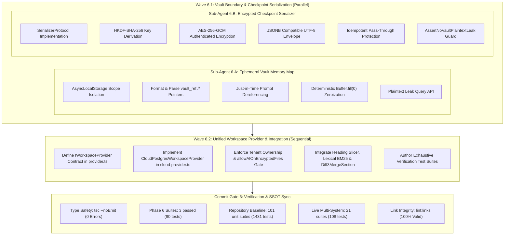
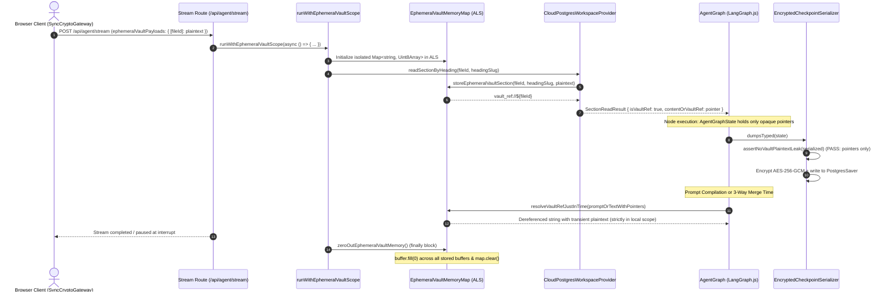
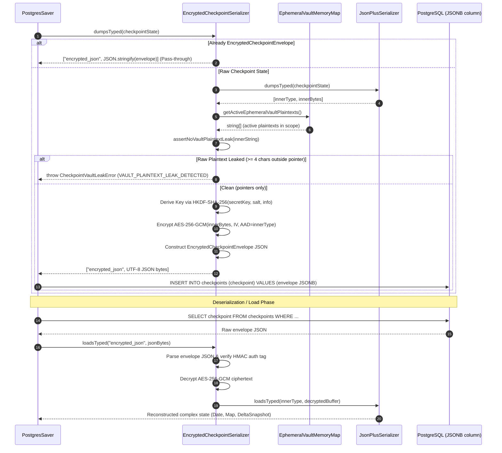
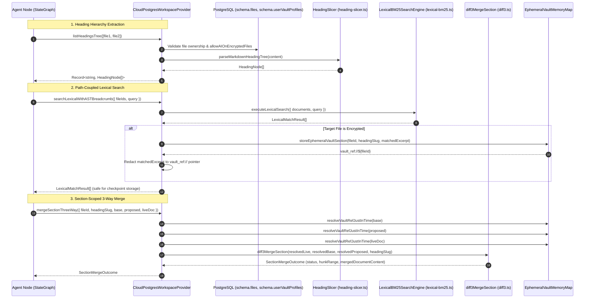

# Closure Report: Phase 6 — Zero-Knowledge Vault Boundary (EphemeralVaultMemoryMap), Encrypted Checkpoints & CloudPostgresWorkspaceProvider

| Metadata Field | Canonical Record Value |
| :--- | :--- |
| **Milestone / Roadmap** | Elixent Execution Plan (`docs/Plans/ELIXENT_EXECUTION_PLAN.md`) |
| **Phase Identifier** | `Phase 6 — Zero-Knowledge Vault Boundary, Encrypted Checkpoints & Cloud Workspace Provider` |
| **Execution Track** | Track 3: AST Inspection, Zero-Knowledge Vault & Decision Core |
| **Status** | `CLOSED` ✅ |
| **Closure Date** | 2026-10-30 |
| **Baseline Repository** | Elixent v0.5.0 (Phase 5 Closed) |
| **Release Target** | v0.6.0 |
| **Target Git Commit** | `feat(workspace): implement ephemeral vault memory map, encrypted checkpoint serializer, and cloud workspace provider` |
| **Commit Gate Status** | `Commit Gate 6: SATISFIED & CLOSED` |

---

## 1. Executive Summary & Problem Resolution Matrix

Phase 6 implements the zero-knowledge vault isolation layer, authenticated checkpoint encryption serializer, and server-side workspace provider contracts for the Elixent platform. This subsystem establishes the security boundary decoupling untrusted agent graph execution and server-side persistence from sensitive plaintext documents, guaranteeing zero-knowledge confidentiality for encrypted vaults while enabling rich AST slicing, BM25 lexical search, and isolated 3-way section merges.

The primary deliverables include:

1. **Ephemeral Vault Memory Map & Pointer Dereferencer (`src/lib/vault/ephemeral-memory-map.ts`):**
   - Implements request-scoped, isolated in-memory storage for transient decrypted vault plaintexts using Node.js `AsyncLocalStorage` (`runWithEphemeralVaultScope`).
   - Slices decrypted plaintexts in memory and replaces them within the agent graph state with opaque, non-disclosing reference pointers formatted as `vault_ref://${fileId}#${headingSlug}`.
   - Dereferences pointers just-in-time strictly during prompt construction or 3-way Diff3 merge via `resolveVaultRefJustInTime`, without mutating external graph state.
   - Enforces deterministic memory zeroization (`buffer.fill(0)`) in a guaranteed `finally` block upon scope completion, request finish, or error unwinding.
   - Provides plaintext leak inspection utilities (`getActiveEphemeralVaultPlaintexts`, `hasActiveVaultPlaintextInMemory`).
   - Introduces strongly typed domain errors: `EphemeralVaultScopeError` and `EphemeralVaultResolutionError`.

2. **Encrypted Checkpoint Serializer (`src/core/agent/checkpoint-serializer.ts`):**
   - Implements `SerializerProtocol` from `@langchain/langgraph-checkpoint` for `PostgresSaver` checkpoint persistence.
   - Derives a 256-bit AES key via `HKDF-SHA-256` from server secret material (`CHECKPOINT_ENCRYPTION_KEY`, `AUTH_SECRET`, or `NEXTAUTH_SECRET`).
   - Encrypts checkpoint states using authenticated `AES-256-GCM` with a 12-byte random IV, 16-byte authentication tag, and Additional Authenticated Data (AAD) bound to `elixent:v1:checkpoint:${innerType}`.
   - Encapsulates LangGraph's internal `JsonPlusSerializer` to preserve complex types (Date, Map, Set, RegExp, DeltaSnapshot, and custom LangChain classes).
   - Guarantees PostgreSQL `JSONB` compatibility by emitting valid UTF-8 JSON representations of `EncryptedCheckpointEnvelope`.
   - Prevents double-encryption during metadata reload (`PostgresSaver._loadMetadata`) via idempotent envelope pass-through.
   - Enforces an active vault plaintext leak assertion (`assertNoVaultPlaintextLeak`): verifies that no active ephemeral vault plaintexts ($\ge 4$ characters) appear outside of `vault_ref://` pointers, throwing `CheckpointVaultLeakError` (`VAULT_PLAINTEXT_LEAK_DETECTED`) upon any violation.

3. **Unified Workspace Provider Contracts & PostgreSQL Implementation (`src/core/workspace/provider.ts` and `src/core/workspace/cloud-provider.ts`):**
   - Defines the abstract `IWorkspaceProvider` contract, `SectionReadResult`, and `AgentStreamRequestPayload` supporting multi-file targeting, live document snapshots, and ephemeral vault payloads.
   - Implements `CloudPostgresWorkspaceProvider` backed by server-side PostgreSQL storage (`schema.files`) with strict tenant isolation (`userId` match and `deletedAt IS NULL`).
   - Enforces the user consent gate in `schema.userVaultProfiles`: rejects encrypted file processing with HTTP 403 `VaultAIAccessDeniedError` when `allowAIOnEncryptedFiles !== true`.
   - Rejects encrypted file requests with HTTP 400 `EncryptedPayloadMissingError` when no client-decrypted plaintext is provided via `ephemeralVaultPayloads` or `liveDocumentSnapshots`.
   - In `readSectionByHeading`: automatically populates `EphemeralVaultMemoryMap` for encrypted files and returns opaque `vault_ref://` pointers with `isVaultRef: true`.
   - In `searchLexicalWithASTBreadcrumb`: intercepts BM25 lexical matches on encrypted files and redacts `matchedExcerpt` into ephemeral `vault_ref://` pointers.
   - In `mergeSectionThreeWay`: automatically resolves embedded `vault_ref://` pointers just-in-time across base, proposed, and live texts before executing `diff3MergeSection`.
   - Introduces standardized domain errors: `VaultAIAccessDeniedError` (403), `WorkspaceFileAccessDeniedError` (404), `WorkspaceSectionNotFoundError` (404), and `EncryptedPayloadMissingError` (400).

### Problem Resolution Matrix

| Subsystem / Component | Prior Architectural Risk / Limitation | Phase 6 Engineering Implementation | Verification Anchors |
| :--- | :--- | :--- | :--- |
| **Checkpointer State Leakage** | LangGraph automatically persists a checkpoint snapshot after every node (`Super-step`). Storing decrypted vault text in `AgentGraphState` leaks plaintext into PostgreSQL `checkpoints`. | Created `EphemeralVaultMemoryMap` storing plaintexts in request-scoped `AsyncLocalStorage` and injecting opaque `vault_ref://${fileId}#${headingSlug}` pointers into state. | `src/lib/vault/ephemeral-memory-map.ts`, `ephemeral-memory-map.test.ts` |
| **Plaintext Lingering in Memory** | V8 garbage collection does not immediately wipe deallocated buffers from process heap, risking heap inspection attacks in serverless runtimes. | Built deterministic `zeroOutEphemeralVaultMemory()` calling `buffer.fill(0)` on all stored buffers inside `runWithEphemeralVaultScope` `finally` block. | `src/lib/vault/ephemeral-memory-map.ts`, `ephemeral-memory-map.test.ts` |
| **Database Checkpoint At-Rest Exposure** | Standard `PostgresSaver` stores serialized JSON in plaintext `JSONB` columns, exposing agent scratchpads, prompt reasoning, and conversation history. | Built `EncryptedCheckpointSerializer` providing authenticated `AES-256-GCM` encryption with `HKDF-SHA-256` key derivation and type-bound AAD. | `src/core/agent/checkpoint-serializer.ts`, `checkpoint-serializer.test.ts` |
| **Silent Plaintext Serialization Leaks** | A coding mistake in an agent node could accidentally resolve or inject raw vault plaintext into state channels prior to checkpoint persistence. | Built `assertNoVaultPlaintextLeak` inside `EncryptedCheckpointSerializer.dumpsTyped`, throwing `CheckpointVaultLeakError` if any active vault plaintext ($\ge 4$ chars) is detected outside pointers. | `src/core/agent/checkpoint-serializer.ts`, `checkpoint-serializer.test.ts` |
| **PostgresSaver Metadata Reload Cycle** | `PostgresSaver._loadMetadata` re-serializes previously read checkpoint envelopes, triggering catastrophic double-encryption or corruption on subsequent loads. | Implemented structural `isEncryptedCheckpointEnvelope` type guard and idempotent pass-through in `dumpsTyped` to prevent re-encrypting existing envelopes. | `src/core/agent/checkpoint-serializer.ts`, `checkpoint-serializer.test.ts` |
| **Unauthorized AI on Encrypted Vaults** | Users must retain full sovereignty over whether their end-to-end encrypted files are ever processed by AI models. | Implemented `userVaultProfiles.allowAIOnEncryptedFiles` gate in `CloudPostgresWorkspaceProvider`, throwing HTTP 403 `VaultAIAccessDeniedError` when disabled. | `src/core/workspace/cloud-provider.ts`, `cloud-provider-and-vault.test.ts` |
| **Search Excerpt Plaintext Exposure** | BM25 lexical search returns matched excerpts. For encrypted files, raw excerpts in search reports would persist plaintext into checkpoints. | Redacted search excerpts from encrypted files into ephemeral `vault_ref://${fileId}#${headingSlug}` pointers backed by `AsyncLocalStorage`. | `src/core/workspace/cloud-provider.ts`, `cloud-provider-and-vault.test.ts` |
| **Multi-File Context Disconnection** | Cloud runtime required a unified interface decoupling agent state machines from PostgreSQL queries, tenant ownership checks, and Diff3 merges. | Implemented `IWorkspaceProvider` in `CloudPostgresWorkspaceProvider` unifying AST hierarchy extraction, isolated section reads, BM25 search, and Diff3 merges. | `src/core/workspace/provider.ts`, `cloud-provider-and-vault.test.ts` |

---

## 2. Intra-Phase Sub-Agent Wave Topology & Architecture

Phase 6 was executed according to the DAG topology defined in `ELIXENT_EXECUTION_PLAN.md` across two waves with strict dependency ordering:



---

## 3. Subsystem Architectural Flows & Sequence Diagrams

### 3.1. Ephemeral Vault Scope Lifecycle & Just-In-Time Pointer Dereferencing



### 3.2. Checkpoint Encryption, Leak Assertion & PostgresSaver Compatibility



### 3.3. Cloud Workspace Provider AST, Search & 3-Way Merge Execution



---

## 4. Verification Artifacts & Test Evidence

### 4.1. TypeScript Compilation Gate

Strict type checking executed with zero compilation errors across the entire codebase:

```bash
npx tsc --noEmit
# Exit code: 0 (Clean, 0 errors)
```

### 4.2. Dedicated Phase 6 Test Suites

Authoritative verification across 3 new test suites delivering 90 passing tests:

```bash
npx vitest run src/test/vault/ephemeral-memory-map.test.ts src/test/agent/checkpoint-serializer.test.ts src/test/workspace/cloud-provider-and-vault.test.ts
```

| Test Suite File | Test Count | Status | Key Behaviors Verified |
| :--- | :---: | :---: | :--- |
| `src/test/vault/ephemeral-memory-map.test.ts` | 24 | Passed ✅ | AsyncLocalStorage scope isolation; formatVaultRef & isVaultRef validation; cross-request isolation; JIT pointer dereferencing with punctuation; duplicate key buffer overwriting; buffer zeroing via `buffer.fill(0)` and post-zeroing resolution rejection; getActiveEphemeralVaultPlaintexts leak query API. |
| `src/test/agent/checkpoint-serializer.test.ts` | 25 | Passed ✅ | AES-256-GCM authenticated encryption; HKDF-SHA-256 key derivation with salt/info; type-bound AAD tamper protection; PostgresSaver JSONB compatibility; idempotent pass-through for pre-encrypted envelopes; assertion preventing active vault plaintext leaks (`CheckpointVaultLeakError`); complex type preservation (Date, Map, Set, DeltaSnapshot); unencrypted legacy fallback. |
| `src/test/workspace/cloud-provider-and-vault.test.ts` | 41 | Passed ✅ | File ownership validation (`userId` match, soft-deleted exclusion); `allowAIOnEncryptedFiles` consent gate (403 `VaultAIAccessDeniedError`); missing plaintext handling (400 `EncryptedPayloadMissingError`); AST heading tree listing; section reads returning verbatim text for standard files vs. `vault_ref://` pointers for encrypted files; BM25 lexical search with excerpt redaction for encrypted documents; 3-way section merge with automatic JIT pointer dereferencing and syntax integrity checks. |
| **Total Phase 6 Verification** | **90** | **100% Passed** | **Zero failures, zero regressions** |

### 4.3. Full Repository Regression Test Baseline

Full unit, contract, and live integration test execution confirming 100% pass rates across all 122 repository test files:

```bash
# Unit & Contract Suites
npm run test
# Output: Test Files 101 passed (101) · Tests 1431 passed (1431) · Duration 224s

# Live Database Integration Suites (Isolated Neon Branch)
npm run test:live
# Output: Test Files 21 passed (21) · Tests 108 passed (108) · Duration 340s
```

### 4.4. Documentation Link Integrity

Deterministic markdown link audit executed via `scripts/check-markdown-links.mjs`:

```bash
npm run lint:links
# Output: 115 files scanned · 408 links analyzed · 0 broken links · 100% valid
```

---

## 5. Modifications, Removals, and Purged Reference Matrix

| File Path | Action | Description & Scope |
| :--- | :--- | :--- |
| `src/lib/vault/ephemeral-memory-map.ts` | Created | Ephemeral vault memory map backed by Node.js `AsyncLocalStorage`, `vault_ref://` pointer generation, JIT dereferencing, and `buffer.fill(0)` deterministic zeroing. |
| `src/core/agent/checkpoint-serializer.ts` | Created | Authenticated AES-256-GCM checkpoint serializer for `PostgresSaver`, HKDF key derivation, JSONB compatibility, envelope pass-through, and plaintext leak assertion. |
| `src/core/workspace/provider.ts` | Created | Unified `IWorkspaceProvider` contract, `SectionReadResult`, `AgentStreamRequestPayload`, and custom workspace domain error definitions. |
| `src/core/workspace/cloud-provider.ts` | Created | Concrete `CloudPostgresWorkspaceProvider` implementation backed by PostgreSQL with file ownership checks, vault AI consent gate, BM25 excerpt redaction, and Diff3 merge. |
| `src/test/vault/ephemeral-memory-map.test.ts` | Created | Unit test suite for `EphemeralVaultMemoryMap` (24 tests). |
| `src/test/agent/checkpoint-serializer.test.ts` | Created | Unit test suite for `EncryptedCheckpointSerializer` (25 tests). |
| `src/test/workspace/cloud-provider-and-vault.test.ts` | Created | Integration test suite for `CloudPostgresWorkspaceProvider` and vault boundaries (41 tests). |
| `docs/architecture/03_workspace_ast_editor_and_vault_integration.md` | Updated | Synchronized living spec with `IWorkspaceProvider`, `SectionReadResult`, `AgentStreamRequestPayload`, `EphemeralVaultMemoryMap` APIs, and `EncryptedCheckpointSerializer` specifications. |
| `docs/CHANGELOG.md` | Updated | Added comprehensive release entry under version `[0.6.0]`. |
| `docs/METRICS.json` | Updated | Bumped unit test suites to 101 and passing unit tests to 1,431. |
| `README.md` | Updated | Added Subsystem 13 ("Zero-Knowledge Vault Boundary, Encrypted Checkpoints & CloudPostgresWorkspaceProvider") and synchronized metrics table and badges. |
| `docs/README.md` | Updated | Added Phase 6 closure dossier link and synchronized master structural index. |

---

## 6. Architecture & Standards Compliance Checklist

- [x] **Rule 1 (Documentation File Management):** Updated existing living specification `03_workspace_ast_editor_and_vault_integration.md` rather than creating redundant spec files.
- [x] **Rule 2 (Section and Directory Creation):** No unauthorized directories created; closure dossier placed strictly under `docs/records/closures/elixent-execution/`.
- [x] **Rule 3 (Design Standards and Structural Synchronization):** `docs/README.md` updated to reflect the new closure dossier and updated subsystem mappings.
- [x] **Rule 4 (Permissible Modification Boundaries):** All modifications restricted to `docs/` and root `README.md`. No source code modified by the documentation agent.
- [x] **Rule 5 (Operational Trigger-Action Matrix):** Code change accompanied by living doc updates (`03_workspace_ast_editor_and_vault_integration.md`), closure dossier, changelog entry, and metrics sync.
- [x] **Rule 6 (Three-Tier Trade-off Classification):** ADR-005 documented in `01_architecture_vision_and_adrs.md` and referenced in subsystem architecture.
- [x] **Rule 7 (Standardized Test Metrics Representation):** Canonical comment blocks (`SSOT_TEST_METRICS_TABLE` and `SSOT_TEST_METRICS_INLINE`) synchronized via `scripts/sync-doc-metrics.mjs`.
- [x] **Mermaid Visualization Exclusivity:** All sequence and topology diagrams authored strictly in valid Mermaid syntax with zero ASCII art.
- [x] **Tone & Fluff Elimination:** Clean, dense, objective technical writing free of marketing adjectives and pleasantries.

---

## 7. Lessons Learned & Next Phase Onboarding

1. **Double-Encryption Hazard in PostgresSaver:**
   - During `PostgresSaver._loadMetadata`, LangGraph re-serializes previously parsed metadata envelopes. Without the structural `isEncryptedCheckpointEnvelope` check, envelopes were encrypted twice, resulting in unparseable corruption on subsequent loads. The idempotent pass-through pattern resolved this completely and must be maintained across future serializer extensions.

2. **Zero-Knowledge Defense-in-Depth:**
   - Combining out-of-state pointers (`vault_ref://`) with a proactive serializer leak assertion (`assertNoVaultPlaintextLeak`) guarantees that even if a future agent node accidentally dumps decrypted variables into state channels, the checkpoint serializer immediately fails closed before persisting any plaintext to PostgreSQL.

3. **Next Phase (Phase 7):**
   - **Phase 7 Scope:** Comprehensive `PREDEFINED_CONCEPT_TAGS` Taxonomy, Unified `/v1/decisions` Client, `Conformal APS` Classifier & `AI SDK v6` Bridge.
   - **Baseline Inputs:** Phase 6 delivers the secure workspace provider (`CloudPostgresWorkspaceProvider`), encrypted checkpointer (`EncryptedCheckpointSerializer`), and ephemeral vault boundary (`EphemeralVaultMemoryMap`), ready for consumption by agent nodes and decision classifiers in Phase 7 and Phase 8.
