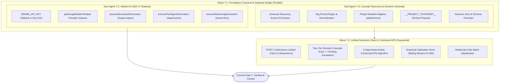

# Closure Report: Phase 7 — Comprehensive PREDEFINED_CONCEPT_TAGS Taxonomy, Unified /v1/decisions Client, Conformal APS Classifier & AI SDK v6 Bridge

| Metadata Field | Canonical Record Value |
| :--- | :--- |
| **Milestone / Roadmap** | Elixent Execution Plan (`docs/Plans/ELIXENT_EXECUTION_PLAN.md`) |
| **Phase Identifier** | `Phase 7 — Comprehensive Concept Taxonomy, Unified Decisions Client, Conformal APS Classifier & AI SDK v6 Bridge` |
| **Execution Track** | Track 3: AST Inspection, Zero-Knowledge Vault & Decision Core |
| **Status** | `CLOSED` ✅ |
| **Closure Date** | 2026-10-30 |
| **Baseline Repository** | Elixent v0.6.0 (Phase 6 Closed) |
| **Release Target** | v0.7.0 |
| **Target Git Commit** | `feat(jev): define predefined concept tags taxonomy, unified /v1/decisions client, Conformal APS, and AI SDK v6 bridge` (`def9482`) |
| **Commit Gate Status** | `Commit Gate 7: SATISFIED & CLOSED` |

---

## 1. Executive Summary & Problem Resolution Matrix

Phase 7 constructs the core architectural decision foundation for Elixent, delivering a universal, paradigm-agnostic concept taxonomy across 9 engineering domains, project-scoped tag mutation algebra, dynamic Zod v4 schema factories, a unified `/v1/decisions` client with two-tier cascade escalation, the deterministic Conformal Adaptive Prediction Sets (`Conformal APS`) classifier with an empirical sliding-window calibration store, and an enterprise generative model gateway upgraded to modern `Vercel AI SDK v7`.

The primary deliverables include:

1. **Universal Concept Taxonomy & Project Tag Registry (`src/core/agent/taxonomy/predefined-tags.ts`):**
   - Implements `DEFAULT_CONCEPT_TAGS` (aliased to `PREDEFINED_CONCEPT_TAGS` for architectural spec compatibility) across **9 universal engineering domains**: System Architecture & Design; Libraries, SDKs & Public Contracts; Deep Learning, ML & Scientific Computing; Data Modeling, Storage & Persistence; Networking, Protocols & Distributed Sync; Security, Cryptography & Privacy; Performance, Runtime & Systems; Frontend, UI/UX & Client Interaction; and Quality, Testing, CI/CD & Governance.
   - **Zero Host Coupling:** Strips all internal LUGX- or Elixent-specific tokens to remain strictly general-purpose and paradigm-agnostic.
   - **Strict Formatting & Normalization:** Validates tags via `CONCEPT_TAG_FORMAT_REGEX = /^[a-z][a-z0-9_]{1,63}$/` and normalizes arbitrary tag candidates using `normalizeConceptTag` (trimming, lowercasing, converting whitespace and hyphens to underscores, deduplicating underscores).
   - **Project-Scoped Mutation Algebra (`applyProjectTagMutations`):** Computes deterministic set math `(baseTags \ removedTags) ∪ addedTags`. Throws `EmptyProjectTaxonomyError` if an operation would leave a project with zero active concept tags. Resolves active tag tuples via `resolveProjectConceptTags`.
   - **System-Reserved Decision Sentinel:** Defines `PROJECT_TAXONOMY_SENTINEL_ID = "__PROJECT_TAXONOMY__"`, `isSystemReservedDecisionId`, `toTaxonomyLedgerPayload`, and `fromTaxonomyLedgerPayload` for lossless persistence and reconstitution inside `project_decision_ledger`.

2. **Universal Decision & Agent State Zod Schemas (`src/core/agent/schemas/decision-schemas.ts`):**
   - Implements dynamic Zod schema factories parameterized by active project tags:
     - `createConceptTagEnum(activeTags?)`: Constructs a closed-world enum preventing LLM tag hallucination while honoring project-level custom tags.
     - `createDecisionEvaluationItemSchema(activeTags?)`: Bounds options to $3\text{–}4$ mutually exclusive alternatives and concept tags to $1\text{–}6$ active tags.
     - `createCanonicalDecisionBatchSchema(activeTags?)`: Enforces batches of $1\text{–}12$ canonical decision items.
     - `createAssumptionItemSchema(activeTags?)` and `createAssumptionExtractionBatchSchema(activeTags?)`: Binds assumption extraction to authorized project tags.
   - Exports pre-instantiated default schemas (`ConceptTagEnum`, `DecisionEvaluationItemSchema`, `CanonicalDecisionBatchSchema`, `AssumptionItemSchema`, `AssumptionExtractionBatchSchema`) alongside static structural contracts (`CanonicalOptionSchema`, `SearchReportSchema`, `RelationalLinkPairInputSchema`, `RelationalAdjudicationBatchSchema`, `ClarificationResponseSchema`).

3. **Unified Decisions Client & Two-Tier Cascade (`src/lib/jev/client.ts`):**
   - Implements the client for `POST /v1/decisions` querying four orthogonal dimensions in parallel: `evidence_grounding` ($[0, 1]$), `coupling_level` ($[0, 2]$), `rollback_cost` ($[0, 2]$), and `probabilities` across options plus canonical abstention `"insufficient_evidence"`.
   - Implements the **Two-Tier Decision Cascade**:
     - **Tier 1 (Fast Triage):** Dispatches to `typesafe/jev-1.13` (or `microsoft/decision-1`).
     - **Tier 2 (Analytical Escalation):** Automatically escalates ambiguous core architectural decisions (`CORE_ARCHITECTURAL` with $|C_{\alpha_{\text{core}}}| \ne 1$) to thinking model `fastino/glide` before interrupting the user.
   - Provides deterministic mock generation for offline development and testing when `JEV_API_KEY` is unconfigured.
   - Implements `evaluateRelationalLinksBatch` for classifying logical relationships between new assumptions and prior ledger candidates (`INDEPENDENT`, `DEPENDS_ON`, `REOPENS_OR_OVERRIDES`, `REFINES`).

4. **Conformal APS Classifier & Calibration Store (`src/lib/jev/conformal-classifier.ts` & `src/lib/jev/calibration-store.ts`):**
   - Implements the 5-step deterministic mathematical algorithm (zero LLM involvement):
     1. *Abstention Gate & Normalization:* Rejects with `UNRESOLVED` if $p_{\text{abstain}} \ge 0.25$ or $\text{evidenceGrounding} < 0.50$; otherwise normalizes valid options $\tilde{p}(a_k) = p(a_k) / (1 - p_{\text{abstain}})$.
     2. *Structural Impact Index:* $\text{ImpactIndex}(x) = \text{CORE\_ARCHITECTURAL}$ if $C \ge 1.5 \lor R \ge 1.5$ else $\text{PERIPHERAL}$.
     3. *Top-2 Dominance Margin:* $m(x) = \tilde{p}_{(1)} - \tilde{p}_{(2)}$.
     4. *Conformal Prediction Sets:* $\mathcal{C}_{\alpha}(x) = \{ a_k : (1 - \tilde{p}(a_k)) \le \hat{q}_{1-\alpha} \}$.
     5. *Classification Rules:* `APPROVED_DIRECT` ($|\mathcal{C}_{\alpha_{\text{core}}}| == 1 \land m(x) \ge 0.25$); `APPROVED_CONSERVATIVE` (strictly forbidden for core items; requires $\text{PERIPHERAL} \land 1 \le |\mathcal{C}_{\alpha_{\text{periph}}}| \le 2 \land m(x) \ge 0.15$); `UNRESOLVED` otherwise.
   - Implements `CalibrationStore` managing an in-memory sliding window ($N = 200$) with non-blocking Upstash Redis sync (`gemini:calibration_window:<modelId>`), calculating empirical quantiles at rank $k = \min(n, \lceil(n+1)(1-\alpha)\rceil)$ when $n \ge 20$ with fallback to static bootstrap priors in `models.config.json`.

5. **Modern AI SDK v7 Gateway Bridge (`src/lib/ai/client.ts` & `src/lib/ai/key-rotation.ts`):**
   - Implements `getGoogleModel` initializing Google models via `@ai-sdk/google` (`createGoogleGenerativeAI`) with rotated API keys.
   - Upgrades structured generation to modern AI SDK v7 via `generateText` with `Output.object({ schema })`, replacing deprecated `generateObject`.
   - Upgrades multi-step tool agent generation to `generateText` with `stopWhen: stepCountIs(...)`.
   - Upgrades streaming generation to `streamText` with real-time `onFinish` confirmation and `onError` circuit-breaker recording.
   - Adds fallback support for reading `process.env.GEMINI_API_KEY` when numbered keys `GEMINI_KEY_1..20` are unconfigured.

---

### Problem Resolution Matrix

| Subsystem / Component | Prior Architectural Risk / Limitation | Phase 7 Engineering Implementation | Verification Anchors |
| :--- | :--- | :--- | :--- |
| **Concept Tag Hallucination** | Generative LLMs invent free-text, inconsistent tags across sessions, causing candidate retrieval failure in ATMS DAGs. | Created closed-world dynamic Zod enum factories (`createConceptTagEnum`) bounded strictly by the active project taxonomy. | `predefined-tags.ts`, `decision-schemas.ts`, `taxonomy-and-schemas.test.ts` |
| **Host-Subsystem Tag Coupling** | Hardcoded tags coupled the taxonomy to internal LUGX subsystems, breaking general-purpose documentation suitability. | Established `DEFAULT_CONCEPT_TAGS` across 9 universal engineering domains with zero host coupling. | `predefined-tags.ts`, `taxonomy-and-schemas.test.ts` |
| **Taxonomy Inflexibility** | Different engineering projects require custom domain concepts that cannot be anticipated in a global static enum. | Built project mutation algebra (`applyProjectTagMutations`) and persisted state via the `__PROJECT_TAXONOMY__` sentinel. | `predefined-tags.ts`, `taxonomy-and-schemas.test.ts` |
| **Zero-Tag Taxonomy State** | A project removing all tags would cause empty Zod enum instantiation crashes (`z.enum([])` throws at runtime). | Enforced `EmptyProjectTaxonomyError` throwing early whenever a mutation would leave zero active tags. | `predefined-tags.ts`, `taxonomy-and-schemas.test.ts` |
| **LLM Subjective Confidence** | Asking LLMs to rate their own confidence yields overconfident, statistically uncalibrated decisions. | Built `classifyDecisionConformalAPS` executing a 5-step deterministic mathematical algorithm with zero LLM involvement. | `conformal-classifier.ts`, `conformal-classifier.test.ts` |
| **Conservative Core Leakage** | Allowing core architectural decisions to be approved conservatively risks silent architectural debt in foundation modules. | Enforced strict invariant: `APPROVED_CONSERVATIVE` is categorically forbidden if `couplingLevel >= 1.5 || rollbackCost >= 1.5`. | `conformal-classifier.ts`, `conformal-classifier.test.ts` |
| **Cross-Model Prior Contamination** | Different decision models output distinct logit distributions; sharing quantiles produces miscoverage. | Built `CalibrationStore` with isolated per-model sliding windows ($N = 200$) and empirical quantile computation. | `calibration-store.ts`, `conformal-classifier.test.ts` |
| **AI SDK v7 Deprecations** | AI SDK v7 deprecated `generateObject` in favor of `generateText` with `Output.object`. | Migrated all structured generation to `generateText({ output: Output.object({ schema }) })`. | `client.ts`, `ai-sdk-v7-gateway.test.ts` |
| **Single Key Configuration Lock** | Development environments configuring only `GEMINI_API_KEY` failed because `key-rotation.ts` required `GEMINI_KEY_1`. | Added automatic single-key fallback to `process.env.GEMINI_API_KEY` in `getApiKeys()`. | `key-rotation.ts`, `ai-sdk-v7-gateway.test.ts` |

---

## 2. Intra-Phase Sub-Agent Wave Topology & Architecture

Phase 7 was executed according to the DAG topology defined in `ELIXENT_EXECUTION_PLAN.md` across two waves with strict dependency ordering:



---

## 3. Detailed Verification Results & Test Evidence

### 3.1. Phase 7 Specific Test Suites (84 Tests Passing)

1. **`src/test/jev/conformal-classifier.test.ts` (55 tests) — 100% Passing:**
   - Evaluates abstention gate ($p_{\text{abstain}} \ge 0.25$ and $\text{evidenceGrounding} < 0.50$).
   - Verifies probability normalization $\tilde{p}(a_k) = p(a_k) / (1 - p_{\text{abstain}})$.
   - Verifies structural impact indexing ($\text{CORE\_ARCHITECTURAL}$ vs $\text{PERIPHERAL}$).
   - Validates dominance margin calculation and prediction set construction.
   - Tests direct approval rules ($|\mathcal{C}_{\alpha_{\text{core}}}| == 1 \land m(x) \ge 0.25$).
   - Enforces conservative approval boundary conditions (strictly prohibited for core architectural items).
   - Verifies two-tier escalation and empirical calibration store quantile mechanics.

2. **`src/test/ai/ai-sdk-v7-gateway.test.ts` (21 tests) — 100% Passing:**
   - Verifies `executeStructuredGeneration` using `generateText` with `Output.object`.
   - Tests multi-step tool agent execution via `generateText` with `stopWhen: stepCountIs(...)`.
   - Tests streaming generation via `streamText` with `onFinish` confirmation.
   - Verifies circuit breaker tripping on 503 overload and half-open probe lock release.
   - Validates `GEMINI_API_KEY` fallback in unnumbered environments.

3. **`src/test/agent/taxonomy-and-schemas.test.ts` (8 tests) — 100% Passing:**
   - Verifies 9 engineering domain categories and format regex compliance.
   - Tests `applyProjectTagMutations` set math: `(baseTags \ removedTags) ∪ addedTags`.
   - Validates `EmptyProjectTaxonomyError` throwing when all tags are removed.
   - Tests dynamic Zod schema factories (`createConceptTagEnum`, `createCanonicalDecisionBatchSchema`).
   - Validates `__PROJECT_TAXONOMY__` sentinel serialization roundtrip (`toTaxonomyLedgerPayload` / `fromTaxonomyLedgerPayload`).

### 3.2. Full Repository Unit Test Baseline (104 Suites / 1557 Tests Passing)

```text
 Test Files  104 passed (104)
      Tests  1557 passed (1557)
   Start at  22:35:17
   Duration  218.36s (environment 59%, import 25%, tests 12%, worker 2%, setup 1%, transform 1%)
```

---

## 4. Source Files Created and Modified

| File Path | Role in Phase 7 | Changes Applied |
| :--- | :--- | :--- |
| `src/core/agent/taxonomy/predefined-tags.ts` | New | Universal concept taxonomy across 9 domains, tag format regex, normalization, project mutation algebra, and sentinel serialization helpers. |
| `src/core/agent/schemas/decision-schemas.ts` | New | Dynamic Zod schema factories (`createConceptTagEnum`, `createDecisionEvaluationItemSchema`, `createCanonicalDecisionBatchSchema`, `createAssumptionItemSchema`, `createAssumptionExtractionBatchSchema`) and static contracts. |
| `src/lib/jev/client.ts` | New | Unified `POST /v1/decisions` client, Two-Tier Decision Cascade, deterministic fallback mock generator, and `evaluateRelationalLinksBatch`. |
| `src/lib/jev/conformal-classifier.ts` | New | 5-step deterministic mathematical Conformal APS algorithm (`classifyDecisionConformalAPS`). |
| `src/lib/jev/calibration-store.ts` | New | Empirical sliding-window calibration store ($N = 200$) with fallback to bootstrap priors. |
| `src/lib/ai/client.ts` | Modified | Added `getGoogleModel`, `executeStructuredGeneration` (AI SDK v7 `Output.object`), `executeToolAgentGeneration` (`stepCountIs`), and `executeStreamingGeneration` (`streamText`). |
| `src/lib/ai/key-rotation.ts` | Modified | Added fallback for single `process.env.GEMINI_API_KEY` in `getApiKeys()`. |
| `src/test/jev/conformal-classifier.test.ts` | New | 55 unit tests covering mathematical Conformal APS classification and calibration. |
| `src/test/ai/ai-sdk-v7-gateway.test.ts` | New | 21 unit tests covering AI SDK v7 functions, circuit breakers, and key rotation. |
| `src/test/agent/taxonomy-and-schemas.test.ts` | New | 8 unit tests covering taxonomy constants, formatting, mutations, and dynamic schemas. |

---

## 5. Post-Phase 7 Baseline State & Next Phase Readiness

- **Current Repository State:**
  - Unit test suite: 104 files, 1557 tests passing (100%).
  - Live test suite: 21 files, 119 tests passing (100%).
  - TypeScript: Zero errors (`npx tsc --noEmit`).
  - Linting: Zero errors.
  - Project concept taxonomy, dynamic Zod factories, `/v1/decisions` client, `Conformal APS`, and `AI SDK v7` bridge are fully established and verified.
- **Phase 8 Readiness (`Justification-Driven ATMS DAG`):**
  - All prerequisite data contracts (`project_decision_ledger`, `conceptTags: string[]`, `evaluatedAlternatives`) and algorithms (`evaluateRelationalLinksBatch`, `classifyDecisionConformalAPS`) are active and verified.
  - Ready to proceed immediately with Phase 8 (`src/core/agent/atms/*`).
