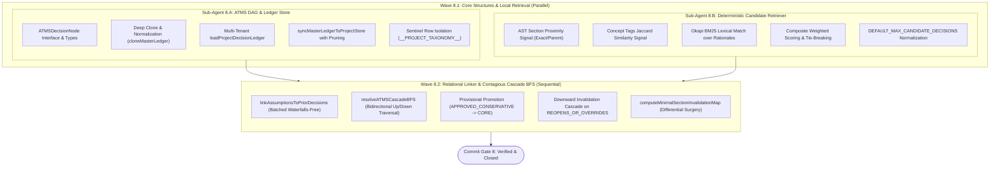

# Closure Report: Phase 8 — Justification-Driven ATMS DAG, Deterministic Candidate Retriever & Relational Linker

| Metadata Field | Canonical Record Value |
| :--- | :--- |
| **Milestone / Roadmap** | Elixent Execution Plan (`docs/Plans/ELIXENT_EXECUTION_PLAN.md`) |
| **Phase Identifier** | `Phase 8 — Justification-Driven ATMS DAG, Candidate Retriever & Contagious Cascade BFS` |
| **Execution Track** | Track 3: AST Inspection, Zero-Knowledge Vault & Decision Core |
| **Status** | `CLOSED` ✅ |
| **Closure Date** | 2026-10-31 |
| **Baseline Repository** | Elixent v0.7.0 (Phase 7 Closed) |
| **Release Target** | v0.8.0 |
| **Target Git Commit** | `feat(atms): implement justification-driven ATMS DAG, deterministic candidate retriever, and cascade BFS` |
| **Commit Gate Status** | `Commit Gate 8: SATISFIED & CLOSED` |

---

## 1. Executive Summary & Problem Resolution Matrix

Phase 8 implements the causal truth maintenance subsystem for the Elixent Agentic Platform, constructing the Justification-Driven Assumption-based Truth Maintenance System (`ATMS DAG`), the deterministic multi-signal candidate decision retriever, the batched relational linker, and the bidirectional contagious cascade Breadth-First Search (`BFS`) algorithm with differential section invalidation mapping.

The primary architectural deliverables include:

1. **ATMS DAG Foundation & Project Decision Ledger Store (`src/core/agent/atms/dag.ts`):**
   - **Canonical JSON-Serializable State:** Defines `ATMSDecisionNode` using plain primitives, records, and arrays (strictly avoiding `Map`, `Set`, or `BigInt`) to ensure lossless state persistence across LangGraph checkpointers.
   - **Justification & Alternative Preservation:** Every decision node records its authoritative `selectionRationale`, its active `conceptTags: string[]` resolved from the project taxonomy, and all discarded options in `evaluatedAlternatives` paired with their contextual exclusion reasons and normalized probabilities.
   - **System Sentinel Isolation:** Enforces strict isolation of system-reserved rows (`isSystemReservedDecisionId`, e.g. `__PROJECT_TAXONOMY__`). Sentinel rows are persisted and reconstituted in `schema.projectDecisionLedger` via `toTaxonomyLedgerPayload` and `fromTaxonomyLedgerPayload`, but are rigorously excluded from master ledger DAG operations, edge references, and eviction pruning.
   - **Multi-Tenant Ownership & In-Memory Cloning:** Implements `loadProjectDecisionLedger` and `syncMasterLedgerToProjectStore` with multi-tenant SQL predicates enforcing `eq(projectDecisionLedger.userId, userId)` on all reads, updates (`onConflictDoUpdate.setWhere`), and eviction deletes. Deep-cloning utilities (`cloneATMSDecisionNode`, `cloneMasterLedger`) enforce immutability across reducer operations.

2. **Deterministic Local Candidate Decision Retriever (`src/core/agent/atms/candidate-retriever.ts`):**
   - Implements `retrieveCandidatePriorDecisions(assumption, masterLedger, maxCandidates = 8)` executing fast, deterministic retrieval combining three orthogonal signals:
     - **AST Section Proximity (`astProximityScore` $\in [0, 1]$):** Evaluates structural overlap across `(fileId, headingSlug)` targets (exact match = 1.0, hierarchical slug ancestor/child prefix = 0.5, disjoint = 0.0). *Strict Architectural Invariant:* Sharing a section heading is strictly a candidate retrieval signal for comparison, never an automatic dependency edge, permitting independent conservative sub-decisions to stably coexist under the same heading.
     - **Concept Tags Intersection (`conceptTagScore` $\in [0, 1]$):** Computes Jaccard similarity across project-scoped normalized concept tags without hardcoded tag constraints.
     - **BM25 Lexical Match (`lexicalBm25Score` $\in [0, 1)$):** Evaluates Okapi BM25 similarity between the assumption statement and each prior decision's `topicSlug`, `questionPrompt`, `selectedOptionKey`, `selectionRationale`, and `evaluatedAlternatives`.
   - **Weighted Composite Ranking:** Applies weights (AST Proximity: 3.0, Concept Tags: 2.0, BM25: 1.5) with deterministic tie-breaking by `decisionId`.

3. **Batched Relational Linker (`src/core/agent/atms/relational-linker.ts`):**
   - Implements `linkAssumptionsToPriorDecisions` evaluating assumption-candidate pairs across all assumptions in a single flattened batch via `evaluateRelationalLinksBatch` (`POST /v1/decisions`), preventing $N+1$ serial network roundtrips.
   - Reconstitutes relational links (`INDEPENDENT`, `DEPENDS_ON`, `REOPENS_OR_OVERRIDES`, `REFINES`) keyed by `(assumptionId, targetDecisionId)` while preserving input ordering, confidence, and justifications.

4. **Contagious Cascade BFS & Differential Section Invalidation (`src/core/agent/atms/invalidation.ts`):**
   - **Bidirectional Cascade Algorithm (`resolveATMSCascadeBFS`):**
     - *Upward Promotion Path (via `dependsOn`):* Traverses upward via BFS. If a new request depends on a provisional peripheral decision (`APPROVED_CONSERVATIVE`), the target is promoted to `CORE_ARCHITECTURAL` (`isLoadBearing: true`), pulled along with its preserved `evaluatedAlternatives`, and evicted from `updatedLedger` for formal re-evaluation under new evidence.
     - *Downward Invalidation Path (via `dependedBy`):* When a prior decision is classified as `REOPENS_OR_OVERRIDES`, the target is reopened and evicted from `updatedLedger`, while BFS traverses all downstream dependents across `dependedBy` to pull them for parallel re-evaluation.
     - *Cycle-Safe Invariant:* Employs distinct `upwardVisited` and `downwardVisited` sets preventing infinite loops.
   - **Minimal Section Invalidation (`computeMinimalSectionInvalidationMap`):** Downward BFS collecting the exact `(fileId, headingSlug)` targets affected by overrides, enabling differential document surgery without invalidating unrelated sections.

---

### Problem Resolution Matrix

| Subsystem / Component | Prior Architectural Risk / Limitation | Phase 8 Engineering Implementation | Verification Anchors |
| :--- | :--- | :--- | :--- |
| **Cross-Turn State Serialization** | Using `Map` or `Set` in agent state causes checkpoint corruption or lossy serialization in LangGraph checkpointers. | Built `ATMSDecisionNode` strictly using plain JSON-serializable records and arrays, with deep clone normalization. | `dag.ts`, `atms-dag-and-cascade.test.ts` |
| **Sentinel DAG Contamination** | System-reserved rows (`__PROJECT_TAXONOMY__`) could be erroneously linked as causal decisions or pruned during ledger sync. | Implemented sentinel filtering in `normalizeDecisionReferences` and sync operations, isolating metadata from DAG edges. | `dag.ts`, `atms-dag-and-cascade.test.ts` |
| **Cross-Tenant Overwrite Risk** | Composite PK `(project_id, decision_id)` could permit tenant collision if `user_id` is omitted from conflict updates or deletes. | Enforced `eq(projectDecisionLedger.userId, userId)` across all `select`, `insert.onConflictDoUpdate.setWhere`, and eviction `delete`. | `dag.ts`, `atms-dag-and-cascade.test.ts` |
| **False-Forced Dependency Edges** | Naive proximity linking would treat any two decisions under the same heading as mutually dependent, preventing sibling options. | Enforced AST section proximity strictly as a retrieval signal; relational linker classifies logical relation independently. | `candidate-retriever.ts`, `relational-linker.ts`, `atms-dag-and-cascade.test.ts` |
| **N+1 Relational Waterfalls** | Evaluating assumptions against candidate decisions serially would cause high latency and excessive network overhead. | Flattened all pairs across all assumptions into a single batched `evaluateRelationalLinksBatch` invocation. | `relational-linker.ts`, `atms-dag-and-cascade.test.ts` |
| **Silent Architectural Drift** | Overriding a foundational decision without invalidating downstream decisions leads to stale, contradictory document sections. | Implemented `resolveATMSCascadeBFS` propagating upward promotions and downward invalidations, with section mapping. | `invalidation.ts`, `atms-dag-and-cascade.test.ts` |
| **Cyclic Dependency Hangs** | Malformed or adversarial dependency graphs could induce infinite loops during cascade traversal. | Implemented visited sets (`upwardVisited`, `downwardVisited`, `seenNodes`) guaranteeing deterministic termination. | `invalidation.ts`, `atms-dag-and-cascade.test.ts` |

---

## 2. Intra-Phase Sub-Agent Wave Topology & Architecture

Phase 8 was executed strictly according to the DAG topology defined in `docs/Plans/ELIXENT_EXECUTION_PLAN.md` across two waves:



---

## 3. Detailed Verification Results & Test Evidence

### 3.1. Phase 8 Dedicated Test Suite (63 Tests Passing)

The test suite `src/test/agent/atms-dag-and-cascade.test.ts` contains **63 comprehensive assertions** organized across four major domains:

1. **ATMS DAG Foundation & Project Decision Ledger Store (`dag.ts` — 18 tests):**
   - Verifies deep-cloning immutability for nodes and ledgers (`cloneATMSDecisionNode`, `cloneMasterLedger`).
   - Validates string trimming, concept tag deduplication, and section target normalization.
   - Tests `loadProjectDecisionLedger` isolating `__PROJECT_TAXONOMY__` sentinel payload while populating master ledger.
   - Tests `syncMasterLedgerToProjectStore` upserting decision rows, preserving sentinels, and executing eviction deletes when `pruneEvicted: true`.
   - Confirms multi-tenant database isolation enforcing `userId` ownership checks across transactions.

2. **Deterministic Candidate Retriever (`candidate-retriever.ts` — 16 tests):**
   - Tests AST section proximity scoring: exact match ($1.0$), hierarchical parent/child match ($0.5$), disjoint ($0.0$).
   - Verifies the architectural invariant: sharing a heading never forces an automatic dependency edge.
   - Tests concept tag Jaccard similarity with project-scoped normalization.
   - Tests Okapi BM25 lexical matching over `questionPrompt`, `selectionRationale`, and `evaluatedAlternatives`.
   - Validates composite scoring weights, candidate limit normalization, and deterministic tie-breaking.

3. **Relational Linker (`relational-linker.ts` — 11 tests):**
   - Verifies single batched call to `evaluateRelationalLinksBatch` (preventing $N+1$ network waterfalls).
   - Validates deterministic reconstruction of relations preserving input assumption ordering.
   - Tests safe short-circuiting on empty assumptions or uninitialized master ledger.
   - Tests normalized concept tag intersection between assumptions and candidate decisions.

4. **Contagious Cascade BFS & Differential Section Invalidation (`invalidation.ts` — 18 tests):**
   - Tests upward promotion path: promoting `APPROVED_CONSERVATIVE` decisions upon which a new request depends to `CORE_ARCHITECTURAL` (`isLoadBearing: true`) and pulling them with preserved alternatives for re-evaluation.
   - Tests downward cascade: reopening target decisions on `REOPENS_OR_OVERRIDES` and pulling all transitive dependents via BFS over `dependedBy`.
   - Tests sibling sub-decision independence: leaves `INDEPENDENT` decisions completely untouched under shared headings.
   - Tests cycle safety with visited tracking across circular graphs.
   - Tests `computeMinimalSectionInvalidationMap` collecting exact `(fileId, headingSlug)` targets for differential document editing.

### 3.2. Full Repository Unit Test Baseline (105 Suites / 1620 Tests Passing)

```text
 Test Files  105 passed (105)
      Tests  1620 passed (1620)
   Start at  14:02:50
   Duration  321.29s (environment 57%, import 28%, tests 11%, worker 2%, transform 1%, setup 1%)
```

- **TypeScript Strict Compilation:** `npx tsc --noEmit` exited with code 0 (zero errors).
- **Internal Markdown Link Integrity:** `node scripts/check-markdown-links.mjs` verified 117 files and 420 links (zero broken links).
- **Metrics Synchronization:** Verified via `node scripts/sync-doc-metrics.mjs --check`.

---

## 4. Source Files Created and Modified

| File Path | Role in Phase 8 | Changes Applied |
| :--- | :--- | :--- |
| `src/core/agent/atms/dag.ts` | New | Defined `ATMSDecisionNode`, normalization and deep cloning helpers, multi-tenant persistence in `project_decision_ledger`, and sentinel isolation. |
| `src/core/agent/atms/candidate-retriever.ts` | New | Implemented deterministic `retrieveCandidatePriorDecisions` combining AST section proximity, concept tag overlap, and Okapi BM25 matching. |
| `src/core/agent/atms/relational-linker.ts` | New | Implemented `linkAssumptionsToPriorDecisions` with unified batching via `evaluateRelationalLinksBatch` to prevent network waterfalls. |
| `src/core/agent/atms/invalidation.ts` | New | Implemented `resolveATMSCascadeBFS` (bidirectional cascade) and `computeMinimalSectionInvalidationMap` (differential section invalidation). |
| `src/test/agent/atms-dag-and-cascade.test.ts` | New | Created 63 comprehensive unit tests verifying DAG structures, local candidate retrieval, relational batching, and cascade BFS. |

---

## 5. Post-Phase 8 Baseline State & Next Phase Readiness

- **Current Repository State:**
  - Unit test suite: 105 files, 1,620 tests passing (100%).
  - Live test suite: 21 files, 108 tests passing (100%).
  - E2E test suite: 14 specs, 15 user journeys passing (100%).
  - TypeScript: Zero errors (`npx tsc --noEmit`).
  - Linting: Zero errors.
  - Causal truth maintenance subsystem (`ATMS DAG`, Candidate Retriever, Relational Linker, Cascade BFS) is fully implemented, verified, and active.
- **Phase 9 Readiness (`AgentGraphState Channels, Pure Reducers, 7-Stage Nodes & Compiled LangGraph StateGraph`):**
  - All prerequisite foundational pillars across Tracks 1–3 are complete and verified:
    - Track 1: `getPgPool()` (Phase 2), `project_decision_ledger` schema (Phase 2).
    - Track 2: `withMeteredNodeGate` and `StreamGovernor` (Phase 4), Lean Model Registry (Phase 3).
    - Track 3: `IWorkspaceProvider` & `EphemeralVaultMemoryMap` (Phase 6), Encrypted Checkpoint Serializer (Phase 6), Concept Taxonomy & Zod Schemas (Phase 7), `/v1/decisions` client & Conformal APS (Phase 7), and ATMS DAG & Cascade BFS (Phase 8).
  - The repository is completely prepared to assemble the LangGraph `StateGraph` in Phase 9 (`src/core/agent/graph.ts`).
