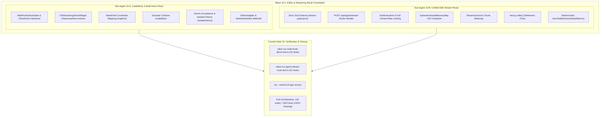

# Closure Report: Phase 10 — CodeMirror 6 Multi-Hunk Ghost Upgrade & Unified Agent SSE Stream Route

| Metadata Field | Canonical Record Value |
| :--- | :--- |
| **Milestone / Roadmap** | Elixent Execution Plan (`docs/Plans/ELIXENT_EXECUTION_PLAN.md`) |
| **Phase Identifier** | `Phase 10 — CodeMirror 6 Multi-Hunk Ghost Upgrade & Unified Agent SSE Stream Route` |
| **Execution Track** | Track 3: AST Inspection, Zero-Knowledge Vault & Decision Core |
| **Status** | `CLOSED` ✅ |
| **Closure Date** | 2026-10-31 |
| **Baseline Repository** | Elixent v0.9.0 (Phase 9 Closed) |
| **Release Target** | v0.10.0 |
| **Target Git Commit** | `feat(editor): upgrade CodeMirror 6 to multi-hunk ghost and implement /api/agent/stream SSE route` |
| **Commit Gate Status** | `Commit Gate 10: SATISFIED & CLOSED` |

---

## 1. Executive Summary & Problem Resolution Matrix

Phase 10 delivers the presentation-layer and server-streaming bridge of the Elixent Agentic Platform, connecting the compiled LangGraph `StateGraph` (delivered in Phase 9) to the interactive editor view. It upgrades the native CodeMirror 6 markdown editor to manage concurrent, non-contiguous multi-hunk ghost previews with dynamic coordinate remapping and isolated undo history, and builds the unified server-authoritative SSE stream route (`POST /api/agent/stream`).

The primary architectural deliverables include:

1. **CodeMirror 6 Multi-Hunk Ghost Preview Extension (`src/components/editor/markdown/streaming-ghost.ts` & `types.ts`):**
   - **`MultiHunkGhostState` Data Structure:** Upgrades the ghost preview state machine from a single range to an array of `GhostHunk` items with active session tracking (`sessionId: string | null`, `hunks: GhostHunk[]`), preserving legacy single-range accessors for backward compatibility.
   - **Dynamic Coordinate Remapping (`tr.changes.mapPos`):** Remaps coordinates of all remaining hunks across document changes using `hunk.from = tr.changes.mapPos(hunk.from, 1)` and `hunk.to = tr.changes.mapPos(hunk.to, -1)`, preventing cumulative offset drift when text is inserted or deleted elsewhere in the document.
   - **Granular Collision Invalidation:** Automatically detects if user typing intersects any active ghost hunk (`fromA < hunk.to && toA > hunk.from`), safely invalidating and evicting only the colliding hunk (triggering `onStop?.()`) while keeping non-intersecting hunks fully intact.
   - **Atomic Acceptance & Isolated History:**
     - `acceptGhostHunk(view, hunkId)` applies changes tagged with `Transaction.userEvent.of("ai.accept.hunk")` and `isolateHistory.of("full")`, creating an isolated undo history step so `Ctrl+Z` cleanly reverts only that individual acceptance.
     - `rejectGhostHunk(view, hunkId)` dispatches `removeGhostHunkEffect` without doc mutation or history addition, executing `onReject?.()`.
     - `acceptAllGhostHunks(view)` sorts non-overlapping hunks and applies all changes in a single atomic transaction tagged with `Transaction.userEvent.of("ai.accept.all")` and `isolateHistory.of("full")`, allowing a single `Ctrl+Z` to revert the entire batch.
   - **Glassmorphism Interactive Preview Card (`CMStreamingGhostWidget`):** Renders dark glassmorphism preview cards with operation/heading badges, streaming pulsing indicators, and inline action triggers ("إيقاف التوليد", "رفض", "إعادة المحاولة", "تطبيق") with dynamic text direction evaluation (`detectTextDirection`).
   - **Engine-Agnostic Adapter Exposure (`EditorAdapter`):** Implements all multi-hunk lifecycle methods in `CodeMirrorEditorAdapter` (`editor-adapter.ts`) and forwards them through `MarkdownEditor` (`markdown-editor.tsx`).

2. **Framework-Agnostic Stream Request Payload Contract (`src/core/agent/stream-payload.ts`):**
   - **Strict Closed Schema (`AgentStreamRequestPayloadSchema`):** Defined using Zod with `.strict()`, zero Next.js or React runtime dependencies, and strict sanitization bounds (`MAX_PROMPT_CHARS = 100_000`, `MAX_TARGET_FILES = 100`, `MAX_IDENTIFIER_LENGTH = 256`, `MAX_DOCUMENT_SNAPSHOT_CHARS = 2_000_000`, `MAX_RECORD_KEYS = 100`).
   - **Pure Discriminated Parsing Helper (`parseAgentStreamPayload`):** Validates untyped inputs returning typed discriminated union results (`{ success: true, data } | { success: false, error }`).

3. **Unified Agent SSE Stream Route (`src/app/api/agent/stream/route.ts`):**
   - **Route Configuration:** `export const dynamic = "force-dynamic"; export const maxDuration = 300;` providing a 5-minute serverless streaming budget.
   - **Authentication Guard:** Strictly validates active session via `requireAuthenticatedUser()` prior to body parsing, returning RFC 7807 `401 Unauthorized` problem details on failure.
   - **Fail-Closed Stream Rate Limiting:** Enforces `aiStreamRateLimiter.limit(user.id)`, failing closed with RFC 7807 `429 Too Many Requests` problem details on rate limit breach or Redis unavailability.
   - **Transient Ephemeral Vault Hydration:** Hydrates client-decrypted ephemeral file plaintexts into `EphemeralVaultMemoryMap` by heading slugs via AST slicer (`loadEphemeralVaultPayloads`), executing `elixentAgentGraph` within `runWithEphemeralVaultScope`.
   - **Dynamic Credit Metering:** Metres incoming token chunks via `StreamGovernor` (`INITIAL_RESERVATION_TOKENS = 1200`, model `google/gemini-3.8-flash`), monitoring token runway and triggering fail-closed stream abort (`GOVERNOR_QUOTA_EXHAUSTED`) on quota depletion.
   - **Deferred Settlement Flush:** Queues asynchronous credit ledger settlement persistence to PostgreSQL via Next.js `after(async () => { await flushPendingSettlementsToPostgres(user.id); })`.
   - **Deterministic Memory Zeroing:** Unconditionally wipes all in-memory decrypted buffers via `zeroOutEphemeralVaultMemory()` (`Buffer.fill(0)`) in `finally` and `cancel` handlers.
   - **Standardized SSE Framing:** Emits framed events `start`, `update`, `interrupt`, `error`, and `done` over `text/event-stream; charset=utf-8` with `X-Accel-Buffering: no`.

---

### Problem Resolution Matrix

| Subsystem / Invariant | Prior Architectural Risk / Limitation | Phase 10 Engineering Implementation | Verification Anchors |
| :--- | :--- | :--- | :--- |
| **Multi-Section Preview** | CodeMirror 6 editor supported only a single contiguous ghost range; multi-section agent updates could not be previewed simultaneously. | Upgraded to `MultiHunkGhostState` with `StateEffect` array management and interactive glassmorphism widgets per hunk. | `streaming-ghost.ts`, `multi-hunk-ghost.test.ts` |
| **Coordinate Drift** | User edits outside a ghost range shifted document indices, misaligning preview overlays and causing corrupted replacements. | Implemented dynamic coordinate mapping in `StateField.update` using `tr.changes.mapPos(hunk.from, 1)` and `mapPos(hunk.to, -1)`. | `streaming-ghost.ts`, `multi-hunk-ghost.test.ts` |
| **Typing Collision Corruptions** | User typing inside a preview range caused overlapping changes and unrecoverable text duplication. | Implemented granular collision detection invalidating only the directly intersecting hunk while preserving non-overlapping hunks. | `streaming-ghost.ts`, `multi-hunk-ghost.test.ts` |
| **Undo Stack Pollution** | Accepting multiple hunks created tangled undo steps, preventing clean reversal of individual AI modifications. | Enforced `Transaction.userEvent.of("ai.accept.hunk")` and `isolateHistory.of("full")` for single-step Ctrl+Z per hunk. | `streaming-ghost.ts`, `multi-hunk-ghost.test.ts` |
| **Batch Acceptance Revert** | "Accept All" applied separate transactions, forcing the user to press Ctrl+Z dozens of times to revert. | Implemented atomic `acceptAllGhostHunks` combining sorted non-overlapping changes in one transaction with `ai.accept.all` userEvent. | `streaming-ghost.ts`, `multi-hunk-ghost.test.ts` |
| **Payload Memory Exhaustion** | Unbounded string payloads or record keys could trigger serverless Node.js OOM crashes during AST slicing. | Enforced strict Zod bounds: max 100K prompt chars, max 100 target files, max 2MB document snapshots, max 100 record keys. | `stream-payload.ts`, `agent-stream-route.test.ts` |
| **Zero-Knowledge Memory Leaks** | Decrypted plaintexts passed in request payloads could linger in serverless memory across invocations. | Encapsulated execution in `runWithEphemeralVaultScope` with unconditional `zeroOutEphemeralVaultMemory()` (`Buffer.fill(0)`). | `route.ts`, `agent-stream-route.test.ts` |
| **Runaway Credit Depletion** | Unbounded LLM streaming loops could consume user credit balance without real-time enforcement. | Integrated `StreamGovernor` chunk-level token metering (`1200` initial tokens), fail-closed aborting on quota breach. | `route.ts`, `agent-stream-route.test.ts` |

---

## 2. Intra-Phase Architecture & Topology

Phase 10 executed via two parallel sub-agent tracks adhering to `docs/Plans/ELIXENT_EXECUTION_PLAN.md`:



---

## 3. Technical Implementation Details

### 3.1. CodeMirror 6 Multi-Hunk Ghost Preview Engine

- **State Field Definition (`codeMirrorStreamingGhostField`):**
  - Maintains `MultiHunkGhostState` containing `sessionId: string | null` and `hunks: GhostHunk[]`.
  - Driven by four primary `StateEffect` definitions: `startGhostSessionEffect`, `upsertGhostHunkEffect`, `removeGhostHunkEffect`, and `clearGhostSessionEffect`.
  - Retains backward-compatible handling for legacy single-ghost effects (`startGhostEffect`, `updateGhostEffect`, `clearGhostEffect`).
- **Dynamic Coordinate Remapping & Collision Invalidation:**
  - On `tr.docChanged`, iterates through all existing hunks:
    ```typescript
    tr.changes.iterChanges((fromA, toA) => {
        if (collides) return;
        if (hunk.from === hunk.to) {
            if (fromA <= hunk.from && toA >= hunk.from) collides = true;
        } else {
            if (fromA < hunk.to && toA > hunk.from) collides = true;
        }
    });
    ```
  - Colliding hunks are removed from state and their `onStop` callbacks queued via `queueMicrotask`.
  - Surviving hunks have their boundaries shifted:
    ```typescript
    const newFrom = tr.changes.mapPos(hunk.from, 1);
    const newTo = tr.changes.mapPos(hunk.to, -1);
    ```
- **Decoration Generation:**
  - Builds decoration range sets using `RangeSetBuilder<CMDecoration>`.
  - Places `CMDecoration.widget` instances using `CMStreamingGhostWidget` at the beginning of each hunk (`side: -1`).
  - Dark glassmorphism widget renders operation labels, pulsating streaming dots, and inline Arabic actions with direction isolation.
- **Atomic Undo Isolation:**
  - `acceptGhostHunk`:
    ```typescript
    view.dispatch({
        changes: { from: safeFrom, to: safeTo, insert: hunk.replacementText },
        effects: removeGhostHunkEffect.of(hunkId),
        annotations: [
            Transaction.userEvent.of("ai.accept.hunk"),
            isolateHistory.of("full"),
        ],
    });
    ```
  - `acceptAllGhostHunks`:
    ```typescript
    view.dispatch({
        changes: validChanges,
        effects: clearGhostSessionEffect.of(),
        annotations: [
            Transaction.userEvent.of("ai.accept.all"),
            isolateHistory.of("full"),
        ],
    });
    ```

### 3.2. Framework-Agnostic Stream Request Contract (`stream-payload.ts`)

- Zero external framework dependencies; pure TypeScript + Zod.
- Bounded input validation constraints:
  - `threadId`: 1 to 256 characters.
  - `projectId`: 1 to 256 characters.
  - `prompt`: optional string, maximum 100,000 characters.
  - `targetFileIds`: array of non-empty strings, maximum 100 entries.
  - `resumePayload`: unknown optional payload.
  - `ephemeralVaultPayloads`: record of string keys to string values, maximum 100 keys, maximum 2,000,000 characters per entry.
  - `liveDocumentSnapshots`: record of string keys to string values, maximum 100 keys, maximum 2,000,000 characters per entry.
  - `.strict()`: rejects unrecognized extraneous fields.

### 3.3. Unified Server SSE Stream Route (`route.ts`)

- **Execution Flow Pipeline:**
  1. Correlation ID generation/extraction (`getOrGenerateCorrelationId`).
  2. Strict server session authentication via `requireAuthenticatedUser()`.
  3. Fail-closed stream rate limiting via `aiStreamRateLimiter.limit(user.id)`.
  4. JSON body parsing and contract validation via `parseAgentStreamPayload`.
  5. Stream AbortController linked to incoming `req.signal`.
  6. `StreamGovernor` initialization with 1,200 initial tokens and model ID `google/gemini-3.8-flash`.
  7. Asynchronous settlement flush scheduled via Next.js `after()`.
  8. ReadableStream construction within `runWithEphemeralVaultScope`:
     - Slices and stores decrypted ephemeral files into `EphemeralVaultMemoryMap`.
     - Emits `start` SSE frame.
     - Streams `elixentAgentGraph.stream(graphInput, graphConfig)`.
     - Meters intermediate token chunks through `governor.onTokenChunk(chunkStr)`.
     - Handles `__interrupt__` and `GraphInterrupt` yielding `interrupt` SSE frames.
     - Emits `update` SSE frames for state updates.
     - Emits `done` SSE frame on completion.
     - In `finally` and `cancel`: unconditionally calls `zeroOutEphemeralVaultMemory()` and `governor.settle()`.

---

## 4. Architectural Decisions & Trade-offs

### Decision: StateField Array Tracking over Multiple Single-Hunk Fields

- **Context:** An agent cycle can generate 5 to 15 non-contiguous section modifications across a single markdown file.
- **Chosen Architecture:** Single `StateField<MultiHunkGhostState>` holding an array of `GhostHunk` objects with coordinate remapping.
- **Rejected Alternatives:** Spawning multiple dynamic CodeMirror compartments or separate StateFields per hunk.
- **Trade-off Analysis:**
  | Evaluation Criteria | Single MultiHunkGhostState (Chosen) | Multiple Compartments (Discarded) |
  | :--- | :--- | :--- |
  | Reconfiguration Overhead | Zero (pure StateEffect dispatch) | High (requires dynamic extension reconfiguration) |
  | Coordinate Mapping | Single-pass linear mapping | Complex cross-compartment transaction coordination |
  | Undo History Isolation | Deterministic via `isolateHistory.of("full")` | Fragmented undo trees across compartments |

- **Migration Trigger:** If hunk counts exceed 1,000 simultaneously within a single document, migrate decoration storage to an interval tree structure (B-tree).

### Decision: In-Memory SSE Streaming over Persistent WebSockets

- **Context:** Vercel serverless functions are stateless and execution is bounded by `maxDuration`.
- **Chosen Architecture:** Standard HTTP Server-Sent Events (`text/event-stream`) with `maxDuration = 300` and `StreamGovernor` credit metering.
- **Rejected Alternatives:** Persistent WebSocket servers or long-polling HTTP endpoints.
- **Trade-off Analysis:**
  | Evaluation Criteria | HTTP SSE Stream (Chosen) | WebSockets (Discarded) |
  | :--- | :--- | :--- |
  | Serverless Compatibility | Native to Vercel & Edge | Requires persistent connection gateway / proxy |
  | Connection Overhead | Minimal standard HTTP | High stateful handshake & keep-alive management |
  | Auto-Reconnection & Cleanup | Client EventSource / Fetch reader | Complex heartbeat & reconnect protocol |

- **Migration Trigger:** If two-way full-duplex interactive audio streaming or real-time multi-agent collaborative editing is required, introduce a dedicated WebSocket gateway.

---

## 5. Verification & Real Test Evidence

### 5.1. Dedicated Test Suites (Phase 10)

Phase 10 authored two comprehensive, zero-mocking (where applicable) automated test suites:

1. **`src/test/editor/multi-hunk-ghost.test.ts` (32 tests):**
   - Multi-hunk ghost session initialization, upsert, and retrieval via adapter.
   - Dynamic coordinate remapping: shifts remaining hunks when text is typed before, between, or after hunks.
   - Granular collision invalidation: dismisses only directly colliding hunks while preserving non-overlapping hunks.
   - Atomic acceptance via `acceptGhostHunk` with `Transaction.userEvent.of("ai.accept.hunk")` and isolated history.
   - Individual rejection via `rejectGhostHunk` without document mutation or history addition.
   - Batch acceptance via `acceptAllGhostHunks` with `Transaction.userEvent.of("ai.accept.all")` and single-step undo.
   - BiDi text direction evaluation for Arabic and English replacement text.
   - Interactive button click events and callback dispatches (`onApply`, `onReject`, `onStop`).

2. **`src/test/agent/agent-stream-route.test.ts` (41 tests):**
   - Route segment configuration (`maxDuration = 300`, `dynamic = "force-dynamic"`).
   - Authentication gate: returns 401 problem details when unauthenticated.
   - Rate limiting gate: returns 429 problem details on limit breach or Redis error (fail-closed).
   - Request payload parsing: validates Zod bounds and returns 400 with `invalidParams` on malformed inputs.
   - Happy path SSE streaming: emits `start`, `update`, and `done` frames.
   - LangGraph interrupt handling: emits `interrupt` frame on graph suspension.
   - Resumption protocol: dispatches `new Command({ resume })` when `resumePayload` is provided.
   - StreamGovernor integration: enforces token runway and emits `error` with `QUOTA_EXCEEDED` on quota breach.
   - Zero-Knowledge memory hygiene: verifies `zeroOutEphemeralVaultMemory()` (`Buffer.fill(0)`) is called on both clean completion and stream abort.
   - Background settlement: verifies `flushPendingSettlementsToPostgres` is scheduled via Next.js `after()`.

### 5.2. Test Suite Execution Output

```
Test Files  2 passed (2)
     Tests  73 passed (73)
  Start at  22:02:04
  Duration  8.36s
```

Full Unit & Contract Baseline:
```
Test Files  110 passed (110)
     Tests  1815 passed (1815)
  Start at  21:55:55
  Duration  171.64s
```

TypeScript Compilation:
```
npx tsc --noEmit (Exit Code 0 — 0 type errors)
```

Markdown Internal Link Verification:
```
node scripts/check-markdown-links.mjs (100% valid links, 0 broken links)
```

---

## 6. Related Documentation & Canonical References

- Authoritative Architecture Spec: [`docs/architecture/03_workspace_ast_editor_and_vault_integration.md`](../../../architecture/03_workspace_ast_editor_and_vault_integration.md)
- Agent Orchestration Architecture Spec: [`docs/architecture/02_agent_orchestration_and_decision_engine.md`](../../../architecture/02_agent_orchestration_and_decision_engine.md)
- UI Streaming Living Contract: [`docs/reference/ui-streaming-readiness.md`](../../../reference/ui-streaming-readiness.md)
- Execution Plan Roadmap: [`docs/records/plans/elixent-agentic-architecture-execution-plan.md`](../../plans/elixent-agentic-architecture-execution-plan.md)
- Previous Phase Closure: [`docs/records/closures/elixent-execution/phase-09-agent-graph-state-channels-pure-reducers-7-stage-nodes-and-compiled-langgraph-stategraph.md`](./phase-09-agent-graph-state-channels-pure-reducers-7-stage-nodes-and-compiled-langgraph-stategraph.md)
