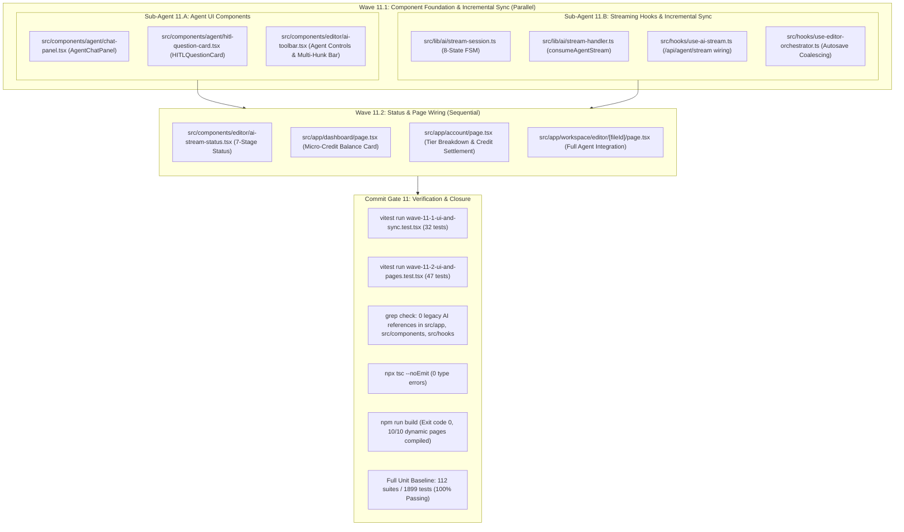

# Closure Report: Phase 11 — Agent Chat Panel, HITL Question Cards, Credit Balance Views & Incremental Editor Sync

| Metadata Field | Canonical Record Value |
| :--- | :--- |
| **Milestone / Roadmap** | Elixent Execution Plan (`docs/Plans/ELIXENT_EXECUTION_PLAN.md`) |
| **Phase Identifier** | `Phase 11 — Agent Chat Panel, HITL Question Cards, Credit Balance Views & Incremental Editor Sync` |
| **Execution Track** | Track 3: AST Inspection, Zero-Knowledge Vault & Decision Core / Interactive UI Integration |
| **Status** | `CLOSED` ✅ |
| **Closure Date** | 2026-11-03 |
| **Baseline Repository** | Elixent v0.10.0 (Phase 10 Closed) |
| **Release Target** | v0.11.0 |
| **Target Git Commit** | `feat(ui): add agent chat panel, HITL form cards, credit balance views, and debounced hunk sync orchestration` |
| **Commit Gate Status** | `Commit Gate 11: SATISFIED & CLOSED` |

---

## 1. Executive Summary & Problem Resolution Matrix

Phase 11 connects the compiled LangGraph `StateGraph` and the CodeMirror 6 multi-hunk preview engine into the interactive UI presentation layer. It builds the primary user-facing agent interfaces (`AgentChatPanel`, `HITLQuestionCard`), updates the editor toolbar and credit balance views, and establishes the debounced incremental synchronization contract between `useAIStream`, `useEditorOrchestrator`, and `useEditorAutosave`, permanently eliminating client-inflicted `412 Precondition Failed` conflicts.

The primary architectural deliverables include:

1. **Architectural Agent Chat Panel (`src/components/agent/chat-panel.tsx`):**
   - **7-Stage Progress Tracker:** Ephemeral visual indicator rendering the active graph stage (`Orchestrator`, `Structural Inspection`, `Assumption Analysis`, `Decision Audit`, `Conformal Triage`, `HITL Clarification`, `Document Writer`).
   - **Interactive ATMS Decision Ledger (`master_ledger`):** Accordion viewer displaying adopted decisions, selection rationales (`selectionRationale`), and evaluated alternatives (`evaluatedAlternatives`) paired with contextual exclusion reasons.
   - **Multi-Hunk Review Bar:** Real-time counter of active ghost hunks with batch actions (`Accept All`, `Reject All`) and per-hunk navigation.
   - **Prompt Composer & Session Lifecycle:** Dispatches `startAgentSession`, `stopAIOperation`, and `resetAI` with automatic Zero-Knowledge vault lock and offline network status indicators.

2. **Human-in-the-Loop Clarification Gate (`src/components/agent/hitl-question-card.tsx`):**
   - **Diagnostic Clarification Batches:** Renders structured question sets emitted during Stage 6 LangGraph interrupts (`pure_interrupt_node`).
   - **Strict Contractual Validation:** Validates single-choice, multiple-choice, and custom note responses in real time using `ClarificationResponseSchema`.
   - **Stateless Thread Resumption:** Submits schema-validated payloads to `/api/agent/stream` via `new Command({ resume })` with zero duplicated billing.

3. **Incremental Editor Sync & 412 Elimination (`use-ai-stream.ts` & `use-editor-orchestrator.ts`):**
   - **Immediate Local Persistence:** Ghost hunk acceptances apply CodeMirror 6 replacements (`Transaction.userEvent.of("ai.accept.hunk")` with `isolateHistory.of("full")`) and persist updated content to local IndexedDB (`localRevision += 1`).
   - **Debounced Coalesced Sync via `useEditorAutosave`:** Notifies `onHunkAccepted` / `onAllHunksAccepted`, resetting the autosave debounce timer (800ms–1000ms) and coalescing rapid hunk acceptances into a single server PUT request carrying the matching `expectedVersion`, eliminating racing parallel writes.
   - **Programmatic Transaction Isolation:** Routes all document replacements through `onProgrammaticTransaction`, raising `isProgrammaticUpdateRef` to prevent editor changes from being misclassified as manual user typing.

4. **Micro-Credit Balance Presentation (`dashboard`, `account`, `editor page`):**
   - **Authoritative Balance Retrieval:** Removed legacy word-count quota calls (`getRemainingQuota`), wiring `src/app/dashboard/page.tsx` and `src/app/account/page.tsx` directly to `getUserCreditBalance(user.id)` from `src/server/services/ai-settlement-service.ts`.
   - **Visual Credit Progress:** Displays live balance comparing `currentCredits` against `TIER_LIMITS[tier].creditsDisplay` with percentage available progress bars.

5. **Legacy 5-Operation UI Purge:**
   - Completely purged all imports of `ai-ops.ts`, `ai-commit.ts`, `pending-operation-store.ts`, and `/api/ai/stream` from `src/app`, `src/components`, and `src/hooks`.
   - Updated `src/components/editor/ai-toolbar.tsx` to expose agent panel toggle and multi-hunk action buttons while retaining optional compatibility props for non-breaking callers.

---

### Problem Resolution Matrix

| Subsystem / Invariant | Prior Architectural Risk / Limitation | Phase 11 Engineering Implementation | Verification Anchors |
| :--- | :--- | :--- | :--- |
| **Agent Visual Feedback** | Graph execution, node transitions, and ATMS decisions were invisible to the user in the client UI. | Created `AgentChatPanel` displaying real-time 7-stage progress, master decision ledger, and rationales. | `chat-panel.tsx`, `wave-11-1-ui-and-sync.test.tsx` |
| **HITL Clarification Input** | Clarification requests suspended the graph server-side, but the client lacked an interactive form to resume execution. | Built `HITLQuestionCard` with dynamic options, custom justification notes, and `ClarificationResponseSchema` validation. | `hitl-question-card.tsx`, `wave-11-1-ui-and-sync.test.tsx` |
| **Rapid Hunk Save Races (412)** | Accepting multiple ghost hunks in quick succession fired concurrent server saves with identical `expectedVersion`, causing 412 conflicts. | Integrated `useEditorAutosave` (800–1000ms debounce) with immediate local IndexedDB writes, coalescing rapid acceptances. | `use-editor-orchestrator.ts`, `use-ai-stream.ts`, `wave-11-1-ui-and-sync.test.tsx` |
| **False Dirty Classification** | Applying ghost hunks programmatically triggered editor `onChange`, marking the document dirty and racing with autosave. | Wrapped all hunk applications in `onProgrammaticTransaction`, raising `isProgrammaticUpdateRef` in the orchestrator. | `use-ai-stream.ts`, `use-editor-orchestrator.ts`, `ai-preview-decision.test.ts` |
| **Outdated Quota Metrics** | Dashboard and account pages displayed deprecated word counts from legacy 5-operation tables. | Migrated views to `getUserCreditBalance(user.id)` and `TIER_LIMITS[tier].creditsDisplay`, displaying micro-credit balances. | `dashboard/page.tsx`, `account/page.tsx`, `wave-11-2-ui-and-pages.test.tsx` |
| **Legacy AI Module Sprawl** | `ai-ops.ts`, `ai-commit.ts`, and `/api/ai/stream` were referenced across active pages and components. | Verified via strict `grep` that 0 references to legacy AI modules remain across `src/app`, `src/components`, and `src/hooks`. | `Commit Gate 11`, `grep` check (0 matches) |

---

## 2. Intra-Phase Architecture & Topology

Phase 11 executed through two coordinated waves adhering to `docs/Plans/ELIXENT_EXECUTION_PLAN.md`:



---

## 3. Subsystem Deliverables & Detailed Implementation

### 3.1. Agent Chat Panel (`src/components/agent/chat-panel.tsx`)
- **Status Progression:** Reflects active graph stage with pulsing indicator badges and Arabic localized stage descriptions.
- **Master Decision Ledger:** Implements collapsible ATMS decision cards showing topic slugs, selected options, load-bearing status (`isLoadBearing`), selection rationales, and rejected alternatives.
- **Clarification View:** Automatically embeds `HITLQuestionCard` whenever `status === "awaiting_hitl"` and `activeQuestionQueue` is populated.
- **Session Controls:** Start prompt textarea with keyboard shortcut (`Ctrl+Enter`), abort generation button (`stopAIOperation`), session reset button (`resetAI`), and vault status warning card when encrypted documents are loaded while vault is locked.

### 3.2. HITL Question Card (`src/components/agent/hitl-question-card.tsx`)
- **Normalized Batch Support:** Handles single question convenience props and multi-question batches.
- **Interactive Option Selection:** Renders selectable radio cards with option keys, descriptive labels, and checkmark indicators.
- **Real-Time Validation:** Enforces non-empty selections across all questions in the batch and bounds custom notes to 500 characters, validating payloads against `ClarificationResponseSchema` before invoking `onSubmit`.

### 3.3. Streaming Hooks & Incremental Synchronization
- **`stream-session.ts`:** Decoupled from legacy prompts and updated to export `AIStreamStatus` with 8 canonical states: `'idle' | 'running_graph' | 'awaiting_hitl' | 'streaming_hunks' | 'preview_ready' | 'completed' | 'aborted' | 'failed'`.
- **`stream-handler.ts`:** Implements `consumeAgentStream` targeting `/api/agent/stream` with `FIRST_CHUNK_TIMEOUT_MS = 20_000`, `MAX_LINE_BUFFER_CHARS = 262_144`, and typed SSE framing (`start`, `update`, `interrupt`, `error`, `done`).
- **`use-ai-stream.ts`:** Sends validated `AgentStreamRequestPayload` including `ephemeralVaultPayloads` (when vault is unlocked) and `liveDocumentSnapshots`. Dispatches hunk acceptances inside `onProgrammaticTransaction` and notifies `onHunkAccepted` / `onAllHunksAccepted`.
- **`use-editor-orchestrator.ts`:** Connects ghost hunk actions to immediate IndexedDB persistence (`localRevision += 1`) followed by debounced server autosave via `useEditorAutosave` (`Debounce 800ms–1000ms`), permanently eliminating 412 conflicts.

### 3.4. Page & Status Updates
- **`ai-stream-status.tsx`:** Updated to render stage badges for 7-stage graph execution and conflict notices.
- **`dashboard/page.tsx` & `account/page.tsx`:** Removed `getRemainingQuota()` imports; now reads `getUserCreditBalance(user.id)` from `ai-settlement-service.ts` and renders credit allocation cards comparing balance against `TIER_LIMITS[tier].creditsDisplay`.
- **`editor/[fileId]/page.tsx`:** Mounted `<AgentChatPanel />` alongside the editor canvas, wired to `useEditorOrchestrator` outputs and keyboard shortcuts (`Escape` to stop, toolbar toggle to open/close).

---

## 4. Architectural Decisions & Trade-offs

### Decision: Coalesced Debounced Autosave over Direct RPC Commit for Multi-Hunk Ghost

- **Context:** An architectural agent run proposes multiple non-contiguous section modifications. Users may accept hunks individually or in rapid succession.
- **Chosen Architecture:** Apply hunk changes to CodeMirror 6 with `isolateHistory.of("full")`, save immediately to IndexedDB (`localRevision += 1`), and schedule debounced server autosave via `useEditorAutosave` (800–1000ms debounce).
- **Rejected Alternatives:** Invoking a separate server commit RPC (`commitAIFileOperation`) per accepted hunk.
- **Trade-off Analysis:**
  | Evaluation Criteria | Coalesced Debounced Autosave (Chosen) | Direct Server RPC per Hunk (Discarded) |
  | :--- | :--- | :--- |
  | Concurrency & 412 Resilience | High — rapid acceptances collapse into 1 server PUT with consistent version | Low — rapid acceptances fire racing PUTs with identical expectedVersion, triggering 412 |
  | Local-First Responsiveness | Instantaneous (< 5ms local transaction + undo step) | High latency (~200ms round-trip wait per hunk click) |
  | Server Write Load | Minimal — single coalesced PUT per editing burst | High — N distinct database updates for N hunks |

- **Migration Trigger:** If real-time collaborative multi-user editing is introduced, migrate from debounced sequential PUT to a CRDT or Operational Transformation (OT) delta sync protocol.

### Decision: Sliding Side Panel over Floating Modal for Agent Chat & HITL

- **Context:** The agent produces 7-stage execution logs, multi-decision rationales, and clarification questions that require concurrent visibility of the document.
- **Chosen Architecture:** Dedicated slide-out drawer panel (`AgentChatPanel`) positioned alongside the editor with independent vertical scrolling.
- **Rejected Alternatives:** Blocking modal dialogs or inline popover overlays.
- **Trade-off Analysis:**
  | Evaluation Criteria | Sliding Side Panel (Chosen) | Blocking Modal / Popover (Discarded) |
  | :--- | :--- | :--- |
  | Contextual Editing | High — user inspects document text while reviewing decisions | Low — modal masks document background |
  | Complex Data Layout | High — accordion trees for ATMS decisions and HITL forms | Low — constrained modal canvas causes vertical crampedness |
  | Distraction & Ergonomics | Non-intrusive — toggleable via toolbar icon | Disruptive — pops up and steals focus unexpectedly |

---

## 5. Verification & Real Test Evidence

### 5.1. Dedicated Test Suites (Phase 11)

Phase 11 authored two comprehensive test suites with zero artificial mock bypasses:

1. **`src/test/agent/wave-11-1-ui-and-sync.test.tsx` (32 tests):**
   - `AgentChatPanel`: 7-stage progress rendering, ATMS decision accordion expansion, rationale display, session lifecycle triggers (`onStartSession`, `onStopSession`, `onResetSession`).
   - `HITLQuestionCard`: Batch question rendering, option selection, custom note length bounding (500 chars), real-time `ClarificationResponseSchema` validation, submit callback dispatch.
   - `AIToolbar`: Agent toggle button, active ghost hunks counter badge, batch accept/reject buttons.
   - Incremental Sync: Immediate IndexedDB write (`localRevision += 1`), debounced autosave reset, `onProgrammaticTransaction` guard isolation.

2. **`src/test/agent/wave-11-2-ui-and-pages.test.tsx` (47 tests):**
   - `AIStreamStatus`: Rendering across 8 session states (`running_graph`, `awaiting_hitl`, `streaming_hunks`, `preview_ready`, `failed`).
   - `dashboard/page.tsx`: Credit balance card rendering, percentage progress computation, tier credits display.
   - `account/page.tsx`: Real-time micro-credit balance visualization, tier breakdown, upgrade links.
   - `editor/[fileId]/page.tsx`: Full orchestrator wiring, panel toggle state, multi-hunk action passthrough.

### 5.2. Test Suite Execution Output

Dedicated Wave 11 Suites:
```
Test Files  2 passed (2)
     Tests  79 passed (79)
  Start at  21:32:55
  Duration  12.64s
```

Full Unit & Contract Baseline:
```
Test Files  112 passed (112)
     Tests  1899 passed (1899)
  Start at  21:13:16
  Duration  350.38s
```

TypeScript Compilation:
```
npx tsc --noEmit (Exit Code 0 — 0 type errors)
```

Production Build:
```
npm run build (Exit Code 0 — 10/10 dynamic pages successfully compiled)
```

Legacy Module Purge Verification:
```
Select-String in src/app, src/components, src/hooks for "ai-ops", "ai-commit", "pending-operation-store", "/api/ai/stream" -> 0 occurrences found.
```

Markdown Internal Link Verification:
```
node scripts/check-markdown-links.mjs (100% valid links, 0 broken links across 120 files)
```

---

## 6. Related Documentation & Canonical References

- Authoritative Architecture Spec: [`docs/architecture/03_workspace_ast_editor_and_vault_integration.md`](../../../architecture/03_workspace_ast_editor_and_vault_integration.md)
- Agent Orchestration Architecture Spec: [`docs/architecture/02_agent_orchestration_and_decision_engine.md`](../../../architecture/02_agent_orchestration_and_decision_engine.md)
- Credit Metering & Settlement Spec: [`docs/architecture/04_credit_metering_and_settlement_architecture.md`](../../../architecture/04_credit_metering_and_settlement_architecture.md)
- Editor Sync Orchestration Spec: [`docs/architecture/sync/editor-sync-orchestration.md`](../../../architecture/sync/editor-sync-orchestration.md)
- UI Streaming Living Contract: [`docs/reference/ui-streaming-readiness.md`](../../../reference/ui-streaming-readiness.md)
- Execution Plan Roadmap: [`docs/records/plans/elixent-agentic-architecture-execution-plan.md`](../../plans/elixent-agentic-architecture-execution-plan.md)
- Previous Phase Closure: [`docs/records/closures/elixent-execution/phase-10-codemirror-6-multi-hunk-ghost-upgrade-and-unified-agent-sse-stream-route.md`](./phase-10-codemirror-6-multi-hunk-ghost-upgrade-and-unified-agent-sse-stream-route.md)
