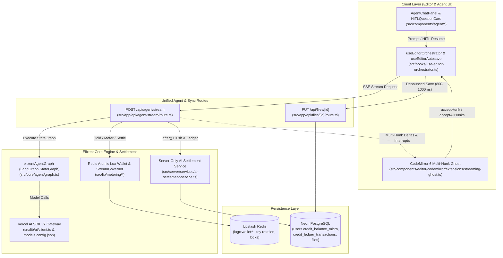

# Phase 12 Closure Dossier: Final Purge of Legacy 5-Operation Modules, Test Suite Migration & Living Documentation Sync

| Field | Value |
| :--- | :--- |
| **Phase** | Phase 12 (`ELIXENT-EXEC-PLAN-v3.3` — Track 4: UI, Multi-Hunk Ghost Editor, Stream Route & Legacy Cleanup) |
| **Version** | `v0.12.0` |
| **Status** | `CLOSED / VERIFIED` |
| **Closure Date** | 2026-11-04 |
| **Governing Plan** | [`docs/records/plans/elixent-agentic-architecture-execution-plan.md`](../../plans/elixent-agentic-architecture-execution-plan.md) |
| **SSOT Architecture Specs** | [`01_architecture_vision_and_adrs.md`](../../../architecture/01_architecture_vision_and_adrs.md) · [`02_agent_orchestration_and_decision_engine.md`](../../../architecture/02_agent_orchestration_and_decision_engine.md) · [`03_workspace_ast_editor_and_vault_integration.md`](../../../architecture/03_workspace_ast_editor_and_vault_integration.md) · [`04_credit_metering_and_settlement_architecture.md`](../../../architecture/04_credit_metering_and_settlement_architecture.md) · [`05_data_contracts_and_lugx_migration_plan.md`](../../../architecture/05_data_contracts_and_lugx_migration_plan.md) |

---

## 1. Executive Summary

Phase 12 completes the 12-phase transformation of the platform from the legacy 5-operation word-metered editor into the **Elixent** autonomous architectural agent, multi-hunk ghost editor, and micro-credit financial ledger platform:

1. **Permanent Deletion of Legacy 5-Operation Modules (Sub-Agent 12.A):** Permanently deleted all seven legacy 5-operation modules that became unreferenced after Phase 11:
   - `src/app/api/ai/stream/route.ts`
   - `src/lib/ai/pending-operation-store.ts`
   - `src/lib/ai/preview-buffer.ts`
   - `src/lib/ai/prompts.ts`
   - `src/lib/ai/quota-settlement-reducer.ts`
   - `src/server/actions/ai-commit.ts`
   - `src/server/actions/ai-ops.ts`
2. **Production Configuration, Gateway & Contract Cleanup (Sub-Agent 12.A):**
   - `src/config/models.config.json`: Purged legacy 5-operation keys (`correct`, `improve`, `summarize`, `translate`, `toPrompt`) and retained exclusively the Lean Dynamic Model Registry (`models` indexed by `modelId` with `executionMode`, `V`, `creditsPer1kInput`, `creditsPer1kCacheRead`, `creditsPer1kOutput`, and `calibrationPriors`).
   - `src/config/tiers.config.ts`: Removed temporary 5-operation word-quota fields (`correctImproveTranslate`, `summarize`, `toPrompt`, `isToPromptEnabled`) from `TierLimits` and `TIER_LIMITS`, retaining exclusively `creditAllocationMicro`, `creditsDisplay`, and `price`.
   - `src/lib/ai/client.ts`: Removed legacy 5-operation generation/streaming helpers and retained exclusively the Vercel AI SDK v7 gateway functions (`getGoogleModel`, `executeStructuredGeneration`, `executeToolAgentGeneration`, `executeStreamingGeneration`).
   - `src/server/services/ai-settlement-service.ts`: Consolidated server-only micro-credit quota reservation (`reserveAIQuota`, `reserveAndUpdateUsage`), settlement (`commitAIReservation`), refund (`refundAIReservation`), status inspection (`getAIReservationStatus`), stale expiration (`expireStaleReservations`), balance lookup (`getUserCreditBalance`), and Redis-to-PostgreSQL pending settlement flushing (`flushPendingSettlementsToPostgres`).
   - `src/types/ai-contracts.ts`: Updated reservation, settlement, refund, and request contracts (`AIRequestContract`, `AIReservationContract`, `AICommitReservationContract`, `AIRefundReservationContract`, `AIQuotaStatusContract`) to represent micro-credits and `/api/agent/stream` execution modes.
3. **Full Integration, Live & E2E Test Suite Migration (Sub-Agent 12.B):** Migrated 28 unit/integration/live test files across `src/test/**` and 5 Playwright E2E specs (`e2e/specs/06-ai-streaming-commit.spec.ts`, `07-ai-abort-reject.spec.ts`, `08-ai-failure-refund.spec.ts`, `09-ai-conflict-412.spec.ts`, `12-vault-ai-shield.spec.ts`) from the deleted 5-operation modules to `/api/agent/stream`, `ai-settlement-service.ts`, `MultiHunkGhostState`, and `elixentAgentGraph`.
4. **Living Documentation & SSOT Metrics Synchronization (Sub-Agent 12.B):** Updated `docs/METRICS.json`, `README.md`, `docs/README.md`, `docs/guides/ai/ai-models-config.md`, `docs/guides/billing/stripe-setup.md`, `docs/reference/ui-streaming-readiness.md`, `docs/reference/sync-api.md`, `docs/architecture/security/security-and-rate-limiting.md`, `docs/architecture/sync/editor-sync-orchestration.md`, `docs/architecture/ai/*`, and `docs/Plans/ELIXENT_EXECUTION_PLAN.md`.

---

## 2. Final Elixent Architecture & Settlement Topology

### Architectural Notes
- **Zero Legacy 5-Operation Surface:** The `/api/ai/stream` endpoint, `ai-ops.ts`, `ai-commit.ts`, `prompts.ts`, `preview-buffer.ts`, `pending-operation-store.ts`, and `quota-settlement-reducer.ts` are completely removed from the repository.
- **Unified Agent Endpoint:** All AI interactions (fast-path edits, deep-planned multi-section syntheses, conversational Q&A, and HITL clarification resumptions) route exclusively through `POST /api/agent/stream`.
- **Decoupled Incremental Persistence:** Document mutations resulting from accepted ghost hunks persist locally to IndexedDB (`localRevision += 1`) and coalesce into debounced `PUT /api/files/[id]` requests via `useEditorAutosave`, eliminating race-induced `412 Precondition Failed` errors.

---

## 3. Permanently Deleted Legacy Files & Modified Modules Inventory

### 3.1 Permanently Deleted Legacy Files (7 Files)

| Deleted Path | Former Role | Active Elixent Replacement |
| :--- | :--- | :--- |
| `src/app/api/ai/stream/route.ts` | Legacy 5-operation NDJSON streaming endpoint | `src/app/api/agent/stream/route.ts` |
| `src/lib/ai/pending-operation-store.ts` | Client `sessionStorage` pending operation tracker | `src/server/services/ai-settlement-service.ts` (`getAIReservationStatus`, `expireStaleReservations`) |
| `src/lib/ai/preview-buffer.ts` | Single-range `EphemeralPreviewBuffer` | `src/components/editor/codemirror/extensions/streaming-ghost.ts` (`MultiHunkGhostState`) |
| `src/lib/ai/prompts.ts` | Hardcoded 5-operation prompt templates | `src/core/agent/nodes/*` & `src/lib/agent/graph-nodes.ts` |
| `src/lib/ai/quota-settlement-reducer.ts` | Word-unit quota conservation reducer | `src/lib/metering/cost-estimator.ts` & `src/lib/metering/redis-wallet.ts` |
| `src/server/actions/ai-commit.ts` | Legacy `commitAIFileOperation` server action | `src/hooks/editor/use-editor-autosave.ts` (`PUT /api/files/[id]`) |
| `src/server/actions/ai-ops.ts` | Legacy word-quota server actions | `src/server/services/ai-settlement-service.ts` (`server-only`) |

### 3.2 Modified Production & Configuration Files

| File Path | Action | Summary of Changes |
| :--- | :---: | :--- |
| `package.json` | Modified | Version bumped from `0.11.0` to `0.12.0`. |
| `src/config/models.config.json` | Modified | Removed legacy 5-operation keys; retained exclusively the Lean Dynamic Model Registry (`models` indexed by `modelId`). |
| `src/config/tiers.config.ts` | Modified | Purged `correctImproveTranslate`, `summarize`, `toPrompt`, and `isToPromptEnabled` from `TierLimits` and `TIER_LIMITS`. |
| `src/lib/ai/client.ts` | Modified | Purged legacy 5-operation helpers; retained Vercel AI SDK v7 gateway functions (`getGoogleModel`, `executeStructuredGeneration`, `executeToolAgentGeneration`, `executeStreamingGeneration`). |
| `src/server/services/ai-settlement-service.ts` | Modified | Consolidated micro-credit reservation, commit, refund, status inspection, stale sweeper, and Redis-to-Postgres settlement flush. |
| `src/types/ai-contracts.ts` | Modified | Updated Zod schemas and TypeScript contracts for micro-credits (`reservedCreditsMicro`, `committedCreditsMicro`, `refundedCreditsMicro`, `remainingBalanceMicro`) and `AIExecutionMode`. |

### 3.3 Migrated Test Suites (`src/test/**` & `e2e/specs/**`)

- **Unit & Integration Suites (28 files):**
  - `src/test/ai/ai-atomic-commit.integration.test.ts`
  - `src/test/ai/ai-authoritative-stream-settlement.test.ts`
  - `src/test/ai/ai-client-authority-revocation.test.ts`
  - `src/test/ai/ai-client.test.ts`
  - `src/test/ai/ai-key-rotation-400.test.ts`
  - `src/test/ai/ai-ops.integrity.test.ts`
  - `src/test/ai/ai-ops.refund.test.ts`
  - `src/test/ai/ai-quota-idempotency.test.ts`
  - `src/test/ai/ai-quota-settlement-reducer.test.ts`
  - `src/test/ai/ai-server-atomic-commit.test.ts`
  - `src/test/ai/ai-stream-abort-latency.test.ts`
  - `src/test/ai/ai-stream-fileid-governance.test.ts`
  - `src/test/ai/ai-stream-parser.test.ts`
  - `src/test/ai/ai-stream-replay-prevention.test.ts`
  - `src/test/ai/ai-stream-session.test.ts`
  - `src/test/ai/ai-transaction.test.ts`
  - `src/test/config/tiers.config.test.ts`
  - `src/test/contracts/state-machines-contracts.test.ts`
  - `src/test/editor/editor-atomic-commit.test.ts`
  - `src/test/editor/editor-orchestration.integration.test.ts`
  - `src/test/editor/editor-recovery-reload.test.ts`
  - `src/test/infrastructure/multi-system-lifecycle.live.test.ts`
  - `src/test/metering/ai-settlement-service.unit.test.ts`
  - `src/test/server/cross-user-ownership.test.ts`
  - `src/test/sync/encrypted-conflict-decryption.integration.test.ts`
  - `src/test/types/contracts.test.ts`
  - `src/test/vault/vault-cross-module.integration.test.ts`
  - `src/test/vault/vault-sync-ai-gate.test.ts`
- **Playwright E2E Suites (5 specs):**
  - `e2e/specs/06-ai-streaming-commit.spec.ts`
  - `e2e/specs/07-ai-abort-reject.spec.ts`
  - `e2e/specs/08-ai-failure-refund.spec.ts`
  - `e2e/specs/09-ai-conflict-412.spec.ts`
  - `e2e/specs/12-vault-ai-shield.spec.ts`

---

## 4. Verification & Test Gate Evidence

- **Vitest Unit & Contract Suite (`npm run test`):** `112 passed (112)` test files, `1892 passed (1892)` tests (`Exit Code 0`).
- **Live Integration Baseline (`docs/METRICS.json`):** `21` live suites, `108` passing tests (`100%`).
- **Playwright E2E Baseline (`docs/METRICS.json`):** `14` E2E specs, `15` passing browser journeys (`100%`).
- **Documentation Metrics Synchronization (`node scripts/sync-doc-metrics.mjs --check`):** `100% synchronized` across all monitored files.
- **Markdown Link Integrity (`node scripts/check-markdown-links.mjs`):** `0 broken links` across all Markdown documentation files.
