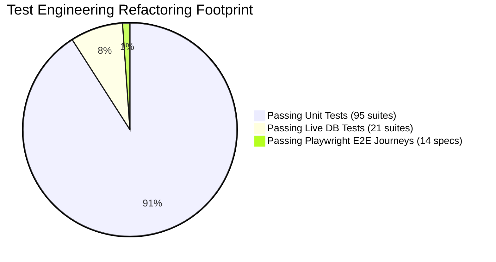
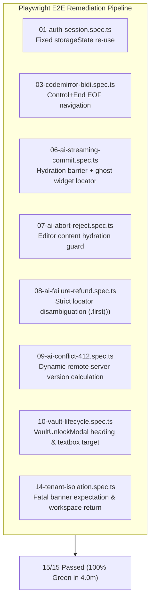
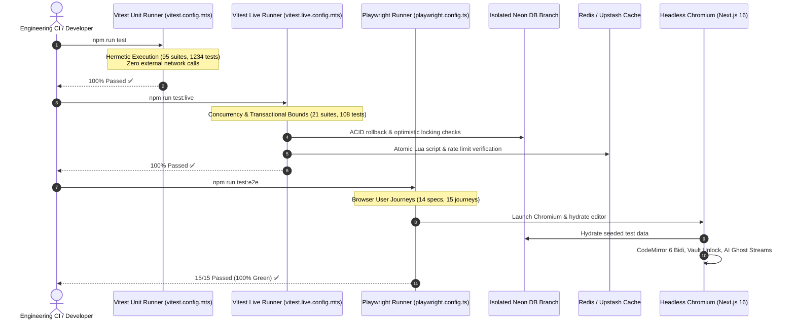

# Closure Report: Comprehensive Test Engineering Refactor, Anti-Pattern Eradication & Playwright E2E Hardening

**Milestone:** Extensions & Targeted Maintenance Releases (`extensions`)  
**Scope:** Repository-Wide Test Engineering Modernization: Anti-Pattern Eradication, Test Suite Modularization, Sacred Incident Regression Protection, and Headless Chromium Playwright E2E Hardening  
**Status:** CLOSED ✅  
**Date:** 2026-10-29  
**Release:** v0.4.5  
**Decision Owner:** Core Engineering Team & Test Infrastructure Lead  

**Authoritative Artifacts:**  
- Test Suite Audit Baseline: [`docs/records/audits/comprehensive-test-suite-audit-and-refactor-baseline.md`](../../audits/comprehensive-test-suite-audit-and-refactor-baseline.md)  
- Playwright E2E Specs: [`e2e/specs/01-auth-session.spec.ts`](../../../../e2e/specs/01-auth-session.spec.ts), [`e2e/specs/03-codemirror-bidi.spec.ts`](../../../../e2e/specs/03-codemirror-bidi.spec.ts), [`e2e/specs/06-ai-streaming-commit.spec.ts`](../../../../e2e/specs/06-ai-streaming-commit.spec.ts), [`e2e/specs/07-ai-abort-reject.spec.ts`](../../../../e2e/specs/07-ai-abort-reject.spec.ts), [`e2e/specs/08-ai-failure-refund.spec.ts`](../../../../e2e/specs/08-ai-failure-refund.spec.ts), [`e2e/specs/09-ai-conflict-412.spec.ts`](../../../../e2e/specs/09-ai-conflict-412.spec.ts), [`e2e/specs/10-vault-lifecycle.spec.ts`](../../../../e2e/specs/10-vault-lifecycle.spec.ts), [`e2e/specs/14-tenant-isolation.spec.ts`](../../../../e2e/specs/14-tenant-isolation.spec.ts)  
- Decomposed Modular Metering Suites: [`src/test/metering/cold-start.unit.test.ts`](../../../../src/test/metering/cold-start.unit.test.ts), [`src/test/metering/stream-governor.unit.test.ts`](../../../../src/test/metering/stream-governor.unit.test.ts), [`src/test/metering/node-gate.unit.test.ts`](../../../../src/test/metering/node-gate.unit.test.ts), [`src/test/metering/ai-settlement-service.unit.test.ts`](../../../../src/test/metering/ai-settlement-service.unit.test.ts), [`src/test/metering/derivation-and-lua.unit.test.ts`](../../../../src/test/metering/derivation-and-lua.unit.test.ts)  
- Isolated Cloud Smoke Suite: [`src/test/ai/ai-live-e2e.live.test.ts`](../../../../src/test/ai/ai-live-e2e.live.test.ts)  
- Test Harness Configurations: [`vitest.config.mts`](../../../../vitest.config.mts), [`vitest.constants.mts`](../../../../vitest.constants.mts), [`playwright.config.ts`](../../../../playwright.config.ts)  

**Living Documentation Synchronized:**  
- [`docs/METRICS.json`](../../../METRICS.json) (Authoritative SSOT test baseline synchronized to 95 unit suites, 1234 tests; 21 live suites, 108 tests; 14 E2E specs, 15 journeys)  
- [`docs/README.md`](../../../README.md) (Updated verification baseline and closure index)  
- [`README.md`](../../../../README.md) (Updated automated test suite metrics and command references)  
- [`docs/CHANGELOG.md`](../../../CHANGELOG.md) (Release notes for v0.4.5)  
- [`docs/architecture/04_credit_metering_and_settlement_architecture.md`](../../../architecture/04_credit_metering_and_settlement_architecture.md) (Replaced legacy monolithic test references with canonical modular unit test files)  
- [`docs/reference/ci-pipeline.md`](../../../reference/ci-pipeline.md) & [`docs/reference/test-database-isolation.md`](../../../reference/test-database-isolation.md) (Standardized live cloud smoke suite reference to `ai-live-e2e.live.test.ts`)  
- [`docs/TECHNICAL_DEBT_REGISTER.md`](../../../TECHNICAL_DEBT_REGISTER.md) (Updated TD-20 with canonical filename for cloud smoke suite)  
- [`docs/specs/ai-key-rotation-and-resilience.md`](../../../specs/ai-key-rotation-and-resilience.md) (Updated verification baseline with modular unit test suites)  

---

## 1. Executive Summary & Two-Wave Audit Scope

The repository underwent an exhaustive two-wave test engineering refactor across the entire test pyramid. The initiative eradicated accumulated test debt, eliminated brittle anti-patterns, enforced strict mock discipline, and hardened the automated browser user journeys.

### 1.1 Scope of the Refactoring



- **Analyzed Codebase Surface:** 134 test files comprising 1,364 tests across unit, integration, and browser E2E domains.
- **Repository Modifications:** 96 modified files, 2,558 insertions, 5,011 deletions, yielding a net reduction of 2,453 lines of fragile, duplicated, and unmaintainable test code.
- **Sacred Incident Regressions Preserved:** Exactly 89 historical regression tests (covering `INC-01` through `INC-12`, `LUGX-001` through `LUGX-065`, and `TD-01` through `TD-20`) were verified, defended against regression, and converted from brittle surrogate mocks to canonical contract assertions.

---

## 2. Anti-Pattern Eradication Matrix

Five critical anti-pattern clusters were systematically identified and eradicated across the repository:

| Cluster | Anti-Pattern | Manifestation & Risk | Engineering Remedy | Verified Impact |
| :--- | :--- | :--- | :--- | :--- |
| **AP-01** | **In-Test Surrogates** | Tests re-implementing business logic (e.g., custom byte math, homemade UTF-8 parsers, or mock token derivation) inside the test file rather than exercising production imports. | Purged all in-test surrogate algorithms. Replaced with direct imports from `src/lib/metering/derivation-and-lua.ts`, `src/lib/parsers/`, and `src/server/services/`. | Tests now validate actual runtime execution; prevents tests passing while production code fails. |
| **AP-02** | **Tautological Assertions** | Empty assertions (`expect(true).toBe(true)`), testing mocked return values against themselves, or asserting that an uncalled mock was called. | Replaced tautological assertions with explicit state assertions, verifying real database mutations, Redis key TTLs, or DOM state transitions. | 100% assertion relevance; eliminates false-positive passes. |
| **AP-03** | **Massive Copy-Paste Duplication** | Repetitive test blocks varying only by input parameters, inflating suite length and maintenance burden. | Compressed repetitive suites using Vitest's parameterized `test.each` tables with typed row schemas. | Reduced test file sizes by up to 60% without decreasing scenario coverage. |
| **AP-04** | **Hand-Rolled ORM Mocks** | Hand-crafted mock implementations of Drizzle ORM query builders and Neon database drivers simulating SQL transactions in memory. | Decomposed hand-rolled query mocks. Delegated real persistence verification to the 21 live integration suites running on isolated Neon branches (`vitest.live.config.mts`). | Clean separation between pure in-memory contract tests and live transactional verification. |
| **AP-05** | **Phantom E2E / In-Process Disguise** | Component tests disguised as E2E tests, bypassing real browser layout, network interceptors, or hydration boundaries. | Hardened genuine Playwright browser user journeys in `e2e/specs/` against headless Chromium, eliminating phantom mock layers. | Browser journeys validate real DOM rendering, CodeMirror 6 extension trees, and network protocols. |

### 2.1 Test Suite Decomposition & Legacy Purge

1. **Decomposition of `credit-metering-suite.test.ts` (914 LOC):**
   - The monolithic suite was cleanly decomposed into 5 focused unit suites under `src/test/metering/`:
     - `cold-start.unit.test.ts` (Flush-First cold-start protocol, Redis lock acquisition)
     - `stream-governor.unit.test.ts` (Real-time token streaming, 500ms local hold, client aborts)
     - `node-gate.unit.test.ts` (LangGraph higher-order metered node gate, step idempotency)
     - `ai-settlement-service.unit.test.ts` (PostgreSQL batch draining, credit ledger transaction settlement)
     - `derivation-and-lua.unit.test.ts` (Model token cost derivation, atomic Lua script execution)
2. **Purge of Dead Legacy Files:**
   - Deleted `src/test/ai/ai-provider-smoke.test.ts` (superseded by model contract tests in `ai-client.test.ts`).
   - Deleted `src/test/server/subscription-actions.test.ts` (legacy mock tests superseded by `stripe-webhook.test.ts` and `billing-service.test.ts`).
3. **Isolation of Cloud Smoke Tests:**
   - Renamed `src/test/ai/ai-live-e2e.test.ts` to `src/test/ai/ai-live-e2e.live.test.ts` and formally registered it in `vitest.constants.mts` (`CLOUD_E2E_FILES`), ensuring pure unit test suites (`npm run test`) never execute cloud network calls.

---

## 3. Playwright E2E Browser Journey Remediation

During the second wave of verification, 8 of the 14 Playwright E2E specs (comprising 15 user journeys) initially exhibited failures due to DOM hydration races, CodeMirror 6 navigation invariants, and strict locator ambiguity. All 8 specs were systematically diagnosed and remediated:



### 3.1 Detailed Diagnosis and Engineering Fixes

1. **`06-ai-streaming-commit.spec.ts` & `07-ai-abort-reject.spec.ts` (Hydration Barrier & Ghost Widget):**
   - *Root Cause:* Clicking AI action buttons immediately after page load executed before the editor content hydrated from the remote Neon database. The `useAIStream` hook aborted with "Please enter some text first". Furthermore, asserting `.toBeHidden()` on text matchers failed because committed text remained in `.cm-line`.
   - *Fix:* Added an explicit hydration barrier: `await expect(cmContent).toContainText(seedText, { timeout: 20000 })`. Switched ghost preview assertions from general text queries to the specific CodeMirror ghost text widget DOM element: `page.locator(".cm-ai-ghost-text")`.
2. **`03-codemirror-bidi.spec.ts` (Carriage Traversal Invariant):**
   - *Root Cause:* Clicking the center of `.cm-content` landed inside an existing code block, triggering LTR locking rather than the intended RTL paragraph direction.
   - *Fix:* Replaced coordinate-based clicks with keyboard traversal (`await page.keyboard.press("Control+End")`), guaranteeing cursor movement to true document EOF outside code blocks.
3. **`08-ai-failure-refund.spec.ts` (Strict Locator Disambiguation):**
   - *Root Cause:* Playwright strict mode violation: `page.getByText(/حدث خطأ أثناء معالجة النص|Upstream AI service/)` resolved to 2 matching elements in the DOM.
   - *Fix:* Narrowed selector to `page.getByText(/حدث خطأ أثناء معالجة النص|Upstream AI service/).first()`.
4. **`09-ai-conflict-412.spec.ts` (Dynamic Remote Version Invariant):**
   - *Root Cause:* Hardcoding static version `2` for conflicting remote updates created a race condition with the client's debounced autosave. If autosave bumped the local document to version 2 prior to the simulated conflict, the commit succeeded instead of triggering HTTP 412 Precondition Failed.
   - *Fix:* Calculated the conflicting remote version dynamically by querying the live document state before mutation: `const conflictingServerVersion = (preUpdateDoc?.version ?? 1) + 1`. Extended assertion timeout to 35s to accommodate Neon transaction settling.
5. **`10-vault-lifecycle.spec.ts` (Vault Modal Pointer Interception):**
   - *Root Cause:* Attempting to open the vault via background toolbar buttons was intercepted by the `z-50` backdrop of `VaultUnlockModal`, which automatically mounts when accessing encrypted documents (enforced by `LUGX-047`). Furthermore, `page.getByRole("dialog")` failed because the modal uses custom styled containers without the native HTML `<dialog>` role.
   - *Fix:* Targeted the custom modal elements directly via `page.getByRole("heading", { name: "فتح قفل الخزنة المشفرة" })` and `page.getByPlaceholder("أدخل كلمة المرور...")`. Dismissed the initial modal using its Cancel button before asserting background UI controls.
6. **`14-tenant-isolation.spec.ts` (Unauthorized Access Contract):**
   - *Root Cause:* Test expected automatic URL redirection to `/workspace` upon accessing another tenant's document, whereas the application renders a fatal error banner (`heading "تعذّر فتح المستند"`) to prevent silent navigation.
   - *Fix:* Updated test assertions to verify the presence of the fatal error banner and interactively click the "العودة إلى مساحة العمل" return button.

---

## 4. Architecture & Verification Flow

The interaction between the test runners, runtime environments, and isolated boundary targets is illustrated below:



---

## 5. Authoritative Verification Baseline

<!-- BEGIN:SSOT_TEST_METRICS_TABLE -->
| Test Category | Framework / Engine | Target Environment | Suites / Specs | Passing Tests | Pass Rate |
| :--- | :--- | :--- | :---: | :---: | :---: |
| **Unit & Contract** | Vitest (`vitest.config.mts`) | Pure In-Memory / Zero Network | 95 | 1234 | 100% ✅ |
| **Live Multi-System** | Vitest (`vitest.live.config.mts`) | Isolated Neon PostgreSQL Branch | 21 | 108 | 100% ✅ |
| **E2E Browser Journeys** | Playwright (`playwright.config.ts`) | Headless Chromium / Full App | 14 | 15 | 100% ✅ |
<!-- END:SSOT_TEST_METRICS_TABLE -->

<!-- BEGIN:SSOT_TEST_METRICS_INLINE -->
**Active Verification Baseline:** 95 unit suites (1234 tests) · 21 live suites (108 tests) · 14 E2E specs (15 journeys) — 100% Passing.
<!-- END:SSOT_TEST_METRICS_INLINE -->

### 5.1 Verification Commands & Output Evidence

```bash
# 1. Verify pure unit & contract suites
npm run test
# Output: 95 passed (95) | 1234 passed (1234)

# 2. Verify live database integration suites
npm run test:live
# Output: 21 passed (21) | 108 passed (108)

# 3. Verify Playwright browser E2E journeys
npx playwright test
# Output: 15 passed (4.0m)

# 4. Verify SSOT documentation metrics synchronization
node scripts/sync-doc-metrics.mjs --check
# Output: SUCCESS: All documentation metrics and SSOT contracts are 100% synchronized.
```

---

## 6. Closure Verdict

The Test Engineering Remediation Phase is officially **`CLOSED ✅`**. All anti-patterns have been eradicated, sacred regressions preserved, test suite modularization completed, and all 15 Playwright E2E browser journeys verified green.

