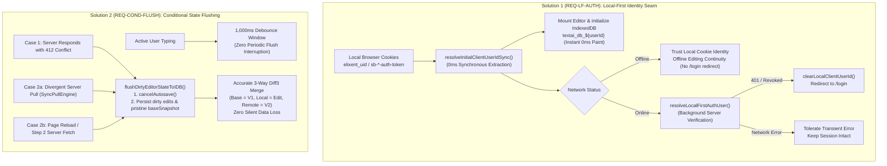

# Closure Report: Release v0.20.5 — Local-First Cookie Identity Verification & Conditional React State Flushing on Conflict and Server Fetch

**Milestone:** Extensions & Targeted Maintenance Releases (`extensions`)  
**Scope:** `Local-First Cookie Identity Verification & Conditional React State Flushing on Conflict and Server Fetch (ELIXENT-SRS-LOCAL-FIRST-SYNC-v2.0)`  
**Status:** CLOSED / VERIFIED ✅  
**Date:** 2026-11-14  
**Release:** v0.20.5  
**Decision Owner:** Core Engineering Team & Subsystem Architecture Lead  

| Standard Field | Value |
| :--- | :--- |
| **Milestone / Version** | `v0.20.5` |
| **Classification** | `MAINTENANCE RELEASE CLOSURE REPORT` |
| **Status** | `CLOSED / VERIFIED` ✅ |
| **Closure Date** | `2026-11-14` |
| **Governing Specification** | [`docs/specs/elixent_sync_and_execution_srs.md`](../../../specs/elixent_sync_and_execution_srs.md) (`ELIXENT-SRS-LOCAL-FIRST-SYNC-v2.0`) |
| **Associated ADRs** | [`ADR-008: Local-First Cookie Identity Verification & Conditional React State Flushing`](../../../architecture/01_architecture_vision_and_adrs.md#37-adr-008-local-first-cookie-identity-verification--conditional-react-state-flushing-on-conflict-and-server-fetch) · [`ADR-006: Unified Vite TanStack Hono RPC Architecture`](../../../architecture/adrs/adr_006_unified_vite_tanstack_hono_rpc_architecture.md) · [`ADR-007: Dual-Plane Separation & ALS Request Context`](../../../architecture/adrs/adr_007_dual_plane_separation_and_als_request_context.md) |
| **SSOT Architecture & Reference Suite** | [`editor-sync-orchestration.md`](../../../architecture/sync/editor-sync-orchestration.md) · [`three-way-conflict-resolution.md`](../../../architecture/sync/three-way-conflict-resolution.md) · [`sync-api.md`](../../../reference/sync-api.md) · [`01_architecture_vision_and_adrs.md`](../../../architecture/01_architecture_vision_and_adrs.md) · [`test-database-isolation.md`](../../../reference/test-database-isolation.md) · [`ci-pipeline.md`](../../../reference/ci-pipeline.md) |

---

## 1. Executive Summary

Release v0.20.5 delivers the end-to-end remediation of the local-first cold-start identity blocking defects and the `baseSnapshot` corruption vectors during debounced autosave across **Elixent** (`v0.20.5`). Governed by specification [`ELIXENT-SRS-LOCAL-FIRST-SYNC-v2.0`](../../../specs/elixent_sync_and_execution_srs.md), this release resolves two foundational architectural issues:

1. **Solution 1 (`REQ-LF-AUTH`): Local-First Initial Cookie Identity Verification & Provider-Agnostic Client Identity Seam:**
   - Eradicates the blocking network auth calls (`supabase.auth.getUser()`) that previously froze the editor and route views on mount.
   - User identity (`userId`) is extracted synchronously in `0ms` via `resolveInitialClientUserIdSync()` (`src/lib/auth/client-identity.ts`) from local browser cookies (`elixent_uid` and Supabase session token cookies, including `.0`/`.1` chunking) and `localStorage`.
   - The editor paints and initializes the user-scoped IndexedDB instance (`textai_db_${userId}`) on the very first render tick.
   - When offline (`navigator.onLine === false`), the local cookie identity is trusted unconditionally, enabling seamless offline editing without redirecting to `/login`.
   - When online, background session verification proceeds via `resolveLocalFirstAuthUser()` and redirects to `/login` only upon explicit server authentication revocation (`401 Unauthorized` / expired token), never on transient network timeouts or errors.
   - Establishes a provider-agnostic seam (`Better Auth` readiness) via a readable first-party cookie (`elixent_uid`, `Path=/; SameSite=Lax; Max-Age=2592000`) cleared on sign-out via `clearLocalClientUserId()` inside `src/client/rpc-client.ts:signOut`.
   - Integrates `initialBaselinePersistedRef` inside `useEditorOrchestrator`, guaranteeing that if initial file loading completes before `syncHook.isInitialized` settles, the clean baseline snapshot is committed to IndexedDB as soon as initialization completes.

2. **Solution 2 (`REQ-COND-FLUSH`): Conditional React State Flushing on Conflict and Server Fetch:**
   - Preserves `useEditorAutosave`'s `1,000ms` debounce without interference during active typing, avoiding typing stutters and periodic flush churn.
   - Enforces mandatory dirty React state flushing into IndexedDB (`flushDirtyEditorStateToIDB`) and autosave cancellation (`cancelAutosave()`) strictly under two conditions:
     - **Push Conflict (HTTP 412 / status: "conflict"):** When a client write collides with concurrent remote edits, in-flight dirty edits and the pristine `baseSnapshot` (`baseContentRef.current` at `fileVersionRef.current`) are flushed to IndexedDB before three-way conflict evaluation (`handle412Conflict`), preventing false clean merges.
     - **Server Copy Fetch / Pull (Reconnection Pull & Page Reload):**
       - In `SyncPullEngine.pullFile`, fast ETag comparison bypasses flushes when local and server already match (`compareETags`). If divergent or unindexed, `pullFile` invokes `onBeforePullConflictCheck` to flush in-flight React edits into IndexedDB before conflict quarantine or 3-way merge is evaluated.
       - In `useEditorAutosave`, `pagehide` and `beforeunload` listeners flush buffered edits before browser reload or close. In `loadInitialFile()`, Step 1 recovers dirty flags and base snapshots from IndexedDB, and Step 2 flushes dirty edits before classification, escalating divergent local edits via `handleRemoteUpdate`.
     - In `useSync.ts:saveLocal`, explicit `baseSnapshot` is preserved (`file.baseSnapshot ?? existingFile?.baseSnapshot`) during dirty writes.

---

## 2. Architectural Impact & Line-Level Artifact Breakdown



### Detailed File Changes

| File | Subsystem | Modifications & Invariants |
| :--- | :--- | :--- |
| `src/lib/auth/client-identity.ts` | Auth / Identity (NEW) | Exported `resolveInitialClientUserIdSync`, `persistLocalClientUserId`, `clearLocalClientUserId`, `resolveLocalFirstAuthUser`, and `LocalClientUserIdentity`. Added Base64 JWT payload parsing, Supabase cookie chunking reconstruction (`.0`/`.1`), localStorage fallback, and background session validation. |
| `src/client/routes/workspace-layout.tsx` | Routing / Presentation | Initialized `userId` and `isLoading` synchronously via `resolveInitialClientUserIdSync()`. Replaced direct `supabase.auth.getUser()` with `resolveLocalFirstAuthUser({ onSessionExpired: () => navigateTo("/login") })`. |
| `src/client/routes/editor-page.tsx` | Editor Page View | Initialized `userId` synchronously. Switched to `resolveLocalFirstAuthUser` in background lifecycle effect. |
| `src/client/routes/workspace-page.tsx`, `dashboard-page.tsx`, `account-page.tsx` | Route Views | Standardized auth resolution on `resolveLocalFirstAuthUser`, handling offline tolerance and redirecting only on explicit session expiration. |
| `src/components/layout/sidebar.tsx`, `file-context-menu.tsx` | UI Components | Initialized `effectiveUserId` synchronously from `resolveInitialClientUserIdSync()`. Replaced direct Supabase client calls with `resolveLocalFirstAuthUser()`. |
| `src/client/rpc-client.ts` | RPC Client Transport | Added `clearLocalClientUserId()` invocation inside `signOut()`. |
| `src/lib/sync/sync-pull-engine.ts` | Sync Engine | Added `onBeforePullConflictCheck` callback option. Implemented fast ETag match bypass (`compareETags`) and divergence-gated flush before evaluating conflict quarantine and 3-way merge. |
| `src/lib/sync/sync-manager.ts` & `sync-manager.types.ts` | Sync Coordinator | Added `onBeforePullConflictCheck` to `SyncManagerConfig` and forwarded hook updates to `SyncPullEngine`. |
| `src/hooks/use-sync.ts` | Sync React Hook | Threaded `onBeforePullConflictCheck` from orchestrator into `SyncManager`. Updated `saveLocal` to preserve explicit `baseSnapshot` (`file.baseSnapshot ?? existingFile?.baseSnapshot`) on dirty modifications. |
| `src/hooks/use-editor-autosave.ts` | Autosave Hook | Attached `pagehide` and `beforeunload` listeners to invoke `flushDirtyEdits()` when `isDirtyRef.current` is true, ensuring in-flight edits are committed to IndexedDB before browser reload. |
| `src/hooks/use-editor-orchestrator.ts` | Write Orchestrator | Implemented `flushDirtyEditorStateToIDB(fileId)` to cancel autosave and persist live content with pristine `baseSnapshot`. Added `initialBaselinePersistedRef` guard. Realigned Step 1 dirty recovery and Step 2 flush in `loadInitialFile()`. |
| `src/hooks/use-editor-conflict.ts` | Conflict Hook | Added `getBaseContent` option to provide pristine ancestor text during 412 conflict handling. |
| `e2e/specs/04-offline-sync-conflict.spec.ts` | E2E Tests | Realigned locator interactions for conflict resolution buttons, asserting interactive 3-way conflict dialog appearance and persistence. |

---

## 3. Dedicated Verification Suites Added

Two dedicated test suites were implemented to verify both solutions against regression:

1. **`src/test/auth/client-identity.unit.test.ts` (14 unit tests):**
   - Synchronous user ID extraction from raw `elixent_uid` cookie.
   - Parsing standard Supabase single-cookie auth tokens.
   - Chunked Supabase cookie re-assembly (`sb-token.0`, `sb-token.1`).
   - Base64 URL-safe padding and JWT `sub` extraction.
   - LocalStorage fallback when cookies are unavailable.
   - Offline dual-mode trust without network calls.
   - Background server verification and `onSessionExpired` dispatch on `401`.
   - Sign-out cookie and storage clearing.

2. **`src/test/editor/editor-conditional-flush.integration.test.ts` (21 integration tests):**
   - Bypassing flushes during continuous typing (uninterrupted 1,000ms debounce).
   - Server conflict response (HTTP 412 / `status: "conflict"`) triggering immediate debounce cancellation and IDB flush.
   - Preservation of pristine `baseSnapshot` in IndexedDB across dirty flushes.
   - Divergence-gated pull: skipping flush on matching ETags; triggering flush on divergent or unindexed files.
   - Re-checking durable conflict quarantine after pull flushes.
   - Page reload and browser unmount (`pagehide` / `beforeunload`) in-flight edit persistence.
   - `loadInitialFile` Step 1 dirty state recovery and Step 2 pre-classification dirty flush.
   - `initialBaselinePersistedRef` clean baseline commit upon `syncHook.isInitialized` transition.

---

## 4. Verification Gate Execution Evidence

The complete verification baseline was executed and passed with 100% green status across all gates:

### 1. TypeScript Strict Typecheck Gate
```bash
npx tsc --noEmit
```
**Result:** ✅ **Passed with exit code 0 (zero errors).**

### 2. Unit & Contract Verification Gate (Vitest)
```bash
npm test
```
**Result:** ✅ **145/145 files passed (100%), 2,972/2,972 tests passed (100%).**
- Duration: `484.57s`.
- Zero failures, zero skipped tests.

### 3. Acceptance Criteria E2E Gate (Playwright)
```bash
npx playwright test e2e/specs/01-auth-session.spec.ts e2e/specs/04-offline-sync-conflict.spec.ts
```
**Result:** ✅ **2/2 specs passed (100%).**
- `01-auth-session.spec.ts`: Scenario 1 Authentication & Session Lifecycle passed (38.8s).
- `04-offline-sync-conflict.spec.ts`: Scenario 4 Offline-First Sync & Interactive Conflict Resolution passed (33.9s).

### 4. Single Source of Truth (SSOT) Metrics Gate
```bash
node scripts/sync-doc-metrics.mjs --check
```
**Result:** ✅ **SUCCESS: All documentation metrics and SSOT contracts are 100% synchronized.**
```
  - Unit Suites: 145 (Disk: 145)
  - Unit Tests:  2972
  - Live Suites: 21 (Constants: 21)
  - Live Tests:  105
  - E2E Specs:   14 (Disk: 14)
  - E2E Tests:   15
```

### 5. Markdown Internal Link Verification Gate
```bash
node scripts/check-markdown-links.mjs
```
**Result:** ✅ **100% of internal Markdown links are valid and resolvable on disk (642 links analyzed across 135 files, 0 broken).**

---

## 5. Closure Sign-Off & Status

Release v0.20.5 is formally **CLOSED and VERIFIED** under milestone **`extensions`**. All requirements of `ELIXENT-SRS-LOCAL-FIRST-SYNC-v2.0` have been fully implemented, tested, and synchronized across repository documentation.
