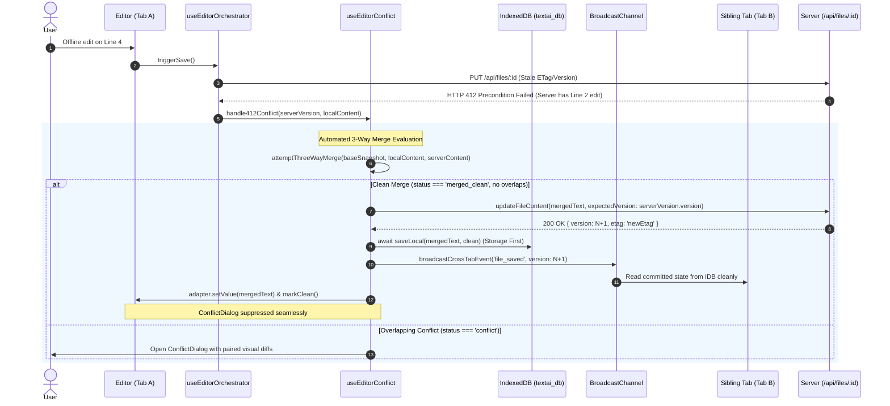
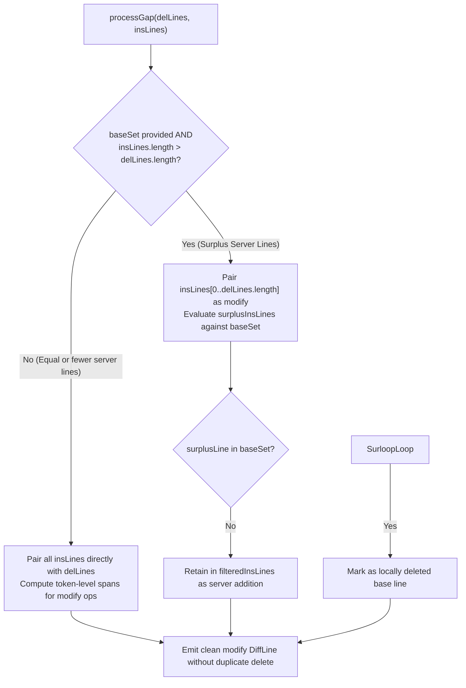

# Closure Report: Release v1.46.1 — Offline 3-Way Auto-Merge, Storage-First Cross-Tab Broadcast & Diff3 Deletion Guard Hardening

**Milestone:** Extensions & Targeted Maintenance Releases (`extensions`)  
**Scope:** Lateral Remediation: Multi-Tab Synchronization & Offline Diff3 Merge Hardening  
**Status:** CLOSED ✅  
**Date:** 2026-10-13  
**Release:** v1.46.1  
**Decision Owner:** Core Engineering Team & Subsystem Architecture Lead  

**Authoritative Artifacts:**  
- Cross-Tab Persistence Sequencer: `src/hooks/use-editor-orchestrator.ts` (enforces strict storage-first ordering: `await syncHook.saveLocal()` settles in IndexedDB before emitting `broadcastCrossTabEvent('file_saved')`)  
- Silent 3-Way Merge Controller: `src/hooks/use-editor-conflict.ts` (integrates `attemptThreeWayMerge` into HTTP 412 handling; cleanly auto-merges, re-encrypts, pushes with CAS version anchors, and commits non-overlapping mutations without opening `ConflictDialog`)  
- Visual Diff LCS Gap Matcher & Deletion Guard: `src/lib/sync/conflict-resolver.ts` (restricts `baseSet.has(line)` deletion guard to surplus remote insertions; pairs in-place line mutations cleanly as `modify` operations with token spans)  
- Diff3 Line Pruning Guard: `src/lib/sync/diff3.ts` (guards Deletion Guard trimming to run strictly when local line count is strictly smaller than base: `aContent.length < oContent.length`)  
- Dedicated Regression Test Suites: `src/test/editor/use-editor-conflict.test.ts` (12 tests) & `src/test/sync/sync-conflict-resolver.test.ts` (61 tests)  

**Living Documentation Synchronized:**  
- `docs/architecture/sync/three-way-conflict-resolution.md` (Updated Section 2.6 with automated 3-way merge sequence flow, visual diff pairing, and storage-first broadcast invariants)  
- `docs/architecture/sync/editor-sync-orchestration.md` (Updated Section 4.2 flowchart with 412 silent auto-merge branch and storage-first sequence)  
- `docs/reference/sync-api.md` (Updated Section 2 Resolution Lifecycle & Invariants)  
- `docs/foundation/DESIGN_VS_REALITY.md` (Documented Release v1.46.1 architectural evolution)  
- `docs/TECHNICAL_DEBT_REGISTER.md` (Registered and resolved `TD-19`)  
- `docs/CHANGELOG.md` (Documented Release v1.46.1)  

---

## 1. Executive Summary & Defect Remediation

Release v1.46.1 resolves three interdependent synchronization and concurrency defects identified during multi-tab offline editing testing:

### Remediated Core Defects

1. **Storage-First Cross-Tab Sequential Broadcast Race Elimination:**
   - *Problem:* In `useEditorOrchestrator`, `broadcastCrossTabEvent({ type: 'file_saved', ... })` was invoked *before* `await syncHook.saveLocal()` completed. Sibling tabs receiving the event immediately read IndexedDB and encountered stale data or pre-commit state due to an asynchronous disk I/O race.
   - *Fix:* Inverted the sequence in `useEditorOrchestrator.ts`: the orchestrator strictly awaits `syncHook.saveLocal()` to settle on disk first. Only after the local IndexedDB transaction settles is the `file_saved` broadcast emitted.

2. **Visual Diff LCS Gap Pairing & Deletion Guard Defect (4-Line Repro):**
   - *Problem:* In `ConflictResolver.computeVisualDiff`, the `processGap` handler checked `baseSet.has(line)` across all remote insertions (`insLines`) regardless of count. In a 4-line scenario where Line 4 was modified locally and Line 2 was modified remotely, the base line was classified as locally deleted even though it had a direct in-place local counterpart. This emptied `filteredInsLines`, marked both the modified line and base line as `delete` operations, causing Line 4 to appear duplicated with strike-through in the local diff preview while vanishing entirely from the remote diff preview.
   - *Fix:* Restricted `baseSet.has(line)` deletion pruning in `conflict-resolver.ts` strictly to surplus insertions (`insLines.length > delLines.length`). Equal-length and paired replacements are preserved as `modify` operations with token-level diff spans. In `diff3.ts`, Deletion Guard pruning is guarded by `aContent.length < oContent.length`.

3. **Automated Silent 3-Way Merge on Non-Overlapping HTTP 412 Conflicts (LUGX-054):**
   - *Problem:* When a client returned from offline editing and encountered an HTTP 412 Precondition Failed, `useEditorConflict.handle412Conflict` only checked for identical content modulo whitespace (`isIdenticalContent`). If both sides had edited different, non-overlapping lines (e.g. client edited Line 4, server edited Line 2), the system unconditionally opened `ConflictDialog`, interrupting the user and breaking the seamless offline editing contract.
   - *Fix:* When HTTP 412 occurs and a valid `baseSnapshot` is present, `useEditorConflict` calls `conflictResolver.attemptThreeWayMerge()`. If `status === 'merged_clean'`, the merged Markdown is automatically re-encrypted (if applicable), pushed to the server with `expectedVersion: serverVersion.version`, committed to IndexedDB, and applied to the editor surface without opening `ConflictDialog`.

4. **React 19 Compiler Discipline & Zero Lint Violations:**
   - *Problem:* Pre-existing React 19 compiler warnings and render-phase state resets in Vault modals (`CreateVaultModal`, `TrustDeviceModal`, `VaultSecurityCard`, `VaultUnlockModal`), `OCRSettingsCard`, and `EditorPage` generated linter errors.
   - *Fix:* Replaced render-phase resets with `prevIsOpen !== isOpen` render comparisons, encapsulated effects with `isMounted` cancellation guards, and converted local storage reads to lazy `useState(() => ...)` initializers. Result: **0 errors, 0 warnings** across repository-wide ESLint.

---

## 2. Subsystem Architecture & Data Flows

### 2.1 Storage-First Broadcast & Silent 412 Auto-Merge Sequence



### 2.2 Visual Diff Gap Processor Decision Logic



---

## 3. Comprehensive Verification Evidence

### 3.1 Verification Baseline (100% Passing)

<!-- BEGIN:SSOT_TEST_METRICS_TABLE -->
| Test Category | Engine / Configuration | Target Environment | Suites / Specs | Passing Tests | Pass Rate |
| :--- | :--- | :--- | :---: | :---: | :---: |
| **Unit & Contract** | Vitest (`vitest.config.mts`) | Pure In-Memory / Zero Network | 88 | 1071 | 100% ✅ |
| **Live Multi-System** | Vitest (`vitest.live.config.mts`) | Isolated Neon PostgreSQL Branch | 21 | 117 | 100% ✅ |
| **E2E Browser Journeys** | Playwright (`playwright.config.ts`) | Headless Chromium / Full App | 14 | 15 | 100% ✅ |
<!-- END:SSOT_TEST_METRICS_TABLE -->

<!-- BEGIN:SSOT_TEST_METRICS_INLINE -->
**Active Verification Baseline:** 88 unit suites (1071 tests) · 21 live suites (117 tests) · 14 E2E specs (15 journeys) — 100% Passing.
<!-- END:SSOT_TEST_METRICS_INLINE -->

### 3.2 Verification Commands & Exit Status

| Verification Tool | Executed Command | Exit Code | Status |
| :--- | :--- | :---: | :---: |
| **ESLint** | `npm run lint` | 0 | 0 problems (0 errors, 0 warnings) ✅ |
| **TypeScript Typecheck** | `npx tsc --noEmit` | 0 | 0 errors ✅ |
| **Conflict & Auto-Merge Unit** | `npx vitest run src/test/editor/use-editor-conflict.test.ts` | 0 | 12/12 passed (100%) ✅ |
| **Visual Diff Resolution Unit** | `npx vitest run src/test/sync/sync-conflict-resolver.test.ts` | 0 | 61/61 passed (100%) ✅ |
| **Sub-line 3-Way Merge Unit** | `npx vitest run src/test/sync/diff3-sub-line-merge.test.ts` | 0 | 37/37 passed (100%) ✅ |
| **Documentation Metrics** | `node scripts/sync-doc-metrics.mjs --check` | 0 | 100% Synchronized ✅ |

---

## 4. Scope of Modified Files

```
docs/METRICS.json
docs/architecture/sync/three-way-conflict-resolution.md
docs/architecture/sync/editor-sync-orchestration.md
docs/reference/sync-api.md
docs/foundation/DESIGN_VS_REALITY.md
docs/TECHNICAL_DEBT_REGISTER.md
docs/CHANGELOG.md
docs/records/closures/extensions/release-1-46-1-offline-automerge-and-crosstab-sync-closure.md
src/app/workspace/editor/[fileId]/page.tsx
src/components/layout/ocr-settings-card.tsx
src/components/vault/create-vault-modal.tsx
src/components/vault/trust-device-modal.tsx
src/components/vault/vault-security-card.tsx
src/components/vault/vault-unlock-modal.tsx
src/hooks/use-editor-conflict.ts
src/hooks/use-editor-orchestrator.ts
src/lib/sync/conflict-resolver.ts
src/lib/sync/diff3.ts
src/test/editor/use-editor-conflict.test.ts
src/test/sync/sync-conflict-resolver.test.ts
```
