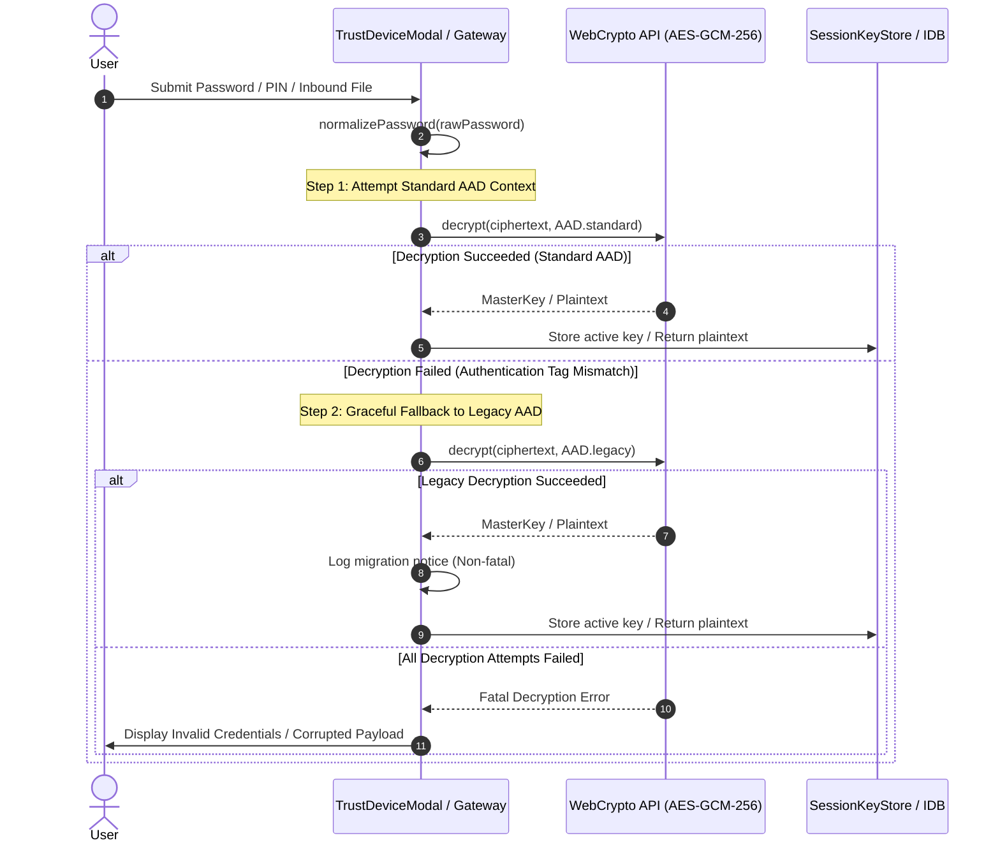
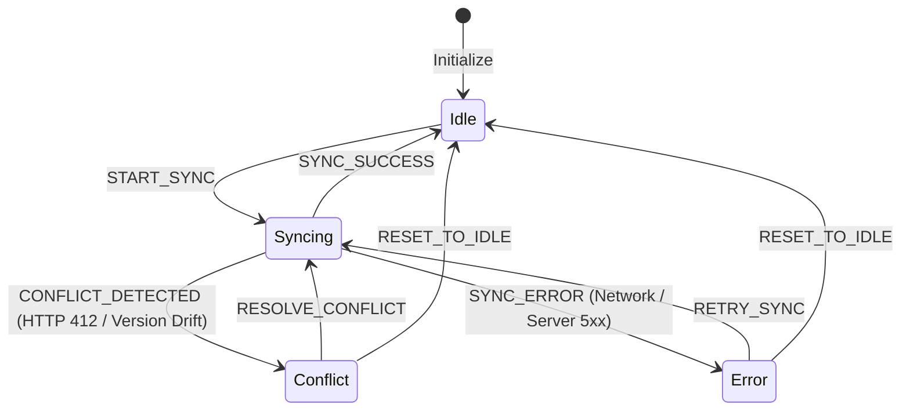
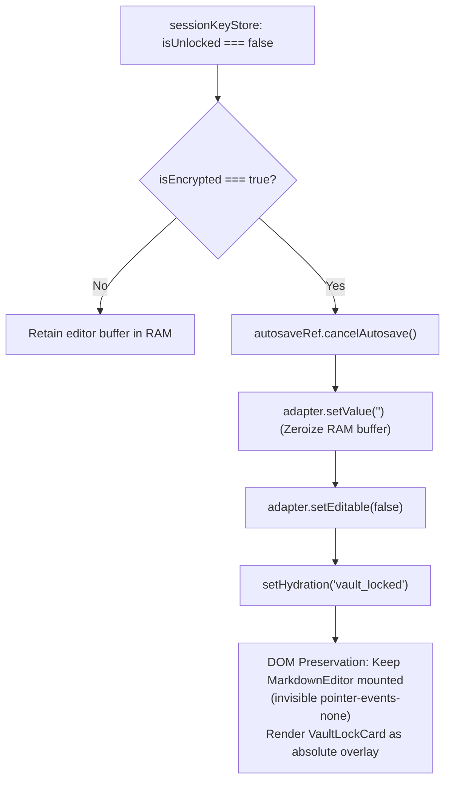

# Closure Report: Release v1.46.2 — Multi-Agent Architectural Remediation & Complete Lifecycle Hardening

**Milestone:** Extensions & Targeted Maintenance Releases (`extensions`)  
**Scope:** Architectural Remediation: Cryptographic Lifecycles, Storage Contracts, State Reducers & Editor Zero-Knowledge Security  
**Status:** CLOSED ✅  
**Date:** 2026-10-14  
**Release:** v1.46.2  
**Decision Owner:** Core Engineering Team & Subsystem Architecture Lead  

**Authoritative Artifacts:**  
- Cryptographic Gateway & Adaptive Unwrapping: [`src/lib/sync/sync-crypto-gateway.ts`](../../../../src/lib/sync/sync-crypto-gateway.ts), [`src/lib/sync/encryption.ts`](../../../../src/lib/sync/encryption.ts), [`src/components/vault/trust-device-modal.tsx`](../../../../src/components/vault/trust-device-modal.tsx)  
- Device Trust Epoch & Proof-of-Possession: [`src/server/actions/vault-actions.ts`](../../../../src/server/actions/vault-actions.ts), [`src/components/vault/vault-unlock-modal.tsx`](../../../../src/components/vault/vault-unlock-modal.tsx)  
- Synchronization Engine & Event Reducer: [`src/lib/sync/sync-manager.ts`](../../../../src/lib/sync/sync-manager.ts), [`src/lib/sync/sync-state-reducer.ts`](../../../../src/lib/sync/sync-state-reducer.ts)  
- Storage & Sync Contracts: [`src/app/api/files/[id]/route.ts`](../../../../src/app/api/files/[id]/route.ts), [`src/app/api/files/sync/route.ts`](../../../../src/app/api/files/sync/route.ts)  
- Editor RAM Zeroization & DOM Overlay: [`src/hooks/use-editor-orchestrator.ts`](../../../../src/hooks/use-editor-orchestrator.ts), [`src/hooks/use-editor-conflict.ts`](../../../../src/hooks/use-editor-conflict.ts), [`src/app/workspace/editor/[fileId]/page.tsx`](../../../../src/app/workspace/editor/[fileId]/page.tsx)  
- Billing & AI Quota State Reducers: [`src/server/services/billing-service.ts`](../../../../src/server/services/billing-service.ts), [`src/server/services/ai-settlement-service.ts`](../../../../src/server/services/ai-settlement-service.ts), [`src/server/actions/ai-ops.ts`](../../../../src/server/actions/ai-ops.ts), [`src/app/api/ai/stream/route.ts`](../../../../src/app/api/ai/stream/route.ts)  
- Document Pipeline & Web Worker Protection: [`src/components/layout/sidebar.tsx`](../../../../src/components/layout/sidebar.tsx), [`src/lib/parsers/text-parser.ts`](../../../../src/lib/parsers/text-parser.ts), [`src/lib/exporters/utils/markdown-stripper.ts`](../../../../src/lib/exporters/utils/markdown-stripper.ts)  

**Living Documentation Synchronized:**  
- [`docs/architecture/sync/editor-sync-orchestration.md`](../../../architecture/sync/editor-sync-orchestration.md) (Updated SyncManager state machine lifecycle and Editor lock in-memory zeroization)  
- [`docs/architecture/sync/three-way-conflict-resolution.md`](../../../architecture/sync/three-way-conflict-resolution.md) (Updated identical conflict raw-ciphertext preservation)  
- [`docs/reference/sync-api.md`](../../../reference/sync-api.md) (Updated RFC 7807 storage and sync query validation contracts)  
- [`docs/foundation/DESIGN_VS_REALITY.md`](../../../foundation/DESIGN_VS_REALITY.md) (Documented Release v1.46.2 cryptographic evolution and zero-knowledge memory discipline)  
- [`docs/CHANGELOG.md`](../../../CHANGELOG.md) (Documented Release v1.46.2)  
- [`docs/METRICS.json`](../../../METRICS.json) (Authoritative SSOT test baseline synchronized to 89 unit suites and 1076 tests)  

---

## 1. Executive Summary & Defect Remediation

Release v1.46.2 completes the systemic architectural hardening across the cryptographic lifecycle, storage contracts, state machines, and editor zero-knowledge guarantees:

### 1.1 Remediated Core Architectural Pillars

1. **Dual-Try AAD Cryptographic Unwrapping & Zero User Lockout:**
   - *Problem:* Historical key derivation contexts lacked standard authentication data (`AAD.passwordWrap`, `AAD.deviceWrap`, `AAD.file`), causing decryption failures when accessing vaults initialized under older conventions.
   - *Fix:* Implemented canonical `normalizePassword()` before PBKDF2 derivation. Deployed automated Dual-Try unwrapping across PIN, password, and file inbound operations: attempts canonical AAD first, gracefully falling back to legacy envelopes without user disruption. Connected `VaultManager.touchActivity()` to refresh session TTL on every inbound decryption.
   - *Device Trust & Vault Hardening:* Enforced mandatory `proofOfPossession` (strictly verified as a 64-character hexadecimal string) and `proofNonce` in `updateVaultPassword`, rejecting missing, non-hex, or malformed parameters to permanently close security vulnerability `LUGX-063`. Atomically incremented `deviceTrustEpoch` via SQL expressions to invalidate stale sibling device tokens.

2. **SyncManager State Machine Integration & Deterministic Lifecycles:**
   - *Problem:* `SyncManager` coordinated queue operations without maintaining an explicit pure state machine instance, causing unmonitored transition drift during background syncs.
   - *Fix:* Added `private machineState: SyncState = { status: 'idle' }` to `SyncManager`. Bound transitions to `reduceSyncState`, dispatching `START_SYNC`, `SYNC_SUCCESS`, `CONFLICT_DETECTED`, `SYNC_ERROR`, and `RESOLVE_CONFLICT`. Exposed `getMachineState()` and `resolveConflict()`.

3. **Storage Payload & Sync Query RFC 7807 Contract Hardening:**
   - *Problem:* `PUT /api/files/[id]` and `GET /api/files/sync` lacked compile-time schema validation for incoming bodies and query parameters, risking ambiguous encryption states or malformed cursors.
   - *Fix:* Bound `PUT /api/files/[id]` to `documentStoragePayloadSchema` and `GET /api/files/sync` to `syncPullRequestSchema`. Rejected violations immediately with RFC 7807 400 Problem Details (`urn:problem-type:invalid-storage-payload` and `urn:problem-type:invalid-sync-pull-request`).

4. **Editor Zero-Knowledge Memory Wiping & DOM Overlay Retention:**
   - *Problem:* When the vault was locked, sensitive plaintext remained resident in CodeMirror 6 memory buffers in RAM, and unmounting `<MarkdownEditor />` destroyed editor adapter instances and scroll/cursor state. Furthermore, clearing the text without a restore hook caused document loss upon unlocking.
   - *Fix:* On vault lock (`!isUnlocked && isEncrypted`), `useEditorOrchestrator` immediately zeroizes editor buffer text via `runProgrammaticUpdate(() => adapter.setValue(""))`, clears `editorContentRef.current = ""`, and sets `editable: false`. Upon vault unlock, `handleVaultUnlocked` gracefully reconstructs the pending encrypted payload from local IndexedDB (`loadLocal(fileId)`) or remote storage (`getFile(fileId)`) before decrypting and rehydrating the editor buffer. In `page.tsx`, the editor remains mounted in the DOM (`invisible pointer-events-none`) underneath an absolute modal overlay, preserving `EditorView` state across lock/unlock cycles.
   - *Conflict Re-encryption & AAD Alignment:* In `sync-encrypted-conflict-store.ts`, manual crypto calls were replaced with `SyncCryptoGateway.decryptInbound` (dual-try AAD) and `SyncCryptoGateway.encryptOutbound`. In `useEditorConflict`, when `isIdentical === true` on encrypted files, raw server ciphertext (`rawServerContent`) is preserved in `saveLocal`.

5. **Financial Entitlements, AI Quota & Terminal Billing Defense:**
   - *Problem:* Subscriptions were susceptible to out-of-order webhook replays reverting canceled statuses, and AI streaming routes lacked Zod validation and session guards.
   - *Fix:* Connected `reduceSubscriptionState` and `isTerminalSubscriptionStatus` to protect terminal subscription states. Connected `reduceQuotaReservationState` and `calculateQuotaSettlement` to eliminate errant commit refunds. In `commitAIFileOperation`, removed quota refunds on encryption rejections (`allowAIOnEncryptedFiles: false` or missing IV); consumed streaming quota is permanently retained. Guarded AI quota operations with authenticated `effectiveUserId` and enforced `aiRequestSchema`. Corrected Arabic word counting heuristic to `Math.max(spaces, Math.ceil(len / 6))`.

6. **Worker Memory Detachment, Windows-1256 Fallback & Dead Code Purge:**
   - *Problem:* Passing `ArrayBuffer` directly to `detectPdfFontCorruption` detached the buffer before worker transmission, triggering `DataCloneError`. Legacy Arabic documents encoded in Windows-1256 failed under fatal UTF-8 decoders. Deprecated PDF parser file remained orphaned.
   - *Fix:* Cloned binary buffers via `arrayBuffer.slice(0)` before worker extraction. Permanently deleted dead file `src/lib/parsers/pdf-parser.ts`. Wired `detectDocumentLanguage` into `parseTextFile` (`src/lib/parsers/text-parser.ts`). Added fatal UTF-8 decoding with automated fallback to `windows-1256`. Protected Markdown code blocks during stripping via placeholder token masking. Configured `serverActions.bodySizeLimit: "10mb"` in `next.config.ts`.

---

## 2. Subsystem Architecture & Data Flows

### 2.1 Cryptographic Hierarchy & Dual-Try AAD Migration Flow



### 2.2 SyncManager State Machine Event Transitions



### 2.3 Editor Vault Lock Memory Zeroization & Overlay Preservation



---

## 3. Verification Scorecard & Verification Evidence

All verification criteria for Release v1.46.2 have been satisfied:

<!-- BEGIN:SSOT_TEST_METRICS_TABLE -->
| Test Category | Engine / Configuration | Target Environment | Suites / Specs | Passing Tests | Pass Rate |
| :--- | :--- | :--- | :---: | :---: | :---: |
| **Unit & Contract** | Vitest (`vitest.config.mts`) | Pure In-Memory / Zero Network | 89 | 1077 | 100% ✅ |
| **Live Multi-System** | Vitest (`vitest.live.config.mts`) | Isolated Neon PostgreSQL Branch | 21 | 117 | 100% ✅ |
| **E2E Browser Journeys** | Playwright (`playwright.config.ts`) | Headless Chromium / Full App | 14 | 15 | 100% ✅ |
<!-- END:SSOT_TEST_METRICS_TABLE -->

<!-- BEGIN:SSOT_TEST_METRICS_INLINE -->
**Active Verification Baseline:** 89 unit suites (1077 tests) · 21 live suites (117 tests) · 14 E2E specs (15 journeys) — 100% Passing.
<!-- END:SSOT_TEST_METRICS_INLINE -->

### 3.1 Verification Commands Output

1. **TypeScript Type Safety Check:**
   ```bash
   npx tsc --noEmit
   # Exit Code: 0 (Zero errors detected across repository)
   ```

2. **Vitest Unit & Contract Execution:**
   ```bash
   npm test
   # Test Files: 89 passed (89)
   # Tests:      1077 passed (1077)
   # Pass Rate:  100%
   # Duration:   158.71s
   ```

3. **Markdown Link Checker:**
   ```bash
   npm run lint:links
   # Scanned: 100 Markdown files
   # Analyzed: 282 links
   # Broken: 0 (100% valid)
   ```

4. **SSOT Metric Synchronization Gate:**
   ```bash
   node scripts/sync-doc-metrics.mjs --check
   # SUCCESS: All documentation metrics and SSOT contracts are 100% synchronized.
   ```
