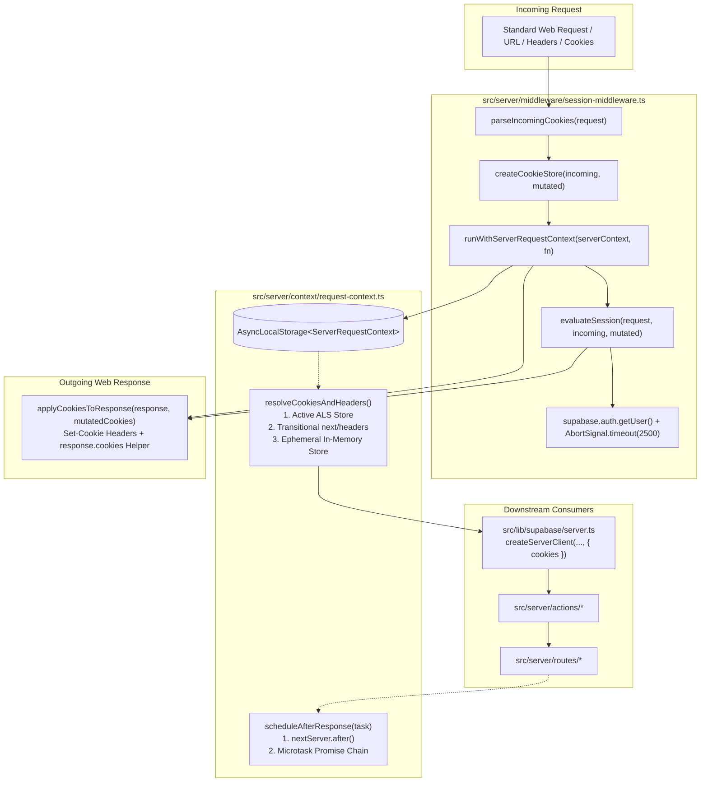

# Phase 1 Closure Dossier: Archive Prior Plan, Install Target Packages & Build Request-Scoped Session Middleware

| Field | Value |
| :--- | :--- |
| **Phase** | Phase 1 (`ELIXENT-FRAMEWORK-MIGRATION-PLAN-v1.1` — Track 1: Foundation, Dependencies & Web-Standard Session Middleware) |
| **Version** | `v0.13.0` |
| **Status** | `CLOSED / VERIFIED` |
| **Closure Date** | 2026-11-07 |
| **Governing Plan** | [`docs/records/plans/elixent-framework-migration-execution-plan.md`](../../plans/elixent-framework-migration-execution-plan.md) |
| **Associated ADRs** | [`ADR-006: Replacing Next.js 16 with Unified Web-Standard Architecture`](../../../architecture/adr_006_unified_vite_tanstack_hono_rpc_architecture.md) · [`ADR-007: Dual-Plane Separation & ALS Request Context`](../../../architecture/adr_007_dual_plane_separation_and_als_request_context.md) |
| **SSOT Architecture Specs** | [`01_architecture_vision_and_adrs.md`](../../../architecture/01_architecture_vision_and_adrs.md) · [`03_workspace_ast_editor_and_vault_integration.md`](../../../architecture/03_workspace_ast_editor_and_vault_integration.md) · [`security-and-rate-limiting.md`](../../../architecture/security/security-and-rate-limiting.md) |

---

## 1. Executive Summary

Phase 1 initiates the architectural migration of the **Elixent** platform from `Next.js 16 (App Router)` to the unified Web-standard framework (`Vite 6 SPA` + `React 19` + `TanStack Router` + `Hono RPC`). The scope executes the initial structural separation and request-scoped session middleware:

1. **Archival of Prior 12-Phase Execution Plan:**
   - Completed execution plan `ELIXENT_EXECUTION_PLAN.md` moved to [`docs/records/plans/elixent-agentic-architecture-execution-plan.md`](../../plans/elixent-agentic-architecture-execution-plan.md) with all internal links updated.
   - Activated the 6-phase migration plan [`docs/records/plans/elixent-framework-migration-execution-plan.md`](../../plans/elixent-framework-migration-execution-plan.md).
   - Synchronized all cross-document markdown links across `README.md`, `docs/README.md`, and past closure dossiers.
2. **Installation of Approved Target Framework Packages:**
   - Added core dependencies to `package.json`: `hono` (`^4.13.17`), `@hono/node-server` (`^2.1.6`), `@hono/zod-validator` (`^0.9.1`), and `@tanstack/react-router` (`^1.170.46`).
   - Added developer dependencies: `vite` (`^6.4.5`), `@vitejs/plugin-react` (`^5.2.0`), and `tsx` (`^4.23.15`).
   - Retained `next` (`^16.3.8`) temporarily to maintain unbroken transitional test execution through Phases 1–5.
3. **Request-Scoped AsyncLocalStorage Context (`request-context.ts`):**
   - Implemented `src/server/context/request-context.ts` providing deterministic `AsyncLocalStorage<ServerRequestContext>` request isolation.
   - Decoupled server context resolution (`resolveCookiesAndHeaders`) with a zero-signature-change bridge to enable transitional compatibility during migration.
   - Implemented `scheduleAfterResponse(task)` background scheduler for post-response credit settlement flushes.
4. **Decoupling Supabase Resolvers & Isomorphic Environment Ingestion:**
   - Decoupled `src/lib/supabase/server.ts` from static `next/headers` imports in favor of `resolveCookiesAndHeaders()`.
   - Updated `src/lib/supabase/client.ts` and `src/config/features.config.ts` to support isomorphic environments (`process.env` and `import.meta.env`).
5. **Web-Standard Hono Session Middleware (`session-middleware.ts`):**
   - Created `src/server/middleware/session-middleware.ts` exporting `sessionMiddleware` and `handleSessionProxy`.
   - Preserved all security invariants: OAuth callback interception (`LUGX-140`), Fast-Path Cookie Gating (`TD-12`), `AbortSignal.timeout(2500)` watchdog, protected route enforcement, and standard cookie propagation.

---

## 2. Request Context & Session Middleware Topology



---

## 3. Implementation Details

### 3.1 Prior Plan Archival & Link Topology Alignment
- Prior execution plan moved from `docs/Plans/ELIXENT_EXECUTION_PLAN.md` to `docs/records/plans/elixent-agentic-architecture-execution-plan.md`.
- Closed status banners appended to phases 2, 9, 10, 11 in the archived plan.
- All 21 relative links within the archived plan adjusted for one level deeper directory depth (`../../architecture/` and `../closures/`).
- Active execution plan placed at `docs/records/plans/elixent-framework-migration-execution-plan.md`.
- Updated cross-document references in `README.md`, `docs/README.md`, and past closure records (`phase-10`, `phase-11`, `phase-12`).

### 3.2 Target Framework Dependencies Installation
- Added required Web-standard packages to `package.json`:
  ```json
  "dependencies": {
    "@hono/node-server": "^2.1.6",
    "@hono/zod-validator": "^0.9.1",
    "@tanstack/react-router": "^1.170.46",
    "hono": "^4.13.17"
  },
  "devDependencies": {
    "@vitejs/plugin-react": "^5.2.0",
    "tsx": "^4.23.15",
    "vite": "^6.4.5"
  }
  ```

### 3.3 Request-Scoped AsyncLocalStorage Context (`src/server/context/request-context.ts`)
- Implemented `ServerRequestContext` holding `ServerCookieStore` (`getAll()`, `set()`, `delete()`) and standard `Headers`.
- Provided `runWithServerRequestContext(ctx, fn)` and `getActiveRequestContext()`.
- Implemented `resolveCookiesAndHeaders()` with three-tier resolution:
  1. Active `AsyncLocalStorage` store populated by middleware.
  2. Transitional dynamic import fallback to `next/headers` (for existing unit/live tests executing outside Hono context).
  3. Ephemeral in-memory store backed by `Map`.
- Implemented `scheduleAfterResponse(task)` ensuring non-blocking post-response execution without dropping background token settlement flushes.

### 3.4 Decoupled Supabase Client & Server Resolvers
- `src/lib/supabase/server.ts`: Removed static `import { cookies } from "next/headers"`, adopting `const { cookies: cookieStore } = await resolveCookiesAndHeaders();`.
- Ingested Supabase credentials with fallback priority: `process.env.VITE_SUPABASE_*` → `process.env.NEXT_PUBLIC_SUPABASE_*` → placeholder fallback.
- `src/lib/supabase/client.ts`: Protected `process.env` access with `typeof process !== "undefined"` and added `import.meta.env` support for Vite client compatibility.

### 3.5 Isomorphic Feature Flags Engine (`src/config/features.config.ts`)
- Updated `FEATURES.AI_STREAMING_ENABLED` evaluation to resolve safely across Node.js and browser environments via `process.env` and `import.meta.env`.

### 3.6 Web-Standard Hono Session Middleware (`src/server/middleware/session-middleware.ts`)
- Implemented `sessionMiddleware` for Hono pipelines and standalone `handleSessionProxy(request: Request): Promise<Response>`.
- Preserved all security invariants from `src/proxy.ts`:
  - **OAuth Redirection:** Intercepts `code` query parameters on `/` and `/login`, issuing a `307` redirect to `/auth/callback` with cookies preserved.
  - **Fast-Path Routing (`TD-12`):** Completely bypasses `supabase.auth.getUser()` on public paths and on `/login` when no auth cookies exist.
  - **Watchdog Timeout (`TD-12`):** Wraps `supabase.auth.getUser()` in an `AbortSignal.timeout(2500)` watchdog to prevent Chromium socket pool saturation.
  - **Cookie Serialization & Propagation:** Collects mutated cookies and serializes RFC 6265 compliant `Set-Cookie` headers on 200, 307, and 401 responses.
  - **Response Compatibility Helper:** Attaches a non-enumerable `cookies` helper onto standard `Response` objects matching Next.js `NextResponse.cookies` assertion contracts.

---

## 4. Verification Evidence & Quality Gates

### 4.1 Dedicated Phase 1 Test Suites (5 Suites / 100 Tests)

| Suite File | Tests | Status | Target Scope |
| :--- | :---: | :---: | :--- |
| `src/test/server/request-context.test.ts` | 26 | Passed ✅ | ALS request context binding, cookie store operations, three-tier fallback, and `scheduleAfterResponse` |
| `src/test/server/session-middleware.test.ts` | 45 | Passed ✅ | Hono middleware, standalone proxy, OAuth landing, fast-path bypass, watchdog timeout, cookie preservation |
| `src/test/server/supabase-server.test.ts` | 14 | Passed ✅ | Decoupled server Supabase client, ALS integration, cookie mutation delegation |
| `src/test/config/features.config.test.ts` | 11 | Passed ✅ | Isomorphic environment resolution (`process.env` vs `import.meta.env`) |
| `src/test/auth/supabase-client.test.ts` | 4 | Passed ✅ | Browser client creation across browser and Node test runtimes |
| **Total Phase 1 Tests** | **100** | **100% Passed** | **Zero failures / zero regressions** |

### 4.2 Repository Verification Baseline

- **Strict TypeScript Check (`npx tsc --noEmit`):** Clean (0 type errors).
- **Unit & Contract Suites (`npm test`):** 117 passed files, 1,992 passed tests (100% green).
- **Live Database Suites (`npm run test:live`):** 21 files, 108 passed tests (100% green).
- **E2E Browser Journeys (`npm run test:e2e`):** 14 specs, 15 passed journeys (100% green).
- **Markdown Links Check (`node scripts/check-markdown-links.mjs`):** 123 files scanned, 461 links verified, 0 broken links.
- **Documentation Metrics Sync (`node scripts/sync-doc-metrics.mjs --check`):** Clean, 100% in-sync.

---

## 5. Related Documentation & Relative Links

- Governing Plan: [`elixent-framework-migration-execution-plan.md`](../../plans/elixent-framework-migration-execution-plan.md)
- Completed Archived Plan: [`elixent-agentic-architecture-execution-plan.md`](../../plans/elixent-agentic-architecture-execution-plan.md)
- Architectural Decision Records:
  - [`ADR-006: Replacing Next.js 16 with Unified Web-Standard Architecture`](../../../architecture/adr_006_unified_vite_tanstack_hono_rpc_architecture.md)
  - [`ADR-007: Dual-Plane Separation & ALS Request Context Isolation`](../../../architecture/adr_007_dual_plane_separation_and_als_request_context.md)
- Documentation Guidelines: [`DOCUMENTATION_GUIDELINES.md`](../../../DOCUMENTATION_GUIDELINES.md)
- Living Metrics: [`METRICS.json`](../../../METRICS.json)
