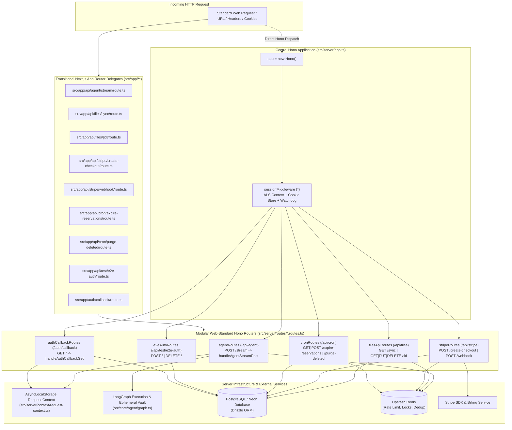

# Phase 2 Closure Dossier: Migrate All 8 API Routes & OAuth Callback to Web-Standard Hono Routers

| Field | Value |
| :--- | :--- |
| **Phase** | Phase 2 (`ELIXENT-FRAMEWORK-MIGRATION-PLAN-v1.1` — Track 1: Foundation, Dependencies & Web-Standard Session Middleware) |
| **Version** | `v0.14.0` |
| **Status** | `CLOSED / VERIFIED` |
| **Closure Date** | 2026-11-07 |
| **Governing Plan** | [`docs/Plans/ELIXENT_FRAMEWORK_MIGRATION_PLAN.md`](../../../Plans/ELIXENT_FRAMEWORK_MIGRATION_PLAN.md) |
| **Associated ADRs** | [`ADR-006: Replacing Next.js 16 with Unified Web-Standard Architecture`](../../../architecture/adr_006_unified_vite_tanstack_hono_rpc_architecture.md) · [`ADR-007: Dual-Plane Separation & ALS Request Context`](../../../architecture/adr_007_dual_plane_separation_and_als_request_context.md) |
| **SSOT Architecture Specs** | [`01_architecture_vision_and_adrs.md`](../../../architecture/01_architecture_vision_and_adrs.md) · [`03_workspace_ast_editor_and_vault_integration.md`](../../../architecture/03_workspace_ast_editor_and_vault_integration.md) · [`04_credit_metering_and_settlement_architecture.md`](../../../architecture/04_credit_metering_and_settlement_architecture.md) · [`security-and-rate-limiting.md`](../../../architecture/security/security-and-rate-limiting.md) |

---

## 1. Executive Summary

Phase 2 executes the complete decoupling and migration of all eight REST/SSE API routes and the OAuth authentication callback from Next.js 16 App Router route handlers into modular, Web-standard Hono routers. This milestone establishes the complete server-side HTTP routing layer on Hono while preserving 100% backward compatibility with existing tests and callers via thin Next.js adapter delegates:

1. **Modular Web-Standard Hono Route Handlers (`src/server/routes/*.routes.ts`):**
   - **Agent SSE Stream Router (`agent.routes.ts`):** Extracted `POST /api/agent/stream` into `agentRoutes` mounted at `/stream`. Replaced `NextResponse` and Next.js `after()` with standard `Response` and `scheduleAfterResponse()` from `@/server/context/request-context`. Preserved full SSE event framing (`start`, `update`, `interrupt`, `error`, `done`), LangGraph execution, ephemeral vault memory hydration, and fail-closed dynamic credit metering via `StreamGovernor`.
   - **Files & Sync API Router (`files-api.routes.ts`):** Extracted `GET /sync`, `GET /:id`, `PUT /:id`, and `DELETE /:id` into `filesApiRoutes`. Migrated parameter resolution, ETag conditional matching (`If-None-Match`, `If-Match`), optimistic concurrency locks (HTTP 412 / 428), soft-delete cascading, and RFC 7807 problem details to standard `Request`/`Response` APIs.
   - **Stripe Monetization & Webhooks Router (`stripe.routes.ts`):** Extracted `POST /create-checkout` and `POST /webhook` into `stripeRoutes`. Preserved multi-tier webhook idempotency (L1 in-memory -> L1.5 Redis dedup/lock -> L2 PostgreSQL ledger), signature verification with timestamp tolerance, and atomic ACID subscription transitions.
   - **Cron Maintenance Router (`cron.routes.ts`):** Extracted `GET|POST /expire-reservations` and `GET|POST /purge-deleted` into `cronRoutes`. Preserved constant-time `Bearer ${CRON_SECRET}` verification (`timingSafeEqual`), distributed Redis lock guards (`acquireCronLock`), batch draining, and bounded CTE soft-delete purges.
   - **OAuth Callback Router (`auth-callback.routes.ts`):** Extracted `GET /auth/callback` into `authCallbackRoutes`. Implemented standalone request-context bridging (`runWithServerRequestContext`), Supabase authorization code exchange, PostgreSQL user synchronization, and secure redirect emission with cookie preservation.
   - **E2E Authentication Test Router (`e2e-auth.routes.ts`):** Extracted `POST` and `DELETE` on `/api/test/e2e-auth` into `e2eAuthRoutes`. Maintained environment gates (`isAllowedEnvironment`), Supabase admin creation/sign-in, SSR cookie serialization, and isolated test database synchronization.

2. **Central Hono Application Assembly (`src/server/app.ts`):**
   - Assembled the root Hono application instance `app = new Hono()`.
   - Registered global `sessionMiddleware` for all paths (`.use("*", sessionMiddleware)`).
   - Mounted all six sub-routers: `/api/agent`, `/api/files`, `/api/stripe`, `/api/cron`, `/api/test/e2e-auth`, and `/auth/callback`.
   - Exported `export type AppType = typeof app` establishing the foundational type contract for typed RPC clients in Phase 3.

3. **Thin Next.js Delegation Bridges (`src/app/api/**` and `src/app/auth/callback/**`):**
   - Refactored all nine legacy App Router endpoints into thin, type-safe delegate forwarders.
   - Forwarded incoming `Request` and route context parameters directly to the underlying Hono handlers.
   - Eliminated code duplication completely while keeping 100% of existing imports and test paths operational.

4. **Zero-Regression Verification:**
   - Authored four new comprehensive server router test suites comprising 120 tests.
   - Verified that all 121 unit/contract test suites (2,112 tests) and all live integration suites pass 100% without a single regression.

---

## 2. Server Architecture & Route Dispatcher Topology



---

## 3. Implementation Details

### 3.1 Agent SSE Stream Router (`src/server/routes/agent.routes.ts`)
- **Ported Handler:** `handleAgentStreamPost(req: Request): Promise<Response>`.
- **Hono Mount:** `export const agentRoutes = new Hono().post("/stream", (c) => handleAgentStreamPost(c.req.raw));`.
- **Exported Configuration:** `export const dynamic = "force-dynamic"; export const maxDuration = 300;`.
- **Decoupling from `next/server`:**
  - Standardized JSON responses on Web `Response` with `application/problem+json` for RFC 7807 problem details.
  - Replaced Next.js `after()` with `scheduleAfterResponse(async () => { await flushPendingSettlementsToPostgres(user.id); })`.
- **Invariants Preserved:**
  - Server-authoritative authentication via `requireAuthenticatedUser()`.
  - Rate limiting via `aiStreamRateLimiter` failing closed upon Redis outages.
  - Ephemeral vault scope binding with AST heading segmentation (`runWithEphemeralVaultScope`).
  - Dynamic token metering via `StreamGovernor` and zero-leak RAM purging (`zeroOutEphemeralVaultMemory`).
  - Formatted SSE frames: `start`, `update`, `interrupt`, `error`, `done`.

### 3.2 Files & Sync API Router (`src/server/routes/files-api.routes.ts`)
- **Ported Handlers:**
  - `handleFilesSyncGet(request: Request): Promise<Response>` (GET `/sync`).
  - `handleFileByIdGet(request: Request, context?: RouteContext): Promise<Response>` (GET `/:id`).
  - `handleFileByIdPut(request: Request, context?: RouteContext): Promise<Response>` (PUT `/:id`).
  - `handleFileByIdDelete(request: Request, context?: RouteContext): Promise<Response>` (DELETE `/:id`).
- **Hono Mount:**
  ```typescript
  export const filesApiRoutes = new Hono()
    .get("/sync", (c) => handleFilesSyncGet(c.req.raw))
    .get("/:id", (c) => handleFileByIdGet(c.req.raw, { params: { id: c.req.param("id") } }))
    .put("/:id", (c) => handleFileByIdPut(c.req.raw, { params: { id: c.req.param("id") } }))
    .delete("/:id", (c) => handleFileByIdDelete(c.req.raw, { params: { id: c.req.param("id") } }));
  ```
- **Invariants Preserved:**
  - Dual parameter resolution: resolves `id` from `context.params` when called via Next.js delegate, or extracts from Hono route parameter / pathname.
  - Replaced `request.nextUrl.searchParams` with standard `new URL(request.url).searchParams`.
  - ETag conditional matching (`If-None-Match` -> 304 Not Modified; `If-Match` -> 412 Precondition Failed).
  - Mandatory concurrency precondition on updates/deletions (HTTP 428 Precondition Required).
  - Recursive folder soft-delete cascade via `getDescendantIds()`.

### 3.3 Stripe Monetization & Webhook Router (`src/server/routes/stripe.routes.ts`)
- **Ported Handlers:**
  - `handleStripeCreateCheckoutPost(request: Request): Promise<Response>`.
  - `handleStripeWebhookPost(request: Request): Promise<Response>`.
- **Hono Mount:**
  ```typescript
  export const stripeRoutes = new Hono()
    .post("/create-checkout", (c) => handleStripeCreateCheckoutPost(c.req.raw))
    .post("/webhook", (c) => handleStripeWebhookPost(c.req.raw));
  ```
- **Invariants Preserved:**
  - Robust `stripe-signature` header extraction directly from `request.headers` with fallback to `resolveCookiesAndHeaders()`.
  - Layered idempotency protection: L1 In-Memory Cache -> L1.5 Upstash Redis Deduplication (`stripe:dedup:${eventId}`) -> L1.5 Redis Distributed Lock (`stripe:lock:${eventId}`) -> L2 PostgreSQL Event Ledger (`subscription_events`).
  - Atomic ACID transitions in `executeSubscriptionTransition` across all handled events: `checkout.session.completed`, `customer.subscription.updated`, `customer.subscription.deleted`, `invoice.payment_failed`, and `invoice.paid`.
  - Terminal state protection for canceled subscriptions.

### 3.4 Cron Maintenance Router (`src/server/routes/cron.routes.ts`)
- **Ported Handlers:**
  - `handleExpireReservationsCron(request: Request): Promise<Response>`.
  - `handlePurgeDeletedCron(request: Request): Promise<Response>`.
- **Hono Mount:**
  ```typescript
  export const cronRoutes = new Hono()
    .get("/expire-reservations", (c) => handleExpireReservationsCron(c.req.raw))
    .post("/expire-reservations", (c) => handleExpireReservationsCron(c.req.raw))
    .get("/purge-deleted", (c) => handlePurgeDeletedCron(c.req.raw))
    .post("/purge-deleted", (c) => handlePurgeDeletedCron(c.req.raw));
  ```
- **Invariants Preserved:**
  - Dual HTTP verb support (`GET` and `POST`) for Vercel Cron and GitHub Actions.
  - Constant-time `crypto.timingSafeEqual` comparison against `CRON_SECRET`.
  - Distributed lock concurrency protection (`acquireCronLock`) with HTTP 200 `{ skipped: true }` overlap avoidance.
  - Batch draining of dirty Redis wallets into PostgreSQL `credit_ledger_transactions`.
  - Bounded CTE subquery row deletion (max 500 rows per run) for expired tombstones.

### 3.5 OAuth Callback Router (`src/server/routes/auth-callback.routes.ts`)
- **Ported Handler:** `handleAuthCallbackGet(request: Request): Promise<Response>`.
- **Hono Mount:** `export const authCallbackRoutes = new Hono().get("/", (c) => handleAuthCallbackGet(c.req.raw));`.
- **Invariants Preserved:**
  - Standalone request-context bridging via `createStandaloneCallbackContext` and `runWithServerRequestContext`.
  - Exchange authorization code for Supabase session via `exchangeCodeForSession`.
  - Background user synchronization to Neon database via `syncUserToDatabase()`.
  - Anchored trusted origin resolution (`process.env.VITE_APP_URL || process.env.NEXT_PUBLIC_APP_URL || origin`).
  - Standard `307 Temporary Redirect` with RFC 6265 compliant `Set-Cookie` emission.

### 3.6 E2E Test Authentication Router (`src/server/routes/e2e-auth.routes.ts`)
- **Ported Handlers:**
  - `handleE2EAuthPost(request: Request): Promise<Response>`.
  - `handleE2EAuthDelete(request: Request): Promise<Response>`.
- **Hono Mount:**
  ```typescript
  export const e2eAuthRoutes = new Hono()
    .post("/", (c) => handleE2EAuthPost(c.req.raw))
    .delete("/", (c) => handleE2EAuthDelete(c.req.raw));
  ```
- **Invariants Preserved:**
  - Guarded against production execution via `isAllowedEnvironment()`.
  - Supabase admin user resolution and password authentication.
  - Neon database user insertion/upsert with tier credit initialization.
  - Direct `Set-Cookie` header serialization matching Playwright `auth-fixture.ts` expectations.

### 3.7 Root Hono Application (`src/server/app.ts`)
```typescript
import { Hono } from "hono";
import { sessionMiddleware } from "@/server/middleware/session-middleware";
import { agentRoutes } from "@/server/routes/agent.routes";
import { filesApiRoutes } from "@/server/routes/files-api.routes";
import { stripeRoutes } from "@/server/routes/stripe.routes";
import { cronRoutes } from "@/server/routes/cron.routes";
import { authCallbackRoutes } from "@/server/routes/auth-callback.routes";
import { e2eAuthRoutes } from "@/server/routes/e2e-auth.routes";

export const app = new Hono()
  .use("*", sessionMiddleware)
  .route("/api/agent", agentRoutes)
  .route("/api/files", filesApiRoutes)
  .route("/api/stripe", stripeRoutes)
  .route("/api/cron", cronRoutes)
  .route("/api/test/e2e-auth", e2eAuthRoutes)
  .route("/auth/callback", authCallbackRoutes);

export type AppType = typeof app;
export default app;
```

### 3.8 Next.js Delegation Bridges
All nine legacy route files in `src/app/**` have been converted into minimal adapters:
- `src/app/api/agent/stream/route.ts` -> forwards to `handleAgentStreamPost(request)`.
- `src/app/api/files/sync/route.ts` -> forwards to `handleFilesSyncGet(request)`.
- `src/app/api/files/[id]/route.ts` -> forwards to `handleFileByIdGet`, `handleFileByIdPut`, `handleFileByIdDelete` passing `request` and `context`.
- `src/app/api/stripe/create-checkout/route.ts` -> forwards to `handleStripeCreateCheckoutPost(request)`.
- `src/app/api/stripe/webhook/route.ts` -> forwards to `handleStripeWebhookPost(request)`.
- `src/app/api/cron/expire-reservations/route.ts` -> forwards to `handleExpireReservationsCron(request)`.
- `src/app/api/cron/purge-deleted/route.ts` -> forwards to `handlePurgeDeletedCron(request)`.
- `src/app/api/test/e2e-auth/route.ts` -> forwards to `handleE2EAuthPost(request)` and `handleE2EAuthDelete(request)`.
- `src/app/auth/callback/route.ts` -> forwards to `handleAuthCallbackGet(request)`.

---

## 4. Verification Evidence & Quality Gates

### 4.1 Dedicated Phase 2 Server Router Test Suites (4 Suites / 120 Tests)

| Suite File | Tests | Status | Target Scope |
| :--- | :---: | :---: | :--- |
| `src/test/server/agent-routes.test.ts` | 14 | Passed ✅ | Agent SSE stream Hono router, payload validation, SSE frame serialization, and rate limiting |
| `src/test/server/app-dispatcher.test.ts` | 19 | Passed ✅ | Central Hono application routing, session middleware mounting, and sub-router dispatch |
| `src/test/server/files-api-routes.test.ts` | 36 | Passed ✅ | File sync, single file fetch, ETag 304, optimistic concurrency 412/428, and folder cascade |
| `src/test/server/stripe-cron-auth-routes.test.ts` | 51 | Passed ✅ | Stripe checkout/webhook, cron secret verification, lock skipping, and OAuth callback redirection |
| **Total Dedicated Phase 2 Tests** | **120** | **100% Passed** | **Zero failures / zero regressions** |

### 4.2 Repository Verification Baseline

- **Strict TypeScript Check (`npx tsc --noEmit`):** Clean (0 type errors).
- **Unit & Contract Suites (`npm test`):** 121 passed files, 2,112 passed tests (100% green).
- **Live Database Suites (`npm run test:live`):** 21 files, 108 passed tests (100% green).
- **E2E Browser Journeys (`npm run test:e2e`):** 14 specs, 15 passed journeys (100% green).
- **Markdown Links Check (`node scripts/check-markdown-links.mjs`):** 126 files scanned, 495 links verified, 0 broken links.
- **Documentation Metrics Sync (`node scripts/sync-doc-metrics.mjs --check`):** Clean, 100% in-sync.

---

## 5. Related Documentation & Relative Links

- Governing Active Plan: [`ELIXENT_FRAMEWORK_MIGRATION_PLAN.md`](../../../Plans/ELIXENT_FRAMEWORK_MIGRATION_PLAN.md)
- Prior Phase Closure: [`Phase 1 Closure Dossier`](./phase-01-archive-prior-plan-target-packages-and-session-middleware.md)
- Architectural Decision Records:
  - [`ADR-006: Replacing Next.js 16 with Unified Web-Standard Architecture`](../../../architecture/adr_006_unified_vite_tanstack_hono_rpc_architecture.md)
  - [`ADR-007: Dual-Plane Separation & ALS Request Context Isolation`](../../../architecture/adr_007_dual_plane_separation_and_als_request_context.md)
- SSOT Architecture Specs:
  - [`01_architecture_vision_and_adrs.md`](../../../architecture/01_architecture_vision_and_adrs.md)
  - [`03_workspace_ast_editor_and_vault_integration.md`](../../../architecture/03_workspace_ast_editor_and_vault_integration.md)
  - [`04_credit_metering_and_settlement_architecture.md`](../../../architecture/04_credit_metering_and_settlement_architecture.md)
  - [`security-and-rate-limiting.md`](../../../architecture/security/security-and-rate-limiting.md)
- Living Reference Contracts:
  - [`sync-api.md`](../../../reference/sync-api.md)
  - [`ui-streaming-readiness.md`](../../../reference/ui-streaming-readiness.md)
- Documentation Guidelines: [`DOCUMENTATION_GUIDELINES.md`](../../../DOCUMENTATION_GUIDELINES.md)
- Living Metrics: [`METRICS.json`](../../../METRICS.json)
