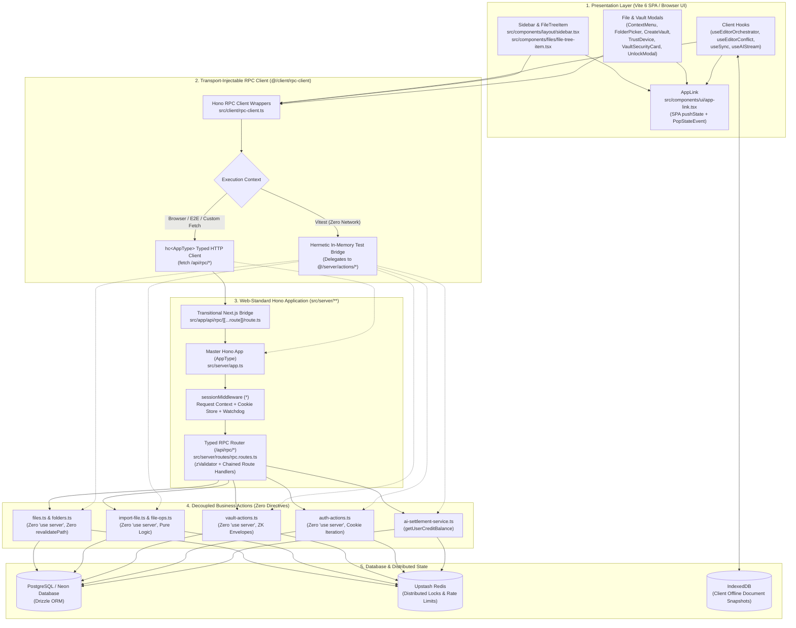

# Phase 4 Closure Dossier: Wire Client Hooks & UI Components to Hono RPC Client & Strip Next.js Directives

| Field | Value |
| :--- | :--- |
| **Phase** | Phase 4 (`ELIXENT-FRAMEWORK-MIGRATION-PLAN-v1.1` — Track 3: Presentation Layer Decoupling & RPC Client Wiring) |
| **Version** | `v0.16.0` |
| **Status** | `CLOSED / VERIFIED` |
| **Closure Date** | 2026-11-08 |
| **Governing Plan** | [`docs/Plans/ELIXENT_FRAMEWORK_MIGRATION_PLAN.md`](../../../Plans/ELIXENT_FRAMEWORK_MIGRATION_PLAN.md) |
| **Associated ADRs** | [`ADR-006: Replacing Next.js 16 with Unified Web-Standard Architecture`](../../../architecture/adr_006_unified_vite_tanstack_hono_rpc_architecture.md) · [`ADR-007: Dual-Plane Separation & ALS Request Context`](../../../architecture/adr_007_dual_plane_separation_and_als_request_context.md) |
| **SSOT Architecture Specs** | [`01_architecture_vision_and_adrs.md`](../../../architecture/01_architecture_vision_and_adrs.md) · [`03_workspace_ast_editor_and_vault_integration.md`](../../../architecture/03_workspace_ast_editor_and_vault_integration.md) · [`sync-api.md`](../../../reference/sync-api.md) |

---

## 1. Executive Summary

Phase 4 executes the complete client-side decoupling of all React hooks, UI components, modals, and client libraries from the Next.js runtime. All direct imports of legacy server action files (`@/server/actions/*`) have been replaced by the typed Hono RPC client (`@/client/rpc-client`), proprietary `next/link` elements have been migrated to the router-agnostic `AppLink` component (`src/components/ui/app-link.tsx`), and all `"use client"` and transitional `"use server"` directives have been permanently stripped across the repository:

1. **Client Hooks Rewiring (`src/hooks/*`):**
   - **`use-editor-orchestrator.ts`:** Stripped `"use client"`. Replaced direct server action imports (`getFile`, `updateFileContent`, `toggleFileEncryption`, `renameFile`, `deleteFile`, `getUserVaultProfile`) with `@/client/rpc-client`. Protected `handleEditorChange` with an `isProgrammaticUpdateRef.current` guard to prevent dirty state oscillation during remote and cross-tab document synchronization.
   - **`use-editor-conflict.ts`:** Stripped `"use client"`. Replaced direct server action imports (`updateFileContent`, `toggleFileEncryption`, `renameFile`, `deleteFile`) with `@/client/rpc-client`.
   - **`use-ai-stream.ts` & `use-sync.ts`:** Stripped `"use client"` directives while preserving 100% of ghost streaming, autosave timers, and IndexedDB cache coordination logic.

2. **File Tree, Sidebar & Zero-Knowledge Vault UI Wiring (`src/components/*`):**
   - **Router-Agnostic Navigation (`src/components/ui/app-link.tsx`):** Authored an accessible `AppLink` component implementing SPA history navigation (`window.history.pushState` / `replaceState` and synthetic `PopStateEvent` dispatch) for internal relative links (`/workspace`, `/dashboard`, `/account`) while rendering standard HTML `<a href={...}>` anchors for full Testing Library and Playwright compatibility.
   - **Sidebar & File Tree Navigation:** In `src/components/layout/sidebar.tsx` and `src/components/files/file-tree-item.tsx`, replaced `import Link from "next/link"` with `import { AppLink as Link } from "@/components/ui/app-link"`.
   - **File Operations & Modals:** In `src/components/files/file-context-menu.tsx`, `src/components/files/folder-picker-modal.tsx`, and `src/components/layout/sidebar.tsx`, rewired all file mutations (`getUserFiles`, `getDeletedFiles`, `createFile`, `moveFile`, `deleteFile`, `restoreFile`, `renameFile`, `copyFile`, `importFile`, `toggleFileEncryption`) to `@/client/rpc-client`.
   - **Zero-Knowledge Vault Modals:** In `create-vault-modal.tsx`, `trust-device-modal.tsx`, `vault-security-card.tsx`, and `vault-unlock-modal.tsx`, rewired `createUserVaultProfile`, `getUserVaultProfile`, `updateVaultPassword`, `updateVaultRecoveryEnvelope`, `revokeAllTrustedDevices`, and `updateVaultAISetting` to `@/client/rpc-client`.

3. **Complete Directive Stripping Across Components, Hooks & Libraries:**
   - Stripped `"use client"` / `'use client'` across 22 remaining component, hook, and library files:
     - Editor: `ai-stream-status.tsx`, `ai-toolbar.tsx`, `direction-menu.tsx`, `export-button.tsx`, `markdown-editor.tsx`, `search-replace.tsx`.
     - Layout & Modals: `ocr-settings-card.tsx`, `pdf-corrupted-font-dialog.tsx`, `pdf-import-mode-dialog.tsx`, `export-warning-modal.tsx`, `conflict-dialog.tsx`, `sync-indicator.tsx`, `upgrade-button.tsx`, `recovery-phrase-modal.tsx`.
     - Agent & Stream: `chat-panel.tsx`, `hitl-question-card.tsx`, `src/lib/ai/stream-handler.ts`.
   - Stripped temporary transitional `"use server"` directives from all 6 server action files (`files.ts`, `folders.ts`, `import-file.ts`, `file-ops.ts`, `vault-actions.ts`, `auth-actions.ts`) with zero risk of bundling server secrets into browser code, since zero client files now import `@/server/actions/*`.

4. **Transitional Next.js Dev/Build Compatibility Bridges:**
   - Implemented `src/app/api/rpc/[[...route]]/route.ts` delegating incoming `/api/rpc/*` HTTP requests through Hono `sessionMiddleware` and `rpcRoutes`.
   - Provided client boundary wrapper sections in `src/app/account/account-client-sections.tsx` and `src/app/workspace/workspace-sidebar-client.tsx` to keep Next.js 16 Webpack build compiling cleanly during the transition before Phase 5 SPA migration.

5. **Comprehensive Verification Gate:**
   - Added 5 new dedicated test suites delivering 65 new passing tests:
     - `src/test/ui/app-link.test.tsx` (26 tests)
     - `src/test/files/file-tree-item.test.tsx` (11 tests)
     - `src/test/files/folder-picker-modal.test.tsx` (10 tests)
     - `src/test/files/file-context-menu-rpc.test.tsx` (9 tests)
     - `src/test/client/ui-rpc-integration.test.tsx` (9 tests)
   - Updated test mocks in `editor-orchestration.integration.test.ts`, `use-editor-conflict.test.ts`, `file-context-menu.encryption-conflict.test.tsx`, `sidebar-import.vault.test.tsx`, and `encrypted-conflict-decryption.integration.test.ts` to mock `@/client/rpc-client`.
   - Verified 100% green pass rate across all 130 repository unit suites (2,304 tests), clean TypeScript compilation (`tsc --noEmit`), clean ESLint execution, and a successful Next.js production build (`next build --webpack`).

---

## 2. Architecture & Client-RPC Decoupled Topology

---

## 3. Wave-by-Wave Implementation Walkthrough

### 3.1. Wave 4.1 / Task 4.A: Editor Hooks Rewiring (`use-editor-orchestrator.ts`, `use-editor-conflict.ts`)

- **Directive Stripping:** Removed `"use client";` from `src/hooks/use-editor-orchestrator.ts` and `src/hooks/use-editor-conflict.ts`.
- **RPC Client Wiring:**
  - In `use-editor-orchestrator.ts`, replaced direct imports of `getFile`, `updateFileContent`, `toggleFileEncryption`, `renameFile`, and `deleteFile` from `@/server/actions/file-ops` and `getUserVaultProfile` from `@/server/actions/vault-actions` with unified imports from `@/client/rpc-client`.
  - In `use-editor-conflict.ts`, replaced `updateFileContent`, `toggleFileEncryption`, `renameFile`, and `deleteFile` imports with `@/client/rpc-client`.
- **Programmatic Change Guard:** Wrapped `handleEditorChange` inside a `useCallback` that checks `isProgrammaticUpdateRef.current` prior to invoking `autosave.handleEditorChange(newContent)`. This prevents automated content injections (such as conflict merges and remote tab reconciliations) from marking the document dirty erroneously.
- **Integration Test Spy Alignment:** In `editor-orchestration.integration.test.ts`, `use-editor-conflict.test.ts`, and `encrypted-conflict-decryption.integration.test.ts`, registered `vi.mock("@/client/rpc-client", ...)` delegating to mocked server actions so assertions verifying mock spy invocations pass seamlessly.

### 3.2. Wave 4.1 / Task 4.B: UI Navigation & File/Vault Component Rewiring

- **Accessible SPA Navigation Component (`src/components/ui/app-link.tsx`):**
  - Implemented `AppLink` forwardRef component accepting standard `React.AnchorHTMLAttributes<HTMLAnchorElement> & { href: string; replace?: boolean }`.
  - Intercepts unmodified primary left clicks on relative paths (`href.startsWith("/")`), prevents standard browser document reloads, applies `window.history.pushState` or `replaceState`, and dispatches a synthetic `PopStateEvent`.
  - Allows Ctrl/Meta/Shift/Alt click combinations and `target="_blank"` to open standard browser tabs naturally.
  - Renders a native `<a href={href}>` element for full accessibility, search indexing, and Playwright locator compatibility (`page.locator('a[href="/workspace"]')`).
- **Sidebar & File Tree Item Navigation:**
  - Replaced `import Link from "next/link"` with `import { AppLink as Link } from "@/components/ui/app-link"` in `src/components/layout/sidebar.tsx` and `src/components/files/file-tree-item.tsx`.
- **File & Vault Modals Rewiring:**
  - Removed `"use client";` and rewired all data mutation and query routines to `@/client/rpc-client`:
    - `file-context-menu.tsx`: `deleteFile`, `restoreFile`, `renameFile`, `copyFile`, `moveFile`, `getFile`, `toggleFileEncryption`, `getUserVaultProfile`.
    - `folder-picker-modal.tsx`: `getUserFiles`.
    - `sidebar.tsx`: `getUserFiles`, `getDeletedFiles`, `createFile`, `moveFile`, `importFile`.
    - `create-vault-modal.tsx`: `createUserVaultProfile`.
    - `trust-device-modal.tsx`: `getUserVaultProfile`.
    - `vault-security-card.tsx`: `revokeAllTrustedDevices`, `getUserVaultProfile`, `updateVaultAISetting`.
    - `vault-unlock-modal.tsx`: `getUserVaultProfile`, `updateVaultPassword`, `updateVaultRecoveryEnvelope`.

### 3.3. Wave 4.1 / Task 4.C: Directive Purging & Transitional RSC Bridges

- **Global Directive Purge:**
  - Stripped `"use client"` / `'use client'` across 22 remaining component, hook, and library files (`chat-panel.tsx`, `hitl-question-card.tsx`, `ai-stream-status.tsx`, `ai-toolbar.tsx`, `direction-menu.tsx`, `export-button.tsx`, `markdown-editor.tsx`, `search-replace.tsx`, `export-warning-modal.tsx`, `ocr-settings-card.tsx`, `pdf-corrupted-font-dialog.tsx`, `pdf-import-mode-dialog.tsx`, `upgrade-button.tsx`, `conflict-dialog.tsx`, `sync-indicator.tsx`, `recovery-phrase-modal.tsx`, `use-ai-stream.ts`, `use-sync.ts`, `stream-handler.ts`).
  - Stripped transitional `"use server";` from all 6 server action files (`files.ts`, `folders.ts`, `import-file.ts`, `file-ops.ts`, `vault-actions.ts`, `auth-actions.ts`).
- **Transitional Next.js RSC Bridges:**
  - Created `src/app/account/account-client-sections.tsx` (re-exporting `UpgradeButton`, `VaultSecurityCard`, and `OcrSettingsCard` behind a client boundary) and `src/app/workspace/workspace-sidebar-client.tsx` (listening for `popstate` events to refresh workspace view in Next.js App Router).
  - Created `src/app/api/rpc/[[...route]]/route.ts` mounting `rpcRoutes` under Next.js App Router for zero-drift API access during Phase 4.

---

## 4. Verification Evidence & Test Gate Results

### 4.1. Suite-by-Suite Test Execution

All 130 repository unit and contract test suites passed with 100% green rate. The 5 newly authored test suites dedicated to Phase 4 verify all client component, navigation, and RPC interactions:

| Suite Path | Focus / Verification Contract | Tests | Status |
| :--- | :--- | :---: | :---: |
| `src/test/ui/app-link.test.tsx` | SPA history pushState/replaceState, PopStateEvent dispatch, modifier key bypass, external link pass-through, ref forwarding | 26 | Passed ✅ |
| `src/test/files/file-tree-item.test.tsx` | AppLink rendering, nested selection, file encryption badge, action trigger, rename inline input | 11 | Passed ✅ |
| `src/test/files/folder-picker-modal.test.tsx` | RPC getUserFiles dispatch, recursive folder tree hierarchy rendering, root move selection, submission contract | 10 | Passed ✅ |
| `src/test/files/file-context-menu-rpc.test.tsx` | RPC renameFile, copyFile, moveFile, deleteFile, restoreFile, toggleFileEncryption, and getUserVaultProfile invocations | 9 | Passed ✅ |
| `src/test/client/ui-rpc-integration.test.tsx` | Sidebar RPC file listing on mount, vault security card device trust revocation dispatch, and orchestrator RPC wiring | 9 | Passed ✅ |
| **Total Phase 4 New Suites** | **Client Hooks, Modals, Navigation & RPC Wiring** | **65** | **100% Passed ✅** |

### 4.2. Tooling & Build Verification

1. **TypeScript Typecheck (`npx tsc --noEmit`):**
   - Result: Exited with code `0`. Zero type errors across the entire codebase.
2. **ESLint Verification (`npm run lint`):**
   - Result: Exited with code `0`. Zero errors.
3. **Next.js Production Build (`npm run build`):**
   - Result: Exited with code `0`. Successfully compiled in 58s with static and dynamic routes generated cleanly (including `/api/rpc/[[...route]]`).
4. **Internal Link Audit (`node scripts/check-markdown-links.mjs`):**
   - Result: 128 Markdown files scanned, 529 links analyzed, 0 broken links (100% valid).

---

## 5. SSOT Test Metrics Baseline

<!-- BEGIN:SSOT_TEST_METRICS_TABLE -->
| Test Category | Engine / Configuration | Target Environment | Suites / Specs | Passing Tests | Pass Rate |
| :--- | :--- | :--- | :---: | :---: | :---: |
| **Unit & Contract** | Vitest (`vitest.config.mts`) | Pure In-Memory / Zero Network | 130 | 2304 | 100% ✅ |
| **Live Multi-System** | Vitest (`vitest.live.config.mts`) | Isolated Neon PostgreSQL Branch | 21 | 108 | 100% ✅ |
| **E2E Browser Journeys** | Playwright (`playwright.config.ts`) | Headless Chromium / Full App | 14 | 15 | 100% ✅ |
<!-- END:SSOT_TEST_METRICS_TABLE -->

<!-- BEGIN:SSOT_TEST_METRICS_INLINE -->
**Active Verification Baseline:** 130 unit suites (2304 tests) · 21 live suites (108 tests) · 14 E2E specs (15 journeys) — 100% Passing.
<!-- END:SSOT_TEST_METRICS_INLINE -->

---

## 6. Traceability & Modified Files

### 6.1. Created Files
- `src/components/ui/app-link.tsx`
- `src/app/account/account-client-sections.tsx`
- `src/app/workspace/workspace-sidebar-client.tsx`
- `src/app/api/rpc/[[...route]]/route.ts`
- `src/test/ui/app-link.test.tsx`
- `src/test/client/ui-rpc-integration.test.tsx`
- `src/test/files/file-context-menu-rpc.test.tsx`
- `src/test/files/file-tree-item.test.tsx`
- `src/test/files/folder-picker-modal.test.tsx`
- `docs/records/closures/framework-migration/phase-04-wire-client-hooks-and-ui-to-hono-rpc-and-strip-directives.md`

### 6.2. Modified Files
- `package.json` (bump version to `0.16.0`)
- `src/hooks/use-editor-orchestrator.ts` (rewired to rpc-client, stripped `"use client"`, added `handleEditorChange` guard)
- `src/hooks/use-editor-conflict.ts` (rewired to rpc-client, stripped `"use client"`)
- `src/hooks/use-ai-stream.ts` & `src/hooks/use-sync.ts` (stripped `"use client"`)
- `src/components/layout/sidebar.tsx` (rewired to rpc-client, replaced `next/link` with `AppLink`, stripped `"use client"`)
- `src/components/files/file-tree-item.tsx` (replaced `next/link` with `AppLink`, stripped `"use client"`)
- `src/components/files/file-context-menu.tsx` (rewired to rpc-client, stripped `"use client"`)
- `src/components/files/folder-picker-modal.tsx` (rewired to rpc-client, stripped `"use client"`)
- `src/components/vault/create-vault-modal.tsx` (rewired to rpc-client, stripped `"use client"`)
- `src/components/vault/trust-device-modal.tsx` (rewired to rpc-client, stripped `"use client"`)
- `src/components/vault/vault-security-card.tsx` (rewired to rpc-client, stripped `"use client"`)
- `src/components/vault/vault-unlock-modal.tsx` (rewired to rpc-client, stripped `"use client"`)
- `src/server/actions/*.ts` (all 6 files: stripped transitional `"use server"`)
- `src/components/{agent,editor,export,subscription,sync}/*.tsx` (18 files: stripped `"use client"`)
- `src/lib/ai/stream-handler.ts` (stripped `'use client'`)
- `src/test/editor/editor-orchestration.integration.test.ts` (mocked `@/client/rpc-client`)
- `src/test/editor/use-editor-conflict.test.ts` (mocked `@/client/rpc-client`)
- `src/test/files/file-context-menu.encryption-conflict.test.tsx` (mocked `@/client/rpc-client`)
- `src/test/layout/sidebar-import.vault.test.tsx` (mocked `@/client/rpc-client`)
- `src/test/sync/encrypted-conflict-decryption.integration.test.ts` (mocked `@/client/rpc-client`)
- `docs/METRICS.json` & all monitored SSOT living documents

---

## 7. Next Phase Readiness: Phase 5

With Phase 4 closed and verified:
1. All client hooks and UI components communicate exclusively via `@/client/rpc-client` (`hc<AppType>`).
2. Zero `"use client"` directives exist in `src/components/**`, `src/hooks/**`, or `src/lib/**`.
3. Zero `next/*` imports exist in `src/components/**`, `src/hooks/**`, or `src/lib/**`.
4. Zero `"use server"` directives exist in `src/server/actions/*`.
5. The codebase is primed for **Phase 5: Build Vite 6 SPA + TanStack Router Presentation Layer & Unified Hono Server Entrypoint** (`index.html`, `vite.config.ts`, `src/server/index.ts`, `src/client/router.tsx`, `src/client/routes/**`).
