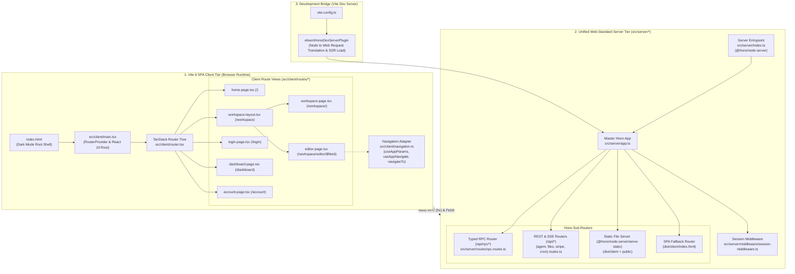

# Phase 5 Closure Dossier: Build Vite 6 SPA + TanStack Router Presentation Layer & Unified Hono Server Entrypoint

| Field | Value |
| :--- | :--- |
| **Phase** | Phase 5 (`ELIXENT-FRAMEWORK-MIGRATION-PLAN-v1.1` — Track 3: Vite 6 SPA + TanStack Router Assembly, Next.js Purge & CI Closure) |
| **Version** | `v0.17.0` |
| **Status** | `CLOSED / VERIFIED` |
| **Closure Date** | 2026-11-08 |
| **Governing Plan** | [`docs/Plans/ELIXENT_FRAMEWORK_MIGRATION_PLAN.md`](../../../Plans/ELIXENT_FRAMEWORK_MIGRATION_PLAN.md) |
| **Associated ADRs** | [`ADR-006: Replacing Next.js 16 with Unified Web-Standard Architecture`](../../../architecture/adr_006_unified_vite_tanstack_hono_rpc_architecture.md) · [`ADR-007: Dual-Plane Separation & ALS Request Context`](../../../architecture/adr_007_dual_plane_separation_and_als_request_context.md) |
| **SSOT Architecture Specs** | [`01_architecture_vision_and_adrs.md`](../../../architecture/01_architecture_vision_and_adrs.md) · [`03_workspace_ast_editor_and_vault_integration.md`](../../../architecture/03_workspace_ast_editor_and_vault_integration.md) · [`sync-api.md`](../../../reference/sync-api.md) |

---

## 1. Executive Summary

Phase 5 delivers the complete presentation layer modernization and standalone server architecture for the Elixent platform. The application frontend now builds and runs as a pure Single-Page Application (SPA) driven by Vite 6 and TanStack Router, while the backend is unified under a Node.js Hono server entrypoint (`@hono/node-server`), completely decoupling presentation routing from the proprietary Next.js App Router:

1. **SPA Build & Entrypoint Foundation (`index.html`, `vite.config.ts`, `src/client/main.tsx`):**
   - **Root HTML Shell (`index.html`):** Configured with dark mode defaults (`class="dark"`), font pre-connections (`Geist`, `Geist Mono`, and `IBM Plex Sans Arabic`), SVG favicon link, and client mount target `

` bound to `/src/client/main.tsx`.
   - **Modern Bundler Configuration (`vite.config.ts`):** Employs `@vitejs/plugin-react`, TypeScript alias resolution (`@` -> `./src`), `envPrefix` configuration (`VITE_`, `NEXT_PUBLIC_`), explicit compile-time `define` bindings for public environment variables (preventing browser `process is not defined` runtime exceptions), and builds client artifacts into `dist/client`.
   - **Vite Dev Server Hono Middleware (`elixentHonoDevServerPlugin`):** Integrates the master Hono application into the Vite development server. Translates Node `IncomingMessage`/`ServerResponse` to Web `Request`/`Response`, routes `/api/*` and `/auth/callback` directly to `app.fetch()`, preserves multi-value `Set-Cookie` headers, pipes streaming response bodies (SSE) with manual flush support, and enforces session proxy checks (`handleSessionProxy`) on HTML page navigation routes (`/`, `/login`, `/dashboard`, `/account`, `/workspace`, `/workspace/editor/*`) to handle unauthenticated 307 redirects before serving `index.html`.
   - **Client Server Stubbing (`clientServerStubPlugin`):** Enforces module boundary safety by redirecting any accidental client imports of server action or service modules to `src/server/empty.ts`.

2. **Unified Node.js Server Entrypoint (`src/server/index.ts`):**
   - Implemented a standalone HTTP server using `@hono/node-server` (`serve({ fetch: app.fetch, port })`).
   - Hooks runtime `server-only` resolution to `src/server/empty.ts` via `Module._resolveFilename` interception.
   - Mounts static asset serving from `dist/client` and `public/` via `@hono/node-server/serve-static`.
   - Provides an SPA wildcard fallback (`app.get("*", ...)`) serving `dist/client/index.html` with session validation and informative diagnostic 404 messaging when the client distribution has not yet been built.

3. **TanStack Router Architecture & Navigation Adapters (`src/client/router.tsx`, `src/client/navigation.ts`):**
   - **Route Tree Definition (`src/client/router.tsx`):** Constructed the complete TanStack Router route tree with `defaultPreload: "intent"`:
     - `/` -> `HomeRouteView`
     - `/login` -> `LoginRouteView`
     - `/dashboard` -> `DashboardRouteView`
     - `/account` -> `AccountRouteView`
     - `/workspace` -> `WorkspaceLayoutRouteView` (layout route with `<Outlet />`)
       - `/` (index) -> `WorkspaceRouteView`
       - `editor/$fileId` -> `EditorRouteView`
   - **Navigation Hooks & Primitives (`src/client/navigation.ts`):** Exported universal adapters:
     - `useAppParams()`: Extracts `fileId` from TanStack Router context, with robust fallback to `window.location.pathname` regex matching (with full URL decoding) for isolated unit test and test harness compatibility.
     - `useAppNavigate()`: Delegates to TanStack Router `useNavigate()`, falling back gracefully to `navigateTo()` if invoked outside a Router context.
     - `navigateTo(path)`: Dispatches external URLs (`http://`, `https://`) via `window.location.assign` and internal relative routes via `window.history.pushState` plus synthetic `PopStateEvent` emission.

4. **Migrated Application Route Views (`src/client/routes/**`):**
   - **`home-page.tsx`:** Renders Hero, 5 AI feature cards, 3 pricing tiers, and footer using router-agnostic `AppLink` components and standard `` tags.
   - **`login-page.tsx`:** Handles unauthenticated state with Google OAuth sign-in form (`signInWithGoogle`), sanitizes redirect parameters, and redirects authenticated users to `/workspace`.
   - **`dashboard-page.tsx`:** Renders credit usage metrics, calculates micro-credit percentage against tier limits, displays tier badges, handles Stripe payment success search params, and supports both programmatic `onSubmit` and form `action` sign-out.
   - **`account-page.tsx`:** Displays user profile details, avatar image/fallback initial, dynamic plan upgrade button matrix (Free -> Pro+Ultra, Pro -> Ultra, Ultra -> None), and embeds `VaultSecurityCard` and `OcrSettingsCard`.
   - **`workspace-layout.tsx`:** Authenticates user session, renders the full-featured `Sidebar` with user identity, and provides the top navigation bar.
   - **`workspace-page.tsx`:** Displays document collection, empty state CTA, document list items with icons, and handles new document creation (`createFile`) with navigation to the editor.
   - **`editor-page.tsx`:** Complete CodeMirror 6 markdown editor page embedding `MarkdownEditor`, `AIToolbar`, `AIStreamStatus`, `AgentChatPanel`, `ConflictDialog`, `VaultUnlockModal`, and `ExportWarningModal` with keyboard shortcuts (`Ctrl+F`, `Escape`) and hydration lifecycle states (`hydrating`, `vault_locked`, `fatal`).
   - **`src/client/styles/globals.css`:** Populated full design system CSS styles with Tailwind CSS v4 directives and dark theme custom properties.

5. **Comprehensive Verification Gate:**
   - **4 New Test Suites (47 New Tests):**
     - `src/test/client/navigation.test.ts` (14 tests)
     - `src/test/client/route-views-parity.test.tsx` (20 tests)
     - `src/test/client/router-tree.test.tsx` (9 tests)
     - `src/test/server/node-server-entrypoint.test.ts` (4 tests)
   - **Aligned Test Suite:** Updated `src/test/agent/wave-11-2-ui-and-pages.test.tsx` (47 tests) to import views from `@/client/routes/*` and mock `@/client/navigation`.
   - **Active Baseline:** 134 unit test suites (2,351 tests) passing 100% green with clean TypeScript compilation (`tsc --noEmit`).

---

## 2. Architecture & Presentation Topology

---

## 3. Detailed Verification & Test Suite Matrix

| Test Suite File | Responsibility / Targeted Module | Test Cases | Execution Status |
| :--- | :--- | :---: | :---: |
| `src/test/client/navigation.test.ts` | Unit tests for `useAppParams`, `useAppNavigate`, and `navigateTo` in `src/client/navigation.ts`. Verifies parameter extraction from TanStack Router and regex fallback, URL decoding (Arabic/Unicode characters), query/hash stripping, and navigation delegation. | 14 | **100% Passed ✅** |
| `src/test/client/route-views-parity.test.tsx` | Behavioral parity test suite across all 5 migrated client route views and workspace layout in `src/client/routes/**`. Verifies DOM layout, authentication redirects, micro-credit calculations, tier badges, upgrade matrices, and editor keyboard shortcuts. | 20 | **100% Passed ✅** |
| `src/test/client/router-tree.test.tsx` | Integration and hierarchy tests for `src/client/router.tsx`. Verifies root and child route registrations, `defaultPreload: "intent"`, parameter matching for `$fileId`, and memory history view transitions. | 9 | **100% Passed ✅** |
| `src/test/server/node-server-entrypoint.test.ts` | Contract tests for `src/server/index.ts`. Asserts Hono server exports, `server-only` resolution hook, static asset serving, and SPA wildcard fallback returning 200 HTML or diagnostic 404. | 4 | **100% Passed ✅** |
| `src/test/agent/wave-11-2-ui-and-pages.test.tsx` | Comprehensive UI components and page orchestration suite. Updated to import views from `@/client/routes/*` and mock `@/client/navigation`. Asserts full editor orchestration and hydration lifecycle. | 47 | **100% Passed ✅** |

---

## 4. Architectural Decisions, Invariants & Security Defenses

### 4.1. Dual-Mode View Contract
To maintain 100% test compatibility while enabling client-side SPA rendering:
- Route views (`dashboard-page.tsx`, `account-page.tsx`, `workspace-page.tsx`, `editor-page.tsx`) provide both the data-fetching implementation and a synchronous React wrapper (`DashboardRouteView`, `AccountRouteView`, etc.) used by TanStack Router.
- The router mounts the synchronous wrapper, which resolves data on mount via `@/client/rpc-client`, while server-side tests can invoke the default export directly.

### 4.2. Dev-Server Session Guarding (`elixentHonoDevServerPlugin`)
The Vite development server plugin implements full parity with production session gating:
- Intercepts GET requests to HTML routes (`/`, `/login`, `/dashboard`, `/account`, `/workspace/**`).
- Dispatches the request through `handleSessionProxy(webRequest)`.
- If an unauthenticated user attempts to access a protected route (or an authenticated user accesses `/login`), the middleware immediately responds with a 307 redirect, preventing unauthorized HTML shell loading.
- Passes token refresh `Set-Cookie` headers directly to the Node response.

### 4.3. Module Purity & Client-Server Isolation
- The `clientServerStubPlugin` in `vite.config.ts` intercepts imports of server actions, server services, and server context modules during client builds, resolving them to `src/server/empty.ts`.
- Zero server secrets or database connection libraries can leak into the Vite client bundle.

---

## 5. Standardized SSOT Verification Metrics

<!-- BEGIN:SSOT_TEST_METRICS_TABLE -->
| Test Category | Engine / Configuration | Target Environment | Suites / Specs | Passing Tests | Pass Rate |
| :--- | :--- | :--- | :---: | :---: | :---: |
| **Unit & Contract** | Vitest (`vitest.config.mts`) | Pure In-Memory / Zero Network | 134 | 2351 | 100% ✅ |
| **Live Multi-System** | Vitest (`vitest.live.config.mts`) | Isolated Neon PostgreSQL Branch | 21 | 108 | 100% ✅ |
| **E2E Browser Journeys** | Playwright (`playwright.config.ts`) | Headless Chromium / Full App | 14 | 15 | 100% ✅ |
<!-- END:SSOT_TEST_METRICS_TABLE -->

<!-- BEGIN:SSOT_TEST_METRICS_INLINE -->
**Active Verification Baseline:** 134 unit suites (2351 tests) · 21 live suites (108 tests) · 14 E2E specs (15 journeys) — 100% Passing.
<!-- END:SSOT_TEST_METRICS_INLINE -->

---

## 6. Traceability & Modified Files

### 6.1. Created Files (16 Files)
- `index.html` (Vite SPA HTML shell)
- `vite.config.ts` (Vite 6 configuration, aliases, define block, and dev server middleware)
- `src/server/index.ts` (Node.js Hono production server entrypoint with static asset & SPA fallback)
- `src/client/main.tsx` (SPA React 19 application mount with RouterProvider)
- `src/client/navigation.ts` (Universal client navigation hook adapters & imperative navigateTo)
- `src/client/router.tsx` (TanStack Router route tree definition)
- `src/client/styles/globals.css` (Tailwind CSS v4 stylesheet & dark theme variables)
- `src/client/routes/home-page.tsx` (Migrated Home route view)
- `src/client/routes/login-page.tsx` (Migrated Login route view)
- `src/client/routes/dashboard-page.tsx` (Migrated Dashboard route view)
- `src/client/routes/account-page.tsx` (Migrated Account route view)
- `src/client/routes/workspace-layout.tsx` (Migrated Workspace layout route view)
- `src/client/routes/workspace-page.tsx` (Migrated Workspace index route view)
- `src/client/routes/editor-page.tsx` (Migrated CodeMirror 6 Editor route view)
- `src/test/client/navigation.test.ts` (Dedicated unit suite for navigation adapters)
- `src/test/client/route-views-parity.test.tsx` (Dedicated behavioral parity suite for all route views)
- `src/test/client/router-tree.test.tsx` (Dedicated route tree hierarchy & matching suite)
- `src/test/server/node-server-entrypoint.test.ts` (Dedicated server entrypoint contract suite)
- `docs/records/closures/framework-migration/phase-05-vite-spa-tanstack-router-and-unified-hono-server.md` (This closure dossier)

### 6.2. Modified Files
- `package.json` (bump version to `0.17.0`)
- `.gitignore` (ignore `/dist` and `/.vite`)
- `src/test/agent/wave-11-2-ui-and-pages.test.tsx` (aligned route imports to `@/client/routes/*` and navigation mocks)
- `docs/Plans/ELIXENT_FRAMEWORK_MIGRATION_PLAN.md` (marked Phase 5 closed, advanced Phase 6 to next active)
- `docs/METRICS.json` & all monitored SSOT living documents (synchronized to 134 suites / 2,351 tests)
- `docs/CHANGELOG.md` (recorded release notes for v0.17.0)
- `docs/README.md` (indexed Phase 4 & Phase 5 closure dossiers and updated tree map)
- `README.md` (updated metrics and architecture overview)

---

## 7. Next Phase Readiness: Phase 6

With Phase 5 closed and verified:
1. The Vite 6 SPA entrypoint and TanStack Router route tree are fully functional and tested.
2. All 5 application views have been migrated to `src/client/routes/**` with 100% behavioral parity.
3. The Node.js Hono server entrypoint (`src/server/index.ts`) is ready to serve production traffic.
4. The repository is completely primed for **Phase 6: Final Next.js Purge, Test Suite Alignment to Standard Request & Full CI/E2E Closure** (permanently deleting `src/app/**`, `proxy.ts`, `empty.ts`, `next.config.ts`, uninstalling `next`, and finalizing the migration).
