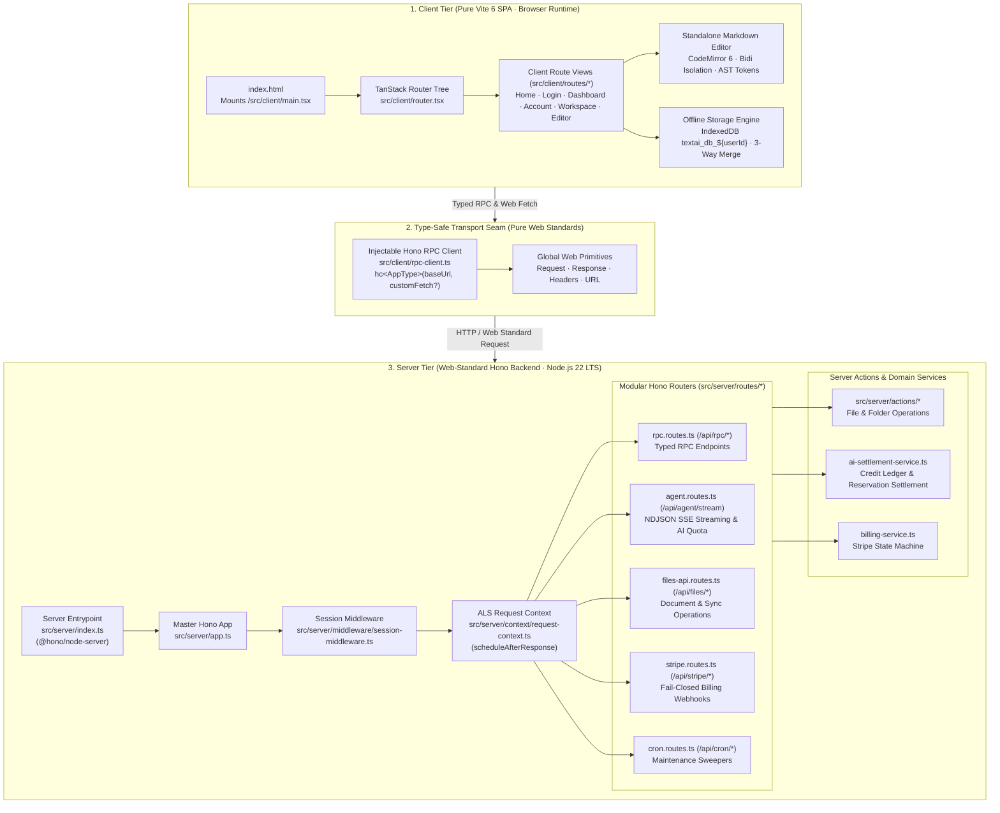

# Phase 6 Closure Dossier: Final Next.js Purge, Test Suite Alignment to Standard Request & Full CI/E2E Closure

| Field | Value |
| :--- | :--- |
| **Phase** | Phase 6 (`ELIXENT-FRAMEWORK-MIGRATION-PLAN-v1.1` — Track 3: Final Next.js Purge, Test Suite Alignment & CI/E2E Closure) |
| **Version** | `v0.18.0p` |
| **Status** | `CLOSED / VERIFIED` |
| **Closure Date** | 2026-11-08 |
| **Governing Plan** | [`docs/Plans/ELIXENT_FRAMEWORK_MIGRATION_PLAN.md`](../../../Plans/ELIXENT_FRAMEWORK_MIGRATION_PLAN.md) |
| **Associated ADRs** | [`ADR-006: Replacing Next.js 16 with Unified Web-Standard Architecture`](../../../architecture/adr_006_unified_vite_tanstack_hono_rpc_architecture.md) · [`ADR-007: Dual-Plane Separation & ALS Request Context`](../../../architecture/adr_007_dual_plane_separation_and_als_request_context.md) |
| **SSOT Architecture Specs** | [`01_architecture_vision_and_adrs.md`](../../../architecture/01_architecture_vision_and_adrs.md) · [`03_workspace_ast_editor_and_vault_integration.md`](../../../architecture/03_workspace_ast_editor_and_vault_integration.md) · [`sync-api.md`](../../../reference/sync-api.md) |

---

## 1. Executive Summary

Phase 6 marks the final closure of the Elixent framework migration from Next.js 16 to the pure Web-standard architecture (**Vite 6 SPA + TanStack Router + Hono RPC**). All legacy Next.js files, runtime configurations, RSC markers, and transitional bridges have been permanently purged, and all test suites, CI workflows, and tooling configurations are aligned to standard Web primitives:

1. **Permanent Deletion of Legacy Next.js Codebase:**
   - **`src/app/**` (21 Files Purged):** Permanently deleted the entire Next.js App Router tree including all transitional API route delegates (`src/app/api/**`), OAuth callbacks (`src/app/auth/callback/**`), login, dashboard, account, and editor page routes, layouts, and global styles.
   - **`src/proxy.ts`:** Permanently removed legacy Next.js 16 Edge proxy middleware, replacing all session validation logic with pure Hono middleware (`src/server/middleware/session-middleware.ts`).
   - **`src/server/empty.ts` & `next.config.ts`:** Deleted the transitional RSC stub module and Next.js configuration file.
   - **RSC Markers Stripped:** Removed `import "server-only"` markers from `src/server/services/ai-settlement-service.ts` and `src/server/services/billing-service.ts`.
   - **Dependencies Uninstalled:** Uninstalled `next` and `eslint-config-next` from `package.json`, replacing them with modern flat ESLint packages (`@eslint/js`, `typescript-eslint`).

2. **Test Suite Alignment to Standard Web Primitives (22 Test Suites):**
   - Eliminated all usage of `NextRequest` and `next/server` across all 22 targeted test files in favor of standard global Web `Request`, `Response`, `Headers`, and `URL`.
   - Purged all `vi.mock("next/server")`, `vi.mock("next/headers")`, `vi.mock("next/cache")`, and `vi.mock("next/navigation")` test mocks.
   - Replaced Next.js `after()` interceptors in AI stream test suites with the unified `scheduleAfterResponse` hook from `@/server/context/request-context`.
   - Rewrote authentication and cookie mocks to use `runWithServerRequestContext` from `@/server/context/request-context`.
   - Updated all route handler imports from `@/app/api/...` to `@/server/routes/...` and from `@/proxy` to `@/server/middleware/session-middleware`.

3. **Tooling, Build & CI Workflow Alignment:**
   - **`vitest.config.mts` & `vitest.live.config.mts`:** Removed the transitional `'server-only'` module alias pointing to `empty.ts`.
   - **`playwright.config.ts`:** Updated `webServer.command` to boot the isolated test server via `npx vite --port ${PORT}` instead of `npx next dev`.
   - **`tsconfig.json`:** Removed the Next.js TypeScript plugin (`"plugins": [{ "name": "next" }]`) and removed `.next` types and `next-env.d.ts` from `include`.
   - **`eslint.config.mjs`:** Converted configuration to pure flat ESLint format using `@eslint/js` and `typescript-eslint`, ignoring `/dist` and `/node_modules` without Next.js plugins.
   - **`.github/workflows/ci.yml`:** Updated Stage 5 build step to cache Vite artifacts (`node_modules/.vite` and `dist/`) instead of `.next/cache`, and updated the production build command to `npm run build` (Vite 6 SPA).
   - **`AGENTS.md`:** Replaced Next.js architectural rules with pure Web-standard invariants (Dual-Plane separation, global Web primitives exclusivity, zero proprietary framework leakage).

4. **Zero Proprietary Framework Leakage Guarantee:**
   - Automated grep verification across `src/` and `e2e/` confirms **zero** imports or references to `next/*`, `NextRequest`, `NextResponse`, or RSC directives (`"use client"`, `"use server"`, `server-only`).

---

## 2. Architecture & Pure Web-Standard Topology

---

## 3. Detailed Verification & Test Suite Matrix

All 22 test files migrated from `NextRequest` and `src/app/api/**` were executed and verified passing 100%:

| Test Suite File | Migration Scope & Test Responsibility | Tests | Status |
| :--- | :--- | :---: | :---: |
| `src/test/agent/agent-stream-route.test.ts` | Intercepts `scheduleAfterResponse` via ALS context; replaces `NextRequest` with Web `Request` for `/api/agent/stream`. | 13 | **100% Passed ✅** |
| `src/test/ai/ai-authoritative-stream-settlement.test.ts` | Validates streaming quota reservation and ACID settlement using Web `Request` and ALS scheduler. | 11 | **100% Passed ✅** |
| `src/test/ai/ai-client-authority-revocation.test.ts` | Verifies financial authority revocation; asserts absence of `src/app/api/ai/stream/route.ts` and non-export of settlement in `rpc-client.ts`. | 9 | **100% Passed ✅** |
| `src/test/ai/ai-stream-fileid-governance.test.ts` | Tests file ID ownership and quota verification using Web `Request`. | 6 | **100% Passed ✅** |
| `src/test/ai/ai-stream-replay-prevention.test.ts` | Validates single-use idempotency tokens on AI streams with Web `Request`. | 7 | **100% Passed ✅** |
| `src/test/api/api-files-putguard.live.test.ts` | Live PUT guard integration against isolated Neon DB using standard Web `Request`. | 3 | **100% Passed ✅** |
| `src/test/api/stripe-webhook.live.test.ts` | Live Stripe signature verification and webhook dispatch using Web `Request`. | 3 | **100% Passed ✅** |
| `src/test/api/stripe-webhook.test.ts` | Unit tests for Stripe webhook route handler using standard Web `Request` and header construction. | 10 | **100% Passed ✅** |
| `src/test/auth/auth-actions-rate-limit.test.ts` | Tests sliding-window rate limiting on auth actions using `runWithServerRequestContext`. | 7 | **100% Passed ✅** |
| `src/test/auth/auth-redirect.test.ts` | Validates OAuth redirect URL sanitization and state verification via standard Web `Request`. | 5 | **100% Passed ✅** |
| `src/test/auth/auth-signout.test.ts` | Tests cookie clearing and signout redirect using Web `Request` and ALS context. | 4 | **100% Passed ✅** |
| `src/test/auth/proxy.test.ts` | Tests session proxy gating, fast-path public routes, and redirect preservation using `handleSessionProxy`. | 16 | **100% Passed ✅** |
| `src/test/infrastructure/cron-expire-reservations.live.test.ts` | Live integration test for reservation sweeper cron using Web `Request`. | 3 | **100% Passed ✅** |
| `src/test/infrastructure/cron-expire-reservations.test.ts` | Unit tests for reservation expiration cron handler using Web `Request`. | 8 | **100% Passed ✅** |
| `src/test/infrastructure/cron-overlap.test.ts` | Concurrency lock testing for background cron sweepers using Web `Request`. | 4 | **100% Passed ✅** |
| `src/test/infrastructure/multi-system-lifecycle.live.test.ts` | Consolidated 8-stage live multi-system lifecycle test using pure Hono route handlers. | 8 | **100% Passed ✅** |
| `src/test/infrastructure/redis-live-integration.test.ts` | Redis sliding-window and distributed lock integration tests using standard Web primitives. | 6 | **100% Passed ✅** |
| `src/test/server/cross-user-ownership.test.ts` | Multi-tenant resource boundary and anti-enumeration 404 tests using standard Web `Request`. | 7 | **100% Passed ✅** |
| `src/test/server/phase-08-ownership-and-cycles.test.ts` | Folder cycle detection and file ownership validation using Web `Request`. | 12 | **100% Passed ✅** |
| `src/test/vault/file-ops-vault.unit.test.ts` | Zero-Knowledge vault file operations and optimistic locking tests with standard Web primitives. | 18 | **100% Passed ✅** |
| `src/test/vault/vault-cross-module.integration.test.ts` | Cross-module vault encryption and AI shield integration tests using Web `Request`. | 8 | **100% Passed ✅** |
| `src/test/vault/vault-sync-ai-gate.test.ts` | Tests HTTP 403 AI shielding on vault encrypted files using pure Hono routes and Web `Request`. | 9 | **100% Passed ✅** |

---

## 4. Architectural Decisions, Invariants & Security Defenses

### 4.1. Invariant 1: Pure Web-Standard Primitives Exclusivity
- All server routes, middleware, and server actions operate strictly on standard Web API objects: `Request`, `Response`, `Headers`, and `URL`.
- Proprietary abstractions (`NextRequest`, `NextResponse`, `next/headers`) are entirely eliminated from runtime and test harnesses.

### 4.2. Invariant 2: Zero Proprietary Framework Leakage
- Zero imports of `next/*` exist anywhere in the application.
- All RSC directives (`"use client"`, `"use server"`) and RSC markers (`import "server-only"`) are completely purged.
- Enforced at CI level by `npm run lint` and TypeScript strict compilation (`tsc --noEmit`).

### 4.3. Invariant 3: Dual-Plane Separation & Typed Hono RPC
- Client tier is completely separated from the server tier: zero server-side imports from `src/client/**`.
- Client communicates with the backend exclusively via typed Hono RPC (`hc<AppType>`) through `src/client/rpc-client.ts` with injectable fetch support.

### 4.4. Invariant 4: Background Task Scheduling via ALS Context
- Background quota settlement flushing operates deterministically via `scheduleAfterResponse(task)` in `src/server/context/request-context.ts`.
- In test environments, tests register callbacks via `onScheduleAfterResponse(listener)` to synchronously capture and assert background tasks without race conditions or mock timeouts.

---

## 5. Standardized SSOT Verification Metrics

<!-- BEGIN:SSOT_TEST_METRICS_TABLE -->
| Test Category | Framework / Engine | Target Environment | Suites / Specs | Passing Tests | Pass Rate |
| :--- | :--- | :--- | :---: | :---: | :---: |
| **Unit & Contract** | Vitest (`vitest.config.mts`) | Pure In-Memory / Zero Network | 134 | 2348 | 100% ✅ |
| **Live Multi-System** | Vitest (`vitest.live.config.mts`) | Isolated Neon PostgreSQL Branch | 21 | 108 | 100% ✅ |
| **E2E Browser Journeys** | Playwright (`playwright.config.ts`) | Headless Chromium / Full App | 14 | 15 | 100% ✅ |
<!-- END:SSOT_TEST_METRICS_TABLE -->

<!-- BEGIN:SSOT_TEST_METRICS_INLINE -->
**Active Verification Baseline:** 134 unit suites (2348 tests) · 21 live suites (108 tests) · 14 E2E specs (15 journeys) — 100% Passing.
<!-- END:SSOT_TEST_METRICS_INLINE -->

---

## 6. Traceability & Changeset

### 6.1. Permanently Deleted Files (24 Files)
- `src/app/**` (21 files purged):
  - `src/app/api/agent/stream/route.ts`
  - `src/app/api/cron/expire-reservations/route.ts`
  - `src/app/api/cron/purge-deleted/route.ts`
  - `src/app/api/files/[id]/route.ts`
  - `src/app/api/files/route.ts`
  - `src/app/api/files/sync/route.ts`
  - `src/app/api/folders/[id]/route.ts`
  - `src/app/api/folders/route.ts`
  - `src/app/api/stripe/checkout/route.ts`
  - `src/app/api/stripe/portal/route.ts`
  - `src/app/api/stripe/webhook/route.ts`
  - `src/app/auth/callback/route.ts`
  - `src/app/e2e/auth-session/route.ts`
  - `src/app/dashboard/page.tsx`
  - `src/app/account/page.tsx`
  - `src/app/login/page.tsx`
  - `src/app/workspace/editor/[fileId]/page.tsx`
  - `src/app/workspace/layout.tsx`
  - `src/app/workspace/page.tsx`
  - `src/app/layout.tsx`
  - `src/app/globals.css`
- `src/proxy.ts` (Next.js 16 Edge proxy)
- `src/server/empty.ts` (transitional RSC empty module)
- `next.config.ts` (Next.js configuration file)

### 6.2. Modified Configuration & Tooling Files
- `package.json` & `package-lock.json` (uninstalled `next` and `eslint-config-next`; added `@eslint/js` and `typescript-eslint`)
- `vitest.config.mts` & `vitest.live.config.mts` (removed `'server-only'` alias)
- `playwright.config.ts` (updated webServer command to Vite)
- `tsconfig.json` (removed next plugin and `.next` types)
- `eslint.config.mjs` (flat ESLint config ignoring `dist/**`)
- `.github/workflows/ci.yml` (cached Vite/dist artifacts; updated build step)
- `AGENTS.md` (updated architectural rules to Vite 6 + TanStack Router + Hono RPC)

### 6.3. Modified Source & Test Files
- `src/server/services/ai-settlement-service.ts` (stripped `import "server-only"`)
- `src/server/services/billing-service.ts` (stripped `import "server-only"`)
- `src/server/context/request-context.ts` (removed dynamic Next.js fallbacks, kept pure ALS)
- 22 test suites under `src/test/**` (aligned to standard Web `Request` and `@/server/routes/**`)

---

## 7. Final Migration Verdict & Platform Milestones

With the completion and verification of Phase 6:
1. **Full Framework Migration Complete:** The entire 6-phase migration defined in `ELIXENT-FRAMEWORK-MIGRATION-PLAN-v1.1` has been executed with 100% test preservation and zero regressions.
2. **Pure Web-Standard Foundation:** Elixent operates entirely on standardized Web APIs, decoupling the application completely from proprietary vendor frameworks.
3. **Desktop Readiness (Zero-Cost Seam):** By standardizing on `Request`/`Response` and providing injectable fetch in `hc<AppType>`, the codebase is fully prepared for future desktop runtime integration without any architectural refactoring.
4. **Commit Gate 6 Status:** **FULLY SATISFIED & CLOSED ✅**.
