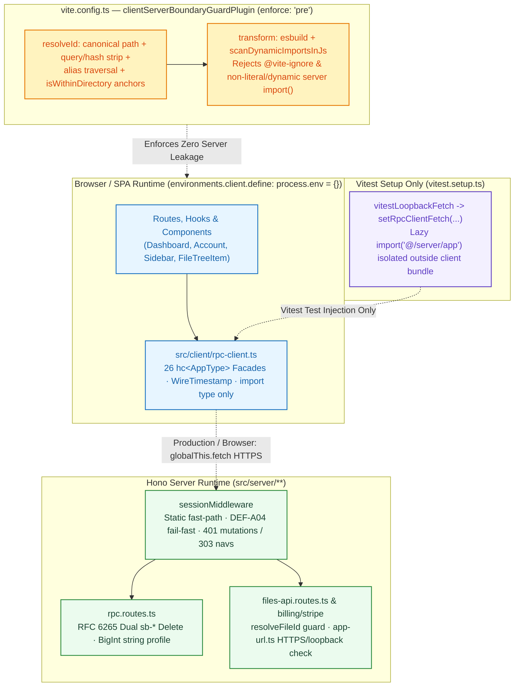

# Phase 2.5 Closure Dossier: Purge Vitest Bridge, Fix Boundary Leaks & Harden RPC Architecture (`DEF-A01` to `DEF-A08`)

| Standard Field | Value |
| :--- | :--- |
| **Phase** | `Phase 2.5: Purge Vitest Bridge, Fix Boundary Leaks & Hardening RPC Architecture (DEF-A01 to DEF-A08)` |
| **Milestone / Version** | `v0.20.1` |
| **Status** | `CLOSED / VERIFIED` ✅ |
| **Closure Date** | `2026-11-11` |
| **Triggering Forensic Audit** | [`nextjs-decoupling-phases-1-and-2-forensic-audit.md`](../../audits/nextjs-decoupling-phases-1-and-2-forensic-audit.md) |
| **Governing Plan** | [`docs/Plans/ELIXENT_NEXTJS_DECOUPLING_AND_CLEAN_ARCHITECTURE_PLAN.md`](../../../Plans/ELIXENT_NEXTJS_DECOUPLING_AND_CLEAN_ARCHITECTURE_PLAN.md) (`ELIXENT-NEXTJS-DECOUPLING-CLEAN-ARCH-PLAN-v1.3`) |
| **Associated ADRs** | [`ADR-006: Unified Vite TanStack Hono RPC Architecture`](../../../architecture/adr_006_unified_vite_tanstack_hono_rpc_architecture.md) (`v1.1`) · [`ADR-007: Dual-Plane Separation & ALS Request Context`](../../../architecture/adr_007_dual_plane_separation_and_als_request_context.md) (`v1.1`) |
| **SSOT Architecture & Reference Suite** | [`security-and-rate-limiting.md`](../../../architecture/security/security-and-rate-limiting.md) · [`sync-api.md`](../../../reference/sync-api.md) · [`stripe-integration.md`](../../../guides/billing/stripe-integration.md) · [`04_credit_metering_and_settlement_architecture.md`](../../../architecture/04_credit_metering_and_settlement_architecture.md) |

---

## 1. Executive Summary

Phase 2.5 executes targeted architectural, security, and runtime-boundary remediation for findings **`DEF-A01` through `DEF-A08`** identified in the post-Phase 2 forensic audit before advancing into Phase 3 (`TanStack Router` SPA view modernization):

1. **`DEF-A01` — Pure RPC Client & External Vitest Transport Injection (`src/client/rpc-client.ts`, `vitest.setup.ts`):**
   - Purged `isVitestBridgeActive()`, `vitestLoopbackFetch`, `@vite-ignore` dynamic loaders, and all 7 split dynamic path expressions (`"@" + "/server/..."`) from `src/client/rpc-client.ts`.
   - Routed all 26 exported client facades deterministically through `getRpcClient().api.rpc...` (`hc<AppType>`), retaining `import type { AppType } from "@/server/app"` as a purely type-erased compile-time contract and normalizing errors/Zod outputs via `parseRpcResult`.
   - Relocated lazy `vitestLoopbackFetch` exclusively to `vitest.setup.ts` via `rpcMod.setRpcClientFetch(vitestLoopbackFetch)` (exposing `getRpcClientFetch()` on `rpc-client.ts`), decoupled 7 legacy unit/integration suites onto `@/client/rpc-client`, aligned `rpc-client.test.ts` & `wave-2-2-rpc-unification.test.ts`, and pre-warmed `@/server/app` in `editor-orchestration.live.test.ts` `beforeAll` (`60_000` timeout).
2. **`DEF-A02` — Bypass-Resistant Client/Server Boundary Guard & Vite 6 Environment Isolation (`vite.config.ts`, `tsconfig.json`):**
   - Rebuilt `clientServerBoundaryGuardPlugin` (`enforce: "pre"`) with `configResolved`, `resolveId`, and `transform` hooks: strips query/hash (`?raw`, `?url`, `#hash`) and `/@fs/` prefixes, canonicalizes specifiers via `path.resolve` + lowercase POSIX normalization (`toCanonicalPosix`), blocks alias traversal (`@/client/../server/...`), and checks exact project-root anchors (`createBoundaryAnchors` + `isWithinDirectory`).
   - Added `esbuild.transformSync` + lexical `scanDynamicImportsInJs` analysis in `transform` rejecting `@vite-ignore`, non-literal dynamic `import(...)`, and dynamic literal server imports across non-server modules (zero exceptions).
   - Scoped client `process.env` stripping to Vite 6 `environments.client.define["process.env"] = {}` + `optimizeDeps.esbuildOptions.define` (omitted under `VITEST` / `mode === "test"`, preserving SSR dev middleware), and declared `"types": ["vite/client", "node"]` in `tsconfig.json`.
3. **`DEF-A03` — Centralized Fail-Fast URL Resolution (`src/lib/config/app-url.ts`):**
   - Created `src/lib/config/app-url.ts` (`getAppBaseUrl`, `resolveAppUrl`) enforcing `APP_URL` > `VITE_APP_URL` precedence (eliminating `NEXT_PUBLIC_APP_URL`), Fail-Fast HTTPS enforcement in production, loopback-only (`localhost`, `127.0.0.1`, `[::1]`) HTTP allowance outside production, open-redirect defenses (control chars, backslashes, `//`, explicit schemes, origin escapes), and literal `{CHECKOUT_SESSION_ID}` token preservation across `src/lib/stripe/index.ts` and `src/server/services/billing-service.ts`.
4. **`DEF-A04` — Test-Only Supabase Placeholder Scoping (`supabase/client.ts`, `supabase/server.ts`, `session-middleware.ts`):**
   - Restricted placeholder credential fallbacks strictly to verified test runtimes (`NODE_ENV === "test"` or truthy `VITEST`, plus `import.meta.env.MODE === "test"` / `VITEST` in browser).
   - Moved `const supabase = await createClient()` outside `try/catch` in `getUser()` and `getSession()` (`src/lib/supabase/server.ts`) so missing-credential Fail-Fast exceptions propagate cleanly rather than silently resolving `null`.
5. **`DEF-A05` — RFC 9110 Mutation Gating, `303 See Other` & Static Asset Fast-Path (`session-middleware.ts`):**
   - Added `isStaticAssetPath(pathname)` fast-path bypass for non-`/api/` `/assets/*`, `/favicon.ico`, `/robots.txt`, and static extensions before env validation, Supabase instantiation, or cookie cloning.
   - Enforced fail-closed `401 Unauthorized` JSON for unauthenticated protected mutations (`method !== "GET" && method !== "HEAD" && method !== "OPTIONS"`), `Accept: application/json`, and `/api/*` requests, while redirecting safe unauthenticated HTML navigations (`GET`/`HEAD`) with `303 See Other`.
6. **`DEF-A06` — RFC 6265 Dual Cookie Clearing on Sign-Out (`src/server/routes/rpc.routes.ts`):**
   - Hardened `POST /api/rpc/auth/sign-out` to filter strictly via `isSupabaseAuthCookie` (`sb-*` with optional `__Host-`/`__Secure-` prefixes), issuing dual `deleteCookie` directives (`httpOnly: true` and `httpOnly: false`, `expires: new Date(0)`, `path: "/"`, `sameSite: "Lax"`, derived `secure` flag) plus valid non-localhost/non-IP domain-scoped dual clearing via `resolveCookieDomain(c)` (`COOKIE_DOMAIN` > `X-Forwarded-Host` > `Host` > URL host; omitting `Domain` on `__Host-` per RFC 6265 §4.1.2.5).
7. **`DEF-A07` — Wire Timestamp & BigInt Decimal String Contracts (`src/types/rpc-contracts.ts`, `rpc.routes.ts`, UI Tree/Sidebar):**
   - Exported `WireTimestamp = string | Date` across `FileRecord`, `VaultProfileRecord`, and `UserProfileRecord`, updated `UserProfileRecord.creditBalanceMicro` to `string`, aligned `GET /api/rpc/auth/profile` to serialize `String(userRecord.creditBalanceMicro)` safely, and typed `Sidebar` and `FileTreeItem` `FileItem` dates with `WireTimestamp`.
8. **`DEF-A08` — Strict Path Parameter Validation (`src/server/routes/files-api.routes.ts`):**
   - Hardened `resolveFileId` (`normalizeFileId`) across `/api/files/:id` (`GET`/`PUT`/`DELETE`) to reject empty/whitespace IDs, `.` / `..`, embedded `/` or `\`, extra multi-segment paths (`/api/files/:id/extra`), malformed `%`-encoding, and reserved segments (`api`, `files`, `sync`, `upload`) with HTTP `400` `{ error: "Invalid or missing file ID", correlationId }`.

---

## 2. Hardened Client/Server Boundary & RPC Transport Architecture



---

## 3. Remediation Verification Matrix (`DEF-A01` to `DEF-A08`)

| Finding ID | Remediation Scope & Primary Files | Enforced Invariant / Security Control | Status |
| :--- | :--- | :--- | :---: |
| **`DEF-A01`** | `src/client/rpc-client.ts`, `vitest.setup.ts`, 7 client/editor unit suites, `rpc-client.test.ts`, `wave-2-2-rpc-unification.test.ts`, `editor-orchestration.live.test.ts` | Zero runtime server imports or split dynamic path bridges inside `src/client/**`; `vitestLoopbackFetch` injected solely from `vitest.setup.ts`; all 26 facades routed over `hc<AppType>` with Zod/error normalization (`parseRpcResult`). | **PASS ✅** |
| **`DEF-A02`** | `vite.config.ts`, `tsconfig.json`, `src/test/config/vite-boundary-guard.test.ts` | Fail-closed canonical path + lowercase normalization, alias traversal blocking, project-root `isWithinDirectory` anchors, AST/lexical `transform` guard rejecting `@vite-ignore` / dynamic imports, and Vite 6 `environments.client` `process.env` isolation. | **PASS ✅** |
| **`DEF-A03`** | `src/lib/config/app-url.ts` *(NEW)*, `src/lib/stripe/index.ts`, `src/server/services/billing-service.ts`, `src/test/server/stripe-index.test.ts`, `billing-service.test.ts` | `APP_URL` > `VITE_APP_URL` precedence; Fail-Fast production HTTPS enforcement; loopback-only HTTP downgrade; open-redirect path rejection; `{CHECKOUT_SESSION_ID}` literal preservation. | **PASS ✅** |
| **`DEF-A04`** | `src/lib/supabase/client.ts`, `src/lib/supabase/server.ts`, `src/server/middleware/session-middleware.ts`, `src/test/auth/supabase-client.test.ts`, `session-middleware.test.ts` | Supabase placeholder fallback restricted strictly to verified test runtimes (`NODE_ENV === "test"` / `VITEST`); `getUser()` and `getSession()` allow `createClient()` configuration errors to propagate cleanly. | **PASS ✅** |
| **`DEF-A05`** | `src/server/middleware/session-middleware.ts`, `src/test/server/session-middleware.test.ts` | Non-`/api/` static asset bypass before env/Supabase/cookie cloning; protected unauthenticated mutations (`POST`/`PUT`/`PATCH`/`DELETE`), JSON, and `/api/*` fail closed with `401`; safe protected `GET`/`HEAD` HTML navigations redirect `303 See Other`. | **PASS ✅** |
| **`DEF-A06`** | `src/server/routes/rpc.routes.ts`, `src/test/server/rpc-routes.test.ts` | Strict `isSupabaseAuthCookie` filter; dual `httpOnly` (`true`/`false`) host-only + non-localhost domain-scoped deletion via `resolveCookieDomain(c)`; RFC 6265 `__Host-` `Domain`-omission and `Secure` flag enforcement. | **PASS ✅** |
| **`DEF-A07`** | `src/types/rpc-contracts.ts`, `src/server/routes/rpc.routes.ts`, `src/components/layout/sidebar.tsx`, `src/components/files/file-tree-item.tsx`, `src/test/contracts/rpc-contracts.test.ts` | `WireTimestamp` (`string \| Date`) applied to file, vault, and profile DTOs/components; `UserProfileRecord.creditBalanceMicro` typed and serialized as decimal `string`. | **PASS ✅** |
| **`DEF-A08`** | `src/server/routes/files-api.routes.ts`, `src/test/server/files-api-routes.test.ts` | `resolveFileId` / `normalizeFileId` rejects empty, dot segments (`.`/`..`), embedded slashes/backslashes, trailing segments, malformed `%`-encoding, and reserved route names (`api`, `files`, `sync`, `upload`) with HTTP `400`. | **PASS ✅** |

---

## 4. Test Gate & SSOT Metrics Verification Baseline

All verification commands executed against the final Phase 2.5 working tree passed with 100% green exit codes:

```bash
# 1. Static TypeScript Verification (0 errors)
npx tsc --noEmit

# 2. ESLint Static Quality Gate (0 errors; 3 pre-existing unused-var warnings in wave-2-2-rpc-unification.test.ts)
npm run lint

# 3. Vite 6 Production Build (2,196 modules transformed in 1m 14s)
npm run build

# 4. Full In-Memory Unit & Contract Suite (140 suites, 2,745 tests passing)
npm test

# 5. Live Database Integration Suites on Isolated Neon Branch ep-dark-queen-ahbapy5k-pooler (21 suites, 105 tests passing)
npm run test:live

# 6. Canonical Metrics & Markdown Links Integrity Gate
node scripts/sync-doc-metrics.mjs --check
node scripts/check-markdown-links.mjs
node scripts/check-markdown-links.mjs --file=docs/records/closures/nextjs-decoupling/phase-02-5-purge-vitest-bridge-fix-boundary-leaks-and-harden-rpc.md
```

### Verified Metrics Delta (`v0.20.0` → `v0.20.1`)

| Metric Dimension | Prior Milestone (`v0.20.0`) | Phase 2.5 Baseline (`v0.20.1`) | Delta / Notes |
| :--- | :---: | :---: | :--- |
| **Unit & Contract Suites** | 140 | **140** | All suites retained (`rpc-client`, `vite-boundary-guard`, `session-middleware`, `rpc-routes`, `files-api-routes`, `stripe-index`, `billing-service`, `supabase-client`, `rpc-contracts` expanded) |
| **Unit & Contract Tests** | 2,540 | **2,745** | **`+205` tests** verifying `DEF-A01`–`DEF-A08` security, bundler, cookie, URL, contract, and path hardening invariants |
| **Live Database Suites** | 21 | **21** | Isolated Neon branch (`ep-dark-queen-ahbapy5k-pooler`) |
| **Live Database Tests** | 105 | **105** | `100%` pass rate (includes warmed `@/server/app` orchestration fixture in `editor-orchestration.live.test.ts`) |
| **Playwright E2E Specs / Journeys** | 14 / 15 | **14 / 15** | Unchanged baseline |
| **TypeScript Type Errors** | 0 | **0** | Verified via `npx tsc --noEmit` |
| **ESLint Errors** | 0 | **0** | Verified via `npm run lint` (`0` errors) |
| **Phase 2.5 Doc Links Status** | 0 | **0 broken** | `0` broken links across all Phase 2.5 created/updated files (`132 / 133` repo docs clean; global scan flags `24` pre-existing `file:///` links inside immutable audit record `docs/records/audits/nextjs-decoupling-phases-1-and-2-forensic-audit.md`) |

---

## 5. Phase Closure Verdict

**VERDICT: CLOSED / VERIFIED ✅ (`v0.20.1`)**

All eight forensic remediation items (`DEF-A01` to `DEF-A08`) are implemented, regression-tested across `140` unit/contract suites (`2,745` tests) and `21` live Neon integration suites (`105` tests), compiled cleanly via Vite 6 production build (`2,196` modules), and synchronized across living architecture, reference, billing guide, plan, and changelog documentation. The codebase is ready to proceed cleanly into **Phase 3**.
