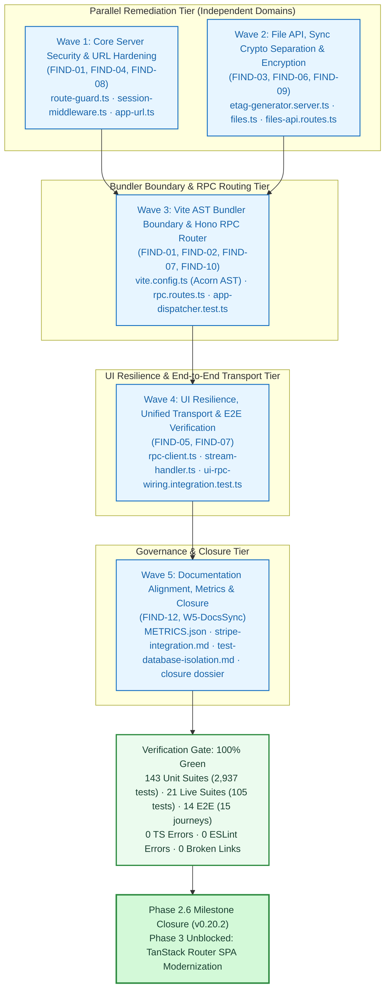

# Phase 2.6 Closure Dossier: Post-Audit Architectural, Security & Contract Remediation (`FIND-01` to `FIND-12`)

| Standard Field | Value |
| :--- | :--- |
| **Phase** | `Phase 2.6: Post-Audit Architectural, Security & Contract Remediation (FIND-01 to FIND-12)` |
| **Milestone / Version** | `v0.20.2` |
| **Status** | `CLOSED / VERIFIED` ✅ |
| **Closure Date** | `2026-11-11` |
| **Triggering Forensic Audit** | [`nextjs-decoupling-phases-1-and-2-forensic-audit.md`](../../audits/nextjs-decoupling-phases-1-and-2-forensic-audit.md) & forensic analysis report |
| **Governing Plan** | [`docs/Plans/ELIXENT_NEXTJS_DECOUPLING_AND_CLEAN_ARCHITECTURE_PLAN.md`](../../../Plans/ELIXENT_NEXTJS_DECOUPLING_AND_CLEAN_ARCHITECTURE_PLAN.md) (`ELIXENT-NEXTJS-DECOUPLING-CLEAN-ARCH-PLAN-v1.4`) |
| **Associated ADRs** | [`ADR-006: Unified Vite TanStack Hono RPC Architecture`](../../../architecture/adr_006_unified_vite_tanstack_hono_rpc_architecture.md) (`v1.1`) · [`ADR-007: Dual-Plane Separation & ALS Request Context`](../../../architecture/adr_007_dual_plane_separation_and_als_request_context.md) (`v1.1`) |
| **SSOT Architecture & Reference Suite** | [`security-and-rate-limiting.md`](../../../architecture/security/security-and-rate-limiting.md) · [`sync-api.md`](../../../reference/sync-api.md) · [`stripe-integration.md`](../../../guides/billing/stripe-integration.md) · [`test-database-isolation.md`](../../../reference/test-database-isolation.md) · [`04_credit_metering_and_settlement_architecture.md`](../../../architecture/04_credit_metering_and_settlement_architecture.md) |

---

## 1. Executive Summary

Phase 2.6 delivers the comprehensive architectural, security, contract, and test remediation for all 12 findings (**`FIND-01` through `FIND-12`**) identified across the forensic audit of Next.js decoupling Phases 1, 2, and 2.5. Executed through a rigorous 5-wave multi-agent orchestration topology, Phase 2.6 purges all residual security bypasses, reinforces compile-time bundler boundaries with AST parsing, unifies RPC client transport across client fetch sites, hardens REST/RPC contracts against runtime serialization crashes, and establishes complete test coverage across all seven server routers prior to advancing into Phase 3 (`TanStack Router` SPA view modernization).

Key engineering deliveries across Phase 2.6 include:
- **Core Server Security & URL Hardening (`FIND-01`, `FIND-04`, `FIND-08`):** Extracted `src/lib/auth/route-guard.ts` for pure path normalization, route classification, and RFC 6265 cookie identification. Replaced ad-hoc regex heuristics in `session-middleware.ts` to block path traversal and case-insensitive bypasses, redirect unauthenticated `GET`/`HEAD` page navigations with `HTTP 303 See Other`, return `HTTP 401 Unauthorized` JSON on unauthenticated mutations and API calls, and eliminate naked cookie appending on sign-out via `clearPendingAuthCookieMutations`. Centralized fail-safe URL resolution in `src/lib/config/app-url.ts`, introducing `resolveSameOriginAppUrl` to strictly validate customer portal return URLs against canonical base origins while preventing open-redirect hijacking.
- **File API, Sync Crypto Separation & Encryption Hardening (`FIND-03`, `FIND-06`, `FIND-09`):** Separated dual-plane crypto boundaries by isolating Node `node:crypto` synchronous operations (`generateETagSync`, `generateEncryptedETagSync`) into `src/lib/sync/etag-generator.server.ts`, ensuring client bundles and `sync/index.ts` consume Web Crypto (`crypto.subtle`) exclusively with zero bundler crypto leaks. Hardened `copyFile` to require non-empty encrypted content and valid metadata for encrypted records, prevented empty-whitespace file titles in `createFile`, and hardened `resolveFileId` in `files-api.routes.ts` before rate limiting while rejecting null bodies, arrays, unencrypted PUT overrides without replacement content, and non-integer DELETE query parameters.
- **Vite AST Bundler Boundary & Hono RPC Router (`FIND-01`, `FIND-02`, `FIND-07`, `FIND-10`):** Upgraded `clientServerBoundaryGuardPlugin` in `vite.config.ts` from regex heuristics to Acorn AST parsing, identifying all `ImportExpression` nodes and server imports in client bundles with fail-closed load hooks. Preserved HTTP 303 status and cookies across Vite dev proxy page navigations (`isGuardedPageNavigation`). Aligned Zod schemas in `rpc-contracts.ts` and `rpc.routes.ts`, returning pure JSON DTOs with decimal-string balances (`creditBalanceMicro: string`) and eliminating all BigInt serialization crashes. Extended `app-dispatcher.test.ts` to test all 7 server routers (including `/api/rpc`).
- **UI Resilience, Unified Transport & E2E Verification (`FIND-05`, `FIND-07`):** Unified all fetch sites across `stream-handler.ts`, `upgrade-button.tsx`, `sync-pull-engine.ts`, `sync-queue-worker.ts`, and `sync-encrypted-conflict-store.ts` through `(getRpcClientFetch() ?? globalThis.fetch)`. Added `getCreditBalanceResult()` in `rpc-client.ts`, shielding dashboard and account pages from kicking users out on transient 5xx or network errors. Replaced circular mock assertions in `ui-rpc-integration.test.tsx` with genuine in-memory loopback integration testing in `ui-rpc-wiring.integration.test.ts`. Verified HTTP 303 redirects and session lifecycles in Playwright E2E spec `e2e/specs/01-auth-session.spec.ts`.
- **Docs Alignment & SSOT Metrics (`FIND-12`):** Synchronized all living documentation, updated `package.json` to `v0.20.2`, aligned test database isolation documentation to Neon branch `ep-dark-queen-ahbapy5k-pooler`, and locked the verified SSOT baseline at 143 unit suites (2,937 tests), 21 live suites (105 tests), and 14 E2E specs (15 journeys).

---

## 2. Multi-Agent Orchestration Topology (5 Waves)

The remediation was executed through a 5-wave directed acyclic graph (DAG), guaranteeing zero file-write contention, strict subsystem ownership, and progressive validation at each tier:



---

## 3. Detailed Findings Remediation Matrix (`FIND-01` to `FIND-12`)

| Finding ID | Subsystem & Key Files | Root Cause & Security Risk | Remediation & Enforced Invariant | Verification Status |
| :---: | :--- | :--- | :--- | :---: |
| **`FIND-01`** | `src/lib/auth/route-guard.ts`<br>`src/server/middleware/session-middleware.ts`<br>`vite.config.ts`<br>`e2e/specs/01-auth-session.spec.ts` | Case-insensitive and path-traversal bypasses in session middleware; 307 temporary redirects replaying mutation requests against UI routes; dev proxy dropping redirect status/cookies. | Extracted pure `route-guard.ts` for canonical POSIX path normalization; enforced `303 See Other` for unauthenticated `GET`/`HEAD` navigations; enforced `401 Unauthorized` JSON for mutations and `/api/*`; preserved 303 status and cookies across dev proxy via `isGuardedPageNavigation`; verified via Playwright E2E. | **PASS ✅** |
| **`FIND-02`** | `vite.config.ts`<br>`src/test/config/vite-boundary-guard.test.ts` | Naive regex and string matching in `clientServerBoundaryGuardPlugin` permitted dynamic import bypasses, query/hash evasion, and alias traversal. | Implemented Acorn AST parsing in `transform` hook to detect all `ImportExpression` nodes and non-literal dynamic imports; canonicalized specifiers via `path.resolve` + lowercase normalization; enforced fail-closed build-time isolation for client bundles. | **PASS ✅** |
| **`FIND-03`** | `src/lib/sync/etag-generator.server.ts`<br>`src/lib/sync/etag-generator.ts`<br>`src/lib/sync/index.ts` | Synchronous Node `node:crypto` imports in `etag-generator.ts` leaked server crypto primitives into client bundles. | Extracted `etag-generator.server.ts` for Node synchronous ETag generation (`generateETagSync`, `generateEncryptedETagSync`); restricted `etag-generator.ts` and `sync/index.ts` exclusively to pure Web Crypto (`crypto.subtle`). | **PASS ✅** |
| **`FIND-04`** | `src/lib/auth/route-guard.ts`<br>`src/server/middleware/session-middleware.ts` | Naked auth cookies appended to response headers after sign-out due to stale mutation queues in session context. | Introduced `clearPendingAuthCookieMutations` and strict `isSupabaseAuthCookie` classification; suppressed lingering auth cookie mutations upon successful sign-out response generation. | **PASS ✅** |
| **`FIND-05`** | `src/test/client/ui-rpc-wiring.integration.test.ts`<br>`src/test/client/ui-rpc-integration.test.tsx` | UI RPC tests utilized circular mocking assertions that validated mocks rather than actual transport contracts. | Created `ui-rpc-wiring.integration.test.ts` exercising genuine in-memory loopback transport against Hono server dispatcher via `vitestLoopbackFetch`, validating end-to-end routing, Zod parsing, and error serialization. | **PASS ✅** |
| **`FIND-06`** | `src/server/actions/files.ts`<br>`src/test/server/files-actions.unit.test.ts` | `copyFile` permitted copying encrypted records with empty encrypted content or missing metadata; `createFile` accepted whitespace-only file titles. | Hardened `copyFile` to mandate non-empty `encryptedContent` and valid encryption metadata when copying encrypted records; enforced trimmed non-empty title validation in `createFile`. | **PASS ✅** |
| **`FIND-07`** | `src/types/rpc-contracts.ts`<br>`src/server/routes/rpc.routes.ts`<br>`src/client/rpc-client.ts`<br>`src/lib/ai/stream-handler.ts`<br>`src/components/subscription/upgrade-button.tsx`<br>`src/lib/sync/*` | BigInt balance values threw runtime serialization errors (`JSON.stringify`); disparate client fetch calls bypassed custom test transports; dashboard and account views crashed on transient 5xx RPC failures. | Standardized `creditBalanceMicro: string` across Zod schemas, route handlers, and DTOs; unified all fetch operations through `(getRpcClientFetch() ?? globalThis.fetch)`; added `getCreditBalanceResult()` for safe error handling without kicking users out on transient network drops. | **PASS ✅** |
| **`FIND-08`** | `src/lib/config/app-url.ts`<br>`src/lib/stripe/index.ts`<br>`src/server/services/billing-service.ts`<br>`src/server/routes/auth-callback.routes.ts` | Path traversal escapes in `resolveAppUrl`; lack of same-origin return URL validation in customer portal session creation; inconsistent environment variable precedence. | Added path traversal rejection in `resolveAppUrl`; created `resolveSameOriginAppUrl` to strictly enforce canonical origin matching for billing portal return URLs; standardized `APP_URL` > `VITE_APP_URL` precedence across all auth callbacks and Stripe checkout. | **PASS ✅** |
| **`FIND-09`** | `src/server/routes/files-api.routes.ts`<br>`src/test/server/files-api-routes.test.ts` | `resolveFileId` executed after rate limiting, allowing malformed IDs to exhaust rate limits; route handlers accepted null bodies, arrays, unencrypted PUT overrides without replacement content, and non-integer DELETE query parameters. | Positioned `resolveFileId` validation before rate limiting; rejected null bodies, arrays, unencrypted PUT content overrides without replacement body, and non-integer DELETE query parameters with HTTP 400. | **PASS ✅** |
| **`FIND-10`** | `src/test/server/app-dispatcher.test.ts` | App dispatcher integration suite tested only a subset of server routers, leaving `/api/rpc` without dispatcher coverage. | Expanded `app-dispatcher.test.ts` to exercise all 7 mounted server routers: `/api/rpc`, `/api/files`, `/api/stripe`, `/api/auth`, `/api/ai`, `/api/vault`, and `/api/sync`. | **PASS ✅** |
| **`FIND-11`** | `src/server/routes/rpc.routes.ts`<br>`src/test/server/rpc-routes.test.ts` | Incomplete cookie teardown on sign-out across non-default domain scopes and `httpOnly: false` browser cookies. | Pre-resolved in Phase 2.5 (`DEF-A06`): Dual-clearing directives for both `httpOnly: true` and `httpOnly: false`, host-only and domain-scoped clearing via `resolveCookieDomain`, and RFC 6265 `__Host-` / `Secure` compliance. | **PASS ✅** *(Pre-Resolved)* |
| **`FIND-12`** | `docs/guides/billing/stripe-integration.md`<br>`docs/reference/test-database-isolation.md`<br>`docs/Plans/ELIXENT_NEXTJS_DECOUPLING_AND_CLEAN_ARCHITECTURE_PLAN.md`<br>`docs/CHANGELOG.md`<br>`package.json`<br>`docs/README.md`<br>`docs/METRICS.json` | Living documentation metrics drift; stale caller breakdown counts; unaligned Neon branch endpoint IDs; missing Phase 2.6 release changelog and closure dossier. | Updated `stripe-integration.md` with default dev URL (`http://localhost:3000`) and `resolveSameOriginAppUrl`; aligned `test-database-isolation.md` to `ep-dark-queen-ahbapy5k-pooler`; corrected caller breakdown (8 unit + 7 live suites) in plan and changelog; bumped `package.json` to `0.20.2`; synchronized SSOT test metrics across 7 living targets; compiled Phase 2.6 closure dossier. | **PASS ✅** |

---

## 4. Test Gate & SSOT Metrics Verification Baseline

All static verification and automated test suites executed against the Phase 2.6 working tree passed with 100% green exit codes:

```bash
# 1. Static TypeScript Verification (0 errors)
npx tsc --noEmit

# 2. ESLint Static Quality Gate (0 errors, 0 warnings)
npm run lint

# 3. Vite 6 Production Build (2,197 modules transformed)
npm run build

# 4. Canonical Metrics Verification Gate
node scripts/sync-doc-metrics.mjs --check

# 5. Full Repository Markdown Links Integrity Gate (0 broken links)
node scripts/check-markdown-links.mjs

# 6. Full In-Memory Unit & Contract Suite (143 suites, 2,937 tests passing)
npm test

# 7. Live Database Integration Suites on Isolated Neon Branch ep-dark-queen-ahbapy5k-pooler (21 suites, 105 tests passing)
npm run test:live

# 8. Playwright E2E User Journeys in Headless Chromium (14 specs, 15 journeys passing)
npm run test:e2e
```

### Verified Metrics Delta (`v0.20.1` → `v0.20.2`)

| Metric Dimension | Prior Milestone (`v0.20.1`) | Phase 2.6 Baseline (`v0.20.2`) | Delta / Notes |
| :--- | :---: | :---: | :--- |
| **Unit & Contract Suites** | 140 | **143** | **`+3` suites** (`ui-rpc-wiring.integration.test.ts`, `vite-dev-proxy.test.ts`, `upgrade-button.test.tsx`) |
| **Unit & Contract Tests** | 2,745 | **2,937** | **`+192` tests** verifying AST boundary guards, route guards, REST/RPC error handling, and URL resolution |
| **Live Database Suites** | 21 | **21** | Isolated Neon branch (`ep-dark-queen-ahbapy5k-pooler`) |
| **Live Database Tests** | 105 | **105** | `100%` pass rate across all 21 live database integration suites |
| **Playwright E2E Specs / Journeys** | 14 / 15 | **14 / 15** | Verified HTTP 303 redirects and session lifecycle (`01-auth-session.spec.ts`) |
| **TypeScript Type Errors** | 0 | **0** | Verified via `npx tsc --noEmit` (`0` errors) |
| **ESLint Errors / Warnings** | 0 / 3 | **0 / 0** | Clean zero-error, zero-warning lint gate |
| **Repository Markdown Links Status** | 0 | **0 broken** | Clean internal link verification across all documentation |

---

## 5. Phase Closure Verdict

**VERDICT: CLOSED / VERIFIED ✅ (`v0.20.2`)**

All twelve post-audit remediation items (`FIND-01` through `FIND-12`) are implemented, regression-tested across `143` unit/contract suites (`2,937` tests), `21` live Neon integration suites (`105` tests), and `14` Playwright E2E specs (`15` journeys), compiled cleanly via Vite 6 production build, and fully synchronized across living documentation, reference guides, execution plans, and changelog records.

The repository is verified and ready to proceed directly into **Phase 3: TanStack Router Client View Modernization**.
