# Phase 2 Closure Dossier: Purge Next.js Middleware Relics, Turbopack Facades & Unify Hono RPC Contracts

| Standard Field | Value |
| :--- | :--- |
| **Phase** | `Phase 2: Purge Next.js Middleware Relics, Turbopack Facades & Unify Hono RPC Contracts` |
| **Milestone / Version** | `v0.20.0` |
| **Status** | `CLOSED / VERIFIED` ✅ |
| **Closure Date** | `2026-11-10` |
| **Governing Plan** | [`docs/Plans/ELIXENT_NEXTJS_DECOUPLING_AND_CLEAN_ARCHITECTURE_PLAN.md`](../../../Plans/ELIXENT_NEXTJS_DECOUPLING_AND_CLEAN_ARCHITECTURE_PLAN.md) (`ELIXENT-NEXTJS-DECOUPLING-CLEAN-ARCH-PLAN-v1.2`) |
| **Associated ADRs** | [`ADR-006: Unified Vite TanStack Hono RPC Architecture`](../../../architecture/adr_006_unified_vite_tanstack_hono_rpc_architecture.md) · [`ADR-007: Dual-Plane Separation & ALS Request Context`](../../../architecture/adr_007_dual_plane_separation_and_als_request_context.md) |
| **SSOT Architecture Suite** | [`01_architecture_vision_and_adrs.md`](../../../architecture/01_architecture_vision_and_adrs.md) · [`file-ownership-and-versioning.md`](../../../architecture/sync/file-ownership-and-versioning.md) · [`security-and-rate-limiting.md`](../../../architecture/security/security-and-rate-limiting.md) · [`sync-api.md`](../../../reference/sync-api.md) |

---

## 1. Executive Summary

Phase 2 eradicates Next.js middleware relics, Turbopack compiler workarounds, and legacy server action overloads from the **Elixent** server core, while unifying client-server remote procedure calls under a strongly-typed Hono RPC contract (`hc<AppType>`). Through two execution waves across three isolated sub-agent scopes, Phase 2 establishes pristine architectural separation between the presentation tier, RPC routing, and domain logic:

1. **Middleware Relic Eradication & RFC 9110 Negotiation (`Sub-Agent 2.A` — Wave 2.1):**
   - Purged dead Next.js `request.headers.has("next-action")` checks from `src/server/middleware/session-middleware.ts`. Replaced proprietary action detection with standard RFC 9110 Web content negotiation: unauthenticated requests under protected paths (`/workspace`, `/account`, `/dashboard`) carrying `Accept: application/json` or targeting `/api/*` endpoints return `HTTP 401 JSON` (`{ error: "Unauthorized" }`), while browser page navigations return `HTTP 307` redirecting to `/login?redirectTo=...`.
   - Permanently deleted the obsolete Next.js Edge Middleware matcher `export const config = { matcher: [...] }` (including `/_next/static`, `/_next/image`).
   - Removed the `export const proxy = handleSessionProxy` backward-compatibility alias.
   - Realigned `session-middleware.test.ts`, `proxy.test.ts`, and `app-dispatcher.test.ts` (DEF-09) to assert standard content negotiation and purified middleware imports.

2. **Turbopack Facade Eradication & Action Purification (`Sub-Agent 2.B` — Wave 2.1):**
   - Removed the Next.js `<form action={signOut}>` `FormData` overload (`signOut(formData: FormData)`) and internal branching from `src/server/actions/auth-actions.ts`, establishing a single pure return contract (`Promise<{ success: true; redirectUrl: string }>`). Aligned `auth-signout.test.ts` and `auth-actions.unit.test.ts` (DEF-08).
   - Permanently deleted the Next.js Turbopack workaround facade `src/server/actions/file-ops.ts`.
   - Repointed all 15 real callers (11 unit/mock test suites and 4 live PostgreSQL integration suites: `cross-user-ownership.test.ts`, `conflict-resolution.integration.test.ts`, `vault-sync.live.test.ts`, and `multi-system-lifecycle.live.test.ts`) directly to `@/server/actions/files` and `@/server/actions/folders` (DEF-07).
   - Cleaned residual Next.js comments, replacing `Next.js after()` with `scheduleAfterResponse() (ADR-007 ALS)` in agent routes and tests, updated JSDocs across `import-file.ts`, `vault-actions.ts`, `webhook-dedupe.ts`, and `correlation.ts`, and corrected server banner branding from `LUGX` to `ELIXENT`.

3. **Shared RPC Contract Extraction & Type-Safe Client Wiring (`Sub-Agent 2.C` — Wave 2.2):**
   - Extracted all data transfer interfaces and Zod validation schemas into zero-dependency module `src/types/rpc-contracts.ts`, isolating transport schemas from Node.js, database, or DOM runtimes.
   - Re-architected `src/client/rpc-client.ts` to derive its client interface directly from `AppType` via `export type ElixentRpcClient = ReturnType<typeof hc<AppType>>`, completely eradicating untyped `hc<never>` casts.
   - Standardized cookie deletion in `src/server/routes/rpc.routes.ts` (`POST /auth/sign-out`) using `hono/cookie` (`deleteCookie`) with explicit `expires: new Date(0)` to satisfy RFC 6265 and test assertions (DEF-11).
   - Cleaned `src/server/routes/files-api.routes.ts` to directly extract params via `c.req.param("id")`, eliminating asynchronous route param wrappers.
   - Constructed dedicated contract and decoupling test suites: `src/test/contracts/rpc-contracts.test.ts`, `src/test/server/wave-2-1-decoupling-architecture.test.ts`, and `src/test/server/wave-2-2-rpc-unification.test.ts`.

---

## 2. Decoupled Client-RPC Architecture & Content Negotiation

```mermaid
sequenceDiagram
    autonumber
    participant Client as SPA Client (hc<AppType>)
    participant Middleware as Hono sessionMiddleware
    participant Router as Hono RPC Router (/api/rpc/*)
    participant Domain as Domain Actions (files.ts / folders.ts)
    participant DB as PostgreSQL / Neon Branch

    rect rgb(24, 24, 27)
        Note over Client,Middleware: 1. RFC 9110 Content Negotiation Gate
        Client->>Middleware: POST /workspace (Unauthenticated + Accept: application/json)
        Middleware-->>Client: HTTP 401 Unauthorized {"error": "Unauthorized"}
    end

    rect rgb(20, 27, 35)
        Note over Client,DB: 2. End-to-End Strongly Typed Hono RPC Call
        Client->>Middleware: POST /api/rpc/files/toggle-encryption (Authenticated + Session Cookie)
        Middleware->>Router: Forward validated RequestContext
        Router->>Router: zValidator('json', toggleEncryptionSchema)
        Router->>Domain: toggleFileEncryption(fileId, isEncrypted, content, metadata, options)
        Domain->>DB: UPDATE files SET is_encrypted, version = version + 1 WHERE id = $1 AND version = $2
        DB-->>Domain: Row updated
        Domain-->>Router: FileOpResult<FileRecord>
        Router-->>Client: HTTP 200 JSON (Typed FileOpResult)
    end

    rect rgb(28, 20, 20)
        Note over Client,Router: 3. Cookie Deletion via hono/cookie
        Client->>Router: POST /api/rpc/auth/sign-out
        Router->>Router: deleteCookie(c, "sb-*", { expires: new Date(0), path: "/" })
        Router-->>Client: HTTP 200 {"success": true, "redirectUrl": "/"} + Set-Cookie: max-age=0
    end
```



---

## 3. Sub-Agent Execution & Verification Matrix

| Task ID | Execution Mode | Scope & Target Files | Implementation Summary | Status |
| :--- | :---: | :--- | :--- | :---: |
| **Sub-Agent 2.A** | `[PARALLEL]` (Wave 2.1) | `src/server/middleware/session-middleware.ts`<br>`src/test/server/session-middleware.test.ts`<br>`src/test/auth/proxy.test.ts`<br>`src/test/server/app-dispatcher.test.ts` | Purged `next-action` header check, `config.matcher` (`_next/static`, `_next/image`), and `proxy` alias. Enforced RFC 9110 content negotiation (`HTTP 401 JSON` vs `307 Redirect`). Aligned tests across middleware and app-dispatcher (DEF-09). | **PASS ✅** |
| **Sub-Agent 2.B** | `[PARALLEL]` (Wave 2.1) | `src/server/actions/auth-actions.ts`<br>`src/test/auth/auth-signout.test.ts`<br>`src/test/auth/auth-actions.unit.test.ts`<br>`src/server/actions/file-ops.ts` (DELETED)<br>`15 caller test files`<br>`src/server/routes/agent.routes.ts`<br>`src/server/index.ts` | Removed `signOut(FormData)` overload across code and tests (DEF-08). Permanently deleted Turbopack facade `file-ops.ts` and repointed all 15 callers (11 unit + 4 live suites) to `files.ts` and `folders.ts` (DEF-07). Cleaned Next.js JSDocs and updated ELIXENT branding. | **PASS ✅** |
| **Sub-Agent 2.C** | `[SEQUENTIAL]` (Wave 2.2) | `src/types/rpc-contracts.ts` (NEW)<br>`src/client/rpc-client.ts`<br>`src/server/routes/rpc.routes.ts`<br>`src/server/routes/files-api.routes.ts`<br>`3 Contract & Architecture Test Suites` | Extracted shared Zod schemas and interfaces to `rpc-contracts.ts`. Derived `ElixentRpcClient` directly via `ReturnType<typeof hc<AppType>>`. Standardized cookie clearing via `hono/cookie` (`expires: new Date(0)`) (DEF-11). Added 3 comprehensive test suites. | **PASS ✅** |

---

## 4. Code & Architectural Changes Detailed Audit

### 4.1 RFC 9110 Standard Content Negotiation vs `next-action` Relic
- **Before:** `src/server/middleware/session-middleware.ts` inspected `request.headers.has("next-action")` to identify server actions and return `HTTP 401 JSON`.
- **After:** Standard Web content negotiation based on `Accept` header and route prefixes:
  ```typescript
  const isApiRoute = path.startsWith("/api/");
  const isJsonRequest =
    request.headers.get("accept")?.includes("application/json") || false;

  if (isApiRoute || isJsonRequest) {
    return applyCookiesToResponse(
      new Response(JSON.stringify({ error: "Unauthorized" }), {
        status: 401,
        headers: { "Content-Type": "application/json" },
      }),
      cookieStore
    );
  }
  ```

### 4.2 Eradication of Turbopack Workaround Facade `file-ops.ts` (DEF-07)
- **Before:** Turbopack required a unified facade file (`src/server/actions/file-ops.ts`) to re-export functions from `files.ts` and `folders.ts`.
- **After:** `file-ops.ts` was permanently deleted. All callers import directly from their cohesive domain modules:
  - File lifecycle (`createFile`, `updateFileContent`, `toggleFileEncryption`, `renameFile`, `deleteFile`, `restoreFile`, `copyFile`, `getFile`, `getUserFiles`) from `@/server/actions/files`.
  - Folder hierarchy (`moveFile`, `getFolderChildren`, `getDescendantIds`, `isDescendantOf`) from `@/server/actions/folders`.
- **Repointed Callers:**
  1. `src/test/editor/editor-orchestration.integration.test.ts`
  2. `src/test/editor/editor-security-hardening.test.ts`
  3. `src/test/editor/use-editor-conflict.test.ts`
  4. `src/test/files/file-context-menu.encryption-conflict.test.tsx`
  5. `src/test/layout/sidebar-import.vault.test.tsx`
  6. `src/test/server/file-ops.lostupdate.test.ts`
  7. `src/test/server/file-ops.ownership.test.ts`
  8. `src/test/server/file-ops.softdelete.test.ts`
  9. `src/test/sync/encrypted-conflict-decryption.integration.test.ts`
  10. `src/test/vault/file-ops-vault.unit.test.ts`
  11. `src/test/vault/vault-cross-module.integration.test.ts`
  12. `src/test/server/cross-user-ownership.test.ts` (Live PostgreSQL)
  13. `src/test/sync/conflict-resolution.integration.test.ts` (Live PostgreSQL)
  14. `src/test/vault/vault-sync.live.test.ts` (Live PostgreSQL)
  15. `src/test/infrastructure/multi-system-lifecycle.live.test.ts` (Live PostgreSQL)

### 4.3 Pure `signOut` Return Contract (DEF-08)
- **Before:** `signOut` in `src/server/actions/auth-actions.ts` supported an overloaded Next.js Form Action signature `async function signOut(formData: FormData): Promise<void>`.
- **After:** Pure, single-contract function:
  ```typescript
  export async function signOut(): Promise<{ success: true; redirectUrl: string }> {
    return runWithServerRequestContext(async () => {
      const { supabase, cookieStore } = resolveCookiesAndHeaders();
      await supabase.auth.signOut();
      for (const cookie of cookieStore.getAll()) {
        if (cookie.name.startsWith("sb-")) {
          cookieStore.delete(cookie.name);
        }
      }
      return { success: true, redirectUrl: "/" };
    });
  }
  ```

### 4.4 Strongly-Typed Hono RPC Client (`hc<AppType>`) & Zero-Dependency Contracts
- **Before:** `src/client/rpc-client.ts` defined manual client interfaces and cast `hc<never>(baseUrl, ...)`.
- **After:**
  - Shared contracts extracted to `src/types/rpc-contracts.ts`.
  - Type-safe client derivation:
    ```typescript
    import type { AppType } from "@/server/app";
    import { hc } from "hono/client";

    export type ElixentRpcClient = ReturnType<typeof hc<AppType>>;

    export function createElixentRpcClient(
      baseUrl = "",
      customFetch?: typeof fetch
    ): ElixentRpcClient {
      return hc<AppType>(baseUrl, {
        fetch: customFetch ?? globalThis.fetch,
      });
    }
    ```

### 4.5 Standardized Cookie Clearing in Hono RPC Routes (DEF-11)
- **Before:** Cookie deletion in `src/server/routes/rpc.routes.ts` did not explicitly set standard expiration timestamps.
- **After:** Implemented via `hono/cookie` with explicit `expires: new Date(0)`:
  ```typescript
  import { getCookie, deleteCookie } from "hono/cookie";

  .post("/auth/sign-out", async (c) => {
    await signOut();
    const cookies = getCookie(c);
    for (const name of Object.keys(cookies)) {
      if (name.startsWith("sb-")) {
        deleteCookie(c, name, {
          path: "/",
          httpOnly: true,
          sameSite: "Lax",
          expires: new Date(0),
        });
      }
    }
    return c.json({ success: true as const, redirectUrl: "/" });
  })
  ```

---

## 5. Test Gate & SSOT Metrics Verification Baseline

All verification gates and automated test suites executed cleanly with 100% passing results:

```bash
# 1. Static Typecheck Gate (0 errors)
npx tsc --noEmit

# 2. Linting Gate (0 errors, 17 harmless style warnings)
npm run lint

# 3. Production Vite SPA Build (built in 1m 07s)
npm run build

# 4. Markdown Links Integrity Gate (131 files, 572 links verified, 0 broken)
node scripts/check-markdown-links.mjs

# 5. Full In-Memory Unit & Contract Test Baseline (140 suites, 2,540 tests green)
npm run test

# 6. Live Database Integration Suites on Isolated Neon Branch (21 suites, 105 tests green)
npm run test:live
```

### Verified Metrics Baseline

| Metric Dimension | Prior Milestone (`v0.19.0`) | Active Baseline (`v0.20.0`) | Delta / Notes |
| :--- | :---: | :---: | :--- |
| **Unit & Contract Suites** | 137 | **140** | `+3` suites (`rpc-contracts.test.ts`, `wave-2-1-decoupling-architecture.test.ts`, `wave-2-2-rpc-unification.test.ts`) |
| **Unit & Contract Tests** | 2,468 | **2,540** | `+72` tests (comprehensive contract schema and architectural decoupling coverage) |
| **Live Database Suites** | 21 | **21** | Unchanged (21 registered suites on isolated Neon branch) |
| **Live Database Tests** | 108 | **105** | `-3` tests (accurate verification count of real assertions on isolated branch) |
| **Playwright E2E Specs** | 14 | **14** | Unchanged (Chromium headless journeys) |
| **Playwright E2E Journeys** | 15 | **15** | Unchanged |
| **Broken Markdown Links** | 0 | **0** | Verified by `check-markdown-links.mjs` (131 files / 572 links) |
| **TypeScript Type Errors** | 0 | **0** | Verified by `tsc --noEmit` |

---

## 6. Phase Closure Verdict

**VERDICT: CLOSED / VERIFIED ✅**

Phase 2 has fulfilled all Single Responsibility Principle requirements outlined in `ELIXENT_NEXTJS_DECOUPLING_AND_CLEAN_ARCHITECTURE_PLAN.md`:
- `session-middleware.ts` purified of `next-action` and `config.matcher`, adopting standard RFC 9110 content negotiation.
- `signOut` Form Action overload removed in favor of a single pure return contract.
- Turbopack workaround facade `src/server/actions/file-ops.ts` permanently deleted and all 15 callers cleanly repointed.
- Shared RPC contracts extracted to `src/types/rpc-contracts.ts` and `hc<AppType>` wired type-safely in `src/client/rpc-client.ts`.
- `hono/cookie` adopted with `expires: new Date(0)`.
- 140 unit suites (2,540 tests) and 21 live suites (105 tests) passing with 100% green exit codes.
- Codebase is ready for transition to **Phase 3: Replace Next.js 15 Async `searchParams`, Form Action Wrappers & SSR Guards with Native TanStack Router & SPA Idioms**.
