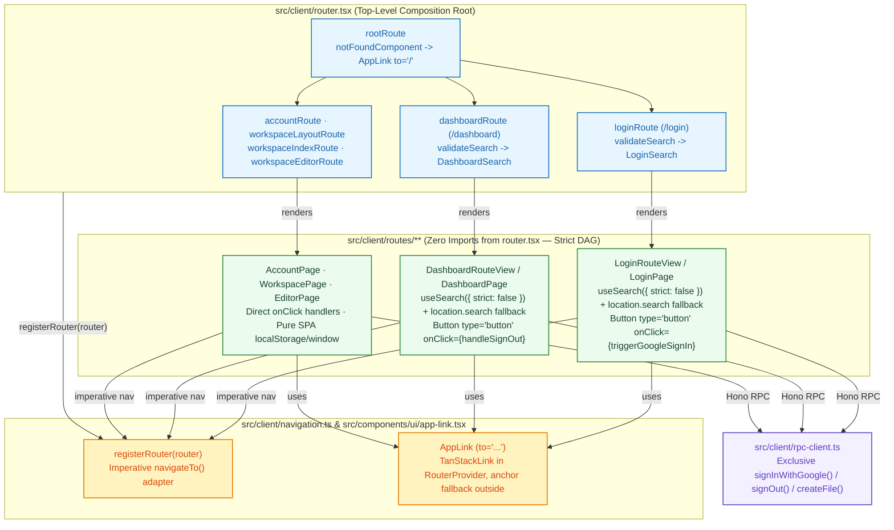

# Phase 3 Closure Dossier: Replace Next.js 15 Async `searchParams`, Form Action Wrappers & SSR Guards with Native TanStack Router & SPA Idioms

| Standard Field | Value |
| :--- | :--- |
| **Phase** | `Phase 3: Replace Next.js 15 Async searchParams, Form Action Wrappers & SSR Guards with Native TanStack Router & SPA Idioms` |
| **Milestone / Version** | `v0.21.0` |
| **Status** | `CLOSED / VERIFIED` ✅ |
| **Closure Date** | `2026-11-14` |
| **Governing Plan** | [`docs/Plans/ELIXENT_NEXTJS_DECOUPLING_AND_CLEAN_ARCHITECTURE_PLAN.md`](../../plans/elixent-nextjs-decoupling-and-clean-architecture-plan.md) (`ELIXENT-NEXTJS-DECOUPLING-CLEAN-ARCH-PLAN-v1.5`) |
| **Associated ADRs** | [`ADR-006: Unified Vite TanStack Hono RPC Architecture`](../../../architecture/adrs/adr_006_unified_vite_tanstack_hono_rpc_architecture.md) (`v1.2`) · [`ADR-007: Dual-Plane Separation & ALS Request Context`](../../../architecture/adrs/adr_007_dual_plane_separation_and_als_request_context.md) (`v1.1`) |
| **SSOT Architecture & Reference Suite** | [`elixent_sync_and_execution_srs.md`](../../../specs/elixent_sync_and_execution_srs.md) · [`04_credit_metering_and_settlement_architecture.md`](../../../architecture/04_credit_metering_and_settlement_architecture.md) · [`ui-streaming-readiness.md`](../../../reference/ui-streaming-readiness.md) |

---

## 1. Executive Summary

Phase 3 completes the frontend SPA and `TanStack Router` idiomatic modernization across `src/client/**` and `src/components/**`, purging all remaining Next.js 15 App Router presentation idioms (`searchParams: Promise<...>`, single-button `<form onSubmit>` action wrappers, `<Link href=...>` attributes, and redundant `typeof window !== "undefined"` SSR guards):

1. **TanStack Router Search Validation, 404 Boundary & DAG Integrity (`Sub-Agent 3.A` — Wave 3.1):**
   - Configured typed `validateSearch` schemas (`LoginSearch` and `DashboardSearch`) on exported `loginRoute` and `dashboardRoute` in `src/client/router.tsx`, sanitizing non-empty strings for `redirectTo` and `session_id` while stripping invalid or non-string values to `undefined`.
   - Configured a root `notFoundComponent` on `rootRoute` in `src/client/router.tsx` rendering a dark-themed recovery view (`Page Not Found` + `<AppLink to="/">Return to Home</AppLink>`).
   - Bound the router singleton via `registerRouter(router)` at module initialization (`src/client/router.tsx`), preserving a strict Directed Acyclic Graph (DAG) in which route views never import route definitions from `router.tsx` (`DEF-13`).
   - Standardized `<Link href={...}>` callers to `<Link to={...}>` in `src/components/files/file-tree-item.tsx` and `src/components/layout/sidebar.tsx`, and updated the JSDoc in `src/components/subscription/upgrade-button.tsx`.
2. **Pure SPA Route Views & Defensive `useSearch` Resolution (`Sub-Agent 3.B` — Wave 3.1):**
   - Eliminated Next.js 15 async `searchParams: Promise<...>` prop handling, state hooks, and `"then" in props.searchParams` effects from `src/client/routes/login-page.tsx` and `src/client/routes/dashboard-page.tsx`, replacing them with synchronous optional props (`redirectTo` / `sessionId` / `searchParams`) and defensive `useSearch({ strict: false })` wrapped in `try / catch` with `window.location.search` fallback inside `LoginRouteView` and `DashboardRouteView`.
   - Replaced all 5 single-button `<form onSubmit>` wrappers with direct `<Button type="button" onClick={...}>` handlers across `login-page.tsx` (Google sign-in), `dashboard-page.tsx` (sign-out), `account-page.tsx` (sign-out), and `workspace-page.tsx` (2 document creation buttons: `New Document` and `Create Document`), while preserving true multi-control interactive forms (`chat-panel.tsx`, `hitl-question-card.tsx`).
   - Eliminated the double sign-out anti-pattern in `dashboard-page.tsx` and `account-page.tsx` by routing sign-out exclusively through the Hono RPC `signOut()` facade and `navigateTo("/")` (dropping redundant `supabase.auth.signOut()` calls in `handleSignOut` and removing unused `createClient` import from `dashboard-page.tsx`).
   - Stripped redundant `typeof window !== "undefined"` SSR guards across `login-page.tsx`, `dashboard-page.tsx`, `account-page.tsx`, and `editor-page.tsx` (including `localStorage` direction preference loading and the 400ms fallback in `handleReturnToWorkspace`), and standardized `<Link href="...">` to `<Link to="...">` across `home-page.tsx`, `login-page.tsx`, `dashboard-page.tsx`, `account-page.tsx`, `workspace-layout.tsx`, and `workspace-page.tsx`.
3. **Client Test Alignment & Wave 3.1 SPA Hardening Suite (`Sub-Agent 3.C` — Wave 3.2):**
   - Isolated router singleton state in `src/test/client/navigation.test.ts` via `registerRouter(null)` and `delete window.__APP_ROUTER__` in `beforeEach`/`afterEach` (`DEF-14`), and added delegation tests for `registerRouter`, `getActiveRouter`, and `{ replace: true }` forwarding.
   - Added unit assertions in `src/test/client/router-tree.test.tsx` covering `getActiveRouter() === router`, nested `/workspace/non-existent-subpath` `notFoundComponent` rendering, and `loginRoute.options.validateSearch` / `dashboardRoute.options.validateSearch` edge cases.
   - Updated `src/test/client/route-views-parity.test.tsx` with `useSearch: () => ({})` mock, button click assertions, synchronous props, and `<Link to=...>` href checks.
   - Updated `src/test/agent/wave-11-2-ui-and-pages.test.tsx` with `useSearch: () => ({})` mock, synchronous `searchParams={{ session_id: "cs_stripe_mock_session_123" }}`, and `Ctrl+Alt+D` direction cycling `localStorage` persistence coverage.
   - Added dedicated integration and edge-case test suite `src/test/client/wave-3-1-spa-hardening.test.tsx` (`+1` suite, `+35` unit tests overall across Phase 3).

---

## 2. TanStack Router DAG & Idiomatic SPA Architecture



---

## 3. Sub-Agent Execution & Verification Matrix

| Task ID | Execution Mode | Scope & Target Files | Implementation Summary | Status |
| :--- | :---: | :--- | :--- | :---: |
| **Sub-Agent 3.A** | `[PARALLEL]` (Wave 3.1) | `src/client/router.tsx`<br>`src/components/files/file-tree-item.tsx`<br>`src/components/layout/sidebar.tsx`<br>`src/components/subscription/upgrade-button.tsx` | Added `LoginSearch` / `DashboardSearch` `validateSearch` on exported `loginRoute` and `dashboardRoute`, configured `rootRoute.notFoundComponent`, exported `workspaceEditorRoute`, bound `registerRouter(router)`, standardized `<Link to=...>`, and updated `upgrade-button.tsx` JSDoc. | **PASS ✅** |
| **Sub-Agent 3.B** | `[PARALLEL]` (Wave 3.1) | `src/client/routes/login-page.tsx`<br>`src/client/routes/dashboard-page.tsx`<br>`src/client/routes/account-page.tsx`<br>`src/client/routes/workspace-page.tsx`<br>`src/client/routes/workspace-layout.tsx`<br>`src/client/routes/home-page.tsx`<br>`src/client/routes/editor-page.tsx` | Removed Next.js 15 `Promise` `searchParams` props, replaced 5 single-button `<form onSubmit>` wrappers with `<Button type="button" onClick=...>`, adopted defensive `useSearch({ strict: false })` + `window.location.search` fallback, removed double `supabase.auth.signOut()`, stripped SSR guards, and standardized `<Link to=...>`. | **PASS ✅** |
| **Sub-Agent 3.C** | `[SEQUENTIAL]` (Wave 3.2) | `src/test/client/wave-3-1-spa-hardening.test.tsx` *(NEW)*<br>`src/test/client/navigation.test.ts`<br>`src/test/client/router-tree.test.tsx`<br>`src/test/client/route-views-parity.test.tsx`<br>`src/test/agent/wave-11-2-ui-and-pages.test.tsx` | Isolated `registerRouter(null)` across tests (`DEF-14`), tested `validateSearch` and `notFoundComponent`, aligned route-view parity and `wave-11-2` mocks/synchronous props, and added `wave-3-1-spa-hardening.test.tsx` covering SPA edge cases. | **PASS ✅** |

---

## 4. Code & Architectural Changes Detailed Audit

### 4.1 `TanStack Router` `validateSearch`, `notFoundComponent`, and DAG Boundary (`DEF-13`)
- **Implementation (`src/client/router.tsx`):**
  - Exported `LoginSearch` (`{ redirectTo?: string }`) and `DashboardSearch` (`{ session_id?: string }`) along with `loginRoute`, `dashboardRoute`, and `workspaceEditorRoute` for unit test verification.
  - `loginRoute.validateSearch` extracts non-empty string `redirectTo` and coerces empty or non-string inputs to `undefined`; `dashboardRoute.validateSearch` enforces the identical contract for `session_id`.
  - `rootRoute.notFoundComponent` renders a fallback 404 screen with `<AppLink to="/">Return to Home</AppLink>`.
  - `registerRouter(router)` executes at the bottom of `src/client/router.tsx` so `navigateTo()` in `src/client/navigation.ts` dispatches via the active TanStack Router instance instead of raw History API fallbacks when mounted.
- **DAG Invariant:** Route views (`login-page.tsx`, `dashboard-page.tsx`, etc.) do not import route objects from `router.tsx`, preventing circular ESM initialization deadlocks.

### 4.2 Elimination of Next.js 15 Async `searchParams` & Defensive `useSearch` Resolution
- **Before:** `LoginPage` and `DashboardPage` accepted `searchParams?: Promise<...> | { ... }`, used `useState` + `useEffect` with `"then" in props.searchParams`, and `LoginRouteView` / `DashboardRouteView` parsed `window.location.search` directly.
- **After:**
  - `LoginPage` accepts synchronous `props?: { redirectTo?: string; searchParams?: { redirectTo?: string } }`.
  - `DashboardPage` accepts synchronous `props?: { sessionId?: string; searchParams?: { session_id?: string } }`.
  - `LoginRouteView` and `DashboardRouteView` invoke `useSearch({ strict: false })` inside a `try / catch` block, falling back to `Object.fromEntries(new URLSearchParams(window.location.search))` when rendered standalone outside `RouterProvider` in isolated unit tests.

### 4.3 Replacement of 5 Single-Button `<form>` Wrappers & Exclusive RPC Sign-Out
- Replaced `<form onSubmit>` wrappers with direct `<Button type="button" onClick={...}>` handlers across:
  1. `src/client/routes/login-page.tsx`: Google OAuth button (`onClick={triggerGoogleSignIn}`).
  2. `src/client/routes/dashboard-page.tsx`: Header sign-out icon button (`onClick={handleSignOut}`).
  3. `src/client/routes/account-page.tsx`: Header sign-out button (`onClick={handleSignOut}`).
  4. `src/client/routes/workspace-page.tsx`: Header `New Document` button (`onClick={triggerCreateDocument}`).
  5. `src/client/routes/workspace-page.tsx`: Empty-state `Create Document` button (`onClick={triggerCreateDocument}`).
- `handleSignOut` in `dashboard-page.tsx` and `account-page.tsx` calls Hono RPC `signOut()` exclusively and delegates to `navigateTo("/")`, eliminating redundant client-side `supabase.auth.signOut()` calls.
- Multi-control interactive forms (`src/components/agent/chat-panel.tsx`, `src/components/agent/hitl-question-card.tsx`) were left untouched.

### 4.4 Redundant SSR Guard Removal & `AppLink` `to` Standardization
- Removed redundant `typeof window !== "undefined"` checks in `login-page.tsx`, `dashboard-page.tsx`, `account-page.tsx`, and `editor-page.tsx` (specifically around `localStorage.getItem("lugx_editor_direction_pref")` and the 400ms fallback in `handleReturnToWorkspace`), along with stale `/ SSR` comments.
- Standardized `<Link href=...>` attributes to `<Link to=...>` across `home-page.tsx`, `login-page.tsx`, `dashboard-page.tsx`, `account-page.tsx`, `workspace-layout.tsx`, `workspace-page.tsx`, `sidebar.tsx`, and `file-tree-item.tsx`.

---

## 5. Test Gate & SSOT Metrics Verification Baseline

All static checks, build pipelines, unit/contract suites, and targeted Playwright E2E smoke checks passed with 100% green exit codes:

```bash
# 1. Static TypeScript Verification (0 errors)
npx tsc --noEmit

# 2. ESLint Verification (0 errors)
npm run lint

# 3. Production Build (vite build + esbuild -> dist/server/index.mjs 479.2kb)
npm run build

# 4. Targeted Client, UI, Files & Agent Page Suites (16 files, 295 tests passing)
npx vitest run src/test/client src/test/ui src/test/files src/test/agent/wave-11-2-ui-and-pages.test.tsx src/test/agent/wave-11-1-ui-and-sync.test.tsx

# 5. Full In-Memory Unit & Contract Suite (146 files, 3,007 tests passing)
npm run test

# 6. Playwright E2E Auth Session Smoke Verification (1 passed [chromium])
npx playwright test e2e/specs/01-auth-session.spec.ts

# 7. Canonical Metrics & Markdown Links Integrity Gate
node scripts/sync-doc-metrics.mjs --check
node scripts/check-markdown-links.mjs
```

### Verified Metrics Delta (`v0.20.6` → `v0.21.0`)

| Metric Dimension | Prior Baseline (`v0.20.6`) | Phase 3 Baseline (`v0.21.0`) | Delta / Notes |
| :--- | :---: | :---: | :--- |
| **Unit & Contract Suites** | 145 | **146** | **`+1` suite** (`src/test/client/wave-3-1-spa-hardening.test.tsx`) |
| **Unit & Contract Tests** | 2,972 | **3,007** | **`+35` tests** covering `validateSearch`, `notFoundComponent`, `registerRouter`, defensive `useSearch`, direct button handlers, and SSR guard removal |
| **Live Database Suites** | 21 | **21** | Unchanged SSOT baseline (isolated Neon PostgreSQL branch) |
| **Live Database Tests** | 105 | **105** | Unchanged SSOT baseline |
| **Playwright E2E Specs / Journeys** | 14 / 15 | **14 / 15** | Smoke verified via `e2e/specs/01-auth-session.spec.ts` (`1 passed [chromium]`) |
| **TypeScript Type Errors** | 0 | **0** | Verified via `npx tsc --noEmit` |
| **ESLint Errors** | 0 | **0** | Verified via `npm run lint` |
| **Production Build** | Green | **Green** | `vite build` + `esbuild` -> `dist/server/index.mjs` (`479.2kb`) |

---

## 6. Phase Closure Verdict

**VERDICT: CLOSED / VERIFIED ✅ (`v0.21.0`)**

Phase 3 has completed all Single Responsibility Principle deliverables under `ELIXENT_NEXTJS_DECOUPLING_AND_CLEAN_ARCHITECTURE_PLAN.md`:
- `TanStack Router` in `src/client/router.tsx` enforces `validateSearch`, `notFoundComponent`, and `registerRouter(router)` without circular route-view dependencies (`DEF-13`).
- Next.js 15 async `searchParams` Promises, 5 single-button `<form onSubmit>` wrappers, redundant `supabase.auth.signOut()` calls, `<Link href=...>` attributes, and redundant SSR `typeof window !== "undefined"` guards are purged from `src/client/**` and `src/components/**`.
- All `146` unit/contract suites (`3,007` tests), TypeScript check, ESLint, production build, and Playwright auth smoke verification pass `100%` green.
- The repository is ready to proceed into **Phase 4: Align Living Architecture Specs, Subsystem Docs, Guides & Technical Debt Register**.
